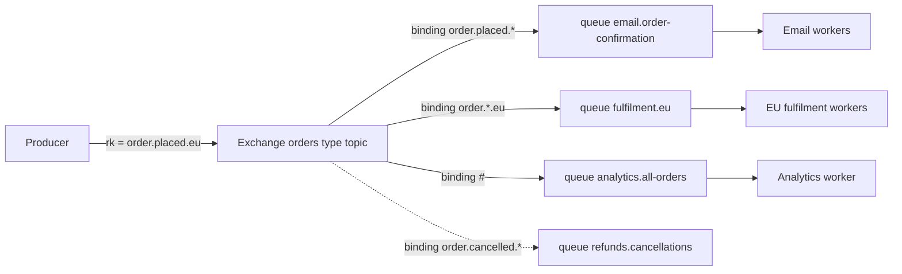
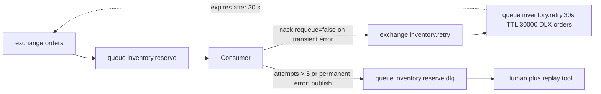

## 17.4 RabbitMQ in depth

RabbitMQ is a message broker in the classic sense: producers publish to exchanges, exchanges route to queues by rules, consumers take messages from queues and acknowledge them, and the broker deletes acknowledged messages. It is optimized for routing flexibility and per-message control rather than for retained logs, and that makes it the better tool for a large class of backend work.

### 17.4.1 Exchanges, queues, bindings and routing keys

#### Concept

A producer never publishes to a queue directly. It publishes to an **exchange** with a **routing key**. The exchange looks at its **bindings** (rules linking it to queues) and copies the message into every queue whose binding matches. Consumers subscribe to queues.

#### Why does it exist?

Separating "where the producer sends" from "where the consumer reads" is what makes fan-out, filtering and topology changes possible without touching code. Add a new queue bound to the same exchange and a new consumer receives the messages; change a binding pattern and a queue starts or stops receiving a category, all at runtime.

#### Mental model

Imagine a mail room. Senders drop letters in a slot labelled by exchange, with a code written on the envelope (the routing key). The mail room has a rule book (bindings): "envelopes coded `order.*.eu` go to the EU fulfilment tray and to the analytics tray". Trays are queues; the clerks emptying them are consumers. Senders never know which trays exist.

#### How it works



The four exchange types:

| Type | Routing rule | Use |
|---|---|---|
| `direct` | Routing key equals the binding key exactly | Work queues: `thumbnail.generate` to the thumbnail queue |
| `topic` | Dot-separated key matched against patterns; `*` matches one word, `#` matches zero or more | Event routing: `order.placed.eu` to `order.placed.*` and `order.*.eu` and `#` |
| `fanout` | Ignores the key; every bound queue gets a copy | Broadcast: cache invalidation, "everything to the audit log" |
| `headers` | Match on message header values instead of the key (`x-match: all` or `any`) | Rare; routing by content type or tenant when keys are not enough |

Queues have properties that decide their behaviour: `durable` (survives broker restart; the messages inside also need `persistent` delivery mode to survive), `exclusive` (one connection, deleted when it closes; for RPC reply queues), `auto-delete`, `x-message-ttl`, `x-max-length`, `x-dead-letter-exchange`, `x-max-priority`, `x-queue-type` (`classic` or `quorum`).

### 17.4.2 Acknowledgements, prefetch and fairness

#### Concept

A consumer receives a message and, when finished, sends `ack`. Until then the message is "unacked" and belongs to that consumer. `nack` or `reject` returns it, with a `requeue` flag deciding whether it goes back to the queue (to be redelivered, possibly to the same consumer immediately) or is dead-lettered or dropped. If the consumer's connection dies, every unacked message it held is requeued automatically.

**Prefetch** (`basic.qos` with `prefetch_count`) caps how many unacked messages the broker will push to one consumer. Without it, the broker pushes everything in the queue to the first consumer that connects, which then holds 50,000 messages while the other nine consumers idle.

#### How it works

1. Consumer sets `prefetch(10)`.
2. Broker delivers up to 10 messages; then waits for acks before sending more.
3. Consumer processes one, acks it, receives one more. A slow consumer naturally takes less; a fast one takes more. This is fair dispatch.
4. `nack(msg, allUpTo=false, requeue=false)` sends the message to the queue's dead-letter exchange if one is configured, or drops it. `requeue=true` puts it back at the head of the queue: an immediate retry that, for a permanently failing message, becomes a tight loop at the front of the queue starving everything behind it.

Prefetch guidance: 1 for long tasks where fairness matters most (video transcoding), 10 to 50 for short tasks (sending emails), higher only when the handler is sub-millisecond. A prefetch that is too high also means a crashed consumer requeues a large batch, which is a burst of duplicates for whoever gets them next.

### 17.4.3 TTL, dead-letter exchanges and delayed retries

#### Concept

RabbitMQ has no built-in "retry in 30 seconds" operation. The standard construction uses two features: a per-queue **message TTL** (`x-message-ttl`) after which a message expires, and a **dead-letter exchange** (`x-dead-letter-exchange`) to which expired or rejected messages are republished. A "wait queue" with a TTL and a DLX pointing back at the main exchange is a delay line.

#### How it works



1. The main queue `inventory.reserve` is declared with `x-dead-letter-exchange: inventory.retry`.
2. On a transient failure the consumer `nack`s with `requeue=false`. The broker moves the message to the `inventory.retry` exchange, which routes to `inventory.retry.30s`.
3. That queue has `x-message-ttl: 30000` and `x-dead-letter-exchange: orders` with the original routing key preserved. After 30 seconds the message expires and is republished to `orders`, arriving back in `inventory.reserve`.
4. The `x-death` header (appended by the broker on every dead-lettering) carries a `count`. The consumer reads it to know the attempt number. After the budget, the consumer publishes the message to a DLQ explicitly and acks the original.
5. For exponential backoff, use several wait queues (`30s`, `2m`, `10m`) and pick by attempt number, or the `rabbitmq_delayed_message_exchange` plugin, which accepts an `x-delay` header per message.

TTL queues have a subtlety: expiry is checked only at the head of the queue. If a 10 minute message is in front of a 30 second message, the 30 second message waits 10 minutes. One queue per delay value avoids it.

#### NestJS example

A consumer on the `@nestjs/microservices` RMQ transport with manual acks, retry counting and dead-lettering. The transport hides the channel behind `RmqContext`, and you must set `noAck: false` in the options or every message is auto-acked on receipt.

```ts
// main.ts (worker)
const app = await NestFactory.createMicroservice<MicroserviceOptions>(WorkerModule, {
  transport: Transport.RMQ,
  options: {
    urls: [process.env.AMQP_URL!],
    queue: 'inventory.reserve',
    prefetchCount: 10,
    noAck: false,                                            // we ack manually
    queueOptions: {
      durable: true,
      arguments: { 'x-queue-type': 'quorum', 'x-dead-letter-exchange': 'inventory.retry' },
    },
  },
});
app.enableShutdownHooks();
await app.listen();
```

```ts
// inventory/reserve-stock.controller.ts
import { Controller, Logger } from '@nestjs/common';
import { Ctx, EventPattern, Payload, RmqContext } from '@nestjs/microservices';
import { ChannelWrapper } from 'amqp-connection-manager';
import { InventoryService } from './inventory.service';
import { classifyError } from '../messaging/error-classifier';

const MAX_ATTEMPTS = 5;

@Controller()
export class ReserveStockController {
  private readonly logger = new Logger(ReserveStockController.name);
  constructor(private readonly inventory: InventoryService) {}

  @EventPattern('reserve-stock')
  async handle(@Payload() cmd: ReserveStockCommand, @Ctx() ctx: RmqContext): Promise<void> {
    const channel = ctx.getChannelRef();
    const msg = ctx.getMessage();
    const deaths = (msg.properties.headers?.['x-death'] as { count: number }[] | undefined) ?? [];
    const attempt = (deaths[0]?.count ?? 0) + 1;

    try {
      await this.inventory.reserve(cmd);                       // idempotent on cmd.messageId
      channel.ack(msg);
    } catch (err) {
      const kind = classifyError(err);                         // transient | permanent | poison
      if (kind === 'transient' && attempt < MAX_ATTEMPTS) {
        this.logger.warn(`attempt ${attempt} failed for ${cmd.messageId}: ${(err as Error).message}`);
        channel.nack(msg, false, false);                       // to DLX -> retry wait queue -> back here
        return;
      }
      await this.inventory.deadLetter(cmd, msg.properties.headers ?? {}, attempt, err as Error);
      channel.ack(msg);                                        // parked; remove from main queue
    }
  }
}
```

### 17.4.4 Quorum queues, publisher confirms and priorities

#### How it works

- **Classic queues** are the original single-node queue type. Their mirrored (HA) mode is deprecated. Use them only for transient, non-replicated work such as RPC reply queues.
- **Quorum queues** replicate each queue across a majority of nodes using Raft. A message is confirmed only after a quorum has it. They survive node loss, support `x-delivery-limit` (after N redeliveries the message is dead-lettered by the broker itself, which kills poison loops), and are the default choice for anything durable.
- **Streams** (RabbitMQ 3.9 and later) are an append-only, replayable log type inside RabbitMQ, for the cases where you want Kafka-like retention without Kafka. Consumed with a different protocol and client.
- **Publisher confirms**: on a confirm channel, the broker acknowledges each publish once it has been persisted (and, for quorum queues, replicated). Without confirms, `publish()` returns as soon as the bytes hit the socket and a broker crash loses the message silently. Use the `mandatory` flag with a `return` listener to catch messages that matched no binding.
- **Priority queues** (`x-max-priority: 10`): higher-priority messages are delivered first. Useful for "VIP tenant jobs first"; costly if the queue is deep, and never a substitute for capacity.

```ts
// messaging/rabbit-publisher.service.ts (amqplib with confirms)
import { Injectable, OnModuleDestroy, OnModuleInit } from '@nestjs/common';
import amqp, { ChannelModel, ConfirmChannel } from 'amqplib';
import { randomUUID } from 'node:crypto';

@Injectable()
export class RabbitPublisher implements OnModuleInit, OnModuleDestroy {
  private conn!: ChannelModel;
  private ch!: ConfirmChannel;

  async onModuleInit(): Promise<void> {
    this.conn = await amqp.connect(process.env.AMQP_URL!, { heartbeat: 30 });
    this.ch = await this.conn.createConfirmChannel();
    await this.ch.assertExchange('orders', 'topic', { durable: true });
    this.ch.on('return', (msg) => {
      // mandatory publish that matched no queue: this is a topology bug, not a transient error
      console.error(`unroutable message ${msg.properties.messageId} rk=${msg.fields.routingKey}`);
    });
  }

  async onModuleDestroy(): Promise<void> { await this.ch.close(); await this.conn.close(); }

  publish(routingKey: string, body: object, headers: Record<string, string> = {}): Promise<void> {
    return new Promise((resolve, reject) => {
      this.ch.publish('orders', routingKey, Buffer.from(JSON.stringify(body)), {
        persistent: true,                  // survive broker restart (with a durable queue)
        contentType: 'application/json',
        messageId: (body as { id?: string }).id ?? randomUUID(),
        timestamp: Math.floor(Date.now() / 1000),
        headers,
        mandatory: true,
      }, (err) => (err ? reject(err) : resolve()));  // resolves when the broker confirms
    });
  }
}
```

### 17.4.5 When RabbitMQ shines

#### How a Senior Backend Engineer thinks about this

RabbitMQ is the right tool for **task queues** (each message is a unit of work for one worker, acked when done, with fair dispatch and priorities), **RPC-style request/reply** (a `replyTo` queue and a `correlationId`, for services that need a synchronous answer through an async channel), **complex routing** (route by pattern, header or tenant without consumer-side filtering), and **per-message TTL and delayed delivery**. It has a first-class management UI, per-queue metrics, and a mental model most engineers pick up in a day. It does not retain messages after ack, so replay is not a feature; it does not scale one queue across nodes the way partitions do (throughput per queue tops out in the low tens of thousands of messages per second); and deep queues (millions of messages) degrade it, because it is designed for messages to flow, not to sit.

#### Failure scenario

At 02:14 on-call sees `email.order-confirmation` at 2.3 million messages and the RabbitMQ node at 95 percent memory, with the memory alarm blocking all publishers, which means the orders API is now failing to publish and returning 500s. The email provider has been returning 503 for three hours; the consumer nacks with `requeue=true`, so each message goes straight back to the head of the queue and is redelivered immediately, thousands of times per second, generating log volume that also fills the disk. The fix: nack to a retry wait queue with backoff instead of requeue, `x-max-length` on the queue with `overflow: reject-publish` so a backlog cannot take the broker down, and a publisher that treats a blocked connection as "write to the outbox and move on". The email backlog itself was fine to keep; the retry loop and the unbounded queue were the incident.

#### Edge cases & failure modes

- `noAck: true` (auto-ack) in the NestJS transport: a crash loses every in-flight message.
- `requeue=true` on permanent failures: a hot loop at the head of the queue.
- Missing prefetch: one consumer hoards the queue.
- Non-durable queue or non-persistent messages: everything vanishes on broker restart.
- Publishing without confirms: messages lost during a broker failover with no error in the producer.
- A consumer that acks before processing: at-most-once by accident.
- Connection-level memory or disk alarm: all publishers on the node are blocked; producers appear to hang rather than error.

## 17.5 SQS and SNS

### 17.5.1 SQS standard and FIFO queues

#### Concept

SQS is a fully managed queue: no brokers, no partitions, no connections to keep alive, just HTTPS calls to send, receive and delete. A **standard** queue offers nearly unlimited throughput with at-least-once delivery and best-effort ordering. A **FIFO** queue offers strict ordering within a **message group** and de-duplication within a 5 minute window, at a throughput of roughly 300 messages per second per group (3,000 with batching; higher with high-throughput mode).

#### How it works

- **Message group id** (FIFO only): messages with the same group id are delivered in order, one batch at a time; different groups are processed in parallel. It is the SQS equivalent of a Kafka key. Use `orderId` or `userId`.
- **Deduplication id** (FIFO only): a message with the same dedup id as one accepted in the last 5 minutes is dropped. Content-based deduplication uses a hash of the body instead. This removes producer-retry duplicates, not consumer-side duplicates.
- **Size** is capped at 256 KB; larger payloads go to S3 with a pointer (the extended client library does this).
- **Retention** is 4 days by default, 14 days maximum. Unprocessed messages older than that are deleted.

### 17.5.2 Visibility timeout as the lock

#### Concept

When a consumer receives a message, SQS does not delete it. It hides it from other consumers for the **visibility timeout** (default 30 seconds, maximum 12 hours). The consumer must delete the message before the timeout expires; if it does not, the message becomes visible again and another consumer receives it. The visibility timeout is a lease, and the delete is the acknowledgement.

#### How it works

```mermaid
sequenceDiagram
    participant Q as SQS queue
    participant W1 as Worker 1
    participant W2 as Worker 2
    W1->>Q: ReceiveMessage (WaitTimeSeconds 20)
    Q-->>W1: message m1, hidden for 30 s
    W1->>W1: processing takes 45 s (slow database)
    Note over Q: 30 s elapsed: m1 visible again
    W2->>Q: ReceiveMessage
    Q-->>W2: message m1 again (ReceiveCount 2)
    W1->>Q: DeleteMessage m1 (succeeds, receipt still valid)
    W2->>W2: processes m1 a second time
    W2->>Q: DeleteMessage m1 (no error; already gone)
```

The rules that follow:

1. Set the visibility timeout above the handler's p99, with margin; for variable work, call `ChangeMessageVisibility` periodically to extend the lease (a heartbeat).
2. **Long polling** (`WaitTimeSeconds` up to 20) makes `ReceiveMessage` wait for messages instead of returning empty immediately. Always use it; short polling costs money and returns empty responses on a distributed queue even when messages exist.
3. `MaxNumberOfMessages` up to 10 per receive; delete in batches with `DeleteMessageBatch`.
4. **Redrive policy**: after `maxReceiveCount` receives without a delete, SQS moves the message to a dead-letter queue. `ApproximateReceiveCount` is the attempt number. A DLQ redrive back to the source queue is available in the console and API for replay.
5. A message received but not deleted within the timeout is the SQS duplicate path (17.8).

#### NestJS example

A polling consumer as a NestJS provider using the AWS SDK v3. There is no official NestJS transport for SQS; the loop below is what the community packages wrap.

```ts
// messaging/sqs-consumer.service.ts
import { Injectable, Logger, OnModuleDestroy, OnModuleInit } from '@nestjs/common';
import { SQSClient, ReceiveMessageCommand, DeleteMessageCommand, ChangeMessageVisibilityCommand, Message } from '@aws-sdk/client-sqs';

@Injectable()
export class SqsConsumerService implements OnModuleInit, OnModuleDestroy {
  private readonly logger = new Logger(SqsConsumerService.name);
  private readonly sqs = new SQSClient({ region: process.env.AWS_REGION });
  private readonly queueUrl = process.env.SQS_QUEUE_URL!;
  private running = true;
  private loop?: Promise<void>;

  constructor(private readonly handler: { handle(body: unknown, attempt: number): Promise<void> }) {}

  onModuleInit(): void { this.loop = this.run(); }
  async onModuleDestroy(): Promise<void> { this.running = false; await this.loop; }

  private async run(): Promise<void> {
    while (this.running) {
      const res = await this.sqs.send(new ReceiveMessageCommand({
        QueueUrl: this.queueUrl,
        MaxNumberOfMessages: 10,
        WaitTimeSeconds: 20,               // long polling
        VisibilityTimeout: 60,
        AttributeNames: ['ApproximateReceiveCount'],
      }));
      for (const msg of res.Messages ?? []) await this.process(msg);
    }
  }

  private async process(msg: Message): Promise<void> {
    const attempt = Number(msg.Attributes?.ApproximateReceiveCount ?? '1');
    const heartbeat = setInterval(() => {
      this.sqs.send(new ChangeMessageVisibilityCommand({ QueueUrl: this.queueUrl, ReceiptHandle: msg.ReceiptHandle!, VisibilityTimeout: 60 }))
        .catch((err) => this.logger.warn(`extend visibility failed: ${err.message}`));
    }, 40_000);                            // extend before the 60 s lease expires
    try {
      await this.handler.handle(JSON.parse(msg.Body ?? '{}'), attempt);  // idempotent
      await this.sqs.send(new DeleteMessageCommand({ QueueUrl: this.queueUrl, ReceiptHandle: msg.ReceiptHandle! }));
    } catch (err) {
      // Do nothing: the message becomes visible again after the timeout; redrive policy moves it to the DLQ after maxReceiveCount.
      this.logger.warn(`attempt ${attempt} failed for ${msg.MessageId}: ${(err as Error).message}`);
    } finally {
      clearInterval(heartbeat);
    }
  }
}
```

### 17.5.3 SNS fan-out

#### Concept

SNS is a topic service: publish once, deliver to every subscription (SQS queues, Lambda functions, HTTP endpoints, email). The standard AWS pattern is **SNS to SQS fan-out**: one topic, one queue per consuming service, so each service has its own buffer, retry policy and DLQ while the producer publishes once.

#### How it works

1. The producer publishes `OrderPlaced` to the `orders-events` SNS topic with message attributes (`eventType`, `region`).
2. Each consuming service owns an SQS queue subscribed to the topic. A **filter policy** on the subscription (`{"eventType": ["OrderPlaced", "OrderCancelled"]}`) delivers only matching messages, so consumers do not discard what they do not need.
3. **Raw message delivery** on the subscription puts the payload directly in the SQS body rather than wrapping it in an SNS envelope.
4. SNS delivery to SQS is at-least-once with its own retries; the queue provides the buffering and the consumer's redrive policy provides the DLQ.
5. FIFO SNS topics fan out to FIFO SQS queues preserving message group ordering.

EventBridge is the other AWS option, with richer routing rules, schema registry and archive/replay; for simple fan-out SNS to SQS is cheaper and simpler.

#### Production scenario

A marketplace on AWS publishes 800 order events per minute to an SNS topic with five SQS subscribers. Cost: well under 100 dollars a month for the messaging itself. Operational load: zero brokers, IAM policies per queue, CloudWatch alarms on `ApproximateNumberOfMessagesVisible` (backlog) and `ApproximateAgeOfOldestMessage` (lag in seconds) per queue, and one DLQ per queue with an alarm on depth greater than zero. The team never thinks about partitions or rebalancing. What they cannot do is replay last Tuesday's events into a new consumer; when that requirement arrived, they added an S3 archive subscriber to the topic and replayed from S3.

#### Edge cases & failure modes

- Visibility timeout shorter than processing: guaranteed duplicates under load.
- Deleting with a stale receipt handle after the timeout expired: the delete succeeds silently in most cases, but the message may already have been received by another consumer.
- FIFO dedup window of 5 minutes: a producer retry after 6 minutes creates a duplicate; the dedup id does nothing for consumer-side redelivery.
- FIFO group throughput: one huge message group (`tenantId` of a giant tenant) serializes that tenant to 300 messages per second.
- 256 KB limit: a payload with an embedded PDF fails at send time with `InvalidParameterValue`.
- Standard queue "best-effort ordering": occasionally out of order even with a single producer; never rely on order from a standard queue.
- Retention of 4 days: a consumer down over a long weekend loses messages; raise retention to 14 days on business queues.

## 17.6 Kafka versus RabbitMQ versus SQS

### 17.6.1 Comparison table

| Dimension | Kafka | RabbitMQ | SQS / SNS |
|---|---|---|---|
| Model | Partitioned, retained log; consumers pull by offset | Exchanges route to queues; broker pushes to consumers; deleted on ack | Managed queue (SQS) and topic (SNS); consumers poll over HTTPS |
| Ordering | Per partition, by key | Per queue with one consumer; lost with parallel consumers or requeue | FIFO: per message group; standard: best effort |
| Throughput | Millions of msgs/s per cluster; 10 to 20 MB/s per partition | Tens of thousands msgs/s per node; per-queue ceiling | Standard: effectively unlimited; FIFO: 300 to 3,000 msgs/s per group |
| Retention and replay | Days to forever; replay by resetting offsets; compaction for state | None after ack; RabbitMQ Streams add a log type | 4 to 14 days; no replay except DLQ redrive; archive to S3 yourself |
| Routing | By topic and key only; consumers filter | Rich: direct, topic patterns, fanout, headers, bindings changed at runtime | SNS filter policies on attributes; otherwise one queue per consumer |
| Delayed messages | Not native; retry topics with delayed consumers, or a scheduler | TTL plus DLX wait queues, or the delayed-exchange plugin | Per-message `DelaySeconds` up to 15 min; visibility timeout for retries |
| Consumer model | Consumer groups; one consumer per partition; rebalancing | Competing consumers with prefetch; any number per queue | Competing consumers polling; visibility timeout as the lease |
| Duplicates | At-least-once; idempotent producer removes producer retries; EOS within Kafka | At-least-once; redelivery on nack or connection loss | At-least-once; FIFO dedups producer retries for 5 min |
| Dead letters | Build it: DLQ topic plus consumer logic | Native DLX; quorum `x-delivery-limit` | Native redrive policy with `maxReceiveCount`; redrive back |
| Operational cost | High self-hosted (brokers, ZooKeeper or KRaft, partitions, lag tooling); managed via MSK, Confluent, Redpanda | Moderate; single node is easy, clusters and quorum queues need care; managed via Amazon MQ, CloudAMQP | Near zero; IAM and CloudWatch alarms |
| Client complexity | High: keys, commits, rebalances, heartbeats | Low to moderate: channels, acks, prefetch, confirms | Low: three API calls |
| Best fit | Event streaming, CDC, event sourcing, high fan-out, replay, analytics pipelines | Task queues, RPC, complex routing, delayed work, moderate volumes | AWS-native services, simple decoupling, serverless consumers, elastic burst absorption |

### 17.6.2 Decision table: which broker for which job

| Job | Choose | Why |
|---|---|---|
| Order events consumed by 6 services, replayable for a new analytics consumer | Kafka | Fan-out with independent groups, retention, replay |
| Thumbnail generation, PDF rendering, email sending | RabbitMQ (or BullMQ on Redis) | Task queue semantics, fair dispatch, priorities, native DLX |
| Change data capture from PostgreSQL into search and cache | Kafka (Debezium) | Log semantics, compaction, ordered per key |
| Fan-out on AWS to Lambda and a few SQS consumers, low ops budget | SNS to SQS | Managed, cheap, alarms built in |
| Request/reply between services that must stay decoupled | RabbitMQ RPC (`replyTo`, `correlationId`) | Native pattern; Kafka is awkward for it |
| Ledger events needing strict per-account order at 50,000 msgs/s | Kafka, keyed by `accountId` | Per-partition ordering at scale |
| Strict order per customer at 200 msgs/s on AWS | SQS FIFO with `MessageGroupId` | Ordering without operating anything |
| Retry in 5 minutes, then 30 minutes, then park | RabbitMQ TTL plus DLX, or SQS visibility and redrive | Native delay mechanisms |
| One service, one background job type, Redis already present | BullMQ | No new infrastructure |
| Audit log kept for a year and queryable by time | Kafka with long retention plus an S3 sink, or just PostgreSQL | Retention is a Kafka strength; but a database may be the simplest answer |

#### How a Senior Backend Engineer thinks about this

The senior does not ask "Kafka or RabbitMQ"; they ask "what are the messages for". Work to be done once by someone: a queue, and RabbitMQ or SQS or BullMQ depending on what the team already runs. Facts that several parties react to, possibly later, possibly again: a log, and Kafka. Both needs in one system are common; a company often runs Kafka for events and RabbitMQ or SQS for tasks, and that is fine. What they refuse to do is adopt Kafka because it is on the conference circuit, or run three brokers because three teams each chose their own.

#### Interview questions

1. **Prefetch of 1 versus 50: what changes?** Expected: fairness and duplicate burst on crash versus throughput; long tasks want low prefetch.
2. **How do you implement "retry after 2 minutes" in RabbitMQ without a plugin?** Expected: wait queue with `x-message-ttl` and a DLX back to the main exchange; one queue per delay.
3. **Explain the SQS visibility timeout and its failure mode.** Expected: a lease; processing longer than the lease causes redelivery and duplicates; extend with `ChangeMessageVisibility`.
4. **Why does SQS FIFO dedup not solve consumer idempotency?** Expected: it removes duplicate sends within 5 minutes; redelivery after a missed delete is a different path.
5. **What can Kafka do that RabbitMQ cannot, and vice versa?** Expected: retention and replay, per-partition scale versus routing flexibility, native delays and DLX, RPC.
6. **When is a broker the wrong answer entirely?** Expected: single service, low volume, Redis or PostgreSQL job table suffices; a broker adds a failure domain.

#### Practical exercise

Implement the same "send order confirmation email with retries" consumer twice: once on RabbitMQ with a 30 second and a 5 minute wait queue and a DLQ, once on SQS with a visibility timeout and a redrive policy of 5. Acceptance criteria: (a) a simulated email provider that fails 50 percent of the time results in every email eventually sent exactly once (verified by a unique constraint on `(order_id, template)` in PostgreSQL); (b) a permanently invalid address lands in the DLQ within one attempt with a readable error header; (c) killing the worker mid-send produces a redelivery that the idempotency check absorbs; (d) a one-page comparison of what you had to build yourself in each case.
