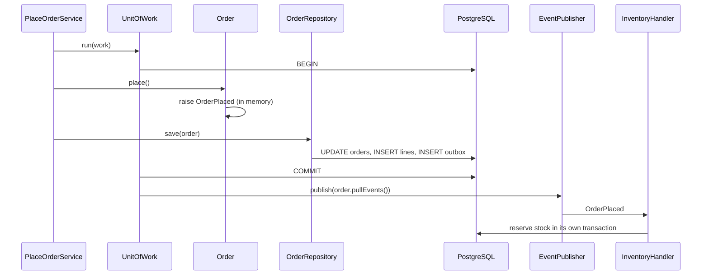

## 17.7 Repositories

#### Concept

A **repository** is an object that gives the domain the illusion of an in-memory collection of aggregates. `orders.findById(id)` returns a fully-formed `Order`; `orders.save(order)` persists whatever changed. The domain code never sees SQL, TypeORM entities or Sequelize models.

There is **one repository per aggregate root**. There is no `OrderLineRepository`, because order lines are only reachable through `Order`.

The repository **interface** lives in the domain layer (it is part of the domain's vocabulary: "find an order by id"). The **implementation** lives in the infrastructure layer and uses TypeORM, Sequelize or raw SQL.

#### Why does it exist?

Without a repository, persistence leaks into every use case: application services build query builders, know about join tables, and call `save()` on child entities. Tests of business logic then require a database. And the aggregate boundary evaporates, because any service can `UPDATE order_lines` directly.

A repository does three jobs: (1) hide persistence so the domain and application layers are testable with an in-memory fake; (2) enforce that only roots are loaded and saved; (3) centralise the mapping between the persistence shape and the domain shape.

#### Mental model

Imagine a librarian. You ask for "the book with ISBN X" and get a book. You hand back a book and it gets shelved. You do not know or care whether the library uses shelves, boxes or a warehouse across town. And the librarian will not hand you a single chapter torn out of a book; you get the whole book or nothing.

#### How it works

Two ways to build the implementation. Both are used in real production systems; the choice is a tradeoff, not a moral question.

**Approach A: rich entity = ORM entity (pragmatic).** The TypeORM entity *is* the domain class. Decorators live on it, behaviour methods live on it, and the repository is nearly a pass-through.

**Approach B: separate domain model + mapper (pure).** A plain TypeScript domain class with no decorators; a separate ORM entity class; a mapper that converts between them in both directions.

| | A: ORM entity is the domain class | B: Separate domain model + mapper |
|---|---|---|
| Code volume | Low: one class per concept | High: two classes plus a mapper per aggregate |
| Framework coupling | Domain depends on TypeORM decorators | Domain is pure TypeScript; only infrastructure imports TypeORM |
| Constructor control | Weak: TypeORM needs a no-arg constructor, so invalid instances are creatable | Strong: private constructors and factories |
| Value objects | Awkward (embedded columns, transformers, `bigint` as string) | Natural: mapper converts |
| Lazy loading / proxies | Tempting and dangerous inside domain logic | Impossible; you load what the repository loads |
| Unit testing the domain | Works, but the class drags decorators and metadata | Trivial: `new Order(...)`, no ORM in the test |
| Schema drift | Domain shape follows the table | Table and domain can evolve separately |
| Best for | Supporting subdomains, small teams, CRUD-plus-rules | Core subdomains with real invariants and long lifetimes |

A common and sensible middle: Approach A for supporting contexts (Customer, Shipping), Approach B for the core (Ordering, Inventory).

#### Practical example

The repository interface, in the domain layer. Note that it speaks in domain types only.

```ts
// src/ordering/domain/order.repository.ts
import { Order } from './order';

export const ORDER_REPOSITORY = Symbol('ORDER_REPOSITORY');

export interface OrderRepository {
  /** Returns null if not found. Never throws for "not found". */
  findById(id: string): Promise<Order | null>;

  /** Same, but takes a row lock so that the caller's transaction serialises writers. */
  findByIdForUpdate(id: string): Promise<Order | null>;

  /** Insert or update the whole aggregate. Throws ConcurrencyError on version mismatch. */
  save(order: Order): Promise<void>;

  /** Used for idempotent creation (see Part 18 — API Design, Idempotency). */
  findByIdempotencyKey(customerId: string, key: string): Promise<Order | null>;
}
```

#### TypeORM example

**Approach B**, the mapper and the repository. The mapper is the only place that knows both shapes. `bigint` columns come back as strings from `pg`, so the mapper converts to `BigInt`.

```ts
// src/ordering/infrastructure/order.mapper.ts
import { Order } from '../domain/order';
import { OrderLine } from '../domain/order-line';
import { Money } from '../../shared/domain/money';
import { Address } from '../../customer/domain/address';
import { OrderOrmEntity } from './order.orm-entity';
import { OrderLineOrmEntity } from './order-line.orm-entity';

export class OrderMapper {
  static toDomain(row: OrderOrmEntity): Order {
    const lines = (row.lines ?? []).map((l) =>
      OrderLine.rehydrate({
        id: l.id,
        sku: l.sku,
        productName: l.productName,
        quantity: l.quantity,
        unitPrice: Money.ofMinor(BigInt(l.unitPriceMinor), row.currency),
      }),
    );
    const shippingAddress = row.shipLine1
      ? Address.of({
          line1: row.shipLine1, line2: row.shipLine2 ?? undefined, city: row.shipCity!,
          postalCode: row.shipPostalCode!, countryCode: row.shipCountry!,
        })
      : null;
    return Order.rehydrate({
      id: row.id, customerId: row.customerId, currency: row.currency,
      status: row.status as Order['currentStatus'], lines, shippingAddress,
      version: row.version, placedAt: row.placedAt,
    });
  }

  static toPersistence(order: Order): OrderOrmEntity {
    const row = new OrderOrmEntity();
    row.id = order.id;
    row.customerId = order.customerId;
    row.currency = order.total().currency;
    row.status = order.currentStatus;
    row.totalMinor = order.total().amountMinor.toString();
    row.version = order.version;
    row.placedAt = order.placedAtOrNull();
    const a = order.address;
    row.shipLine1 = a?.line1 ?? null; row.shipLine2 = a?.line2 ?? null; row.shipCity = a?.city ?? null;
    row.shipPostalCode = a?.postalCode ?? null; row.shipCountry = a?.countryCode ?? null;
    row.lines = order.orderLines.map((l) => {
      const lr = new OrderLineOrmEntity();
      lr.id = l.id; lr.orderId = order.id; lr.sku = l.sku; lr.productName = l.productName;
      lr.quantity = l.qty;
      lr.unitPriceMinor = l.unitPrice.amountMinor.toString();
      lr.lineTotalMinor = l.lineTotal().amountMinor.toString();
      return lr;
    });
    return row;
  }
}
```

The repository implementation receives an `EntityManager` from the unit of work (section 17.11), so it participates in the caller's transaction instead of opening its own.

```ts
// src/ordering/infrastructure/typeorm-order.repository.ts
import { EntityManager, OptimisticLockVersionMismatchError } from 'typeorm';
import { OrderRepository } from '../domain/order.repository';
import { Order } from '../domain/order';
import { OrderOrmEntity } from './order.orm-entity';
import { OrderLineOrmEntity } from './order-line.orm-entity';
import { OrderMapper } from './order.mapper';
import { ConcurrencyError } from '../../shared/domain/errors';

export class TypeOrmOrderRepository implements OrderRepository {
  constructor(private readonly em: EntityManager) {}

  async findById(id: string): Promise<Order | null> {
    const row = await this.em.getRepository(OrderOrmEntity).findOne({ where: { id }, relations: { lines: true } });
    return row ? OrderMapper.toDomain(row) : null;
  }

  async findByIdForUpdate(id: string): Promise<Order | null> {
    // Lock only the root row. Children are protected by the root lock because all writes go through the root.
    const row = await this.em.getRepository(OrderOrmEntity).createQueryBuilder('o')
      .setLock('pessimistic_write', undefined, ['o'])
      .leftJoinAndSelect('o.lines', 'l')
      .where('o.id = :id', { id })
      .getOne();
    return row ? OrderMapper.toDomain(row) : null;
  }

  async save(order: Order): Promise<void> {
    const row = OrderMapper.toPersistence(order);
    // Explicit UPDATE with version check: the aggregate carries the version it was loaded with.
    const result = await this.em.createQueryBuilder().update(OrderOrmEntity)
      .set({
        status: row.status, totalMinor: row.totalMinor, placedAt: row.placedAt,
        shipLine1: row.shipLine1, shipLine2: row.shipLine2, shipCity: row.shipCity,
        shipPostalCode: row.shipPostalCode, shipCountry: row.shipCountry,
        version: () => 'version + 1',
      })
      .where('id = :id AND version = :version', { id: row.id, version: row.version })
      .execute();

    if (result.affected === 0) {
      const exists = await this.em.getRepository(OrderOrmEntity).exist({ where: { id: row.id } });
      if (exists) throw new ConcurrencyError(`Order ${row.id} was modified concurrently`);
      await this.em.getRepository(OrderOrmEntity).insert({ ...row, lines: undefined, version: 0 });
    }

    // Replace-all for children: simple, correct, and cheap for aggregates with tens of rows.
    await this.em.getRepository(OrderLineOrmEntity).delete({ orderId: row.id });
    if (row.lines.length) await this.em.getRepository(OrderLineOrmEntity).insert(row.lines);
  }

  async findByIdempotencyKey(customerId: string, key: string): Promise<Order | null> {
    const row = await this.em.getRepository(OrderOrmEntity).findOne({
      where: { customerId, idempotencyKey: key }, relations: { lines: true },
    });
    return row ? OrderMapper.toDomain(row) : null;
  }
}
```

A note on "replace all children": deleting and re-inserting lines is a clean way to persist an aggregate without diffing. For 3 to 100 rows it costs a few hundred microseconds. If an aggregate legitimately has thousands of children, it is probably too big (section 17.15). The `delete` plus `insert` also happens inside the caller's transaction and under the root row lock, so no reader sees a half-updated aggregate.

**Approach A** for comparison, where the ORM entity is the domain class:

```ts
// src/customer/domain/customer.entity.ts  (supporting subdomain: pragmatic approach)
import { Entity, PrimaryColumn, Column, VersionColumn } from 'typeorm';
import { Email } from '../../shared/domain/email';
import { DomainError } from '../../shared/domain/domain-error';

@Entity({ schema: 'customer', name: 'customers' })
export class Customer {
  @PrimaryColumn('uuid') id: string;
  @Column({ unique: true }) email: string;   // primitive in storage
  @Column() fullName: string;
  @Column({ default: 'STANDARD' }) tier: 'STANDARD' | 'GOLD';
  @Column({ default: false }) blocked: boolean;
  @VersionColumn() version: number;

  changeEmail(raw: string): void {
    this.email = Email.of(raw).value;        // value object used transiently for validation
  }
  block(reason: string): void {
    if (this.blocked) return;
    if (!reason) throw new DomainError('A reason is required to block a customer');
    this.blocked = true;
  }
}
```

Fewer files, faster to write, and good enough for a supporting subdomain. The cost: `new Customer()` with no fields is legal, TypeORM can hydrate an instance without running any validation, and the domain class imports `typeorm`.

#### Sequelize example

The same repository against Sequelize. The transaction is passed in explicitly (Sequelize has no ambient transaction unless you enable CLS).

```ts
// src/ordering/infrastructure/sequelize-order.repository.ts
import { Transaction } from 'sequelize';
import { OrderRepository } from '../domain/order.repository';
import { Order } from '../domain/order';
import { OrderModel } from './order.model';
import { OrderLineModel } from './order-line.model';
import { OrderMapper } from './order.mapper'; // same idea: toDomain(model), toPersistence(order)
import { ConcurrencyError } from '../../shared/domain/errors';

export class SequelizeOrderRepository implements OrderRepository {
  constructor(private readonly t: Transaction) {}

  async findByIdForUpdate(id: string): Promise<Order | null> {
    const row = await OrderModel.findByPk(id, {
      include: [{ model: OrderLineModel, as: 'lines' }],
      lock: { level: this.t.LOCK.UPDATE, of: OrderModel },
      transaction: this.t,
    });
    return row ? OrderMapper.toDomain(row) : null;
  }

  async findById(id: string): Promise<Order | null> {
    const row = await OrderModel.findByPk(id, { include: [{ model: OrderLineModel, as: 'lines' }], transaction: this.t });
    return row ? OrderMapper.toDomain(row) : null;
  }

  async save(order: Order): Promise<void> {
    const data = OrderMapper.toPersistence(order);
    const [affected] = await OrderModel.update(
      { ...data.root, version: order.version + 1 },
      { where: { id: order.id, version: order.version }, transaction: this.t },
    );
    if (affected === 0) {
      const exists = await OrderModel.count({ where: { id: order.id }, transaction: this.t });
      if (exists) throw new ConcurrencyError(`Order ${order.id} was modified concurrently`);
      await OrderModel.create({ ...data.root, version: 0 }, { transaction: this.t });
    }
    await OrderLineModel.destroy({ where: { orderId: order.id }, transaction: this.t });
    if (data.lines.length) await OrderLineModel.bulkCreate(data.lines, { transaction: this.t });
  }

  async findByIdempotencyKey(customerId: string, key: string): Promise<Order | null> {
    const row = await OrderModel.findOne({
      where: { customerId, idempotencyKey: key },
      include: [{ model: OrderLineModel, as: 'lines' }], transaction: this.t,
    });
    return row ? OrderMapper.toDomain(row) : null;
  }
}
```

#### Production scenario

With Approach B in the Ordering context, the domain test suite (about 380 tests covering pricing, promotions and state transitions) runs in 1.4 seconds with no database. The repository has 12 integration tests against a real PostgreSQL in Docker, taking 9 seconds. Engineers run domain tests on every save. Before the split, every test needed the database and the suite took 4 minutes, so people ran it rarely and bugs reached staging.

#### Failure scenario

A developer added `@OneToMany(() => Order, ...) orders: Order[]` to the `Customer` ORM entity "for convenience" and marked it `eager: true`. Loading a customer to check whether they were blocked now loaded every order they ever placed. For a B2B customer with 48,000 orders that was a 200 MB query, the pod hit its memory limit and was `OOMKilled` during checkout. The repository pattern with a strict "roots only, load what the aggregate needs" rule would have made that change a review comment instead of an incident.

#### Edge cases & failure modes

- **Repository returns ORM entities** "for now", and the application layer starts calling `.save()` on children. The boundary is gone.
- **Repository opens its own transaction per call.** Two calls in a use case are two transactions; the second can see a state the first did not commit. Pass the transaction (`EntityManager` / `Transaction`) in.
- **N+1 on load.** Lazy relations inside the domain. Load the full aggregate in one query.
- **`findById` throws on not-found.** Decide once: return `null` and let the application service decide what "not found" means for that use case.
- **Optimistic lock check skipped on insert path.** Handle both "not found because concurrent" and "not found because new" (see the `exists` check above).
- **Mapper drift.** A new column added to the ORM entity but not to the mapper silently drops data. A round-trip test (`toDomain(toPersistence(x))` equals `x`) catches it.

#### How a Senior Backend Engineer thinks about this

- One repository per aggregate root; no repository for children; no generic `BaseRepository<T>` with 40 methods.
- Query needs of the UI (lists, filters, dashboards) do **not** go through the aggregate repository. They go through a separate read model or query service that returns DTOs straight from SQL (see Part 33 on CQRS). Repositories are for write-side loading of whole aggregates.
- They pick Approach A or B per context and write it down. Mixing both inside one context is confusing.

#### Common mistakes

- `OrderRepository.updateStatus(id, status)`: a shortcut that bypasses the aggregate.
- Returning `Promise<OrderOrmEntity>` from a repository "temporarily".
- Repositories that expose `createQueryBuilder()` to callers.
- Loading with `relations: ['lines', 'lines.product', 'customer', 'customer.addresses']`: an aggregate graph that spans three contexts.

#### Interview questions

1. *Why is there no `OrderLineRepository`?* Expected: lines are inside the `Order` aggregate; only roots are loaded and saved; otherwise invariants cannot be enforced.
2. *Compare "ORM entity as domain class" with "separate domain model and mapper".* Expected: the table above; when each is appropriate.
3. *How does the repository participate in the use case's transaction?* Expected: it receives the `EntityManager`/`Transaction` from a unit of work; it never begins its own.
4. *Where do list/search queries for the admin UI go?* Expected: a read model or query service, not the aggregate repository.

#### Practical exercise

Write `InMemoryOrderRepository` implementing `OrderRepository` with a `Map<string, Order>` and version checking, then a shared contract test suite (`describe.each`) that runs the same tests against the in-memory and TypeORM implementations. Acceptance criteria: both implementations pass identical tests for find/save/version conflict; the in-memory tests run with no database; the mapper has a round-trip test.

## 17.8 Domain services

#### Concept

A **domain service** holds business logic that does not naturally belong to one entity or value object, usually because it involves several aggregates or an external rule set. It is stateless and speaks only in domain types. Examples: `PricingService` (computes the price of a line given customer tier, promotions and tax rules), `StockAllocationPolicy` (decides which warehouse fulfils which line), `FraudScreening`.

A domain service is **not** an application service (next section). A domain service contains business rules; an application service contains orchestration (load, call, save, publish).

#### Why does it exist?

Some rules genuinely involve more than one thing. "Price for this SKU for this customer" needs the customer's tier, the product's list price and the active promotions. Putting that on `Order` makes `Order` know about promotions and customer tiers; putting it on `Customer` makes `Customer` know about products. Neither is right. A `PricingService` that takes the inputs and returns a `Money` is the honest place.

#### Mental model

Imagine a tax accountant. Your income belongs to you, the tax rates belong to the government, and the calculation belongs to neither; it belongs to the accountant, who takes both and gives you a number. The accountant holds no state of yours and does the same computation for everyone.

#### How it works

1. Identify logic that references two or more aggregates, or rules external to any aggregate.
2. Create a class named after the business activity (`PricingService`, not `OrderHelper`).
3. Make it pure: inputs in, result out, no I/O. If it needs data (promotions), the application service loads that data and passes it in, or the domain service depends on a small domain-level interface (`PromotionCatalog`) that infrastructure implements.
4. Call it from the application service, and feed its result into an aggregate command.

#### Practical example

```ts
// src/ordering/domain/pricing.service.ts
import { Money } from '../../shared/domain/money';

export interface Promotion {
  code: string;
  appliesTo: (sku: string) => boolean;
  discountBasisPoints: number;        // 1500 = 15%
  minimumQuantity: number;
}

export type CustomerTier = 'STANDARD' | 'GOLD';

export class PricingService {
  /** Pure: same inputs, same output. No clock, no DB. */
  unitPrice(p: { sku: string; listPrice: Money; quantity: number; tier: CustomerTier; promotions: Promotion[] }): Money {
    let price = p.listPrice;

    if (p.tier === 'GOLD') price = price.subtract(price.percent(500)); // 5% loyalty

    const best = p.promotions
      .filter((promo) => promo.appliesTo(p.sku) && p.quantity >= promo.minimumQuantity)
      .sort((a, b) => b.discountBasisPoints - a.discountBasisPoints)[0];
    if (best) price = price.subtract(price.percent(best.discountBasisPoints));

    return price.isNegative() ? Money.zero(price.currency) : price;
  }
}
```

Stock allocation across warehouses is another classic domain service. It decides; it does not persist.

```ts
// src/inventory/domain/allocation.policy.ts
export interface WarehouseStock { warehouseId: string; available: number; distanceKm: number; }

export class AllocationPolicy {
  /** Choose the nearest warehouse that can fulfil the whole quantity; else split by nearest first. */
  allocate(quantity: number, options: WarehouseStock[]): Array<{ warehouseId: string; quantity: number }> {
    const sorted = [...options].filter((o) => o.available > 0).sort((a, b) => a.distanceKm - b.distanceKm);
    const whole = sorted.find((o) => o.available >= quantity);
    if (whole) return [{ warehouseId: whole.warehouseId, quantity }];

    const plan: Array<{ warehouseId: string; quantity: number }> = [];
    let remaining = quantity;
    for (const o of sorted) {
      if (remaining === 0) break;
      const take = Math.min(o.available, remaining);
      plan.push({ warehouseId: o.warehouseId, quantity: take });
      remaining -= take;
    }
    if (remaining > 0) throw new InsufficientStockError(quantity, quantity - remaining);
    return plan;
  }
}
```

#### NestJS example

Domain services are plain classes. Register them as providers so they can be injected, but keep them free of NestJS decorators other than `@Injectable()` if you want DI. Many teams skip DI for pure domain services and simply `new` them.

```ts
// src/ordering/ordering.module.ts (excerpt)
providers: [
  PricingService,                       // domain service, pure
  PlaceOrderService,                    // application service, orchestrates
  { provide: ORDER_REPOSITORY, useClass: TypeOrmOrderRepositoryFactory },
]
```

#### Production scenario

Pricing was called 3.5 million times a day (every cart view, every line change, every checkout). As a pure function it ran in about 20 microseconds and was trivially cached per `(sku, tier, promotionSetVersion)` in memory for 30 seconds. Because it had no I/O, load testing it meant a loop in a Jest file.

#### Failure scenario

A previous version of pricing lived inside `OrdersService` and called the database for promotions on every line. A checkout with 40 lines made 40 sequential queries. At 02:14 during a flash sale the connection pool (size 20) was exhausted by pricing queries alone and every other endpoint started timing out. Moving the rule into a pure `PricingService` and loading promotions once per request in the application service fixed both the latency and the pool exhaustion.

#### Edge cases & failure modes

- Domain services that do I/O become untestable and slow; push I/O to the application layer.
- Domain services that hold state (a cache) become shared mutable state across requests.
- "Service" as a dumping ground: `OrderService` with 60 methods is not a domain service; it is an anemic model (section 17.13).

#### How a Senior Backend Engineer thinks about this

"Does this rule belong to one aggregate?" If yes, put it there. If it spans aggregates or external rule sets, domain service. If it is orchestration (load, save, publish, call another context), application service. They resist the urge to name things `Manager`, `Helper` or `Util`.

#### Common mistakes

- Putting pricing on the `Order` aggregate and injecting a repository into the aggregate.
- Domain services that return ORM entities.
- Splitting every method into its own "service" class until nothing has cohesion.

#### Interview questions

1. *Domain service vs application service: what is the difference?* Expected: business rules vs orchestration; pure vs I/O; domain types vs DTOs and transactions.
2. *Where does "choose which warehouse ships this line" belong, and why not on `Order` or `StockItem`?* Expected: spans multiple `StockItem` aggregates; policy object.
3. *How do you test a domain service?* Expected: unit tests, no DB, table-driven inputs.

#### Practical exercise

Implement a `TaxService` that computes tax per line given a destination `Address` and a tax table (rates by country and category). Write 20 table-driven tests. Acceptance criteria: no I/O in the service; the application service loads the tax table once and passes it in; `Money` arithmetic only.

## 17.9 Application services (use cases)

#### Concept

An **application service** implements one **use case**: `PlaceOrder`, `CancelOrder`, `ReserveStock`. It is the entry point from the outside world (controller, message consumer, cron job) into the domain. It does not contain business rules; it **orchestrates**: start a transaction, load aggregates through repositories, call domain methods and domain services, save, commit, publish events, return a result DTO.

In NestJS terms, an application service is a `@Injectable()` service with one public method per use case (or one class per use case, which scales better in the core domain).

#### Why does it exist?

Someone has to own the transaction and the sequence. If the controller does it, the same use case cannot be triggered from a Kafka consumer or a job. If the aggregate does it, the aggregate now knows about transactions, repositories and events, and stops being a pure model. The application service is the seam: thin, testable with fakes, and the only place where "load, change, save, publish" is spelled out.

#### Mental model

Imagine a project manager. They do not design the building (the domain does) and they do not lay bricks (infrastructure does). They make sure the right people are called in the right order, that nothing is signed off before the inspection passes, and that once it is signed, everyone who needs to know is told.

#### How it works

```text
Controller / Consumer / Job
        |
        v  (command DTO)
Application Service (use case)
   1. begin unit of work (transaction)
   2. load aggregate(s) via repository
   3. call domain methods and domain services
   4. save aggregate(s)
   5. commit
   6. dispatch domain events collected from aggregates
   7. return result DTO
        |
        v
Repository (infrastructure)  <->  PostgreSQL
Event publisher (infrastructure) -> EventEmitter / outbox -> Kafka
```

Rules:

1. One use case, one transaction, one aggregate modified (usually).
2. Inputs are plain command objects (from validated DTOs); outputs are plain result DTOs. Domain objects do not leak out.
3. No business rules in the application service. If you see an `if (order.total > 1000 && customer.tier === 'GOLD')` here, it belongs in the domain.
4. Cross-context needs (check customer is not blocked, get current price) go through the other context's exported query service or an anti-corruption layer, never its repository.
5. Events are dispatched **after** commit.

#### NestJS example

Module layout for the Ordering context, showing where each kind of class lives:

```text
src/ordering/
  domain/
    order.ts                     aggregate root
    order-line.ts                child entity
    order.repository.ts          interface + injection token
    pricing.service.ts           domain service
    events.ts                    OrderPlaced, OrderPaid, OrderCancelled
    errors.ts                    OrderStateError, OrderInvariantError
  application/
    place-order.service.ts       use case
    cancel-order.service.ts      use case
    dto/place-order.command.ts   input shape used by the use case
    handlers/payment-captured.handler.ts   reacts to Payments' event
  infrastructure/
    order.orm-entity.ts
    order-line.orm-entity.ts
    order.mapper.ts
    typeorm-order.repository.ts
    typeorm-unit-of-work.ts
  api/
    orders.controller.ts
    dto/create-order.dto.ts      HTTP DTO with class-validator
  ordering.module.ts
```

The full `PlaceOrderService` appears in the worked example (section 17.11). Here is the shape of a smaller use case, `CancelOrder`, to show the pattern in isolation:

```ts
// src/ordering/application/cancel-order.service.ts
import { Injectable, Inject } from '@nestjs/common';
import { UnitOfWork, UNIT_OF_WORK } from '../../shared/application/unit-of-work';
import { OrderNotFoundError } from '../domain/errors';

export interface CancelOrderCommand { orderId: string; reason: string; requestedBy: string; }
export interface CancelOrderResult { orderId: string; status: string; refundRequired: boolean; }

@Injectable()
export class CancelOrderService {
  constructor(@Inject(UNIT_OF_WORK) private readonly uow: UnitOfWork) {}

  async execute(cmd: CancelOrderCommand): Promise<CancelOrderResult> {
    return this.uow.run(async ({ orders }) => {
      const order = await orders.findByIdForUpdate(cmd.orderId);   // 1. load with lock
      if (!order) throw new OrderNotFoundError(cmd.orderId);

      const wasPaid = order.currentStatus === 'PAID';
      order.cancel(cmd.reason);                                     // 2. domain decides legality, raises OrderCancelled

      await orders.save(order);                                     // 3. persist
      return { orderId: order.id, status: order.currentStatus, refundRequired: wasPaid };
    });
    // 4. uow.run commits, then dispatches order.pullEvents(); see 7.11
  }
}
```

Notice what is *not* here: no status checks (the aggregate does that), no SQL, no event emitter call. The unit of work commits and dispatches.

#### Production scenario

A use-case-per-class layout produced 34 application services in the Ordering context. Each was 30 to 80 lines. When the company added a B2B channel that placed orders from a CSV import job, the job simply called `PlaceOrderService.execute()` 5,000 times in a loop with a concurrency of 8, and every invariant, event and idempotency rule applied exactly as for the HTTP path. No code was duplicated.

#### Failure scenario

A controller called `orderRepository.save()` directly and then `eventEmitter.emit('order.placed')`, skipping the application service. Under load, the emit ran before the transaction committed; the Inventory handler tried to reserve stock for an order id that was not yet visible and logged "order not found" 1,200 times in ten minutes, with reservations silently skipped. Orders were confirmed to customers with no stock reserved. The fix was structural: only application services touch repositories, and only the unit of work dispatches events.

#### Edge cases & failure modes

- **Two aggregates in one use case.** Sometimes unavoidable (transfer between two `StockItem`s in the same warehouse). Lock in a deterministic order (sort by id) to avoid deadlocks, keep the transaction short, and document why.
- **Use case calls another context synchronously** and that context is down. Decide per call: is it a hard precondition (customer blocked check: yes, fail fast with a timeout of ~300 ms) or a nice-to-have (recommendations: no, skip)?
- **Long transactions** because the use case does HTTP calls inside the transaction. Do I/O to external systems before or after the transaction, not inside.
- **Result DTOs that expose domain objects.** Map to plain objects.

#### How a Senior Backend Engineer thinks about this

They read a use case top to bottom and expect to see the business process in plain steps. If a use case is 300 lines, either the domain is anemic or two use cases are tangled. They keep the transaction boundary visible in code (the `uow.run` block) so nobody has to guess.

#### Common mistakes

- Controllers that orchestrate and services that only wrap the repository.
- Use cases that return ORM entities to the controller, which then serialises the whole graph including `passwordHash`.
- `@Transactional()` magic decorators that hide where the transaction starts and ends, then surprises when a nested call opens a second one.

#### Interview questions

1. *What belongs in an application service and what does not?* Expected: orchestration, transaction, repositories, events; not business rules.
2. *Why should the same use case be callable from HTTP, a queue consumer and a job?* Expected: one implementation of the process; consistent invariants and events.
3. *Where do you draw the transaction boundary and why there?* Expected: around the use case, covering one aggregate; events after commit.

#### Practical exercise

Implement `ChangeShippingAddressService` with command validation, unit of work, optimistic concurrency and an `OrderAddressChanged` event. Add a Jest test using an in-memory repository and a fake unit of work proving that when `save` throws `ConcurrencyError`, no event is dispatched. Acceptance criteria: no business rules in the service; the event is dispatched only after a successful commit.

## 17.10 Domain events

#### Concept

A **domain event** is a record of something that happened in the domain, named in the past tense: `OrderPlaced`, `PaymentCaptured`, `StockReserved`, `ShipmentDispatched`. It is raised **inside the aggregate** when a state change happens, collected by the aggregate root, and **dispatched after the transaction commits** so that other parts of the system (same context, other contexts, other services) can react.

Domain events are how bounded contexts talk without sharing tables or calling each other's repositories.

#### Why does it exist?

When an order is placed, Inventory must reserve stock, Payments must create a payment intent, Notifications must send a confirmation, and Analytics must record a funnel step. If `PlaceOrderService` calls all four directly, it depends on four contexts, its transaction takes as long as the slowest of them, and adding a fifth reaction means editing the core use case. With an event, `PlaceOrderService` says "OrderPlaced" once and each interested party subscribes. The core stays small; reactions are added at the edges.

#### Mental model

Imagine a newspaper. The reporter (aggregate) writes the story ("Order 123 was placed"). The printer (unit of work) prints it only after the editor signs off (commit). Subscribers (handlers) read it and act, each in their own time. Nobody phones each subscriber individually, and a story that was pulled before printing never reaches anyone.

#### How it works



1. The aggregate method calls `this.raise(new OrderPlaced(...))`. Events accumulate in memory on the root.
2. The repository, on `save`, may also write each event into an **outbox table** in the same transaction (the transactional outbox; see Part 33 — Distributed Transactions: Sagas, Outbox, Inbox and Idempotency for the full pattern).
3. The unit of work commits.
4. After commit, the unit of work pulls the events from the aggregate and hands them to a publisher. In a monolith this is `EventEmitter2` from `@nestjs/event-emitter`. Across services, an outbox relay reads the outbox table and publishes to Kafka/RabbitMQ.
5. Handlers run in their own transactions. If a handler fails, the original commit is unaffected; the handler is retried (in-process retry, or the broker redelivers).

Monolith vs distributed:

| | In-process (`@nestjs/event-emitter`) | Cross-service (Kafka / RabbitMQ with outbox) |
|---|---|---|
| Delivery guarantee | None if the process crashes between commit and handler | At-least-once via outbox relay |
| Latency | Microseconds | Milliseconds to seconds |
| Ordering | Call order | Per partition key (order id) |
| Handler failure | You must add retry/dead-letter yourself | Broker redelivery, DLQ |
| Use when | Same deployable, reactions are cheap and can be repaired by a reconciliation job | Different deployables, or reactions must not be lost |

#### Practical example

The event classes carry **facts**, not aggregates. Include ids, the values a consumer needs, and a timestamp. Never include the whole `Order` object.

```ts
// src/ordering/domain/events.ts
import { DomainEvent } from '../../shared/domain/aggregate-root';
import { Money } from '../../shared/domain/money';

export class OrderPlaced implements DomainEvent {
  readonly name = 'ordering.order.placed';
  constructor(
    public readonly orderId: string,
    public readonly customerId: string,
    public readonly lines: ReadonlyArray<{ lineId: string; sku: string; quantity: number; unitPrice: string }>,
    public readonly total: Money,
    public readonly occurredAt: Date,
  ) {}
}

export class OrderPaid implements DomainEvent {
  readonly name = 'ordering.order.paid';
  constructor(public readonly orderId: string, public readonly paymentId: string, public readonly occurredAt: Date) {}
}

export class OrderCancelled implements DomainEvent {
  readonly name = 'ordering.order.cancelled';
  constructor(
    public readonly orderId: string, public readonly reason: string,
    public readonly wasPaid: boolean, public readonly occurredAt: Date,
  ) {}
}
```

#### NestJS example

In a modular monolith, the publisher wraps `EventEmitter2`, and handlers use `@OnEvent`. Handlers must be idempotent, because a crash after commit but before the handler runs means the reconciliation job will replay the event later.

```ts
// src/shared/infrastructure/event-emitter.publisher.ts
import { Injectable } from '@nestjs/common';
import { EventEmitter2 } from '@nestjs/event-emitter';
import { DomainEvent } from '../domain/aggregate-root';

export interface EventPublisher { publishAll(events: DomainEvent[]): Promise<void>; }
export const EVENT_PUBLISHER = Symbol('EVENT_PUBLISHER');

@Injectable()
export class EventEmitterPublisher implements EventPublisher {
  constructor(private readonly emitter: EventEmitter2) {}

  async publishAll(events: DomainEvent[]): Promise<void> {
    for (const e of events) {
      // emitAsync waits for async listeners and surfaces their errors to the caller.
      await this.emitter.emitAsync(e.name, e);
    }
  }
}

// src/inventory/application/handlers/order-placed.handler.ts
import { Injectable, Logger } from '@nestjs/common';
import { OnEvent } from '@nestjs/event-emitter';
import { OrderPlaced } from '../../../ordering/domain/events'; // published language of Ordering
import { ReserveStockService } from '../reserve-stock.service';

@Injectable()
export class OrderPlacedHandler {
  private readonly log = new Logger(OrderPlacedHandler.name);
  constructor(private readonly reserveStock: ReserveStockService) {}

  @OnEvent('ordering.order.placed', { async: true, promisify: true })
  async handle(e: OrderPlaced): Promise<void> {
    // Idempotent: reservation keyed by (orderId, lineId); a replay is a no-op.
    await this.reserveStock.execute({
      orderId: e.orderId,
      lines: e.lines.map((l) => ({ lineId: l.lineId, sku: l.sku, quantity: l.quantity })),
    });
    this.log.log({ msg: 'stock reserved', orderId: e.orderId });
  }
}
```

The `EventEmitterModule.forRoot()` import goes in `AppModule`. Note that `OrderPlaced` is imported from Ordering's `domain/events.ts`: that file is Ordering's **published language** (section 17.12), the one thing other contexts are allowed to depend on.

#### PostgreSQL example

The outbox table that makes events survive crashes and allows cross-service publishing. It is written in the same transaction as the aggregate.

```sql
CREATE TABLE ordering.outbox (
  id            uuid PRIMARY KEY,
  aggregate_id  uuid NOT NULL,
  event_name    text NOT NULL,
  payload       jsonb NOT NULL,
  occurred_at   timestamptz NOT NULL,
  published_at  timestamptz,
  attempts      integer NOT NULL DEFAULT 0
);
-- The relay polls unpublished rows in order. Partial index keeps the poll cheap as the table grows.
CREATE INDEX ix_outbox_unpublished ON ordering.outbox (occurred_at) WHERE published_at IS NULL;
```

The relay does `SELECT ... WHERE published_at IS NULL ORDER BY occurred_at LIMIT 100 FOR UPDATE SKIP LOCKED`, publishes to Kafka, and sets `published_at`. Part 33 covers this in depth.

#### Production scenario

The Ordering context emitted roughly 6 events per order, about 240,000 events per day. In the monolith, all were in-process; total handler time per order was under 15 ms. When Notifications moved to a separate service, only `ordering.order.placed` and `ordering.order.cancelled` were added to the outbox and relayed to Kafka; the rest stayed in-process. The relay published with a 200 ms poll interval and a lag of under one second at p99.

#### Failure scenario

At 16:40 a deploy introduced a bug where `emitter.emit()` was called inside the transaction, just before `COMMIT`. A small fraction of transactions (about 0.3%) then failed at commit due to the optimistic lock check. For those, Inventory had already reserved stock for an order that was rolled back and never existed. Over four hours, 120 phantom reservations accumulated, 30 SKUs showed as out of stock on the site while the warehouse had them on the shelf, and marketing paused a campaign. The reconciliation job (which compared reservations to placed orders) found and released them the next morning. The rule "dispatch after commit" exists because of incidents exactly like this.

#### Edge cases & failure modes

- **Event emitted before commit.** Consumers act on uncommitted state. Dispatch after commit, always.
- **Process crash between commit and in-process dispatch.** Events lost. Use the outbox for anything that must not be lost, and a reconciliation job as a safety net.
- **Handler throws.** With `emitAsync`, the error propagates to the publisher. Decide: log and continue (the commit already happened, so the caller should get success) and rely on retry/reconciliation. Never roll back a committed transaction because a downstream handler failed.
- **Duplicate delivery.** Outbox relays and brokers are at-least-once. Every handler must be idempotent: check a processed-events table keyed by event id, or make the effect naturally idempotent (upsert keyed by `(orderId, lineId)`).
- **Ordering.** `OrderCancelled` can arrive before `OrderPlaced` if partitioned badly. Partition by aggregate id; handlers tolerate out-of-order by checking current state.
- **Fat events** carrying the whole aggregate encourage consumers to depend on internal shape. Carry ids and the specific facts needed.
- **Event versioning.** Adding a field is safe; renaming or removing breaks consumers. Treat event schemas like public APIs (see Part 18 on breaking changes).

#### How a Senior Backend Engineer thinks about this

- "Which reactions must never be lost?" Those go through the outbox. "Which are best-effort?" In-process is fine.
- They insist on idempotent handlers and a reconciliation job even in a monolith, because at-least-once is the only delivery guarantee anyone actually has.
- They keep the event class as the contract and version it consciously.
- To a product manager: "When an order is placed, we write it down in a ledger inside the same save. A courier reads the ledger and delivers the news to warehouse, payments and email. If the courier drops one, the ledger still has it and it gets delivered again. That is why every recipient must be fine receiving the same message twice."

#### Common mistakes

- `eventEmitter.emit()` sprinkled in services, before or inside transactions.
- Handlers that assume exactly-once delivery.
- Using events for **queries** ("emit GetCustomerTier and wait for a reply"). Events are facts; use a query service for questions.
- Events that trigger synchronous chains ten deep so that placing an order takes 2 seconds in the same request.

#### Interview questions

1. *Why dispatch domain events after commit and not before?* Expected: consumers must not act on state that may roll back; incident example.
2. *How do you guarantee an event is not lost when the process crashes right after commit?* Expected: transactional outbox plus relay; reconciliation as a backstop.
3. *`@nestjs/event-emitter` vs Kafka for domain events: when is each appropriate?* Expected: the table above.
4. *A handler fails. Do you roll back the order?* Expected: no; the commit stands; retry the handler; compensate if needed.
5. *What must every event handler guarantee and why?* Expected: idempotency, because delivery is at-least-once.

#### Practical exercise

Add an outbox write to `TypeOrmOrderRepository.save()` for every event pulled from the aggregate, then write an `OutboxRelay` using `@nestjs/schedule` (`@Interval(200)`) that publishes with `FOR UPDATE SKIP LOCKED` and marks rows published. Kill the process between commit and in-process dispatch in a test (throw in the publisher) and prove the relay delivers the event. Acceptance criteria: no event lost across the crash; a duplicate delivery to the Inventory handler creates no duplicate reservation.
