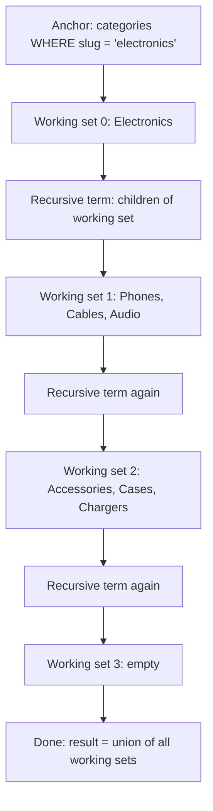

## 17.5 EXISTS vs IN vs JOIN: semi-joins and anti-joins

#### Concept

Three ways to ask "orders that have a captured payment":

- `JOIN payments p ON ... AND p.status = 'captured'`: returns one row per match. Two captured payments (impossible with our partial unique index, but possible on other tables) would duplicate the order.
- `WHERE o.id IN (SELECT order_id FROM payments WHERE status = 'captured')`: returns each order at most once. A semi-join.
- `WHERE EXISTS (SELECT 1 FROM payments p WHERE p.order_id = o.id AND p.status = 'captured')`: same result as `IN`, a semi-join, and the form that handles `NULL` correctly and reads naturally for correlated conditions.

The negatives: `NOT IN (subquery)` and `NOT EXISTS (...)` both ask "orders with no captured payment", an anti-join. They differ in one crucial way: `NOT IN` returns nothing at all if the subquery produces even one `NULL`.

#### Why does it exist?

A join is for combining columns from two tables. When you only need to check whether a related row exists, joining is the wrong tool: it multiplies rows and forces you to `DISTINCT` them back. `EXISTS` and `IN` express the intent "filter by existence" and let the planner use semi-join and anti-join strategies, which stop scanning the inner side as soon as one match is found.

#### Mental model

Imagine checking which customers on a list have ever placed an order. Joining is stapling every one of their orders to their name, then removing the duplicates. `EXISTS` is looking in the orders file, finding the first order with their name, and ticking the box. The tick is all you wanted.

#### How it works

1. PostgreSQL rewrites `IN (subquery)` and `EXISTS (subquery)` into a `Semi Join` node when the subquery is uncorrelated or simply correlated. `NOT EXISTS` becomes an `Anti Join`. Both use the same physical algorithms (nested loop, hash, merge) but stop probing after the first match.
2. `NOT IN (subquery)` cannot be turned into an anti-join if the subquery column is nullable, because the semantics differ: `x NOT IN (1, 2, NULL)` is `UNKNOWN` for every x, never `TRUE`. The planner uses a hashed subplan with special null handling and the result is an empty set the moment a `NULL` appears.
3. `IN (list of constants)` with many values is rewritten to `= ANY(ARRAY[...])` and can use an index; a very long list (thousands) is better passed as an array parameter.
4. A correlated `EXISTS` with an index on the inner side's correlation column is a nested loop semi-join: one index probe per outer row, stopping at the first hit.

#### PostgreSQL example

```sql
-- Semi-join: customers who have placed at least one paid order, no duplicates
SELECT u.id, u.email
FROM users u
WHERE EXISTS (SELECT 1 FROM orders o WHERE o.user_id = u.id AND o.status IN ('paid','shipped','delivered'));
-- Hash Semi Join  (actual rows=412880)  or  Nested Loop Semi Join with an index probe per user

-- Equivalent with IN
SELECT u.id, u.email FROM users u
WHERE u.id IN (SELECT o.user_id FROM orders o WHERE o.status IN ('paid','shipped','delivered'));

-- Anti-join, safe: users with no orders at all
SELECT u.id, u.email FROM users u
WHERE NOT EXISTS (SELECT 1 FROM orders o WHERE o.user_id = u.id);
-- Hash Anti Join

-- The NOT IN bug: orders.shipping_address_id is nullable.
-- "Addresses that are not used as a shipping address on any order":
SELECT a.id FROM addresses a
WHERE a.id NOT IN (SELECT o.shipping_address_id FROM orders o);
-- Returns ZERO rows as soon as one order has shipping_address_id = NULL. Not an error, just wrong.

-- Safe versions:
SELECT a.id FROM addresses a
WHERE NOT EXISTS (SELECT 1 FROM orders o WHERE o.shipping_address_id = a.id);

SELECT a.id FROM addresses a
WHERE a.id NOT IN (SELECT o.shipping_address_id FROM orders o WHERE o.shipping_address_id IS NOT NULL);

-- EXISTS with a LIMIT inside is redundant; EXISTS already stops at the first row.
-- JOIN + DISTINCT: correct but does more work
SELECT DISTINCT u.id, u.email FROM users u JOIN orders o ON o.user_id = u.id;  -- Hash Join then HashAggregate over 2M rows
```

Decision table:

| Need | Use | Why |
|---|---|---|
| Columns from the related table | `JOIN` | Only joins return the other table's columns |
| Existence check, related table 1:N | `EXISTS` | No duplication; stops at first match; null-safe |
| Existence check against a small constant list | `IN (...)` / `= ANY($1)` | Index-usable; simplest to read |
| Non-existence | `NOT EXISTS` | Null-safe anti-join; `NOT IN` is a trap with nullable subquery columns |
| Existence with a condition on the related row | `EXISTS (... WHERE ...)` | Condition stays inside; nothing leaks into the outer filter |

#### TypeORM example

```ts
// EXISTS via a subquery in QueryBuilder
const users = await userRepo.createQueryBuilder('u')
  .where((qb) => {
    const sub = qb.subQuery().select('1').from(Order, 'o')
      .where('o.user_id = u.id').andWhere("o.status IN ('paid','shipped','delivered')").getQuery();
    return `EXISTS ${sub}`;
  })
  .getMany();

// NOT EXISTS
const idle = await userRepo.createQueryBuilder('u')
  .where((qb) => `NOT EXISTS ${qb.subQuery().select('1').from(Order, 'o').where('o.user_id = u.id').getQuery()}`)
  .getMany();

// IN with an array parameter (becomes = ANY)
import { In } from 'typeorm';
const some = await productRepo.find({ where: { id: In(ids) } });
```

#### Sequelize example

```ts
const buyers = await User.findAll({
  where: literal(`EXISTS (SELECT 1 FROM orders o WHERE o.user_id = "User"."id" AND o.status IN ('paid','shipped','delivered'))`),
});
// Or an include with required: true, which is an INNER JOIN and will duplicate unless you add distinct/attributes: []
const buyers2 = await User.findAll({
  include: [{ model: Order, as: 'orders', required: true, attributes: [], where: { status: ['paid','shipped','delivered'] } }],
  // Sequelize deduplicates parent instances in memory, but count() would be wrong without { distinct: true }
});
```

#### Failure scenario

A cleanup job "delete addresses not used by any order" ran `DELETE FROM addresses WHERE id NOT IN (SELECT shipping_address_id FROM orders)`. It deleted nothing, for a year, because one order in 2023 had a `NULL` shipping address. Then a data fix set that one order's address, the subquery no longer contained `NULL`, and the next nightly run deleted 1.8 million "unused" addresses, including every address of every customer who had never checked out. The query was not wrong that night; it had been wrong all along, and the `NULL` had been masking it. `NOT EXISTS` would have behaved correctly on every run.

#### Edge cases & failure modes

- `NOT IN` with a nullable subquery column: empty result.
- `IN` with a subquery returning millions of rows: hashed, fine; with a correlated subquery: evaluated per row, can be O(n squared) without an index.
- `EXISTS` with `SELECT *` vs `SELECT 1`: identical; `1` is convention.
- `JOIN` + `DISTINCT` to fake a semi-join: correct, more expensive, and `DISTINCT` hides multiplication bugs elsewhere.
- Semi-join with `LIMIT` on the outer query: the planner may pick a nested loop and stop early, which is good; without an inner index it is a sequential scan per outer row.

#### How a Senior Backend Engineer thinks about this

`EXISTS` for existence, `NOT EXISTS` for absence, `JOIN` only when they need columns. They flag `NOT IN (subquery)` in every code review, and they flag `DISTINCT` as a symptom to investigate.

#### Common mistakes

- `NOT IN` on nullable columns.
- `JOIN` then `DISTINCT` on the request path.
- `IN` with a 50,000-element literal list; use an array parameter or a temp table.

#### Interview questions

1. `NOT IN` vs `NOT EXISTS`: which is safe and why? Expected: `NOT EXISTS`; `NOT IN` returns nothing when the subquery has a `NULL`.
2. What is a semi-join and how does the planner execute it? Expected: existence check that stops at the first match; `Semi Join` node using nested loop, hash, or merge.
3. When is `JOIN` better than `EXISTS`? Expected: when you need the related table's columns.

## 17.6 UNION vs UNION ALL

#### Concept

`UNION` combines two result sets and removes duplicate rows. `UNION ALL` combines them and keeps everything. `INTERSECT` returns rows present in both; `EXCEPT` returns rows in the first but not the second. All require the same number of columns with compatible types.

#### Why does it exist?

Sometimes the rows you want come from different tables or different conditions that cannot be expressed as one `WHERE`: "all activity for a user" from `orders`, `reviews` and `notifications` into one timeline; "products in category A priced under 500 or in category B priced over 5000" when different indexes serve each half better than one `OR`.

#### How it works

1. Each branch is planned and executed independently.
2. `UNION ALL` is an `Append` node: rows stream through with no extra work.
3. `UNION` adds a `HashAggregate` or `Sort` + `Unique` over the combined rows to remove duplicates, which reads and hashes every row. On a million rows that is hundreds of milliseconds and `work_mem` pressure for nothing, if the branches were already disjoint.
4. `ORDER BY` and `LIMIT` at the end apply to the combined result; to limit each branch, wrap it in parentheses.

#### PostgreSQL example

```sql
-- User activity timeline: branches are disjoint by construction, so UNION ALL
SELECT 'order' AS kind, id::text AS ref, placed_at AS at FROM orders WHERE user_id = $1
UNION ALL
SELECT 'review', id::text, created_at FROM reviews WHERE user_id = $1
UNION ALL
SELECT 'notification', id::text, created_at FROM notifications WHERE user_id = $1
ORDER BY at DESC
LIMIT 50;
-- Limit -> Sort -> Append -> three Index Scans. The Sort is over at most (rows per branch), bounded by the user's activity.

-- Same with UNION: adds a HashAggregate over all rows for no reason
-- UNION when you genuinely want set semantics: emails that appear in both marketing lists
SELECT email FROM newsletter_subscribers
INTERSECT
SELECT email FROM users WHERE deleted_at IS NULL;

-- OR split into UNION ALL so each half uses its own index (the planner often does this itself via BitmapOr)
SELECT id FROM products WHERE category_id = 3 AND price < 500
UNION ALL
SELECT id FROM products WHERE category_id = 7 AND price > 5000;
-- If a product could satisfy both, UNION ALL duplicates it; here the categories differ so it cannot.
```

#### Edge cases & failure modes

- `UNION` silently deduplicates rows that are legitimately identical (two identical order lines in an export). Use `UNION ALL` unless you have a reason.
- Type mismatch between branches: `id uuid` in one branch and `id bigint` in another needs an explicit `::text` on both.
- Column names come from the first branch; aliases in later branches are ignored.
- `ORDER BY` inside a branch without parentheses is a syntax error or applies to the whole union.

#### Interview questions

1. `UNION` or `UNION ALL` for a timeline from three tables? Expected: `UNION ALL`; branches are disjoint, and `UNION` would hash every row to remove duplicates that cannot exist.

## 17.7 Common Table Expressions

### 17.7.1 WITH for readability, and materialization vs inlining

#### Concept

A CTE (common table expression) is a named subquery declared with `WITH name AS (...)` and then used like a table in the main query. It makes multi-step queries readable: filter first, aggregate second, join third, each step named. Since PostgreSQL 12, a CTE that is referenced once and has no side effects is inlined into the main query by default, so the planner can push predicates into it and choose indexes; before 12, every CTE was an optimization fence, always materialized. You can force either behavior with `MATERIALIZED` or `NOT MATERIALIZED`.

#### Why does it exist?

Nested subqueries three levels deep are unreadable and unreviewable. CTEs turn them into a pipeline you read top to bottom. Materialization exists because sometimes you want the fence: an expensive subquery used twice should run once, and a subquery with a volatile function must not be duplicated.

#### How it works

1. The parser registers each CTE by name. A CTE can reference earlier CTEs in the same `WITH`.
2. Planning (PG12+): if the CTE is non-recursive, referenced exactly once, and contains no volatile functions or data-modifying statements, it is inlined as if you had written a subquery. The planner then treats it like any subquery: predicates from the outer query can be pushed down, join order can be changed.
3. If referenced more than once, or marked `MATERIALIZED`, it is executed once into a temporary result (in memory up to `work_mem`, then temp file), and each reference scans that result. Outer predicates cannot be pushed into it.
4. `NOT MATERIALIZED` forces inlining even when referenced multiple times (the subquery is duplicated at each reference).
5. Data-modifying CTEs (`WITH moved AS (DELETE ... RETURNING *) INSERT INTO archive SELECT * FROM moved`) always run exactly once and see the same snapshot.

#### PostgreSQL example

```sql
-- Readable pipeline: active customers in March, their order stats, joined to their default address
WITH march_orders AS (
  SELECT user_id, id, total
  FROM orders
  WHERE placed_at >= '2026-03-01' AND placed_at < '2026-04-01'
    AND status IN ('paid','shipped','delivered')
),
per_user AS (
  SELECT user_id, count(*) AS orders, sum(total) AS revenue
  FROM march_orders
  GROUP BY user_id
)
SELECT u.email, pu.orders, pu.revenue, a.city
FROM per_user pu
JOIN users u ON u.id = pu.user_id
LEFT JOIN addresses a ON a.user_id = u.id AND a.is_default
WHERE pu.revenue > 10000
ORDER BY pu.revenue DESC
LIMIT 100;
-- PG12+: march_orders and per_user are each referenced once, so both are inlined; the planner sees one query.

-- The materialization fence in action: a predicate that should be pushed down
WITH recent AS MATERIALIZED (
  SELECT * FROM orders WHERE placed_at >= now() - interval '90 days'   -- 1.5M rows materialized
)
SELECT * FROM recent WHERE user_id = 'a1b2...';   -- scans the 1.5M-row temp result; cannot use orders_user_id_placed_at_idx
-- Without MATERIALIZED (PG12+ default) the user_id predicate is pushed into the CTE and the index is used: 0.1 ms vs 400 ms.

-- Legitimate MATERIALIZED: expensive subquery used twice
WITH stats AS MATERIALIZED (
  SELECT product_id, count(*) AS n, avg(rating) AS avg_rating FROM reviews GROUP BY product_id   -- 20M rows aggregated once
)
SELECT p.name, s.avg_rating FROM products p JOIN stats s ON s.product_id = p.id WHERE s.n >= 100
UNION ALL
SELECT 'AVERAGE OF ALL', avg(avg_rating) FROM stats;

-- Data-modifying CTE: archive and delete in one statement, one snapshot
WITH archived AS (
  DELETE FROM notifications
  WHERE status = 'sent' AND sent_at < now() - interval '180 days'
  RETURNING *
)
INSERT INTO notifications_archive SELECT * FROM archived;
```

#### TypeORM example

```ts
// TypeORM QueryBuilder supports CTEs via addCommonTableExpression
const rows = await dataSource.createQueryBuilder()
  .addCommonTableExpression(
    `SELECT user_id, count(*) AS orders, sum(total) AS revenue
       FROM orders WHERE placed_at >= :from AND placed_at < :to GROUP BY user_id`,
    'per_user',
  )
  .select(['u.email AS email', 'pu.orders AS orders', 'pu.revenue AS revenue'])
  .from('per_user', 'pu')
  .innerJoin('users', 'u', 'u.id = pu.user_id')
  .where('pu.revenue > :min', { min: 10000 })
  .orderBy('pu.revenue', 'DESC')
  .limit(100)
  .setParameters({ from, to })
  .getRawMany();
// Beyond two CTEs, raw SQL via dataSource.query() is usually more readable than the builder.
```

#### Sequelize example

Sequelize has no CTE API; use `sequelize.query` with replacements and a model for mapping if needed:

```ts
const [rows] = await sequelize.query(
  `WITH per_user AS (SELECT user_id, count(*) AS orders, sum(total) AS revenue FROM orders
                     WHERE placed_at >= :from AND placed_at < :to GROUP BY user_id)
   SELECT u.email, pu.orders, pu.revenue FROM per_user pu JOIN users u ON u.id = pu.user_id
   WHERE pu.revenue > :min ORDER BY pu.revenue DESC LIMIT 100`,
  { replacements: { from, to, min: 10000 }, type: QueryTypes.SELECT },
);
```

#### Edge cases & failure modes

- Upgrading from PG11 to PG12+ changes CTE behavior; queries that relied on the fence (to avoid a bad plan or to run an expensive subquery once) may regress. Audit with `MATERIALIZED`.
- A CTE referenced twice is materialized, and its temp result may spill to disk if larger than `work_mem`.
- CTEs cannot be indexed. A CTE producing a million rows joined to a big table is a hash join at best.
- Data-modifying CTEs all see the same snapshot: a `WITH d AS (DELETE ...) SELECT count(*) FROM target` still counts the deleted rows.
- Deeply nested CTE chains are hard for the planner: `join_collapse_limit` applies to the inlined result.

#### How a Senior Backend Engineer thinks about this

CTEs for readability by default, trusting PG12+ inlining. `MATERIALIZED` when a subquery is expensive and reused, or when the plan without it is demonstrably worse. They check the plan after adding a CTE, because "it reads better" and "it runs the same" are different claims.

#### Interview questions

1. What changed about CTEs in PostgreSQL 12? Expected: single-reference, side-effect-free CTEs are inlined; before, always materialized as an optimization fence.
2. When would you write `MATERIALIZED` explicitly? Expected: expensive subquery used multiple times; or to deliberately fence a bad plan.
3. What does a data-modifying CTE see? Expected: all statements in the query share one snapshot; later parts do not see earlier parts' modifications.

## 17.8 Recursive CTEs

#### Concept

A recursive CTE (`WITH RECURSIVE`) is a query that refers to its own result. It has an anchor (the starting rows) and a recursive term (how to get the next rows from the current ones), combined with `UNION` or `UNION ALL`. It is how SQL walks trees and graphs: the category tree, an org chart, a bill of materials, "who can this user reach through friends of friends", and "which orders are transitively linked to this one through returns and exchanges".

#### Why does it exist?

Adjacency lists (`parent_id`) are the simplest way to store a tree, but "all descendants of Electronics" has no fixed depth, so no fixed number of self-joins answers it. The recursive CTE loops until no new rows are produced.

#### Mental model

Imagine finding every folder under "Projects" on a disk. You start with "Projects" (anchor). You list its subfolders (one recursive step). For each of those, you list their subfolders (next step), until there are no more. The recursive CTE does exactly this, one level per iteration, and returns everything it visited.



#### How it works

1. Evaluate the anchor term. Its rows go into the result and into a working table.
2. Evaluate the recursive term with the CTE name bound to the working table (only the previous iteration's rows, not the whole result so far).
3. With `UNION ALL`, append the new rows; with `UNION`, discard rows already in the result (which also stops cycles for exactly-duplicate rows).
4. Replace the working table with the new rows. Repeat from step 2 until the working table is empty.
5. Depth, path and cycle detection are added by carrying extra columns (`depth + 1`, `path || id`) or with the `CYCLE` clause (PG14+).

Each iteration is one query execution; a tree of depth 5 is 6 executions. With an index on `parent_id`, each execution is a set of index probes. Cost is proportional to the number of nodes visited, not the size of the table.

#### PostgreSQL example

```sql
-- All descendants of Electronics with their depth and path (category tree)
WITH RECURSIVE subtree AS (
  SELECT id, parent_id, name, 0 AS depth, ARRAY[id] AS path
  FROM categories WHERE slug = 'electronics'
  UNION ALL
  SELECT c.id, c.parent_id, c.name, s.depth + 1, s.path || c.id
  FROM categories c
  JOIN subtree s ON c.parent_id = s.id
  WHERE s.depth < 10                          -- hard depth limit as a safety net
)
SELECT repeat('  ', depth) || name AS tree, depth, path FROM subtree ORDER BY path;
-- tree               | depth | path
-- Electronics        | 0     | {1}
--   Phones           | 1     | {1,4}
--     Accessories    | 2     | {1,4,17}
--   Cables           | 1     | {1,6}

-- Products in a category OR any descendant (the query every category page needs)
WITH RECURSIVE subtree AS (
  SELECT id FROM categories WHERE id = $1
  UNION ALL
  SELECT c.id FROM categories c JOIN subtree s ON c.parent_id = s.id
)
SELECT p.id, p.name, p.price
FROM products p
WHERE p.category_id IN (SELECT id FROM subtree) AND p.is_active
ORDER BY p.name
LIMIT 40;

-- Ancestors: breadcrumb for a category (walk up instead of down)
WITH RECURSIVE ancestors AS (
  SELECT id, parent_id, name, 0 AS depth FROM categories WHERE id = $1
  UNION ALL
  SELECT c.id, c.parent_id, c.name, a.depth + 1 FROM categories c JOIN ancestors a ON c.id = a.parent_id
)
SELECT string_agg(name, ' > ' ORDER BY depth DESC) AS breadcrumb FROM ancestors;

-- Cycle protection with the CYCLE clause (PG14+): a corrupt parent_id loop will not run forever
WITH RECURSIVE subtree AS (
  SELECT id, parent_id, name FROM categories WHERE id = $1
  UNION ALL
  SELECT c.id, c.parent_id, c.name FROM categories c JOIN subtree s ON c.parent_id = s.id
) CYCLE id SET is_cycle USING path
SELECT * FROM subtree WHERE NOT is_cycle;
-- Before PG14: carry path ARRAY and add "WHERE NOT c.id = ANY(s.path)" to the recursive term.

-- Bill of materials: total quantity of each leaf component for one bundle product
-- (product_components: parent_product_id, child_product_id, qty)
WITH RECURSIVE bom AS (
  SELECT child_product_id AS product_id, qty::bigint AS total_qty, 1 AS level
  FROM product_components WHERE parent_product_id = $1
  UNION ALL
  SELECT pc.child_product_id, b.total_qty * pc.qty, b.level + 1
  FROM product_components pc JOIN bom b ON pc.parent_product_id = b.product_id
  WHERE b.level < 20
)
SELECT product_id, sum(total_qty) AS required
FROM bom
WHERE product_id NOT IN (SELECT parent_product_id FROM product_components)  -- leaves only
GROUP BY product_id;

-- Graph traversal: users reachable within 3 hops via a referrals table (referrer_id, referred_id)
WITH RECURSIVE reach AS (
  SELECT referred_id AS user_id, 1 AS hops, ARRAY[$1::uuid, referred_id] AS path
  FROM referrals WHERE referrer_id = $1
  UNION ALL
  SELECT r.referred_id, rc.hops + 1, rc.path || r.referred_id
  FROM referrals r JOIN reach rc ON r.referrer_id = rc.user_id
  WHERE rc.hops < 3 AND NOT r.referred_id = ANY(rc.path)     -- manual cycle check
)
SELECT DISTINCT ON (user_id) user_id, hops FROM reach ORDER BY user_id, hops;
```

#### TypeORM example

```ts
// Recursive CTEs: raw SQL is the right tool. Keep it in a repository method with typed output.
interface CategoryNode { id: string; name: string; depth: number }

async subtree(rootId: string): Promise<CategoryNode[]> {
  return this.ds.query<CategoryNode[]>(
    `WITH RECURSIVE subtree AS (
       SELECT id, name, 0 AS depth, ARRAY[id] AS path FROM categories WHERE id = $1
       UNION ALL
       SELECT c.id, c.name, s.depth + 1, s.path || c.id
       FROM categories c JOIN subtree s ON c.parent_id = s.id WHERE s.depth < 10
     )
     SELECT id, name, depth FROM subtree ORDER BY path`,
    [rootId],
  );
}
```

TypeORM has a `TreeRepository` with `@Tree('closure-table' | 'materialized-path' | 'nested-set' | 'adjacency-list')` decorators, which manage the storage strategy for you. It is convenient for small trees; for anything with custom columns or performance needs, the raw recursive CTE is more predictable.

#### Production scenario

A category page on a 40,000-product catalog: the recursive CTE over a 900-row category table takes about 0.3 ms (three iterations, each a handful of index probes on `categories_parent_id_idx`), and the products query then uses `products_category_id_idx` with `= ANY` over the 12 resulting ids. Total under 2 ms. Caching the subtree id list in Redis for 10 minutes removes even that; categories change rarely.

#### Failure scenario

A data import set `categories.parent_id = id` for one row (self-parent) before the `CHECK (parent_id IS DISTINCT FROM id)` existed. The category page's recursive CTE ran forever, or rather until it exhausted temp disk at 200 GB and the query was killed after 40 minutes, having pinned one CPU core the whole time. Since then the CTE carries `WHERE s.depth < 10`, the `CHECK` exists, and PG14's `CYCLE` clause is in place for multi-node loops. Recursion without a depth guard is an outage waiting for one bad row.

#### Edge cases & failure modes

- Infinite recursion on cycles: always a depth limit and, on PG14+, `CYCLE`.
- `UNION` vs `UNION ALL`: `UNION` deduplicates complete rows and thereby stops simple cycles, but costs a hash per iteration; carrying `depth` makes rows distinct so `UNION` no longer stops cycles.
- Recursive term must reference the CTE exactly once and cannot use aggregates, `ORDER BY`, or `LIMIT` on the CTE reference.
- Wide recursion (a node with 100,000 children) produces a large working table; fine, but memory-bound.
- Deep recursion (a 10,000-level chain) is 10,000 query executions; use `ltree` or a closure table for very deep structures.

#### How a Senior Backend Engineer thinks about this

Recursive CTE for trees under a few thousand nodes and graphs with bounded hops. Always a depth guard. Cache the result when the tree is read-mostly. Move to `ltree` or a closure table when the read pattern is "descendants of X" at high volume on a large tree.

#### Common mistakes

- No depth limit.
- Using the recursive CTE to walk 10 million rows when a single self-join or a materialized path would do.
- Forgetting that the recursive term sees only the previous iteration's rows.

#### Interview questions

1. How does a recursive CTE execute? Expected: anchor, then repeated recursive term over the previous iteration's rows until empty.
2. How do you protect against cycles? Expected: depth column with a limit; path array with `NOT = ANY`; `CYCLE` clause in PG14+.
3. When is a recursive CTE the wrong tool for a tree? Expected: very deep or very large trees read at high volume; use `ltree` or a closure table.

#### Practical exercise

Build a 5-level category tree with 2,000 nodes. Implement `GET /categories/:id/products` using the recursive CTE, then implement the same with `ltree`. Insert a cycle deliberately and verify both the depth guard and the `CYCLE` clause stop it. Acceptance criteria: both implementations return identical product sets; the cycle test terminates in under 100 ms; plans captured for each.
