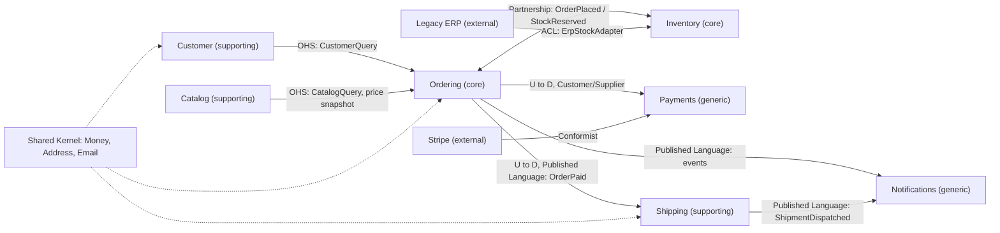

## 17.12 Context mapping

#### Concept

A **context map** is a diagram plus a set of agreements describing how bounded contexts relate: who depends on whom, who owns the contract, and what protects each side from the other's changes. DDD names the common relationship patterns:

| Pattern | Meaning | E-commerce example |
|---|---|---|
| **Partnership** | Two teams succeed or fail together; they coordinate releases and share planning. | Ordering and Inventory: a change to reservation semantics needs both. |
| **Customer / Supplier** | Downstream (customer) states needs; upstream (supplier) commits to meet them; upstream is not blocked by downstream. | Shipping (customer) depends on Ordering (supplier) for `OrderPaid` with address data. |
| **Conformist** | Downstream adopts upstream's model as-is because it has no leverage. | Payments context conforms to Stripe's model of intents, charges and refunds. |
| **Anti-Corruption Layer (ACL)** | Downstream builds a translation layer so upstream's model does not leak in. | Inventory wraps a legacy ERP behind an adapter that speaks our `StockLevel` language. |
| **Open Host Service (OHS)** | Upstream exposes a well-defined protocol for any consumer. | Catalog exposes a versioned REST/gRPC API used by web, mobile, Ordering. |
| **Published Language** | A shared, documented schema for exchange (events, JSON schemas). | `ordering.order.placed` event schema v1, documented and versioned. |
| **Shared Kernel** | A small piece of model shared by two contexts and changed only together. | `Money`, `Address`, `Email` value objects in `src/shared/domain`. |
| **Separate Ways** | No integration at all; duplicate rather than couple. | Notifications keeps its own tiny copy of customer display name. |

#### Why does it exist?

Bounded contexts do not live alone. Without an explicit map, integration happens by accident: someone imports a class from another module, someone reads another team's table, someone hard-codes a vendor's field names deep inside the core. Each accident is a hidden dependency that shows up as a broken deploy months later. A context map makes every dependency visible and gives each a **protection strategy**.

#### Mental model

Imagine countries and borders. Some pairs are in a trade union (partnership). Some have a customs office that inspects and relabels goods (ACL). Some publish an official standard for imports (open host service with a published language). Some share a currency (shared kernel). And some simply do not trade (separate ways). The map of these arrangements is a context map.

#### How it works

Here is the e-commerce context map. `U` marks the upstream side (the one that owns the contract), `D` the downstream.



Reading it:

1. **Ordering and Inventory are partners.** Both are core and their contracts (`OrderPlaced` with lines, `StockReserved`/`StockRejected` back) change together. The teams share a planning cadence.
2. **Ordering is upstream of Shipping, Payments and Notifications**, which consume its published events. Ordering versions its events and does not break consumers.
3. **Customer and Catalog are open host services** for Ordering: exported query classes in the monolith, versioned HTTP APIs if extracted.
4. **Payments conforms to Stripe.** Fighting a payment provider's model is wasted effort; Payments' internal model mirrors intents, charges and refunds and our own `PaymentIntent` entity is thin.
5. **Inventory protects itself from the legacy ERP with an ACL.** The ERP has 40-year-old field names (`ITMCD`, `WHSLOC`, `QTYAVL`) and quirks (quantities in dozens for some item classes). None of that appears in Inventory's model.
6. **The shared kernel is tiny and stable**: three value objects, changed only with sign-off from every context that uses them.

#### Practical example: an anti-corruption layer around a legacy ERP

The ACL has three pieces: an interface in Inventory's domain language, an adapter that calls the ERP, and a translator that converts the ERP's shape into ours. The domain never imports anything ERP-specific.

```ts
// src/inventory/domain/external-stock.source.ts   (domain-level port, in OUR language)
export interface ExternalStockLevel { sku: string; warehouseId: string; onHand: number; asOf: Date; }
export interface ExternalStockSource {
  levelsFor(skus: string[]): Promise<ExternalStockLevel[]>;
}
export const EXTERNAL_STOCK_SOURCE = Symbol('EXTERNAL_STOCK_SOURCE');
```

```ts
// src/inventory/infrastructure/erp/erp-stock.adapter.ts   (the ACL)
import { Injectable, Logger } from '@nestjs/common';
import { ConfigService } from '@nestjs/config';
import { ExternalStockSource, ExternalStockLevel } from '../../domain/external-stock.source';
import { ErpClient, ErpItemRow } from './erp.client';          // raw SOAP/HTTP client, returns ERP shapes
import { ErpTranslationError } from './errors';

const WAREHOUSE_BY_ERP_LOC: Record<string, string> = { 'WH01': 'b6d2...', 'WH02': '9a11...' }; // ERP codes -> our ids
const DOZEN_CLASSES = new Set(['PKG-DZ', 'BULK-DZ']);          // ERP quirk: these classes count in dozens

@Injectable()
export class ErpStockAdapter implements ExternalStockSource {
  private readonly log = new Logger(ErpStockAdapter.name);
  constructor(private readonly erp: ErpClient, config: ConfigService) {
    this.erp.setTimeout(config.get<number>('ERP_TIMEOUT_MS', 2000));
  }

  async levelsFor(skus: string[]): Promise<ExternalStockLevel[]> {
    const rows = await this.erp.fetchItems(skus.map(toErpItemCode));   // may throw ErpUnavailableError
    return rows.flatMap((r) => this.translate(r));
  }

  /** All ERP weirdness lives here and nowhere else. */
  private translate(r: ErpItemRow): ExternalStockLevel[] {
    const warehouseId = WAREHOUSE_BY_ERP_LOC[r.WHSLOC];
    if (!warehouseId) { this.log.warn({ msg: 'unknown ERP location', loc: r.WHSLOC }); return []; }
    const multiplier = DOZEN_CLASSES.has(r.ITMCLS) ? 12 : 1;
    const onHand = Number(r.QTYAVL) * multiplier;
    if (!Number.isFinite(onHand) || onHand < 0) throw new ErpTranslationError(`Bad QTYAVL for ${r.ITMCD}`);
    return [{ sku: fromErpItemCode(r.ITMCD), warehouseId, onHand, asOf: parseErpDate(r.UPDTS) }];
  }
}

function toErpItemCode(sku: string): string { return sku.replace(/-/g, '').padStart(12, '0'); }
function fromErpItemCode(code: string): string { return code.replace(/^0+/, '').replace(/(\w{3})(\w+)/, '$1-$2'); }
function parseErpDate(s: string): Date { return new Date(`${s.slice(0, 4)}-${s.slice(4, 6)}-${s.slice(6, 8)}T00:00:00Z`); }
```

The NestJS module binds the port to the adapter, and a test double replaces it in tests:

```ts
// src/inventory/inventory.module.ts (excerpt)
providers: [
  { provide: EXTERNAL_STOCK_SOURCE, useClass: ErpStockAdapter },
  ErpClient,
]
// in tests: { provide: EXTERNAL_STOCK_SOURCE, useValue: fakeStockSource }
```

When the ERP is replaced in three years, only `infrastructure/erp/` changes.

#### Published language in a monolith

Ordering's `domain/events.ts` is its published language. To keep other modules from importing anything else, add a lint rule (with `eslint-plugin-import` or `eslint-plugin-boundaries`) that allows `src/*/domain/events.ts` and `src/*/application/*.query.ts` to be imported across contexts and forbids everything else. It is a five-line config that prevents a whole class of coupling.

#### Production scenario

A company had 9 contexts across 4 teams. The context map lived in `docs/context-map.md` with the Mermaid diagram above and a table listing, per edge, the contract (event names or query class), the owner, and the versioning rule. Every quarterly planning session started by reviewing the map. When the Shipping team wanted to add `estimatedDelivery` to the order confirmation email, the map showed that Notifications consumed `ordering.order.placed`, not anything from Shipping, so the right move was a new `shipping.shipment.promised` event rather than stuffing shipping data into Ordering's event.

#### Failure scenario

The ERP integration originally had no ACL. `QTYAVL` flowed straight into `stock_items.on_hand`. Then the ERP vendor changed `PKG-DZ` items to report in units instead of dozens. Overnight, 3,000 SKUs showed 12x less stock than reality, the site marked them out of stock, and revenue dropped 18% for a day before anyone connected the two. With the adapter above, the change would have been a one-line edit to `DOZEN_CLASSES`, discovered by the adapter's contract tests against a recorded ERP response.

#### Edge cases & failure modes

- **Shared kernel that grows.** Someone adds `OrderSummary` to `shared/` "because two contexts need it". Now two contexts are coupled through a bag of shared types. Keep the kernel to primitives-with-rules.
- **Conformist by accident.** The core domain adopts a vendor's field names and the vendor's quirks become business rules. Conform only in generic contexts; ACL in core.
- **Upstream breaks the published language.** Renaming an event field breaks every consumer. Add fields, never remove; version the event name (`ordering.order.placed.v2`) for breaking changes.
- **ACL too thin** (just renames fields) or **too thick** (contains business rules). It should translate and validate, nothing more.
- **Partnership between teams in different time zones** with no shared cadence turns into two conformists resenting each other. Name a contract owner.

#### How a Senior Backend Engineer thinks about this

- Every arrow on the map has an owner and a protection strategy. If they cannot name both, the arrow is a risk.
- They put an ACL in front of anything they do not control and expect to outlive: ERPs, partner APIs, old databases.
- They treat events and query interfaces as public APIs with versioning rules.
- To a product manager: "Between departments we agreed on forms. If the warehouse changes its internal system, the form stays the same, so checkout keeps working."

#### Common mistakes

- Importing another context's repository or ORM entity.
- Letting a third-party SDK's types appear in domain classes.
- Drawing the map once and never updating it.
- Making everything a partnership, so nobody can release without everybody.

#### Interview questions

1. *Explain anti-corruption layer with a concrete example and what goes wrong without it.* Expected: adapter plus translator around a legacy system; vendor change incident.
2. *When is conformist the right choice?* Expected: generic subdomain, no leverage over upstream, low value in fighting the model.
3. *What is a shared kernel and what are its risks?* Expected: small shared model; risk of growing into coupling; change only together.
4. *How do you version a published language (events) without breaking consumers?* Expected: additive changes, new event names for breaking changes, consumer-driven contract tests (Part 45).

#### Practical exercise

Draw the context map for a system you know with at least five contexts. For every edge, write the pattern, the contract (event or interface name), the owner and the versioning rule. Then implement one ACL around one external system with a contract test that replays a recorded response. Acceptance criteria: no external type appears outside the adapter folder; the contract test fails if the external format changes; the map is checked into the repository.

## 17.13 Anemic vs rich domain model

#### Concept

An **anemic domain model** is one where entities are bags of getters and setters and all behaviour lives in services. A **rich domain model** puts behaviour and invariants on the entities and aggregates, and services only orchestrate.

Anemic is the default output of most ORM tutorials and code generators. It is not always wrong (see 17.14), but in a core subdomain it produces bugs because invariants have no owner.

#### Why does it exist?

The rich model exists because rules need a home. When `OrderService.cancel()` checks the status and `RefundService.process()` also checks the status and `AdminController.forceCancel()` forgets to, the rule "cannot cancel a fulfilled order" is enforced in some places and not others. Putting the rule in `Order.cancel()` means every path enforces it, and the test for the rule is a unit test on `Order`.

#### Mental model

Imagine two kinds of bank vault. In the anemic one, the vault is a box with an open lid; a guard is supposed to check every hand that reaches in, but there are eleven guards and each has their own checklist. In the rich one, the vault has one door with one lock and the rules are built into the lock; there is no way to reach in that bypasses them.

#### Before: anemic

```ts
// order.entity.ts (anemic)
@Entity()
export class Order {
  @PrimaryColumn('uuid') id: string;
  @Column() status: string;
  @Column('bigint') totalMinor: string;
  @OneToMany(() => OrderLine, (l) => l.order, { cascade: true }) lines: OrderLine[];
  // no methods
}

// orders.service.ts (anemic: every rule lives here, and in three other services)
@Injectable()
export class OrdersService {
  constructor(@InjectRepository(Order) private repo: Repository<Order>, private events: EventEmitter2) {}

  async addLine(orderId: string, sku: string, qty: number, priceMinor: number) {
    const order = await this.repo.findOne({ where: { id: orderId }, relations: ['lines'] });
    if (order.status !== 'DRAFT') throw new BadRequestException('not editable');
    const line = new OrderLine(); line.sku = sku; line.quantity = qty; line.unitPriceMinor = String(priceMinor);
    order.lines.push(line);
    order.totalMinor = String(order.lines.reduce((s, l) => s + Number(l.unitPriceMinor) * l.quantity, 0)); // float risk, duplicated elsewhere
    await this.repo.save(order);
  }

  async cancel(orderId: string) {
    const order = await this.repo.findOne({ where: { id: orderId } });
    // forgot to check FULFILLED; AdminService.forceCancel has a slightly different check
    order.status = 'CANCELLED';
    await this.repo.save(order);
    this.events.emit('order.cancelled', order); // emitted after save, but not tied to a transaction
  }
}
```

Problems: rules scattered and inconsistent, total recomputed by hand with `Number()` (float), events not transactional, `Order` can be constructed empty, tests need a database.

#### After: rich

```ts
// domain/order.ts (rich; see 17.6 for the full class)
export class Order extends AggregateRoot<string> {
  addLine(sku: string, productName: string, quantity: number, unitPrice: Money): void {
    this.assertMutable('add a line');
    /* currency, max lines, one-line-per-sku invariants */
    this.lines.push(OrderLine.create(sku, productName, quantity, unitPrice));
  }
  total(): Money { return this.lines.reduce((s, l) => s.add(l.lineTotal()), Money.zero(this.currency)); }
  cancel(reason: string, now = new Date()): void {
    if (this.status === 'FULFILLED') throw new OrderStateError('Cannot cancel a fulfilled order');
    if (this.status === 'CANCELLED') return;
    const wasPaid = this.status === 'PAID';
    this.status = 'CANCELLED';
    this.raise(new OrderCancelled(this.id, reason, wasPaid, now));
  }
}

// application/cancel-order.service.ts (thin orchestration; see 17.9)
async execute(cmd: CancelOrderCommand) {
  return this.uow.run(async ({ orders }, track) => {
    const order = await orders.findByIdForUpdate(cmd.orderId);
    if (!order) throw new OrderNotFoundError(cmd.orderId);
    track(order);
    order.cancel(cmd.reason);
    await orders.save(order);
    return { orderId: order.id, status: order.currentStatus };
  });
}
```

Every path that cancels an order goes through `Order.cancel()`. The rule is tested once. The event is transactional.

#### How a Senior Backend Engineer thinks about this

They look for **invariants with no owner**. If the same `if (status !== ...)` appears in three services, the model is anemic and that check needs to move onto the aggregate. They also know when anemic is fine: a `Setting` entity with two fields and no rules does not need a rich model.

#### Common mistakes

- "Rich" models that still have public setters, so the rules can be bypassed.
- Moving *orchestration* into entities (an aggregate that calls a repository or an HTTP client). Rich means business rules, not I/O.
- Refactoring the whole codebase to rich at once. Do it one aggregate at a time, starting with the one with the most bugs.

#### Interview questions

1. *What is an anemic domain model and why is it considered a problem?* Expected: behaviour in services, invariants without owner, duplication and inconsistency.
2. *Show how you would move one rule from a service into an aggregate and what test changes.* Expected: before/after above; unit test on the aggregate replaces DB-backed service test.
3. *Is anemic always bad?* Expected: no; fine for supporting/generic CRUD.

#### Practical exercise

Find a service in your codebase with the same status check in two or more places. Move the rule into the entity, replace the checks with a method call, and write one unit test for the rule. Acceptance criteria: the check exists in exactly one place; the service test that needed a database is replaced by a domain unit test.

## 17.14 When NOT to use DDD, and DDD-lite

#### Concept

DDD's tactical patterns cost code: two model shapes, mappers, unit of work, events, factories. That cost is repaid when the domain is complex and long-lived. It is wasted when the domain is simple.

Do **not** reach for full DDD when:

- **The subdomain is CRUD-heavy.** An admin tool for editing product descriptions has no invariants beyond "title required". A DTO, a validation pipe and a repository are enough.
- **The domain is unclear.** In the first months of a startup, nobody knows what "order" will mean. Aggregates designed now will be wrong; keep the model thin until the language stabilises.
- **The team is small and the system is small.** Three engineers and 15 tables do not need seven bounded contexts and a context map.
- **The subdomain is generic.** Do not write a rich domain model for email sending.

#### DDD-lite

Most teams get 80% of the value from a small subset:

| Practice | Keep in DDD-lite? | Why |
|---|---|---|
| Ubiquitous language, glossary | Yes | Free, prevents the most expensive misunderstandings |
| Bounded contexts as NestJS modules with narrow exports | Yes | Cheap, prevents the shared-table disaster |
| Value objects for Money, Email, Address | Yes | Prevents real bugs; tiny cost |
| Entities with behaviour methods, no public setters | Yes | The core of "rules have an owner" |
| One repository per root, no child repositories | Yes | Keeps invariants enforceable |
| Domain events after commit | Yes, for anything cross-context | Prevents phantom-reservation incidents |
| Separate domain model plus mapper | Only in core | Elsewhere, ORM entity with methods is fine |
| Unit of work abstraction | Only in core | Elsewhere, `dataSource.transaction()` in the service is fine |
| Full context map with all seven patterns | When more than 3 teams | Otherwise a paragraph in the README |
| CQRS, event sourcing | Rarely | Separate decisions with their own costs (Part 33) |

#### Decision matrix

| Signal | Suggests |
|---|---|
| Many invariants, several statuses with rules, money involved | Rich aggregate, separate model, unit of work |
| Mostly create/read/update/delete with validation | ORM entity with a few methods, service, DTO |
| Two or more teams touching the same tables | Bounded contexts with separate schemas now |
| One team, one deployable, under 30 tables | Modules with narrow exports; skip the context map |
| Domain experts disagree on terms | Stop designing aggregates; run glossary sessions first |
| Vendor or legacy system in the loop | ACL regardless of anything else |

#### How a Senior Backend Engineer thinks about this

They apply DDD **per subdomain**, not per codebase. The Ordering module has aggregates and a unit of work; the Settings module has a controller, a service and a TypeORM entity. Both are correct. They also resist "DDD" as a folder structure: `domain/`, `application/`, `infrastructure/` folders with anemic classes inside are not DDD, they are ceremony.

#### Common mistakes

- Applying the full tactical pattern set to every module because a blog post said so.
- Skipping the strategic half (boundaries, language) and doing only the tactical half.
- Refusing DDD entirely because "we are not that complex", then rediscovering invariants scattered across 40 services two years later.

#### Interview questions

1. *When would you advise against DDD?* Expected: CRUD-heavy, unclear domain, small team, generic subdomain; and which subset you would still keep.
2. *What is the minimum set of DDD practices you always apply?* Expected: the "yes" rows above.
3. *A team of four has `domain/application/infrastructure` folders but all logic is in services. Is that DDD?* Expected: no; explain what would make it so and whether it is even needed.

#### Practical exercise

Audit one module in your codebase against the DDD-lite table. For each row decide "have it", "need it", or "do not need it" with one sentence. Acceptance criteria: at least one "do not need it" with justification (over-engineering is a real finding), and at least one concrete PR proposed for a "need it".

## 17.15 Edge cases & failure modes for DDD

This section gathers the sharp edges that bite teams in production, with the concrete fix for each.

#### Aggregates that grow too big

`Customer` with 10 million orders as children is the classic case. Symptoms: loading a customer takes seconds, memory spikes, every order placement locks the customer row so a busy B2B customer's staff block each other.

Fix: `Order` is its own aggregate with `customerId`. If you need "customer lifetime spend" as a rule (say, a credit limit), keep a **summary** on the customer (`outstandingBalanceMinor`) updated by an event handler with its own small transaction, and accept that it can lag by milliseconds. Enforce the hard limit at payment authorisation time, not at cart time.

A useful heuristic: if you would ever need to paginate the children to display them, they are not children; they are separate aggregates.

#### Concurrent modification of one aggregate

Two admins edit the same draft, or a customer taps "place order" twice on two tabs. Without protection, the last write wins and one edit silently disappears.

Fix: optimistic locking. TypeORM's `@VersionColumn` increments on every `save()` and throws `OptimisticLockVersionMismatchError` if the loaded version is stale; or do it by hand with `WHERE id = :id AND version = :version` and check `affected` (section 17.7). Sequelize: `version: true` on the model, catch `OptimisticLockError`. Map the error to HTTP 409 and let the client reload and retry. Use pessimistic `FOR UPDATE` instead when conflicts are frequent and the critical section is short (stock decrement is the classic case).

```ts
// Handling the version conflict at the application layer
try {
  await orders.save(order);
} catch (err) {
  if (err instanceof ConcurrencyError) throw new ConflictException('Order was modified; reload and retry');
  throw err;
}
```

#### Events emitted before commit

Covered in 17.10 with the phantom reservation incident. Fix: the unit of work is the only thing that dispatches, and only after `COMMIT`; the outbox row is written inside the transaction for durability.

#### Cross-aggregate invariants

"Total reserved across all warehouses must not exceed total on hand across all warehouses" spans many `StockItem` aggregates. Trying to enforce it atomically means locking all of them (deadlocks, contention) or one giant `Warehouse` aggregate (too big).

Fix options, in order of preference:

1. **Redefine the invariant per aggregate.** Reserved per `(sku, warehouse)` must not exceed on-hand per `(sku, warehouse)`. Each `StockItem` enforces its own rule with a `CHECK (reserved <= on_hand)` in the database. The cross-warehouse total is then automatically satisfied.
2. **Saga / process manager.** Reserve warehouse by warehouse; if one fails, release the others (compensation). Eventual consistency for a few hundred milliseconds.
3. **Reconciliation.** A periodic job that compares sums and flags or repairs drift.

Never option 4: one transaction across all warehouses.

#### Bounded contexts sharing tables

Two contexts writing the same table means neither can change it, and a "harmless" trigger from one takes the other down (the `products` incident in 17.3). Fix: separate schemas, separate database roles, id references instead of foreign keys, snapshots for the fields the other context needs, events for changes.

#### Other sharp edges

- **Mapper drift.** New column, forgotten mapper line, silent data loss. Round-trip test on every mapper.
- **Rehydration through validating constructors.** Loading 10,000 orders for a report runs `Address.of()` validation 10,000 times; worse, a historic row that violates a newer rule cannot be loaded at all. Use `rehydrate` factories that skip validation for persisted state, and never use aggregates for reports (read models).
- **Domain exceptions leaking as 500s.** Map domain errors to HTTP in one global filter (Part 18, section 18.9).
- **Handlers assuming ordering.** `OrderCancelled` arrives before `OrderPlaced` after a partition rebalance. Handlers check current state and tolerate out-of-order.
- **A "shared" module that becomes the real domain.** If `src/shared/domain` has more than value objects and base classes, the boundaries have collapsed.
- **Transactions spanning HTTP calls.** Pool exhaustion under load (the 02:14 incident in 17.11). No external I/O inside `uow.run`.

## Senior Checklist — Part 17

- [ ] I understand the concept
- [ ] I can explain it simply
- [ ] I can implement it
- [ ] I understand its failure modes
- [ ] I understand its scaling limitations
- [ ] I understand its security implications
- [ ] I understand its operational implications
- [ ] I can choose between alternatives
- [ ] I can explain the tradeoffs
- [ ] I can answer senior-level interview questions
- [ ] I can classify subdomains as core, supporting or generic and say what to build vs buy
- [ ] I can draw the bounded contexts and the context map for a system I work on, with a protection pattern on every edge
- [ ] I can explain why "Product" is three different models in Catalog, Inventory and Ordering
- [ ] I can implement `Money` with integer minor units and a currency, and I refuse float money columns
- [ ] I can design an aggregate around its invariants, keep it small, and reference other aggregates by id
- [ ] I can write one repository per aggregate root with a mapper and optimistic locking
- [ ] I can write an application service with a unit of work that commits first and dispatches events after
- [ ] I can add an outbox so events survive a crash between commit and dispatch
- [ ] I can put an anti-corruption layer around a legacy or vendor system
- [ ] I can recognise an anemic model and move a rule onto the aggregate with a unit test
- [ ] I can say when DDD is overkill and what DDD-lite subset I would still keep

## Part 17 — Key Takeaways

- Strategic DDD (subdomains, language, bounded contexts, context map) gives more leverage than tactical patterns; do it first and do it per subdomain.
- Core gets the full treatment; supporting gets a clean service layer; generic gets bought or wrapped.
- One word, one meaning, per context. "Order" is three concepts; give each its own model, table and name.
- Each bounded context owns its data: separate schema, id references instead of cross-context foreign keys, snapshots of what it needs, events for the rest.
- Entities have identity and lifecycle; value objects are immutable and compared by value. Money is integer minor units plus currency, never a float.
- Aggregates are drawn around invariants, kept small, loaded whole, modified through the root, and saved in one transaction with a version column.
- Repositories exist per aggregate root only, participate in the caller's transaction, and hide the ORM behind a mapper in the core.
- Domain services hold rules that span aggregates; application services orchestrate load, change, save, commit, publish and never hold business rules.
- Domain events are raised inside the aggregate, written to an outbox inside the transaction, and dispatched only after commit; every handler is idempotent.
- Cross-aggregate rules are handled by redefining the invariant, by sagas with compensation, or by reconciliation, never by one giant transaction.
- Wrap anything you do not control (ERP, partner API, vendor SDK) in an anti-corruption layer; conform only in generic subdomains.
- DDD-lite (language, modules with narrow exports, value objects, behaviour on entities, root-only repositories, post-commit events) is usually enough; full ceremony belongs in the core only.
