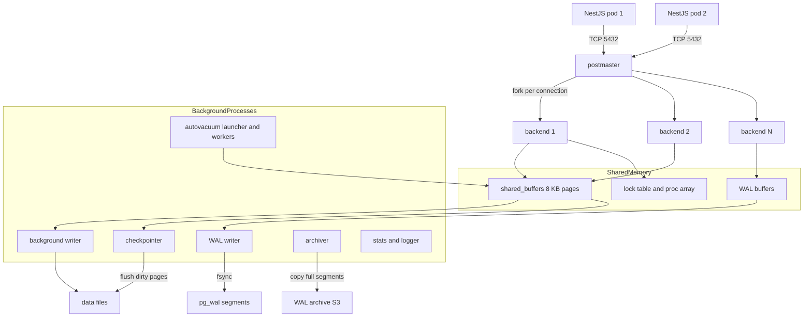

# Part 18 — PostgreSQL Internals

PostgreSQL is the component in your stack that you can least afford to treat as a black box. Redis can be restarted. A NestJS pod can be killed and replaced. The database holds the only copy of the truth, and every performance incident, every lock pile-up, and every "why is disk full at 3 a.m." page eventually leads back to how PostgreSQL works underneath.

This part teaches those mechanics: processes and memory, how a query travels through the server, how rows are stored, how MVCC keeps readers and writers from blocking each other, why VACUUM is not optional, how locks queue, and how the planner decides what to do. Every example uses the same e-commerce schema, so you can run everything on a local PostgreSQL 15 or 16.

```sql
-- Running schema used across Part 18 and Part 19
CREATE TABLE users (
  id           bigserial PRIMARY KEY,
  email        text NOT NULL,
  created_at   timestamptz NOT NULL DEFAULT now()
);

CREATE TABLE products (
  id           bigserial PRIMARY KEY,
  sku          text NOT NULL,
  name         text NOT NULL,
  attributes   jsonb NOT NULL DEFAULT '{}',
  price_cents  integer NOT NULL
);

CREATE TABLE orders (
  id           bigserial PRIMARY KEY,
  user_id      bigint NOT NULL REFERENCES users(id),
  status       text NOT NULL,              -- PENDING, PAID, SHIPPED, CANCELLED
  total_cents  integer NOT NULL,
  created_at   timestamptz NOT NULL DEFAULT now(),
  updated_at   timestamptz NOT NULL DEFAULT now()
);

CREATE TABLE order_items (
  id           bigserial PRIMARY KEY,
  order_id     bigint NOT NULL REFERENCES orders(id),
  product_id   bigint NOT NULL REFERENCES products(id),
  quantity     integer NOT NULL,
  price_cents  integer NOT NULL
);

CREATE TABLE payments (
  id               bigserial PRIMARY KEY,
  order_id         bigint NOT NULL REFERENCES orders(id),
  provider_ref     text NOT NULL,
  status           text NOT NULL,          -- INITIATED, CAPTURED, FAILED
  amount_cents     integer NOT NULL,
  created_at       timestamptz NOT NULL DEFAULT now()
);

CREATE TABLE inventory (
  product_id   bigint PRIMARY KEY REFERENCES products(id),
  quantity     integer NOT NULL CHECK (quantity >= 0),
  updated_at   timestamptz NOT NULL DEFAULT now()
);
```

## 18.1 PostgreSQL process architecture

### 18.1.1 Processes and shared memory

#### Concept

PostgreSQL is not one program. It is a family of operating-system processes that share one region of memory. There is one parent process called the **postmaster**. When your NestJS app opens a connection, the postmaster forks a brand-new child process, called a **backend**, that serves only that connection for its whole life. Around them run a handful of **background processes** that do housekeeping: writing dirty pages, flushing the write-ahead log, vacuuming, archiving, collecting statistics.

All of these processes talk through **shared memory**: a big block of RAM that holds the page cache (`shared_buffers`), the WAL buffers, the lock table, and the list of running transactions.

#### Why does it exist?

A process-per-connection model was chosen in the 1990s for isolation: if one backend crashes on a bug, the postmaster notices, and because memory could be corrupted, it restarts all backends but the data files are protected by the WAL. The background processes exist because certain jobs (flushing dirty pages, vacuuming) must happen continuously regardless of whether any client is connected. Without a checkpointer, crash recovery would have to replay the entire WAL since the server started. Without autovacuum, tables would grow forever.

#### Mental model

Imagine a restaurant. The postmaster is the host at the door. Every guest (connection) gets a dedicated waiter (backend process) who does nothing else until the guest leaves. The kitchen (shared memory) is shared by all waiters. In the back, cleaners (autovacuum), a dishwasher (background writer), a bookkeeper writing every order into a ledger before food is served (WAL writer), and a manager who periodically makes sure everything is filed (checkpointer) keep the restaurant running. If you invite 500 guests at once, you need 500 waiters, and they all crowd the same kitchen.

#### How it works



Step by step:

1. **postmaster** starts, allocates shared memory, opens the listening socket, and launches the background processes. It never touches data itself. If a backend dies abnormally, the postmaster kills all other backends and restarts, because shared memory might be corrupt.
2. **backend process** (one per connection) authenticates the client, then loops: read query, parse, plan, execute, send results. It reads and writes pages only through `shared_buffers`. Each backend also keeps private memory: the relation cache and catalog cache (metadata for tables it has touched), `work_mem` for sorts, and a prepared statement cache. This private memory is why an idle connection still costs 5 to 10 MB, and more after it has touched many tables.
3. **background writer** wakes every `bgwriter_delay` (200 ms) and writes some dirty pages to disk so backends rarely have to evict a dirty page themselves.
4. **checkpointer** periodically writes *all* dirty pages and records a checkpoint in the WAL. Recovery only needs WAL after the last checkpoint. Covered in 18.6.
5. **WAL writer** flushes WAL buffers to the `pg_wal` directory every `wal_writer_delay` (200 ms) and on commit.
6. **autovacuum launcher** starts up to `autovacuum_max_workers` (default 3) **autovacuum workers**, each of which vacuums or analyzes one table at a time.
7. **archiver** copies completed 16 MB WAL segments to an archive location when `archive_mode = on`. This is how point-in-time recovery works.
8. **stats collector** existed through PostgreSQL 14 as a separate process receiving UDP packets from backends. Since PostgreSQL 15, cumulative statistics live in shared memory and there is no collector process, but the views (`pg_stat_user_tables`, `pg_stat_activity`) are the same.
9. **logger** writes server logs when `logging_collector = on`. On managed services (RDS, Cloud SQL) this is always on.
10. Replication adds **WAL sender** processes on the primary (one per replica) and **WAL receiver** plus **startup** processes on each replica.

You can see every process type:

```sql
SELECT backend_type, count(*)
FROM pg_stat_activity
GROUP BY backend_type
ORDER BY 2 DESC;
```

```text
 backend_type                 | count
------------------------------+-------
 client backend               |    42
 autovacuum worker            |     2
 walsender                    |     2
 checkpointer                 |     1
 background writer            |     1
 walwriter                    |     1
 autovacuum launcher          |     1
 logical replication launcher |     1
```

#### Practical example

Your NestJS order service runs 6 pods, each with a pool of 10 connections. That is 60 backend processes sitting inside PostgreSQL, whether they are busy or not. Each holds a private relation cache. When you deploy and all 6 pods restart at once, 60 connections close and 60 new ones open within a second, so the postmaster forks 60 processes in a burst. On a small instance (2 vCPU) that fork storm alone can take 300 to 800 ms and spike CPU to 100 percent, which is why the first requests after a deploy are slow even though nothing in your code changed.

#### PostgreSQL example

Look at what one backend is doing and what it costs:

```sql
-- One row per process; pid maps to an OS process you can see with `ps`
SELECT pid, backend_type, state, wait_event_type, wait_event,
       now() - backend_start AS connected_for,
       now() - xact_start    AS in_txn_for,
       left(query, 60)       AS query
FROM pg_stat_activity
WHERE backend_type = 'client backend'
ORDER BY backend_start;
```

On Linux, `ps -o pid,rss,cmd -C postgres` shows the resident memory per backend. Fresh backends sit at 4 to 6 MB; backends that have touched hundreds of tables and run many distinct queries grow to 20 to 50 MB because of the catalog cache. On a 2 GB RDS instance with 300 connections that is the difference between "fine" and OOM.

#### Production scenario

A typical medium e-commerce deployment: PostgreSQL 16 on an 8 vCPU, 32 GB instance. `shared_buffers = 8GB`, `max_connections = 200`. Twenty NestJS pods across four services, each pooling 8 connections, gives 160 backends. Peak traffic 1,200 requests per second, 3,000 queries per second, median query 1.2 ms. Autovacuum runs 3 workers almost continuously on `orders`, `order_items`, and `inventory` because they are update-heavy. The checkpointer writes 400 to 900 MB every 5 minutes.

Monitoring you must have: `pg_stat_activity` counts by state, backend memory (RSS) totals, `pg_stat_bgwriter` (or `pg_stat_checkpointer` on PG 17) for checkpoint frequency, and autovacuum worker occupancy.

#### Failure scenario

At 14:07 a product-catalog import ran a single `UPDATE products SET attributes = attributes || '{"imported": true}'` on 4 million rows inside a transaction, then the importer crashed with an unhandled promise rejection but the Node process stayed alive. The backend stayed in `idle in transaction`. Nothing looked wrong for two hours. Then autovacuum could not clean any dead rows newer than that transaction on any table, the `inventory` table (updated 500 times per second) bloated from 60 MB to 2.1 GB, sequential scans that used to take 4 ms took 300 ms, and the API p99 went from 80 ms to 2.5 s. The fix was one `SELECT pg_terminate_backend(pid)`, and a permanent `idle_in_transaction_session_timeout = '60s'`. Every one of those mechanisms is explained in the sections that follow.

#### Edge cases & failure modes

- A crash of a single backend (segfault, out of memory kill) restarts *all* backends: every pooled connection in every pod drops at once.
- OOM killer on Linux picks the process with the largest RSS, often the postmaster or a backend running a large sort; on Kubernetes-hosted PostgreSQL set memory limits with a wide margin.
- Fork storms after a deploy: 100+ new connections in one second on a small instance can push connect latency above the pool's `connectionTimeoutMillis`.
- Background processes compete with backends for I/O; a checkpoint and an autovacuum on the same disk at the same time cause a visible latency bump.
- `max_connections` is also a shared memory sizing input: raising it requires a restart, and each slot reserves memory even when unused.

#### How a Senior Backend Engineer thinks about this

They think of connections as a scarce, expensive resource that must be budgeted like CPU. They ask "how many backends will exist in total across all services and pods, and does the instance have RAM and CPU for that many processes?" before increasing any pool size. They refuse to solve "too many connections" by raising `max_connections`; they put a pooler in front. They explain to a product manager: "The database is a kitchen with a fixed number of cooks. Adding more waiters does not make food come faster; it makes the kitchen slower."

#### Common mistakes

- Treating connections as free and opening one per request. Every one is a process fork plus authentication (5 to 20 ms) plus 5 MB.
- Setting `max_connections = 1000` "to be safe". The server now allows 1000 processes to fight over 8 cores.
- Ignoring `backend_type` when counting connections and panicking about autovacuum workers.
- Assuming a killed query frees everything: the backend is still there; only `pg_terminate_backend` ends it.

#### Interview questions

1. *Why is a PostgreSQL connection expensive compared to a Redis connection?* Expected: each PostgreSQL connection is a forked OS process with private caches (5 to 10 MB, growing), while Redis is single-threaded with cheap client structures. Follow-up: how do you keep connection count under control across 50 pods?
2. *What happens when one backend process crashes?* Expected: the postmaster restarts all backends because shared memory may be corrupt; data is safe because of WAL; all client connections drop. Follow-up: how should the app react?
3. *Name five background processes and one thing each does.*
4. *Why does PostgreSQL restart all connections after a single backend segfault instead of only that one?* Expected: shared memory is shared; a bug that crashed one process may have corrupted structures others rely on.
5. *What changed about the stats collector in PostgreSQL 15?*

#### Practical exercise

Run PostgreSQL 16 in Docker with `-c max_connections=20`. Write a small script that opens 25 connections with `pg`. Observe the `FATAL: sorry, too many clients already` error, then inspect `pg_stat_activity` and `ps` to correlate pids with RSS. Acceptance criteria: you can explain which processes are backends, which are background, and how much memory the 20 backends use in total.

## 18.2 Connections and connection pooling

### 18.2.1 Why each connection costs so much, and what `max_connections` really limits

#### Concept

`max_connections` (default 100) is the maximum number of simultaneous backends. Every app pool slot, every psql session, every migration runner and every replication sender counts. A handful of slots (`superuser_reserved_connections`, default 3) are held back for superusers so an admin can still log in when the app has exhausted everything.

#### Why does it exist?

There must be a cap, because each backend consumes memory (private caches, `work_mem` per sort operation), CPU (context switches among hundreds of runnable processes), and shared-memory structures (proc array, lock table slots). Beyond roughly 2 to 4 backends per CPU core that are *actively running queries*, throughput goes down, not up, because of contention on shared buffers and lock manager latches.

#### Mental model

Imagine a bank with 8 tellers (CPU cores). Letting 500 people into the hall (connections) does not serve anyone faster. It creates a crowd where tellers spend time managing the line instead of serving. A queue outside the door (a pooler) with 16 people inside at any time is strictly faster for everyone.

#### How it works

1. A client connects; the postmaster forks a backend and runs authentication (password, SCRAM, or IAM token). Cost: 5 to 20 ms and a few MB.
2. The backend registers itself in the proc array in shared memory; there are exactly `max_connections` slots.
3. Every query that sorts or hashes may allocate up to `work_mem` per operation. 300 connections × 3 sorts × 64 MB `work_mem` is 57 GB of theoretical demand; this is why `work_mem` must be sized against connection count.
4. Idle backends still hold their relation cache and stay registered, and idle-in-transaction backends additionally pin the oldest visible transaction id, which holds back vacuum (18.4).
5. Benchmarks on an 8-core box: throughput peaks at roughly 20 to 40 active connections and drops 30 to 50 percent at 300 connections because of latch contention and context switching. Latency, meanwhile, becomes bimodal: most queries are fast, but some wait behind a runnable-queue of hundreds of processes.

Why 500 application connections is bad even if the server "accepts" them:

| Number of backends | Memory (idle, 8 MB each) | Active on 8 cores | Effect |
|---|---|---|---|
| 40 | 320 MB | up to 40 | Healthy; cores are busy, little contention |
| 200 | 1.6 GB | 200 | Context switching, `work_mem` risk, p99 climbs |
| 500 | 4 GB | 500 | Lock manager and buffer contention; throughput falls; OOM risk during sorts |

#### Practical example

Four NestJS services (orders, catalog, payments, notifications) each run 8 pods with a pool of 15. That is 4 × 8 × 15 = 480 connections plus 3 workers with 10 each = 510. On a `max_connections = 500` server the last pods to start get `too many clients already`, their readiness probes fail, Kubernetes restarts them, they reconnect and steal slots from another service, and you get a rolling connection storm across the fleet. The fix is not `max_connections = 1000`; it is a pool budget per service and a pooler.

#### NestJS example

Pool settings live in the `TypeOrmModule` options and should come from environment config, sized by a budget, not by guess:

```ts
// app.module.ts
import { Module } from '@nestjs/common';
import { ConfigModule, ConfigService } from '@nestjs/config';
import { TypeOrmModule } from '@nestjs/typeorm';

@Module({
  imports: [
    ConfigModule.forRoot({ isGlobal: true }),
    TypeOrmModule.forRootAsync({
      inject: [ConfigService],
      useFactory: (cfg: ConfigService) => ({
        type: 'postgres',
        url: cfg.getOrThrow<string>('DATABASE_URL'),
        autoLoadEntities: true,
        synchronize: false,                   // never in production
        // `extra` is passed straight to pg-pool
        extra: {
          max: cfg.get<number>('DB_POOL_MAX', 8),          // per pod
          min: 0,
          idleTimeoutMillis: 30_000,        // release idle clients
          connectionTimeoutMillis: 5_000,   // fail fast when the pool is starved
          maxLifetimeSeconds: 1_800,        // recycle, spreads reconnects
          statement_timeout: 10_000,        // server-side safety belt, ms
          idle_in_transaction_session_timeout: 30_000,
          application_name: 'orders-api',   // shows up in pg_stat_activity
        },
      }),
    }),
  ],
})
export class AppModule {}
```

`application_name` is not decoration: when 400 backends are fighting, it tells you which service they belong to.

#### PostgreSQL example

Count connections by application and state so you can see who is spending the budget:

```sql
SELECT application_name, state, count(*)
FROM pg_stat_activity
WHERE backend_type = 'client backend'
GROUP BY 1, 2
ORDER BY 3 DESC;
```

```text
 application_name | state               | count
------------------+---------------------+-------
 orders-api       | idle                |   112
 catalog-api      | idle                |    96
 orders-api       | active              |    14
 payments-worker  | idle in transaction |     6   <-- investigate
```

Then check remaining headroom:

```sql
SELECT current_setting('max_connections')::int
       - (SELECT count(*) FROM pg_stat_activity) AS free_slots;
```

#### TypeORM example

`extra` maps directly to pg-pool's constructor: `max`, `min`, `idleTimeoutMillis`, `connectionTimeoutMillis`, `maxUses`, `maxLifetimeSeconds`, `allowExitOnIdle`. Everything else in `extra` (like `statement_timeout`) is passed through to the `pg` client, which sends recognised ones as startup parameters.

```ts
// data-source.ts (used by CLI and by tests)
import { DataSource } from 'typeorm';

export const AppDataSource = new DataSource({
  type: 'postgres',
  url: process.env.DATABASE_URL,
  extra: { max: Number(process.env.DB_POOL_MAX ?? 8), connectionTimeoutMillis: 5000 },
  entities: [__dirname + '/**/*.entity.{ts,js}'],
  migrations: [__dirname + '/migrations/*.{ts,js}'],
});
```

#### Sequelize example

Sequelize has its own pool (built on `sequelize-pool`), configured with `pool`:

```ts
import { Sequelize } from 'sequelize';

export const sequelize = new Sequelize(process.env.DATABASE_URL!, {
  dialect: 'postgres',
  logging: false,
  pool: {
    max: Number(process.env.DB_POOL_MAX ?? 8), // per pod
    min: 0,
    acquire: 5_000,   // ms to wait for a free connection before throwing
    idle: 30_000,     // ms before an idle connection is destroyed
    evict: 10_000,    // how often the evictor runs
  },
  dialectOptions: {
    statement_timeout: 10_000,
    idle_in_transaction_session_timeout: 30_000,
    application_name: 'orders-api',
  },
});
```

`acquire` is the equivalent of pg-pool's `connectionTimeoutMillis`: how long a request waits for a slot before failing with `ResourceRequest timed out`.

#### Production scenario

The correct order of operations for a connection budget:

1. Decide the server's healthy active-connection count. Rule of thumb from the PostgreSQL wiki: `connections = (cores * 2) + effective_spindle_count`. On 8 cores with SSD that is roughly 16 to 24 *active* connections. Allow idle headroom: budget 100 to 150 backends total.
2. Divide by services and pods: 4 services × 8 pods gives 32 pools; 120 / 32 gives a pool of 3 to 4 per pod. That feels tiny. It is fine when queries take 2 ms: one connection can serve 500 queries per second.
3. If the math does not fit (many pods, spiky traffic, serverless), put PgBouncer or RDS Proxy in front so pods can hold 20 client connections each while the database sees 50.

Latency check: with a 4-connection pool and 2 ms queries, a pod handling 400 requests per second that each run 2 queries needs 400 × 2 × 2 ms = 1.6 connection-seconds per second: 40 percent utilisation. Comfortable.

#### Failure scenario

"Connection storm after deploy": at 10:00 a deploy rolled 30 pods with a pool `max: 20` and `min: 20` (someone set `min` to "pre-warm"). 600 connect attempts hit a `max_connections = 400` server within 3 seconds. The postmaster forked 400 backends, CPU hit 100 percent, authentication took 2 s each, and pools timed out at `connectionTimeoutMillis: 2000`, retried, and produced a second wave. The API was down for 9 minutes without any code bug. Fixes: `min: 0`, a pooler, and a pool `max` sized by budget.

#### Edge cases & failure modes

- Pool `max` per pod × replicas × services × environments (staging shares the instance) exceeds `max_connections`.
- Horizontal pod autoscaler scales from 8 to 40 pods during a sale; every new pod brings its full pool.
- Health checks that open a new connection each time instead of using the pool.
- Connection leak: a `QueryRunner` created and never released; the pool empties one slot per leaked call until every request waits `connectionTimeoutMillis` and fails.
- `maxUses` or `maxLifetimeSeconds` forcing all connections to recycle at the same instant (they were created together at pod start); add jitter or rely on `idleTimeoutMillis`.
- A long DNS TTL after a failover: pools keep connecting to the old primary IP.
- TLS handshake cost (2 to 5 ms) multiplies during storms.

#### How a Senior Backend Engineer thinks about this

They keep a written connection budget and treat it as capacity planning. They know that a smaller pool with a queue in the app is better than a bigger pool that makes the database thrash. They put `connectionTimeoutMillis` low (2 to 5 s) so overload fails fast and visibly instead of piling up. They ask: "Can it timeout? Can it become slow? Can it partially succeed?" and answer with timeouts at every layer: pool acquire timeout, `statement_timeout`, HTTP timeout.

#### Common mistakes

- Sizing the pool by "more is safer".
- `min` equal to `max` for warm-up, which turns every deploy into a storm.
- Sharing one database instance among ten microservices with independent pools that nobody totals.
- No `connectionTimeoutMillis`: requests hang forever when the pool is empty, which looks like a database outage.

#### Interview questions

1. *Ten services, 8 pods each, `max_connections = 300`. How big is the pool per pod?* Expected: about 3 to 4, or use a pooler; explain the budget arithmetic and why active-connection count should stay near 2× cores.
2. *Why is a pool of 4 enough for a pod doing 400 RPS?* Expected: Little's law; 2 ms queries mean each connection can serve hundreds of queries per second.
3. *What does `connectionTimeoutMillis` protect against?*
4. *What is `superuser_reserved_connections` for?*

#### Practical exercise

Instrument a NestJS service with a Prometheus gauge for `pool.totalCount`, `pool.idleCount`, and `pool.waitingCount` (available on the pg `Pool` object, reachable through `dataSource.driver`). Load test with autocannon at increasing concurrency. Acceptance criteria: you can show the point where `waitingCount` starts to rise and relate it to p99 latency, and you can justify a pool size with the numbers.

