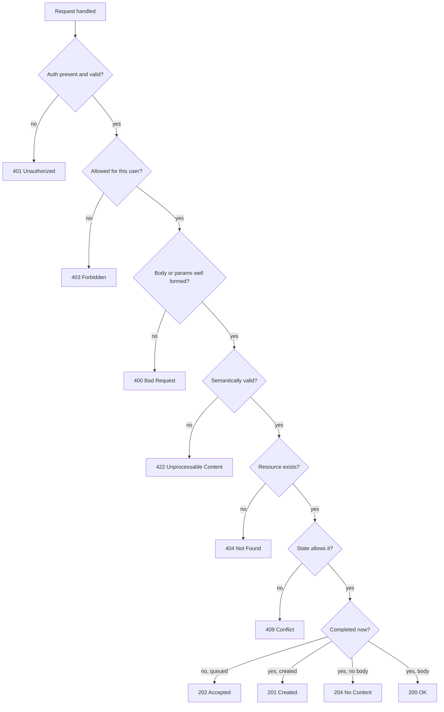

# Part 18 — API Design (REST first)

An API is a contract you will be held to for years. The database schema behind it can change every sprint; the API cannot, because mobile apps stuck on last year's release and partner integrations nobody remembers are calling it right now. That asymmetry is why API design deserves more care than almost any other backend decision.

This part covers REST thoroughly, with NestJS code for everything: resource modeling, URIs, verbs, status codes, pagination, filtering, bulk operations, partial updates, versioning, errors, validation, idempotency, rate limiting, contracts, long-running operations and webhooks. It ends with a complete `OrdersController` and an API design review checklist. GraphQL and gRPC are covered in Part 20; the principles here (resources, idempotency, errors, versioning) carry over.

## 18.1 Resource modeling

#### Concept

A REST API exposes **resources**: named things a client can address and manipulate. `Order`, `Customer`, `Shipment`, `Payment`. A resource is identified by a URI and manipulated with HTTP verbs. Resources are modelled around **business capabilities and the ubiquitous language** (Part 17), not around database tables.

Resource kinds:

- **Collection**: `/orders` (many orders).
- **Item**: `/orders/8f3c...` (one order).
- **Sub-resource**: `/orders/8f3c.../lines` (the lines that belong to that order).
- **Action as a resource**: `/orders/8f3c.../cancellations` (the fact that a cancellation happened), created with `POST`, instead of an RPC-style `/orders/8f3c.../cancel`.

#### Why does it exist?

Modelling around resources gives clients a uniform interface: once they know how `/orders` works, they know how `/shipments` works. It gives caches, proxies and gateways something to reason about (a `GET` on a URI is cacheable; a `POST` is not). And it forces you to name business concepts, which is exactly the discipline that keeps an API stable while the implementation churns.

Modelling around tables, by contrast, ties the contract to the schema. Every normalisation, rename or split of a table becomes a breaking change.

#### Mental model

Imagine a well-run post office. There are counters (resources) with clear signs: "Parcels", "Letters", "Complaints". You do not ask the clerk to "run procedure 47 with these parameters". You go to the "Complaints" counter and file a complaint (create a complaint resource). Later you can ask "what happened to complaint 123?" (read the resource). The counters are organised by what customers want to do, not by which filing cabinet the clerk uses.

#### How it works

Bad, table-driven API. It exposes the schema and pushes logic to the client:

```text
GET    /order_header?id=42
GET    /order_detail?order_header_id=42
POST   /order_header          body: { status_id: 1, cust_id: 9 }
POST   /order_detail          body: { order_header_id: 42, prod_id: 7, qty: 2 }   (repeat per line)
PUT    /order_header/42       body: { status_id: 4 }                               (client "cancels" by setting a magic number)
GET    /status_lookup                                                                (client fetches what 4 means)
```

Problems: five round trips to place an order; no atomicity (line 3 fails, lines 1 and 2 are orphaned); the client knows that status 4 means cancelled; renaming `order_header` breaks everyone; the invariant "cannot cancel a fulfilled order" is enforced by hoping the client checked.

Good, resource-driven API. It speaks the business language and keeps invariants server-side:

```text
POST   /orders                          body: { currency, lines: [...], shippingAddress }   -> 201 + Location
GET    /orders/{id}
GET    /orders?status=PAID&cursor=...
PATCH  /orders/{id}                     body: { shippingAddress }                          (draft only)
DELETE /orders/{id}                     (draft only; placed orders are cancelled, not deleted)
POST   /orders/{id}/cancellations       body: { reason }                                   -> 201 with the cancellation
GET    /orders/{id}/cancellations       (history: who cancelled, when, why)
POST   /orders/{id}/payments            body: { method, ... }                              -> 202 (async capture)
GET    /orders/{id}/shipments
```

One call places an order atomically. Cancelling is creating a `cancellation` resource, which naturally has an id, a timestamp, a reason and an actor, and which you can list. The client never sees status codes as magic integers.

Why `POST /orders/{id}/cancellations` and not `POST /orders/{id}/cancel`? Three reasons:

1. **It is a noun.** The cancellation is a thing that exists after the fact, can be looked up, and can carry data (reason, refund amount, who did it).
2. **It is idempotent-friendly.** Creating a second cancellation for an already-cancelled order can return the existing one (200) instead of failing.
3. **It stays consistent.** `/cancel`, `/approve`, `/ship`, `/refund` sprawl into an RPC API with a different shape per verb. Sub-resources keep one shape.

When a verb resource truly has no state to keep (a `/search` with a large body, a `/validate` that returns a result without side effects), an action endpoint is acceptable. Use it rarely and document why.

#### Practical example

The Ordering API's resource model, derived from the aggregate and events in Part 17:

| Resource | Backed by | Verbs |
|---|---|---|
| `/orders` | `Order` aggregate | `POST` (place), `GET` (list) |
| `/orders/{id}` | `Order` aggregate | `GET`, `PATCH` (draft edits), `DELETE` (draft only) |
| `/orders/{id}/lines` | `OrderLine` inside the aggregate | `POST`, `PATCH /{lineId}`, `DELETE /{lineId}` (draft only) |
| `/orders/{id}/cancellations` | `OrderCancelled` event, `cancellations` table | `POST`, `GET` |
| `/orders/{id}/payments` | Payments context via events | `POST` (initiate), `GET` |
| `/orders/{id}/shipments` | Shipping context read model | `GET` |

Notice that `/orders/{id}/shipments` is served from a **read model** fed by Shipping's events, not by joining into Shipping's tables. The API boundary respects the bounded context boundary.

#### NestJS example

The controller structure follows the resource tree. Sub-resources get their own controller with a prefix.

```ts
// src/ordering/api/orders.controller.ts (shape only; full version in 8.18)
@Controller('orders')
export class OrdersController {
  @Post() create() {}
  @Get() list() {}
  @Get(':id') getOne() {}
  @Patch(':id') update() {}
  @Delete(':id') remove() {}
}

// src/ordering/api/order-cancellations.controller.ts
@Controller('orders/:orderId/cancellations')
export class OrderCancellationsController {
  constructor(private readonly cancelOrder: CancelOrderService) {}

  @Post()
  @HttpCode(201)
  async create(@Param('orderId', ParseUUIDPipe) orderId: string, @Body() dto: CreateCancellationDto,
               @CurrentUser() user: { id: string }, @Res({ passthrough: true }) res: Response) {
    const result = await this.cancelOrder.execute({ orderId, reason: dto.reason, requestedBy: user.id });
    if (result.alreadyCancelled) res.status(200);   // idempotent: return the existing cancellation
    res.setHeader('Location', `/orders/${orderId}/cancellations/${result.cancellationId}`);
    return result;
  }

  @Get()
  list(@Param('orderId', ParseUUIDPipe) orderId: string) { /* history */ }
}
```

#### PostgreSQL example

Actions-as-resources usually earn their own table. It doubles as an audit log.

```sql
CREATE TABLE ordering.order_cancellations (
  id            uuid PRIMARY KEY,
  order_id      uuid NOT NULL REFERENCES ordering.orders(id),
  reason        text NOT NULL,
  requested_by  uuid NOT NULL,
  refund_minor  bigint NOT NULL DEFAULT 0 CHECK (refund_minor >= 0),
  created_at    timestamptz NOT NULL DEFAULT now(),
  CONSTRAINT ux_one_cancellation_per_order UNIQUE (order_id)   -- an order is cancelled at most once
);
```

#### Production scenario

A marketplace API served 2,000 RPS across 60 resources. Because every resource followed the same shape (`GET` list with cursor, `GET` item, `POST` create with `Idempotency-Key`, sub-resources for actions), the mobile team built one generic client layer and new resources needed zero client changes. Partner onboarding time dropped from three weeks to three days because the OpenAPI document was predictable.

#### Failure scenario

A team exposed `POST /orders/{id}/setStatus` with `{ status: 'CANCELLED' }`. The iOS app cached the status list and, after a backend change renamed `CANCELLED` to `CANCELED` (American spelling, a "harmless" cleanup), every cancel from iOS was rejected with 400 for six weeks until the app store release caught up. With `POST /orders/{id}/cancellations` there is no status string on the wire to break.

#### Edge cases & failure modes

- **Resource that maps to two aggregates.** `/orders/{id}/shipments` reads Shipping data. Serve it from a read model; do not let the Ordering controller call Shipping's repository.
- **Deeply nested URIs** mirroring the object graph: `/customers/{c}/orders/{o}/lines/{l}/product`. Stop at two levels; orders have their own top-level collection.
- **Actions that are really queries** (`POST /orders/search`). Acceptable when filters are too large for a query string; document it as a query.
- **Deleting vs cancelling.** `DELETE /orders/{id}` on a placed order would erase history. Only drafts are deletable; placed orders are cancelled.

#### How a Senior Backend Engineer thinks about this

They start from the ubiquitous language and the aggregate boundaries, list the nouns, decide which are top-level collections, and turn every business verb into either a state-changing `PATCH` or a sub-resource `POST`. They ask "what will a client want to *read back* after doing this?" If the answer is anything (a reason, a timestamp, an actor), it is a resource.

#### Common mistakes

- Generating controllers from tables.
- `/getOrder`, `/createOrder`, `/updateOrderStatus`.
- Exposing internal enums as integers.
- One `PUT /orders/{id}` that accepts any field and lets the client change `status`, `total` and `customerId`.

#### Interview questions

1. *Why `POST /orders/{id}/cancellations` instead of `POST /orders/{id}/cancel`?* Expected: noun, has data and history, idempotent-friendly, consistent shape.
2. *Show a table-driven API and explain what breaks when the schema changes.* Expected: the bad example above; atomicity, magic values, renames.
3. *How do you expose data from another bounded context through this API?* Expected: read model fed by events; no cross-context repository calls.
4. *When is an action endpoint acceptable?* Expected: stateless operations like search or validate; rare and documented.

#### Practical exercise

Take a `SHIPMENTS` table with columns `id, order_id, carrier_code, status_id, tracking_no, dispatched_ts, delivered_ts`. Design the resource model: collection, item, sub-resources for `dispatch` and `delivery confirmation`, and a read model for tracking events. Acceptance criteria: no status integers on the wire; every state change is either a `PATCH` of a draft or a `POST` to a sub-resource; the URI tree is at most two levels deep.

## 18.2 URI design

#### Concept

A URI names a resource. Good URIs are predictable, stable and boring: plural nouns, lowercase kebab-case, no verbs, no trailing slashes, no file extensions, ids that are safe to expose.

#### Why does it exist?

Clients hard-code URIs. Search engines, logs, dashboards and alerting rules match on them. A URI is the most public part of your contract, and inconsistency (some singular, some plural, some camelCase) is the first thing a partner notices and the last thing you can fix.

#### Mental model

Imagine street addresses. "12 Baker Street" works because every street follows the same pattern. If some streets used "Baker St. #12", some "Baker-12", and some "House twelve on the road of bakers", the postal service would grind to a halt. URIs are addresses; make them uniform.

#### How it works

Rules, with reasons:

| Rule | Example | Why |
|---|---|---|
| Plural nouns for collections | `/orders`, `/customers` | `GET /orders` reads naturally as "the orders"; `/orders/{id}` as "one of the orders" |
| Lowercase, kebab-case for multi-word | `/order-cancellations`, `/shipping-addresses` | URIs are case-sensitive; kebab-case survives copy-paste and is readable in logs |
| No verbs | `/orders/{id}/cancellations` not `/cancelOrder` | The verb is the HTTP method |
| No trailing slash | `/orders` not `/orders/` | Two URIs for one resource confuse caches and routers; redirect one to the other |
| At most two levels of nesting | `/orders/{id}/lines/{lineId}` | Deeper paths duplicate ids and couple the client to the object graph |
| Query params for filters, sorts, pages | `/orders?status=PAID&sort=-placedAt` | Path is identity; query is selection |
| No file extensions | `/orders/{id}` with `Accept: application/json` | Content negotiation, not filenames |
| Version prefix if using URI versioning | `/v1/orders` | Section 18.11 |
| Ids are opaque strings | `/orders/8f3c2b1e-...` | See below |

**Choosing ids.** Three options:

| Id type | Example | Pros | Cons |
|---|---|---|---|
| Sequential integer | `/orders/10482` | Small, fast B-tree, human-readable | Leaks volume ("they have 10k orders"); enumerable (`/orders/10483`); requires DB round trip before you know the id |
| UUID v4 | `/orders/8f3c2b1e-4a5b-...` | Generated anywhere, not enumerable, no volume leak | 36 chars; random inserts fragment B-trees (UUID v7 / ULID fix this by being time-ordered) |
| Public id / prefixed id | `/orders/ord_7Yq3kLp2Xz` | Self-describing, short, not enumerable, internal id can change | Needs a mapping or a generator; must be unique-indexed |

Recommendation: internal primary key can be `uuid` (v7 if your PostgreSQL stack supports it, otherwise v4), and the API exposes the same value. If you want Stripe-style prefixed ids (`ord_`, `cus_`), store them as a separate unique column. Never expose sequential integers for anything a user could enumerate (orders, invoices, users).

#### NestJS example

Enforce the rules mechanically. A `ParseUUIDPipe` on every id param rejects junk before it reaches the service, and a global prefix plus versioning is set once in `main.ts`.

```ts
// src/main.ts
import { NestFactory } from '@nestjs/core';
import { VersioningType } from '@nestjs/common';
import { AppModule } from './app.module';

async function bootstrap() {
  const app = await NestFactory.create(AppModule);
  app.setGlobalPrefix('api');
  app.enableVersioning({ type: VersioningType.URI, defaultVersion: '1' }); // /api/v1/orders
  await app.listen(3000);
}
bootstrap();

// src/ordering/api/order-lines.controller.ts
@Controller('orders/:orderId/lines')
export class OrderLinesController {
  @Patch(':lineId')
  changeQuantity(
    @Param('orderId', new ParseUUIDPipe({ version: '4' })) orderId: string,
    @Param('lineId', new ParseUUIDPipe({ version: '4' })) lineId: string,
    @Body() dto: ChangeQuantityDto,
  ) { /* ... */ }
}
```

Express (NestJS's default adapter) treats `/orders` and `/orders/` as the same route by default (`strict routing` off). Keep it that way, and make sure your gateway does not add or strip slashes inconsistently.

#### PostgreSQL example

Time-ordered UUIDs avoid the random-insert problem. PostgreSQL 17 does not ship a UUID v7 generator natively (it arrives in 18 as `uuidv7()`); until then generate in the application (`uuidv7` npm package) or with a small SQL function. The difference matters at scale:

```sql
-- Random UUID v4 primary key: inserts land on random leaf pages, cache misses, index bloat.
-- Time-ordered UUID v7 primary key: inserts append to the right-hand leaf, like a serial.
-- Measured on a 50M-row orders table: v4 insert throughput ~35% lower than v7, index 20% larger.

CREATE TABLE ordering.orders (
  id         uuid PRIMARY KEY,           -- v7 generated by the app
  public_id  text NOT NULL UNIQUE,       -- optional: 'ord_7Yq3kLp2Xz' for the API
  ...
);
CREATE INDEX ix_orders_public_id ON ordering.orders (public_id);
```

#### Edge cases & failure modes

- **Case sensitivity.** `/Orders` and `/orders` are different URIs. Enforce lowercase at the gateway with a redirect.
- **URL-encoded ids** with slashes or spaces. Reject ids that do not match the expected pattern.
- **Id enumeration attacks.** `GET /orders/10483` with someone else's order. Non-enumerable ids reduce the blast radius; authorisation is still required (Part 44 — Security).
- **Very long query strings** (> 8 KB) rejected by proxies. Move large filters to `POST /orders/search`.

#### How a Senior Backend Engineer thinks about this

They write the URI table before the code and review it with the mobile and partner teams. They pick UUIDs or prefixed ids by default and reserve integers for internal joins. They put lint rules or an OpenAPI linter (Spectral) in CI to catch `camelCase` paths and verbs.

#### Common mistakes

- Mixing `/order/{id}` and `/orders`.
- `/api/v1/getOrderById?id=42`.
- Exposing auto-increment ids and then discovering a competitor scraped growth numbers.
- `/orders/{id}/` with a trailing slash returning 404 on one router and 200 on another.

#### Interview questions

1. *UUID vs sequential integer vs public id for API identifiers?* Expected: the table above; enumeration, volume leak, B-tree behaviour, v7/ULID.
2. *How deep should URI nesting go and why?* Expected: two levels; deeper duplicates ids and couples clients.
3. *Why no verbs in URIs?* Expected: method is the verb; uniform interface; caching.

#### Practical exercise

Write an OpenAPI linter config (Spectral) that fails on: verbs in paths, uppercase letters, trailing slashes, nesting deeper than two levels, path params not matching a UUID or prefixed-id pattern. Run it against an existing spec. Acceptance criteria: at least five real violations found and fixed; the linter runs in CI.

## 18.3 HTTP verbs

#### Concept

HTTP methods carry standard **semantics** that clients, caches, proxies and retries depend on:

| Method | Meaning | Safe (no side effects) | Idempotent (repeat = same result) | Request body | Typical response |
|---|---|---|---|---|---|
| `GET` | Read a resource | Yes | Yes | No | 200, 404 |
| `HEAD` | Headers only | Yes | Yes | No | 200 |
| `OPTIONS` | Capabilities, CORS preflight | Yes | Yes | No | 204 |
| `POST` | Create, or non-idempotent action | No | **No** | Yes | 201, 202, 200 |
| `PUT` | Replace the whole resource | No | Yes | Yes | 200, 204, 201 |
| `PATCH` | Partial update | No | Not by default (can be made so) | Yes | 200 |
| `DELETE` | Remove | No | Yes | Usually no | 204, 404, 409 |

**Safe** means the client can call it without changing anything; browsers prefetch and caches store safe responses. **Idempotent** means calling it N times has the same effect as once; a client or proxy can retry it without fear.

#### Why does it exist?

Retries. Every network call can time out with the server having done the work. If the client knows the method is idempotent, it can retry blindly. If not, it must not, unless the server gives it a way (an `Idempotency-Key`, section 18.12). Getting verbs right is what makes reliable clients possible.

#### Mental model

Imagine a vending machine. Looking at the display (`GET`) is safe; do it all day. Pressing "return coins" (`DELETE`) twice returns the coins once; idempotent. Inserting a coin (`POST`) twice inserts two coins; not idempotent, so if you are not sure the first coin registered, you need a receipt (idempotency key) before inserting another.

#### How it works

**PUT vs PATCH.** `PUT /orders/{id}/shipping-address` with a full address replaces the address entirely: omitted fields become null. `PATCH /orders/{id}` with `{ "shippingAddress": { "line2": "Flat 4" } }` changes only `line2`. `PUT` is idempotent by definition; `PATCH` is idempotent only if the patch is absolute ("set quantity to 3") and not relative ("increase quantity by 1"). Prefer absolute patches. Section 18.8 covers JSON Merge Patch vs JSON Patch.

**POST for creation.** Creating a new order must mint a new id, so `POST /orders` is not idempotent by default. Two ways to make creation safe to retry: (a) client-supplied ids with `PUT /orders/{clientGeneratedUuid}` (idempotent by construction), or (b) `POST` with an `Idempotency-Key` header. Most public APIs use (b).

**DELETE semantics.** The first `DELETE` returns 204; a repeat may return 404 (resource gone) or 204 (still gone, which is the more retry-friendly choice). Both are idempotent: the end state is the same.

#### NestJS example

Method decorators map one to one. Note `@HttpCode` where the default (200 for everything except `POST`, which defaults to 201) is wrong.

```ts
@Controller('orders')
export class OrdersController {
  @Get(':id')                       // safe, idempotent, cacheable
  getOne(@Param('id', ParseUUIDPipe) id: string) { /* ... */ }

  @Post()                           // non-idempotent by default; Idempotency-Key makes it safe (18.12)
  @HttpCode(201)
  create(@Body() dto: CreateOrderDto) { /* ... */ }

  @Put(':id/shipping-address')      // replace whole sub-resource; idempotent
  @HttpCode(200)
  replaceAddress(@Param('id', ParseUUIDPipe) id: string, @Body() dto: AddressDto) { /* ... */ }

  @Patch(':id')                     // partial; keep patches absolute so repeats are harmless
  update(@Param('id', ParseUUIDPipe) id: string, @Body() dto: UpdateOrderDto) { /* ... */ }

  @Delete(':id')                    // idempotent; second call also 204
  @HttpCode(204)
  async remove(@Param('id', ParseUUIDPipe) id: string) {
    await this.deleteDraft.execute({ orderId: id }); // no-op if already gone
  }
}
```

#### PostgreSQL example

Idempotent `DELETE` and `PUT` at the SQL level:

```sql
-- DELETE: affected rows 0 on repeat is fine; still return 204.
DELETE FROM ordering.orders WHERE id = $1 AND status = 'DRAFT';

-- PUT replace-address: same statement, same end state on repeat.
UPDATE ordering.orders
SET ship_line1 = $2, ship_line2 = $3, ship_city = $4, ship_postal_code = $5, ship_country = $6,
    updated_at = now(), version = version + 1
WHERE id = $1 AND status = 'DRAFT';

-- PATCH relative update is NOT idempotent; avoid on retryable paths:
-- UPDATE order_lines SET quantity = quantity + 1 WHERE id = $1;
-- Absolute is:
UPDATE ordering.order_lines SET quantity = $2 WHERE id = $1;
```

#### Failure scenario

A mobile app used `POST /cart/items` to add items and retried on timeout. At 19:00 on a Friday the API's p99 crossed the app's 5-second timeout, so every add was retried once or twice. Carts filled with duplicate lines; 4% of orders that evening had double quantities, and the refund queue took two days to clear. The fix was twofold: `PUT /cart/items/{sku}` with an absolute quantity (idempotent by design), and `Idempotency-Key` on `POST /orders`.

#### Edge cases & failure modes

- **`GET` with side effects** (`GET /orders/{id}/cancel`). Crawlers and prefetchers will trigger it. Never.
- **`POST` used for everything** because "it is easier". Clients cannot retry anything safely.
- **`PATCH` with relative operations** on retryable paths.
- **`DELETE` with a body.** Many proxies drop it. Put parameters in the query string or use a sub-resource.
- **HEAD not mirroring GET headers** (`Content-Length`, `ETag`) confuses download managers and caches.

#### How a Senior Backend Engineer thinks about this

For every endpoint they ask: *Can it timeout? Can it fail? Can it duplicate? Can it partially succeed?* Then they pick the method whose semantics tell the truth, and they add an idempotency key wherever the method alone cannot make retries safe. They refuse `GET` with side effects and `POST` for reads with no justification.

#### Common mistakes

- `POST /orders/{id}/get`.
- `PUT` that only updates the provided fields (that is `PATCH`).
- Returning 200 with `{ success: false }` on a `DELETE` failure.
- Relying on `PATCH` being idempotent without checking the operations are absolute.

#### Interview questions

1. *Define safe and idempotent; give an HTTP method that is idempotent but not safe.* Expected: `DELETE`, `PUT`.
2. *Is `PATCH` idempotent?* Expected: not by definition; absolute patches are; relative are not; design accordingly.
3. *How do you make `POST` creation safe to retry?* Expected: client-generated id with `PUT`, or `Idempotency-Key`.
4. *Second `DELETE` on the same resource: 204 or 404?* Expected: both valid; 204 is more retry-friendly; be consistent.

#### Practical exercise

Audit ten endpoints in a codebase. For each, record method, whether it is actually safe/idempotent as implemented, and what a client retry would do. Fix at least two mismatches. Acceptance criteria: every `GET` is side-effect free; every `PUT`/`DELETE` is provably idempotent in SQL; every non-idempotent `POST` either has an idempotency key or a documented reason not to.

## 18.4 Status codes

#### Concept

The status code is the first thing a client reads. It decides whether to parse the body as a result or as an error, whether to retry, whether to re-authenticate, whether to back off. Using the right code is not pedantry; it is the difference between a client that self-heals and one that pages you.

#### Why does it exist?

Generic clients (SDKs, gateways, browsers, monitoring) act on the code without reading your documentation. A 401 triggers token refresh; a 429 triggers backoff with `Retry-After`; a 503 is retried; a 400 is not. Return 200 with `{ "error": ... }` and none of that works, and your dashboards say everything is fine while customers cannot pay.

#### Mental model

Imagine traffic lights. Green (2xx): proceed. Amber (3xx): change course. Red with a "you" sign (4xx): you did something wrong, fix it before trying again. Red with a "road closed" sign (5xx): not your fault, try another time. A driver who gets a green light with a note saying "actually the bridge is out" will crash.

#### How it works

The decision, as a flowchart:



The full table for our API:

| Situation | Code | Notes |
|---|---|---|
| Read succeeded | 200 | Body is the resource |
| Created synchronously | 201 | `Location` header points to the new resource |
| Accepted for async processing | 202 | Body or `Location` points to a status resource (18.16) |
| Succeeded, nothing to return | 204 | `DELETE`, some `PUT` |
| Idempotent replay of a create | 200 | Same resource as before; some APIs use 201 again; be consistent |
| Malformed JSON, wrong types, missing required field | 400 | Syntax/shape problem |
| Valid shape, invalid meaning (unknown SKU, quantity above stock, bad state transition data) | 422 | Semantic problem; the client must change the content |
| Not authenticated / token expired | 401 | Include `WWW-Authenticate` |
| Authenticated but not permitted | 403 | Do not reveal whether the resource exists if that leaks data; some APIs return 404 instead |
| Resource missing | 404 | Also for resources the user may not know exist |
| Method not supported on this resource | 405 | With `Allow` header |
| Cannot satisfy `Accept` | 406 | |
| State conflict (cancel a fulfilled order), optimistic lock mismatch, duplicate unique key | 409 | Body says which |
| Precondition failed (`If-Match` mismatch) | 412 | Section 18.8 |
| Payload too large | 413 | Section 18.19 |
| Unsupported media type | 415 | Client sent XML |
| Rate limited | 429 | `Retry-After` header |
| Unexpected server error | 500 | Never leak details; correlation id in body |
| Upstream (payment provider, catalog service) failed or timed out | 502 / 504 | Client may retry with backoff |
| Overloaded or in maintenance | 503 | `Retry-After` |

**400 vs 422.** Use 400 when the request could not be understood: broken JSON, `quantity: "two"`, missing `currency`. Use 422 when it was understood but cannot be processed: `sku` does not exist, `countryCode` is not served, promotion expired. Both mean "do not retry unchanged". The distinction helps client developers know whether the bug is in serialisation or in business data.

**409 vs 422.** 409 is about *state*: the request would be fine if the resource were in a different state (cancelling a fulfilled order, version mismatch, duplicate key). 422 is about *content*: the request would never be fine.

**202 for async.** When placing a payment takes seconds (3-D Secure, bank calls), return 202 with a `Location` of a status resource the client can poll, or a webhook registration. Section 18.16.

#### NestJS example

NestJS ships the `HttpException` family. Use them from controllers and guards; map domain errors to them in one global filter (18.9). Never `throw new Error('not found')` from a controller.

```ts
import {
  BadRequestException, UnauthorizedException, ForbiddenException, NotFoundException,
  ConflictException, UnprocessableEntityException, PayloadTooLargeException,
  ServiceUnavailableException, GatewayTimeoutException, HttpException, HttpStatus,
} from '@nestjs/common';

// Direct use in a controller/guard (rare; most mapping happens in the filter):
if (!user) throw new UnauthorizedException();                        // 401
if (!can(user, 'orders:read', order)) throw new ForbiddenException(); // 403
if (!order) throw new NotFoundException(`Order ${id} not found`);    // 404

// Custom with explicit status and a structured body:
throw new HttpException(
  { type: 'https://errors.example.com/order-not-cancellable', title: 'Order cannot be cancelled', status: 409 },
  HttpStatus.CONFLICT,
);

// 202 for async work:
@Post(':id/payments')
@HttpCode(202)
async initiatePayment(@Param('id', ParseUUIDPipe) id: string, @Body() dto: InitiatePaymentDto,
                      @Res({ passthrough: true }) res: Response) {
  const { paymentId } = await this.initiate.execute({ orderId: id, ...dto });
  res.setHeader('Location', `/api/v1/payments/${paymentId}`);
  return { paymentId, status: 'PENDING' };
}
```

The mapping from domain errors (Part 17) to HTTP, applied by the filter in 18.9:

| Domain error | HTTP |
|---|---|
| `OrderNotFoundError` | 404 |
| `OrderStateError` (bad transition) | 409 |
| `ConcurrencyError` (version mismatch) | 409 |
| `DuplicateIdempotencyKeyError` (payload mismatch) | 422 |
| `OrderInvariantError`, `UnknownSkuError`, `InsufficientStockError` | 422 |
| `CustomerBlockedError` | 403 |
| `ErpUnavailableError`, catalog timeout | 503 / 504 |
| Anything else | 500 |

#### Production scenario

An API gateway retried any 5xx up to three times with jittered backoff and never retried 4xx. Because the app returned 503 for "payment provider timed out" and 422 for "card declined", the gateway automatically retried the transient failures (which succeeded 70% of the time on retry) and never retried declines. When the app briefly returned 500 for declines due to a bug, the gateway retried each decline three times, tripling load on the provider and triggering their rate limit. Status codes are control signals for the whole chain.

#### Failure scenario

At 10:05 the checkout success rate dashboard showed 99.8%, while support tickets said "cannot pay". The API returned `200 { "ok": false, "message": "payment failed" }` on decline and on provider outage alike. The dashboard counted 200s. The provider had been down for 40 minutes. After the fix (503 for provider failures, 422 for declines, 200 only for success), the same outage would have paged within two minutes.

#### Edge cases & failure modes

- **200 for errors.** Monitoring, retries and caches all lie.
- **500 for client errors.** Gateways retry them; load triples during a bad deploy.
- **404 vs 403 information leak.** Returning 403 for an order that exists but is not yours tells an attacker the id is valid. For sensitive resources, return 404 for both.
- **201 without `Location`.** Clients cannot find what they created.
- **204 with a body.** Some HTTP stacks choke. `@HttpCode(204)` and return nothing.
- **429 without `Retry-After`.** Clients retry immediately and make it worse.

#### How a Senior Backend Engineer thinks about this

They can name the code for any situation without thinking, and they make sure the gateway's retry policy, the SDK's retry policy and the app's codes agree. They treat a wrong code as a bug with the same priority as wrong data, because downstream automation depends on it.

#### Common mistakes

- Wrapping every response in `{ success, data, error }` with status 200.
- Using 400 for everything from bad JSON to "order already shipped".
- Throwing raw `Error` from services and letting NestJS turn it into a 500 with a stack trace in development mode that leaks in production.

#### Interview questions

1. *400 vs 422 vs 409: give one example of each in an order API.* Expected: malformed JSON; unknown SKU; cancelling a fulfilled order or version mismatch.
2. *Why does returning 200 with an error body cause operational problems?* Expected: retries, caches, monitoring, SDK behaviour.
3. *When do you return 202 and what must accompany it?* Expected: async work; `Location` of a status resource or a webhook.
4. *403 or 404 for someone else's order?* Expected: depends on leak tolerance; 404 hides existence; be consistent.

#### Practical exercise

Write a Jest e2e test suite for `POST /orders` and `POST /orders/{id}/cancellations` that asserts the exact status for: malformed JSON, missing currency, unknown SKU, blocked customer, unknown order, cancelling a fulfilled order, version conflict, catalog timeout. Acceptance criteria: eight distinct assertions, at least six distinct status codes, and no test accepts "any 4xx".
