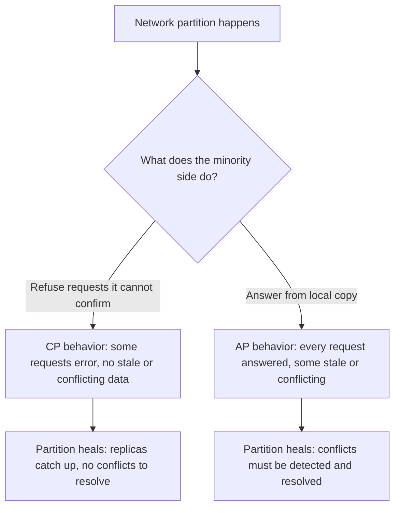
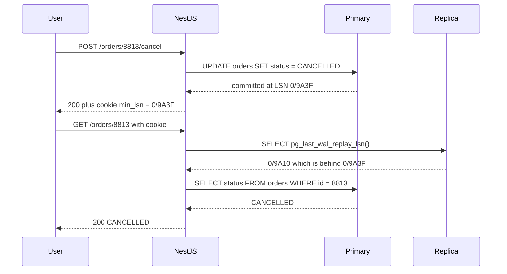

## 18.4 CAP theorem, explained simply and correctly

#### Concept

CAP says: **during a network partition, a distributed data system must choose between consistency and availability**. It cannot give both, because giving both would require the two sides of the partition to agree on data they cannot exchange.

The three letters, with their precise meanings (the theorem uses strict definitions, and most misunderstandings come from using loose ones):

- **C, Consistency**: every read returns the most recent write, as if there were a single copy of the data. This is *linearizability* (section 18.6), not the "C" of ACID.
- **A, Availability**: every request to a non-failed node gets a non-error response, without a guarantee that it contains the latest write.
- **P, Partition tolerance**: the system keeps operating when messages between nodes are lost or delayed.

#### Why does it exist?

CAP exists to kill a fantasy: the fantasy that with enough engineering you can have a multi-node system that is always up *and* always agrees with itself. Eric Brewer stated it in 2000; Gilbert and Lynch proved it in 2002. Its practical value is that it forces a question every architecture must answer: *when the network breaks, do we stop, or do we go on and risk disagreement?*

#### Mental model

Asha and Ben's bakery, phone line dead. Rule 1: "Only sell a cake if you can confirm with the other shop that it is still available." Under that rule they refuse every sale while the line is down. Consistent, not available. Rule 2: "Sell whatever your copy of the book says is available." They keep selling and may oversell. Available, not consistent. There is no rule 3 that keeps selling *and* never oversells while the phone is dead. Notice the choice only matters *while the phone is dead*; when it works, they can have both.

#### How it works

The three things everyone gets wrong about CAP:

1. **It is not a three-way choice.** "Pick two of C, A, P" is how it is usually drawn, and it is misleading. Partitions are not optional in a system that uses a network; you do not "choose P". You get P imposed on you, and the real choice is what you sacrifice *when a partition happens*: C or A.
2. **"CA" does not exist for a distributed system.** A "CA" system is one that never experiences a partition, which means a single node. A single PostgreSQL instance is "CA" in the sense that it is consistent and available until it is down, at which point it is neither. Once you add a second node that must agree with the first, you are choosing C or A during partitions.
3. **The choice applies per operation, not per system.** A system can be CP for writes and AP for reads, or CP for one table and AP for another. The letters describe behaviors, not products.



How specific systems behave during a partition:

| System | Behavior during a partition | Effective choice |
|---|---|---|
| PostgreSQL primary + synchronous standby | With `synchronous_commit = on` and the sync standby unreachable, commits block. With Patroni, a primary that loses its lease in etcd demotes itself; the minority side serves no writes. | CP for writes; reads from the primary continue |
| PostgreSQL primary + asynchronous replicas | Primary keeps committing; cut-off replicas serve increasingly stale reads and never error. If you fail over to an async replica you may lose acknowledged writes. | Writes: single leader, consistent while the primary is reachable. Replica reads: AP |
| Redis Cluster | Replication is async. The majority side keeps serving; the minority side stops accepting writes after `cluster-node-timeout`. A failover can lose the last few acknowledged writes. | Leans A on the majority side; loses writes on failover, so not C either |
| DynamoDB | Eventually consistent reads succeed from any replica. Strongly consistent reads and writes go through the partition leader and fail if it is unreachable. | Per request: eventual reads AP, strong reads and writes CP |
| Cassandra | Tunable per query. `ONE` answers from any replica. `QUORUM` needs a majority and errors without it. | `ONE`: AP; `QUORUM` reads and writes: CP-like |
| ZooKeeper / etcd | Minority side refuses writes and (by default) linearizable reads. Majority side continues. | CP |
| Kafka (`acks=all`, `min.insync.replicas=2`, unclean leader election off) | A partition that leaves fewer than 2 in-sync replicas makes the partition unavailable for writes rather than accepting unreplicated data. | CP for writes |

How a NestJS system on PostgreSQL behaves during a partition between some pods and the primary: those pods cannot write (connection timeouts, pool exhaustion), and any read they send to a cut-off replica is stale. There is no setting that changes that; the choice you get to make is *what the pod does about it*. A well-built pod fails readiness so traffic moves to pods that can reach the primary; serves cached catalogue and product pages if it can (accepting staleness there, an AP choice for read-only, low-risk data); and fails checkout and account writes fast with a clear error (a CP choice for money and stock). The system as a whole is CP at the database and can be made partially available at the application layer, on purpose, per endpoint.

#### Practical example

Inventory for a flash sale. If you keep stock counts in Redis Cluster and a partition splits the cluster, the majority side keeps decrementing, and a failover may lose the last hundred decrements. Result: overselling. If you keep stock in PostgreSQL with `SELECT ... FOR UPDATE` on the primary, a partition makes some pods unable to decrement at all. Result: some users see "try again", nobody is oversold. For inventory, the second is the right choice, and the senior engineer makes it knowingly rather than discovering it in a post-mortem.

#### NestJS example

Choosing the behavior per endpoint, explicitly, with a small guard that decides whether an endpoint may be served from a possibly stale source when the primary is unreachable:

```ts
// consistency.decorator.ts
import { SetMetadata } from '@nestjs/common';
export const CONSISTENCY_KEY = 'consistency';
export type ConsistencyLevel = 'strong' | 'stale-ok';
export const Consistency = (level: ConsistencyLevel) => SetMetadata(CONSISTENCY_KEY, level);

// primary-required.guard.ts
import { CanActivate, ExecutionContext, Injectable, ServiceUnavailableException } from '@nestjs/common';
import { Reflector } from '@nestjs/core';
import { PrimaryHealth } from './primary-health.service';

@Injectable()
export class PrimaryRequiredGuard implements CanActivate {
  constructor(private readonly reflector: Reflector, private readonly primary: PrimaryHealth) {}

  canActivate(ctx: ExecutionContext): boolean {
    const level = this.reflector.get<ConsistencyLevel>(CONSISTENCY_KEY, ctx.getHandler()) ?? 'strong';
    if (level === 'stale-ok') return true;                 // AP choice for this endpoint
    if (!this.primary.isReachable()) {                     // CP choice: refuse rather than guess
      throw new ServiceUnavailableException('Primary database unreachable; try again shortly');
    }
    return true;
  }
}
```

`PrimaryHealth` is a small service that pings the primary every 2 s (bounded to 500 ms) and keeps a boolean. Product listing gets `@Consistency('stale-ok')` and is served from the replica or cache; `POST /checkout` stays `strong` and fails fast with a 503 and a `Retry-After` header instead of a 30 s timeout.

#### PostgreSQL example

The knob that moves PostgreSQL between "block for safety" and "continue at risk" during a partition:

```sql
-- Wait for at least one of two standbys to confirm before COMMIT returns.
-- If both are unreachable, commits block: the CP choice.
ALTER SYSTEM SET synchronous_standby_names = 'ANY 1 (standby_b, standby_c)';
SELECT pg_reload_conf();

-- Per transaction, a session can opt out for data where losing a few ms of writes is acceptable
-- (audit logs, analytics events), an AP choice made deliberately, per write.
BEGIN;
SET LOCAL synchronous_commit = 'local';
INSERT INTO page_views (user_id, path, viewed_at) VALUES ($1, $2, now());
COMMIT;
```

`SET LOCAL synchronous_commit = 'local'` tells the primary to acknowledge as soon as its own WAL is flushed. During a partition those writes succeed while checkout writes (still `on`) block. Same database, two CAP choices, chosen per transaction.

#### Production scenario

A ticketing platform sells 40,000 seats in 4 minutes for a concert. Seat holds live in PostgreSQL (CP, `FOR UPDATE` on the seat row, primary only). The seat map that fans look at is served from Redis with 2 s TTL (AP, stale by design). During the sale a network hiccup partitioned 4 of 30 pods from the primary for 12 s. Those pods went unready in 6 s; fans on them saw a "reconnecting" spinner for about 8 s, then landed on healthy pods. Seat map kept rendering from Redis throughout. Zero double-sold seats. The team's CAP decision was written down before the sale: seat holds are CP, seat map is AP.

#### Failure scenario

A startup stored shopping carts in a two-node "active-active" key-value store configured to accept writes on either node and merge later with last-writer-wins. A 90-second partition between the nodes, during a promotion, let users add items on both sides. On heal, last-writer-wins discarded 1,900 cart updates. Nobody was paged; there was no error. Support noticed a day later from "my cart lost items" tickets. The store had been chosen for its uptime story ("always available"), and it delivered exactly that, at the price of silently losing data. The fix was not a different store; it was writing down that carts needed a merge strategy (union of items, section 18.9) rather than last-writer-wins.

#### Edge cases & failure modes

- A system that is "CP" still returns errors during a partition; those errors need a good client experience, or users create retry storms.
- A system that is "AP" produces conflicts that must be resolved; if nobody wrote the resolution rule, the default (usually last-writer-wins) silently loses data.
- Partitions between the *client* and *your API* are also partitions. A mobile app that queues writes offline is an AP system with the client as a replica.
- "Strongly consistent reads" in a managed database usually cost more (DynamoDB charges double) and fail during partitions; teams switch them on everywhere for safety and then wonder about the bill and the 5xx spikes.
- A single PostgreSQL with no replica is not "CA": it is a single point of failure that is neither C nor A when it is down.

#### How a Senior Backend Engineer thinks about this

A senior never says "we chose AP" about a whole system. They walk through the data: money and stock are CP; catalogue, search, feeds and analytics are AP; sessions and carts are AP with a merge rule; auth token revocation is CP. Then they check that the storage and the code actually deliver those choices during a partition, ideally with a game day. To a product manager: "When the network breaks, we can either show users an error for a few seconds or risk selling the same seat twice. For seats, we show the error. For the seat map picture, we show a slightly old picture. Both are decisions we made on purpose."

#### Common mistakes

- Reading CAP as "pick two" and believing a "CA" database exists.
- Calling PostgreSQL "CP" or Cassandra "AP" without saying for which operations and which configuration.
- Choosing an "always available" store for data that actually needs strong consistency, then discovering data loss on the first partition.
- Enabling strongly consistent reads everywhere "to be safe" and paying in latency, cost and partition-time errors for data that did not need it.

#### Interview questions

1. *State CAP precisely. Why is "pick two" wrong?* Expected: during a partition choose C or A; P is not optional; the choice is per operation. Follow-up: what does "C" mean in CAP versus in ACID?
2. *Is PostgreSQL CP or AP?* Expected: depends on replication and failover configuration; sync replication with quorum-based failover is CP for writes; async replicas give AP reads. Follow-up: what happens to commits when a sync standby is unreachable?
3. *How does a NestJS app on PostgreSQL behave during a partition, and what can the app layer do?* Expected: pods without the primary cannot write; fail readiness; serve stale reads only for endpoints where that is acceptable; fail writes fast.
4. *Give an example where you would deliberately choose availability over consistency.* Expected: product catalogue, feed, seat map preview, analytics; anything where a few seconds of staleness costs less than an error.

#### Practical exercise

For a system you know, list every table or data type and mark it CP or AP with one sentence of justification. Then, for each AP item, write the conflict rule. Acceptance criteria: money, stock and auth are CP; each AP item has a merge rule other than "last write wins by wall clock" or a written reason why last-writer-wins is acceptable.

## 18.5 PACELC: the choice you make every day

#### Concept

PACELC (Daniel Abadi, 2012) extends CAP: **if there is a Partition, choose Availability or Consistency; Else, choose Latency or Consistency.** The "else" is the important part, because partitions are rare and "else" is every second of every day. On a normal day, every replicated system still has to decide: do I wait for other replicas before answering (consistent, slower) or answer from the nearest copy (fast, possibly stale)?

#### Why does it exist?

CAP says nothing about the 99.99% of time when the network works, yet that is when most of your consistency decisions bite: reading from a replica, caching, async versus sync replication, cross-region writes. PACELC gives those decisions a name and puts them next to the partition decision, where they belong.

#### Mental model

Asha and Ben, phone line working. Before confirming an order, Ben can phone Asha to check her copy (slow, always right) or trust his own copy (fast, sometimes wrong by a minute). He makes that choice a hundred times a day, and nobody calls it a "partition".

#### How it works

The everyday PACELC choices in a NestJS + PostgreSQL system:

| Decision | Latency choice (EL) | Consistency choice (EC) | Typical numbers |
|---|---|---|---|
| Where to read | Replica or cache | Primary | Replica read ~1–3 ms, but 50 ms to several seconds behind; primary ~1–5 ms and always current |
| Replication mode | Async (`synchronous_commit = local`) | Sync (`on`, or `remote_apply`) | Async commit ~1 ms; sync same-zone adds ~1–2 ms; sync cross-region adds 80–150 ms per commit |
| Cross-region writes | Write locally, replicate later | Write to the one primary region | Local ~5 ms vs 120 ms round trip |
| Cache TTL | Long TTL, serve possibly stale | Short TTL or invalidate on write | 0.3 ms cache hit vs 3 ms database read |
| Kafka producer | `acks=1` | `acks=all` with `min.insync.replicas=2` | ~2 ms vs ~5–10 ms per batch |

Systems by PACELC letter: PostgreSQL with sync replication is PC/EC; with async replicas it is PA/EL for reads; DynamoDB and Cassandra default to PA/EL; etcd and ZooKeeper are PC/EC; MongoDB with majority writes is PA/EC.

#### Practical example

Order history page: read from the replica (EL). Order confirmation page right after checkout: read from the primary (EC), because the user will notice a missing order much more than 3 ms. Same table, two endpoints, two PACELC choices. Section 18.6 shows how to make that routing automatic.

#### How a Senior Backend Engineer thinks about this

They never enable read replicas fleet-wide with a single switch. They classify reads: "after my own write" reads go to the primary; list and search reads go to replicas; and the replica lag is monitored with an alert at 5 s. They treat sync replication across regions as a per-table decision, not a cluster default, because 120 ms per commit on every table would be a self-inflicted outage.

#### Common mistakes

- Turning on TypeORM or Sequelize read replicas globally and getting "I just saved it and it is not there" bugs the same afternoon.
- Choosing async replication to get fast commits, then promoting a replica during an incident and losing the last seconds of acknowledged orders, without ever having decided that was acceptable.
- Setting `acks=1` for Kafka producers for speed and losing events on broker failover.

#### Interview questions

1. *What does PACELC add to CAP?* Expected: the latency-versus-consistency choice when there is no partition, which is the usual case.
2. *Where does a read-replica setup sit in PACELC, and what bug does it introduce?* Expected: EL; stale read-after-write; fix with primary routing for a window after writes.
3. *When would you pay 120 ms per commit for cross-region sync replication?* Expected: data whose loss is unacceptable and whose write rate is low (ledger entries, account changes), never for high-volume events.

## 18.6 Consistency models in plain language

#### Concept

A **consistency model** is a contract about what values reads are allowed to return, given the writes that happened. Stronger models make programming easy and cost latency and availability; weaker models are fast and cheap and push complexity into your code. You will meet every model below in an ordinary backend, mostly without anyone naming it.

#### Why does it exist?

Once data has more than one copy (a replica, a cache, a client), reads can return different values depending on which copy they hit and when. Without a named contract, developers assume the strongest model (a single copy that is always current) and write code that is wrong on replicas and caches. Naming the models lets you say precisely what each endpoint promises.

#### Mental model

The order status page for order 8813. The status moves `PENDING_PAYMENT` then `PAID` then `SHIPPED`. Ask: what may the page show, to whom, and when? Each model answers differently.

#### How it works

From strongest to weakest, each with the order status page:

1. **Linearizable (strong consistency)**: there is effectively one copy. Once any client has seen `PAID`, every client everywhere sees `PAID` or later, immediately. Cost: every read must go to the leader or a majority. Example: reading the order row from the PostgreSQL primary.
2. **Sequential consistency**: all clients see the *same* sequence of statuses in the same order, but not necessarily at the same time. Nobody sees `SHIPPED` then `PAID`, but a client may still see `PAID` a while after another client saw `SHIPPED`. Example: everyone reads from the same single replica that applies WAL in order.
3. **Causal consistency**: if `SHIPPED` was caused by `PAID` (the shipping service acted *because* it saw the payment), no client sees `SHIPPED` without also being able to see `PAID`. Unrelated updates (a different order, or the customer changing their nickname) may appear in any order. Example: a Kafka consumer that keys all events of one order to one partition sees them in causal order for that order.
4. **Read-your-writes**: the client who just clicked "cancel" sees `CANCELLED` on their next page load. Other clients may see the old status for a while. This is the model users actually notice being broken. Example: route the writing user's reads to the primary for a short window.
5. **Monotonic reads**: once a client has seen `SHIPPED`, a refresh never shows `PAID` again. Broken when consecutive reads hit different replicas with different lag. Example: pin a user's session to one replica, or carry a "seen up to LSN X" token.
6. **Monotonic writes**: a client's own writes are applied in the order it issued them. Broken by fire-and-forget async writes through different paths.
7. **Eventual consistency**: if writes stop, all copies eventually show `SHIPPED`. No promise about when, and no promise about what you see in between. Example: a search index rebuilt by a consumer, a CDN-cached page, a DynamoDB eventually consistent read.

Read-your-writes with a replica, made concrete:



Three ways to achieve read-your-writes with replicas or caches:

- **Time window**: after any write by user U, route U's reads to the primary for N seconds (N above your p99 replica lag, usually 2–10 s). Simple, slightly wasteful.
- **LSN token** (as in the diagram): after a write, capture `pg_current_wal_lsn()` and give it to the client (cookie or header). On a read, ask the replica `pg_last_wal_replay_lsn()`; if it is behind the token, use the primary or wait briefly. Precise, a bit more code.
- **Write-through cache**: on write, update the cache entry in the same code path; reads hit the cache first. Works for single-object reads, not for lists or searches.

#### Practical example

Food-delivery app. Restaurant marks an item "sold out". The restaurant's own tablet must show it sold out immediately (read-your-writes). Customers browsing may see it for a few more seconds (eventual, bounded), but a customer who *orders* it must be rejected by a strong check on the primary at order time. Three models on one field, each chosen for its cost.

#### NestJS example

A request-scoped router that decides primary or replica per query, using the LSN token method:

```ts
// read-routing.service.ts
import { Injectable } from '@nestjs/common';
import { InjectDataSource } from '@nestjs/typeorm';
import { DataSource, QueryRunner } from 'typeorm';

@Injectable()
export class ReadRouting {
  constructor(@InjectDataSource() private readonly ds: DataSource) {}

  // Call right after a committing write; returns a token the client stores in a cookie.
  async currentLsn(): Promise<string> {
    const [{ lsn }] = await this.ds.query('SELECT pg_current_wal_lsn()::text AS lsn');
    return lsn;
  }

  // Pick a query runner for a read that must include everything up to minLsn.
  async runnerFor(minLsn?: string): Promise<QueryRunner> {
    if (!minLsn) return this.ds.createQueryRunner('slave');          // no freshness requirement
    const replica = this.ds.createQueryRunner('slave');
    const [{ caught_up }] = await replica.query(
      'SELECT pg_last_wal_replay_lsn() >= $1::pg_lsn AS caught_up', [minLsn],
    );
    if (caught_up) return replica;
    await replica.release();
    return this.ds.createQueryRunner('master');                      // replica is behind: go to primary
  }
}
```

`createQueryRunner('master' | 'slave')` is TypeORM's real API when the `DataSource` is configured with `replication: { master, slaves }`. A controller passes the cookie value as `minLsn`, and the extra round trip to the replica costs about 1 ms.

#### PostgreSQL example

Replica lag is the number that decides whether eventual consistency is "50 ms" or "4 minutes". Measure it from both sides:

```sql
-- On the primary: per-standby lag in bytes and time.
SELECT application_name,
       pg_wal_lsn_diff(pg_current_wal_lsn(), replay_lsn) AS bytes_behind,
       replay_lag
FROM pg_stat_replication;

-- On the replica: how old is the newest transaction I have applied?
SELECT now() - pg_last_xact_replay_timestamp() AS lag;

-- Strongest option: make the primary wait until the standby has APPLIED the commit,
-- so any read from that standby afterwards is read-your-writes without tokens.
-- Costs the full replica apply latency on every commit.
SET synchronous_commit = 'remote_apply';
```

`remote_apply` turns a replica into a linearizable read source for committed data, at the price of every commit waiting for apply on that replica. Almost nobody runs it fleet-wide; some run it per transaction for a few critical writes.

#### TypeORM example

Configuring replication so that `createQueryRunner('slave')` exists at all, and pinning a read to the primary when needed:

```ts
// typeorm.config.ts
import { TypeOrmModuleOptions } from '@nestjs/typeorm';

export const typeOrmConfig = (): TypeOrmModuleOptions => ({
  type: 'postgres',
  replication: {
    master: { host: process.env.PG_PRIMARY_HOST, port: 5432, username: 'api', password: process.env.PG_PASS, database: 'shop' },
    slaves: [
      { host: process.env.PG_REPLICA1_HOST, port: 5432, username: 'api', password: process.env.PG_PASS, database: 'shop' },
      { host: process.env.PG_REPLICA2_HOST, port: 5432, username: 'api', password: process.env.PG_PASS, database: 'shop' },
    ],
  },
  autoLoadEntities: true,
});

// In a service: read after own write must hit the primary.
const runner = dataSource.createQueryRunner('master');
try {
  const order = await runner.manager.findOne(Order, { where: { id } });
  return order;
} finally {
  await runner.release();
}
```

With replication configured, TypeORM sends plain `find` and `SELECT` query-builder calls to a replica and writes to the master; anything that must be fresh needs an explicit master runner or a transaction (transactions always run on the master).

#### Sequelize example

```ts
// sequelize.config.ts
import { Sequelize } from 'sequelize';

export const sequelize = new Sequelize('shop', 'api', process.env.PG_PASS, {
  dialect: 'postgres',
  replication: {
    write: { host: process.env.PG_PRIMARY_HOST },
    read: [{ host: process.env.PG_REPLICA1_HOST }, { host: process.env.PG_REPLICA2_HOST }],
  },
  pool: { max: 20, min: 2, idle: 10_000 },
});

// Read-your-writes: force the write pool for this one query.
const order = await Order.findByPk(orderId, { useMaster: true });
```

Sequelize routes `SELECT`s to the `read` pool and everything else to `write`; `useMaster: true` overrides per query. Queries inside a `sequelize.transaction` always go to the write pool.

#### Production scenario

A social app serves 12,000 reads per second from three replicas with p99 lag of 300 ms, occasionally spiking to 20 s during a nightly batch. Without read-your-writes handling, "I posted and it disappeared" tickets arrived every night. They added a 5 s primary-routing window keyed by user id in Redis after any write; primary read load rose from 8% to 11% of total reads; tickets went to zero. They later added an alert on replica lag above 5 s, because a 20 s lag during the day would have broken the window anyway.

#### Failure scenario

An e-commerce team enabled replica reads for "everything" on a Friday. Checkout wrote the order on the primary, then redirected to `/orders/:id`, which read from a replica 80 ms behind. One in fifteen users saw "Order not found" on the confirmation page and clicked "Place order" again. Duplicate orders climbed 6% in an hour before someone connected the dashboard to the deploy. Rollback fixed it; the real fix was an explicit consistency level per endpoint.

#### Edge cases & failure modes

- A replica falls minutes behind during a bulk import; every "eventual" read is now minutes stale and nothing alerts, because "eventual" had no bound.
- Two consecutive reads hit two replicas with different lag: status goes `SHIPPED` then `PAID` on refresh (monotonic reads broken).
- The LSN cookie is set on one database cluster and presented to another after a failover; compare LSNs only within the same timeline, or fall back to a time window.
- A cache holds a value written *before* a concurrent update and then overwritten *after* it: a stale value with a long TTL. Section 18.16 covers this race.
- Cross-service reads: order service reads "customer address" from a customer-service cache updated by events; the customer changed their address 2 s ago; the order ships to the old address. Causal consistency between services needs versioning on the event, not luck.

#### How a Senior Backend Engineer thinks about this

They write the consistency level into the API contract: "`GET /orders/:id` returns the order as of at most 1 s ago, except for the user who just modified it, who always sees their own change." They pick the weakest model that satisfies the business, because each stronger level costs latency, load on the primary, or partition-time availability. They ask of every read: who reads it, right after which write, and what happens if it is 5 s stale?

#### Common mistakes

- Enabling replica reads globally instead of per endpoint.
- Believing "eventual" is measured in milliseconds; it is measured in whatever your worst replica lag is.
- Redirecting to a read endpoint immediately after a write with no read-your-writes mechanism.
- Relying on wall-clock timestamps to decide which of two replica values is newer.

#### Interview questions

1. *Explain linearizability, causal consistency and eventual consistency using one order status page.* Expected: as in the list above. Follow-up: which does PostgreSQL give a single client on the primary? On a replica?
2. *How do you implement read-your-writes with read replicas?* Expected: time window, LSN token, or write-through cache; tradeoffs of each.
3. *A user refreshes and sees an older status than before. Which model is broken and how do you fix it?* Expected: monotonic reads; pin to one replica or carry an LSN token.
4. *What is the difference between sequential and causal consistency?* Expected: sequential is a single global order for all writes; causal only orders writes that depend on each other.

#### Practical exercise

Set up PostgreSQL with one streaming replica in Docker, add an artificial delay with `recovery_min_apply_delay = '5s'` on the replica, and configure TypeORM or Sequelize replication. Acceptance criteria: a test proves that a naive read after write returns stale data; the LSN-token method returns fresh data; the primary receives only reads that need freshness; and replica lag is exposed as a Prometheus gauge.

## 18.7 Strong versus eventual consistency: which business cases need which

#### Concept

**Strong consistency** means every read reflects every completed write, immediately, everywhere. **Eventual consistency** means copies converge once writes stop, and reads in the meantime may be stale. The choice is not technical taste; it follows from what a stale read costs the business.

#### Why does it exist?

Strong consistency costs latency (wait for the leader or a majority), scalability (one leader takes all writes and all fresh reads) and availability (no answer during partitions). Eventual consistency gives up freshness to buy all three. Almost every real system uses both, and the engineering skill is knowing where the line goes.

#### How it works

| Business case | Needs | Why | Typical implementation |
|---|---|---|---|
| Payments, ledger, balances | Strong | A stale balance lets a user spend money twice | Single primary, `FOR UPDATE`, sync replication for durability |
| Inventory decrement, seat holds | Strong at the moment of reservation | Overselling costs money and trust | Row lock or conditional `UPDATE ... WHERE stock >= qty` on the primary |
| Auth: password change, token revocation, permission removal | Strong (or eventual with a very short bound) | A revoked token that still works for 5 minutes is a security hole | Primary reads for auth checks; short-TTL cache with explicit invalidation |
| Order status for the acting user | Read-your-writes | "I cancelled and it still says active" | Primary routing window or LSN token |
| Product catalogue, prices shown in lists | Eventual, seconds | A price stale by 3 s is corrected at checkout, which is strong | Replica reads, CDN, cache with TTL |
| Feeds, timelines, notifications | Eventual, seconds to minutes | Nobody can tell that a post appeared 4 s late | Fan-out workers via Kafka |
| Search index, recommendations | Eventual, minutes | Freshness is nice, not required | Consumers rebuilding indexes |
| Analytics, reports, dashboards | Eventual, minutes to hours | Aggregates are approximations anyway | Batch and stream pipelines |

UI patterns that make eventual consistency feel fine:

- **Optimistic UI**: show the like, the comment, the "added to cart" immediately from the client's own action, then reconcile with the server response. Roll back visibly if the server rejects.
- **Explicit processing states**: "Payment processing", "Preparing your order", "Sending". The UI tells the truth about a state machine that has not finished, instead of pretending it is done.
- **Poll or push for the final state**: the order page polls `GET /orders/:id` every 2 s until the status is final, or receives a WebSocket or server-sent event.
- **Read-your-writes for the actor only**: the person who made the change sees it at once; everyone else sees it within seconds.
- **Tell users about delays honestly**: "Search results update within a few minutes" prevents "the search is broken" tickets.

#### Practical example

Checkout in an e-commerce app: the "place order" write and stock reservation are strong. The confirmation page says "Order received, confirming payment" (a processing state) and polls. The order appears in the user's order list from a replica (read-your-writes window). The seller's dashboard sees it within seconds (eventual). The recommendations engine sees it within minutes (eventual). The monthly revenue report sees it that night (eventual). One order, five consistency levels, each picked by cost.

#### How a Senior Backend Engineer thinks about this

They push strong consistency down to the smallest possible operation (the one `UPDATE` that reserves stock) and let everything around it be eventual. They design the state machine so that "in progress" is a real state the UI can show, not an embarrassment to hide. They explain to product: "The order will always be correct. The seller dashboard will show it within two seconds instead of instantly, and that lets us handle ten times the traffic on the same database."

#### Common mistakes

- Making the whole flow strongly consistent (one giant transaction across services) because it feels safer, and then discovering it does not scale and cannot include the payment provider anyway.
- Making stock decrement eventual "for performance" and overselling.
- Not designing a "processing" state, so the UI either lies ("Done!") or blocks.
- Skipping the read-your-writes case and shipping a confirmation page that says "not found".

#### Interview questions

1. *Which parts of an order flow need strong consistency and which can be eventual?* Expected: reservation and payment strong; status propagation, feeds, search, analytics eventual; actor gets read-your-writes.
2. *How do you design a UI for an eventually consistent backend?* Expected: optimistic UI, processing states, polling or push, honest messaging.
3. *Can token revocation be eventually consistent?* Expected: only with a bound short enough that the business accepts the window; otherwise check the primary or a synchronously invalidated cache.

#### Practical exercise

Take a feature in your system that currently uses one large transaction across two modules. Split it into a strongly consistent core write and an eventually consistent projection updated by an event, with an explicit processing state visible to the client. Acceptance criteria: the core write's transaction is shorter than before; the client can observe the processing state and the final state; killing the projection worker delays the projection but never corrupts the core.
