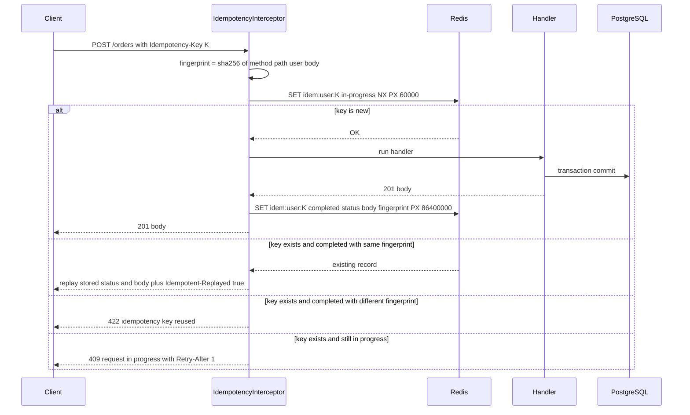

## 18.12 Idempotency

#### Concept

An idempotent operation produces the same result no matter how many times it is applied. For HTTP, `GET`, `PUT` and `DELETE` are idempotent by definition; `POST` is not. The **Idempotency-Key** pattern makes `POST` safe to retry: the client sends a unique key per logical operation; the server remembers the key and the response; a repeat with the same key returns the stored response instead of doing the work again.

The pattern is standard practice at Stripe, Adyen, Razorpay and most payment and ordering APIs, and there is an IETF draft (`Idempotency-Key` header) describing it.

#### Why does it exist?

Networks lose responses. The server charges the card, commits the order, and the response is lost in a proxy timeout. The client sees an error and retries. Without idempotency the customer is charged twice or has two orders. With it, the retry returns the first order. Every endpoint that creates money movement or a unique business event needs this: payments, order placement, refunds, transfers, sending a message, creating a shipment.

#### Mental model

Imagine handing a bank teller a deposit slip with a serial number. If you are unsure whether the first slip was processed and hand over a copy with the same serial, the teller checks the log, sees the serial, and hands you the original receipt instead of depositing again. A slip with a new serial is a new deposit.

#### How it works



Design decisions:

1. **Scope the key** to the authenticated principal (`user:K` or `apiKey:K`). Two customers may both send `K=1`.
2. **Fingerprint the request** (method, path, canonicalised body hash). A replay with the same key but different body is a client bug; return 422, never execute it.
3. **Reserve the key atomically before doing the work.** Redis `SET key value NX PX ttl` or a PostgreSQL `INSERT` into a table with a unique constraint. This is what stops two concurrent identical requests from both executing.
4. **Store the response** (status, headers you care about, body) after the handler completes. TTL of 24 hours is conventional; payments often keep 7 days.
5. **Replay** exactly: same status, same body, plus a header (`Idempotent-Replayed: true`) so clients and logs can tell.
6. **On handler failure** with a 5xx, delete the reservation so the client can retry and actually execute. On 4xx, store the error too; a retry with the same broken payload should get the same answer.
7. **Concurrent duplicate** (key reserved, work in progress): return 409 with `Retry-After: 1`. The client waits and retries; by then the response is stored.

Redis vs PostgreSQL for the store:

| | Redis | PostgreSQL |
|---|---|---|
| Atomic reservation | `SET NX PX` | `INSERT ... ON CONFLICT DO NOTHING` under a unique index |
| Latency | ~0.3 ms | ~1 to 2 ms |
| TTL | Native | Cron delete or partitioned table |
| Survives Redis restart | Only with persistence; a lost key means a possible duplicate | Yes |
| Same transaction as the business write | No (two systems) | Yes: the key row and the order row commit together |
| Use when | Volume is high, and the business write already has its own unique constraint as a backstop | Money movement where losing a key is unacceptable, or no Redis in the stack |

The belt-and-braces approach used in Part 17's `PlaceOrder`: the interceptor in Redis for fast replay, plus `UNIQUE (customer_id, idempotency_key)` on the `orders` row as the durable guarantee.

#### NestJS example

An interceptor with Redis (`ioredis`), a decorator to opt endpoints in, and request fingerprinting.

```ts
// src/shared/api/idempotent.decorator.ts
import { SetMetadata } from '@nestjs/common';
export const IDEMPOTENT_KEY = 'idempotent';
export const Idempotent = (opts: { ttlSeconds?: number } = {}) => SetMetadata(IDEMPOTENT_KEY, { ttlSeconds: 86_400, ...opts });
```

```ts
// src/shared/api/idempotency.interceptor.ts
import {
  BadRequestException, CallHandler, ConflictException, ExecutionContext, HttpException, Injectable, NestInterceptor,
  UnprocessableEntityException,
} from '@nestjs/common';
import { Reflector } from '@nestjs/core';
import { Observable, from, of, throwError } from 'rxjs';
import { catchError, mergeMap, tap } from 'rxjs/operators';
import { createHash } from 'node:crypto';
import Redis from 'ioredis';
import { IDEMPOTENT_KEY } from './idempotent.decorator';

interface StoredResponse { state: 'in-progress' | 'completed'; fingerprint: string; status?: number; body?: unknown; }

@Injectable()
export class IdempotencyInterceptor implements NestInterceptor {
  constructor(private readonly redis: Redis, private readonly reflector: Reflector) {}

  intercept(ctx: ExecutionContext, next: CallHandler): Observable<unknown> {
    const opts = this.reflector.get<{ ttlSeconds: number } | undefined>(IDEMPOTENT_KEY, ctx.getHandler());
    if (!opts) return next.handle();

    const req = ctx.switchToHttp().getRequest();
    const res = ctx.switchToHttp().getResponse();
    const key: string | undefined = req.headers['idempotency-key'];
    if (!key || key.length > 128) throw new BadRequestException('Idempotency-Key header is required (1-128 chars)');

    const principal = req.user?.id ?? req.apiKeyId;
    if (!principal) throw new BadRequestException('Idempotency requires an authenticated principal');
    const redisKey = `idem:${principal}:${key}`;
    const fingerprint = fingerprintOf(req.method, req.route?.path ?? req.path, req.body);

    return from(this.reserve(redisKey, fingerprint)).pipe(
      mergeMap((existing) => {
        if (!existing) {
          // We own the key. Run the handler, then store the outcome.
          return next.handle().pipe(
            tap(async (body) => {
              const status = res.statusCode ?? 200;
              await this.store(redisKey, { state: 'completed', fingerprint, status, body }, opts.ttlSeconds);
            }),
            catchError((err) => from(this.onError(redisKey, fingerprint, err, opts.ttlSeconds)).pipe(mergeMap(() => throwError(() => err)))),
          );
        }
        if (existing.fingerprint !== fingerprint) {
          throw new UnprocessableEntityException({ code: 'IDEMPOTENCY_KEY_REUSED', message: 'Idempotency-Key was already used with a different request' });
        }
        if (existing.state === 'in-progress') {
          res.setHeader('Retry-After', '1');
          throw new ConflictException({ code: 'REQUEST_IN_PROGRESS', message: 'A request with this Idempotency-Key is still being processed' });
        }
        // Replay.
        res.status(existing.status!);
        res.setHeader('Idempotent-Replayed', 'true');
        return of(existing.body);
      }),
    );
  }

  /** Returns null if we reserved the key, or the existing record otherwise. Atomic via SET NX. */
  private async reserve(redisKey: string, fingerprint: string): Promise<StoredResponse | null> {
    const placeholder: StoredResponse = { state: 'in-progress', fingerprint };
    const ok = await this.redis.set(redisKey, JSON.stringify(placeholder), 'PX', 60_000, 'NX');
    if (ok === 'OK') return null;
    const raw = await this.redis.get(redisKey);
    return raw ? (JSON.parse(raw) as StoredResponse) : null;   // expired between SET and GET: treat as new on retry
  }

  private async store(redisKey: string, rec: StoredResponse, ttlSeconds: number): Promise<void> {
    await this.redis.set(redisKey, JSON.stringify(rec), 'EX', ttlSeconds);
  }

  private async onError(redisKey: string, fingerprint: string, err: unknown, ttlSeconds: number): Promise<void> {
    const status = err instanceof HttpException ? err.getStatus() : 500;
    if (status >= 500) { await this.redis.del(redisKey); return; }            // let the client retry for real
    const body = err instanceof HttpException ? err.getResponse() : { message: 'error' };
    await this.store(redisKey, { state: 'completed', fingerprint, status, body }, ttlSeconds);  // deterministic 4xx replays
  }
}

function fingerprintOf(method: string, path: string, body: unknown): string {
  return createHash('sha256').update(`${method}\n${path}\n${canonical(body)}`).digest('hex');
}
/** Stable JSON: sorted keys so { a, b } and { b, a } fingerprint the same. */
function canonical(v: unknown): string {
  if (Array.isArray(v)) return `[${v.map(canonical).join(',')}]`;
  if (v && typeof v === 'object') {
    return `{${Object.keys(v as object).sort().map((k) => `${JSON.stringify(k)}:${canonical((v as Record<string, unknown>)[k])}`).join(',')}}`;
  }
  return JSON.stringify(v);
}
```

Usage:

```ts
@Post()
@HttpCode(201)
@Idempotent({ ttlSeconds: 86_400 })
@UseInterceptors(IdempotencyInterceptor)
create(@Body() dto: CreateOrderDto) { /* ... */ }
```

Note the ordering: the interceptor must run **after** authentication (it needs `req.user`) and **before** the handler. NestJS runs guards, then interceptors, then pipes, then the handler; so a `JwtAuthGuard` on the controller satisfies that. Also note `res.statusCode` inside `tap`: because `@HttpCode(201)` is applied by NestJS before the handler's result is sent, the value is correct when `tap` runs.

#### PostgreSQL example

The durable variant, when Redis is not acceptable as the source of truth. The reservation is an insert with a unique index; the response is stored on the same row; the business write can share the transaction.

```sql
CREATE TABLE ops.idempotency_keys (
  principal_id     text NOT NULL,
  idem_key         text NOT NULL,
  fingerprint      char(64) NOT NULL,
  state            text NOT NULL CHECK (state IN ('in-progress', 'completed')),
  response_status  smallint,
  response_body    jsonb,
  locked_at        timestamptz NOT NULL DEFAULT now(),
  expires_at       timestamptz NOT NULL DEFAULT now() + interval '24 hours',
  PRIMARY KEY (principal_id, idem_key)
);
CREATE INDEX ix_idem_expires ON ops.idempotency_keys (expires_at);   -- for the cleanup job

-- Reserve (atomic). Zero rows returned means someone else holds the key.
INSERT INTO ops.idempotency_keys (principal_id, idem_key, fingerprint, state)
VALUES ($1, $2, $3, 'in-progress')
ON CONFLICT (principal_id, idem_key) DO NOTHING
RETURNING principal_id;

-- Complete, in the same transaction as the order insert:
UPDATE ops.idempotency_keys
SET state = 'completed', response_status = $4, response_body = $5
WHERE principal_id = $1 AND idem_key = $2;

-- Stale in-progress reservations (process died mid-request) are released by a job:
DELETE FROM ops.idempotency_keys WHERE state = 'in-progress' AND locked_at < now() - interval '2 minutes';
DELETE FROM ops.idempotency_keys WHERE expires_at < now();
```

#### Which endpoints need it

| Endpoint | Idempotency-Key? | Why |
|---|---|---|
| `POST /orders` | Yes | Duplicate orders cost money and trust |
| `POST /orders/{id}/payments` | Yes, mandatory | Double charge |
| `POST /refunds` | Yes, mandatory | Double refund |
| `POST /orders/{id}/cancellations` | Optional; naturally idempotent via unique constraint | Second cancel returns the first |
| `POST /notifications` | Yes | Duplicate emails/SMS |
| `POST /inventory/adjustments/batch` | Per item (18.7) | Retried batch |
| `PUT`, `DELETE`, `GET` | No | Already idempotent |
| `POST /orders/search` | No | Read-only |

#### Production scenario

An ordering API at 15 orders/s peak saw a 1.8% retry rate from mobile clients (flaky networks). Before idempotency keys that was roughly 1,000 duplicate orders a week, each needing a refund and a support touch. After: zero duplicates; 1.8% of `POST /orders` responses carried `Idempotent-Replayed: true`; Redis handled the extra ~30 operations per second without noticing. The interceptor added about 0.8 ms per request.

#### Failure scenario

At 21:10 during a sale, Redis was restarted by an operator to apply a config change, losing in-memory keys (no AOF). For the next 60 seconds, retried `POST /orders` requests found no key and executed again. The `UNIQUE (customer_id, idempotency_key)` constraint on `orders` caught all 43 of them as 23505 unique violations, which the repository turned into a re-read of the existing order. No duplicates. This is why the durable backstop exists even when Redis is the fast path.

#### Edge cases & failure modes

- **Same key, different payload.** Reject with 422; never execute the second.
- **Concurrent duplicates.** `SET NX` makes exactly one winner; the other gets 409 and retries after a second.
- **Process crash after reservation, before storing the response.** The 60-second in-progress TTL (or the 2-minute cleanup) releases the key; the client's retry executes; the business unique constraint prevents a duplicate if the first actually committed.
- **Response stored but business transaction rolled back** (store-before-commit bug). Store only after the handler returns, which is after commit in the unit-of-work design from Part 17.
- **Key reuse across endpoints.** The fingerprint includes method and path, so reuse yields 422.
- **Huge stored bodies.** Cap stored response size (for example 64 KB); for bigger ones store a reference (the created resource id) and re-fetch on replay.
- **Clock skew** is not an issue for TTLs in Redis (server-side clock), but is for signed requests (18.19).
- **Client generates keys badly** (same key for every request). Document: one UUID v4 per logical operation, reused only for retries of that operation.

#### How a Senior Backend Engineer thinks about this

They make idempotency mandatory on any endpoint that moves money or creates a business event, reserve the key atomically before doing work, fingerprint the payload, replay faithfully, and keep a database unique constraint as the last line of defence. They document the client contract in three sentences and put it in the OpenAPI description of the header.

#### Common mistakes

- Checking "does the key exist" and then inserting, without atomic reservation.
- Storing the response before the transaction commits.
- Ignoring the payload; a client bug then returns a wrong order as if it were the new one.
- Making the key optional on payments.
- In-memory `Map` for keys, which does not work with two pods.

#### Interview questions

1. *Walk through the Idempotency-Key flow including concurrent duplicates and a crash mid-request.* Expected: the diagram; `SET NX`; TTLs; durable constraint.
2. *Where do you store keys and why?* Expected: Redis fast path vs PostgreSQL durable; both in critical paths.
3. *Same key, different body: what do you return?* Expected: 422, never execute.
4. *Which endpoints must have idempotency and which must not?* Expected: the table; reads and already-idempotent verbs excluded.
5. *How does the interceptor know the response status to store?* Expected: `res.statusCode` after `@HttpCode`; or handler returns a tuple; store after completion.

#### Practical exercise

Implement the interceptor with Redis and the PostgreSQL backstop, then run three tests: 50 concurrent identical `POST /orders` (expect 1 executed, 49 replays or 409s that then replay), same key with a different body (422), and a simulated handler crash (throw 500) followed by a retry that executes. Acceptance criteria: exactly one order row; replays carry `Idempotent-Replayed: true` and byte-identical bodies; `FLUSHALL` on Redis mid-test still results in exactly one order row thanks to the unique constraint.

## 18.13 Rate limiting

#### Concept

Rate limiting caps how many requests a client may make in a window: 100 requests per minute per user, 1,000 per minute per API key, 20 login attempts per hour per IP. Exceeding the cap returns 429 Too Many Requests with a `Retry-After` header. It protects the service from abuse, from runaway clients, and from itself (one tenant cannot starve the others).

Three algorithms you will meet:

| Algorithm | How | Pros | Cons |
|---|---|---|---|
| **Fixed window** | Counter per key per window (`user:123:2026-09-07T10:05`) | Trivial, one `INCR` | Burst of 2x at the window boundary |
| **Sliding window log/counter** | Count requests in the trailing N seconds (sorted set or two-window interpolation) | Smooth, accurate | More memory or a little math |
| **Token bucket** | Bucket refills at R tokens/s up to capacity B; each request takes a token | Allows short bursts up to B while enforcing average R | Needs a Lua script for atomic refill-and-take |

`@nestjs/throttler` implements a sliding-window style counter with configurable storage; gateways and reverse proxies (NGINX, Envoy, cloud API gateways) usually implement token buckets.

#### Why does it exist?

Without limits, one misbehaving client (a retry loop, a scraper, a load test pointed at production, a credential-stuffing bot) consumes all capacity. Rate limiting turns "the site is down for everyone" into "one client gets 429s". It also enforces commercial tiers (free: 60/min; paid: 6,000/min) and protects expensive endpoints (search, exports, login).

#### Mental model

Imagine a nightclub with a bouncer counting people in per minute. Above the limit, the bouncer says "wait two minutes" (429 with `Retry-After`) instead of letting the club overflow. VIP cards (API tiers) get a higher count. The bouncer at the street entrance (gateway) handles the crowd; the bartender (application) enforces "two drinks per person per hour" (business-aware limits).

#### How it works

**Where to limit.** Two layers, different jobs:

| Layer | Knows | Good for | Not good for |
|---|---|---|---|
| Gateway / load balancer / CDN | IP, path, API key header, coarse volume | Absorbing floods before they reach Node; per-IP limits; DDoS mitigation | Per-user or per-tenant rules that need authentication; business-specific limits |
| Application (NestJS) | Authenticated user, tenant, plan, endpoint cost | Per-user and per-plan limits; expensive endpoints; login attempts per account | Absorbing floods (the request has already cost a connection and a JSON parse) |

Use both: coarse at the edge, precise in the app.

**Keys.** Per IP (anonymous traffic; beware NAT and mobile carriers sharing IPs), per user id (authenticated), per API key (partners), per tenant (multi-tenant SaaS), and often per endpoint group (login: strict; reads: generous; writes: moderate).

**Storage.** Counters must be shared across pods, so Redis, not process memory. Each check is one or two Redis operations (~0.3 ms). Use a Lua script or `MULTI` so the increment and TTL set are atomic.

**Response.** 429, `Retry-After: <seconds>`, and the informational headers `X-RateLimit-Limit`, `X-RateLimit-Remaining`, `X-RateLimit-Reset` (the IETF draft standardises these as `RateLimit-*`). A problem+json body with `code: RATE_LIMITED`.

#### NestJS example

`@nestjs/throttler` with Redis storage and a per-user tracker.

```ts
// src/app.module.ts
import { ThrottlerModule, ThrottlerGuard, seconds, minutes } from '@nestjs/throttler';
import { ThrottlerStorageRedisService } from '@nest-lab/throttler-storage-redis';
import { APP_GUARD } from '@nestjs/core';
import Redis from 'ioredis';

@Module({
  imports: [
    ThrottlerModule.forRootAsync({
      inject: [ConfigService],
      useFactory: (config: ConfigService) => ({
        throttlers: [
          { name: 'short', ttl: seconds(1), limit: 20 },        // burst protection
          { name: 'long', ttl: minutes(1), limit: 300 },        // sustained
        ],
        storage: new ThrottlerStorageRedisService(new Redis(config.getOrThrow('REDIS_URL'))),
        errorMessage: 'Too many requests',
      }),
    }),
  ],
  providers: [{ provide: APP_GUARD, useClass: UserOrIpThrottlerGuard }],
})
export class AppModule {}
```

```ts
// src/shared/api/user-or-ip-throttler.guard.ts
import { ExecutionContext, Injectable } from '@nestjs/common';
import { ThrottlerGuard, ThrottlerException, ThrottlerLimitDetail } from '@nestjs/throttler';

@Injectable()
export class UserOrIpThrottlerGuard extends ThrottlerGuard {
  /** Key by authenticated user or API key when present; fall back to IP. */
  protected async getTracker(req: Record<string, any>): Promise<string> {
    if (req.user?.id) return `user:${req.user.id}`;
    if (req.apiKeyId) return `key:${req.apiKeyId}`;
    const fwd = (req.headers['x-forwarded-for'] as string | undefined)?.split(',')[0]?.trim();
    return `ip:${fwd ?? req.ip}`;
  }

  /** Emit a problem+json-compatible 429 and a Retry-After header. */
  protected async throwThrottlingException(ctx: ExecutionContext, detail: ThrottlerLimitDetail): Promise<void> {
    const res = ctx.switchToHttp().getResponse();
    res.setHeader('Retry-After', Math.ceil(detail.timeToBlockExpire || detail.timeToExpire));
    throw new ThrottlerException(JSON.stringify({ code: 'RATE_LIMITED', title: 'Too Many Requests' }));
  }
}
```

Per-endpoint overrides:

```ts
@Post('auth/login')
@Throttle({ short: { limit: 5, ttl: seconds(10) }, long: { limit: 20, ttl: minutes(15) } })  // credential stuffing
login() {}

@Get('health')
@SkipThrottle()
health() {}

@Post('orders/export')
@Throttle({ long: { limit: 5, ttl: minutes(60) } })     // expensive
exportOrders() {}
```

When the guard runs before authentication (guards run in registration order; `APP_GUARD` providers run in the order declared), `req.user` is not yet set. Either register the auth guard first, or apply the throttler at the controller level after `@UseGuards(JwtAuthGuard)`; the tracker then sees the user.

The trust in `X-Forwarded-For` above is only safe if your gateway overwrites it. Configure `app.set('trust proxy', 1)` for Express to derive `req.ip` correctly, and never trust the header from the open internet.

#### PostgreSQL example

Rate limiting belongs in Redis, not PostgreSQL; a database round trip per request for a counter is a bad trade. Where PostgreSQL does appear is in **plan configuration** and **audit**:

```sql
CREATE TABLE ops.api_plans (
  api_key_id     uuid PRIMARY KEY,
  plan           text NOT NULL CHECK (plan IN ('free','standard','enterprise')),
  per_minute     integer NOT NULL,
  burst          integer NOT NULL
);
-- Loaded into memory at startup and refreshed every minute; the guard reads the cached plan per key.

CREATE TABLE ops.rate_limit_events (
  occurred_at  timestamptz NOT NULL DEFAULT now(),
  tracker      text NOT NULL,
  route        text NOT NULL,
  limit_name   text NOT NULL
);
-- Written asynchronously (queue) on each 429 for abuse review, not on the request path.
```

A Redis token bucket, for the record, is a ~15-line Lua script executed with `EVALSHA`: read `tokens` and `ts`, refill `min(capacity, tokens + (now - ts) * rate)`, take one if available, write back with a TTL, return allowed and the wait time. It is atomic because Redis runs Lua scripts single-threaded.

#### Production scenario

A public API served 5,000 RPS with three tiers. The edge (a cloud API gateway) enforced 2,000 requests per minute per IP and dropped SYN floods. NestJS enforced per-API-key plan limits with Redis (p99 overhead 0.6 ms). On a typical day 0.4% of requests were 429s, nearly all from two integrations with retry loops; both were contacted with their own `X-RateLimit` data. During a scraping incident the edge absorbed 40,000 RPS from 800 IPs and the app never saw more than 5,200.

#### Failure scenario

At 08:00 on the day of a marketing push, the login endpoint had no specific limit, only the global 300/min per IP. A credential-stuffing bot ran 250 logins per minute per IP from 2,000 IPs. Each login did a bcrypt compare (~80 ms of CPU). The pods hit 100% CPU, real users got timeouts, and the autoscaler added pods that were immediately saturated too. The fix was a 5-per-10-seconds limit on `/auth/login` per IP *and* per account, plus a progressive delay after failures. Rate limits must be endpoint-aware because endpoints are not equally expensive.

#### Edge cases & failure modes

- **Redis down.** Decide: fail open (no limits, service still works; safe against outage, unsafe against abuse) or fail closed (429 for everyone). Most choose fail open with an alarm, and rely on the edge limit as the backstop. `@nestjs/throttler` will throw if the storage errors, so wrap the storage or catch in the guard.
- **Shared IPs** (corporate NAT, mobile carriers): per-IP limits punish thousands of users. Prefer per-user once authenticated; keep per-IP generous.
- **Window boundary bursts** with fixed windows: 2x the limit in two seconds. Sliding windows or token buckets fix it.
- **Retry storms.** Clients that retry 429s immediately amplify the problem. `Retry-After` plus documented exponential backoff with jitter; consider blocking repeat offenders for longer (`blockDuration` in throttler).
- **Limits on health checks or webhooks** you receive from partners: exempt them or you will throttle your own monitoring and lose events.
- **Clock skew** between pods does not matter (Redis owns the counters); skew between client and server matters only for `X-RateLimit-Reset` as an absolute timestamp; prefer seconds-until-reset.
- **Cost-based limits.** A search costs 50x a read. Weight requests (take N tokens) rather than counting them equally.

#### How a Senior Backend Engineer thinks about this

They limit at the edge for volume and in the app for meaning, with Redis as the shared counter. They set stricter limits on expensive and security-sensitive endpoints, return 429 with `Retry-After`, expose remaining quota so good clients can self-regulate, and decide the Redis-down behaviour deliberately. They watch the 429 rate per client as an early warning of broken integrations.

#### Common mistakes

- Process-memory counters that reset on deploy and differ per pod.
- One global limit for all endpoints.
- Trusting `X-Forwarded-For` from the internet, letting attackers pick their own key.
- No `Retry-After`, so clients hammer harder.
- Rate limiting *before* authentication and then keying by IP only.

#### Interview questions

1. *Fixed window vs sliding window vs token bucket: when does each fit?* Expected: the table; boundary bursts; burst allowance.
2. *Where do you rate limit and why both places?* Expected: edge for volume/IP; app for user/plan/endpoint.
3. *Redis is down. What does your rate limiter do?* Expected: deliberate fail-open or fail-closed with an alarm; edge as backstop.
4. *How would you protect a login endpoint?* Expected: per-IP and per-account limits, progressive delay, lockout policy, monitoring.
5. *How do you avoid punishing users behind a shared corporate IP?* Expected: per-user keys after auth; generous IP limits; API keys for partners.

#### Practical exercise

Configure `@nestjs/throttler` with Redis storage and a user-or-IP tracker, strict limits on `/auth/login`, and `@SkipThrottle` on health. Write a load test (`autocannon -c 50 -d 10`) against `/orders` and `/auth/login` and capture the 429 rate, `Retry-After` values and `X-RateLimit-Remaining` decreasing. Then stop Redis and prove the chosen fail-open or fail-closed behaviour. Acceptance criteria: two pods share counters (same Redis); login is limited per IP and per account independently; a 429 body is problem+json with `code: RATE_LIMITED`; Redis outage behaviour is tested and alarmed.
