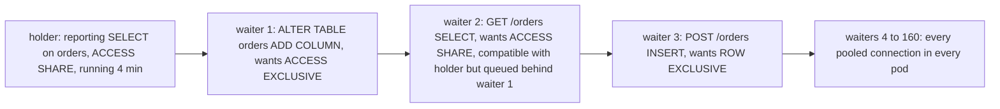

## 18.10 Transactions in practice

### 18.10.1 BEGIN, COMMIT, ROLLBACK, savepoints, and the "idle in transaction" trap

#### Concept

A **transaction** is a group of statements that PostgreSQL treats as one unit: all of it becomes visible to others at `COMMIT`, or none of it does after `ROLLBACK`. Without an explicit `BEGIN`, every statement is its own transaction (autocommit). Between `BEGIN` and `COMMIT`, the connection is **in a transaction**, and if it is not currently running a statement it is **idle in transaction**: holding locks, holding a snapshot, holding a pooled connection, doing nothing.

A **savepoint** is a marker inside a transaction that you can roll back to without losing the whole transaction. Isolation levels (what a transaction can see of others) are the subject of Part 20 — Database Transactions; here we cover the mechanics that matter for the server.

#### Why does it exist?

Checkout writes an order, three items, a payment and three inventory updates. If the process dies after the third statement, you must not have an order with no items. Transactions give atomicity. Savepoints exist because some errors inside a transaction are expected (a unique violation you want to handle) and PostgreSQL otherwise aborts the entire transaction on any error.

#### Mental model

Imagine a shopping session at a market where you fill a basket (statements) and pay at the end (`COMMIT`). Until you pay, nothing is yours and the stall keepers hold the items for you (locks). If you wander off to make a phone call with a full basket (idle in transaction), the stall keepers cannot sell those items to anyone else and cannot restock the shelf (vacuum). A savepoint is a note saying "if the next item turns out to be bad, put back everything after this note, but keep the rest".

#### How it works

1. `BEGIN` marks the connection as in a transaction; no transaction id is assigned yet (only a virtual one) so read-only transactions are free.
2. The first statement that writes assigns a real xid (18.7). Every row it writes carries that xid in `xmin` or `xmax`.
3. Each statement acquires locks (18.11) that are held until the transaction ends, never released earlier, even if the statement finished long ago.
4. On error, the transaction enters an **aborted** state: every further statement fails with `current transaction is aborted, commands ignored until end of transaction block` until you `ROLLBACK`. Node code that catches an error and keeps using the same transaction produces exactly this message.
5. `SAVEPOINT s` starts a **subtransaction** with its own sub-xid once it writes. `ROLLBACK TO SAVEPOINT s` aborts only the subtransaction; the outer one continues. `RELEASE SAVEPOINT s` merges it. Each backend caches only 64 sub-xids in shared memory; a transaction with more than 64 savepoints (ORMs that wrap every statement in a savepoint, or loops creating one per row) overflows that cache, and every snapshot in the system must then consult the `pg_subtrans` on-disk structure. That is a well-known performance cliff, worst on replicas.
6. `COMMIT` writes the commit record to WAL, flushes it (18.5), marks the xid committed in `pg_xact`, releases all locks, and drops the snapshot. `ROLLBACK` marks the xid aborted and releases locks; the rows it wrote are dead tuples for VACUUM.
7. While the connection is idle in transaction, `pg_stat_activity.state` shows `idle in transaction`, `xact_start` shows when it began, and `backend_xmin` shows the snapshot it holds. `idle_in_transaction_session_timeout` kills such sessions after the given duration; `transaction_timeout` (PG 17+) bounds the whole transaction regardless of activity.

The damage of idle in transaction, in order of how quickly it hurts:

| Held resource | Effect | Visible as |
|---|---|---|
| Row locks | Other writers of those rows wait forever | `wait_event_type = Lock` on other backends |
| Table locks (`ACCESS SHARE` from a `SELECT`) | Any `ALTER TABLE`, and then every query behind it, waits (18.11) | Lock queue pile-up |
| Snapshot (`backend_xmin`) | VACUUM cannot remove anything newer; bloat everywhere | "dead but not yet removable" in vacuum logs |
| Pool connection | One fewer connection for the app; eventually pool exhaustion | `waitingCount` rising, `connectionTimeoutMillis` errors |

#### Practical example

The Node patterns that cause idle in transaction, all from real code reviews:

- An `await fetch(paymentProvider)` inside `dataSource.transaction(...)`: a 30 s provider timeout is 30 s of idle in transaction holding a lock on the order row and the inventory rows.
- A missing `await` on a query inside a `QueryRunner` transaction; the code continues, the promise resolves later or rejects unobserved, and `commitTransaction` is skipped on an error path without `finally { release() }`.
- A WebSocket handler that starts a transaction, sends a prompt to the user, and waits for the reply.
- `for await (const row of stream)` reading a cursor inside a transaction while processing each row with slow I/O.

#### NestJS example

Do the external call first, then a short transaction with only database work. If you must reserve first, use a short transaction to reserve with a status, call the provider outside any transaction, then a second short transaction to finalise.

```ts
// checkout.service.ts
import { Injectable } from '@nestjs/common';
import { DataSource } from 'typeorm';
import { PaymentGateway } from './payment.gateway';

@Injectable()
export class CheckoutService {
  constructor(private readonly dataSource: DataSource, private readonly gateway: PaymentGateway) {}

  async pay(orderId: number, amountCents: number, idempotencyKey: string) {
    // 1. Short transaction: claim the order, no external I/O inside
    await this.dataSource.transaction(async (em) => {
      const updated = await em.query(
        `UPDATE orders SET status = 'PAYING', updated_at = now()
          WHERE id = $1 AND status = 'PENDING'`,
        [orderId],
      );
      if (updated[1] !== 1) throw new Error('ORDER_NOT_PAYABLE');
    });

    // 2. External call OUTSIDE any transaction (may take seconds, may time out)
    const result = await this.gateway.charge({ amountCents, idempotencyKey });

    // 3. Second short transaction to record the outcome
    await this.dataSource.transaction(async (em) => {
      await em.query(
        `INSERT INTO payments (order_id, provider_ref, status, amount_cents)
         VALUES ($1, $2, $3, $4)`,
        [orderId, result.providerRef, result.ok ? 'CAPTURED' : 'FAILED', amountCents],
      );
      await em.query(`UPDATE orders SET status = $2, updated_at = now() WHERE id = $1`, [
        orderId,
        result.ok ? 'PAID' : 'PENDING',
      ]);
    });
  }
}
```

The state machine (`PENDING` to `PAYING` to `PAID`) replaces the long lock. A crash between steps leaves a `PAYING` order that a reconciliation job can resolve using the idempotency key.

#### PostgreSQL example

Savepoints for an expected error, and the aborted-transaction message:

```sql
BEGIN;
INSERT INTO orders (user_id, status, total_cents) VALUES (42, 'PENDING', 1999);
SAVEPOINT before_coupon;
INSERT INTO coupon_redemptions (coupon_code, user_id) VALUES ('WELCOME10', 42);
-- ERROR: duplicate key value violates unique constraint "coupon_redemptions_pkey"
ROLLBACK TO SAVEPOINT before_coupon;   -- the order insert survives
COMMIT;
```

Without the savepoint, the second `INSERT` error would have aborted the whole transaction and `COMMIT` would silently behave as `ROLLBACK` (it returns `ROLLBACK`, which drivers surface as a successful command). Find the idle offenders:

```sql
SELECT pid, usename, application_name, state,
       now() - xact_start  AS txn_open_for,
       now() - state_change AS idle_for,
       age(backend_xmin)   AS horizon_age,
       left(query, 80)     AS last_query
FROM pg_stat_activity
WHERE state = 'idle in transaction'
ORDER BY xact_start;
```

```text
 pid  | usename    | application_name | state               | txn_open_for | idle_for  | horizon_age | last_query
------+------------+------------------+---------------------+--------------+-----------+-------------+------------------------------------------
 8812 | orders_api | payments-worker  | idle in transaction | 2 days 03:12 | 2 days .. |     3120044 | INSERT INTO reconciliation_runs ...
```

Set the belts for application roles, not globally (migrations and admins need different limits):

```sql
ALTER ROLE orders_api SET idle_in_transaction_session_timeout = '30s';
ALTER ROLE orders_api SET statement_timeout = '10s';
ALTER ROLE orders_api SET lock_timeout = '5s';
```

#### TypeORM example

TypeORM nests transactions with savepoints automatically: calling `manager.transaction` inside a running transaction, or `queryRunner.startTransaction()` when one is already active, issues `SAVEPOINT typeorm_N`. Use that for the expected-error pattern, and never call `startTransaction` in a loop of thousands of rows (the 64 sub-xid cliff).

```ts
await dataSource.transaction(async (em) => {
  await em.insert(Order, { userId: 42, status: 'PENDING', totalCents: 1999 });
  try {
    // Nested transaction => SAVEPOINT; a unique violation here does not poison the outer txn
    await em.transaction(async (inner) => {
      await inner.insert(CouponRedemption, { couponCode: 'WELCOME10', userId: 42 });
    });
  } catch (e) {
    if (!(e instanceof QueryFailedError) || (e as any).code !== '23505') throw e;
    // already redeemed: continue without the discount
  }
});
```

#### Sequelize example

Sequelize creates a savepoint when you pass the parent transaction to a nested `sequelize.transaction`:

```ts
await sequelize.transaction(async (t) => {
  await Order.create({ userId: 42, status: 'PENDING', totalCents: 1999 }, { transaction: t });
  try {
    await sequelize.transaction({ transaction: t }, async (sp) => {   // SAVEPOINT
      await CouponRedemption.create({ couponCode: 'WELCOME10', userId: 42 }, { transaction: sp });
    });
  } catch (e) {
    if (!(e instanceof UniqueConstraintError)) throw e;
  }
});
```

#### Production scenario

An orders API handles 1,200 transactions per second with a median transaction time of 3 ms and a p99 of 25 ms. With the role-level timeouts above, the maximum damage one bad code path can do is 30 s of a held lock, then the server ends the session and the pool reconnects. The team graphs `max(now() - xact_start)` for the app role and alerts at 20 s. `pg_stat_database.xact_rollback / xact_commit` is also on the dashboard: a rollback ratio jumping from 0.5 percent to 10 percent means a code path is throwing inside transactions.

#### Failure scenario

"Aborted transaction, silent data loss." A NestJS service caught a `QueryFailedError` inside `dataSource.transaction`, logged it, and continued to run two more statements and let the callback return normally. TypeORM issued `COMMIT`, PostgreSQL answered `ROLLBACK` (because the transaction was aborted), the driver did not throw, and the API returned 201 Created for an order that did not exist. Detection took two weeks. Rule: an error inside a transaction either propagates (so TypeORM rolls back and the request fails) or is handled with a savepoint; there is no third option.

#### Edge cases & failure modes

- `COMMIT` on an aborted transaction returns `ROLLBACK` without an error in most drivers.
- Savepoint storms (one per row) hit the 64 sub-xid cache limit and slow the whole server.
- Prepared transactions (`PREPARE TRANSACTION`) survive restarts and hold locks and horizon until resolved; do not use without a coordinator.
- `SET LOCAL` values revert at transaction end; `SET` values persist for the session (and leak through poolers).
- A transaction that only reads still holds `ACCESS SHARE` locks and a snapshot; "read-only" does not mean harmless.
- Retrying a whole transaction after a serialization failure or deadlock must be done by the application, with a bound on attempts.

#### How a Senior Backend Engineer thinks about this

They keep transactions short and free of external I/O, no exceptions. They model long business processes as state machines with short transactions per step. They set server-side timeouts per role so that a bug is bounded in blast radius. They review every `try/catch` inside a transaction with one question: "does this swallow an error that has already aborted the transaction?"

#### Common mistakes

- Awaiting HTTP calls, queue publishes or Redis calls inside a database transaction.
- Catching and ignoring errors inside a transaction.
- Forgetting `queryRunner.release()` in a `finally`.
- Using `SET` where `SET LOCAL` was meant.

#### Interview questions

1. *What does "idle in transaction" hold, and what are the consequences over minutes and over days?* Expected: locks, snapshot, connection; lock queue pile-ups within minutes, bloat and wraparound risk over days.
2. *What happens if you keep running statements after an error inside a transaction?* Expected: aborted state; `COMMIT` becomes `ROLLBACK`.
3. *When do you use savepoints and what is their hidden cost?* Expected: expected errors; sub-xid cache overflow above 64.
4. *Design the payment flow so no transaction spans the provider call.* Expected: state machine with two short transactions and an idempotency key.

#### Practical exercise

Write a NestJS service method with a transaction that calls a fake payment gateway with a 20 s delay inside the transaction. Observe `pg_stat_activity` and a second request blocking on the same inventory row. Refactor to the two-transaction state machine and show the lock is held for milliseconds. Acceptance criteria: before/after `pg_stat_activity` output and a test that simulates a crash between steps and a reconciliation that resolves it.

## 18.11 Locks

### 18.11.1 Lock modes, DDL, row locks and the lock queue

#### Concept

Every statement takes **table-level locks** on the tables it touches, in one of eight **modes** from `ACCESS SHARE` (a plain `SELECT`) to `ACCESS EXCLUSIVE` (`DROP TABLE`, most `ALTER TABLE`). Modes conflict or not according to a fixed matrix. Locks are held until the transaction ends. Waiting requests form a **queue**, and a request waits behind any earlier request it conflicts with, even if the current holder alone would not have blocked it. Separately, writes take **row-level locks** on the rows they modify, stored in the tuple header rather than in the lock table.

#### Why does it exist?

MVCC handles readers versus writers, but two writers on the same row need ordering, and structural changes (dropping a column) cannot happen while a query is reading that column. The lock modes exist so that compatible operations (two `INSERT`s, a `SELECT` and an `UPDATE`) proceed in parallel while incompatible ones (`ALTER TABLE` and anything) serialise. The queue exists to prevent starvation: without it, a stream of `SELECT`s could keep an `ALTER TABLE` waiting forever.

#### Mental model

Imagine a single-lane bridge with a signal. Cars in the same direction (compatible locks) flow together. A maintenance truck (`ACCESS EXCLUSIVE`) needs the bridge empty. The rule "no one may enter behind a waiting truck" prevents the truck from waiting forever, but it also means that one slow car already on the bridge plus one waiting truck stops every car behind the truck. That is the whole `ALTER TABLE` incident in one picture.

#### How it works

Lock modes and what takes them:

| Mode | Taken by | Conflicts with |
|---|---|---|
| `ACCESS SHARE` | `SELECT` | `ACCESS EXCLUSIVE` |
| `ROW SHARE` | `SELECT ... FOR UPDATE / FOR SHARE` | `EXCLUSIVE`, `ACCESS EXCLUSIVE` |
| `ROW EXCLUSIVE` | `INSERT`, `UPDATE`, `DELETE`, `MERGE` | `SHARE`, `SHARE ROW EXCLUSIVE`, `EXCLUSIVE`, `ACCESS EXCLUSIVE` |
| `SHARE UPDATE EXCLUSIVE` | `VACUUM`, `ANALYZE`, `CREATE INDEX CONCURRENTLY`, `REINDEX CONCURRENTLY`, `ALTER TABLE ... VALIDATE CONSTRAINT`, `ALTER TABLE ... SET (storage params)`, `CREATE STATISTICS`, `COMMENT ON` | itself and everything stronger |
| `SHARE` | `CREATE INDEX` (blocks writes, allows reads) | `ROW EXCLUSIVE` and stronger, except itself |
| `SHARE ROW EXCLUSIVE` | `CREATE TRIGGER`, `ALTER TABLE ... ADD FOREIGN KEY` (both tables), `ALTER TABLE ... ENABLE/DISABLE TRIGGER` | `ROW EXCLUSIVE` and stronger, including itself |
| `EXCLUSIVE` | `REFRESH MATERIALIZED VIEW CONCURRENTLY` | everything except `ACCESS SHARE` |
| `ACCESS EXCLUSIVE` | `DROP TABLE`, `TRUNCATE`, `VACUUM FULL`, `CLUSTER`, `REINDEX`, `REFRESH MATERIALIZED VIEW`, `ALTER TABLE` (`ADD/DROP COLUMN`, `ALTER COLUMN TYPE`, `SET/DROP NOT NULL`, `ADD PRIMARY KEY`, `ADD CHECK`, `RENAME`), `LOCK TABLE` | everything |

Some DDL takes `ACCESS EXCLUSIVE` but holds it for milliseconds (`ADD COLUMN` without a volatile default on PG 11+, `SET DEFAULT`, `DROP COLUMN`, `RENAME`); some holds it for the entire rewrite (`ALTER COLUMN TYPE` that changes storage, `ADD COLUMN` with a volatile default, `VACUUM FULL`). Both are dangerous because of the queue, not because of the duration.

Row-level locks:

| Row lock | Taken by | Blocks |
|---|---|---|
| `FOR KEY SHARE` | Foreign-key checks on the referenced row (inserting an `order_items` row locks the `orders` row this way) | `FOR UPDATE` |
| `FOR SHARE` | `SELECT ... FOR SHARE` | `FOR NO KEY UPDATE`, `FOR UPDATE` |
| `FOR NO KEY UPDATE` | `UPDATE` that does not change key columns | `FOR SHARE`, `FOR NO KEY UPDATE`, `FOR UPDATE` |
| `FOR UPDATE` | `DELETE`, `UPDATE` that changes a unique key, `SELECT ... FOR UPDATE` | all row locks |

This distinction is why inserting `order_items` does not block a concurrent `UPDATE orders SET status = ...` on the parent row (`KEY SHARE` and `NO KEY UPDATE` are compatible), but does block `DELETE FROM orders` and does block `SELECT ... FOR UPDATE` on the order. If your code locks the order with `FOR UPDATE` while inserting items in another transaction, you get waits you did not expect. `FOR NO KEY UPDATE` in the application is usually what you mean.

The lock queue, step by step:



1. A request checks the lock table in shared memory for conflicting *holders* and conflicting *waiters* ahead of it.
2. If neither exists, it is granted immediately.
3. If a conflicting holder or waiter exists, it joins the queue and its backend sleeps with `wait_event_type = Lock`.
4. When a lock is released, the queue is re-examined from the front; waiters are granted in order as long as they do not conflict with holders or with earlier waiters.
5. `lock_timeout` makes the waiting request give up after the given time with `canceling statement due to lock timeout`, and leave the queue, unblocking everyone behind it.
6. Every second (`deadlock_timeout`), a waiter checks for a cycle among waiters; a deadlock aborts one participant (Part 20 covers deadlock patterns).

#### Practical example

"ALTER TABLE at 10:00 froze the whole API." A migration ran `ALTER TABLE orders ADD COLUMN gift_message text` during business hours. A finance report had started a 4-minute `SELECT` over `orders` at 09:58. The `ALTER` queued behind it. Every `GET /orders`, every checkout `INSERT`, every `UPDATE` queued behind the `ALTER`. Within 8 seconds all 160 pooled connections across the fleet were waiting, health checks failed, pods restarted and reconnected into the same queue. At 10:02 the report finished, the `ALTER` ran in 4 ms, the queue drained in a second, and a 4-minute outage was over. The `ADD COLUMN` itself was instant; the report plus the queue rule did the damage. Fix: `lock_timeout` in the migration with retries, and no reports on the primary.

#### NestJS example

A migration helper that never lets DDL wait long enough to cause a pile-up, and retries with backoff:

```ts
// migrations/ddl.helper.ts
import { QueryRunner } from 'typeorm';

export async function ddlWithLockTimeout(
  qr: QueryRunner,
  sql: string,
  { lockTimeout = '3s', attempts = 10, backoffMs = 2_000 } = {},
): Promise<void> {
  for (let attempt = 1; ; attempt++) {
    try {
      // lock_timeout applies to the wait for the ACCESS EXCLUSIVE lock;
      // a waiting ALTER that gives up after 3 s unblocks the queue behind it
      await qr.query(`SET lock_timeout = '${lockTimeout}'`);
      await qr.query(sql);
      await qr.query(`RESET lock_timeout`);
      return;
    } catch (err: any) {
      const lockTimedOut = err?.code === '55P03';   // lock_not_available
      if (!lockTimedOut || attempt >= attempts) throw err;
      await new Promise((r) => setTimeout(r, backoffMs * attempt));
    }
  }
}

// usage inside a migration
// await ddlWithLockTimeout(qr, `ALTER TABLE orders ADD COLUMN gift_message text`);
```

#### PostgreSQL example

Who is blocking whom, and what they are waiting on:

```sql
SELECT a.pid,
       a.state,
       a.wait_event_type,
       a.wait_event,
       pg_blocking_pids(a.pid)            AS blocked_by,
       now() - a.query_start              AS waiting_for,
       left(a.query, 60)                  AS query
FROM pg_stat_activity a
WHERE cardinality(pg_blocking_pids(a.pid)) > 0
ORDER BY a.query_start;
```

```text
 pid  | state  | wait_event_type | wait_event | blocked_by | waiting_for | query
------+--------+-----------------+------------+------------+-------------+------------------------------------------------
 5120 | active | Lock            | relation   | {4410}     | 00:02:10    | ALTER TABLE orders ADD COLUMN gift_message text
 5133 | active | Lock            | relation   | {5120}     | 00:02:09    | SELECT id, status FROM orders WHERE user_id = $1
 5134 | active | Lock            | relation   | {5120}     | 00:02:09    | INSERT INTO orders (user_id, status, total_cent
```

The root is pid 4410 (the report). Then decide: cancel the report (`pg_cancel_backend(4410)`), or cancel the `ALTER` (`pg_cancel_backend(5120)`), which drains the queue immediately. Cancel the `ALTER` first; it is the one that can be retried. Full lock detail is in `pg_locks`:

```sql
SELECT l.pid, l.locktype, l.relation::regclass AS rel, l.mode, l.granted
FROM pg_locks l
WHERE l.relation = 'orders'::regclass
ORDER BY l.granted DESC, l.pid;
```

Turn on `log_lock_waits = on` so that any wait longer than `deadlock_timeout` (1 s) is logged with both pids; this is the evidence you need after the fact.

#### TypeORM example

Row locks with the right strength, and non-blocking variants for queues:

```ts
// Lock the order row without blocking child inserts (FOR NO KEY UPDATE)
const order = await em
  .createQueryBuilder(Order, 'o')
  .setLock('for_no_key_update')
  .where('o.id = :id', { id: orderId })
  .getOneOrFail();

// Queue claim: take one PENDING job, skip rows other workers hold
const job = await em
  .createQueryBuilder(OutboxMessage, 'm')
  .setLock('pessimistic_write')        // FOR UPDATE
  .setOnLocked('skip_locked')          // SKIP LOCKED
  .where('m.status = :s', { s: 'PENDING' })
  .orderBy('m.created_at', 'ASC')
  .limit(1)
  .getOne();
```

Both must run inside a transaction (`dataSource.transaction` or a `QueryRunner`), or the lock is released immediately.

#### Sequelize example

```ts
await sequelize.transaction(async (t) => {
  const order = await Order.findByPk(orderId, { transaction: t, lock: t.LOCK.NO_KEY_UPDATE });
  const job = await OutboxMessage.findOne({
    where: { status: 'PENDING' },
    order: [['createdAt', 'ASC']],
    lock: t.LOCK.UPDATE,
    skipLocked: true,
    transaction: t,
  });
});
```

#### Production scenario

Rules that a mature team enforces for DDL on a database serving 1,000 requests per second: every migration sets `lock_timeout = '3s'` and retries; DDL that rewrites the table (`ALTER COLUMN TYPE`, `ADD COLUMN ... DEFAULT volatile()`) is done as add-new-column, backfill in batches, swap; constraints are added `NOT VALID` then `VALIDATE CONSTRAINT` (which takes only `SHARE UPDATE EXCLUSIVE`); indexes are always `CONCURRENTLY` (Part 19); `statement_timeout` for the app role is 10 s so that no request can be the 4-minute holder. Monitoring: count of backends with `wait_event_type = Lock` (alert above 10 for more than 10 s), `log_lock_waits` entries, and deadlocks in `pg_stat_database`.

#### Failure scenario

A deploy added a foreign key: `ALTER TABLE order_items ADD CONSTRAINT fk_order FOREIGN KEY (order_id) REFERENCES orders(id)`. This takes `SHARE ROW EXCLUSIVE` on *both* tables and scans `order_items` (300 million rows, 6 minutes) to validate. Writes to both `orders` and `order_items` blocked for 6 minutes. The safe version: `ADD CONSTRAINT ... NOT VALID` (instant, still enforces for new rows), then `ALTER TABLE order_items VALIDATE CONSTRAINT fk_order`, which holds only `SHARE UPDATE EXCLUSIVE` and lets writes through during the scan.

#### Edge cases & failure modes

- `SELECT ... FOR UPDATE` on a parent row blocks all child inserts because of `KEY SHARE`; use `FOR NO KEY UPDATE`.
- Locks are held to transaction end: a statement that finished 5 minutes ago still holds its locks if the transaction is open.
- `TRUNCATE` in tests against a shared database takes `ACCESS EXCLUSIVE` and can deadlock with app transactions.
- Lock table exhaustion (`out of shared memory ... max_locks_per_transaction`) when a transaction touches thousands of partitions or tables.
- `lock_timeout` also applies to row-lock waits, which may not be what you want in application code; set it per role deliberately.
- Autovacuum (non-wraparound) gives up its lock when DDL wants it; anti-wraparound vacuum does not, and a migration can wait behind it for hours.
- Replicas: `ACCESS EXCLUSIVE` locks replay on standbys and conflict with running queries there (`max_standby_streaming_delay`).

#### How a Senior Backend Engineer thinks about this

They picture the queue before typing any `ALTER`. They know that "this DDL is instant" is not a safety argument, only "this DDL cannot wait long" is. They keep a migration checklist: `lock_timeout`, retry, `CONCURRENTLY`, `NOT VALID` then `VALIDATE`, no rewrites, off-peak. They ask the question "who holds `ACCESS SHARE` on this table for minutes?" and the answer is usually a report that belongs on a replica.

#### Common mistakes

- Running migrations through the same pool and role as the app without `lock_timeout`.
- Adding foreign keys or check constraints without `NOT VALID`.
- Using `FOR UPDATE` where `FOR NO KEY UPDATE` was meant.
- Reading `pg_locks` without `pg_blocking_pids` and chasing the wrong pid.

#### Interview questions

1. *Why can an `ALTER TABLE` that takes 4 ms cause a 4-minute outage?* Expected: it queues behind a long `ACCESS SHARE` holder and everything else queues behind it. Follow-up: name three mitigations.
2. *Which lock does `CREATE INDEX` take versus `CREATE INDEX CONCURRENTLY`?* Expected: `SHARE` (blocks writes) versus `SHARE UPDATE EXCLUSIVE` (allows writes).
3. *Explain `FOR KEY SHARE` and why it exists.* Expected: FK checks; allows non-key updates on parent concurrently.
4. *How do you add a foreign key to a 300 million row table without blocking writes?* Expected: `NOT VALID` then `VALIDATE CONSTRAINT`.
5. *How do you find the root blocker in a lock pile-up?* Expected: `pg_blocking_pids`, follow the chain.

#### Practical exercise

Reproduce the lock queue with three psql sessions: a long `SELECT pg_sleep(120) FROM orders LIMIT 1` inside a transaction, an `ALTER TABLE orders ADD COLUMN x int`, and a plain `SELECT count(*) FROM orders`. Show the third one blocking. Cancel the `ALTER` and show the third proceed. Then rerun the `ALTER` with `lock_timeout = '2s'`. Acceptance criteria: `pg_blocking_pids` output for each step and a migration helper with retry.

### 18.11.2 Advisory locks: application-level mutual exclusion

#### Concept

An **advisory lock** is a lock on a number you choose, with no table or row behind it. PostgreSQL only manages it; your application decides what the number means (`hash('cron:reconcile-payments')`, or a user id). They come in **session** scope (held until you unlock or disconnect) and **transaction** scope (released at commit or rollback), and in blocking (`pg_advisory_lock`) and non-blocking (`pg_try_advisory_lock`) forms.

#### Why does it exist?

Some mutual exclusion has no natural row: "only one pod may run the nightly reconciliation", "serialise all checkout attempts for user 42 even across different orders", "one migration runner at a time". Without advisory locks, teams build lock tables with `INSERT ... ON CONFLICT` and expiry columns, or lean on Redis locks that are not transactional with the data. Advisory locks are cheap (lock-table entries, no I/O), transactional if you want them to be, and released automatically on disconnect.

#### Mental model

Imagine a wall of numbered hooks by the office door. Anyone who wants exclusive use of the meeting room takes the key from hook 17. The building does not know what hook 17 means; the team agreed that it means "the meeting room". If someone leaves the building with the key in their pocket (session lock behind a pooler), the room is locked forever.

#### How it works

1. `pg_advisory_lock(key bigint)` or `pg_advisory_lock(key1 int, key2 int)` blocks until the lock is available. `pg_try_advisory_lock` returns `false` immediately instead of waiting.
2. `pg_advisory_xact_lock` and `pg_try_advisory_xact_lock` are the transaction-scoped forms; they cannot be unlocked early and disappear at transaction end. Prefer these; they work behind PgBouncer transaction mode (18.2.2).
3. Session locks are released with `pg_advisory_unlock(key)` (once per acquisition; they are re-entrant and counted) or `pg_advisory_unlock_all()` or on disconnect.
4. The key space is one 64-bit space per database, shared by every feature. Derive keys from names with `hashtext('feature:name')` (32-bit, use the two-int form with a feature id) or from a `bigint` id, and document the namespace.
5. They appear in `pg_locks` with `locktype = 'advisory'`; `classid` and `objid` hold the key parts.
6. Advisory locks participate in deadlock detection like any other lock.

#### Practical example

Three pods run a `@Cron('0 * * * *')` job that reconciles payments. Without coordination, all three run it, and the provider API rate-limits you. With `pg_try_advisory_lock`, the first pod gets the lock and runs; the other two see `false` and skip. If the winning pod crashes mid-way, the connection drops, the lock is released, and the next hour's run takes over.

#### NestJS example

Session-scoped lock on a dedicated connection (a `QueryRunner` pins one connection for lock and unlock). Use this only when the app connects to PostgreSQL directly or through PgBouncer in session mode; behind transaction pooling, wrap the whole job in one transaction and use the `xact` form instead.

```ts
// payments-reconcile.job.ts
import { Injectable, Logger } from '@nestjs/common';
import { Cron } from '@nestjs/schedule';
import { DataSource, QueryRunner } from 'typeorm';

const LOCK_NS = 1001;                 // feature namespace, documented in one place
const LOCK_ID = 1;                    // job id within the namespace

@Injectable()
export class PaymentsReconcileJob {
  private readonly log = new Logger(PaymentsReconcileJob.name);
  constructor(private readonly dataSource: DataSource) {}

  @Cron('0 * * * *')
  async run(): Promise<void> {
    const qr = this.dataSource.createQueryRunner();   // one pinned connection
    await qr.connect();
    try {
      const [{ got }] = await qr.query('SELECT pg_try_advisory_lock($1, $2) AS got', [LOCK_NS, LOCK_ID]);
      if (!got) {
        this.log.log('another pod holds the reconcile lock, skipping');
        return;
      }
      try {
        await this.reconcile(qr);                        // may take minutes; lock held on this connection
      } finally {
        await qr.query('SELECT pg_advisory_unlock($1, $2)', [LOCK_NS, LOCK_ID]);
      }
    } finally {
      await qr.release();                               // returns the connection; a crash also releases the lock
    }
  }

  private async reconcile(qr: QueryRunner): Promise<void> {
    // batches of short transactions; never one multi-minute transaction
  }
}
```

#### PostgreSQL example

Per-entity serialisation inside a transaction: all checkout attempts for a user are processed one at a time, without locking any row that other flows need.

```sql
BEGIN;
SELECT pg_advisory_xact_lock(42);          -- user 42; released automatically at COMMIT
-- read cart, validate stock, create order, decrement inventory
COMMIT;
```

Inspect advisory locks:

```sql
SELECT pid, classid AS key1, objid AS key2, granted, mode
FROM pg_locks WHERE locktype = 'advisory';
```

#### TypeORM example

```ts
await dataSource.transaction(async (em) => {
  await em.query('SELECT pg_advisory_xact_lock($1)', [userId]);   // released at transaction end
  // ... checkout logic for this user
});
```

#### Sequelize example

```ts
await sequelize.transaction(async (t) => {
  await sequelize.query('SELECT pg_advisory_xact_lock(:key)', { replacements: { key: userId }, transaction: t });
  // ... checkout logic
});
```

#### Production scenario

Advisory locks in an orders platform: migration runner lock (session-scoped, held for the whole migration run so two CI jobs cannot race), per-user checkout serialisation (xact-scoped), and singleton cron jobs (session-scoped with `try`). Throughput cost is negligible: acquiring an uncontended advisory lock is a few microseconds. The team keeps a registry of namespaces in the repository.

#### Failure scenario

"Someone else holds the lock, forever." A job took a session-level advisory lock through PgBouncer in transaction mode. The lock was taken on server connection A; the job's next statement ran on connection B; the unlock ran on connection C and returned `false` (nothing to unlock there). Connection A went back to the pool holding the lock, and every subsequent run of the job saw `pg_try_advisory_lock` return `false` until PgBouncer recycled that server connection hours later. The fix was the xact-scoped form inside a single transaction.

#### Edge cases & failure modes

- Session locks behind transaction pooling leak.
- Key collisions between features using the same 64-bit space.
- A lock holder that blocks on something else (an HTTP call) holds the lock and a connection for as long as that takes.
- Advisory locks are per database, not per cluster; two databases cannot coordinate through them.
- Session locks are re-entrant and counted; unlocking once after locking twice leaves it held.
- They are not visible in `pg_stat_user_tables` or any table-level view; only `pg_locks`.

#### How a Senior Backend Engineer thinks about this

They prefer transaction-scoped advisory locks and treat session-scoped ones as a special tool with a pooling caveat written next to every use. They use them for coordination that belongs with the data and use Redis locks only for coordination that does not involve the database at all. They document the key namespace like an API.

#### Common mistakes

- Session locks through PgBouncer transaction mode.
- Using `pg_advisory_lock` (blocking) in a request path with no timeout.
- Reusing an id-based key across features (`user_id` for both checkout and notifications) and serialising unrelated work.

#### Interview questions

1. *Session versus transaction advisory locks: when do you use which?* Expected: xact for anything inside a transaction and behind poolers; session for long jobs on a pinned connection.
2. *How do you make sure a cron job runs on exactly one of N pods?* Expected: `pg_try_advisory_lock` on a pinned connection, or a xact lock for single-transaction jobs.
3. *What goes wrong with advisory locks and PgBouncer?*

#### Practical exercise

Implement the singleton cron job in NestJS with `pg_try_advisory_lock`, run three instances locally, and verify only one executes each tick. Kill the running instance mid-job and verify another takes over on the next tick. Acceptance criteria: logs from three processes, `pg_locks` output while the job runs, and a note on what changes behind PgBouncer.
