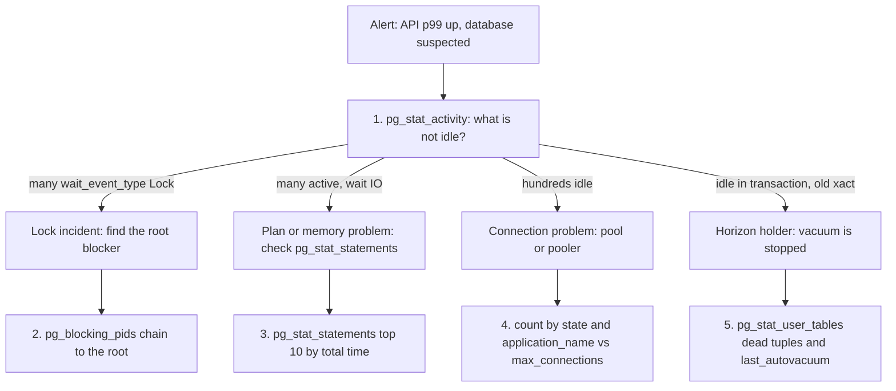
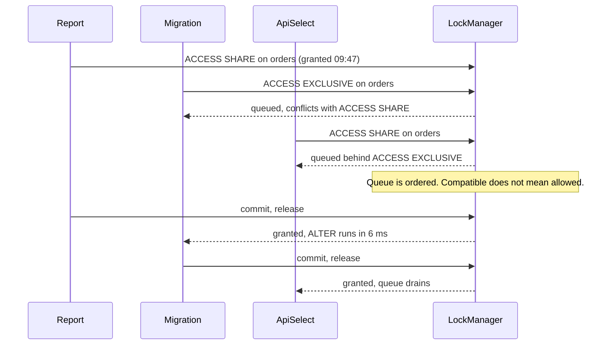

## 18.14 Observing PostgreSQL

### 18.14.1 The views and extensions a backend engineer must know

#### Concept

PostgreSQL tells you almost everything about itself through ordinary SQL. There is no agent to install and no proprietary console you need: the statistics collector maintains a set of views (`pg_stat_*`), the lock manager exposes `pg_locks`, and two extensions (`pg_stat_statements`, `auto_explain`) turn "the database is slow" into "this query, this many times, this much time". Learning eight views is the difference between guessing during an incident and knowing.

#### Why does it exist?

Because the application's view of the database is a single number: latency. When that number moves, the application cannot tell you whether it is a bad plan, a lock queue, a saturated connection pool, a checkpoint, a vacuum that has stopped working, or a replica falling behind. Each of those has a different fix and some of them have opposite fixes. The statistics views are how you distinguish them, and they cost almost nothing to read.

#### Mental model

Imagine a hospital. `pg_stat_activity` is the live ward: who is in a bed right now, what they are doing, and who is waiting for the operating theatre. `pg_stat_statements` is the year's case history: which procedures consumed the most surgeon-hours in total, not which one was longest once. `pg_stat_user_tables` is the maintenance log for each room. `pg_locks` is the theatre booking sheet, showing who holds it and who is queued behind them. During an incident you look at the ward; during planning you look at the case history.

#### How it works

**`pg_stat_activity` — what is happening right now.** One row per backend process. The columns that matter: `state` (`active`, `idle`, `idle in transaction`, `idle in transaction (aborted)`), `wait_event_type` and `wait_event` (why an active backend is not running), `xact_start` (when its transaction began, which is what holds the xmin horizon), `query_start`, `backend_xmin`, `application_name` and `query`.

```sql
-- Everything that is not idle, longest-running first
SELECT pid, now() - xact_start AS xact_age, now() - query_start AS query_age,
       state, wait_event_type, wait_event, application_name, left(query, 80) AS query
FROM pg_stat_activity
WHERE backend_type = 'client backend' AND state <> 'idle'
ORDER BY xact_start NULLS LAST;
```

```text
  pid  | xact_age  | query_age | state               | wait_event_type | wait_event   | application_name | query
-------+-----------+-----------+---------------------+-----------------+--------------+------------------+---------------------------
 21440 | 00:14:02  | 00:14:02  | active              | IO              | DataFileRead | reporting        | SELECT o.id, ... FROM orders
 22107 | 00:11:19  | 00:11:19  | active              | Lock            | relation     | migrations       | ALTER TABLE orders ADD COL
 22300 | 00:11:14  | 00:11:14  | active              | Lock            | relation     | orders-api       | SELECT * FROM orders WHERE
 22488 | 00:04:51  | 00:00:00  | idle in transaction | Client          | ClientRead   | orders-api       | UPDATE inventory SET ...
```

Read it in four moves. `wait_event_type = 'Lock'` means blocked by another session, and that is a lock incident. `wait_event_type = 'IO'` means reading from disk, which is a memory or plan problem. `wait_event_type = 'LWLock'` with `BufferContent` or `WALWrite` means internal contention. `state = 'idle in transaction'` with a large `xact_age` is the single most dangerous row in this view: it holds locks and freezes the xmin horizon, which stops vacuum everywhere (18.8).

Finding the blocker is one function call:

```sql
SELECT blocked.pid AS blocked_pid, blocked.wait_event, left(blocked.query, 60) AS blocked_query,
       blocker.pid AS blocking_pid, blocker.state, now() - blocker.xact_start AS blocker_xact_age,
       left(blocker.query, 60) AS blocking_query
FROM pg_stat_activity blocked
JOIN LATERAL unnest(pg_blocking_pids(blocked.pid)) AS b(pid) ON true
JOIN pg_stat_activity blocker ON blocker.pid = b.pid
WHERE cardinality(pg_blocking_pids(blocked.pid)) > 0;
```

`pg_blocking_pids(pid)` returns the pids this backend is waiting for, transitively through the lock queue. Follow the chain to the root and you have the one session to cancel (`pg_cancel_backend`) or terminate (`pg_terminate_backend`).

**`pg_stat_statements` — where the time actually goes.** Requires `shared_preload_libraries = 'pg_stat_statements'` and a restart, then `CREATE EXTENSION pg_stat_statements`. It normalises queries (constants become `$1`) and accumulates counters per `queryid` since the last reset.

```sql
SELECT calls,
       round(total_exec_time::numeric, 0) AS total_ms,
       round(mean_exec_time::numeric, 2) AS mean_ms,
       round((100 * total_exec_time / sum(total_exec_time) OVER ())::numeric, 1) AS pct,
       rows / greatest(calls, 1) AS rows_per_call,
       shared_blks_hit, shared_blks_read,
       left(query, 70) AS query
FROM pg_stat_statements
ORDER BY total_exec_time DESC
LIMIT 10;
```

```text
 calls   | total_ms  | mean_ms | pct  | rows_per_call | shared_blks_hit | shared_blks_read | query
---------+-----------+---------+------+---------------+-----------------+------------------+--------------------------
 4821003 |  1204811  |    0.25 | 31.2 |             1 |      19204118   |            8112  | SELECT * FROM users WHERE i
    1902 |   901255  |  473.85 | 23.4 |         41022 |       4881200   |         1902144  | SELECT o.id, ... GROUP BY
  882014 |   402118  |    0.46 | 10.4 |            12 |       9902441   |             912  | SELECT * FROM order_items W
```

The lesson of that output is why you sort by `total_exec_time` and not by `mean_exec_time`: the top row is a 0.25 ms query, and it is the biggest consumer in the database because it runs 4.8 million times. Sorting by mean finds the slow report; sorting by total finds the thing that is actually eating the server. Do both, and also sort by `shared_blks_read` to find what is not fitting in `shared_buffers`.

Reset before a load test or after a fix so the numbers describe the period you care about: `SELECT pg_stat_statements_reset();`. Record the reset time somewhere, because the view has no memory of it and "total time" is meaningless without a window. `pg_stat_statements.max` (default 5,000) caps the number of tracked statements; when it is exceeded, the least-used entries are evicted and your numbers get holes.

**`pg_stat_user_tables` — per-table health.** Sequential scans, dead tuples and vacuum history.

```sql
SELECT relname,
       seq_scan, idx_scan,
       n_live_tup, n_dead_tup,
       round(100.0 * n_dead_tup / greatest(n_live_tup + n_dead_tup, 1), 1) AS dead_pct,
       n_mod_since_analyze,
       last_autovacuum, last_autoanalyze
FROM pg_stat_user_tables
WHERE n_live_tup > 10000
ORDER BY n_dead_tup DESC
LIMIT 15;
```

A large `seq_scan` count on a large table is a missing index (or a planner that thinks a scan is cheaper: check statistics). `dead_pct` above 20 percent on a busy table, or a `last_autovacuum` that is hours old on a table with millions of dead tuples, means autovacuum is not keeping up or is being blocked (18.8). `n_mod_since_analyze` climbing into the millions means the planner is working from stale statistics and will start choosing wrong plans.

**`pg_stat_user_indexes` — indexes nobody uses.** Every index costs write amplification, WAL and disk.

```sql
SELECT s.relname AS table_name, s.indexrelname AS index_name, s.idx_scan,
       pg_size_pretty(pg_relation_size(s.indexrelid)) AS size
FROM pg_stat_user_indexes s
JOIN pg_index i ON i.indexrelid = s.indexrelid
WHERE s.idx_scan = 0 AND NOT i.indisunique AND NOT i.indisprimary
ORDER BY pg_relation_size(s.indexrelid) DESC;
```

Two cautions before you drop anything: the counters are since the last `pg_stat_reset()` or since the server was rebuilt, so check the age of the statistics; and the counters are per node, so an index unused on the primary may be essential on a read replica.

**`pg_locks` joined to activity — the lock queue.** `pg_locks` shows one row per held or awaited lock, with `granted` telling you which it is.

```sql
SELECT l.locktype, l.relation::regclass AS relation, l.mode, l.granted,
       a.pid, a.state, now() - a.xact_start AS xact_age, left(a.query, 60) AS query
FROM pg_locks l
JOIN pg_stat_activity a ON a.pid = l.pid
WHERE l.relation = 'public.orders'::regclass
ORDER BY l.granted DESC, a.xact_start;
```

Everything with `granted = false` is queued. The lock queue is ordered: a pending `ACCESS EXCLUSIVE` request blocks every later request, even a plain `SELECT` that would otherwise be compatible with the current holder. That single fact explains incident (a) in the next section.

**`pg_stat_replication` — how far behind the replicas are.** Run on the primary.

```sql
SELECT application_name, client_addr, state, sync_state,
       pg_size_pretty(pg_wal_lsn_diff(pg_current_wal_lsn(), sent_lsn))   AS pending_send,
       pg_size_pretty(pg_wal_lsn_diff(sent_lsn, replay_lsn))             AS pending_replay,
       write_lag, flush_lag, replay_lag
FROM pg_stat_replication;
```

Two different lags matter. **Bytes** (`pg_wal_lsn_diff`) tells you how much WAL the replica has not applied, which predicts recovery time and disk pressure. **Seconds** (`replay_lag`, or on the replica `now() - pg_last_xact_replay_timestamp()`) tells you how stale a read on that replica is, which is what your application cares about when it reads its own writes (Part 28 — Distributed Systems). A replica with 0 bytes pending and 40 seconds of `replay_lag` is idle, not late; a replica with 8 GB pending is a problem.

**`pg_stat_database` — the whole-database counters.**

```sql
SELECT datname, numbackends, xact_commit, xact_rollback, deadlocks,
       temp_files, pg_size_pretty(temp_bytes) AS temp_bytes, conflicts,
       round(100.0 * blks_hit / greatest(blks_hit + blks_read, 1), 2) AS cache_hit_pct
FROM pg_stat_database WHERE datname = current_database();
```

`deadlocks` should be near zero and any increase is a code problem (20.3). `temp_files` and `temp_bytes` growing means queries are spilling `work_mem` to disk; pair with `log_temp_files = 0` to see which ones. `conflicts` is non-zero only on replicas and counts queries cancelled by recovery conflicts. `cache_hit_pct` below about 98 percent on an OLTP database usually means the working set does not fit in `shared_buffers`, though it is a blunt instrument: a single big report can drag it down while every OLTP query is served from memory.

**Bloat.** Dead tuples that vacuum has reclaimed as free space but not returned to the operating system make tables and indexes bigger than their data, which makes every scan read more pages.

```sql
CREATE EXTENSION IF NOT EXISTS pgstattuple;
-- Sampling estimate: cheap enough to run on a large table
SELECT * FROM pgstattuple_approx('orders');
-- table_len | scanned_percent | approx_free_percent | dead_tuple_percent
-- 48 GB     |            4.10 |               61.20 |               3.90
SELECT * FROM pgstatindex('orders_pkey');
-- avg_leaf_density 42.1  -> healthy is 85-90; this index is roughly half air
```

`approx_free_percent` above 40 and `avg_leaf_density` under 60 mean it is time for `REINDEX CONCURRENTLY` or `pg_repack`. Never `VACUUM FULL` a busy table: it takes `ACCESS EXCLUSIVE` for the whole rewrite.

**`auto_explain` and `log_min_duration_statement`.** The slow-query log tells you *what* was slow; `auto_explain` tells you *why*, by logging the plan of the actual execution, including the parameters the planner really saw.

```text
shared_preload_libraries = 'pg_stat_statements,auto_explain'
auto_explain.log_min_duration = '500ms'
auto_explain.log_analyze = on        # real row counts, not estimates
auto_explain.log_buffers = on        # shared hit/read per node
auto_explain.log_timing = off        # cheaper; turn on when you need per-node times
auto_explain.log_nested_statements = on   # plans inside functions and triggers
auto_explain.sample_rate = 0.25      # log a quarter of qualifying statements on a busy server
log_min_duration_statement = 500
log_lock_waits = on
log_temp_files = 0
log_autovacuum_min_duration = 1000
track_io_timing = on
```

`log_analyze = on` means the statement is instrumented, which costs a few percent; `log_timing = off` removes most of that cost while keeping row counts. `sample_rate` keeps a busy server from writing more log than query results.

#### First five queries to run when the database is unhealthy

In order, with what each rules out. This is the runbook; put it in a snippet file every engineer has.



1. **Who is not idle, and why?** The `pg_stat_activity` query above. This single result usually names the category of incident in ten seconds.
2. **Who is blocking whom?** The `pg_blocking_pids` query. Follow to the root; the root is usually one session and often one migration or one report.
3. **What is consuming the server?** `pg_stat_statements` ordered by `total_exec_time`, and again by `mean_exec_time`. Compare against yesterday's snapshot if you keep one.
4. **How many connections, in what state?** `SELECT state, application_name, count(*) FROM pg_stat_activity GROUP BY 1, 2 ORDER BY 3 DESC;` next to `SHOW max_connections`. Hundreds of `idle` connections with low CPU is a pooling problem, not a database problem.
5. **Is maintenance keeping up?** `pg_stat_user_tables` for dead tuples and `last_autovacuum`, plus `SELECT max(age(backend_xmin)) FROM pg_stat_activity;` and `SELECT slot_name, active, pg_size_pretty(pg_wal_lsn_diff(pg_current_wal_lsn(), restart_lsn)) FROM pg_replication_slots;`.

#### NestJS example

Expose the five as an internal, authenticated diagnostics endpoint so the on-call does not need a psql session and a bastion host at 02:14:

```ts
// src/ops/db-diagnostics.controller.ts
import { Controller, Get, UseGuards } from '@nestjs/common';
import { InjectDataSource } from '@nestjs/typeorm';
import { DataSource } from 'typeorm';
import { InternalOnlyGuard } from './internal-only.guard';

@Controller('internal/db')
@UseGuards(InternalOnlyGuard)              // network policy plus a token; never public
export class DbDiagnosticsController {
  constructor(@InjectDataSource() private readonly db: DataSource) {}

  @Get('activity')
  activity() {
    return this.db.query(
      `SELECT pid, now() - xact_start AS xact_age, state, wait_event_type, wait_event,
              application_name, left(query, 120) AS query
         FROM pg_stat_activity
        WHERE backend_type = 'client backend' AND state <> 'idle'
        ORDER BY xact_start NULLS LAST LIMIT 50`);
  }

  @Get('blockers')
  blockers() {
    return this.db.query(
      `SELECT b.pid AS blocked, unnest(pg_blocking_pids(b.pid)) AS blocker,
              left(b.query, 120) AS blocked_query
         FROM pg_stat_activity b
        WHERE cardinality(pg_blocking_pids(b.pid)) > 0`);
  }

  @Get('top-queries')
  topQueries() {
    return this.db.query(
      `SELECT calls, round(total_exec_time::numeric) AS total_ms,
              round(mean_exec_time::numeric, 2) AS mean_ms, left(query, 120) AS query
         FROM pg_stat_statements ORDER BY total_exec_time DESC LIMIT 20`);
  }
}
```

Run it on a small, separate pool (`extra: { max: 2 }`) with its own role and a short `statement_timeout`, so diagnostics still work when the main pool is exhausted. A diagnostics endpoint that cannot get a connection during a connection incident is worthless.

#### Production scenario

A team scrapes six of these queries every 30 seconds into Prometheus with `postgres_exporter`, and alerts on four things only: `pg_stat_activity` count in state `idle in transaction` older than 60 seconds, any backend waiting on a lock for more than 30 seconds, replication lag bytes above 1 GB, and dead-tuple percentage above 25 on the five largest tables. Everything else is a dashboard. Four alerts, each with a runbook link, is a pager that people still answer after six months.

#### Failure scenario

At 03:20 the on-call is paged for API latency. They open Grafana: database CPU is 18 percent, disk is quiet, and every panel looks fine. The instinct is "not the database". `pg_stat_activity` shows 340 connections, 331 of them `idle`, and nine `active` all waiting on `Lock`. The database was almost idle *because* it was blocked: one `idle in transaction` session from a crashed worker held a row lock on a hot inventory row, and every checkout queued behind it. Dashboards showing resource usage would never have shown this; the view that shows waiting shows it in one query.

## 18.15 Three incidents from the database

### 18.15.1 Incident A: the eleven-minute `ALTER TABLE`

**Symptoms.** 10:00:12, every read endpoint starts returning 500s. Error rate 100 percent on the orders API within 40 seconds. Database CPU falls to 6 percent. No deploy of application code; a migration job ran as part of the release.

**Timeline.**

| Time | Event |
|---|---|
| 09:47:31 | A finance report starts: `SELECT ... FROM orders JOIN order_items ... GROUP BY ...`. It takes an `ACCESS SHARE` lock on `orders` and will run for 24 minutes. The reporting role has no `statement_timeout`. |
| 10:00:04 | The release's migration runs `ALTER TABLE orders ADD COLUMN fulfilment_channel text NOT NULL DEFAULT 'web';`. It requests `ACCESS EXCLUSIVE` on `orders`, which conflicts with the report's `ACCESS SHARE`, so it **waits**. |
| 10:00:05 | The next `SELECT * FROM orders WHERE id = $1` from the API requests `ACCESS SHARE`. It is compatible with the report, but the queue already contains a pending `ACCESS EXCLUSIVE`, and PostgreSQL's lock queue is ordered. The `SELECT` **waits behind the ALTER**. |
| 10:00:05 – 10:00:35 | Every subsequent query touching `orders` joins the queue. The application's 20 connections per pod are all consumed by waiting queries within 30 seconds. |
| 10:00:45 | The pool's `connectionTimeoutMillis` starts firing. The API returns 500s. Health checks that query `orders` fail; Kubernetes starts restarting pods, which makes it worse. |
| 10:11:22 | The report finishes. The `ALTER` acquires the lock and completes in **6 ms** (PostgreSQL 11+ stores the default in the catalog and does not rewrite the table). The queue drains. |
| 10:11:40 | Error rate back to zero. |

**Investigation queries actually run.** The on-call ran the activity query and saw twenty rows with `wait_event_type = 'Lock'` and one row with `application_name = 'migrations'` also waiting. Then:

```sql
SELECT blocked.pid, blocked.application_name, blocked.wait_event,
       blocker.pid AS blocker_pid, blocker.application_name AS blocker_app,
       now() - blocker.xact_start AS blocker_age, left(blocker.query, 60)
FROM pg_stat_activity blocked
JOIN LATERAL unnest(pg_blocking_pids(blocked.pid)) AS b(pid) ON true
JOIN pg_stat_activity blocker ON blocker.pid = b.pid;
```

The chain was: 43 API sessions blocked by pid 22107 (`migrations`), which was blocked by pid 21440 (`reporting`, age 13 minutes). One `SELECT pg_cancel_backend(21440);` would have ended the incident in one second. The on-call did exactly that at 10:11 (thirty seconds before the report finished on its own).



**Root cause.** The lock queue is FIFO, and a queued `ACCESS EXCLUSIVE` request blocks readers that would otherwise be compatible with the current holder. The DDL itself was cheap; the *wait* for it was the outage. Nobody had set `lock_timeout` on the migration role.

**Prevention, all of which shipped that week.**

```sql
-- In every migration, before any DDL:
SET lock_timeout = '3s';        -- fail fast rather than build a queue
SET statement_timeout = '0';    -- the DDL itself may legitimately take time once it starts
```

Plus: a retry wrapper that catches `55P03 lock_not_available` and retries with backoff up to ten times; `statement_timeout = '10min'` on the reporting role; `log_lock_waits = on` so the log names the blocker; an alert on any backend waiting on a lock for more than 30 seconds; and a rule that migrations run in a low-traffic window with a pre-check that no transaction older than 60 seconds exists.

### 18.15.2 Incident B: the forgotten `await` that bloated a table to 4x

**Symptoms.** Nothing, for three days. Then on Friday, `GET /orders` p99 drifts from 40 ms to 900 ms, disk usage on the primary is up 180 GB, and the storage alarm fires at 85 percent.

**Timeline.**

| Time | Event |
|---|---|
| Tue 14:10 | A deploy ships a refactor of the inventory sync worker. One code path calls `queryRunner.startTransaction()` and then calls an async method without `await`; the function returns, the promise is never resolved into a commit, and the `QueryRunner` is never released. The connection sits in `idle in transaction` forever. |
| Tue 14:10 onward | That session's `backend_xmin` freezes the xmin horizon. Autovacuum runs on `orders` and `order_items` every few minutes and removes **nothing**, because every dead tuple is still potentially visible to that ancient transaction. |
| Wed – Thu | `orders` grows from 41 million live tuples and 2 percent dead to 41 million live and 39 million dead. The heap goes from 46 GB to 178 GB. The primary key index leaf density falls from 88 to 39. Every index scan reads more pages; the cache hit ratio falls from 99.4 to 96.1 percent. |
| Fri 09:30 | p99 crosses the alert threshold. Disk alarm at 11:05. |

**Investigation queries actually run.**

```sql
-- 1. Who is holding the horizon?
SELECT pid, application_name, state, now() - xact_start AS xact_age,
       backend_xmin, age(backend_xmin) AS xmin_age
FROM pg_stat_activity
WHERE state = 'idle in transaction' OR backend_xmin IS NOT NULL
ORDER BY age(backend_xmin) DESC NULLS LAST;
-- pid 9184 | inventory-worker | idle in transaction | 2 days 19:24:11 | 894231004 | 41,882,617
```

```sql
-- 2. Confirm vacuum is running but reclaiming nothing
SELECT relname, n_live_tup, n_dead_tup, last_autovacuum, autovacuum_count
FROM pg_stat_user_tables WHERE relname IN ('orders', 'order_items');
-- orders | 41,203,551 | 39,882,110 | 2024-xx-xx 11:02 | 918
```

The autovacuum log line (visible because `log_autovacuum_min_duration = 1000`) was the smoking gun:

```text
LOG:  automatic vacuum of table "shop.public.orders": index scans: 0
      pages: 0 removed, 22318112 remain
      tuples: 0 removed, 41203551 remain, 39882110 are dead but not yet removable,
      oldest xmin: 894231004
```

"**Dead but not yet removable**" is the phrase to memorise. It means vacuum is working perfectly and is being prevented from doing anything by an old snapshot.

**Root cause.** A floating promise left a transaction open. The database has no idea the application forgot; from its side, a client has an open transaction and may still read.

**Fix.** `SELECT pg_terminate_backend(9184);` then a manual `VACUUM (VERBOSE, ANALYZE) orders;` which took 22 minutes and reclaimed the space as free space inside the files (disk usage did not drop). `pg_repack` in the Sunday window returned 130 GB to the filesystem without an `ACCESS EXCLUSIVE` lock for the duration.

**Prevention.**

```text
ALTER ROLE orders_api SET idle_in_transaction_session_timeout = '60s';
ALTER ROLE inventory_worker SET idle_in_transaction_session_timeout = '60s';
```

Plus `@typescript-eslint/no-floating-promises` as an error in CI, a rule that transactions go through `dataSource.transaction(async (em) => ...)` rather than manual `QueryRunner` lifecycles, and an alert on `max(age(backend_xmin)) > 50_000_000` and on any session `idle in transaction` for more than two minutes. That last alert would have paged on Tuesday at 14:12 instead of Friday at 09:30.

### 18.15.3 Incident C: the connection storm after a deploy

**Symptoms.** 16:42, immediately after a routine deploy. The API returns 500s on roughly a third of requests. The error in the logs is `FATAL: remaining connection slots are reserved for non-replication superuser connections` and, in the pool, `Connection terminated due to connection timeout`. Database CPU is 14 percent and disk is idle. The database is not busy; it is full.

**Timeline.**

| Time | Event |
|---|---|
| 16:41:50 | Rolling deploy starts. The Deployment has 40 replicas and `maxSurge: 50%`, so up to 60 pods exist at once. |
| 16:41:55 | Each pod's TypeORM pool is configured `max: 20`. New pods open connections eagerly on startup because the readiness probe runs a query and the entity metadata load opens several connections. Demand goes from 800 to 1,200 connections. |
| 16:42:03 | `max_connections` is 500 (a `db.r6g.2xlarge` default with `superuser_reserved_connections = 3`). Connection attempt 498 fails. |
| 16:42:03 – 16:47 | New pods cannot reach readiness (their probe query cannot get a connection), so Kubernetes never terminates old pods, so the surge never drains. The deploy is stuck at 60 pods, all fighting for 500 slots. Meanwhile old pods that lost connections retry immediately, adding load. |
| 16:47:30 | On-call scales the Deployment to 20 replicas manually. Connections drop to 400, the pool recovers, the deploy is rolled back. |

**Investigation queries actually run.**

```sql
SELECT count(*) AS total,
       count(*) FILTER (WHERE state = 'active') AS active,
       count(*) FILTER (WHERE state = 'idle') AS idle,
       count(*) FILTER (WHERE state = 'idle in transaction') AS idle_in_txn
FROM pg_stat_activity WHERE backend_type = 'client backend';
-- total 497 | active 11 | idle 486 | idle_in_txn 0

SELECT application_name, count(*) FROM pg_stat_activity GROUP BY 1 ORDER BY 2 DESC;
-- orders-api 441 | worker 44 | reporting 8 | psql 1
SHOW max_connections;   -- 500
```

Eleven active connections out of 497. The database was doing 2 percent of its capacity while the application could not talk to it at all. That contrast (`active` tiny, `total` at the ceiling, CPU low) is the signature of a connection incident and nothing else looks like it.

**Root cause.** Nobody had multiplied. `pods × pool.max` was 40 × 20 = 800 against a `max_connections` of 500, and the deploy's surge made it 1,200. It had worked for months because pods never all opened their full pool at once; the deploy made them do exactly that. Each PostgreSQL connection is a process with about 5–10 MB of private memory, so raising `max_connections` to 1,200 was not the answer either (18.2).

**Fix and prevention.** PgBouncer in transaction pooling mode between the application and the database (18.3): 1,200 client connections map onto a server pool of 60. Application `pool.max` dropped from 20 to 5, because with a pooler the pod's pool only needs to cover its own concurrency. `maxSurge` reduced to 25 percent. An alert at 70 percent of `max_connections`. And a documented arithmetic check in the deployment template: `replicas × maxSurge × pool.max` must be under the pooler's client limit, and the pooler's server pool must be under `max_connections` minus reserved slots.

## 18.16 Edge cases and failure modes

- **Transaction id wraparound approaching.** PostgreSQL's transaction ids are 32-bit and wrap. If `age(datfrozenxid)` approaches 2 billion the server starts screaming in the log and eventually refuses to accept new write transactions until you vacuum in single-user mode. It is caused by autovacuum being unable to freeze: a long-lived prepared transaction, an abandoned replication slot, or a table whose autovacuum keeps being cancelled. Watch it: `SELECT datname, age(datfrozenxid) FROM pg_database ORDER BY 2 DESC;` and alert above 500 million. Fix before it is urgent, because the emergency fix is downtime.

- **A replication slot filling the disk.** A physical or logical slot guarantees the primary keeps WAL until the consumer has it. If the consumer is gone (a decommissioned replica, a stopped Debezium connector), WAL accumulates forever and fills `pg_wal` until the primary shuts down. Watch `SELECT slot_name, active, pg_size_pretty(pg_wal_lsn_diff(pg_current_wal_lsn(), restart_lsn)) FROM pg_replication_slots;` and set `max_slot_wal_keep_size` (PG13+) so PostgreSQL invalidates a slot rather than dying with it.

- **Checkpoint I/O storms.** A checkpoint that is not spread out writes gigabytes of dirty buffers in a burst, and latency shows a comb pattern every `checkpoint_timeout`. `log_checkpoints = on` plus `pg_stat_bgwriter.checkpoints_req` (requested, not timed) tells you `max_wal_size` is too small and checkpoints are being forced by WAL volume rather than by time.

- **TOAST bloat.** Large `text`, `jsonb` and `bytea` values live in a side table. Updating a row's JSONB column rewrites the TOAST chunks, and the TOAST table bloats independently of the main table. `pg_stat_user_tables` does not show it; check `pg_total_relation_size` against `pg_relation_size`, and vacuum the TOAST relation.

- **Plan flips after `ANALYZE`.** New statistics can change a good nested loop into a bad hash join or vice versa, instantly, with no deploy. If p99 jumps at the exact moment `last_autoanalyze` changed, that is your cause. Fix with better statistics (`ALTER TABLE ... ALTER COLUMN ... SET STATISTICS 500`, extended statistics for correlated columns) rather than by disabling plan types.

- **Autovacuum starvation on a huge table.** Default `autovacuum_vacuum_scale_factor = 0.2` means a 500-million-row table waits for 100 million dead tuples before vacuum starts, and then a single worker crawls it under the cost limit while three other workers are busy. Set per-table: `ALTER TABLE orders SET (autovacuum_vacuum_scale_factor = 0.02, autovacuum_vacuum_cost_limit = 4000);`.

- **Lock queue pile-ups behind one DDL statement.** Incident A. Any `ACCESS EXCLUSIVE` request (most `ALTER TABLE` forms, `REINDEX` without `CONCURRENTLY`, `VACUUM FULL`, `TRUNCATE`) that has to wait blocks everything behind it. `lock_timeout` on every migration, always.

- **Temp file explosions from an under-sized `work_mem`.** A report that spills 300 GB of temp files fills the disk and takes the primary down for everyone. `temp_file_limit` per role is the seatbelt; `log_temp_files = 0` is the warning light.

- **A long analytics query on a replica cancelled by conflict.** `ERROR: canceling statement due to conflict with recovery`. The primary vacuumed rows the replica's query still needed. Options: `hot_standby_feedback = on` (which moves the problem to the primary as bloat), `max_standby_streaming_delay` (which moves it to replication lag), or accept the cancellation and retry. There is no free choice; pick which cost you prefer and write it down.

- **Prepared-statement generic plans going bad.** After five executions, PostgreSQL may switch a prepared statement to a generic plan built without the actual parameters. For a skewed column (`status = 'pending'` matching 0.1 percent, `status = 'shipped'` matching 80 percent) the generic plan is wrong for one of them and latency doubles for a subset of traffic with no code change. Diagnose by comparing `EXPLAIN` with and without parameters; control with `plan_cache_mode = force_custom_plan` on that role or session.

- **Statistics views resetting silently.** A server restart or a `pg_stat_reset()` zeroes the counters. "This index has zero scans" means nothing if the statistics are two hours old. Always check `stats_reset` in `pg_stat_database`.

- **`pg_stat_statements` eviction.** With `pg_stat_statements.max` too low on a system that generates many distinct query shapes (dynamic SQL, unparameterised queries from a reporting tool), entries are evicted and the top-N list is incomplete. Unparameterised queries also explode the table because each constant creates a new entry.

- **Observability that needs a connection during a connection incident.** The exporter, the diagnostics endpoint and the on-call's psql session all need a slot. Reserve them: `superuser_reserved_connections`, a dedicated monitoring role with its own small pool, and a bastion path that does not go through the application's pooler.

## Senior Checklist — Part 18

- [ ] I understand the concept
- [ ] I can explain it simply
- [ ] I can implement it
- [ ] I understand its failure modes
- [ ] I understand its scaling limitations
- [ ] I understand its security implications
- [ ] I understand its operational implications
- [ ] I can choose between alternatives
- [ ] I can explain the tradeoffs
- [ ] I can answer senior-level interview questions
- [ ] I can draw PostgreSQL's process architecture and name what the postmaster, the backends, the WAL writer, the background writer, the checkpointer and the autovacuum launcher each do
- [ ] I can compute `pods × pool.max` against `max_connections` and say when a connection pooler becomes mandatory
- [ ] I know the difference between session, transaction and statement pooling in PgBouncer, and which application features break in each
- [ ] I can explain the lifecycle of a query from parse to plan to execute, and where the plan cache and prepared statements fit
- [ ] I can size `shared_buffers` and `effective_cache_size` and explain why they are not the same kind of setting
- [ ] I can explain WAL, full-page writes and why `max_wal_size` and `checkpoint_timeout` control latency spikes
- [ ] I can read `log_checkpoints` output and tell a timed checkpoint from a requested one
- [ ] I can explain MVCC, xmin/xmax, tuple visibility and why an old snapshot stops vacuum everywhere
- [ ] I recognise "dead but not yet removable" in an autovacuum log line and know the three things that cause it
- [ ] I can tune autovacuum per table and explain scale factor, threshold, cost limit and cost delay
- [ ] I know when `ANALYZE` matters, what extended statistics fix, and how a plan can flip with no deploy
- [ ] I can name PostgreSQL's table-level lock modes and say which pairs conflict
- [ ] I know that a queued `ACCESS EXCLUSIVE` lock blocks compatible readers behind it, and I set `lock_timeout` in every migration
- [ ] I can read `EXPLAIN (ANALYZE, BUFFERS)` and identify a bad plan, a bad estimate and a spill to disk
- [ ] I know the twenty configuration settings that matter and why each has its value in my environment
- [ ] I can run the five diagnostic queries from memory when the database is unhealthy
- [ ] I use `pg_stat_statements` sorted by total time, not just mean time, and I record when I last reset it
- [ ] I can find the root blocker with `pg_blocking_pids` and decide between cancel and terminate
- [ ] I monitor replication lag in both bytes and seconds and know which one my application cares about
- [ ] I watch `age(datfrozenxid)`, replication slot retention and dead tuple percentage before they become incidents

## Part 18 — Key Takeaways

- PostgreSQL is a process per connection. Connections are memory and context switches, not free handles; `pods × pool.max` is arithmetic you must do before the deploy, not after.
- A busy database and a blocked database look completely different in `pg_stat_activity` and identical in a CPU graph. Always look at what backends are waiting for.
- The lock queue is ordered. One `ACCESS EXCLUSIVE` request waiting behind a long report blocks every reader behind it, which is how a 6 ms `ALTER TABLE` becomes an eleven-minute outage.
- `SET lock_timeout` in every migration. Failing fast and retrying is strictly better than building a queue you cannot see.
- `idle in transaction` is the most expensive state in the database: it holds locks and freezes the xmin horizon, which stops vacuum on every table.
- "Dead but not yet removable" means vacuum is working and something older is preventing it. Find the old snapshot, the abandoned slot or the prepared transaction.
- MVCC makes readers and writers not block each other, and the price is dead tuples, vacuum, bloat and wraparound. That price is paid by operations, not by the query.
- Sort `pg_stat_statements` by total time to find what is eating the server, and by mean time to find what is annoying a user. They are usually different queries.
- Replication lag has two units: bytes predict recovery and disk, seconds predict staleness. Alert on both.
- Plans change without deploys. `ANALYZE`, parameter skew and generic plans move latency, so latency alerts need plan evidence (`auto_explain`) attached.
- Statistics views reset on restart. Never drop an index or draw a conclusion without checking how old the counters are.
- Configure the safety belts per role: `statement_timeout`, `lock_timeout`, `idle_in_transaction_session_timeout`, `temp_file_limit`. They are the difference between a bad query and an outage.
- Four alerts with runbooks beat forty dashboards. Old transactions, lock waits, replication lag and dead tuples cover most of what actually pages you.
- Your diagnostics must work when the database is full. Reserve connections and a separate pool for monitoring and for the on-call.
