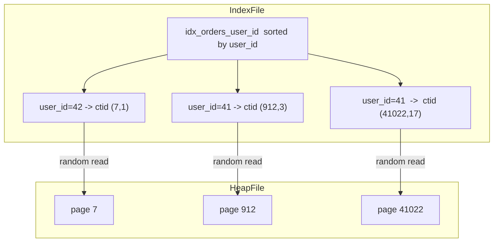
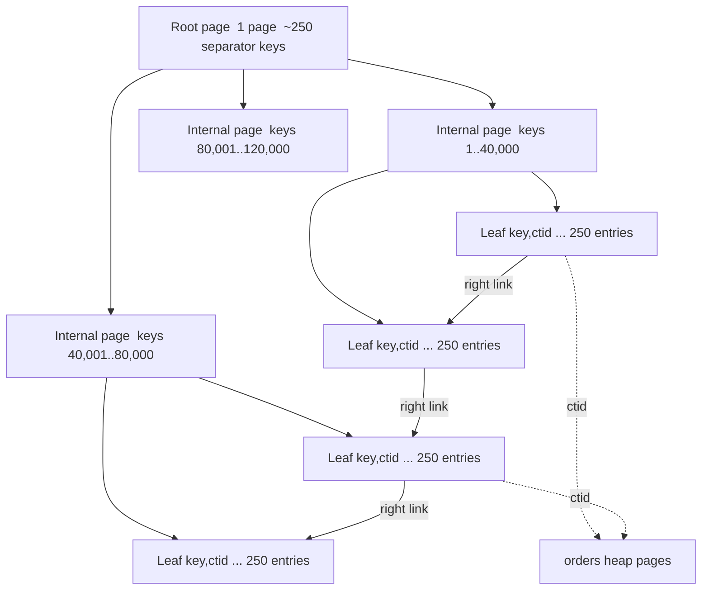

# Part 19 — Database Indexing

Part 18 taught you how PostgreSQL stores and protects your data: pages, buffers, WAL, MVCC, VACUUM, statistics, locks, and the planner. This part is about the one structure you will add, remove, argue about and get paged for more than any other: the **index**.

Indexing is where a backend engineer's decisions become visible in milliseconds. The same query on the same 200-million-row table can take 2.3 seconds or 4 milliseconds, and the only difference is whether the right index exists. It is also where careless engineers do the most quiet damage, because an index that nobody queries still costs you write latency, WAL volume, vacuum time, memory, disk and backup size on every single insert, forever.

So this part has two halves that must be held together. The first is *how to make a query fast*: how a B-tree actually works, how to read a plan, how to build composite, partial, covering, expression, GIN, GiST and BRIN indexes. The second is *how to not make everything else slow*: cardinality, write amplification, bloat, and the discipline of finding and dropping indexes nobody uses.

Everything here uses the running e-commerce schema from Part 18, extended with the tables this part needs, at volumes big enough that the wrong answer actually hurts.

```sql
-- Extra tables and columns used across Part 19.
-- users, products, orders, order_items, payments, inventory are as defined in Part 18.

CREATE TABLE categories (
  id          bigserial PRIMARY KEY,
  parent_id   bigint REFERENCES categories(id),
  slug        text NOT NULL,
  name        text NOT NULL
);

ALTER TABLE products
  ADD COLUMN category_id  bigint REFERENCES categories(id),
  ADD COLUMN is_active    boolean NOT NULL DEFAULT true,
  ADD COLUMN created_at   timestamptz NOT NULL DEFAULT now(),
  ADD COLUMN search_tsv   tsvector;

ALTER TABLE orders
  ADD COLUMN shipping_country char(2) NOT NULL DEFAULT 'DE',
  ADD COLUMN currency         char(3) NOT NULL DEFAULT 'EUR',
  ADD COLUMN tenant_id        bigint  NOT NULL DEFAULT 1;

CREATE TABLE reviews (
  id          bigserial PRIMARY KEY,
  product_id  bigint NOT NULL REFERENCES products(id),
  user_id     bigint NOT NULL REFERENCES users(id),
  rating      smallint NOT NULL CHECK (rating BETWEEN 1 AND 5),
  body        text NOT NULL,
  created_at  timestamptz NOT NULL DEFAULT now(),
  deleted_at  timestamptz
);

CREATE TABLE notifications (
  id          bigserial PRIMARY KEY,
  user_id     bigint NOT NULL REFERENCES users(id),
  kind        text NOT NULL,             -- ORDER_SHIPPED, PRICE_DROP, REVIEW_REPLY
  status      text NOT NULL,             -- PENDING, SENT, FAILED
  payload     jsonb NOT NULL DEFAULT '{}',
  created_at  timestamptz NOT NULL DEFAULT now(),
  sent_at     timestamptz
);
```

The volumes, because indexing advice without volumes is astrology:

| Table | Rows | Heap size | Heap pages | Rows per page |
|---|---|---|---|---|
| `users` | 8,000,000 | 1.1 GB | 141,177 | ~57 |
| `products` | 400,000 | 420 MB | 52,000 | ~8 (wide, TOASTed) |
| `categories` | 1,240 | 128 KB | 16 | ~78 |
| `orders` | 200,000,000 | 30 GB | 3,921,033 | ~51 |
| `order_items` | 900,000,000 | 67 GB | 8,823,530 | ~102 |
| `payments` | 212,000,000 | 26 GB | 3,411,000 | ~62 |
| `inventory` | 400,000 | 22 MB | 2,703 | ~148 |
| `reviews` | 41,000,000 | 9.8 GB | 1,281,000 | ~32 |
| `notifications` | 1,200,000,000 | 210 GB | 27,500,000 | ~44 |

Read those numbers once more. `orders` is 3.9 million pages. A sequential scan of it reads 30 GB. At the ~1.2 GB/s a good NVMe volume sustains with PostgreSQL's readahead, that is roughly 25 seconds of pure I/O even when nothing else is happening. Your API has a 200 ms budget. That gap is what indexes are for.

## 19.1 How an index actually works

### 19.1.1 A second, ordered structure that points into an unordered heap

#### Concept

An index is a **separate data structure, stored in its own file, that holds a sorted copy of one or more columns plus a pointer to where the full row lives**. It is not part of the table. It is not "the table sorted". Dropping it loses no data.

The pointer is a **ctid**: a pair `(block number, line pointer)` that says "page 41022, slot 17 of the `orders` heap file". The **heap** is the table's own file, and it is fundamentally **unordered**: PostgreSQL puts a new row wherever there is free space, which after a few months of updates and vacuums is essentially anywhere. There is no clustered index in PostgreSQL. The primary key is just another B-tree that happens to be unique, sitting beside the heap exactly like every other index.

So a lookup by index is always at least two steps: walk the index to find the ctid, then read the heap page that ctid points to. That second step is the expensive one, because it is a random read.

#### Why does it exist?

Without an index there is exactly one way to answer `WHERE id = 918273645`: read every page of the table and check every row. That is a sequential scan, and on `orders` it is 3.9 million page reads for one row. An index turns that into 4 page reads for the index descent plus 1 page read for the heap: 5 pages instead of 3,921,033. A factor of 780,000.

The price is that the index is a second copy of that data which must be kept correct. Every `INSERT` adds an entry to every index on the table. Every `UPDATE` that changes an indexed column, or that cannot fit the new row version on the same page, adds an entry to every index. Every index consumes buffer cache, WAL bytes, vacuum time and backup space. **An index is a read optimisation paid for with a write tax.** That sentence is the whole part in one line.

#### Mental model

Imagine a warehouse where parcels are put on whichever shelf has room. That is the heap. Beside the door hangs a ring binder, sorted by tracking number, and each page says "tracking 8829 -> aisle 12, shelf 4". That is the index. The binder is a second thing you must maintain: every parcel that arrives needs a line written into the binder, in the right sorted position. If you keep twelve binders (by tracking number, by customer, by postcode, by courier, by weight, by date...), every single parcel that arrives means twelve write operations before the receiving clerk can accept the next one. The picking is fast. The receiving desk is now the bottleneck.

#### How it works



1. **`CREATE INDEX` scans the table**, extracts `(key, ctid)` for every live row, sorts them (using `maintenance_work_mem`, spilling to temp files when it does not fit), and builds the tree bottom-up.
2. **On `INSERT`**, the executor writes the heap tuple, then inserts one entry into *each* index on the table. Each of those is a tree descent plus a leaf-page write plus WAL for that write.
3. **On `UPDATE`**, MVCC writes a new row version (Parts 7 and 181.7). If the new version lands on the same page and no indexed column changed, PostgreSQL uses a **HOT update** (heap-only tuple): the new version is chained from the old one and **no index entry is written at all**. If any indexed column changed, or the page is full, HOT is impossible and every index gets a new entry.
4. **On `DELETE`**, nothing is removed from the index. The heap tuple is marked dead; VACUUM later removes both the dead tuple and its index entries.
5. **On `SELECT`**, the executor descends the index, gets ctids, and fetches heap pages to check MVCC visibility, because *the index does not know whether a row version is visible to your snapshot*. That is why an index scan still touches the heap (unless the visibility map says the page is all-visible, which is the index-only scan of 19.9).

The HOT rule in step 3 is the single most under-appreciated fact in this part: **adding an index to a frequently updated column can silently disable HOT updates for the whole table**, turning cheap in-page updates into full index maintenance plus faster bloat. We will measure it in 19.17.

#### Practical example

`orders` has two indexes: the primary key on `id`, and `idx_orders_user_id`. Product asks for filtering by status, by country, by currency, by payment provider, by created date, by updated date, by total, by tenant, by shipping method and by coupon code. Ten more single-column indexes get added over two quarters, one ticket at a time, each one reviewed alone and each one "obviously fine". Checkout write latency goes from 6 ms to 21 ms and nobody can point at the change that did it, because no single change did it.

#### PostgreSQL example

The measurement everyone should run once, on their own hardware, so the number stops being abstract. Load 1,000,000 rows into a copy of `orders` with 2 indexes, then with 12.

```sql
-- Baseline: primary key + one FK index
CREATE TABLE orders_2idx (LIKE orders INCLUDING DEFAULTS);
ALTER TABLE orders_2idx ADD PRIMARY KEY (id);
CREATE INDEX ON orders_2idx (user_id);

-- Same table, ten more single-column indexes (the "index everything" school)
CREATE TABLE orders_12idx (LIKE orders INCLUDING DEFAULTS);
ALTER TABLE orders_12idx ADD PRIMARY KEY (id);
CREATE INDEX ON orders_12idx (user_id);
CREATE INDEX ON orders_12idx (status);
CREATE INDEX ON orders_12idx (created_at);
CREATE INDEX ON orders_12idx (updated_at);
CREATE INDEX ON orders_12idx (total_cents);
CREATE INDEX ON orders_12idx (shipping_country);
CREATE INDEX ON orders_12idx (currency);
CREATE INDEX ON orders_12idx (tenant_id);
CREATE INDEX ON orders_12idx (status, created_at);
CREATE INDEX ON orders_12idx (user_id, status);
CREATE INDEX ON orders_12idx (tenant_id, created_at);

-- Measure WAL as well as time: pg_current_wal_lsn() before and after
SELECT pg_current_wal_lsn() AS before_lsn \gset
INSERT INTO orders_2idx (user_id, status, total_cents, created_at, updated_at)
SELECT (random()*8000000)::bigint, 'PENDING', (random()*20000)::int, now(), now()
FROM generate_series(1, 1000000);
SELECT pg_size_pretty(pg_current_wal_lsn() - :'before_lsn') AS wal_written;
```

Measured on an 8 vCPU / 32 GB instance with NVMe storage, `shared_buffers = 8GB`, `synchronous_commit = on`:

| | 2 indexes | 12 indexes | Factor |
|---|---|---|---|
| Time for 1,000,000 inserts | 38.4 s | 246.1 s | 6.4x |
| Per-row insert cost | 38 us | 246 us | 6.4x |
| WAL written | 781 MB | 4,612 MB | 5.9x |
| Total index bytes added | 68 MB | 611 MB | 9.0x |
| Autovacuum time for one pass | 11 s | 96 s | 8.7x |

Single-row inserts through the API show the same shape at a smaller scale: p50 checkout write latency 2.1 ms with 2 indexes, 7.9 ms with 12. That is a real p99 story: 12 indexes means 12 tree descents, and any one of them can miss the buffer cache and turn into a disk read.

The write tax also shows up in a place people forget: **replication**. 5.9 times the WAL is 5.9 times the bytes streamed to every replica and 5.9 times the archive bill. A team that adds indexes freely eventually has a replication-lag problem they blame on the network.

#### NestJS example

The only sane way to keep this in check is to make index changes visible in review the same way a schema change is. Put every index in a migration, never in `synchronize: true`, and put the justification in the file.

```ts
// 1712001200000-AddOrdersUserCreatedIndex.ts
import { MigrationInterface, QueryRunner } from 'typeorm';

/**
 * Query: GET /orders?userId=:id  (p99 was 2.3 s, 41 req/s)
 * Plan before: Bitmap Heap Scan on orders, 380k rows removed by filter.
 * Expected index size: ~6.1 GB. Write cost measured at +0.4 ms per order insert.
 * Replaces: idx_orders_user_id (dropped in the next migration after a 7-day soak).
 */
export class AddOrdersUserCreatedIndex1712001200000 implements MigrationInterface {
  public async up(queryRunner: QueryRunner): Promise<void> {
    await queryRunner.query(
      `CREATE INDEX idx_orders_user_created ON orders (user_id, created_at DESC)`,
    );
  }

  public async down(queryRunner: QueryRunner): Promise<void> {
    await queryRunner.query(`DROP INDEX IF EXISTS idx_orders_user_created`);
  }
}
```

That comment block is not decoration. It is what lets the engineer in eighteen months decide whether the index can be dropped. An index with no recorded reason never gets deleted, because nobody dares.

#### Production scenario

A 200 million row `orders` table with 6 indexes occupies 30 GB of heap and 19 GB of indexes. `shared_buffers` is 8 GB. The hot working set (recent orders plus their index pages) is about 6 GB, so cache hit ratio sits at 99.3 percent. Adding three more indexes pushes the index total to 31 GB; the hot index pages now compete with the heap for the same 8 GB, hit ratio drops to 97.1 percent, and read latency on the *unrelated* product lookup endpoint goes up, because it lost its buffer pages. Indexes are not free even for the queries they do not serve.

#### Failure scenario

At 02:14 the on-call is paged for `pg_wal` disk usage at 91 percent. A batch job is backfilling `orders.tenant_id` for 200 million rows. The column has an index. Every updated row is a non-HOT update: a new heap version plus 7 index entries plus full-page images for every page touched after each checkpoint. WAL production goes from 40 MB/s to 310 MB/s, the archiver falls behind, `pg_wal` fills, and PostgreSQL is minutes away from refusing writes. The fix at 02:40 is to drop the index on `tenant_id`, run the backfill in 50,000-row batches with a pause, and rebuild the index at the end. Total WAL for the rebuilt version: 1/9th of the original approach.

#### Edge cases & failure modes

- **HOT updates disabled** by indexing a hot column; heap bloat and index bloat both accelerate.
- **Index on a column that is `NULL` for 99 percent of rows**: B-tree stores NULLs, so the index is full size for almost no benefit. Use a partial index (19.6).
- **`ctid` is not stable.** Never store it. VACUUM FULL, CLUSTER and even a plain update change it.
- **Index entries are not removed on `DELETE`**, only by VACUUM. A mass delete leaves an index the same size until vacuum plus, often, a `REINDEX`.
- **Toasted values are not indexed inline.** An index on a large `text` column indexes the value, and B-tree refuses entries larger than about 2,700 bytes (a third of a page): `ERROR: index row size 3184 exceeds btree version 4 maximum 2704`. Index a hash or an expression instead.
- **Index bloat is invisible in `pg_stat_user_tables`.** You need `pgstattuple` or size trending.

#### How a Senior Backend Engineer thinks about this

They treat every index as a permanent operational liability with a named owner and a recorded query. Before approving one they ask: which query, at what rate, what is the current plan, what is the estimated size, what does it do to insert latency, and what index does it replace. They know that the correct number of indexes on a hot write table is small and deliberate, and that the correct number on a read-only reporting table can be large. They budget indexes per table, not per query.

#### Common mistakes

- Adding an index for every `WHERE` clause a developer writes.
- Believing the primary key "orders the table". It does not; PostgreSQL has no clustered index.
- Measuring the read improvement and never measuring the write cost.
- Adding an index in production with plain `CREATE INDEX` on a 200M row table during business hours (19.14).

#### Interview questions

1. *What does a PostgreSQL index physically contain, and why does an index scan still read the heap?* Expected: sorted keys plus ctids; visibility information lives only in the heap, so MVCC checks force a heap fetch unless the visibility map allows an index-only scan.
2. *What is a HOT update and what disables it?* Expected: new version on the same page with no index entries; disabled when an indexed column changes or the page has no room. Follow-up: how does `fillfactor` help?
3. *Why does adding an index slow down inserts by more than "a bit"?* Expected: a tree descent, a leaf write, WAL, possible page split, possible buffer miss, per index.
4. *If I delete 90 percent of a table, does the index shrink?* Expected: no; VACUUM frees space inside the index but rarely returns it; `REINDEX CONCURRENTLY` does.

#### Practical exercise

Create the two tables above, insert 1,000,000 rows into each, and record wall time, WAL bytes (`pg_current_wal_lsn()` delta), index sizes and one autovacuum pass duration. Then repeat with `UPDATE ... SET status = 'PAID'` on 200,000 rows in each table and compare `n_tup_hot_upd` from `pg_stat_user_tables`. Acceptance criteria: a table of six measurements and a paragraph explaining why the HOT ratio differs.

## 19.2 The B-tree

### 19.2.1 Structure, fan-out, and the leftmost-prefix rule

#### Concept

When you write `CREATE INDEX ... ON t (col)` with no `USING` clause, PostgreSQL builds a **B-tree**: a balanced, sorted tree of 8 KB pages. It is the default because it supports the operators you use 95 percent of the time (`=`, `<`, `<=`, `>`, `>=`, `BETWEEN`, `IN`, `IS NULL`, `LIKE 'prefix%'`), it returns rows in sorted order for free, and it stays balanced no matter what order you insert keys in.

Strictly it is a **B+tree**: all the actual keys live in the **leaf** pages, the leaves are linked left-to-right in a doubly linked list, and the **internal** pages hold only separator keys that route the search downward.

#### Why does it exist?

A sorted array would give you binary search but every insert would move half the array. A binary search tree gives cheap inserts but is one key per node, so a billion rows means 30 levels and 30 random page reads. The B-tree is the answer to a hardware fact: **reading 8 KB costs almost the same as reading 8 bytes**, because storage works in blocks. So you make the node as wide as a block. Hundreds of keys per node means the tree is 3 or 4 levels deep for any table you will ever have, and a lookup is 3 or 4 page reads.

#### Mental model

Imagine a very fat phone book with tabs. The first tab page says "A-F on shelf 1, G-M on shelf 2, N-S on shelf 3, T-Z on shelf 4". Shelf 3's own tab page splits N-S into 250 finer ranges. One more level and you are on the page with the actual names, printed in order, with a note at the bottom saying "continued on the next page". Four lookups and you have your entry, whether the book holds a thousand names or a billion. That is the whole trick: **the depth grows logarithmically with a base of a few hundred**, so it barely grows at all.

#### How it works



**Fan-out arithmetic.** An 8,192-byte page has a 24-byte page header, a 16-byte B-tree special area, and a line pointer array of 4 bytes per entry. An index entry for a `bigint` is an 8-byte `IndexTupleData` header plus 8 bytes of key: 16 bytes, plus its 4-byte line pointer, so 20 bytes per entry. That is `8152 / 20 = 407` entries per page in theory. Pages are not packed full: the default `fillfactor` for B-tree leaves is 90, and splits leave pages half to 90 percent full, so a realistic steady state is **250 to 350 entries per page for a bigint key**, and 100 to 200 for a 30-byte text key.

Take 250 as a working number and count the levels:

| Rows | Leaf pages | Levels | Page reads per lookup |
|---|---|---|---|
| 1,000 | 4 | 1 (root is the leaf) | 1 |
| 1,000,000 | 4,000 | 3 | 3 |
| 200,000,000 | 800,000 | 4 | 4 |
| 1,000,000,000 | 4,000,000 | 4 | 4 |
| 62,500,000,000 | 250,000,000 | 5 | 5 |

**Four page reads for a billion rows.** And in practice fewer, because the root and the internal level are read on every single query and therefore live permanently in `shared_buffers`. On a busy table the real cost of a unique lookup is one or two actual reads plus one heap read.

The search itself:

1. Read the root page. Binary search its separator keys to find which child covers your key. One page read.
2. Repeat down each internal level. One page read per level.
3. Land on a leaf. Binary search inside the page for the first matching key.
4. For an equality on a unique key, you are done: take the ctid, read the heap page, check MVCC visibility, return the row.
5. For a range or a non-unique key, walk right along the leaf level using the right links, emitting ctids until the key stops matching. This is why range scans are cheap: after the descent, every additional 250 rows costs one sequential leaf page read.

**Insertion and page splits.** An insert descends to the correct leaf and writes the entry in sorted position. If the leaf is full, it **splits**: roughly half the entries move to a new page, and a separator key is inserted into the parent, which may split in turn, which may eventually split the root and add a level. A split writes two leaf pages plus a parent page plus WAL for all of them. Splits are why insert latency has a long tail: 999 inserts cost 40 us and the thousandth costs 900 us. For monotonically increasing keys (`bigserial`, `created_at`) PostgreSQL detects the rightmost-page case and does a cheaper 90/10 split instead of 50/50, which keeps sequential-key indexes compact.

**The leftmost-prefix rule.** A multi-column index `(a, b, c)` is sorted by `a`, then by `b` within equal `a`, then by `c` within equal `(a, b)`. Exactly like a phone book sorted by last name, then first name, then middle name. So the index can seek on:

- `a = ?`
- `a = ? AND b = ?`
- `a = ? AND b = ? AND c = ?`
- `a = ? AND b > ?`
- `a > ?`

and it **cannot seek** on `b = ?` alone, or `c = ?` alone, or `b = ? AND c = ?`. You cannot find everyone named "Maria" in a phone book sorted by surname without reading the whole book. PostgreSQL will still sometimes *use* the index for those cases with a full index scan (reading every leaf page and filtering), which is faster than a heap scan only when the index is much narrower than the table. That is not a seek and it does not scale.

**Sorted output for free.** Because leaves are in key order and linked, a B-tree scan produces rows already sorted. If your query says `ORDER BY created_at DESC LIMIT 20` and an index provides that order, the planner emits an `Index Scan Backward` and stops after 20 rows. No `Sort` node, no reading the other 199,999,980 rows. This is the single biggest reason composite indexes matter, and 19.5 is entirely about it.

**ASC/DESC and NULLS FIRST/LAST.** A B-tree can be scanned in either direction, so `(created_at)` serves both `ORDER BY created_at` and `ORDER BY created_at DESC`. Direction only matters for **multi-column** sorts with mixed directions. `ORDER BY user_id ASC, created_at DESC` cannot be served in one direction by `(user_id, created_at)`, because reading that index backwards gives `user_id DESC, created_at DESC`. You need `(user_id ASC, created_at DESC)` explicitly. Similarly, PostgreSQL's default is `NULLS LAST` for `ASC` and `NULLS FIRST` for `DESC`; if your query says `ORDER BY sent_at DESC NULLS LAST`, an index declared `(sent_at DESC)` does *not* match and you get a sort. Declare the index exactly as the query orders: `CREATE INDEX ... ON notifications (sent_at DESC NULLS LAST)`.

**What `CREATE INDEX` actually does.** It takes a `SHARE` lock (blocking writes but not reads), scans the heap, extracts `(key, ctid)` for every live tuple, sorts them with `maintenance_work_mem` (spilling to `pgsql_tmp` if needed), writes the leaf pages sequentially in sorted order at `fillfactor` (90 by default), builds the internal levels bottom-up, then fsyncs and updates the catalog. Bottom-up building is why a freshly built index is compact and fast, and why `REINDEX` on a bloated index can halve its size.

#### Practical example

`orders_pkey` on 200 million `bigint` ids. `pg_relation_size('orders_pkey')` reports 4,290,547,712 bytes: 4.3 GB, 523,700 pages, 4 levels. A lookup by `id` reads the root (cached), one internal page (cached), one leaf page (usually a read), and one heap page (a read). `EXPLAIN (ANALYZE, BUFFERS)` shows `Buffers: shared hit=3 read=1` and `actual time=0.041..0.042`. Forty microseconds. Compare with the 25 seconds of the sequential scan.

#### PostgreSQL example

Inspect the tree yourself with the `pageinspect` extension. This is worth doing once so the structure stops being a metaphor.

```sql
CREATE EXTENSION IF NOT EXISTS pageinspect;

SELECT level, type, live_items, dead_items, avg_item_size, page_size, free_size
FROM bt_multi_page_stats('orders_pkey', 1, 5);
```

```text
 level | type | live_items | dead_items | avg_item_size | page_size | free_size
-------+------+------------+------------+---------------+-----------+-----------
     3 | r    |          3 |          0 |            15 |      8192 |      8104
     2 | i    |        286 |          0 |            15 |      8192 |      3452
     1 | i    |        291 |          0 |            15 |      8192 |      3140
     0 | l    |        367 |          0 |            16 |      8192 |      1216
     0 | l    |        367 |          0 |            16 |      8192 |      1216
```

Level 3 is the root with 3 children, level 0 are the leaves with 367 entries each. `3 x 286 x 291 x 367 = 91,700,000`... which is in the right order of magnitude for 200 million once you account for the root actually having more children than this sample page. The high-level summary:

```sql
SELECT * FROM bt_index_check('orders_pkey');   -- amcheck: verifies structural integrity
SELECT pg_size_pretty(pg_relation_size('orders_pkey')) AS pkey_size,
       pg_size_pretty(pg_relation_size('orders'))      AS heap_size,
       pg_size_pretty(pg_indexes_size('orders'))       AS all_indexes;
```

```text
 pkey_size | heap_size | all_indexes
-----------+-----------+-------------
 4290 MB   | 30 GB     | 19 GB
```

And the two plans that show the range-scan property. First, an equality:

```sql
EXPLAIN (ANALYZE, BUFFERS) SELECT * FROM orders WHERE id = 148392017;
```

```text
Index Scan using orders_pkey on orders  (cost=0.57..8.59 rows=1 width=61)
                                        (actual time=0.038..0.039 rows=1 loops=1)
  Index Cond: (id = 148392017)
  Buffers: shared hit=4 read=1
Planning Time: 0.094 ms
Execution Time: 0.061 ms
```

Then a range, showing that after the descent the cost is linear in rows returned, not in table size:

```sql
EXPLAIN (ANALYZE, BUFFERS)
SELECT id FROM orders WHERE id BETWEEN 148392017 AND 148394017;
```

```text
Index Only Scan using orders_pkey on orders  (cost=0.57..77.12 rows=2013 width=8)
                                             (actual time=0.031..0.372 rows=2001 loops=1)
  Index Cond: ((id >= 148392017) AND (id <= 148394017))
  Heap Fetches: 0
  Buffers: shared hit=4 read=7
Planning Time: 0.088 ms
Execution Time: 0.487 ms
```

Eleven buffers for 2,001 rows: 4 for the descent, 7 leaf pages walked left to right. That is the linked leaf list doing its job.

Finally, the leftmost-prefix rule, proven. With only `CREATE INDEX idx_orders_status_created ON orders (status, created_at)`:

```sql
EXPLAIN (ANALYZE, BUFFERS)
SELECT count(*) FROM orders WHERE created_at >= '2026-09-01' AND created_at < '2026-09-02';
```

```text
Finalize Aggregate  (cost=2891044.10..2891044.11 rows=1 width=8)
                    (actual time=9821.442..9827.310 rows=1 loops=1)
  ->  Gather  (cost=2891043.88..2891044.09 rows=2 width=8) ...
        ->  Parallel Seq Scan on orders  (cost=0.00..2890043.88 rows=170411 width=0)
                                         (actual time=1.204..9788.551 rows=136894 loops=3)
              Filter: ((created_at >= '2026-09-01 00:00:00+00') AND (created_at < '2026-09-02 00:00:00+00'))
              Rows Removed by Filter: 66529773
              Buffers: shared hit=48211 read=3872822
Planning Time: 0.211 ms
Execution Time: 9827.402 ms
```

The `(status, created_at)` index exists and is completely useless here, because `created_at` is the *second* column and the query has no predicate on `status`. Nine point eight seconds and 3.87 million page reads. Add `(created_at)` and the same query is a bitmap scan in 210 ms. Column order is not a detail.

#### TypeORM example

Declare direction and nulls ordering on the entity so the index matches the query you actually write:

```ts
import { Entity, PrimaryGeneratedColumn, Column, Index } from 'typeorm';

@Entity('notifications')
// Matches: WHERE user_id = $1 ORDER BY created_at DESC LIMIT 50
@Index('idx_notifications_user_created', ['userId', 'createdAt'])
export class Notification {
  @PrimaryGeneratedColumn({ type: 'bigint' })
  id!: string;

  @Column({ name: 'user_id', type: 'bigint' })
  userId!: string;

  @Column({ type: 'text' })
  status!: string;

  @Column({ name: 'created_at', type: 'timestamptz' })
  createdAt!: Date;
}
```

TypeORM's `@Index` decorator cannot express `DESC` or `NULLS LAST`. When you need them, and for a composite ordered index you usually do, write the DDL in a migration with `queryRunner.query` (19.22 shows the full pattern) and keep the decorator off so TypeORM never tries to recreate it differently.

#### Sequelize example

```ts
Notification.init(
  {
    id: { type: DataTypes.BIGINT, primaryKey: true, autoIncrement: true },
    userId: { type: DataTypes.BIGINT, field: 'user_id', allowNull: false },
    status: { type: DataTypes.TEXT, allowNull: false },
    createdAt: { type: DataTypes.DATE, field: 'created_at', allowNull: false },
  },
  {
    sequelize,
    tableName: 'notifications',
    indexes: [
      {
        name: 'idx_notifications_user_created',
        fields: ['user_id', { name: 'created_at', order: 'DESC' }],
      },
    ],
  },
);
```

Sequelize's `fields` array does accept `{ name, order }`, so `DESC` is expressible here. `NULLS LAST` still needs raw SQL.

#### Production scenario

The `notifications` table has 1.2 billion rows and a `(user_id, created_at DESC)` index of 41 GB. The endpoint `GET /notifications?limit=50` runs 900 times a second at p99 of 3 ms. The index descent is 4 pages, all cached, and the leaf walk reads 1 page for 50 rows. Cost does not grow with the table; it grows with the number of rows the user asks for. That property, **cost proportional to the answer rather than the data**, is what you are buying.

#### Failure scenario

A team adds `ORDER BY created_at DESC NULLS LAST` to that endpoint to make a UI edge case tidy. The index is `(user_id, created_at DESC)`, which is implicitly `NULLS FIRST`. The plan changes from `Index Scan Backward ... Limit` to `Sort` over all of one user's 41,000 notifications. p99 goes from 3 ms to 480 ms for heavy users. `created_at` is `NOT NULL`, so the clause was semantically a no-op; the planner still could not use the index because index ordering is a structural property, not a semantic one. The fix was to delete four words from the query.

#### Edge cases & failure modes

- **Key too large**: B-tree rejects entries above ~2,704 bytes. Index `md5(body)` or use a GIN/`pg_trgm` index instead.
- **Mixed sort directions** in `ORDER BY` needing a matching index declaration.
- **`NULLS FIRST/LAST` mismatch** silently costing you the index, as above.
- **Descending scans are marginally slower** than ascending on some workloads because readahead does not help; it is rarely material.
- **Right-edge contention**: every insert of a `bigserial` key hits the same rightmost leaf page. Above roughly 6,000 to 10,000 inserts per second this becomes measurable lock contention (19.17).
- **Random UUID v4 primary keys** are the opposite problem: every insert lands on a random leaf page, so the whole index must stay in cache or every insert is a random read. Use UUID v7 or `bigserial` for large tables.
- **`LIKE 'abc%'` uses the index only if the column's collation is `C`** or the index is declared with `text_pattern_ops`. On a `en_US.UTF-8` database, `CREATE INDEX ... ON products (sku text_pattern_ops)` is what makes prefix search work.

#### How a Senior Backend Engineer thinks about this

They can compute the depth of an index in their head and therefore know that "the table is big" is not a reason for a lookup to be slow. When a point lookup is slow, they suspect bloat, a missing index, a type mismatch or a bad plan, not the row count. They design composite indexes by writing the query's `WHERE` and `ORDER BY` first and reading the column order off it. And they know the B-tree covers almost everything, so reaching for GIN, GiST or BRIN is a decision that needs a reason.

#### Common mistakes

- Creating `(a)` and `(a, b)` and `(a, b, c)`; the first two are usually redundant prefixes of the third (19.20).
- Assuming an index on `(status, created_at)` helps a query filtering only on `created_at`.
- Forgetting `text_pattern_ops` and wondering why `LIKE 'ORD-2026%'` is a sequential scan.
- Using random UUIDs as primary keys on a 200M row table and then blaming PostgreSQL for the insert latency.

#### Interview questions

1. *How many page reads does a point lookup on a one-billion-row table take, and why?* Expected: 4 index levels plus 1 heap page; fan-out of a few hundred keys per 8 KB page makes depth logarithmic.
2. *Explain the leftmost-prefix rule with an example of a query it defeats.* Expected: `(status, created_at)` cannot seek on `created_at` alone.
3. *When does index column order for `ORDER BY` matter, and when does it not?* Expected: single column is direction-agnostic; mixed ASC/DESC needs a matching declaration; `NULLS FIRST/LAST` must match too.
4. *What is a page split and why does it show up in your latency percentiles?* Expected: full leaf splits into two plus a parent write plus WAL; rightmost splits are optimised to 90/10.
5. *Why is a random UUID primary key expensive on a large table?* Expected: random insert positions, no locality, whole index must be cached, more full-page writes.

#### Practical exercise

Create `orders` with 5,000,000 rows, build `(status, created_at)`, and run three queries: filtering on `status` only, on `created_at` only, and on both. Capture `EXPLAIN (ANALYZE, BUFFERS)` for each. Then create `(created_at)` and re-run the second query. Finally use `pageinspect` to report the number of levels and average leaf occupancy of both indexes. Acceptance criteria: four plans, a levels-and-occupancy table, and one paragraph on why the second query changed plan.
