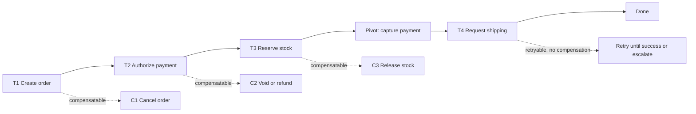
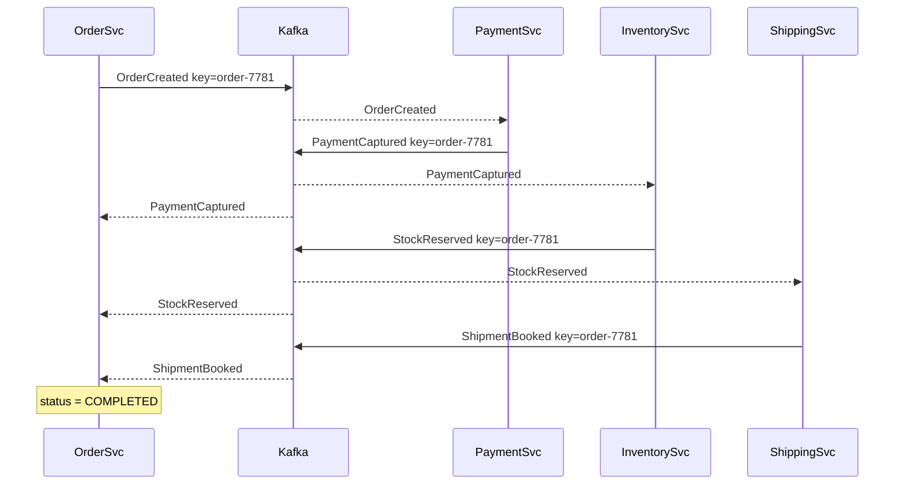
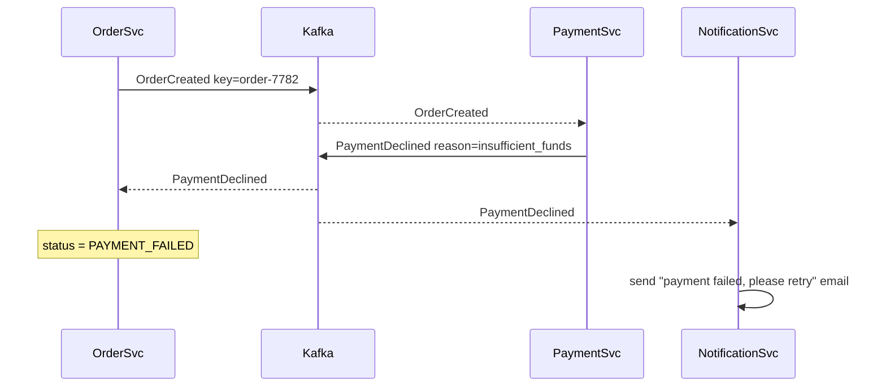
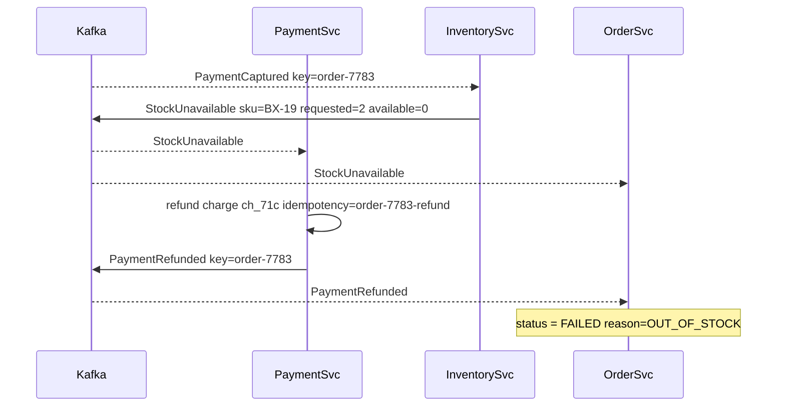
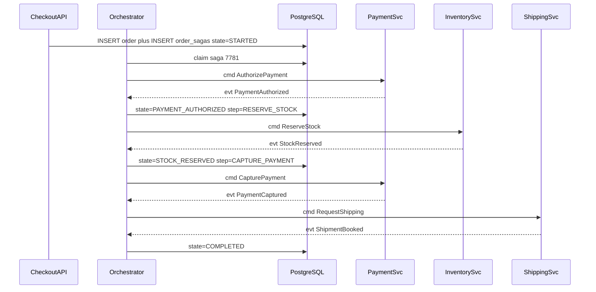

## 19.3 The saga pattern

#### Concept

A **saga** is a business transaction split into a sequence of **local transactions**, where each local transaction has a **compensating transaction** that semantically undoes it.

For our flow:

```text
T1 Order      -> C1 Cancel order
T2 Payment    -> C2 Refund payment
T3 Inventory  -> C3 Release reservation
T4 Shipping   -> C4 Cancel pickup
```

Each `Tn` commits on its own, immediately, in its own database. If `T4` fails, the saga runs `C3`, then `C2`, then `C1`, in reverse order. The end state is "as if nothing happened" from the customer's point of view, even though the database history is full of things that did happen.

The name comes from a 1987 paper by Hector Garcia-Molina and Kenneth Salem about *long-lived transactions* — transactions that run for minutes or hours and cannot hold locks the whole time. Twenty-five years later the same idea turned out to be exactly what microservices needed.

#### Why does it exist?

2PC gives you atomicity by holding locks until everyone agrees. Sagas give up atomicity to get availability: every step commits immediately and releases its locks, so no partner's latency blocks anyone else. In exchange you accept two things:

1. **There is a window where the system is inconsistent.** Between `T2` and `T3` the customer is charged but has no stock reserved. That window is real, it is visible, and it must be bounded and named (`PENDING_PAYMENT`, `PAID`, ...).
2. **You must write the undo yourself.** The database will not do it for you, because there is nothing to roll back — everything was committed on purpose.

Sagas are not a clever trick. They are the honest acknowledgement that the only atomicity available to you is per-service, and everything above that is a state machine you own.

#### Mental model

Imagine booking a holiday: flight, hotel, car. You book the flight — it is confirmed, you have a ticket, money left your account. Then you book the hotel — confirmed. Then the car rental has nothing available.

You do not get a magic rollback. You **cancel** the hotel (a new booking record with status `CANCELLED`, possibly a fee) and you **cancel** the flight (a refund, minus charges, arriving in 5 to 7 business days). The history shows: booked, booked, cancelled, cancelled. Not: nothing happened.

That is a saga. And the holiday example shows the two hard truths immediately: compensation is a *new forward action*, and it is not always free or complete.

#### How it works

**Semantic rollback versus true rollback.** A true rollback restores the previous state exactly, and no one can tell it happened. `ROLLBACK` in PostgreSQL is a true rollback. A semantic rollback produces a state that is *business-equivalent* to "before", while leaving evidence.

| Action | True rollback possible? | Semantic compensation |
|---|---|---|
| `INSERT INTO orders` | Yes, inside the transaction | `UPDATE orders SET status = 'CANCELLED'` |
| Charge a card | No | Issue a refund. Money returns in 3 to 7 days, gateway fee often not returned |
| Reserve stock | Sometimes (if only a reservation row) | Delete the reservation, increment `available` |
| Book a courier pickup | No | Call cancel API. Some partners charge a cancellation fee after cut-off |
| Send "Order confirmed" email | **Never** | Send "Sorry, your order was cancelled" email |
| Send an SMS OTP | Never | Nothing. It is gone |
| Fire a webhook to a customer's system | Never | Send a compensating webhook they must handle |

The email row is the one to remember. **You cannot un-send an email; you send an apology.** Any senior design conversation about sagas eventually lands there, and it changes the design: you push irreversible side effects as late as possible in the saga, ideally after the pivot.

**Three kinds of step.** This vocabulary is the most useful thing in the whole saga literature:

- **Compensatable step** — it succeeded, and you have a way to semantically undo it. `T1` (create order), `T3` (reserve stock) are compensatable.
- **Pivot step** — the point of no return. Once it commits, the saga will go forward, not back. In many designs the payment *capture* is the pivot: after it, you fulfil the order and handle problems as new business processes, not as rollback.
- **Retryable step** — a step after the pivot that must eventually succeed, so it is retried until it does. It has no compensation because going back is no longer an option. `T4` (book shipping) is usually retryable: if the courier API is down, you retry for an hour, then escalate to a human, but you do not refund the customer at the first 500.



Designing the order of steps around the pivot is a real architectural decision. Put cheap, reversible, likely-to-fail steps *before* the pivot, and irreversible steps *after* it. That is why mature checkout flows **authorize** the card first (reversible: a void releases the hold within days and costs nothing), then reserve stock, then **capture** (the pivot), then ship. Authorizing first means a declined card costs you nothing to undo.

**Saga state must be persisted.** This is not optional, and it is the single most common thing missing from first implementations. If your saga lives in a JavaScript `async` function's local variables, then:

- A pod restart during a deploy loses every in-flight saga.
- An `OOMKilled` loses them with no trace.
- You cannot answer "where is order 7781?" because the answer was in RAM on a pod that no longer exists.
- You cannot retry a failed step, because you do not know which step failed.

Persisted saga state means: after every step, a row is committed saying what happened. The saga can then be resumed by any pod, at any time, after any crash. Everything else in this Part is about making that resumption safe.

#### Practical example

Concretely, for order 7781 at 14:03:

```text
14:03:01.120  saga created, state=STARTED, step=CREATE_ORDER
14:03:01.140  orders row inserted, state=ORDER_CREATED, step=AUTHORIZE_PAYMENT
14:03:01.560  gateway authorized auth_9f2, state=PAYMENT_AUTHORIZED, step=RESERVE_STOCK
14:03:01.610  inventory reserved res_44a, state=STOCK_RESERVED, step=CAPTURE_PAYMENT
14:03:02.020  gateway captured ch_71c, state=PAYMENT_CAPTURED, step=REQUEST_SHIPPING
14:03:08.440  shipping API 503, attempts=1, next_retry_at=14:03:38
14:03:38.500  shipping API 503, attempts=2, next_retry_at=14:04:38
14:04:39.010  shipping booked pk_88e, state=COMPLETED
```

Every one of those lines is a committed row. If the pod died at 14:03:08, another pod picks the saga up at 14:03:38 and continues from `REQUEST_SHIPPING`. Nothing is lost and nothing is repeated incorrectly, because each step is idempotent (section 19.12).

#### How a Senior Backend Engineer thinks about this

Before writing any code they answer four questions per step:

1. **Is it compensatable, pivot, or retryable?** If a step has no possible compensation and is not the pivot, the step order is wrong.
2. **What is the compensation, precisely?** Not "undo the payment" but "call `POST /refunds` with idempotency key `order-7781-refund`, expect 200 or 409-already-refunded, both mean success".
3. **What does the customer see during the window?** Between `T2` and `T4` there is a status the UI must render. If product cannot describe it, the design is not finished (section 19.14).
4. **What if the compensation fails?** There must be an answer other than "log an error" (section 19.7).

They also ask the question that saves the most work: **can this be fewer steps?** If inventory lives in the same database as orders, `T1` and `T3` merge into one local transaction and half the saga disappears.

#### Common mistakes

- Saga state in memory. The first restart proves why this is wrong.
- No pivot identified, so the code tries to "roll back" a captured payment and a dispatched parcel.
- Compensations that are not idempotent, so a retried compensation refunds twice.
- Treating a saga as a rollback mechanism rather than a business process. Cancellation is a business event with its own emails, ledger entries and metrics, not a silent undo.
- Putting the email send in step 1 so every failed saga apologises for an order that never existed.

#### Interview questions

1. *What is a saga and how does it differ from 2PC?* Expected: sequence of local committed transactions with compensations; no distributed locks, no coordinator holding participants; gives up atomicity and isolation for availability.
2. *What is the pivot step and why does it matter?* Expected: point of no return; steps before it must be compensatable, steps after it must be retryable; it determines step ordering.
3. *Give an example of something you cannot compensate.* Expected: a sent email or SMS, a fired webhook, a physically dispatched parcel; you compensate semantically with an apology or a returns process.
4. *Why must saga state be persisted?* Expected: pods crash and restart; you need resumability, observability, retry and human answers to "where is order 7781?".

## 19.4 Choreography

#### Concept

In **choreography**, there is no central brain. Each service listens for events and reacts by doing its own work and emitting its own event. The flow emerges from the chain of reactions, like dancers who each know their own cue.

```text
Order Service      publishes OrderCreated
Payment Service    consumes OrderCreated       publishes PaymentCaptured / PaymentDeclined
Inventory Service  consumes PaymentCaptured    publishes StockReserved / StockUnavailable
Shipping Service   consumes StockReserved      publishes ShipmentBooked / ShipmentFailed
Order Service      consumes all of the above and updates its own status
```

Nobody tells anybody what to do. Everybody announces what happened.

#### Why does it exist?

Because it is the loosest possible coupling. The Order Service does not import a payment client, does not know a payment service exists, and does not change when you add a fifth service. Adding a Loyalty Service that grants points on `PaymentCaptured` requires zero changes to any existing service — you deploy a new consumer on the existing topic and it works.

For small flows in fast-moving teams, that property is genuinely valuable and should not be dismissed.

#### Mental model

Imagine a restaurant kitchen with no head chef. A ticket arrives and is pinned to the rail. The grill cook sees "steak" and starts it. When the steak is done, they call "steak up!" The garnish cook hears that and plates it. When they are done they call "table 6 ready!" and a runner takes it out.

It works. It is fast. Nobody waits for permission. And when something goes wrong — the steak is dropped — nobody is in charge of deciding what happens to table 6. Each person shouts a correction and hopes the others hear it in the right order.

#### How it works

The happy path, in events:



Note the `key=order-7781` on every event. In Kafka, the message key determines the partition, and ordering is guaranteed **only within a partition**. Keying every event of an order by the order id is what gives you causal ordering for that order (Part 17 section 17.5 and Part 18 section 18.6). Without it, `StockReserved` can be consumed before `PaymentCaptured` and your handlers will see nonsense.

Now the failure paths, which is where choreography earns or loses its keep.

**Payment declined** — the easy case, because nothing needs undoing yet:



Inventory never heard about this order, so there is nothing to release. Shipping never heard about it either. The failure is cheap because it happened before anything irreversible.

**Stock unavailable** — the hard case, because the customer's money has already moved:



The compensation is itself just an event reaction: the Payment Service subscribes to `StockUnavailable` and refunds. That is elegant, and it is also where the trouble starts, because now the Payment Service knows about inventory concepts, and the "flow" is spread across four codebases with no single file describing it.

#### NestJS example

A choreographed consumer, using `@nestjs/microservices` with the Kafka transport. Note the inbox check (section 19.11) and the transaction boundary.

```ts
// inventory.consumer.ts
@Controller()
export class InventoryConsumer {
  private readonly log = new Logger(InventoryConsumer.name);

  constructor(
    private readonly dataSource: DataSource,
    private readonly outbox: OutboxService,
  ) {}

  @EventPattern('payments.events')
  async onPaymentEvent(@Payload() msg: PaymentEvent, @Ctx() ctx: KafkaContext): Promise<void> {
    if (msg.type !== 'PaymentCaptured') return;               // topic carries several types

    await this.dataSource.transaction(async (manager) => {
      // Deduplicate: same messageId twice is a no-op (see 19.11).
      const dedup = await manager
        .createQueryBuilder()
        .insert().into(InboxMessage)
        .values({ messageId: msg.messageId, consumer: 'inventory' })
        .orIgnore()                                            // -> ON CONFLICT DO NOTHING
        .execute();
      if (dedup.identifiers.length === 0) {
        this.log.debug({ messageId: msg.messageId }, 'duplicate, skipping');
        return;
      }

      const ok = await this.tryReserve(manager, msg.orderId, msg.items);

      // The reply event is written in the SAME transaction as the reservation.
      await this.outbox.publish(manager, {
        aggregateType: 'order',
        aggregateId: msg.orderId,
        eventType: ok ? 'StockReserved' : 'StockUnavailable',
        payload: { orderId: msg.orderId, items: msg.items },
      });
    });
  }

  private async tryReserve(manager: EntityManager, orderId: string, items: OrderItem[]) {
    for (const item of items) {
      // Conditional UPDATE: atomic, no read-modify-write race (Part 13, section 13.10).
      const res = await manager.query(
        `UPDATE inventory SET available = available - $2
         WHERE sku = $1 AND available >= $2`,
        [item.sku, item.qty],
      );
      if (res[1] === 0) return false;                          // rowCount 0 means not enough stock
    }
    return true;
  }
}
```

Two details that separate a working consumer from a demo: the reservation and the outgoing event commit together (so you can never reserve stock without announcing it), and the `orIgnore()` dedup means a redelivered Kafka message does not double-decrement stock. Both are covered in depth later; they belong in every choreographed handler from day one.

#### Production scenario

A food-delivery company with three services (Order, Payment, Restaurant) ran a fully choreographed flow at 90 orders per minute for two years and it was the right call. Three events, three consumers, one topic, roughly 400 lines of code total. Adding "notify the driver app" was a new consumer and nothing else changed. Nobody ever wished for an orchestrator.

The same company at 1,400 orders per minute with eleven services was a different story. A single order could touch Order, Payment, Restaurant, Inventory, Driver, Pricing, Loyalty, Fraud, Notification, Analytics and Support. When an order got stuck, answering "which step is it on?" meant a Kibana query joining eleven services by correlation id, and even then the answer was "we saw `PaymentCaptured` but never saw anything from Restaurant, and we do not know if Restaurant crashed, filtered it out, or is just slow." That is the moment choreography stops paying.

#### Failure scenario

A retailer's choreographed flow had the Notification Service subscribe to `OrderCreated` and send "Thanks for your order!" A separate team added a fraud check that consumed `OrderCreated` and, for suspicious orders, emitted `OrderRejected`.

Nobody noticed that the notification consumer was faster than the fraud consumer. For six weeks, every fraudulently-flagged order received a cheerful confirmation email 200 ms before being rejected, followed by a rejection email. Customer support handled 340 confused tickets. The bug was not in any one service; it was in the *flow*, which existed in no file, in no diagram, and in nobody's head completely.

The fix was to make notification consume `OrderConfirmed` (emitted after the fraud check) instead of `OrderCreated`. Finding it took three days, because there was no place to look.

#### Edge cases & failure modes

- **No single place shows the flow.** The business process exists only as an emergent property of eleven subscriptions. Onboarding a new engineer means reading eleven repositories.
- **Cyclic dependencies.** Payment subscribes to inventory events (to refund), inventory subscribes to payment events (to reserve). Now the two services are logically coupled in a cycle even though they never call each other. Change one event schema and both break.
- **Hard to test end to end.** A unit test covers one consumer. Testing the flow requires all services plus Kafka, which is a docker-compose with eleven containers that nobody runs locally.
- **Hard to change.** Inserting a step in the middle (a fraud check between payment and inventory) means editing the subscription of a service that has nothing to do with fraud.
- **Out-of-order events** if the key is missing or the topic is repartitioned: `StockReserved` arrives before `PaymentCaptured`.
- **A missing consumer is silent.** If the Shipping Service's consumer group is down, `StockReserved` piles up in the topic and orders quietly stop shipping. There is no timeout, because nothing is waiting.
- **Duplicate reactions.** Two services both react to `PaymentCaptured` by writing to the same aggregate, and now you have a race that neither team knew existed.
- **No timeout anywhere.** This is the killer. In choreography, "nothing happened next" is indistinguishable from "it is still working". A saga can hang forever with no alert (section 19.18).

#### How a Senior Backend Engineer thinks about this

They like choreography for genuinely small, stable flows and reject it for anything a support agent has to reason about. Their test is a question: **"When a customer calls and says order 7781 hasn't shipped, how long does it take one person to find out why?"** If the answer involves grepping more than two services, choreography has stopped paying.

They also watch for the honest tell: the first time someone builds a dashboard that *reconstructs* the flow from events across services, the team has already re-invented an orchestrator, badly and after the fact.

#### Common mistakes

- Publishing events without a partition key, then being surprised by out-of-order processing.
- Subscribing to a low-level event (`OrderCreated`) when you meant a business milestone (`OrderConfirmed`).
- Letting compensation logic sprawl: five services each holding a piece of "what happens when it fails".
- No correlation id in the event envelope, making the flow untraceable.
- Growing to eight services on choreography because switching later feels expensive. It only gets more expensive.

## 19.5 Orchestration

#### Concept

In **orchestration**, one component owns the flow. The **orchestrator** holds the saga's state in a database row, sends commands to services ("charge this", "reserve that"), waits for reply events, decides the next step, and drives compensation when something fails.

The services stay dumb and reusable: the Payment Service knows how to charge and refund, and knows nothing about orders, inventory or shipping. All the flow knowledge lives in one file you can read top to bottom.

#### Why does it exist?

Because sooner or later a human must answer "where is order 7781 stuck?", and the only good answer is a `SELECT` against one table. Orchestration exists to make that `SELECT` possible.

It also gives you the two things choreography structurally cannot: **timeouts** (something is waiting, so something can notice it waited too long) and **a single place to change the flow**.

#### Mental model

The kitchen again, now with a head chef. The chef reads the ticket, calls "steak, medium rare, three minutes", waits, hears "steak up", calls "plate table 6". If the steak is dropped, the chef decides: refire the steak, or comp the table and tell the runner to cancel. One person knows the state of every ticket, and if you ask "where is table 6?" they answer instantly.

The cost is obvious: the chef is a bottleneck and a single point of failure. Which is exactly the tradeoff in software, and it is why the orchestrator's state must be in PostgreSQL rather than in the chef's head.

#### How it works



The state row is written **before** each command is sent and **after** each reply is received. That ordering matters: if the orchestrator crashes after sending `CapturePayment` but before recording the reply, the row still says `step=CAPTURE_PAYMENT`, and on recovery it re-sends the command — which is safe only because the command carries an idempotency key.

#### PostgreSQL example

The saga table. This DDL is the heart of the whole pattern; every column earns its place.

```sql
CREATE TYPE saga_state AS ENUM (
  'STARTED', 'PAYMENT_AUTHORIZED', 'STOCK_RESERVED', 'PAYMENT_CAPTURED',
  'SHIPPING_REQUESTED', 'COMPLETED',
  'COMPENSATING', 'COMPENSATED', 'FAILED', 'NEEDS_MANUAL_REVIEW'
);

CREATE TABLE order_sagas (
  id            uuid PRIMARY KEY DEFAULT gen_random_uuid(),
  order_id      uuid NOT NULL UNIQUE,          -- one saga per order, enforced by the database
  state         saga_state NOT NULL DEFAULT 'STARTED',
  step          text NOT NULL,                 -- the step currently in flight
  payload       jsonb NOT NULL DEFAULT '{}',   -- refs collected so far: authId, reservationId, chargeId
  attempts      int  NOT NULL DEFAULT 0,
  next_retry_at timestamptz NOT NULL DEFAULT now(),
  step_deadline timestamptz,                   -- when this step is considered timed out
  last_error    text,
  version       int  NOT NULL DEFAULT 0,       -- optimistic lock against two orchestrators
  created_at    timestamptz NOT NULL DEFAULT now(),
  updated_at    timestamptz NOT NULL DEFAULT now()
);

-- The claim query's index: find runnable sagas cheaply.
CREATE INDEX idx_sagas_runnable ON order_sagas (next_retry_at)
  WHERE state NOT IN ('COMPLETED', 'COMPENSATED', 'FAILED', 'NEEDS_MANUAL_REVIEW');

-- The operations index: find stuck sagas.
CREATE INDEX idx_sagas_deadline ON order_sagas (step_deadline)
  WHERE step_deadline IS NOT NULL;

-- Dashboard query, one row per state, cheap because of the partial index above.
CREATE INDEX idx_sagas_state_updated ON order_sagas (state, updated_at DESC);
```

`payload jsonb` is where the references accumulate — `{"authId":"auth_9f2","reservationId":"res_44a","chargeId":"ch_71c"}`. Compensation needs those references, so they must be durable the moment they are known. `version` is TypeORM's `@VersionColumn`, and it is what stops two orchestrator pods from advancing the same saga twice (section 19.18).

The query that answers "where is order 7781 stuck?" and the one that finds everything stuck:

```sql
SELECT order_id, state, step, attempts, last_error, now() - updated_at AS stuck_for
FROM order_sagas WHERE order_id = '...';

-- Every saga that has not moved in 10 minutes and is not in a terminal state.
SELECT state, step, count(*), min(updated_at) AS oldest
FROM order_sagas
WHERE state NOT IN ('COMPLETED', 'COMPENSATED', 'FAILED')
  AND updated_at < now() - interval '10 minutes'
GROUP BY state, step ORDER BY count DESC;
```

That second query is the reconciliation job (section 19.15) and the dashboard, in one statement. Choreography has no equivalent.

#### NestJS example

The state transition table first, because the code is boring once the table is right:

```ts
// saga-definition.ts
export type StepName =
  | 'CREATE_ORDER' | 'AUTHORIZE_PAYMENT' | 'RESERVE_STOCK'
  | 'CAPTURE_PAYMENT' | 'REQUEST_SHIPPING'
  | 'RELEASE_STOCK' | 'REFUND_PAYMENT' | 'CANCEL_ORDER';

export interface StepDef {
  readonly kind: 'compensatable' | 'pivot' | 'retryable' | 'compensation';
  readonly onSuccess: StepName | 'DONE';
  readonly onFailure: StepName | 'FAILED' | 'NEEDS_MANUAL_REVIEW';
  readonly timeoutMs: number;
  readonly maxAttempts: number;
}

export const ORDER_SAGA: Record<StepName, StepDef> = {
  CREATE_ORDER:      { kind: 'compensatable', onSuccess: 'AUTHORIZE_PAYMENT', onFailure: 'FAILED',              timeoutMs: 5_000,  maxAttempts: 3 },
  AUTHORIZE_PAYMENT: { kind: 'compensatable', onSuccess: 'RESERVE_STOCK',     onFailure: 'CANCEL_ORDER',        timeoutMs: 10_000, maxAttempts: 3 },
  RESERVE_STOCK:     { kind: 'compensatable', onSuccess: 'CAPTURE_PAYMENT',   onFailure: 'REFUND_PAYMENT',      timeoutMs: 5_000,  maxAttempts: 5 },
  CAPTURE_PAYMENT:   { kind: 'pivot',         onSuccess: 'REQUEST_SHIPPING',  onFailure: 'RELEASE_STOCK',       timeoutMs: 15_000, maxAttempts: 5 },
  REQUEST_SHIPPING:  { kind: 'retryable',     onSuccess: 'DONE',              onFailure: 'NEEDS_MANUAL_REVIEW', timeoutMs: 20_000, maxAttempts: 12 },
  RELEASE_STOCK:     { kind: 'compensation',  onSuccess: 'REFUND_PAYMENT',    onFailure: 'NEEDS_MANUAL_REVIEW', timeoutMs: 5_000,  maxAttempts: 10 },
  REFUND_PAYMENT:    { kind: 'compensation',  onSuccess: 'CANCEL_ORDER',      onFailure: 'NEEDS_MANUAL_REVIEW', timeoutMs: 15_000, maxAttempts: 10 },
  CANCEL_ORDER:      { kind: 'compensation',  onSuccess: 'DONE',              onFailure: 'NEEDS_MANUAL_REVIEW', timeoutMs: 5_000,  maxAttempts: 10 },
};
```

Read the `onFailure` column downwards and you can see the whole compensation chain without reading a line of logic. `REQUEST_SHIPPING` failing does not refund — it escalates, because it is after the pivot. Compensations have high `maxAttempts` because giving up on a refund is much worse than giving up on a shipment booking.

Now the orchestrator. It has two entry points: a reply event arrives, or the retry tick fires.

```ts
// order-saga.orchestrator.ts
@Injectable()
export class OrderSagaOrchestrator {
  private readonly log = new Logger(OrderSagaOrchestrator.name);

  constructor(
    private readonly dataSource: DataSource,
    @InjectRepository(OrderSaga) private readonly sagas: Repository<OrderSaga>,
    private readonly commands: CommandBus,           // thin wrapper over the Kafka producer
  ) {}

  /** Advance one saga: record the outcome of the current step, then dispatch the next. */
  async handleReply(orderId: string, step: StepName, outcome: StepOutcome): Promise<void> {
    const next = await this.dataSource.transaction(async (manager) => {
      const saga = await manager.findOne(OrderSaga, {
        where: { orderId }, lock: { mode: 'pessimistic_write' },   // SELECT ... FOR UPDATE
      });
      if (!saga) throw new NotFoundException(`saga for order ${orderId}`);

      // A reply for a step we already moved past is a duplicate. Ignore it.
      if (saga.step !== step) {
        this.log.warn({ orderId, expected: saga.step, got: step }, 'stale reply ignored');
        return null;
      }

      const def = ORDER_SAGA[step];
      const target = outcome.ok ? def.onSuccess : def.onFailure;

      saga.payload = { ...saga.payload, ...outcome.refs };   // keep chargeId, reservationId, ...
      saga.last_error = outcome.ok ? null : outcome.error ?? 'unknown';
      saga.attempts = 0;
      saga.state = STATE_FOR_STEP[step][outcome.ok ? 'ok' : 'fail'];

      if (target === 'DONE' || target === 'FAILED' || target === 'NEEDS_MANUAL_REVIEW') {
        saga.step = target;
        saga.step_deadline = null;
        await manager.save(saga);
        return null;                                        // terminal, nothing to dispatch
      }

      saga.step = target;
      saga.step_deadline = new Date(Date.now() + ORDER_SAGA[target].timeoutMs);
      saga.next_retry_at = new Date(Date.now() + ORDER_SAGA[target].timeoutMs);
      await manager.save(saga);                             // version column guards concurrency
      return { saga, step: target };
    });

    // Command is sent AFTER the transaction commits. Worst case it is sent twice; the
    // idempotency key on the command makes that harmless.
    if (next) await this.dispatch(next.saga, next.step);
  }

  private async dispatch(saga: OrderSaga, step: StepName): Promise<void> {
    await this.commands.send({
      step,
      orderId: saga.orderId,
      // Deterministic: the same step for the same order always produces the same key.
      idempotencyKey: `${saga.orderId}:${step}`,
      payload: saga.payload,
      replyTo: 'saga.replies',
    });
  }
}
```

And the tick that handles timeouts and retries — the piece that makes the saga self-healing:

```ts
// saga-runner.service.ts
@Injectable()
export class SagaRunner {
  @Cron(CronExpression.EVERY_10_SECONDS)
  async tick(): Promise<void> {
    // Claim a batch without two pods claiming the same row (Part 17, section 17.9 pattern).
    const due: OrderSaga[] = await this.dataSource.query(
      `SELECT * FROM order_sagas
        WHERE next_retry_at <= now()
          AND state NOT IN ('COMPLETED','COMPENSATED','FAILED','NEEDS_MANUAL_REVIEW')
        ORDER BY next_retry_at
        LIMIT 50
        FOR UPDATE SKIP LOCKED`,
    );

    for (const saga of due) {
      const def = ORDER_SAGA[saga.step as StepName];
      if (saga.attempts >= def.maxAttempts) {
        // Out of retries. A failed step before the pivot compensates; after it, escalate.
        await this.orchestrator.handleReply(saga.order_id, saga.step as StepName, {
          ok: false, error: `max attempts (${def.maxAttempts}) exceeded`, refs: {},
        });
        continue;
      }
      const backoffMs = Math.min(2 ** saga.attempts * 1000, 60_000) + Math.random() * 1000;
      await this.sagas.update(
        { id: saga.id },
        { attempts: saga.attempts + 1, next_retry_at: new Date(Date.now() + backoffMs) },
      );
      await this.orchestrator.dispatchPublic(saga, saga.step as StepName);  // re-send the command
    }
  }
}
```

Exponential backoff with jitter, capped at 60 s (Part 20 section 20.2). `FOR UPDATE SKIP LOCKED` means twenty pods can run this tick concurrently and never collide.

#### `@nestjs/cqrs` sagas versus a plain service

NestJS ships a `Saga` concept in `@nestjs/cqrs`: you write an RxJS operator that maps a stream of events to a stream of commands.

```ts
// order.saga.ts — the @nestjs/cqrs style
@Injectable()
export class OrderSagas {
  @Saga()
  paymentCaptured = (events$: Observable<any>): Observable<ICommand> =>
    events$.pipe(
      ofType(PaymentCapturedEvent),
      map((e) => new ReserveStockCommand(e.orderId, e.items)),
    );
}
```

It is clean and it is genuinely useful for **in-process** flows. Be clear-eyed about what it does not do:

| Concern | `@nestjs/cqrs` `@Saga()` | Plain service plus PostgreSQL plus Kafka |
|---|---|---|
| State persistence | None. The stream is in memory | A committed row per saga |
| Survives a pod restart | No | Yes |
| Step timeouts | You build them with RxJS operators, still in memory | `step_deadline` column plus a cron tick |
| Retry with backoff | RxJS `retryWhen`, in memory, lost on restart | `attempts` and `next_retry_at` columns |
| "Where is order 7781?" | Not answerable | One `SELECT` |
| Cross-process | No | Yes, via Kafka |
| Best for | Coordinating handlers inside one service | Real distributed sagas |

Use `@nestjs/cqrs` sagas to wire up in-process domain events (Part 7 — Domain-Driven Design covers domain events). Use a persisted state machine for anything that crosses a process boundary. Teams that use `@Saga()` for a distributed flow discover the gap on their first deploy, when every in-flight order stalls silently.

#### Production scenario

A marketplace runs the orchestrator as three pods behind the same consumer group. Saga volume: 220 per minute at peak, ~12,000 rows in `order_sagas` in a non-terminal state at any moment, ~9 million rows total (terminal rows archived monthly to a partition). The tick runs every 10 s per pod, claiming up to 50 rows, so worst-case throughput is 900 retries per minute, far above the real retry rate of about 4 per minute.

The dashboard is three panels: count by `state`, count by `step` where `step_deadline < now()`, and the `NEEDS_MANUAL_REVIEW` count with a threshold alert at 5. Median time from `STARTED` to `COMPLETED` is 2.1 s; p99 is 41 s, dominated by shipping-partner retries. When the shipping partner had a 20-minute outage, `REQUEST_SHIPPING` backed up to 3,100 sagas, all of which drained automatically in 6 minutes once the partner recovered. No human action, no lost orders, no refunds. That is the payoff for building the state machine.

#### Failure scenario

An orchestrator was written without the `version` column and without `FOR UPDATE`. During a rolling deploy, two pods briefly processed the same reply event for order 4402. Both read `step=CAPTURE_PAYMENT`, both advanced to `REQUEST_SHIPPING`, both dispatched the command. The shipping service had no idempotency on the command, so it booked two pickups. The courier collected the parcel twice; the second driver found nothing and charged a failed-pickup fee.

It happened to 31 orders during that deploy. The fix was two lines: `lock: { mode: 'pessimistic_write' }` on the read and a deterministic `idempotencyKey` on the command. The lesson the team wrote in the post-mortem: *an orchestrator is a distributed system too, and it needs the same defences it provides to others.*

#### Edge cases & failure modes

- **Two orchestrator instances advancing one saga.** Solved by row lock plus optimistic version, and made harmless by idempotent commands.
- **Reply arrives for a step the saga already left.** Ignore it (the `saga.step !== step` check). This happens on every retry that was actually a duplicate.
- **Reply never arrives.** `step_deadline` plus the tick turns silence into a retry, then into a failure, then into compensation or escalation.
- **Command sent, orchestrator crashes before committing the state row.** On recovery it re-sends. Safe only because of the idempotency key. This is why the command goes out *after* commit and why the key is deterministic.
- **Orchestrator becomes a bottleneck.** It is stateless apart from PostgreSQL, so scale it horizontally; the contention point becomes the saga table, which `SKIP LOCKED` handles well up to thousands per second.
- **The saga definition changes while sagas are in flight.** A removed step name leaves rows pointing at a step that no longer exists (section 19.18).
- **`payload` grows unboundedly** if you store whole order snapshots in it. Store references, not documents.

#### How a Senior Backend Engineer thinks about this

They treat the orchestrator as a product feature, not plumbing. It gets a dashboard, an alert, an admin API and a runbook, because the whole point of building it was operability.

They keep the orchestrator **thin**: it decides the next step and nothing else. Business rules ("is this customer allowed to order?") live in the services. An orchestrator that grows business logic becomes the distributed monolith everyone warns about, and that is a real risk worth naming.

They also make the orchestrator's own database the same one as the order database when possible, so that creating the order and creating the saga row are one local transaction. Otherwise you have added a distributed transaction to solve distributed transactions.

#### Common mistakes

- In-memory state, then a deploy.
- Sending the command inside the transaction, so a rollback leaves a command already published.
- Non-deterministic idempotency keys (a `uuid()` per attempt), which makes every retry a new charge.
- No `step_deadline`, so a lost reply hangs the saga forever with no alert.
- Orchestrator that calls services synchronously over HTTP and blocks a request thread for the whole saga. The API returns as soon as the order row exists; the saga runs in the background.
- Putting business rules in the orchestrator until it knows more about orders than the Order Service.

#### Interview questions

1. *Design an orchestrated saga for order, payment, inventory, shipping. What is in the state table?* Expected: order id (unique), state, current step, payload of references, attempts, next retry, step deadline, version, timestamps; plus the partial index for runnable sagas.
2. *How do you stop two orchestrator instances from double-advancing a saga?* Expected: `SELECT ... FOR UPDATE` or optimistic `@VersionColumn`, plus `FOR UPDATE SKIP LOCKED` for the claim query, plus idempotent commands so a duplicate dispatch is harmless.
3. *Where do you send the command relative to the transaction commit, and why?* Expected: after commit (or via the outbox, section 19.10); sending inside risks publishing a command for a rolled-back state, and the outbox removes even that race.
4. *What does `@nestjs/cqrs` `@Saga()` give you and what does it not?* Expected: in-process event-to-command mapping with RxJS, no persistence, no timeouts, no cross-process delivery, no resumability.
5. *A saga has been in `RESERVE_STOCK` for two hours. Walk me through the diagnosis.* Expected: check `step_deadline` and `attempts`, check `last_error`, check whether the tick is running and whether the inventory consumer group has lag, check for a poison payload, then resume or compensate via the admin API.

## 19.6 Choreography versus orchestration

#### Concept

They are not opposites and you do not have to pick one for the whole system. Most mature systems are orchestrated for the core money flow and choreographed for everything hanging off it.

#### How it works

| Dimension | Choreography | Orchestration |
|---|---|---|
| Where the flow lives | Spread across every service's subscriptions | One state machine definition, in one file |
| Coupling | Loosest. Services know events, not each other | Services know commands; the orchestrator knows everyone |
| Adding a step | New consumer, possibly editing an unrelated service's subscription | Edit the step table in one place |
| Answering "where is order 7781?" | Trace across N services by correlation id | One `SELECT` |
| Timeouts | Structurally hard: nothing is waiting | Natural: `step_deadline` per step |
| Compensation logic | Spread across services | Centralised in the step table's `onFailure` |
| Testing | Needs all services plus a broker | Orchestrator unit-testable with stubbed commands |
| Single point of failure | None | The orchestrator (mitigated: stateless pods plus PostgreSQL) |
| Risk of distributed monolith | Low | Real, if business logic creeps into the orchestrator |
| Debugging a production issue | Kibana archaeology | Read the row |
| Good fit | 2 to 3 steps, stable flow, loose coupling valued | 4 or more steps, compensation matters, humans must inspect it |
| Typical failure | Silent stall nobody notices | Orchestrator becomes a god service |

#### The rule of thumb

**Use choreography when the flow has two or three steps, changes rarely, and nobody outside engineering ever needs to know where it is.** Order created then loyalty points granted then email sent is a perfect choreography. It is three subscriptions and no state machine.

**Switch to orchestration the moment a human needs to answer "where is order 7781 stuck?"** That question is the tripwire. It arrives from support, or from finance reconciling payments, or from your own on-call at 02:00. If you cannot answer it with one query, you need a saga table.

Two secondary tripwires worth watching for:

- **Money is involved and compensation is required.** Refunds spread across four services are a liability. Centralise them.
- **You are drawing the flow on a whiteboard for the third time because nobody can hold it in their head.** The whiteboard drawing wants to be a file. That file is the step definition table.

#### Practical example

A realistic split for our flow at a mid-size retailer:

```text
ORCHESTRATED (the saga table owns this)
  Order -> Payment -> Inventory -> Shipping
  because money moves, compensation is required, support asks about it daily

CHOREOGRAPHED (fire and forget, off the OrderCompleted event)
  OrderCompleted -> loyalty points
  OrderCompleted -> confirmation email
  OrderCompleted -> analytics ingest
  OrderCompleted -> recommendation model update
  because none of these can fail in a way that must undo the order
```

The rule that separates the two lists: **if its failure must change the outcome of the business transaction, it belongs in the saga; if its failure is merely unfortunate, it belongs on an event.** Loyalty points failing does not un-place the order. Stock reservation failing does.

#### How a Senior Backend Engineer thinks about this

They make the choice per flow, write it down, and revisit it. They also know the migration path, because "we will refactor later" needs to be true: choreography becomes orchestration by adding a saga table and a service that consumes the *same events* and issues commands, then flipping services one at a time from event-driven to command-driven. It is incremental, and knowing that removes the fear of starting simple.

The anti-hype line: an orchestrator is not more "enterprise" and choreography is not more "modern". They are two ways to encode a state machine, one implicit and one explicit. Explicit costs a table and buys you operability. For three steps, the table is not worth it. For seven, it is the cheapest thing you will build all quarter.

#### Common mistakes

- Choosing choreography for a nine-step money flow because it "decouples", then building a bespoke tracing dashboard that is a worse orchestrator.
- Choosing orchestration for a two-step flow and writing 600 lines of state machine to send one email.
- Mixing the two within a single flow without deciding which one owns the outcome, so a failure is handled twice or not at all.
- Never writing down which flows are which, so the next engineer guesses.

#### Interview questions

1. *When would you choose choreography over orchestration?* Expected: few steps, stable, loose coupling valuable, no compensation, no human inspection needed. Follow-up: what is your tripwire for switching?
2. *What is the biggest operational weakness of choreography?* Expected: no timeouts and no single view; a stalled flow is silent because nothing is waiting for anything.
3. *What is the biggest architectural risk of orchestration?* Expected: the orchestrator absorbing business logic and becoming a distributed monolith; mitigate by keeping it to routing plus state.
4. *How would you migrate a choreographed flow to an orchestrated one without downtime?* Expected: add the saga table and an orchestrator that consumes existing events and records state (shadow mode), verify it matches reality, then move services to command-driven one at a time.

#### Practical exercise

Implement `Order -> Payment -> Inventory -> Shipping` twice against the same three stub services: once choreographed on Kafka, once orchestrated with an `order_sagas` table.

Acceptance criteria: both handle the happy path; both handle a declined payment and unavailable stock; for both, kill the process mid-flow and restart it — the orchestrated version resumes and completes, the choreographed version demonstrates the stall; and write one query per implementation that answers "which orders are stuck and on which step?", then compare how hard each was to write.
