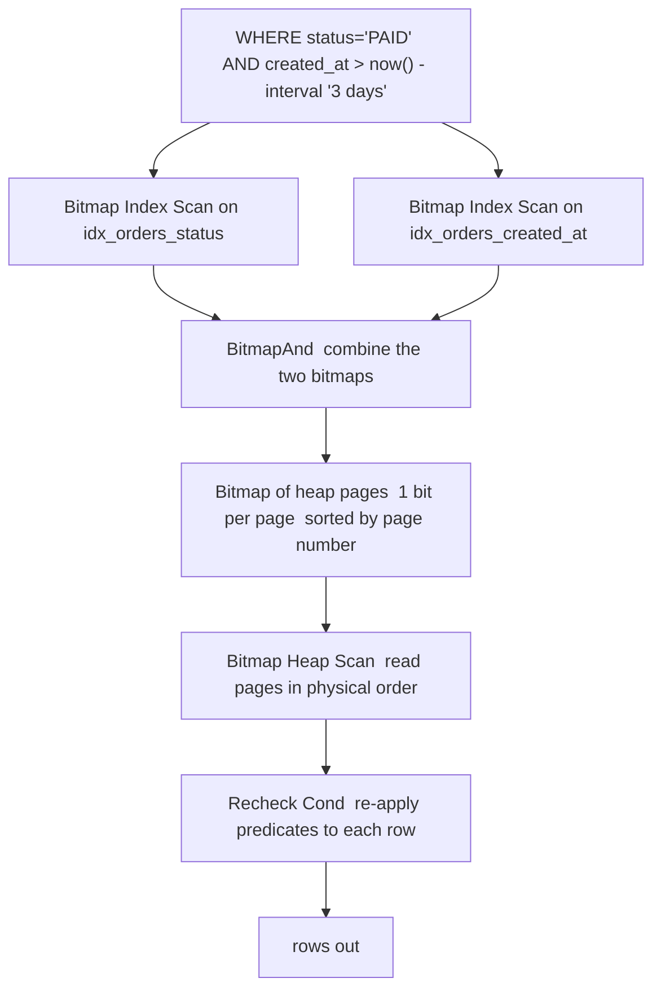

## 19.3 Reading a query plan

### 19.3.1 EXPLAIN, EXPLAIN ANALYZE and EXPLAIN (ANALYZE, BUFFERS)

#### Concept

`EXPLAIN` shows you the plan the planner *chose*, with its *predictions*. `EXPLAIN ANALYZE` actually runs the query and shows predictions next to *measurements*. `EXPLAIN (ANALYZE, BUFFERS)` adds how many 8 KB pages each node touched and where they came from.

You should almost never use the first form on its own, and you should almost always use the third. The whole skill of query tuning is comparing what the planner believed with what happened.

#### Why does it exist?

The planner is a predictor (Parts 7 and 181.12). It picks the plan with the lowest estimated cost, and that estimate is built from statistics that can be stale, from a uniform-distribution assumption that can be wrong, and from an independence assumption between columns that is usually wrong. When a query is slow, the question is never "is the database slow" but "which prediction was wrong". `EXPLAIN ANALYZE` is the only tool that answers it.

#### Mental model

Imagine a route planner that said "42 minutes" and you arrived in 4 hours. You do not tune the car. You look at each leg of the route and find the one where "8 minutes" turned into "3 hours 20", and then you ask why the planner thought that road was empty. A query plan is the route; `rows=` is the predicted traffic; `actual rows=` is the real traffic.

#### How it works

Read a plan **inside out and bottom up**. The most indented nodes run first and feed their parents. Each line looks like this:

```text
->  Index Scan using idx_orders_user_created on orders o
      (cost=0.57..4831.02 rows=214 width=61)
      (actual time=0.048..3.914 rows=19842 loops=1)
```

Every field, one at a time:

| Field | Meaning | What a senior reads into it |
|---|---|---|
| `cost=0.57..4831.02` | startup cost .. total cost, in arbitrary planner units | The **startup** cost is what must happen before the first row appears. A `Sort` or `Hash` has a big startup cost because it must consume everything first. That matters enormously with `LIMIT`. |
| `rows=214` | **estimated** rows this node will emit | The planner's belief. |
| `width=61` | average bytes per row | Useful for spotting a `SELECT *` that drags TOASTed columns through a sort. |
| `actual time=0.048..3.914` | ms until the first row .. ms until the last row, **per loop** | Not cumulative across loops. Multiply by `loops` for the real total. |
| `rows=19842` (in actual) | **measured** rows emitted, **per loop** | Compare with the estimate. This is the whole game. |
| `loops=1` | how many times this node ran | Inside a nested loop this is the outer row count. `actual time=0.02` with `loops=200000` is 4 seconds, not 0.02 ms. |

Then the annotations that appear underneath nodes:

- **`Index Cond:`** the predicate the index itself used to seek. Rows not matching are never read. Cheap.
- **`Filter:`** a predicate applied *after* rows were fetched. Rows are read, then thrown away. Expensive.
- **`Rows Removed by Filter: 380124`** the count thrown away. **This number is your index opportunity.** If a node reads 400,000 rows and discards 380,000, you are missing a column in an index.
- **`Recheck Cond:`** appears on a bitmap heap scan; the condition is re-applied because a lossy bitmap only remembers pages, not rows.
- **`Heap Blocks: exact=41022 lossy=0`** how many heap pages the bitmap tracked precisely versus how many it degraded to whole-page granularity because `work_mem` ran out. Any `lossy` count means raise `work_mem` or narrow the query.
- **`Buffers: shared hit=812203 read=98211 dirtied=44 written=0`** pages found in `shared_buffers` (`hit`), pages requested from the OS or disk (`read`), pages modified (`dirtied`), pages written out by this query (`written`). `temp read/written` means data spilled to temp files. **`read` is the number that costs you real time**, and it is far more stable than `actual time`, which moves with cache warmth and neighbours.
- **`Sort Method: quicksort  Memory: 4211kB`** the sort fit in `work_mem`. `external merge  Disk: 312400kB` means it spilled. Disk sorts are 5 to 20 times slower.
- **`Heap Fetches: 0`** on an index-only scan: how many times the visibility map failed and the heap had to be read anyway. A high number means the table needs vacuuming.
- **`Buckets: 65536  Batches: 4  Memory Usage: 32800kB`** on a hash node: more than one batch means the hash spilled to disk.
- **`Workers Planned: 2  Workers Launched: 2`** parallelism. Note that `actual rows` under a `Parallel Seq Scan` is **per worker**, so the total is roughly `rows x loops` where loops equals workers plus the leader.
- **`Planning Time`** and **`Execution Time`** at the bottom. Planning time above 5 ms on a hot path is itself a problem (too many partitions, too many indexes, too many joins).

Other useful options: `FORMAT JSON` (for programmatic plan tests, as in Part 18's CI example), `VERBOSE` (shows output column lists and schema-qualified names), `SETTINGS` (shows non-default planner settings that influenced the plan, PG 12+), `WAL` (WAL generated by a DML statement, PG 13+), and `GENERIC_PLAN` (PG 16+, plans a parameterised query without executing it).

**The golden rule.** Scan the plan for the node where **estimated rows and actual rows differ by more than 10x**. That node is almost always the cause. A 100x mismatch is not a curiosity, it is the bug. Everything above that node in the tree was planned on a lie: the planner chose a nested loop because it expected 30 rows and got 300,000, so it did 300,000 index probes instead of 30.

Two important gotchas:

1. **`EXPLAIN ANALYZE` executes the query.** On `UPDATE`, `DELETE` or `INSERT` it really modifies data. Wrap it: `BEGIN; EXPLAIN (ANALYZE, BUFFERS) UPDATE ...; ROLLBACK;`
2. **Timing has overhead.** On plans with millions of rows, `actual time` can be inflated 10 to 30 percent by the `gettimeofday` calls. Use `EXPLAIN (ANALYZE, BUFFERS, TIMING OFF)` when you only need row counts and buffers, and trust `Buffers` over `actual time` for comparisons.

#### Practical example

The support team reports that the merchant dashboard "sometimes" takes 8 seconds. `pg_stat_statements` shows a mean of 240 ms and a max of 9,100 ms for one query id. Running `EXPLAIN (ANALYZE, BUFFERS)` with a typical parameter gives 240 ms; running it with the parameter from the slow request gives 8.9 s, and the difference is one node: `rows=41` estimated, `rows=68302` actual, on a filter over `orders.shipping_country`. The plan flipped from an index scan into a nested loop that ran 68,302 times. The mismatch pointed straight at a skewed column with a stale `most_common_vals` list.

#### PostgreSQL example

The five options you will use, on one query:

```sql
-- 1. Plan only, no execution. Safe on production. Shows what the planner would do.
EXPLAIN SELECT * FROM orders WHERE user_id = 91827 ORDER BY created_at DESC LIMIT 20;

-- 2. Execute and measure.
EXPLAIN (ANALYZE) SELECT ...;

-- 3. The one you should default to.
EXPLAIN (ANALYZE, BUFFERS) SELECT ...;

-- 4. Everything, including which planner settings were non-default.
EXPLAIN (ANALYZE, BUFFERS, VERBOSE, SETTINGS, WAL) SELECT ...;

-- 5. Safe for DML.
BEGIN;
EXPLAIN (ANALYZE, BUFFERS) UPDATE orders SET status = 'CANCELLED' WHERE id = 148392017;
ROLLBACK;
```

Turn on I/O timing first, or `Buffers` tells you page counts but not how long the disk took:

```sql
SET track_io_timing = on;   -- or set it globally; it is cheap on modern kernels
```

With it on, plans gain `I/O Timings: shared read=812.442 ms`, which separates "we read 98,000 pages and the disk was fast" from "we read 98,000 pages and the disk was the problem".

#### NestJS example

A small diagnostic endpoint, locked behind an admin guard and a statement timeout, that lets you capture a real plan for a real production parameter without shell access. This has saved more incidents than it has caused, provided the SQL is not user-supplied.

```ts
// admin/plan.controller.ts
import { Controller, Post, Body, UseGuards, BadRequestException } from '@nestjs/common';
import { DataSource } from 'typeorm';
import { AdminGuard } from '../auth/admin.guard';
import { IsIn, IsArray, IsString } from 'class-validator';

class PlanDto {
  @IsIn(['ordersByUser', 'paymentsByProvider']) queryKey!: string;
  @IsArray() params!: unknown[];
}

const CATALOG: Record<string, string> = {
  ordersByUser:
    'SELECT id, status, total_cents FROM orders WHERE user_id = $1 ORDER BY created_at DESC LIMIT 20',
  paymentsByProvider: 'SELECT id, status FROM payments WHERE provider_ref = $1',
};

@Controller('admin/plan')
@UseGuards(AdminGuard)
export class PlanController {
  constructor(private readonly ds: DataSource) {}

  @Post()
  async plan(@Body() dto: PlanDto) {
    const sql = CATALOG[dto.queryKey];              // never interpolate client SQL
    if (!sql) throw new BadRequestException('unknown query');
    return this.ds.transaction(async (em) => {
      await em.query(`SET LOCAL statement_timeout = 5000`);
      const rows = await em.query(
        `EXPLAIN (ANALYZE, BUFFERS, FORMAT JSON) ${sql}`,
        dto.params,
      );
      return rows[0]['QUERY PLAN'];
    });
  }
}
```

#### Production scenario

`auto_explain` in `shared_preload_libraries`, configured to log any plan over 500 ms with buffers and nested plans, turns plan capture from a manual chore into a stream:

```text
auto_explain.log_min_duration = '500ms'
auto_explain.log_analyze = on
auto_explain.log_buffers = on
auto_explain.log_nested_statements = on
auto_explain.log_timing = off        # cheaper; keep row counts and buffers
auto_explain.sample_rate = 0.1       # 10 percent of qualifying statements on a busy system
```

Plans land in the PostgreSQL log, get shipped to your log store, and a dashboard counts distinct plan shapes per `queryid`. When a plan flips, you see two shapes for one query id and you know within minutes rather than after a customer complains.

#### Failure scenario

An engineer runs `EXPLAIN ANALYZE DELETE FROM notifications WHERE created_at < '2025-01-01'` on the primary to "see how expensive it would be". It is not a dry run. It deletes 340 million rows, holds an enormous transaction open, generates 90 GB of WAL, and blocks autovacuum's horizon for eleven minutes. The `BEGIN; ... ROLLBACK;` wrapper is not optional, and even then the WAL and the bloat are real.

#### Edge cases & failure modes

- `EXPLAIN` without `ANALYZE` on a query whose plan depends on parameters gives you a generic plan that may not be the one that runs (19.24).
- Timing overhead inflating `actual time` on high-row-count plans; use `TIMING OFF`.
- Per-loop values mistaken for totals inside nested loops.
- Per-worker values mistaken for totals under `Gather`.
- `EXPLAIN` on a prepared statement shows the *generic* plan after five executions, not your custom plan.
- Running `EXPLAIN ANALYZE` on a replica where the plan differs because `random_page_cost` or statistics differ.
- A query fast in `EXPLAIN ANALYZE` and slow in the app: the plan is fine and your problem is network round trips, result serialisation, or the ORM (Part 21 — ORMs in Depth).

#### How a Senior Backend Engineer thinks about this

They read `rows=` versus `actual rows=` before they read timings, because timings vary with cache and load while the estimate error is stable and diagnostic. They read `Buffers` next, because page counts are a hardware-independent measure of work. They look for `Rows Removed by Filter` as the signature of a missing index column. They never tune a query they have not explained, and never approve an index without the before plan and the after plan in the pull request.

#### Common mistakes

- Using `EXPLAIN` without `ANALYZE` and treating the estimates as facts.
- Reading the plan top-down and blaming the outermost node.
- Ignoring `loops`.
- Optimising the node with the highest cost instead of the node with the worst estimate error.
- Comparing two `EXPLAIN ANALYZE` runs where one had a cold cache.

#### Interview questions

1. *What is the difference between `Index Cond` and `Filter`, and why does it matter?* Expected: seek versus post-fetch discard; `Rows Removed by Filter` shows wasted work and points to a missing index column.
2. *A node says `actual time=0.031..0.044 rows=3 loops=248000`. Is it fast?* Expected: no; roughly 11 seconds total. Follow-up: what does that tell you about the outer estimate?
3. *Why prefer `Buffers` over `actual time` when comparing two plans?* Expected: cache-warmth independence; page counts are the real work.
4. *What does `Heap Blocks: lossy=8200` mean and how do you fix it?* Expected: bitmap exceeded `work_mem` and degraded to page granularity; raise `work_mem` or make the predicate more selective.
5. *How do you capture the plan of a slow production query you cannot reproduce?* Expected: `auto_explain` with `log_min_duration`, buffers and sampling.

#### Practical exercise

Take three of your own slowest queries from `pg_stat_statements`. For each, capture `EXPLAIN (ANALYZE, BUFFERS)`, and produce a one-page write-up naming: the node with the worst estimate error, the total buffers read, the largest `Rows Removed by Filter`, and your hypothesis for a fix. Acceptance criteria: three write-ups where the hypothesis is stated *before* you try the fix.

## 19.4 Scan types

### 19.4.1 Sequential, index, index-only and bitmap scans

#### Concept

There are four ways PostgreSQL gets rows out of a table, and the planner picks between them by cost. Understanding when each one *should* win is what lets you tell "the planner made a mistake" from "the planner is right and my query is wrong".

- **Sequential scan** reads every page of the heap in file order.
- **Index scan** walks the index and fetches heap rows one at a time, in index order.
- **Index-only scan** walks the index and does not touch the heap at all, when the visibility map allows it.
- **Bitmap index scan plus bitmap heap scan** walks the index, builds a bitmap of matching pages, sorts it, then reads the heap in physical page order.

#### Why does it exist?

Because "use the index" is not always right. Random reads cost more than sequential ones, and if you are going to touch a large fraction of the pages anyway, reading them in file order with readahead is dramatically faster than jumping around. The bitmap scan exists for the enormous middle ground where the index is useful but the result set is too big for one-row-at-a-time random fetches.

#### Mental model

You have a shopping list and a supermarket.

- **One item**: walk straight to it using the store map. That is an **index scan**.
- **Everything in the store**: just walk every aisle in order. Consulting the map for each of 4,000 items would be absurd. That is a **sequential scan**.
- **Two hundred items**: look every item up on the map first, write down the aisle numbers, **sort them**, then walk the aisles once in order picking things up. That is a **bitmap scan**, and it is exactly why the bitmap heap scan reads pages in physical order.
- **You only need to know whether the item is in stock, not to pick it up**: the map already says so. That is an **index-only scan**.

#### How it works

**Sequential scan.** Reads the heap from page 0 to page N with 128 KB readahead, applies the filter to every row, discards non-matches. Costs `pages x seq_page_cost + rows x (cpu_tuple_cost + cpu_operator_cost)`. On `orders` that is `3,921,033 + 200,000,000 x 0.0125 = 6,421,033` cost units. It can be parallelised (`Parallel Seq Scan`) across `max_parallel_workers_per_gather` workers, and it uses a small ring buffer rather than flooding `shared_buffers`, so a big scan does not evict your whole cache.

**Sequential scan is correct** when: the table is small (under a few hundred pages, where the descent costs more than the scan), or the query touches a large fraction of rows (roughly above 5 to 10 percent, see 19.16), or there is no usable index, or you are aggregating everything. An analytics query that reads 80 percent of `orders` should be a sequential scan, and forcing an index on it makes it slower. "Seq Scan" in a plan is not automatically a bug.

**Index scan.** Descends the tree, then for each matching index entry fetches the heap page containing that ctid and checks visibility. Rows come back in index order, so `ORDER BY` matching the index is free and `LIMIT` can stop early. The killer property and the killer weakness are the same: one heap page read per row, in random order. 10,000 matching rows in a 30 GB table is close to 10,000 random reads.

**Index-only scan.** Same descent, but every column the query needs is in the index, so there is nothing to fetch from the heap **except the visibility check**. PostgreSQL solves that with the **visibility map**, a two-bits-per-page bitmap maintained by VACUUM that marks pages where every tuple is visible to every transaction. If the page is marked all-visible, no heap read. If not, the heap page must be read anyway and that shows up as `Heap Fetches`. This makes index-only scans **dependent on vacuum**: a table with heavy churn and lazy autovacuum will show thousands of heap fetches and lose most of the benefit.

**Bitmap index scan plus bitmap heap scan.** Two nodes that always come as a pair:



1. The **bitmap index scan** reads the index and, instead of fetching rows, sets a bit for each heap page that contains a match. It never touches the heap.
2. Multiple bitmap index scans can be combined with **`BitmapAnd`** or **`BitmapOr`**. This is how PostgreSQL uses *two separate single-column indexes* for one query, and it is the reason "just add both indexes" sometimes works well enough.
3. If the bitmap grows beyond `work_mem`, it becomes **lossy**: it stops tracking individual rows and remembers only "this page has something". `Heap Blocks: lossy=N` in the plan.
4. The **bitmap heap scan** reads the marked pages **in physical order**, which lets the kernel and `effective_io_concurrency` prefetch. Each page is read at most once, no matter how many matching rows it holds.
5. Because the bitmap may be lossy and because `BitmapAnd` is per page, every row is re-checked against the predicates. That is the **`Recheck Cond`** line.

The trade: the bitmap heap scan **loses index ordering**, so an `ORDER BY` on top needs a `Sort` node. That is precisely why a bitmap scan plus sort loses to a composite index scan for `ORDER BY ... LIMIT` queries, which is the case study of 19.23.

**`random_page_cost` decides the boundary.** The default 4.0 says a random page costs four sequential pages, which was true for a 7,200 rpm disk with a 9 ms seek and is wildly false for NVMe, where the ratio is closer to 1.05. Leaving it at 4 on SSD makes the planner systematically prefer sequential and bitmap scans over index scans. Setting `random_page_cost = 1.1` and `effective_io_concurrency = 200` is the single highest-value planner change on modern storage, and it is worth more than most indexes you will add.

#### Practical example — five plans, line by line

**Plan 1: sequential scan, and it is correct.**

```sql
EXPLAIN (ANALYZE, BUFFERS)
SELECT avg(total_cents) FROM orders WHERE created_at >= '2026-01-01';
```

```text
Finalize Aggregate  (cost=3140882.44..3140882.45 rows=1 width=32)
                    (actual time=18422.101..18428.774 rows=1 loops=1)
  Buffers: shared hit=91204 read=3829829
  ->  Gather  (cost=3140882.22..3140882.43 rows=2 width=32) (actual time=18421.904..18428.766 rows=3 loops=1)
        Workers Planned: 2
        Workers Launched: 2
        ->  Partial Aggregate  (cost=3139882.22..3139882.23 rows=1 width=32)
                               (actual time=18401.220..18401.221 rows=1 loops=3)
              ->  Parallel Seq Scan on orders  (cost=0.00..2967216.00 rows=69066488 width=4)
                                               (actual time=0.031..14022.918 rows=55212004 loops=3)
                    Filter: (created_at >= '2026-01-01 00:00:00+00')
                    Rows Removed by Filter: 11454663
                    Buffers: shared hit=91204 read=3829829
Planning Time: 0.142 ms
Execution Time: 18428.812 ms
```

Reading it: 165 million of 200 million rows match (`55,212,004 x 3` workers). That is 83 percent of the table. There is no index that helps; any index scan would read every heap page anyway plus the index. The estimate (69,066,488 per worker) versus actual (55,212,004) is off by 25 percent, which is fine. **`Rows Removed by Filter: 11,454,663`** per worker sounds huge but is only 17 percent, so a partial index would not pay. This plan is correct. 18 seconds is the honest price of aggregating 165 million rows, and the fix is architectural (a materialised rollup table, Part 22 — Scaling Databases), not an index.

**Plan 2: index scan, the ideal shape.**

```sql
EXPLAIN (ANALYZE, BUFFERS)
SELECT id, status, total_cents, created_at
FROM orders WHERE user_id = 918273 ORDER BY created_at DESC LIMIT 20;
```

```text
Limit  (cost=0.57..37.44 rows=20 width=28) (actual time=0.052..0.098 rows=20 loops=1)
  Buffers: shared hit=6 read=2
  ->  Index Scan Backward using idx_orders_user_created on orders
        (cost=0.57..229.31 rows=124 width=28) (actual time=0.050..0.094 rows=20 loops=1)
        Index Cond: (user_id = 918273)
        Buffers: shared hit=6 read=2
Planning Time: 0.121 ms
Execution Time: 0.126 ms
```

Reading it: startup cost 0.57 and total 37.44 for the `Limit`, versus 229.31 for the unlimited index scan. The planner knows `LIMIT` can stop early, so it charges only 20/124 of the scan. `Index Cond` does all the work, there is **no `Filter`**, there is **no `Sort`** because `Index Scan Backward` already produces `created_at DESC` within `user_id = 918273`. Eight buffers total. 0.126 ms. This is what you are aiming for on every list endpoint.

**Plan 3: index-only scan, and the visibility map.**

```sql
EXPLAIN (ANALYZE, BUFFERS)
SELECT count(*) FROM order_items WHERE order_id BETWEEN 148000000 AND 148010000;
```

```text
Aggregate  (cost=1892.11..1892.12 rows=1 width=8) (actual time=12.884..12.885 rows=1 loops=1)
  Buffers: shared hit=131 read=48
  ->  Index Only Scan using idx_order_items_order_id on order_items
        (cost=0.58..1780.44 rows=44668 width=0) (actual time=0.061..10.221 rows=45012 loops=1)
        Index Cond: ((order_id >= 148000000) AND (order_id <= 148010000))
        Heap Fetches: 0
        Buffers: shared hit=131 read=48
Planning Time: 0.098 ms
Execution Time: 12.912 ms
```

Reading it: 45,012 rows counted from 179 buffers, because nothing was fetched from the 67 GB heap. **`Heap Fetches: 0`** is the line that proves it. Now the same query on a table that has been heavily updated and not vacuumed:

```text
  ->  Index Only Scan using idx_order_items_order_id on order_items
        (cost=0.58..1780.44 rows=44668 width=0) (actual time=0.088..381.442 rows=45012 loops=1)
        Index Cond: ((order_id >= 148000000) AND (order_id <= 148010000))
        Heap Fetches: 41208
        Buffers: shared hit=8214 read=33122
```

Same plan shape, 30x slower, because 41,208 of the 45,012 rows lived on pages the visibility map did not mark all-visible, so each one became a heap fetch. `VACUUM order_items;` restores it. **An index-only scan is a vacuum-dependent optimisation, not a guaranteed one.**

**Plan 4: bitmap scan, correctly chosen.**

```sql
EXPLAIN (ANALYZE, BUFFERS)
SELECT id, total_cents FROM orders
WHERE status = 'PAID' AND created_at >= '2026-09-08';
```

```text
Bitmap Heap Scan on orders  (cost=8912.44..412188.02 rows=402118 width=12)
                            (actual time=61.204..1284.551 rows=388214 loops=1)
  Recheck Cond: (created_at >= '2026-09-08 00:00:00+00')
  Filter: (status = 'PAID')
  Rows Removed by Filter: 122841
  Heap Blocks: exact=41022
  Buffers: shared hit=44120 read=8214
  ->  Bitmap Index Scan on idx_orders_created_at  (cost=0.00..8811.91 rows=511055 width=0)
                                                  (actual time=52.118..52.119 rows=511055 loops=1)
        Index Cond: (created_at >= '2026-09-08 00:00:00+00')
        Buffers: shared hit=1402
Planning Time: 0.184 ms
Execution Time: 1301.884 ms
```

Reading it: the index scan found 511,055 candidate rows over 41,022 heap pages. Fetching those one at a time with an index scan would be 511,055 random reads; instead the bitmap sorts the pages and reads each of the 41,022 exactly once. **`Heap Blocks: exact=41022 lossy=0`** means `work_mem` was sufficient. **`Rows Removed by Filter: 122,841`** is the cost of `status` not being in the index: 24 percent of fetched rows are discarded. That is the tell for the improvement in 19.5. The bitmap choice itself is right for this shape and volume.

**Plan 5: index scan chosen wrongly because of a bad estimate.**

```sql
EXPLAIN (ANALYZE, BUFFERS)
SELECT o.id, oi.product_id
FROM orders o JOIN order_items oi ON oi.order_id = o.id
WHERE o.shipping_country = 'DE' AND o.currency = 'EUR'
  AND o.created_at >= '2026-09-01';
```

```text
Nested Loop  (cost=1.15..1204882.44 rows=182044 width=16)
             (actual time=0.084..41822.551 rows=3121884 loops=1)
  Buffers: shared hit=8214402 read=1128441
  ->  Index Scan using idx_orders_created_at on orders o
        (cost=0.57..214882.10 rows=40460 width=8) (actual time=0.041..3122.884 rows=693752 loops=1)
        Index Cond: (created_at >= '2026-09-01 00:00:00+00')
        Filter: ((shipping_country = 'DE'::bpchar) AND (currency = 'EUR'::bpchar))
        Rows Removed by Filter: 2081256
        Buffers: shared hit=411882 read=308221
  ->  Index Scan using idx_order_items_order_id on order_items oi
        (cost=0.58..24.15 rows=5 width=16) (actual time=0.031..0.052 rows=5 loops=693752)
        Index Cond: (order_id = o.id)
        Buffers: shared hit=7802520 read=820220
Planning Time: 0.402 ms
Execution Time: 42104.882 ms
```

Reading it: the outer node estimated 40,460 rows and produced **693,752**, a 17x error caused by the independence assumption on `shipping_country` and `currency` (Parts 7 and 181.12). The planner priced a nested loop at 40,460 inner lookups; it performed 693,752, visible as **`loops=693752`** on the inner node. `actual time=0.031..0.052` on that inner scan looks lovely and is a trap: 693,752 x 0.052 ms is 36 seconds. Buffers tell the same story: 8.6 million pages touched.

The fix is not an index. It is `CREATE STATISTICS orders_country_currency (dependencies, mcv) ON shipping_country, currency FROM orders; ANALYZE orders;` After that the estimate becomes 640,000, the planner switches to a hash join over a bitmap scan, and the query takes 4.2 seconds. **Then** an index on `(shipping_country, created_at)` takes it to 1.1 seconds. Order matters: fix the estimate first, then index.

#### PostgreSQL example

Force each shape in a session to compare them honestly, then reset:

```sql
SET enable_seqscan = off;    SET enable_bitmapscan = off;   -- forces a plain index scan
EXPLAIN (ANALYZE, BUFFERS) SELECT id, total_cents FROM orders
  WHERE status = 'PAID' AND created_at >= '2026-09-08';
RESET enable_seqscan; RESET enable_bitmapscan;
```

Plain index scan for the same query as Plan 4:

```text
Index Scan using idx_orders_created_at on orders  (cost=0.57..1892441.02 rows=402118 width=12)
                                                  (actual time=0.061..9822.114 rows=388214 loops=1)
  Index Cond: (created_at >= '2026-09-08 00:00:00+00')
  Filter: (status = 'PAID')
  Rows Removed by Filter: 122841
  Buffers: shared hit=291884 read=221402
Execution Time: 9840.221 ms
```

1,301 ms with the bitmap versus 9,840 ms with the index scan: the planner was right, and 513,286 buffers versus 52,334 shows exactly why. Never assume the index scan is the good one.

#### Production scenario

An OLTP instance on gp3 EBS with `random_page_cost = 4` (the default). The team could not understand why `GET /orders?status=PAID&from=...` was doing sequential scans despite three indexes. Setting `random_page_cost = 1.1` and `effective_io_concurrency = 200` changed 6 of the top 20 queries from sequential and bitmap scans to index scans and cut total database CPU by 34 percent, with no schema change at all.

#### Failure scenario

A team disabled sequential scans globally (`enable_seqscan = off` in `postgresql.conf`) after one bad plan. Six weeks later the nightly reconciliation job, which legitimately reads 90 percent of `payments`, started using an index scan: 212 million random heap fetches instead of a 26 GB sequential read. The job went from 6 minutes to 4 hours 20, overran its window, and delayed the settlement file. `enable_*` settings are diagnostic tools for a session, never configuration.

#### Edge cases & failure modes

- Bitmap becoming lossy under low `work_mem`: `Heap Blocks: lossy=...` and a big recheck cost.
- Index-only scan degrading to heap fetches after a bulk load, until `VACUUM` runs.
- `Parallel Seq Scan` where per-worker rows are mistaken for totals.
- Index scan chosen for a large result set because `random_page_cost` is too low (the opposite mistake, rarer but real: 1.0 on spinning disks or on a network volume with real seek cost).
- Very small tables where a sequential scan is correct and an index will never be used, no matter how many you add.
- `BitmapOr` across two indexes producing a plan that looks clever but reads most of the table anyway; a rewrite to `UNION ALL` is often faster (19.24).
- Correlation: a range scan on a well-correlated column (`created_at` on an append-only table) is nearly sequential and much cheaper than the planner's random-page assumption, which is why `pg_stats.correlation` feeds the cost model.

#### How a Senior Backend Engineer thinks about this

They do not treat "Seq Scan" as a failure. They ask what fraction of the table the query needs, and they know that above roughly 5 to 10 percent the sequential scan wins. They check `random_page_cost` on any new instance before adding a single index. They recognise the bitmap-plus-sort shape as the signature of a missing composite index, and the high-`loops` nested loop as the signature of a bad estimate.

#### Common mistakes

- "The plan says Seq Scan, add an index."
- Setting `enable_seqscan = off` anywhere permanent.
- Not enabling `track_io_timing`, so `Buffers` counts exist but disk time does not.
- Comparing plans on a laptop with 200,000 rows and shipping the conclusion to a 200 million row table.
- Believing an index-only scan is guaranteed; it is a vacuum-dependent optimisation.

#### Interview questions

1. *When is a sequential scan the right plan?* Expected: small tables, large result fractions, no usable index, full aggregation. Follow-up: roughly what fraction, and what setting moves the boundary?
2. *Explain a bitmap heap scan and why it exists.* Expected: page-granular bitmap, sorted physical reads, combines multiple indexes, loses ordering, rechecks predicates.
3. *What makes an index-only scan fall back to heap reads?* Expected: visibility map pages not marked all-visible; fix with vacuum; `Heap Fetches` in the plan.
4. *What does `random_page_cost` do and what should it be on NVMe?* Expected: relative cost of random page reads; about 1.1.
5. *You see `loops=693752` with `actual time=0.05` on an inner index scan. What is wrong?* Expected: the outer estimate was wrong; total is 35 seconds; fix the estimate (extended statistics) before the index.

#### Practical exercise

On a 10 million row `orders` table, write one query that returns 1 row, one that returns 50,000, and one that returns 8 million. Capture plans for each with default settings, then with `random_page_cost = 1.1`, then with `enable_bitmapscan = off`. Acceptance criteria: a 3x3 table of execution time and buffers read, plus a written explanation of which scan type won each cell and why.
