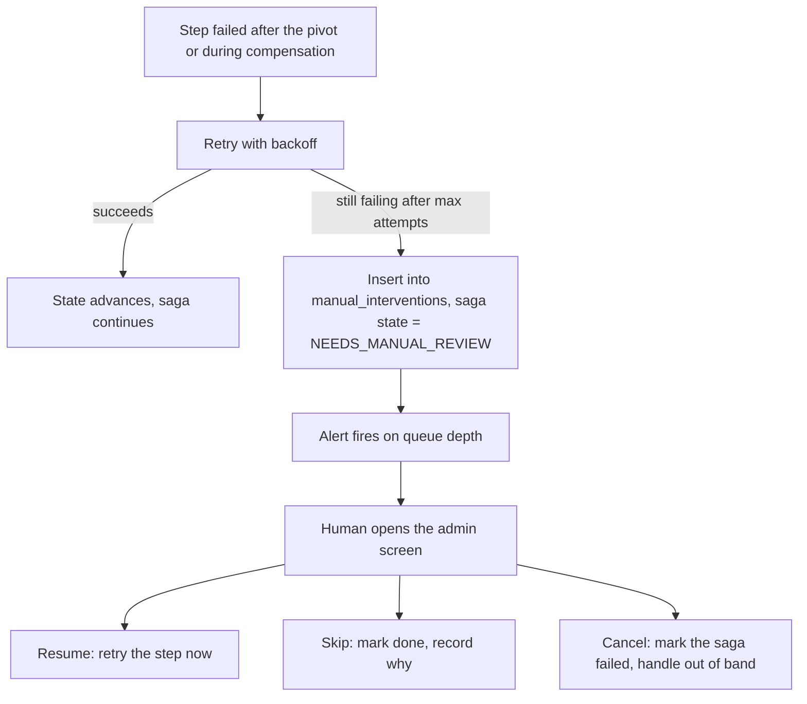
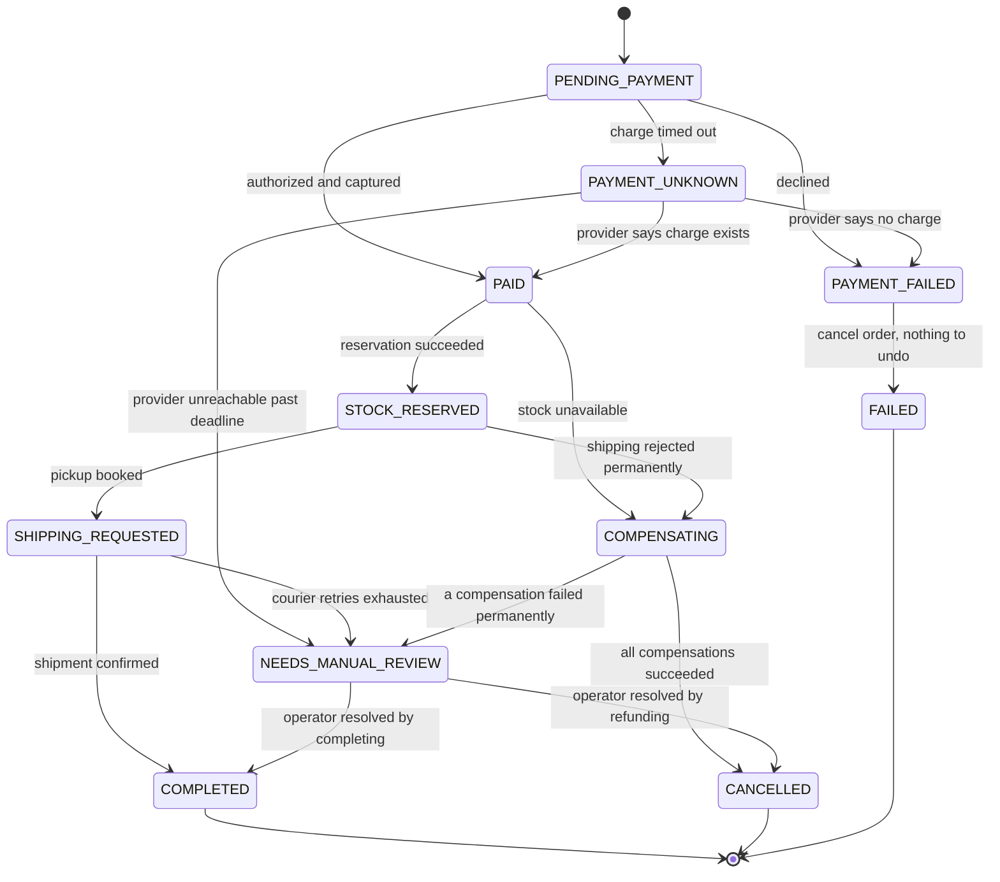

## 19.7 Compensation in practice

#### Concept

A **compensating transaction** is a normal, forward-moving local transaction whose business meaning is "undo the effect of an earlier step". It is not a rollback. It runs later, it is visible in history, it can fail, it can be retried, and it sometimes costs money.

For our flow the four compensations are:

```text
C4 Cancel shipment    -> call the courier's cancel API, mark the shipment CANCELLED
C3 Release stock      -> add the reserved quantity back to available, delete the reservation
C2 Refund payment     -> call the gateway's refund API against the charge id
C1 Cancel order       -> UPDATE orders SET status = 'CANCELLED'
```

They run in reverse order of the forward steps, and every one of them must be safe to run twice.

#### Why does it exist?

Because the forward steps already committed. Nothing in the database can take them back, and nothing in Stripe or Delhivery can either. If you want the customer to end up whole, you have to write the code that makes them whole, and you have to run it reliably even though the process that started it may be dead.

#### Mental model

Imagine a hotel where a guest checks out early. The receptionist does not have a time machine. They: cancel the remaining nights in the booking system, issue a refund to the card, notify housekeeping to release the room, and email a revised invoice. Four forward actions, each recorded, each of which can fail on its own.

If the card refund fails because the card expired, the receptionist does not delete the checkout. They put a note in a file: *refund pending, contact guest*. That file is your manual-intervention queue, and every real system needs one.

#### How it works

**Rule 1: compensations must be idempotent.** They will run more than once. The saga runner retries on timeout; a duplicate reply event triggers a second attempt; an operator hits "resume" from the admin API. If `releaseStock` blindly does `available = available + qty`, running it three times inflates your stock by 2x the order. That is a real inventory corruption incident and it is very hard to notice.

The correct shape uses a **state guard** so the second run does nothing:

```sql
-- WRONG: additive, not idempotent. Two runs add the quantity twice.
UPDATE inventory SET available = available + 2 WHERE sku = 'BX-19';

-- RIGHT: guarded by the reservation's own state. Only the transition RESERVED -> RELEASED
-- has an effect, and it can only happen once.
WITH released AS (
  UPDATE stock_reservations
     SET status = 'RELEASED', released_at = now()
   WHERE order_id = $1 AND sku = $2 AND status = 'RESERVED'
  RETURNING qty
)
UPDATE inventory i
   SET available = i.available + r.qty
  FROM released r
 WHERE i.sku = $2;
```

Run that ten times and stock moves exactly once. The `WHERE status = 'RESERVED'` clause is doing all the work: the second execution updates zero rows in the CTE, so the outer `UPDATE` touches nothing. This pattern — **make the state transition the idempotency mechanism** — is the cheapest form of idempotency there is, and section 19.12 comes back to it.

**Rule 2: compensations run in reverse order.** Not because of elegance, but because of dependencies. Releasing stock before cancelling shipping means a courier can arrive for a parcel whose contents were returned to the shelf. Refunding before releasing stock means a customer sees their money back while the warehouse still shows the item as held, and a second customer cannot buy it. Reverse order keeps every intermediate state explainable.

There is one exception a senior will make deliberately: **refund first when the customer is waiting and the internal cleanup is slow.** A refund initiated at second 2 rather than second 40 measurably reduces support contacts. If you do this, record it as a deliberate ordering choice in the step table, not as an accident.

**Rule 3: compensations can themselves fail.** This is the part every tutorial skips. Your refund call gets a 503. Your courier cancel API returns "already dispatched, cannot cancel". What now?



The manual-intervention queue is a table, not a Slack message:

```sql
CREATE TABLE manual_interventions (
  id           uuid PRIMARY KEY DEFAULT gen_random_uuid(),
  saga_id      uuid NOT NULL REFERENCES order_sagas(id),
  order_id     uuid NOT NULL,
  step         text NOT NULL,
  reason       text NOT NULL,
  context      jsonb NOT NULL DEFAULT '{}',   -- chargeId, reservationId, last provider response
  money_at_risk_cents int NOT NULL DEFAULT 0, -- lets you sort the queue by customer impact
  status       text NOT NULL DEFAULT 'OPEN',  -- OPEN, IN_PROGRESS, RESOLVED
  assigned_to  text,
  created_at   timestamptz NOT NULL DEFAULT now(),
  resolved_at  timestamptz,
  resolution   text
);

CREATE INDEX idx_manual_open ON manual_interventions (created_at)
  WHERE status <> 'RESOLVED';
```

`money_at_risk_cents` is the column that makes the queue usable. When 40 items pile up during an outage, the operator works the 12,000-rupee refunds before the 90-rupee ones.

**Rule 4: handle the partially-succeeded step.** Stock reservation for a 4-line order reserved 3 SKUs and failed on the fourth. The compensation must release exactly what was reserved, no more and no less. That is only possible if the forward step recorded each reservation as it happened:

```ts
// inventory.service.ts — record each line as it succeeds, so compensation is exact
async reserve(orderId: string, items: Item[]): Promise<ReserveResult> {
  return this.dataSource.transaction(async (manager) => {
    const reserved: string[] = [];
    for (const item of items) {
      const res = await manager.query(
        `UPDATE inventory SET available = available - $2
          WHERE sku = $1 AND available >= $2`,
        [item.sku, item.qty],
      );
      if (res[1] === 0) {
        // Whole transaction rolls back: nothing was reserved. This is the easy case,
        // and it is easy ONLY because all lines are in one local database.
        throw new InsufficientStockError(item.sku);
      }
      await manager.insert(StockReservation, {
        orderId, sku: item.sku, qty: item.qty, status: 'RESERVED',
      });
      reserved.push(item.sku);
    }
    return { reservationId: orderId, reserved };
  });
}
```

Note what makes this clean: all four lines live in **one** database, so one local transaction covers them and "partially succeeded" cannot happen inside the step. Whenever you can collapse a multi-part step into one local transaction, do it — you delete an entire class of compensation problem. Where you cannot (stock split across two warehouses in two services), you must record each part and compensate part by part.

**Rule 5: know the compensation window and what the customer sees in it.** This is a product decision with real numbers:

| Compensation | Technical completion | What the customer perceives |
|---|---|---|
| Cancel order row | ~2 ms | Immediate: status flips to Cancelled |
| Release stock | ~5 ms | Invisible to them, visible to other shoppers |
| Cancel courier pickup | 200 ms to 2 s | Invisible unless the label was already emailed |
| Void an authorization (not yet captured) | Immediate at the gateway | Bank hold disappears in 1 to 7 days depending on the issuer |
| Refund a captured charge | 1 to 3 s at the gateway | **3 to 7 business days to appear on the statement** |

That last row is the one product must understand. Your saga completes in 3 seconds; the customer's experience of the compensation lasts a week. Which means the UI must say so explicitly: "We've cancelled your order. Your refund of 4,299 has been issued and will appear on your card within 5 to 7 working days. Reference RF-7781." Silence here generates a support ticket per refund, guaranteed.

#### NestJS example

The compensation executor, driven by the same step table from section 19.5:

```ts
// compensation.service.ts
@Injectable()
export class CompensationService {
  private readonly log = new Logger(CompensationService.name);

  constructor(
    private readonly payments: PaymentGatewayClient,
    private readonly inventory: InventoryClient,
    private readonly shipping: ShippingClient,
    @InjectRepository(ManualIntervention) private readonly manual: Repository<ManualIntervention>,
  ) {}

  async compensate(saga: OrderSaga, step: StepName): Promise<StepOutcome> {
    const key = `${saga.orderId}:${step}`;                 // deterministic, safe to repeat
    try {
      switch (step) {
        case 'CANCEL_SHIPMENT':
          if (!saga.payload.pickupId) return { ok: true, refs: {} };   // nothing to undo
          await this.shipping.cancel(saga.payload.pickupId, { idempotencyKey: key });
          return { ok: true, refs: { shipmentCancelled: true } };

        case 'RELEASE_STOCK':
          if (!saga.payload.reservationId) return { ok: true, refs: {} };
          await this.inventory.release(saga.orderId, { idempotencyKey: key });
          return { ok: true, refs: { stockReleased: true } };

        case 'REFUND_PAYMENT': {
          if (!saga.payload.chargeId) {
            // Authorized but never captured: void the hold instead of refunding.
            if (saga.payload.authId) await this.payments.voidAuth(saga.payload.authId, key);
            return { ok: true, refs: {} };
          }
          const r = await this.payments.refund(saga.payload.chargeId, { idempotencyKey: key });
          return { ok: true, refs: { refundId: r.id } };
        }

        case 'CANCEL_ORDER':
          await this.orders.update(
            { id: saga.orderId, status: Not(OrderStatus.CANCELLED) },
            { status: OrderStatus.CANCELLED, cancelledAt: new Date() },
          );
          return { ok: true, refs: {} };
      }
    } catch (err) {
      if (err instanceof AlreadyDoneError) return { ok: true, refs: {} };  // 409 = success
      this.log.error({ orderId: saga.orderId, step, err: String(err) }, 'compensation failed');
      return { ok: false, error: String(err), refs: {} };
    }
  }

  async escalate(saga: OrderSaga, step: StepName, reason: string): Promise<void> {
    await this.manual.insert({
      sagaId: saga.id,
      orderId: saga.orderId,
      step,
      reason,
      context: saga.payload,
      moneyAtRiskCents: saga.payload.capturedCents ?? 0,
    });
    this.metrics.increment('saga_manual_intervention_total', { step });
  }
}
```

Three details worth copying. `if (!saga.payload.pickupId) return ok` — compensating a step that never ran is a success, not an error, and this line prevents an infinite retry loop over a non-existent shipment. `AlreadyDoneError` mapping a gateway 409 to success — providers return "already refunded" and that is exactly the outcome you wanted. And `voidAuth` versus `refund` — the compensation depends on which forward step actually completed, which is why `payload` must be accurate.

#### Production scenario

A retailer processes about 480 compensations per day out of 34,000 orders (1.4%). The breakdown:

| Trigger | Share | Typical compensation | Auto-resolved |
|---|---|---|---|
| Payment declined at authorization | 61% | Cancel order only. No money moved | 100% |
| Stock unavailable after payment | 22% | Release nothing, refund, cancel | 99.7% |
| Customer cancels within the window | 12% | Cancel shipment, release stock, refund, cancel | 98% |
| Shipping partner rejects the address | 4% | Refund, cancel; stock stays held for reship | 91% |
| Fraud hold after capture | 1% | Refund, cancel, flag account | 76% |

About 6 compensations a day reach `NEEDS_MANUAL_REVIEW`. That is a workload one support person absorbs in twenty minutes, which is the correct size for a manual queue. If it were 600 a day, the design would be wrong.

#### Failure scenario

**A refund storm during a gateway incident.** The payment provider had a 40-minute degradation where refund requests returned HTTP 500 but *actually processed about half the time*. The saga runner retried each failed refund with backoff, up to 10 attempts.

Because the refund client generated a fresh idempotency key per attempt (`randomUUID()`), the provider treated each retry as a new refund. 214 orders were refunded between two and four times. Total over-refund: 780,000 rupees.

Recovery took a week of finance work and re-charging customers who had received money they were not owed, which is a terrible email to send. Two single-line fixes prevented all of it:

```ts
// Before: a new key on every attempt. Every retry is a new refund.
const key = randomUUID();

// After: derived from durable identity. Every retry is the SAME refund.
const key = `${orderId}:REFUND_PAYMENT`;
```

The second fix was reading the provider docs properly: their refund endpoint returns `409 refund_already_exists` for a repeated key, and the client was treating 409 as a failure and retrying. Mapping 409 to success would also have prevented the incident.

#### Edge cases & failure modes

- **Compensating a step that never ran.** Guard on the reference in `payload`; treat it as success.
- **Compensating a step that is still in flight.** The forward call timed out but is still executing on the provider; your refund arrives before the charge exists and returns "charge not found". Retry with backoff rather than escalating on the first attempt — and see section 19.18 on compensation racing the original step.
- **Non-refundable amounts.** Gateway fees (typically 2% plus 3 rupees) are often not returned. Your ledger must model the difference or your reconciliation will never balance.
- **Cancellation after cut-off.** The courier already collected the parcel. Compensation becomes a returns process, which is a *different* business flow with its own saga. Do not try to force it into the order saga.
- **Compensation for a step whose service is down.** The inventory service being down does not permit skipping the release; it must retry until it succeeds or escalate. Skipping silently corrupts stock.
- **Partial refunds.** Order of 4 items, 1 out of stock. Compensation is a partial refund, which means the amount is computed, not copied. Compute it from the order lines, never from the request.
- **Currency and rounding.** Refunding a converted amount at a different exchange rate leaves a few paise unaccounted for. Always refund in the original charge's currency and amount.
- **Compensation loops.** Compensation fails, escalates, an operator hits "retry", it fails again. Cap operator retries too, and require a written resolution note to close the item.

#### How a Senior Backend Engineer thinks about this

They design the compensation at the same time as the forward step, in the same pull request, and they refuse to merge a saga step without one. The review question is: *if this step succeeds and the next one fails, what exactly runs, with what identifier, and what happens if that also fails?*

They treat compensation as a first-class business process, not an error path. It gets a status the customer can see, an email, a ledger entry, a metric and a place in the support tooling. A cancellation is not a failure of the system; it is an outcome of the system.

They also insist on the manual queue existing *before* it is needed. Building it during an incident, at 03:00, with 400 stuck orders, is the worst time to design a table.

To a product manager: "One in seventy orders will need to be unwound. Almost all of that is automatic and the customer just sees 'cancelled, refund on the way'. About six a day need a person to look, and we will give you a screen for that with the biggest refunds at the top."

#### Common mistakes

- Non-idempotent compensations (`available = available + qty` with no guard).
- Fresh idempotency keys per retry attempt.
- Treating a provider's "already done" 409 as a failure.
- No manual queue, so failed compensations become log lines nobody reads.
- Compensating in forward order, producing states nobody can explain.
- Assuming the compensation is instant from the customer's perspective and not telling them about the 5 to 7 day refund window.
- Compensating a partially-succeeded step by "undoing everything", which undoes things that never happened.

#### Interview questions

1. *Why must compensations be idempotent, and how do you make them so?* Expected: retries and duplicate triggers are guaranteed; use a guarded state transition (`WHERE status = 'RESERVED'`) or a deterministic idempotency key at the provider.
2. *What do you do when a compensation fails permanently?* Expected: bounded retries with backoff, then a durable manual-intervention row with money at risk, an alert, and an admin UI with resume/skip/cancel.
3. *In what order do you run compensations and why?* Expected: reverse of the forward order so intermediate states stay explainable; refund-first is a deliberate exception for customer experience.
4. *How do you compensate a step that partially succeeded?* Expected: the forward step must record what it actually did; compensate exactly that; better, make the step a single local transaction so partial success is impossible.
5. *What is the difference between voiding an authorization and refunding a capture?* Expected: void releases a hold before settlement (fast, usually free); refund moves money back after settlement (slow, fees often retained). Your compensation must pick based on what actually happened.

## 19.8 What happens if every step fails

This section is the centrepiece of Part 19. For each of the four steps, we walk every way it can go wrong and state exactly what the system does and where the order ends up. If you build only one thing from this Part, build a table like this for your own flow.

Two definitions first, because they carry the whole table:

- **Unknown outcome** means the request left your process and no answer came back. It may have fully succeeded. Any design that maps "unknown" to "failed" is wrong roughly half the time.
- **End state** means the row in `orders.status` and in `order_sagas.state` after the system has finished reacting, with no human involved.

#### The order status enum

```sql
CREATE TYPE order_status AS ENUM (
  'PENDING_PAYMENT',       -- created, payment not yet authorized
  'PAYMENT_UNKNOWN',       -- charge call timed out; outcome being resolved
  'PAYMENT_FAILED',        -- declined or permanently failed; nothing to undo
  'PAID',                  -- authorized and captured
  'STOCK_RESERVED',        -- items held in the warehouse
  'SHIPPING_REQUESTED',    -- pickup booked with the courier
  'COMPLETED',             -- all four steps done
  'COMPENSATING',          -- unwinding: refund and release in progress
  'CANCELLED',             -- unwound cleanly, customer made whole
  'FAILED',                -- terminal, nothing was left behind
  'NEEDS_MANUAL_REVIEW'    -- automation gave up; a human owns it now
);

ALTER TABLE orders ADD COLUMN status order_status NOT NULL DEFAULT 'PENDING_PAYMENT';

-- Operational index: everything not finished, cheap to scan even at 40 million rows.
CREATE INDEX idx_orders_open ON orders (status, updated_at)
  WHERE status NOT IN ('COMPLETED', 'CANCELLED', 'FAILED');
```

`COMPENSATING` and `NEEDS_MANUAL_REVIEW` are the two states that separate a real system from a demo. `COMPENSATING` gives the UI something honest to show while refunds are in flight. `NEEDS_MANUAL_REVIEW` gives failure a home instead of a log line.

#### The saga state machine, with every compensation path



Read the arrows into `NEEDS_MANUAL_REVIEW`: there are three, and each one is a place where automation has honestly run out. Read the arrows out of it: two, both driven by a human. That is the shape of a complete design.

#### Step 1 — Order creation

The only step fully inside your database, and therefore the easiest.

| Failure mode | What actually happened | What the system does | End state |
|---|---|---|---|
| Fails fast | Constraint violation, invalid DTO, customer not found | Return 400 or 422 immediately. No saga row is created | Nothing exists. Clean |
| Times out | Database unreachable or pool exhausted; the `INSERT` may have committed | Return 503. The client retries with the same `Idempotency-Key`; the unique index on `(customer_id, idempotency_key)` returns the existing order | One order, no duplicate |
| Succeeds, acknowledgement lost | Row committed, response lost in transit | Client retries with the same key, gets the existing order and a 200 | `PENDING_PAYMENT`, one row |
| Partially succeeds | Order header inserted, one line item failed | Impossible: one local transaction covers both. Rolls back entirely | Nothing exists |
| Duplicates | Two POSTs, one intent (double-click, LB retry) | Unique index on the idempotency key rejects the second; return the first order | One order |
| Arrives late | The client gave up 30 s ago; the request lands anyway | The order is created and enters the saga normally; the customer sees it in their order list and may be surprised | `PENDING_PAYMENT`, then normal flow. Consider rejecting requests older than the client timeout via a `Request-Timestamp` header |
| Arrives out of order | A `cancel` for this order arrives before the `create` | The cancel finds no order. Do not create a tombstone silently; park it in a short-lived pending table keyed by order id and apply it when the create lands, or reject it and let the client retry | `PENDING_PAYMENT` then `CANCELLED` |
| Compensation fails | `UPDATE orders SET status = 'CANCELLED'` fails | Only possible if the database is down. Retry; database availability is a prerequisite for everything | `COMPENSATING` until the database returns |

#### Step 2 — Payment

The expensive step. Every row here is money.

| Failure mode | What actually happened | What the system does | End state |
|---|---|---|---|
| Fails fast | Card declined, insufficient funds, 3DS rejected. Explicit `402` | Mark `PAYMENT_FAILED`, cancel the order. No compensation needed: nothing moved | `FAILED`. Customer told to try another card |
| Times out | No response after 4 s. The charge may exist | Mark `PAYMENT_UNKNOWN`. **Never retry blindly.** The reconciler calls `GET /charges?idempotency_key=order-7781-charge`. If found, move to `PAID`; if not found after the provider's settlement window, move to `PAYMENT_FAILED` | `PAID` or `FAILED`, resolved within minutes |
| Succeeds, acknowledgement lost | Money moved, HTTP response lost | Identical to the timeout path. The idempotency-key lookup or the `charge.succeeded` webhook finds it | `PAID` |
| Partially succeeds | Split payment: 2,000 from wallet succeeded, 2,299 on card declined | Record the wallet debit as a real event. Compensation must refund the wallet portion. Model each tender as its own saga step, or you will lose track of it | `COMPENSATING` then `CANCELLED` with a wallet credit |
| Duplicates | Two charge calls for one order | The provider's idempotency key collapses them into one charge. Without the key, two charges and a manual refund | `PAID`, one charge |
| Arrives late | The saga already timed out, compensated and cancelled; the charge lands afterwards | The webhook handler sees the order is `CANCELLED` and triggers an automatic refund saga. This must exist or you keep the money (section 19.18) | `CANCELLED` plus an automatic refund |
| Arrives out of order | `charge.refunded` webhook is delivered before `charge.succeeded` | Handle by event id and provider timestamp, not arrival order. Store both; apply the latest state per charge id. Never derive state from arrival sequence | Correct final state |
| Compensation fails | Refund returns 500 repeatedly | Retry 10 times with backoff up to 60 s (about 12 minutes of attempts), then `NEEDS_MANUAL_REVIEW` with `money_at_risk_cents` set. Page if the queue exceeds 5 | `NEEDS_MANUAL_REVIEW` |

#### Step 3 — Inventory

The step most likely to fail for a *business* reason rather than a technical one.

| Failure mode | What actually happened | What the system does | End state |
|---|---|---|---|
| Fails fast | `available >= qty` is false. Genuinely out of stock | Enter `COMPENSATING`: refund the capture, cancel the order, email "item sold out, refunded" | `CANCELLED` |
| Times out | Inventory service did not answer. Reservation may exist | Retry the same command with key `order-7781:RESERVE_STOCK`. The inventory service's inbox dedups it. After 5 attempts, query reservations by order id; if one exists, treat as success | `STOCK_RESERVED` or `COMPENSATING` |
| Succeeds, acknowledgement lost | Stock decremented, `StockReserved` event lost | The retry hits the inbox, which returns the existing reservation, and the reply is re-emitted from the outbox | `STOCK_RESERVED` |
| Partially succeeds | 3 of 4 SKUs reserved, then the pod died mid-loop | If all lines are in one local transaction, impossible. Across warehouses or services, the saga must release exactly the recorded reservations, line by line | `COMPENSATING` then `CANCELLED` |
| Duplicates | The reserve command is delivered twice | Inbox `ON CONFLICT DO NOTHING` on `message_id` makes the second a no-op. Without it, stock is double-decremented and you undersell | `STOCK_RESERVED`, decremented once |
| Arrives late | Reserve command processed after the saga already compensated | The inventory service accepts it (it has no view of the saga), so stock is now held for a cancelled order. The release compensation must be re-sent, or a nightly reconciler must find reservations whose order is `CANCELLED` | Reconciled within an hour |
| Arrives out of order | `ReleaseStock` arrives before `ReserveStock` | The release finds no reservation and returns success (nothing to release). Then the reserve lands and holds stock forever. **Fix:** the release writes a tombstone row `(order_id, sku, status='RELEASED')`; the later reserve sees the tombstone and refuses | Stock correct |
| Compensation fails | Release returns 500 | Retry up to 10 times, then `NEEDS_MANUAL_REVIEW`. Also caught by the nightly reconciler comparing reservations against cancelled orders | `NEEDS_MANUAL_REVIEW`, stock corrected by reconciler within 24 h |

#### Step 4 — Shipping

After the pivot. Failure here does not refund; it escalates.

| Failure mode | What actually happened | What the system does | End state |
|---|---|---|---|
| Fails fast | Courier rejects: undeliverable pin code, oversize parcel | Not retryable. Enter `COMPENSATING`: release stock, refund, cancel, email the customer with the reason | `CANCELLED` |
| Times out | No answer in 20 s. Pickup may be booked | Retry with the same idempotency key, backoff to 60 s, 12 attempts (~1 hour). If the courier supports it, query by reference before each retry | `SHIPPING_REQUESTED` or `NEEDS_MANUAL_REVIEW` |
| Succeeds, acknowledgement lost | Pickup booked, response lost | The idempotent retry returns the same pickup id (or a 409 you map to success). No double booking | `SHIPPING_REQUESTED` |
| Partially succeeds | Multi-parcel order: 2 of 3 parcels booked | Record each parcel's booking as it returns. Retry only the unbooked parcels. Never re-book confirmed ones | `SHIPPING_REQUESTED` when all parcels are booked |
| Duplicates | Two `RequestShipping` commands from two orchestrator pods | Deterministic key `order-7781:REQUEST_SHIPPING` collapses them at the courier. Without it: two pickups, a failed-pickup fee, an annoyed driver | One pickup |
| Arrives late | Booking confirmed after the saga escalated and a human cancelled the order | The courier webhook finds the order `CANCELLED` and fires a cancel-pickup compensation automatically | `CANCELLED`, pickup cancelled |
| Arrives out of order | `shipment.delivered` webhook arrives before `shipment.created` | Apply by the courier's own status timestamp, not arrival order. Store the tracking record with a `status_updated_at` and only move forward | Correct status |
| Compensation fails | Cancel pickup returns "already collected" | Not a failure: it is a different business process. Move to the returns saga, notify the customer, keep the refund pending until the parcel is back or write it off | `NEEDS_MANUAL_REVIEW` linked to a returns case |

#### The pattern across all 32 rows

Read the four tables together and five rules fall out. These are the actual deliverables of this section:

1. **Every remote step needs a deterministic idempotency key derived from durable identity.** `${orderId}:${step}`. Not a random UUID, not a timestamp. Half the rows above are handled by this one rule.
2. **Every step needs an explicit "unknown" resolution path.** Either query the provider by the idempotency key, or wait for a webhook, or both with a deadline. Guessing is not a path.
3. **Every consumer needs an inbox.** Duplicates are not exceptional; they are the delivery guarantee (Part 17 section 17.7). `ON CONFLICT DO NOTHING` on `message_id` handles the whole "duplicates" column.
4. **Every out-of-order pair needs a tombstone or a version.** "Release before reserve" and "delivered before created" are the same bug: state derived from arrival order. Fix it by deriving state from data, never from sequence.
5. **Every step needs a bounded number of attempts and a place to land when they run out.** `NEEDS_MANUAL_REVIEW` plus a queue row with money at risk. Unbounded retries are how a saga hangs for three weeks.

#### Production scenario

A team built exactly this table for their flow, then wrote one integration test per row: 32 tests, each injecting one specific failure with a stub server, asserting the final `orders.status` and the absence of money discrepancies. The suite ran in 90 seconds in CI.

In the following year they had three provider incidents. In all three the automated compensation handled over 98% of affected orders, and the manual queue peaked at 41 items during the worst one. No customer was charged without an order. The team's own summary: *the tests were tedious to write and they are the reason nobody has been paged for a stuck order since.*

#### Failure scenario

The counter-example. A team shipped the same flow with no matrix. Their handling of "payment timed out" was `catch (e) { order.status = 'FAILED' }`.

For eight months this was invisible, because the timeout rate was 0.04% and the affected customers just re-ordered. Then the gateway had a bad afternoon: 6% timeouts for two hours. 340 orders were marked `FAILED` while the charges succeeded. Customers saw "Order failed" and re-ordered — many of them twice. 411 duplicate charges, 340 orphaned ones.

Finance found it four days later during settlement reconciliation, when the gateway's total did not match the sum of `orders.total_cents WHERE status IN ('PAID','COMPLETED')`. That reconciliation query is worth having as a daily job on its own:

```sql
-- Daily: charges the provider says exist, that we have no PAID order for.
SELECT p.charge_id, p.amount_cents, p.created_at
FROM provider_charges p
LEFT JOIN orders o ON o.payment_ref = p.charge_id
WHERE p.created_at < now() - interval '30 minutes'
  AND (o.id IS NULL OR o.status NOT IN ('PAID','STOCK_RESERVED','SHIPPING_REQUESTED','COMPLETED'))
ORDER BY p.created_at;
```

If that query ever returns rows and you did not expect it, you have money you should not have.

#### Edge cases & failure modes

- **A failure mode you did not enumerate is a failure mode you handle by accident.** The matrix is the deliverable; the code follows from it.
- **The unknown-outcome resolver needs its own deadline.** If the provider is unreachable for an hour, `PAYMENT_UNKNOWN` must eventually escalate rather than spin.
- **Webhook and polling can both resolve the same unknown**, at the same time, on two pods. Both paths must be idempotent against the same order row.
- **Refunding a charge you never recorded** is possible if the reconciler works from provider data. Always write the charge id into the order before or at the moment you learn it.
- **Time zones and settlement windows.** "The provider says no charge exists" can be temporarily true for a charge created 200 ms ago in an eventually consistent provider API. Give the resolver a minimum age before it concludes "no charge".

#### How a Senior Backend Engineer thinks about this

They build the matrix before the code, on paper, with the product owner in the room for the "end state" column, because half the rows are business decisions, not technical ones. "Charge arrives late for a cancelled order" is a policy question: refund automatically, or hold as store credit? Engineering should not decide that alone.

They then turn each row into a test. The matrix becomes the test plan, which becomes the regression suite, which becomes the reason the next gateway incident is boring.

And they keep a single number on the dashboard that summarises the whole table: **orders in a non-terminal state older than 15 minutes.** If that number is zero, all 32 rows are being handled. If it climbs, exactly one of them is not.

#### Common mistakes

- Mapping every exception to `FAILED`.
- No `PAYMENT_UNKNOWN` state, so an unknown outcome must be forced into a lie.
- Testing only the happy path and the "declined" path, which are the two cheapest rows in the table.
- Assuming internal services do not need the duplicate and out-of-order columns. They do; Kafka rebalances and Kubernetes restarts guarantee it.
- No daily reconciliation against the provider, so discrepancies are found by finance rather than by monitoring.

#### Interview questions

1. *Walk me through every way a payment step can fail and what your system does for each.* Expected: the eight rows above, with "unknown" handled by idempotency-key lookup or webhook, not by guessing.
2. *A charge succeeds after the order was already cancelled. What happens?* Expected: the webhook handler detects the cancelled order and triggers an automatic refund saga; without that path you silently keep the money.
3. *`ReleaseStock` arrives before `ReserveStock`. What breaks and how do you fix it?* Expected: the release is a no-op, then the reserve holds stock forever; fix with a tombstone row or a per-order version, never with arrival ordering.
4. *How do you bound the time an order can stay in a non-terminal state?* Expected: per-step deadline, a reconciliation job scanning for stale sagas, a hard escalation to manual review, and a dashboard metric with an alert.
5. *What single query would tell you your saga implementation is broken in production?* Expected: count of non-terminal orders older than N minutes; or the provider-charges-without-a-paid-order reconciliation query.

#### Practical exercise

Build the 32-row matrix for your own flow and turn it into 32 integration tests using a stub provider you can command to fail, hang, respond twice or respond out of order.

Acceptance criteria: every test asserts the final `orders.status`, the final saga state, and that the sum of money held by the provider matches the sum implied by your order statuses; at least six tests fail on your current code before you fix them; and the whole suite runs in under three minutes so it can live in CI.
