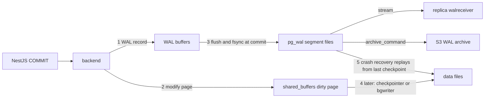
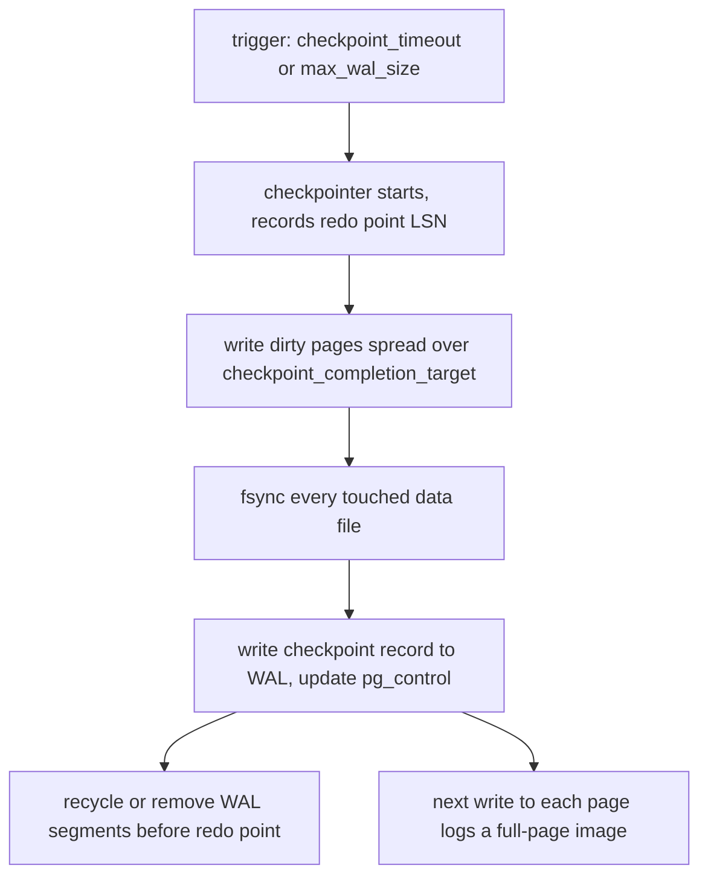

## 19.5 The write-ahead log (WAL)

### 19.5.1 Why every write goes to the WAL first

#### Concept

The **write-ahead log** is an append-only file stream in the `pg_wal` directory. Before PostgreSQL changes any data page in shared buffers in a way that must survive a crash, it first writes a record describing that change to the WAL. At `COMMIT`, PostgreSQL forces the WAL up to that transaction's commit record onto disk (`fsync`) and only then tells your application "committed". The dirty data pages themselves are written to the data files later, at leisure, by the checkpointer and background writer.

The WAL is the single most important structure in PostgreSQL: crash recovery, streaming replication, logical replication, point-in-time recovery, and backups all read it.

#### Why does it exist?

Writing data pages directly on commit would mean random 8 KB writes all over the disk for every transaction, and a crash halfway through a multi-page update would leave the database inconsistent. Appending a small sequential record to one file is far cheaper (one `fsync` of a few hundred bytes at the end of a file), and replaying the log after a crash brings the pages back to the committed state. The **write-ahead rule** is exactly this: a data page may not be written to disk before the WAL records describing its changes are on disk.

#### Mental model

Imagine an accountant who writes every transaction into a bound journal (WAL) immediately, in ink, and only later updates the many ledger books (data files) at a convenient time. If the office floods, the ledgers may be out of date, but the journal is complete and the ledgers can be rebuilt from it. The journal is fast to write because you only ever add a line at the end.

#### How it works



1. Your `UPDATE inventory SET quantity = quantity - 1 WHERE product_id = 7` runs. The backend pins the heap page, and before modifying it, builds a WAL record: "in relation X, page Y, replace tuple Z with this new version". It copies that record into **WAL buffers** in shared memory (size `wal_buffers`, default 1/32 of `shared_buffers` up to 16 MB) and gets back an **LSN** (log sequence number: a 64-bit byte offset into the log, displayed like `1A/3F2B8C40`).
2. The page is modified in shared buffers and stamped with that LSN in its header (`pd_lsn`). The page is now dirty.
3. On `COMMIT`, the backend writes a commit record and calls `XLogFlush` up to it: the WAL buffers are written to the current 16 MB segment file and `fsync`'d. The commit returns only after the `fsync` succeeds. Cost: 0.1 to 0.3 ms on local NVMe, 1 to 3 ms on EBS. Concurrent committers share one `fsync` (**group commit**), which is why throughput scales with concurrency even though each commit waits.
4. The **WAL writer** process also flushes WAL buffers every `wal_writer_delay` (200 ms) so that asynchronous commits and long transactions do not keep everything in memory.
5. Dirty pages reach the data files later. The write-ahead rule is enforced when a page is about to be written: the writer first checks the page's `pd_lsn` and flushes the WAL up to it.
6. **Crash recovery:** on startup PostgreSQL reads `pg_control` for the last checkpoint's **redo point**, then replays every WAL record from there to the end of the log. Replay is idempotent because it compares each record's LSN with the target page's `pd_lsn`: if the page already has that change, the record is skipped.
7. **Replication** is "ship the WAL somewhere else and replay it there". **PITR** is "keep a base backup plus every WAL segment since, and replay up to a chosen time" (`recovery_target_time`).

`synchronous_commit` controls step 3 and is one of the few knobs you can set *per transaction*:

| Value | Commit returns after | You can lose on primary crash | Use |
|---|---|---|---|
| `on` (default) | local WAL fsync | nothing | money, orders, inventory |
| `off` | WAL record in memory | up to about 3 × `wal_writer_delay` (600 ms) of commits; never corruption | audit logs, analytics events, click tracking |
| `local` | local fsync, ignores sync replicas | nothing locally | same as `on` when sync replication is configured |
| `remote_write` | replica has received and written (not fsync'd) | nothing unless both crash | near-sync HA |
| `remote_apply` | replica has applied | nothing; reads on replica see it | read-your-writes across replicas at a latency cost |

`fsync = off` is a different, dangerous thing: it stops PostgreSQL from ever forcing data to disk and allows real corruption on a crash. Never in production.

**Full-page writes.** The OS and disk typically write in 4 KB units, but a PostgreSQL page is 8 KB. A crash mid-write can leave a **torn page**: half new, half old. To survive this, the *first* modification of any page after a checkpoint writes the **entire 8 KB page** into the WAL (`full_page_writes = on`), not just the change. Replay then restores the full image before applying later diffs. Consequence: right after each checkpoint, WAL volume spikes because every hot page gets a full-page image again. `wal_compression = lz4` (PG 15+) shrinks those images by 50 to 80 percent for a little CPU.

**WAL volume.** Every insert, update, delete, index change, TOAST chunk, and commit writes WAL. Typical sizes: a small `orders` insert with 4 indexes is roughly 500 to 900 bytes of WAL; an update of a wide row that touches an indexed column is 1 to 2 KB plus index records; a full-page image is 8 KB (before compression). A workload of 3,000 writes per second easily produces 5 to 20 MB of WAL per second, which is 0.5 to 1.7 TB per day. That volume drives disk write IOPS, replication bandwidth, replica lag, archive storage cost, and backup size.

#### Practical example

Order placement in the checkout service: one transaction inserts an `orders` row, three `order_items`, a `payments` row, and updates three `inventory` rows. That is roughly 15 WAL records including index updates, about 6 KB of WAL, and one `fsync` at commit. At 200 checkouts per second, that is 1.2 MB/s of WAL and 200 `fsync`s per second, which group commit collapses into maybe 60 real disk flushes. On EBS gp3 at 2 ms per flush that is fine; on a network disk at 10 ms per flush, 200 sequential commits per second on one connection would be impossible, and only concurrency (group commit) keeps throughput up.

#### NestJS example

Relax durability only where the business allows it, and only for that transaction. `SET LOCAL` keeps it scoped to the transaction, which is also safe behind PgBouncer transaction mode.

```ts
// product-view-events.service.ts
import { Injectable } from '@nestjs/common';
import { DataSource } from 'typeorm';

@Injectable()
export class ProductViewEventsService {
  constructor(private readonly dataSource: DataSource) {}

  // Losing the last ~600 ms of view events on a primary crash is acceptable;
  // waiting 2 ms for fsync on every page view is not.
  async record(userId: number | null, productId: number): Promise<void> {
    await this.dataSource.transaction(async (em) => {
      await em.query(`SET LOCAL synchronous_commit = 'off'`);
      await em.query(
        `INSERT INTO product_view_events (user_id, product_id, viewed_at)
         VALUES ($1, $2, now())`,
        [userId, productId],
      );
    });
  }
}
```

Never do this for `orders`, `payments` or `inventory`. The question to ask is: "If the database crashes one second after we told the customer 'success', is that acceptable?"

#### PostgreSQL example

Measure WAL generation and see what a single statement costs:

```sql
-- Where is the log right now?
SELECT pg_current_wal_lsn();                        -- e.g. 1A/3F2B8C40

-- WAL bytes generated in the last minute (run twice, 60 s apart)
SELECT pg_wal_lsn_diff(pg_current_wal_lsn(), '1A/3F2B8C40') AS bytes_since;

-- PG 14+: cumulative WAL statistics
SELECT wal_records, wal_fpi, pg_size_pretty(wal_bytes) AS wal_bytes,
       wal_buffers_full, wal_write, wal_sync, wal_sync_time
FROM pg_stat_wal;
```

```text
 wal_records | wal_fpi  | wal_bytes | wal_buffers_full | wal_write | wal_sync | wal_sync_time
-------------+----------+-----------+------------------+-----------+----------+---------------
  9184423110 | 41022019 | 6812 GB   |           120433 |  55129811 | 30188211 |   61302241.5
```

`wal_fpi` (full-page images) being 0.4 percent of records but a large share of bytes tells you checkpoints are the source of most WAL volume. `wal_buffers_full` above zero at high rate means `wal_buffers` is too small. `EXPLAIN (ANALYZE, WAL)` (PG 13+) shows WAL per statement:

```sql
EXPLAIN (ANALYZE, WAL)
UPDATE inventory SET quantity = quantity - 1, updated_at = now() WHERE product_id = 7;
```

```text
Update on inventory  (actual time=0.081..0.082 rows=0 loops=1)
  WAL: records=2 bytes=213
  ->  Index Scan using inventory_pkey on inventory ...
```

Replication slot retention, the classic disk-full cause:

```sql
SELECT slot_name, slot_type, active, wal_status,
       pg_size_pretty(pg_wal_lsn_diff(pg_current_wal_lsn(), restart_lsn)) AS retained_wal
FROM pg_replication_slots;
```

```text
 slot_name        | slot_type | active | wal_status | retained_wal
------------------+-----------+--------+------------+--------------
 replica_1        | physical  | t      | reserved   | 48 MB
 debezium_orders  | logical   | f      | extended   | 212 GB      <-- consumer dead since Friday
```

`max_slot_wal_keep_size = '50GB'` (PG 13+) caps this: the slot is invalidated (`wal_status = lost`) rather than the primary running out of disk.

#### TypeORM example

The same per-transaction durability choice with a `QueryRunner`, useful when you need explicit control:

```ts
const qr = dataSource.createQueryRunner();
await qr.connect();
await qr.startTransaction();
try {
  await qr.query(`SET LOCAL synchronous_commit = 'off'`);
  await qr.manager.insert(ProductViewEvent, { userId, productId, viewedAt: new Date() });
  await qr.commitTransaction();
} catch (e) {
  await qr.rollbackTransaction();
  throw e;
} finally {
  await qr.release();   // forgetting this leaks a pooled connection
}
```

#### Sequelize example

```ts
await sequelize.transaction(async (t) => {
  await sequelize.query(`SET LOCAL synchronous_commit = 'off'`, { transaction: t });
  await ProductViewEvent.create({ userId, productId, viewedAt: new Date() }, { transaction: t });
});
```

#### Production scenario

Streaming replication for a 300 GB database with two replicas: the primary generates 8 MB/s of WAL at peak. Replicas apply it with roughly 50 to 300 ms lag over a same-region network; cross-region replicas see 1 to 3 s. Backups use a base backup every night plus continuous WAL archiving to S3 (`archive_mode = on`, `archive_command` or a tool such as pgBackRest or WAL-G), giving recovery to any second in the last 14 days. The team monitors: WAL generation rate, `pg_stat_replication.replay_lag`, archive failures (`pg_stat_archiver.failed_count`), and `pg_wal` directory size.

Production-first answers: What can go wrong? Slow `fsync` storage makes every commit slow; a dead slot fills the disk; archive failure silently breaks PITR. How do I monitor it? The four metrics above. How do I scale it? Faster disks for WAL (separate volume on self-managed), `wal_compression`, fewer indexes, batching small transactions. When should I not touch it? Never disable `fsync` or `full_page_writes` unless the storage guarantees atomic 8 KB writes (ZFS) and you have verified it.

#### Failure scenario

Saturday 03:40: `PANIC: could not write to file "pg_wal/xlogtemp.12345": No space left on device`. The primary crashed and refused to restart because it could not write WAL. A Debezium connector that fed the search index had been failing since Friday 18:00; its logical replication slot kept 212 GB of WAL on a 250 GB volume. Recovery meant resizing the volume (RDS: storage increase takes minutes to hours), starting the server, and dropping the slot with `pg_drop_replication_slot('debezium_orders')`. Permanent fixes: `max_slot_wal_keep_size`, an alert on `pg_replication_slots` where `active = false` for more than 10 minutes, and a disk-usage alert at 70 percent.

#### Edge cases & failure modes

- Disk full from WAL retention (slot, failed archive, `wal_keep_size` too large) crashes the primary.
- Archive command failing silently: `pg_stat_archiver.failed_count` climbs, `pg_wal` grows, PITR is broken from the last successful segment.
- `synchronous_commit = remote_apply` with a slow replica: every commit waits for the replica; a replica outage stalls all writes unless `synchronous_standby_names` allows a quorum.
- WAL burst after checkpoint from full-page images causing replica lag spikes every `checkpoint_timeout`.
- Bulk loads (`COPY` of 100 million rows) generating WAL faster than replicas can apply or archive can upload.
- Transaction with 1 GB of changes: WAL is written incrementally, but the commit record is tiny; rollbacks are cheap (no undo log), which is a deliberate MVCC design choice (see 19.7).
- Storage that lies about `fsync` (some consumer SSDs, misconfigured virtual disks) corrupts on power loss; `pg_test_fsync` measures real flush latency.

#### How a Senior Backend Engineer thinks about this

They see WAL as the cost model for writes: every index, every wide update, every tiny separate transaction is WAL bytes and `fsync`s. They batch where the business allows (one transaction for 500 inventory updates instead of 500 transactions). They relax `synchronous_commit` per transaction for genuinely non-critical writes, and document why. They never let a replication slot exist without an alert on it. They ask before every "stream the database changes to X" proposal: "who watches the slot, and what happens to the primary when X is down for a weekend?"

#### Common mistakes

- Creating logical replication slots for experiments and forgetting them.
- Setting `synchronous_commit = off` globally "for performance" and losing paid orders in a crash.
- Assuming a commit is durable on the replica because it is durable on the primary.
- Thousands of single-row transactions per second when a batch would cost one `fsync`.

#### Interview questions

1. *What does "write-ahead" guarantee, and why does it make commits fast?* Expected: WAL record is durable before any data page write; sequential append plus one `fsync` per commit group instead of random page writes.
2. *What is the difference between `synchronous_commit = off` and `fsync = off`?* Expected: the first risks losing recent commits, never consistency; the second risks corruption. Why it matters: candidates who confuse them can destroy a database.
3. *Why does WAL volume spike after a checkpoint?* Expected: full-page writes for the first modification of each page.
4. *A replication slot's consumer dies. What happens over the next 48 hours?* Expected: WAL retention grows, disk fills, primary PANICs; `max_slot_wal_keep_size` and alerting prevent it.
5. *How does crash recovery know where to start and when it can skip a record?* Expected: checkpoint redo pointer in `pg_control`; page LSN comparison.

#### Practical exercise

On a local instance, run 10,000 single-row inserts as separate transactions and time them; then 10,000 inserts in one transaction; then 10,000 separate transactions with `synchronous_commit = off`. Record `pg_stat_wal` before and after each run. Acceptance criteria: you present a table with total time, WAL bytes and `wal_sync` count per run, and explain each difference in terms of `fsync` and group commit.

## 19.6 Checkpoints

### 19.6.1 What a checkpoint does and why it causes I/O spikes

#### Concept

A **checkpoint** is the moment PostgreSQL guarantees that every data page dirtied before a certain WAL position has been written to the data files. After a checkpoint completes, crash recovery only needs to replay WAL written *after* it, and older WAL segments can be recycled. The **checkpointer** process does this on a timer (`checkpoint_timeout`, default 5 minutes) or when enough WAL has accumulated (`max_wal_size`, default 1 GB), whichever comes first.

#### Why does it exist?

Without checkpoints, dirty pages could sit in shared buffers forever, WAL could never be deleted, and a crash would require replaying days of WAL. Checkpoints bound recovery time and WAL disk usage. The price is a burst of writes: every dirty page in the cache must reach disk.

#### Mental model

Imagine the accountant from the WAL story. Once an hour they stop taking new journal entries for a moment, note "all journal lines up to number 84,120 are now reflected in the ledgers", and carry every pending change into the ledger books. After that, old journal pages can be archived. The more they let pile up, the bigger and more disruptive the hourly catch-up.

#### How it works



1. The checkpointer records the current WAL position as the **redo point**.
2. It scans shared buffers for dirty pages and writes them, sleeping between writes so that the whole set finishes at `checkpoint_completion_target` (0.9) of the interval. With `checkpoint_timeout = 15min`, writes are spread across 13.5 minutes.
3. It `fsync`s every data file it touched. This **sync phase** is where the I/O spike happens: the OS has been buffering the writes, and now it must push them all. On EBS or slow disks, the sync phase can take seconds and every other I/O waits behind it.
4. It writes a checkpoint record to the WAL and stores the redo point in `pg_control`.
5. WAL segments older than the redo point are recycled (renamed for reuse, up to `min_wal_size`) or removed, unless a replication slot or `wal_keep_size` holds them.
6. Because a checkpoint just finished, the next modification of every page writes a full-page image (see 19.5). This is the WAL burst.

Timed vs requested: `pg_stat_bgwriter.checkpoints_timed` and `checkpoints_req` (on PG 17 these moved to `pg_stat_checkpointer` as `num_timed` and `num_requested`). Requested checkpoints happen because `max_wal_size` was reached before the timer fired. If most checkpoints are requested, `max_wal_size` is too small for your write rate and you are checkpointing too often, which multiplies full-page images.

Tradeoff table:

| Setting | Smaller / shorter | Larger / longer |
|---|---|---|
| `checkpoint_timeout` | Faster crash recovery; more WAL from FPIs; more I/O spikes | Slower recovery (more WAL to replay); less WAL; smoother I/O |
| `max_wal_size` | Requested checkpoints during bursts | Bigger `pg_wal` directory; checkpoints stay timed |
| `checkpoint_completion_target` | Writes concentrated (bad) | 0.9 spreads them (good) |

Typical production values: `checkpoint_timeout = 15min`, `max_wal_size = 8GB` (larger on heavy-write systems), `checkpoint_completion_target = 0.9`, `log_checkpoints = on` (default since PG 15).

#### Practical example

The `inventory` table (60 MB, every page dirty at all times from 500 updates per second) is rewritten in full at every checkpoint. With a 5 minute timeout, that is 60 MB every 5 minutes plus 60 MB of full-page images in WAL right after. Moving to 15 minutes cuts both by two thirds. The hot `orders` index pages behave the same way.

#### PostgreSQL example

Read the checkpoint log lines; they tell the whole story:

```text
LOG:  checkpoint starting: time
LOG:  checkpoint complete: wrote 48213 buffers (5.9%); 0 WAL file(s) added, 12 removed,
      31 recycled; write=809.913 s, sync=2.412 s, total=812.610 s;
      sync files=214, longest=0.930 s, average=0.011 s;
      distance=712345 kB, estimate=980112 kB
```

`sync=2.412 s` with `longest=0.930 s` for one file is your latency spike. `distance` is how much WAL was generated since the last checkpoint; if it approaches `max_wal_size`, checkpoints are about to become requested. A different line is a warning that must not be ignored:

```text
LOG:  checkpoints are occurring too frequently (18 seconds apart)
HINT: Consider increasing the configuration parameter "max_wal_size".
```

Statistics:

```sql
-- PG 16 and earlier
SELECT checkpoints_timed, checkpoints_req, checkpoint_write_time, checkpoint_sync_time,
       buffers_checkpoint, buffers_clean, buffers_backend, maxwritten_clean
FROM pg_stat_bgwriter;
```

```text
 checkpoints_timed | checkpoints_req | checkpoint_write_time | checkpoint_sync_time | buffers_checkpoint | buffers_clean | buffers_backend | maxwritten_clean
-------------------+-----------------+-----------------------+----------------------+--------------------+---------------+-----------------+------------------
              2011 |             388 |             812094311 |              9021177 |          120993412 |      33012881 |        14022107 |            88123
```

`buffers_backend` at more than 10 percent of `buffers_checkpoint` means backends are writing pages themselves because the background writer cannot keep up; raise `bgwriter_lru_maxpages` and lower `bgwriter_delay`. `maxwritten_clean` counts rounds where the background writer hit its cap.

Force a checkpoint before a planned failover or a base backup so that the switchover replays less WAL:

```sql
CHECKPOINT;   -- superuser or pg_checkpoint role (PG 15+)
```

#### Production scenario

Write-heavy e-commerce system on EBS gp3 (3,000 IOPS baseline): checkpoints every 5 minutes wrote 400 to 900 MB, and the sync phase caused 200 to 400 ms p99 spikes every 5 minutes that were visible on the API latency graph as a comb pattern. Changes: `checkpoint_timeout = 20min`, `max_wal_size = 16GB`, `wal_compression = lz4`, IOPS provisioned to 6,000. Result: WAL volume dropped 35 percent (fewer full-page images), spikes became 40 ms and every 20 minutes, and crash recovery time went from about 30 s to about 2 min, which the team accepted because failover to a replica (not crash recovery) is their HA mechanism.

How do I monitor it? Checkpoint frequency and type, write and sync times, `buffers_backend` ratio, and disk write latency during the sync phase. How do I scale it? Better disks, longer intervals, fewer dirty pages (HOT updates, fewer indexes), `wal_compression`. When should I not lengthen it? When you rely on crash recovery of a single instance for availability and need it to be fast, or when `pg_wal` disk is small.

#### Failure scenario

At 11:30, a bulk `UPDATE products SET ...` of 4 million rows dirtied 3 GB of pages and generated 6 GB of WAL in two minutes. `max_wal_size` was 1 GB, so the checkpointer was triggered repeatedly (`checkpoints are occurring too frequently (14 seconds apart)`), each one writing gigabytes and fsync'ing, while the replicas fell 40 s behind because of full-page-image storms. API latency tripled for 10 minutes. The bulk job had not changed; the database configuration simply had never been tuned for bursts. `max_wal_size = 8GB` and running the update in 50,000-row batches with pauses removed the problem.

#### Edge cases & failure modes

- `max_wal_size` is a soft limit; a burst can exceed it, and the directory grows until the checkpoint catches up.
- Checkpoint during a base backup: forced at backup start (`pg_backup_start` performs one), so backups on a loaded system cause a spike.
- Very long intervals with a huge `shared_buffers`: the checkpoint may write tens of GB; recovery after a crash can take many minutes; replicas replay slowly.
- Full-page-image storms hitting replication bandwidth quotas.
- Shutdown checkpoint: a clean shutdown performs a checkpoint, which is why `pg_ctl stop` on a dirty cache can take a long time; `-m immediate` skips it and forces crash recovery on next start.
- On replicas, **restart points** play the role of checkpoints; a replica with slow disks lags at every restart point.

#### How a Senior Backend Engineer thinks about this

They read `log_checkpoints` output during incident reviews. They know the comb-shaped latency graph on sight. They size `max_wal_size` from measured WAL rate × desired interval, not from defaults. They treat recovery-time objectives as an explicit decision: "we accept 2 minutes of crash recovery because failover handles availability".

#### Common mistakes

- Leaving `max_wal_size = 1GB` on a write-heavy system.
- Not enabling `log_checkpoints` and guessing.
- Running bulk updates without batching and blaming the database for lag.
- Tuning `shared_buffers` up without reconsidering checkpoint impact.

#### Interview questions

1. *What happens during a checkpoint and why does it spike I/O?* Expected: write all dirty pages, fsync files, record redo point; the sync phase is the spike. Follow-up: how do you smooth it?
2. *What does "checkpoints are occurring too frequently" mean and what do you change?*
3. *Explain the relationship between checkpoint interval and WAL volume.* Expected: full-page writes after each checkpoint.
4. *How does a longer checkpoint interval affect crash recovery time and why might that be acceptable?*

#### Practical exercise

Set `checkpoint_timeout = 30s`, `max_wal_size = 256MB`, `log_checkpoints = on` locally. Run a pgbench-style write load for five minutes and collect the checkpoint log lines and `pg_stat_wal`. Then set `checkpoint_timeout = 10min`, `max_wal_size = 4GB` and repeat. Acceptance criteria: a comparison table of checkpoint count, WAL bytes, `wal_fpi` and p99 latency, with an explanation of the full-page-write effect.
