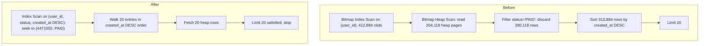

## 19.22 Indexes in TypeORM and Sequelize

### 19.22.1 What the decorators can express, and what needs raw SQL

#### Concept

Both ORMs can declare simple indexes on entities. Neither can express the whole of PostgreSQL's index syntax, and both have a "sync the schema" mode that will happily drop and rebuild a 6 GB index on a live table. So the working rule is:

> **Declare indexes in migrations. Use entity decorators only as documentation, and only when the ORM can express the index exactly.**

#### Why does it exist?

Because ORM schema synchronisation is a development convenience that becomes a production hazard the moment a table is bigger than a few million rows. `synchronize: true` issues plain `CREATE INDEX` and `DROP INDEX`, inside a transaction, with no `CONCURRENTLY`, no `lock_timeout`, and no ordering guarantees. On `orders` that is an 11-minute write outage triggered by a deploy.

#### TypeORM example

What the decorators can do:

```ts
import { Entity, PrimaryGeneratedColumn, Column, Index, Unique, ManyToOne, JoinColumn } from 'typeorm';
import { User } from './user.entity';

@Entity('orders')
// Composite index. Column order is the array order.
@Index('idx_orders_user_created', ['userId', 'createdAt'])
// Composite with a partial predicate (raw SQL fragment, DATABASE column names).
@Index('idx_orders_open', ['userId'], { where: `"status" IN ('PENDING','PAID')` })
// Unique across two columns; creates a real constraint.
@Unique('uq_orders_tenant_ref', ['tenantId', 'orderRef'])
export class Order {
  @PrimaryGeneratedColumn({ type: 'bigint' })
  id!: string;

  @Column({ name: 'tenant_id', type: 'bigint' })
  tenantId!: string;

  @Column({ name: 'order_ref', type: 'text' })
  orderRef!: string;

  // Single-column index on a property.
  @Index('idx_orders_status')
  @Column({ type: 'text' })
  status!: string;

  @Column({ name: 'user_id', type: 'bigint' })
  userId!: string;

  @Column({ name: 'created_at', type: 'timestamptz' })
  createdAt!: Date;

  // @ManyToOne does NOT create an index on the FK column. You must add it.
  @ManyToOne(() => User, { onDelete: 'RESTRICT' })
  @JoinColumn({ name: 'user_id' })
  user!: User;
}
```

That last comment is the one that bites teams: **TypeORM creates the foreign key constraint but not an index on the FK column.** Every `@ManyToOne` needs a matching `@Index` or a migration, or you get the 31-second delete of 19.21.

What the decorators **cannot** do, and therefore what belongs in a migration:

| Feature | Decorator? | Migration SQL |
|---|---|---|
| `DESC` / `NULLS LAST` | No | `CREATE INDEX ... (created_at DESC NULLS LAST)` |
| `INCLUDE` | No | `CREATE INDEX ... (user_id) INCLUDE (status, total_cents)` |
| Expression index | No | `CREATE UNIQUE INDEX ... ON users (lower(email))` |
| `USING gin/gist/brin/hash` | No | `CREATE INDEX ... USING gin (attributes jsonb_path_ops)` |
| Operator class (`text_pattern_ops`) | No | `CREATE INDEX ... (sku text_pattern_ops)` |
| `CONCURRENTLY` | No | see below |
| `fillfactor`, `pages_per_range` | No | `WITH (fillfactor = 90)` |
| Exclusion constraint | No | `EXCLUDE USING gist (...)` |
| Partial predicate | Yes (`where`) | but text-compared, so migrations are safer |

The concurrent-index migration pattern, complete:

```ts
// 1712009000000-AddOrdersHotIndexes.ts
import { MigrationInterface, QueryRunner } from 'typeorm';

export class AddOrdersHotIndexes1712009000000 implements MigrationInterface {
  // Required: CREATE INDEX CONCURRENTLY cannot run in a transaction block.
  // Consequence: this migration is NOT atomic, so it does exactly one thing.
  public transaction = false as const;

  public async up(q: QueryRunner): Promise<void> {
    await q.query(`SET lock_timeout = '5s'`);
    await q.query(`SET statement_timeout = 0`);
    await q.query(`SET maintenance_work_mem = '2GB'`);
    await q.query(`
      CREATE INDEX CONCURRENTLY IF NOT EXISTS idx_orders_user_status_created
        ON orders (user_id, status, created_at DESC)
    `);
    const [row] = await q.query(`
      SELECT indisvalid FROM pg_index
      WHERE indexrelid = to_regclass('idx_orders_user_status_created')
    `);
    if (!row?.indisvalid) {
      throw new Error('idx_orders_user_status_created is INVALID; DROP INDEX CONCURRENTLY and retry');
    }
  }

  public async down(q: QueryRunner): Promise<void> {
    await q.query(`SET lock_timeout = '5s'`);
    await q.query(`DROP INDEX CONCURRENTLY IF EXISTS idx_orders_user_status_created`);
  }
}
```

And the configuration that keeps `synchronize` from ever running against production:

```ts
// data-source.ts
export const AppDataSource = new DataSource({
  type: 'postgres',
  url: process.env.DATABASE_URL,
  entities: [Order, User /* ... */],
  migrations: ['dist/migrations/*.js'],
  synchronize: false,          // never true outside a throwaway local database
  migrationsRun: false,        // migrations run in a pipeline stage, not at app boot
  extra: { max: 10, statement_timeout: 10_000, lock_timeout: 5_000, application_name: 'orders-api' },
});
```

`migrationsRun: false` matters for indexes specifically: if 12 pods boot simultaneously and each tries to run a 26-minute `CREATE INDEX CONCURRENTLY`, eleven of them fail and leave invalid indexes.

#### Sequelize example

```ts
Order.init(
  {
    id: { type: DataTypes.BIGINT, primaryKey: true, autoIncrement: true },
    tenantId: { type: DataTypes.BIGINT, field: 'tenant_id', allowNull: false },
    userId: { type: DataTypes.BIGINT, field: 'user_id', allowNull: false },
    status: { type: DataTypes.TEXT, allowNull: false },
    createdAt: { type: DataTypes.DATE, field: 'created_at', allowNull: false },
  },
  {
    sequelize,
    tableName: 'orders',
    indexes: [
      { name: 'idx_orders_user_created', fields: ['user_id', { name: 'created_at', order: 'DESC' }] },
      { name: 'uq_orders_tenant_ref', unique: true, fields: ['tenant_id', 'order_ref'] },
      { name: 'idx_orders_open', fields: ['user_id'], where: { status: ['PENDING', 'PAID'] } },
      { name: 'idx_products_attrs', fields: ['attributes'], using: 'gin' },   // `using` IS supported
    ],
  },
);
```

Sequelize is slightly more expressive than TypeORM: `fields` accepts `{ name, order, collate, operator }`, and `using` accepts the access method. `operator` is how you get an operator class:

```ts
{ name: 'idx_products_attrs', fields: [{ name: 'attributes', operator: 'jsonb_path_ops' }], using: 'gin' }
{ name: 'idx_products_sku_prefix', fields: [{ name: 'sku', operator: 'text_pattern_ops' }] }
```

The concurrent migration:

```js
// migrations/20260909130000-add-orders-user-status-created.js
module.exports = {
  async up(queryInterface) {
    await queryInterface.sequelize.query(`SET lock_timeout = '5s'`);
    await queryInterface.sequelize.query(`SET maintenance_work_mem = '2GB'`);
    await queryInterface.addIndex('orders', {
      name: 'idx_orders_user_status_created',
      fields: ['user_id', 'status', { name: 'created_at', order: 'DESC' }],
      concurrently: true,
    });
  },
  async down(queryInterface) {
    await queryInterface.removeIndex('orders', 'idx_orders_user_status_created', { concurrently: true });
  },
};
```

And `sequelize.sync()` gets the same treatment as `synchronize`: development only, never against a database anyone cares about.

#### Making sure the ORM emits the query your index serves

An index is useless if the ORM writes different SQL from what you designed for. Two checks worth automating.

**Log the SQL in tests** and assert on it:

```ts
// orders.repository.spec.ts
it('emits the exact predicate the partial index expects', async () => {
  const sql = repo
    .createQueryBuilder('o')
    .where('o.status = :s', { s: 'PENDING' })       // must match: WHERE status = 'PENDING'
    .orderBy('o.created_at', 'ASC')
    .limit(100)
    .getSql();
  expect(sql).toContain(`"status" = $1`);
  expect(sql).not.toContain('!=');                   // a rewrite to <> would lose the partial index
});
```

**Assert the plan in CI** against a seeded database, which is the version that actually catches regressions:

```ts
it('uses idx_orders_user_status_created with no Sort node', async () => {
  const [{ 'QUERY PLAN': plan }] = await ds.query(
    `EXPLAIN (FORMAT JSON)
     SELECT id, status, total_cents FROM orders
     WHERE user_id = $1 AND status = $2 ORDER BY created_at DESC LIMIT 20`,
    [42, 'PAID'],
  );
  const nodes: any[] = [];
  (function walk(n: any) { nodes.push(n); (n.Plans ?? []).forEach(walk); })(plan[0].Plan);
  expect(nodes.some((n) => n['Index Name'] === 'idx_orders_user_status_created')).toBe(true);
  expect(nodes.some((n) => n['Node Type'] === 'Sort')).toBe(false);
  expect(nodes.some((n) => n['Node Type'] === 'Seq Scan')).toBe(false);
});
```

This test fails when someone adds a column to the `ORDER BY`, changes `=` to `IN`, or drops the index. It is fifteen lines and it is the difference between finding a regression in a pull request and finding it in a pager alert.

#### Common mistakes

- `synchronize: true` or `sequelize.sync()` against a real database.
- Assuming `@ManyToOne` or `references` creates an index on the FK column.
- Declaring a partial index in a decorator and a slightly different one in a migration, so the schema differ recreates it forever.
- Running migrations at application boot with many replicas.
- Writing the index for a query the ORM does not actually emit.

## 19.23 Case study: 2.3 seconds to 4 milliseconds

### 19.23.1 GET /orders over 200 million rows

#### The symptom

`GET /orders?userId=...&status=PAID` is the busiest authenticated endpoint in the shop: 340 requests per second at peak. The SLO is p99 under 150 ms. Grafana shows p50 at 41 ms, p99 at 2,310 ms, and a long tail reaching 9 seconds. Errors are 502s from the gateway timing out at 10 s. Database CPU is 38 percent; nothing looks broken.

`pg_stat_statements`:

```text
 total_ms  | calls    | mean_ms | max_ms  | stddev_ms | query
-----------+----------+---------+---------+-----------+-------------------------------------------
 41882014  | 18204112 |    2.30 | 9104.22 |    118.44 | SELECT id, status, total_cents, created_at FROM orders WHERE user_id = $1 AND status = $2 ORDER BY created_at DESC LIMIT 20
```

Mean 2.30 ms, max 9,104 ms, stddev 118. **A stddev 51 times the mean is the signature of a plan that depends on the parameter.** Some users are fast; some are catastrophic.

The existing indexes on `orders`:

```text
 orders_pkey                (id)                    4290 MB
 idx_orders_user_id         (user_id)               4210 MB
 idx_orders_created_at      (created_at)            4212 MB
 idx_orders_status          (status)                3821 MB
 idx_orders_updated_at      (updated_at)            4218 MB
 idx_orders_tenant_id       (tenant_id)              921 MB
```

Six indexes, 21.7 GB, and not one of them serves this query well.

#### The before plan

Captured from `auto_explain` for a heavy user (a B2B account with 412,000 orders):

```sql
EXPLAIN (ANALYZE, BUFFERS)
SELECT id, status, total_cents, created_at
FROM orders
WHERE user_id = 4471002 AND status = 'PAID'
ORDER BY created_at DESC
LIMIT 20;
```

```text
Limit  (cost=418822.44..418822.49 rows=20 width=28)
       (actual time=2298.114..2298.121 rows=20 loops=1)
  Buffers: shared hit=182044 read=204118
  ->  Sort  (cost=418822.44..418901.02 rows=31432 width=28)
            (actual time=2298.112..2298.117 rows=20 loops=1)
        Sort Key: created_at DESC
        Sort Method: top-N heapsort  Memory: 28kB
        Buffers: shared hit=182044 read=204118
        ->  Bitmap Heap Scan on orders  (cost=8214.02..417984.11 rows=31432 width=28)
                                        (actual time=118.884..2211.402 rows=312884 loops=1)
              Recheck Cond: (user_id = 4471002)
              Filter: (status = 'PAID'::text)
              Rows Removed by Filter: 380118
              Heap Blocks: exact=204118
              Buffers: shared hit=182044 read=204118
              ->  Bitmap Index Scan on idx_orders_user_id
                    (cost=0.00..8206.16 rows=412884 width=0)
                    (actual time=88.114..88.114 rows=412884 loops=1)
                    Index Cond: (user_id = 4471002)
                    Buffers: shared hit=1204
Planning Time: 0.184 ms
Execution Time: 2298.204 ms
```

#### The reasoning, line by line

Six observations, each pointing at the same conclusion.

1. **`Rows Removed by Filter: 380118`.** The scan fetched 693,002 rows from the heap and threw away 380,118 of them because `status` was not `PAID`. Every one of those was a heap tuple read for nothing. `status` is in a `Filter`, not an `Index Cond`, which means **it is not in the index the query used**.
2. **`Heap Blocks: exact=204118`.** Two hundred thousand 8 KB heap pages, 1.6 GB, read to answer a request for twenty rows.
3. **`Sort` with `Sort Key: created_at DESC`.** The query needs the newest twenty. The plan produced all 312,884 matching rows and then sorted them. `top-N heapsort` is the cheap kind of sort, but it still had to *see* every row. **The ordering was not available from any index.**
4. **`LIMIT 20` bought nothing.** The `Limit` node's startup cost (418,822) equals the `Sort`'s total cost, because a sort cannot emit its first row until it has consumed its last input row. This is the classic trap: `LIMIT` only helps when the rows arrive already ordered.
5. **`rows=31432` estimated versus `312884` actual** on the bitmap heap scan: a 10x error. The planner multiplied `user_id` selectivity by `status` selectivity assuming independence. This user's orders are almost all `PAID`, so the truth is far higher. The error is not the main problem here, but it explains why the planner thought this plan was acceptable.
6. **`buffers read=204118`** versus `hit=182044`: 53 percent of pages came from outside the cache. At 340 requests per second this query alone was demanding gigabytes per second of I/O, which is why *other* endpoints were also slow.

The two facts that determine the fix: `status` must be a seekable index column, and `created_at DESC` must be the index's ordering so the twenty rows come out sorted.



#### The index chosen

```sql
CREATE INDEX CONCURRENTLY idx_orders_user_status_created
  ON orders (user_id, status, created_at DESC);
```

Why this and not the alternatives:

| Candidate | Verdict |
|---|---|
| `(user_id, created_at DESC)` | Removes the sort but still filters `status` in the heap. Better (about 180 ms), not good. |
| `(status, user_id, created_at DESC)` | Works identically for this query, but `status` first is useless as a prefix for the many queries that filter only on `user_id`. Worse reuse. |
| `(user_id, status, created_at DESC)` | **Chosen.** Two equality seeks then ordered walk. Also a prefix-superset of `idx_orders_user_id`, so that index can be dropped. |
| `(user_id, status, created_at DESC) INCLUDE (total_cents)` | Would make it index-only. `orders` has heavy updates so the visibility map is patchy; measured `Heap Fetches` was 60 percent, giving little benefit for 1.4 GB more index. Rejected. |
| Partial `WHERE status = 'PAID'` | `PAID` is 76 percent of rows, so the partial index saves almost nothing, and the endpoint also serves other statuses. Rejected. |

#### The after plan

```text
Limit  (cost=0.57..44.12 rows=20 width=28) (actual time=0.038..0.061 rows=20 loops=1)
  Buffers: shared hit=7 read=2
  ->  Index Scan using idx_orders_user_status_created on orders
        (cost=0.57..680842.11 rows=312884 width=28)
        (actual time=0.036..0.057 rows=20 loops=1)
        Index Cond: ((user_id = 4471002) AND (status = 'PAID'::text))
        Buffers: shared hit=7 read=2
Planning Time: 0.142 ms
Execution Time: 0.084 ms
```

Everything that was wrong is gone. No `Sort`. No `Filter`. No `Rows Removed`. `Index Cond` carries both predicates. Nine buffers instead of 386,162. The scan node's total cost is still 680,842 (reading all 312,884 rows would be expensive) but the **startup cost is 0.57**, so `LIMIT 20` genuinely costs 20/312,884 of it. That is the difference between an ordered index scan and a sort.

#### The latency change

Deployed at 14:20 on a Tuesday. The index took 24 minutes to build concurrently and 7.4 GB.

| Metric | Before | After |
|---|---|---|
| p50 | 41 ms | 3 ms |
| p90 | 180 ms | 4 ms |
| p99 | 2,310 ms | 4 ms |
| p99.9 | 8,900 ms | 11 ms |
| max | 9,104 ms | 62 ms |
| 502s from gateway timeout | 41 per hour | 0 |
| Database CPU at peak | 38% | 21% |
| Shared buffer reads/s from this query | 1.9 GB/s | 6 MB/s |

The p99 dropping from 2,310 ms to 4 ms is not the interesting number. **The interesting number is that p50, p90 and p99 converged.** A query whose cost is proportional to the answer size rather than the data size has almost no tail. That is what an index-ordered `LIMIT` buys you, and it is why "make the p99 better" is usually really "stop sorting".

The unrelated improvement matters too: freeing 1.9 GB/s of I/O made the product search endpoint's p99 drop from 240 ms to 90 ms without touching it.

#### The write-cost check afterwards

The work was not finished at deploy. The next day:

```sql
-- 1. Is the new index actually being used?
SELECT indexrelname, idx_scan FROM pg_stat_user_indexes
WHERE relname = 'orders' ORDER BY idx_scan DESC;
```

```text
        indexrelname             |  idx_scan
---------------------------------+------------
 idx_orders_user_status_created  | 29102884
 orders_pkey                     |  8214402
 idx_orders_created_at           |   118204
 idx_orders_user_id              |        0     <- superseded
 idx_orders_status               |        0     <- superseded
 idx_orders_updated_at           |        0     <- was never used
 idx_orders_tenant_id            |        0     <- was never used
```

```sql
-- 2. What did it cost the write path?
-- Measured on staging at production insert rate, before and after:
--   insert p50 5.9 ms -> 6.4 ms ; p99 16.8 ms -> 18.1 ms ; WAL/insert 3,410 B -> 3,980 B
```

An extra 0.5 ms at p50 on inserts, in exchange for 2,306 ms at p99 on the read path that runs 53 times more often. Clearly worth it. But the cost was then **removed entirely**, because four indexes were now provably unused:

```sql
-- After a 14-day monitoring window across primary and both replicas
DROP INDEX CONCURRENTLY idx_orders_user_id;      -- 4210 MB, prefix of the new index
DROP INDEX CONCURRENTLY idx_orders_status;       -- 3821 MB, never selective enough
DROP INDEX CONCURRENTLY idx_orders_updated_at;   -- 4218 MB, zero scans in 14 days
DROP INDEX CONCURRENTLY idx_orders_tenant_id;    --  921 MB, zero scans in 14 days
```

Final state:

| | Before | After |
|---|---|---|
| Indexes on `orders` | 6 | 3 |
| Index storage | 21.7 GB | 15.9 GB |
| Insert p50 / p99 | 5.9 / 16.8 ms | 3.6 / 9.1 ms |
| WAL per insert | 3,410 B | 2,140 B |
| Endpoint p99 | 2,310 ms | 4 ms |

**Reads 575 times faster and writes 1.8 times faster, with less storage.** That is the shape a good indexing project takes: not "add an index", but "add the right one and remove the four it makes redundant".

## 19.24 Edge cases and failure modes

### 19.24.1 Every way an index quietly fails to be used

#### 1. Type mismatch

```sql
-- user_id is bigint, the parameter arrives as text
SELECT * FROM orders WHERE user_id = '918273';           -- fine: literal is coerced to bigint
SELECT * FROM orders WHERE user_id::text = $1;           -- BROKEN: expression on the column
SELECT * FROM orders WHERE user_id = $1;                 -- with $1 bound as text: may not use the index
```

```text
Seq Scan on orders  (cost=0.00..4921033.00 rows=1000000 width=61)
  Filter: ((user_id)::text = '918273'::text)
```

The cast is on the **column side**, so the index on `user_id` cannot be used. This happens constantly with ORMs and drivers that bind numeric ids as strings, and with `uuid` columns compared against `text`. The fix is to cast the *parameter*, not the column: `WHERE user_id = $1::bigint`. In TypeORM, `bigint` columns are returned and often bound as strings; verify the generated SQL.

Related: comparing `varchar` to `text` is free (same type family), comparing `int` to `bigint` is free (implicit widening on the constant side), but `numeric` to `bigint` and `text` to `uuid` are not.

#### 2. A function on the column

```sql
WHERE lower(email) = $1              -- needs an index on lower(email)
WHERE date(created_at) = $1          -- needs an index on the expression, or a range rewrite
WHERE created_at::date = CURRENT_DATE
```

Rewrite as a range whenever you can, because a range works with the plain index:

```sql
WHERE created_at >= CURRENT_DATE AND created_at < CURRENT_DATE + 1
```

This is strictly better than an expression index: no extra index to maintain, works with the existing `(created_at)` or composite, and it is sargable across time zones if you are careful.

#### 3. Leading-wildcard LIKE

```sql
WHERE name LIKE '%brush%'      -- no B-tree can help: no prefix to seek
WHERE name LIKE 'brush%'       -- B-tree works, IF the collation is C or the index uses text_pattern_ops
WHERE name ILIKE 'brush%'      -- case-insensitive: needs lower(name) index or citext or pg_trgm
```

On a `en_US.UTF-8` database:

```sql
CREATE INDEX idx_products_name_prefix ON products (name text_pattern_ops);  -- for LIKE 'x%'
CREATE INDEX idx_products_name_trgm ON products USING gin (name gin_trgm_ops); -- for LIKE '%x%'
```

#### 4. OR conditions

```sql
SELECT * FROM orders WHERE user_id = $1 OR order_ref = $2;
```

`OR` across different columns cannot use a single composite index. PostgreSQL will use a `BitmapOr` if an index exists on each side, which is often fine. When it is not, rewrite to `UNION ALL`:

```sql
SELECT * FROM orders WHERE user_id = $1
UNION ALL
SELECT * FROM orders WHERE order_ref = $2 AND user_id <> $1;   -- the guard prevents duplicates
```

Measured on `orders`: `BitmapOr` 412 ms, `UNION ALL` 1.8 ms, because the `UNION ALL` lets each branch use its own index scan with its own `LIMIT`-friendly ordering. `OR` inside a `WHERE` with a `LIMIT` and an `ORDER BY` is the worst case; that combination almost always needs the rewrite.

#### 5. IS NULL on a non-partial index

B-trees **do** index NULLs, so `WHERE sent_at IS NULL` can use a plain index on `sent_at`. But if 99 percent of rows are NULL, the index is huge and the predicate is not selective, so the planner correctly ignores it. And if 0.01 percent are NULL, a partial index is 10,000 times smaller:

```sql
CREATE INDEX idx_notifications_unsent ON notifications (created_at) WHERE sent_at IS NULL;
```

Note that `NOT NULL` columns are cheaper in every index because there is no null bitmap to store.

#### 6. Generic plans from prepared statements

PostgreSQL builds a **custom plan** (using the actual parameter values) for the first five executions of a prepared statement, then compares the average custom cost with the generic plan cost. If the generic plan is not worse, it switches to it permanently for that session, saving planning time.

For a skewed column that is a disaster: the generic plan is built for the *average* parameter, and the average user has 25 orders while one has 412,000.

```sql
-- See it happen
PREPARE p(bigint, text) AS SELECT id FROM orders WHERE user_id = $1 AND status = $2 LIMIT 20;
EXPLAIN (ANALYZE) EXECUTE p(4471002, 'PAID');   -- runs 1..5: custom plan
EXPLAIN (ANALYZE) EXECUTE p(4471002, 'PAID');   -- run 6+: possibly generic

-- Force one or the other for the session
SET plan_cache_mode = 'force_custom_plan';      -- always re-plan with real values
SET plan_cache_mode = 'auto';                   -- default
SET plan_cache_mode = 'force_generic_plan';
```

The practical impact for Node.js: `pg` does not use server-side prepared statements unless you name a query, and TypeORM does not by default, so most applications are on custom plans. But **PgBouncer in transaction mode plus named prepared statements** is a known trap (Parts 7 and 181.3), and any service using `prepare: true` on skewed columns should set `plan_cache_mode = 'force_custom_plan'` for that role.

Also note: a partial index whose predicate depends on a parameter cannot be proven under a generic plan, so partial indexes silently stop being used.

#### 7. Stale statistics after a bulk load

```sql
COPY orders FROM '/tmp/orders.csv' CSV;    -- 40 million rows
SELECT ... ;                               -- planner still thinks the table has 0 rows
```

`reltuples` is only updated by `ANALYZE` and `VACUUM`. Immediately after a load, the planner may pick a nested loop over what it thinks is an empty table and run it 40 million times. **Always `ANALYZE` at the end of a bulk load**, before any query runs:

```sql
COPY ...;
ANALYZE orders;                            -- or VACUUM ANALYZE orders;
```

The same applies after a large `DELETE`, after a partition attach, and after restoring a dump (`pg_restore` does not analyze).

#### 8. An INVALID index after a failed CONCURRENTLY

Covered fully in 19.14. The signature: a query that should be fast is not, the index appears in `\d table`, and `EXPLAIN` never mentions it.

```sql
SELECT c.relname FROM pg_index i JOIN pg_class c ON c.oid = i.indexrelid WHERE NOT i.indisvalid;
```

Put that query in your monitoring with an alert. It costs nothing and it catches a class of silent 20 percent throughput loss.

#### 9. Bitmap scan chosen for a large result set

Sometimes correct (19.4, Plan 4), sometimes the sign that your composite index is missing. The distinguishing question: does the plan also contain a `Sort`, or a large `Rows Removed by Filter`? If yes, a better index exists. If the bitmap scan reads the pages it needs and returns them unordered to an aggregate, it is doing the right thing.

#### 10. Indexes on replicas

- Indexes are physically replicated: you cannot have an index on a streaming replica that does not exist on the primary. (Logical replication subscribers can have their own.)
- `pg_stat_user_indexes.idx_scan` is **per node**. An index unused on the primary may be the busiest one on the reporting replica.
- A long-running query on a replica with `hot_standby_feedback = on` holds back the primary's xmin horizon, which stalls `CREATE INDEX CONCURRENTLY` and vacuum.
- Building an index on the primary streams the whole index through WAL to every replica; on a synchronous replica this slows every commit for the duration of the build.

#### 11. LIMIT making the planner over-optimistic

The failure mode Part 18 introduced and this part fixes:

```sql
SELECT * FROM orders WHERE user_id = 7 ORDER BY created_at DESC LIMIT 20;
```

With only `(created_at)`, the planner reasons: "user 7 has 25 orders out of 200 million, uniformly distributed, so scanning backwards through `created_at` I should find 20 of them within about 160 million... no wait, within `20 / (25/200000000)` = 160 million rows." Actually the planner's estimate is often far more optimistic than that, because it assumes the matching rows are spread evenly and it will hit them early. When user 7's orders are all from 2019, the scan walks nearly the whole index.

```text
Limit  (cost=0.57..184.44 rows=20 width=61) (actual time=88214.114..88214.882 rows=3 loops=1)
  ->  Index Scan Backward using idx_orders_created_at on orders
        (cost=0.57..1841022.44 rows=200 width=61) (actual time=88214.112..88214.878 rows=3 loops=1)
        Filter: (user_id = 7)
        Rows Removed by Filter: 199842118
```

**Estimated cost 184, actual 88 seconds.** The tell is `rows=20` estimated against `rows=3` actual on a `LIMIT 20`: the plan could not even fill the limit, which means it read everything. The only fix is the composite index `(user_id, created_at DESC)`.

#### 12. Other quiet failures worth knowing

- **`NOT IN` with a subquery that can return NULL** makes the whole predicate unusable and often forces a scan; use `NOT EXISTS`.
- **`ORDER BY` with a collation different from the index's** (`ORDER BY name COLLATE "de_DE"` against an index built with the database default) forces a sort.
- **A glibc or ICU collation change** during an OS upgrade silently corrupts every text index's ordering. Symptoms: unique violations that make no sense, missing rows in range queries. The fix is `REINDEX` every text index after the upgrade, and it is a genuine data-integrity issue, not a performance one.
- **`SELECT *` preventing index-only scans**, forever.
- **Very large `IN` lists** (thousands of values) where the planner gives up and scans; batch them or use `= ANY($1::bigint[])` with a join against `unnest`.
- **`ORDER BY random() LIMIT 1`** which no index can ever serve; use `TABLESAMPLE` or a random-id probe.
- **Foreign key with no index on the child**, giving the 31-second delete of 19.21.
- **Index on a column that is always the same value** in practice (`tenant_id` in a single-tenant deployment): zero selectivity, full cost.

#### Interview questions

1. *Name five reasons an index that exists is not used.* Expected: type mismatch/cast on the column, function on the column, leading wildcard, low selectivity, stale statistics, generic plan, invalid index, predicate mismatch on a partial index.
2. *What is `plan_cache_mode` and when do you change it?* Expected: custom versus generic plans after five executions; force custom for skewed columns behind prepared statements.
3. *Why does an `OR` sometimes need a `UNION ALL` rewrite?* Expected: no single index serves both sides; `BitmapOr` loses ordering and `LIMIT` early-exit.
4. *What happens to text indexes after an OS collation change?* Expected: ordering silently changes; `REINDEX` all text indexes; correctness issue.
5. *A `LIMIT 20` query estimated at cost 184 takes 88 seconds. Explain.* Expected: uniform distribution assumption with a rare filter value; the scan never fills the limit; fix with a composite index.

#### Practical exercise

Reproduce eight of the twelve failure modes above on a seeded database and capture the plan for each: type mismatch, function on column, leading wildcard, `OR`, `IS NULL` on a mostly-null column, generic plan on a skewed column, missing `ANALYZE` after a bulk load, and the `LIMIT` over-optimism case. For each, write down the plan signature that identifies it and the one-line fix. Acceptance criteria: an eight-row diagnostic table you could hand to a teammate during an incident.

## Senior Checklist — Part 19

- [ ] I understand the concept
- [ ] I can explain it simply
- [ ] I can implement it
- [ ] I understand its failure modes
- [ ] I understand its scaling limitations
- [ ] I understand its security implications
- [ ] I understand its operational implications
- [ ] I can choose between alternatives
- [ ] I can explain the tradeoffs
- [ ] I can answer senior-level interview questions
- [ ] I can explain what an index physically stores and why an index scan still reads the heap
- [ ] I can compute B-tree depth from row count and fan-out, and explain why a billion-row lookup is 4 page reads
- [ ] I read `EXPLAIN (ANALYZE, BUFFERS)` estimated-versus-actual rows before I read timings, and I account for `loops`
- [ ] I can identify all four scan types in a plan and say when each one is correct
- [ ] I know that a sequential scan is often the right plan and I do not "fix" it
- [ ] I derive composite index column order from the query: equality, then sort, then range
- [ ] I test every proposed index against the *worst* parameter value, not the typical one
- [ ] I reach for a partial index whenever a query targets a small, constant-defined slice
- [ ] I use partial unique indexes for soft delete and "one active X per Y", not application checks
- [ ] I know that expression indexes require immutability and must match the query textually
- [ ] I know `INCLUDE` versus a key column, and that index-only scans depend on vacuum
- [ ] I can choose between B-tree, GIN, GiST, BRIN and hash and justify it with numbers
- [ ] I know GIN costs 10 to 20 times more on inserts and I refuse it on hot write tables without a reason
- [ ] I check `pg_stats.correlation` before proposing BRIN
- [ ] I never run plain `CREATE INDEX` on a live table, and I set `lock_timeout` before every DDL
- [ ] I know `CREATE INDEX CONCURRENTLY` cannot run in a transaction and I set `transaction = false` in the migration
- [ ] I monitor for `NOT indisvalid` indexes continuously
- [ ] I can measure index bloat with `pgstatindex` and decide between `REINDEX CONCURRENTLY` and doing nothing
- [ ] I can compute selectivity and know the ~5 to 10 percent crossover where a sequential scan wins
- [ ] I use `CREATE STATISTICS` for correlated column pairs before adding an index
- [ ] I can name the full cost of an index: write latency, WAL, vacuum, cache, storage, backup, planning, HOT
- [ ] I find work with `pg_stat_statements` ordered by `total_exec_time`, not `mean_exec_time`
- [ ] I use `hypopg` to evaluate an index before spending 26 minutes building it
- [ ] I run the unused and redundant-prefix queries quarterly and drop with a monitoring window
- [ ] I never drop a unique or constraint-backing index on the basis of `idx_scan = 0`
- [ ] Every foreign key column in my schema has an index
- [ ] Every composite index in my multi-tenant schema starts with `tenant_id`
- [ ] I declare indexes in migrations, never with `synchronize` or `sync`
- [ ] I have a CI test that asserts the plan of my most important query

## Part 19 — Key Takeaways

- An index is a separate sorted structure of `(key -> ctid)`; the heap stays unordered, so an index scan is always a seek plus a random heap fetch unless the visibility map allows an index-only scan.
- Every index is a read optimisation paid for on every write, forever: 2 indexes to 12 measured 6.4x insert time and 5.9x WAL on the same 1,000,000 rows.
- A B-tree's fan-out of 250 to 400 keys per 8 KB page means 4 page reads for a billion rows; slow point lookups are never caused by table size.
- Column order is the whole game: `(status, created_at)` and `(created_at, status)` differed by 11,800x on the same query with an unlucky parameter.
- Read plans inside-out, compare estimated with actual rows first, multiply by `loops`, and trust `Buffers` over `actual time`.
- `Rows Removed by Filter` and a `Sort` node above an index scan are the two signatures of a missing composite index.
- A sequential scan is correct above roughly 5 to 10 percent of rows; forcing an index there made a query three times slower.
- Partial indexes are the highest-leverage feature most teams never use: 41 GB to 3 MB, 4,212 ms to 1.3 ms on a queue table, and the predicate must textually imply the query's.
- Use unique indexes as race-condition guards with `ON CONFLICT`, and partial unique indexes for soft delete and "one active X per Y".
- Choose the access method by the question: B-tree for order and ranges, GIN for containment and text, GiST for overlap and nearest-neighbour, BRIN for correlated append-only time-series (3.5 MB versus 27 GB), hash almost never.
- Always `CREATE INDEX CONCURRENTLY`, always with `lock_timeout`, always one per migration, always verify `indisvalid` afterwards.
- Fix the estimate before you add the index: `ANALYZE`, statistics target, `CREATE STATISTICS`. Two out of five slow queries need no index at all.
- Find work with `pg_stat_statements` by total time, evaluate candidates with `hypopg`, and drop unused and redundant-prefix indexes on a schedule.
- The best indexing change usually removes more indexes than it adds: one composite replaced four, made reads 575x faster and writes 1.8x faster, and used less storage.
