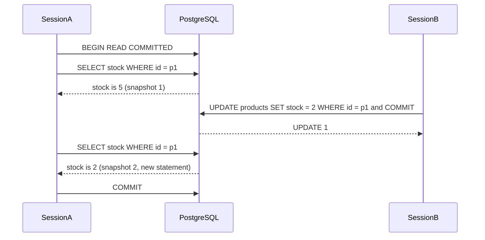

# Part 20 — Database Transactions and Concurrency Control

Every backend bug that costs real money has the same shape: two things happened at the same time and the code assumed they would not. Two customers bought the last unit. Two workers picked up the same job. A payment was recorded but the order was not. A commit was acknowledged and then vanished when the disk lost power.

Transactions are the database's answer to "at the same time". They are also the most misunderstood tool in the backend developer's kit, because they *look* simple (`BEGIN` ... `COMMIT`) while hiding a lot of machinery: snapshots, row versions, locks, wait queues, deadlock detection, write-ahead logs and fsync calls. This part opens that machinery up. Every example is PostgreSQL, and wherever it matters we show two sessions side by side so you can see exactly what each one observes at each step. Then we map all of it onto TypeORM and Sequelize inside NestJS, including the mistakes that appear in almost every codebase we have reviewed.

Keep the senior mantra next to you while reading: *Can it timeout? Can it fail? Can it become slow? Can it duplicate? Can it return a wrong response? Can it partially succeed?* Transactions exist to answer the last two.

## 20.1 ACID — the four promises

#### Concept

A transaction is a group of reads and writes that the database treats as one unit. ACID is the list of promises the database makes about that unit:

- **Atomicity** — all of the writes happen, or none of them do. There is no "half".
- **Consistency** — the transaction moves the database from one valid state to another valid state. "Valid" is defined by your constraints: primary keys, foreign keys, `CHECK`, `UNIQUE`, `NOT NULL`, exclusion constraints, and triggers.
- **Isolation** — concurrent transactions do not see each other's half-finished work. How strictly this is enforced is configurable (the *isolation level*, section 20.2).
- **Durability** — once the database says "committed", the data survives a crash, a power cut or a kernel panic.

#### Why does it exist?

Without atomicity, a crash in the middle of "create order, decrement stock, record payment" leaves a paid order with no stock reserved, or reserved stock with no order. Without consistency, application code becomes the only guard against negative stock, and application code has bugs. Without isolation, a report that sums balances while a transfer is in flight prints money that does not exist. Without durability, "your order is confirmed" is a lie the database tells before the bytes are on disk.

Each of these has a real incident behind it. Let us tell four.

#### Mental model

Imagine a bank teller processing a transfer on paper. She writes "minus 500 from account A" and "plus 500 to account B" on the same slip, and the slip goes into the ledger only when both lines are written and she has stamped it. If the pen runs dry after the first line, the slip is torn up and nothing happened (atomicity). The ledger has a rule printed on the cover: "no account may go below zero", and she checks it before stamping (consistency). While she is writing, other tellers cannot peek at her slip; they only see the ledger, which still shows the old balances (isolation). Once stamped, the slip is copied to the vault log before she tells the customer "done", so even if the office burns down tonight the transfer is in the vault (durability).

#### How it works

1. `BEGIN` opens a transaction. PostgreSQL assigns a transaction id (`xid`) lazily, at the first write.
2. Every row version written carries the `xid` that created it (`xmin`) and, when deleted or replaced, the `xid` that ended it (`xmax`). This is MVCC: multi-version concurrency control. Old versions are not overwritten in place; new versions are appended and old ones are cleaned up later by `VACUUM`.
3. Reads use a *snapshot*: a record of which transaction ids were committed at the moment the snapshot was taken. A row version is visible if its `xmin` is committed in the snapshot and its `xmax` is not.
4. Writes take a row-level lock on the row version they modify. A second writer of the same row waits.
5. Constraints are checked as each statement runs (immediate constraints) or at commit (deferred constraints).
6. `COMMIT` writes a commit record to the write-ahead log (WAL), flushes the WAL to disk (`fsync`), then marks the `xid` as committed in the commit log (`pg_xact`). Only after the flush does the client receive "COMMIT".
7. `ROLLBACK` marks the `xid` as aborted. Row versions it created become invisible to everyone; nothing needs to be "undone" on disk.

Notice step 7: PostgreSQL rollback is cheap because MVCC never overwrote anything. The cost is paid later by `VACUUM`, which removes the dead versions.

#### Practical example — four incidents

**Atomicity: the partial order.** A checkout handler did three awaited calls without a transaction: `INSERT INTO orders`, then `INSERT INTO order_items` in a loop, then `UPDATE products SET stock = stock - qty`. A pod was killed by the Kubernetes scheduler (OOMKilled) between the second and third step. Result: an order with items but no stock decrement, sold again ten minutes later to another customer. With `BEGIN ... COMMIT` around all three, the kill would have left an aborted transaction and no order at all. The customer would have retried, which is exactly the outcome you want.

**Consistency: the constraint that saved you.** The same shop had `CHECK (stock >= 0)` on `products`. A later bug in a discount flow computed `qty` as `NaN`, which became `NULL`, which passed the JavaScript `if (qty > stock)` guard. The statement `UPDATE products SET stock = stock - NULL` would have set stock to `NULL`; the `NOT NULL` constraint rejected it. The transaction rolled back, the error was logged, and nobody sold ghost inventory. Constraints are the last line of defence and the only one that cannot be bypassed by a code path you forgot.

**Isolation: the last item.** Two customers clicked "Buy" on the last unit at 21:00:00.120 and 21:00:00.135. Both handlers read `stock = 1`, both compared `1 >= 1`, both wrote `stock = 0`. Two orders, one unit. This is the lost update anomaly; section 20.3 shows the timeline and every fix.

**Durability: the commit that vanished.** A team set `synchronous_commit = off` on the primary to speed up a bulk import and forgot to turn it back on. Six weeks later the instance lost power. PostgreSQL recovered cleanly from WAL, but the last ~600 ms of commits (about 40 orders during a busy minute) were gone. The clients had received `COMMIT` for all of them. The confirmation emails had been sent. Section 20.9 explains exactly which `synchronous_commit` level means what.

#### NestJS example

The checkout use case with the three writes inside one transaction. The important line is the `manager` argument: every query inside must go through it.

```ts
// src/orders/checkout.service.ts
import { Injectable, ConflictException } from '@nestjs/common';
import { DataSource } from 'typeorm';
import { Order } from './order.entity';
import { OrderItem } from './order-item.entity';
import { Product } from '../products/product.entity';

@Injectable()
export class CheckoutService {
  constructor(private readonly dataSource: DataSource) {}

  async checkout(userId: string, lines: { productId: string; qty: number }[]): Promise<Order> {
    return this.dataSource.transaction(async (manager) => {
      const order = await manager.save(Order, { userId, status: 'CREATED' });

      for (const line of lines) {
        // Atomic conditional decrement: no read-then-write race (see 13.3 and 13.10).
        const result = await manager
          .createQueryBuilder()
          .update(Product)
          .set({ stock: () => 'stock - :qty' })
          .where('id = :id AND stock >= :qty', { id: line.productId, qty: line.qty })
          .execute();

        if (result.affected !== 1) {
          // Throwing inside the callback rolls the whole transaction back.
          throw new ConflictException(`Insufficient stock for ${line.productId}`);
        }
        await manager.save(OrderItem, { orderId: order.id, productId: line.productId, qty: line.qty });
      }
      return order;
    });
  }
}
```

#### PostgreSQL example

The schema the whole part uses, with the constraints that make "consistency" mean something.

```sql
CREATE TABLE products (
  id          uuid PRIMARY KEY DEFAULT gen_random_uuid(),
  sku         text NOT NULL UNIQUE,
  name        text NOT NULL,
  price_cents bigint NOT NULL CHECK (price_cents >= 0),
  stock       integer NOT NULL CHECK (stock >= 0),
  version     integer NOT NULL DEFAULT 0
);

CREATE TABLE orders (
  id          uuid PRIMARY KEY DEFAULT gen_random_uuid(),
  user_id     uuid NOT NULL,
  status      text NOT NULL CHECK (status IN ('CREATED','PAID','CANCELLED')),
  created_at  timestamptz NOT NULL DEFAULT now()
);

CREATE TABLE order_items (
  order_id    uuid NOT NULL REFERENCES orders(id) ON DELETE CASCADE,
  product_id  uuid NOT NULL REFERENCES products(id),
  qty         integer NOT NULL CHECK (qty > 0),
  PRIMARY KEY (order_id, product_id)
);

-- Atomic unit: either all rows exist or none.
BEGIN;
INSERT INTO orders (id, user_id, status) VALUES ('0c1...', 'a9f...', 'CREATED');
UPDATE products SET stock = stock - 2 WHERE id = 'p1...' AND stock >= 2;
-- application checks that the UPDATE returned "UPDATE 1", otherwise issues ROLLBACK
INSERT INTO order_items VALUES ('0c1...', 'p1...', 2);
COMMIT;
```

#### TypeORM example

The same unit of work using a `QueryRunner`, which is what `dataSource.transaction` does for you underneath. You need this form when the transaction must outlive a single callback (for example, a multi-step saga with explicit commit).

```ts
const queryRunner = this.dataSource.createQueryRunner();
await queryRunner.connect();            // takes one connection from the pool
await queryRunner.startTransaction();   // BEGIN
try {
  await queryRunner.manager.insert(Order, { id: orderId, userId, status: 'CREATED' });
  await queryRunner.manager.query(
    'UPDATE products SET stock = stock - $1 WHERE id = $2 AND stock >= $1',
    [qty, productId],
  );
  await queryRunner.commitTransaction(); // COMMIT
} catch (err) {
  await queryRunner.rollbackTransaction(); // ROLLBACK
  throw err;
} finally {
  await queryRunner.release();           // ALWAYS: returns the connection to the pool
}
```

#### Sequelize example

```ts
await this.sequelize.transaction(async (t) => {
  const order = await Order.create({ userId, status: 'CREATED' }, { transaction: t });
  const [affected] = await Product.update(
    { stock: this.sequelize.literal('stock - 2') },
    { where: { id: productId, stock: { [Op.gte]: 2 } }, transaction: t },
  );
  if (affected !== 1) throw new ConflictException('Insufficient stock');
  await OrderItem.create({ orderId: order.id, productId, qty: 2 }, { transaction: t });
});
```

Forgetting `{ transaction: t }` on any one of those three calls silently runs that query on a *different* pooled connection, outside the transaction. It is the single most common Sequelize bug; section 20.12 returns to it.

#### Production scenario

An e-commerce API at 400 requests per second, of which 30 per second are checkouts. Each checkout transaction touches 1 `orders` row, 1–5 `order_items` rows and 1–5 `products` rows and holds its locks for about 4 ms on a local PostgreSQL. Lock contention is negligible unless one product is "hot" (a flash sale, where 500 checkouts per second hit the same `products` row). Then the row lock becomes a queue: each transaction waits for the previous one, throughput is bounded by `1 / lock_hold_time`, and 4 ms per transaction means at most ~250 checkouts per second on that row, regardless of how many API pods you add. Section 20.10 covers the hot-row patterns.

#### Failure scenario

At 02:14 the on-call got paged: "orders with zero items". A deploy had introduced a `try/catch` around the items loop that logged the error and continued, so the outer transaction committed an order with no lines. Atomicity was intact at the database level; the *application* had decided to commit a broken unit. The fix was to rethrow inside the transaction callback. The lesson: the database can only roll back what you let it see as an error.

#### Edge cases & failure modes

- A client timeout (HTTP 504) does not roll back a server-side transaction that is still running. The transaction commits later, and the client retries, producing a duplicate. Idempotency keys (see Part 14 — API Design) are the fix, not shorter transactions alone.
- `COMMIT` can itself fail (serialization failure at commit under `SERIALIZABLE`, deferred constraint violation, or the connection dropping during the fsync). Treat "commit threw" as "unknown outcome" and reconcile, never as "definitely rolled back".
- A connection that dies mid-transaction is rolled back by PostgreSQL when it notices the socket close, which may take until the next write or `tcp_keepalives_idle` seconds.
- Deferred constraints (`DEFERRABLE INITIALLY DEFERRED`) move the consistency check to `COMMIT`, so a violation surfaces as a failed commit far from the offending statement.
- Durability is only as good as the storage underneath. A cloud disk that acknowledges writes from a volatile cache violates the promise for you.

#### How a Senior Backend Engineer thinks about this

The senior question is not "is this ACID?" but "what is the unit of work, and which of its steps are inside the database?". Anything outside the database (an HTTP call to Stripe, a Kafka publish, an email) cannot be rolled back, so it must be either idempotent and retried, or moved after the commit via an outbox (section 20.8 and Part 29 — Distributed Transactions: Sagas, Outbox, Inbox and Idempotency). Explaining to a product manager: "The database guarantees we never sell what we do not have. It cannot guarantee the email goes out; for that we have a retry queue."

#### Common mistakes

- Wrapping a single `UPDATE` in an explicit transaction "for safety". A single statement is already atomic; the extra round trips (`BEGIN`, `COMMIT`) double latency for nothing.
- Believing that the ORM's `save()` is atomic across multiple entities. It is only atomic per statement unless you are inside a transaction.
- Catching errors inside the transaction callback and not rethrowing, which commits partial work.
- Treating `CHECK` constraints as "validation the ORM already does". The ORM validates one code path; the constraint validates every path, including the migration script someone runs by hand.

#### Interview questions

1. *What does "atomic" mean if PostgreSQL never undoes writes on rollback?* Expected: MVCC appends new row versions; rollback marks the transaction aborted so its versions are invisible; VACUUM reclaims them. Follow-up: why is rollback cheap and vacuum expensive?
2. *When does a client receive `COMMIT` relative to the disk write?* Expected: after the WAL commit record is fsynced, unless `synchronous_commit` is lowered. Follow-up: what does `synchronous_commit = off` risk, and for how long?
3. *Give an example where a database constraint caught a bug the application missed.* Why it matters: shows the candidate treats the schema as a safety net, not decoration.
4. *Is a single `UPDATE` statement atomic without `BEGIN`?* Expected: yes, autocommit wraps every statement in its own transaction.
5. *What happens to an open transaction when the Node process crashes?* Expected: the socket closes, PostgreSQL aborts the transaction; but a Kubernetes SIGKILL and a NAT that keeps the socket half-open can delay that.

#### Practical exercise

Build a `POST /checkout` endpoint that creates an order, its items and decrements stock inside one transaction. Then write an integration test that injects a failure after the second item insert and asserts that no order, no items and no stock change survive. Acceptance criteria: the test passes; the `products` table has `CHECK (stock >= 0)`; the endpoint returns 409 when stock is insufficient and the response contains no partial order id.

## 20.2 Isolation levels in PostgreSQL

#### Concept

The isolation level tells PostgreSQL how much of other people's concurrent work your transaction is allowed to notice. Stricter levels give you a more stable view of the data at the cost of more aborted transactions (which you must retry) and, in `SERIALIZABLE`, extra bookkeeping.

PostgreSQL implements three real levels: `READ COMMITTED` (the default), `REPEATABLE READ` and `SERIALIZABLE`. The SQL standard's `READ UNCOMMITTED` is accepted syntactically but behaves exactly like `READ COMMITTED`; PostgreSQL never shows uncommitted data to anyone.

#### Why does it exist?

If every transaction saw a perfectly frozen world, PostgreSQL would have to abort a lot of work whenever two transactions touched the same data. If every transaction saw everything as it happens, your code would need to handle values changing between two lines. Isolation levels let you choose, per transaction, where on that spectrum you want to be. Most OLTP code lives happily at `READ COMMITTED` plus explicit locks; reports and multi-row invariants need `REPEATABLE READ` or `SERIALIZABLE`.

#### Mental model

Imagine reading a busy news website.

- `READ COMMITTED` is refreshing the page before every glance. Each glance is consistent (you never see a half-written article), but two glances may show different headlines.
- `REPEATABLE READ` is printing the site the moment you sit down and reading only the printout. Nothing changes under you. If you try to edit an article that someone else edited after your printout, the editor rejects your change: your printout is stale.
- `SERIALIZABLE` is the printout plus an editor who also checks whether *what you read* influenced *what you wrote* in a way that could contradict someone else's edit, even on different articles. If so, one of you is rejected.

#### How it works

The mechanism is the snapshot.

1. A snapshot records: the lowest `xid` still running (`xmin`), the next `xid` to be assigned (`xmax`), and the list of `xid`s in between that are still in progress.
2. A row version is visible to the snapshot if its creating transaction committed before the snapshot and its deleting transaction (if any) did not.
3. `READ COMMITTED` takes a **new snapshot at the start of every statement**.
4. `REPEATABLE READ` and `SERIALIZABLE` take **one snapshot at the first statement of the transaction** (not at `BEGIN`; the snapshot is taken when the first query runs) and use it for every statement until commit.
5. Writes never use the snapshot to decide *what row to lock*. They always lock the newest committed version. This difference between "what I read" and "what I write" is where the interesting behaviour lives.



The same script under `REPEATABLE READ` returns 5 both times for session A.

### 20.2.1 Read Uncommitted

Syntax is accepted (`BEGIN ISOLATION LEVEL READ UNCOMMITTED`) and silently upgraded to `READ COMMITTED`. Dirty reads are impossible in PostgreSQL. If you are migrating from MySQL or SQL Server, where `READ UNCOMMITTED` is a real (and dangerous) level used for "fast counts", know that the trick does nothing here and the count is still consistent.

### 20.2.2 Read Committed — the default

Each statement sees a fresh snapshot. Two consequences you will meet in production:

**The re-read sees new data.** Setup: `products` row `p1` with `stock = 5`.

| Step | Session A | Session B | What A sees |
|---|---|---|---|
| 1 | `BEGIN;` | | |
| 2 | `SELECT stock FROM products WHERE id = 'p1';` | | `5` |
| 3 | | `UPDATE products SET stock = 2 WHERE id = 'p1';` (autocommit) | |
| 4 | `SELECT stock FROM products WHERE id = 'p1';` | | `2` |
| 5 | `COMMIT;` | | |

Within one transaction, A saw two different values. That is a *non-repeatable read*, allowed at this level. Code that reads a value, does some logic, and re-reads it "to be sure" is not made safer by being inside a transaction at `READ COMMITTED`.

**UPDATE re-checks the WHERE on the latest version.** This is the behaviour that makes the atomic conditional update safe. Setup: `stock = 1`.

| Step | Session A | Session B | Result |
|---|---|---|---|
| 1 | `BEGIN;` | `BEGIN;` | |
| 2 | `UPDATE products SET stock = stock - 1 WHERE id = 'p1' AND stock >= 1;` | | `UPDATE 1`; A holds the row lock; stock (uncommitted) is 0 |
| 3 | | `UPDATE products SET stock = stock - 1 WHERE id = 'p1' AND stock >= 1;` | B blocks: row is locked by A |
| 4 | `COMMIT;` | | A's version (stock 0) is now committed |
| 5 | | (wakes up) | PostgreSQL re-fetches the newest version, re-evaluates `stock >= 1` on it: false. `UPDATE 0` |
| 6 | | application sees 0 rows affected, issues `ROLLBACK;` | |

Step 5 is the important one. PostgreSQL does not apply B's update to the version B's snapshot saw (stock 1). It waits, then re-evaluates the `WHERE` clause against the latest committed version. If the condition still holds, the update proceeds on the new version; if not, the row is skipped. This is documented as the "EvalPlanQual" re-check. It means `UPDATE ... WHERE stock >= qty` cannot oversell, at any isolation level, without any explicit lock.

The same re-check applies to `DELETE` and to `SELECT ... FOR UPDATE`: after waiting for a lock, the returned row is the latest version and rows that no longer match the `WHERE` are dropped from the result.

### 20.2.3 Repeatable Read — one snapshot per transaction

Every statement uses the snapshot taken at the first statement. Reads are stable. The price is paid on writes: if your transaction tries to `UPDATE` or `DELETE` (or `SELECT ... FOR UPDATE`) a row that another transaction has modified *and committed* since your snapshot, PostgreSQL cannot both honour your snapshot and apply your write, so it aborts you:

```text
ERROR:  could not serialize access due to concurrent update
SQLSTATE 40001
```

| Step | Session A | Session B | Result |
|---|---|---|---|
| 1 | `BEGIN ISOLATION LEVEL REPEATABLE READ;` | | |
| 2 | `SELECT stock FROM products WHERE id = 'p1';` | | `5` (snapshot taken now) |
| 3 | | `UPDATE products SET stock = 2 WHERE id = 'p1';` (autocommit) | commits |
| 4 | `SELECT stock FROM products WHERE id = 'p1';` | | still `5` |
| 5 | `UPDATE products SET stock = stock - 1 WHERE id = 'p1';` | | `ERROR: could not serialize access due to concurrent update` |
| 6 | `ROLLBACK;` then retry the whole transaction | | second attempt sees `2` |

If at step 3 B had *not yet committed*, A would block at step 5 until B finished; if B then committed, A gets the error; if B rolled back, A proceeds. Note that in the SQL standard `REPEATABLE READ` still allows phantom reads; PostgreSQL's implementation prevents them too, because the snapshot covers the whole transaction, not individual rows.

`REPEATABLE READ` does *not* prevent write skew (section 20.3.5), because write skew involves no two transactions writing the same row.

### 20.2.4 Serializable — SSI and predicate locks

`SERIALIZABLE` in PostgreSQL is *Serializable Snapshot Isolation* (SSI). It starts as `REPEATABLE READ` and adds a detector: PostgreSQL tracks what each transaction read (as *predicate locks*, `SIReadLock` entries in `pg_locks`, on rows, pages or whole relations) and what it wrote, and looks for the dangerous pattern of read/write dependencies that could make the outcome different from *some* serial ordering. When it finds the pattern, it aborts one of the transactions:

```text
ERROR:  could not serialize access due to read/write dependencies among transactions
DETAIL:  Reason code: Canceled on identification as a pivot, during commit attempt.
HINT:  The transaction might succeed if retried.
SQLSTATE 40001
```

Three things to know before switching a workload to `SERIALIZABLE`:

1. **You must retry.** Every transaction at this level can fail with `40001` through no fault of its own, even at commit time. Code without a retry loop will surface random 500s under load.
2. **Predicate locks are not real locks.** They do not block anyone; they only feed the detector. Memory for them is bounded by `max_pred_locks_per_transaction` (default 64) and the related `max_pred_locks_per_relation` / `max_pred_locks_per_page` settings; when exhausted, PostgreSQL escalates to page or relation granularity, which increases false-positive aborts.
3. **Every transaction touching the data must be serializable** for the guarantee to hold. A `READ COMMITTED` writer mixed in is invisible to the detector. Read-only serializable transactions can declare `READ ONLY DEFERRABLE` to wait for a safe snapshot and then never abort, which is ideal for long reports.

#### Practical example

An inventory service used `READ COMMITTED` with read-then-write logic in Node and oversold during a flash sale. The team's first instinct was "switch everything to SERIALIZABLE". It worked functionally, but the abort rate hit 18% at peak and their code had no retry, so users saw errors. The eventual fix was the atomic conditional `UPDATE` at `READ COMMITTED` (no aborts, no retries) for the stock path, and `SERIALIZABLE` with a retry loop only for the one multi-row invariant they could not express as a single statement (a per-customer credit limit across several pending orders).

#### NestJS example

A generic retry wrapper for serialization failures (`40001`) and deadlocks (`40P01`). Note that only the *whole transaction* is retried, and only if the work inside is safe to repeat.

```ts
// src/database/retry-transaction.ts
import { DataSource, EntityManager } from 'typeorm';

const RETRYABLE = new Set(['40001', '40P01']); // serialization_failure, deadlock_detected

export async function withSerializableRetry<T>(
  dataSource: DataSource,
  work: (manager: EntityManager) => Promise<T>,
  maxAttempts = 5,
): Promise<T> {
  for (let attempt = 1; ; attempt++) {
    try {
      return await dataSource.transaction('SERIALIZABLE', work);
    } catch (err: any) {
      const code = err?.code ?? err?.driverError?.code;
      if (!RETRYABLE.has(code) || attempt >= maxAttempts) throw err;
      // Exponential backoff with jitter: 10-20ms, 20-40ms, 40-80ms, ...
      const base = 10 * 2 ** (attempt - 1);
      await new Promise((r) => setTimeout(r, base + Math.random() * base));
    }
  }
}
```

#### PostgreSQL example

```sql
-- Per transaction
BEGIN ISOLATION LEVEL SERIALIZABLE;
-- or, after BEGIN and before the first query:
SET TRANSACTION ISOLATION LEVEL REPEATABLE READ;

-- Per session / per role / per database (rarely a good idea globally)
SET default_transaction_isolation = 'repeatable read';
ALTER ROLE reporting SET default_transaction_isolation = 'repeatable read';

-- Inspect what a session is running at
SHOW transaction_isolation;

-- A long report that must never abort and never block writers:
BEGIN ISOLATION LEVEL SERIALIZABLE READ ONLY DEFERRABLE;
SELECT date_trunc('day', created_at), sum(total_cents) FROM orders GROUP BY 1;
COMMIT;
```

#### TypeORM example

```ts
// Isolation level as the first argument
await this.dataSource.transaction('REPEATABLE READ', async (manager) => {
  const product = await manager.findOneByOrFail(Product, { id });
  // ... a serialization failure here surfaces as a QueryFailedError with driverError.code === '40001'
});

// Same with a QueryRunner
await queryRunner.startTransaction('SERIALIZABLE');
```

Valid values are `'READ UNCOMMITTED' | 'READ COMMITTED' | 'REPEATABLE READ' | 'SERIALIZABLE'`.

#### Sequelize example

```ts
import { Transaction } from 'sequelize';

await this.sequelize.transaction(
  { isolationLevel: Transaction.ISOLATION_LEVELS.SERIALIZABLE },
  async (t) => {
    const product = await Product.findByPk(id, { transaction: t });
    // ... error.original.code === '40001' on serialization failure
  },
);
```

#### Production scenario

A payments ledger at 200 transactions per second moved its "post journal entry and check that debits equal credits across the batch" transaction to `SERIALIZABLE`. Contention was low (each batch touched its own rows), so the abort rate was under 0.3%, and a 3-attempt retry made user-visible failures effectively zero. The extra cost of predicate lock tracking was about 5–8% CPU on the primary. That is a good trade. The same level on the "hot product row" checkout path was not: 18% aborts, retries amplifying load, p99 latency tripled.

#### Failure scenario

A reporting job ran a 40-minute `REPEATABLE READ` transaction against the primary every night. Nobody noticed for months. Then a table with a high update rate started bloating: `VACUUM` could not remove any row version newer than the report's snapshot, because the report might still need it. Dead tuples piled up for 40 minutes every night; index bloat followed; p99 latency on that table doubled. The fix was to run the report on a replica with `hot_standby_feedback` considered carefully, and to set `idle_in_transaction_session_timeout` so a forgotten transaction could not do the same by accident.

#### Edge cases & failure modes

- The snapshot for `REPEATABLE READ` is taken at the *first statement*, not at `BEGIN`. Code that opens a transaction, awaits something slow, then queries, sees data as of the query, not the `BEGIN`.
- `SELECT ... FOR UPDATE` under `REPEATABLE READ` can also raise `40001` if the row changed since the snapshot. Pessimistic locks are not a way to avoid retries at this level.
- Under `SERIALIZABLE`, a transaction can be aborted *after* it did everything right, because another transaction created the dependency. The retry loop must reload all data; reusing values from the failed attempt defeats the purpose.
- Sequence values (`nextval`) and advisory locks are not transactional and are not rolled back; retries burn ids, which is fine, and re-acquire locks, which you must account for.
- `SERIALIZABLE` and hot standby: serializable transactions on a streaming replica are downgraded to `REPEATABLE READ` behaviour (predicate tracking does not run on standbys).
- Mixing levels: if writers are `READ COMMITTED` and one reader is `SERIALIZABLE`, the reader gets a consistent snapshot but no serializability guarantee about the writers' logic.

#### How a Senior Backend Engineer thinks about this

The senior default is: stay at `READ COMMITTED`, make each write *self-defending* (conditional `UPDATE`, unique constraints, `FOR UPDATE` where a read must be followed by a dependent write), and reach for `SERIALIZABLE` only for invariants that span multiple rows and cannot be expressed as constraints. They never turn on `SERIALIZABLE` globally without a retry wrapper and a dashboard of the `40001` rate. They ask: "What is the invariant? Can the schema enforce it? If not, can one statement enforce it? If not, which rows do I lock? If locking is impractical, `SERIALIZABLE` with retry."

#### Common mistakes

- Assuming a transaction at the default level gives repeatable reads. It does not; every statement is a new snapshot.
- Switching to `REPEATABLE READ` or `SERIALIZABLE` without a retry loop, then treating the resulting `40001` errors as "database flakiness".
- Retrying only the failing statement instead of the whole transaction. After `40001` the transaction is aborted; every statement until `ROLLBACK` returns `current transaction is aborted, commands ignored until end of transaction block`.
- Believing `SERIALIZABLE` prevents lost updates *between a serializable transaction and a read-committed one*. It does not.

#### Interview questions

1. *Why does `READ UNCOMMITTED` exist in PostgreSQL if it behaves like `READ COMMITTED`?* Expected: SQL standard compliance; MVCC never exposes uncommitted versions, so there is nothing to opt into.
2. *A `READ COMMITTED` `UPDATE ... WHERE stock >= 1` waits on a locked row. What does it evaluate when it wakes up?* Expected: the newest committed version, re-checking the `WHERE`; if false, zero rows. Why it matters: this is the basis of every safe atomic decrement.
3. *What error does a `REPEATABLE READ` transaction get when it updates a row someone else changed after its snapshot, and what should the application do?* Expected: `40001 could not serialize access due to concurrent update`; roll back and retry the whole transaction with fresh reads.
4. *How does PostgreSQL's `SERIALIZABLE` differ from taking locks?* Expected: SSI tracks read/write dependencies with non-blocking predicate locks and aborts on dangerous cycles; nothing waits, some things fail. Follow-up: what happens when predicate lock memory runs out?
5. *When would you use `READ ONLY DEFERRABLE`?* Expected: long serializable reports that must not abort or cause others to abort.

#### Practical exercise

Open two `psql` sessions. Reproduce all three tables from this section step by step and record what each session prints. Then write a Jest integration test that runs two concurrent `REPEATABLE READ` TypeORM transactions on the same row, asserts that exactly one fails with `driverError.code === '40001'`, and that wrapping both in `withSerializableRetry` makes both eventually succeed with the correct final stock. Acceptance criteria: the test is deterministic (use a barrier or explicit ordering, not `setTimeout` guesses) and passes ten times in a row.
