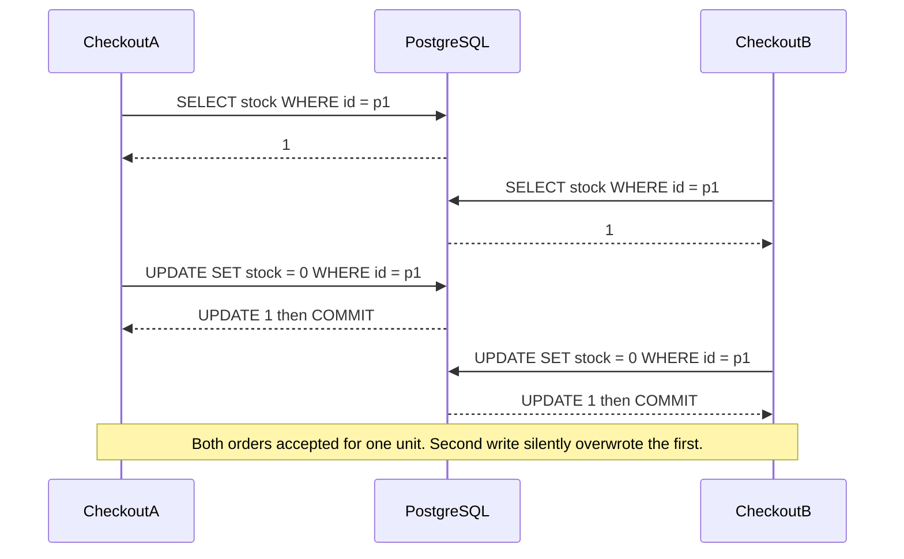

## 20.3 Concurrency anomalies, one timeline at a time

#### Concept

An anomaly is a result that could not have happened if the transactions had run one after another. There are five you must be able to draw on a whiteboard: dirty read, non-repeatable read, phantom read, lost update, and write skew. Each has a precise definition, a precise two-session reproduction, and a precise set of fixes. Senior engineers do not memorise the SQL-standard table; they memorise *what PostgreSQL actually does*, which differs from the standard in two places.

#### Why does it exist?

Anomalies exist because the database lets transactions overlap in time for throughput. If PostgreSQL ran one transaction at a time, none of these could happen, and a 32-core server would run at the speed of one connection. Every anomaly is the price of a particular kind of overlap, and every isolation level is a decision about which prices you are willing to pay.

#### Mental model

Imagine several people editing the same spreadsheet. A dirty read is reading a cell someone is still typing in. A non-repeatable read is reading a cell, looking away, and finding a different value when you look back. A phantom is counting the rows, looking away, and finding a new row. A lost update is two people reading "5", each typing "5 minus 1", and the cell ending at 4 instead of 3. Write skew is two people each checking "is there at least one other person marked on-call?", both seeing yes, and both removing themselves.

#### How it works

Each anomaly below is shown with the setup, the two-session timeline, the PostgreSQL behaviour at each level, and the fixes. Run them yourself with two `psql` windows; the tables are the ones from section 20.1.

### 20.3.1 Dirty read

Reading data written by a transaction that has not committed (and may roll back).

| Step | Session A | Session B | What B sees |
|---|---|---|---|
| 1 | `BEGIN;` | | |
| 2 | `UPDATE products SET price_cents = 100 WHERE id = 'p1';` | | |
| 3 | | `SELECT price_cents FROM products WHERE id = 'p1';` | old value (say `2500`), never `100` |
| 4 | `ROLLBACK;` | | |

PostgreSQL: **impossible at every level.** MVCC only ever shows committed versions to other sessions. If you come from MySQL InnoDB with `READ UNCOMMITTED`, or from SQL Server with `NOLOCK` hints, this is the anomaly those settings allow. There is nothing to fix here in PostgreSQL; we list it so the table at the end is complete.

### 20.3.2 Non-repeatable read

Reading the same row twice in one transaction and getting different values because someone committed in between.

| Step | Session A | Session B | What A sees |
|---|---|---|---|
| 1 | `BEGIN;` | | |
| 2 | `SELECT price_cents FROM products WHERE id = 'p1';` | | `2500` |
| 3 | | `UPDATE products SET price_cents = 2000 WHERE id = 'p1';` (autocommit) | |
| 4 | `SELECT price_cents FROM products WHERE id = 'p1';` | | `2000` at `READ COMMITTED`; `2500` at `REPEATABLE READ` and `SERIALIZABLE` |

Where this hurts: a checkout that reads the price to show the user, then re-reads to compute the total on the same request, and charges a different amount than it displayed. Fixes: read once and carry the value; or `REPEATABLE READ`; or lock the row with `FOR SHARE` if a concurrent price change must be blocked for the duration.

### 20.3.3 Phantom read

Re-running a query with a `WHERE` clause and seeing rows that were not there before (or missing rows that were).

| Step | Session A | Session B | What A sees |
|---|---|---|---|
| 1 | `BEGIN;` | | |
| 2 | `SELECT count(*) FROM orders WHERE user_id = 'u1' AND status = 'CREATED';` | | `2` |
| 3 | | `INSERT INTO orders (user_id, status) VALUES ('u1', 'CREATED');` (autocommit) | |
| 4 | `SELECT count(*) FROM orders WHERE user_id = 'u1' AND status = 'CREATED';` | | `3` at `READ COMMITTED`; `2` at `REPEATABLE READ` and `SERIALIZABLE` |

The SQL standard allows phantoms at `REPEATABLE READ`; PostgreSQL does not, because its snapshot covers every row, not just the ones you touched. The place phantoms bite is *rule enforcement by counting*: "a user may have at most 3 open orders". Two concurrent inserts each count 2, each proceed, and the user has 4. Row locks cannot fix this, because the row that breaks the rule does not exist yet when you would lock it. The fixes are a constraint (unique/exclusion where expressible), a lock on a parent row (`SELECT ... FROM users WHERE id = 'u1' FOR UPDATE` to serialise all order creation for that user), an advisory lock keyed on the user id, or `SERIALIZABLE`.

### 20.3.4 Lost update

Two transactions read the same value, each computes a new value from what it read, and each writes; the second write silently overwrites the first.

This is the anomaly that oversells inventory, double-spends wallets and loses counter increments. The classic buggy code:

```ts
// The bug. Looks reasonable, loses updates under any concurrency at all.
const product = await repo.findOneByOrFail({ id });      // read: stock = 1
if (product.stock < qty) throw new ConflictException();
product.stock -= qty;                                    // compute in JavaScript
await repo.save(product);                                // write: stock = 0
```

| Step | Session A | Session B | Stock (committed) |
|---|---|---|---|
| 0 | | | `1` |
| 1 | `BEGIN;` `SELECT stock FROM products WHERE id = 'p1';` returns `1` | | `1` |
| 2 | | `BEGIN;` `SELECT stock FROM products WHERE id = 'p1';` returns `1` | `1` |
| 3 | `UPDATE products SET stock = 0 WHERE id = 'p1';` | | `1` (A holds row lock) |
| 4 | | `UPDATE products SET stock = 0 WHERE id = 'p1';` blocks | `1` |
| 5 | `COMMIT;` | | `0` |
| 6 | | unblocks; at `READ COMMITTED` the `WHERE id = 'p1'` still matches, so `UPDATE 1`; `COMMIT;` | `0` |

Two orders, one unit, no error anywhere. The `CHECK (stock >= 0)` did not fire because each session wrote the literal `0`, not `stock - 1`.



**Fix 1 — atomic UPDATE (best when the new value is a function of the old value).**

```sql
UPDATE products
SET    stock = stock - 1
WHERE  id = 'p1' AND stock >= 1
RETURNING stock;
```

Session B blocks on A's row lock, then re-evaluates `stock >= 1` against the committed version (0), matches nothing, returns `UPDATE 0`. The application treats zero affected rows as "sold out". No explicit lock, no retry, works at `READ COMMITTED`. The `CHECK` constraint is a second net: even without the `WHERE`, `stock - 1` would go to `-1` and fail.

**Fix 2 — pessimistic lock (`SELECT ... FOR UPDATE`) when the logic between read and write is too complex for one statement.**

```sql
BEGIN;
SELECT stock FROM products WHERE id = 'p1' FOR UPDATE;   -- B blocks here until A commits
-- application logic: check reservations, apply bundle rules, compute new stock
UPDATE products SET stock = 0 WHERE id = 'p1';
COMMIT;
```

B's `SELECT ... FOR UPDATE` waits, then returns the *new* committed value (0), so B's logic sees the truth. Section 20.6 covers the lock modes and their costs.

**Fix 3 — optimistic version column.**

```sql
-- read
SELECT stock, version FROM products WHERE id = 'p1';     -- stock 1, version 7
-- write, only if nobody else wrote since our read
UPDATE products
SET    stock = 0, version = version + 1
WHERE  id = 'p1' AND version = 7;
-- UPDATE 1 => we won; UPDATE 0 => someone else wrote first, reload and retry or fail
```

No lock is held between read and write, so this works even when the "think time" is a human filling a form for two minutes. Section 20.5 covers TypeORM `@VersionColumn` and Sequelize `version: true`.

**Fix 4 — `REPEATABLE READ` or `SERIALIZABLE`.** At either level, session B's `UPDATE` at step 6 fails with `40001 could not serialize access due to concurrent update`, because the row changed after B's snapshot. B must retry. This fixes lost updates *without changing the SQL*, which makes it attractive for legacy code, at the cost of retries.

**Not a fix:** `SELECT ... FOR SHARE` on both sides. Both hold a share lock, both try to upgrade to a write lock, and PostgreSQL detects a deadlock and kills one. It "works" by accident and pollutes your logs.

### 20.3.5 Write skew

Two transactions read overlapping data, each makes a decision based on what it read, and each writes to a *different* row. Neither write conflicts with the other, so no row lock and no `REPEATABLE READ` check ever fires, yet the combined result violates an invariant.

**On-call doctors.** Invariant: at least one doctor must be on call. Two doctors are on call; both ask to go off at the same time.

```sql
CREATE TABLE shifts (doctor_id text PRIMARY KEY, on_call boolean NOT NULL);
INSERT INTO shifts VALUES ('alice', true), ('bob', true);
```

| Step | Session A (Alice) | Session B (Bob) | Result |
|---|---|---|---|
| 1 | `BEGIN ISOLATION LEVEL REPEATABLE READ;` | `BEGIN ISOLATION LEVEL REPEATABLE READ;` | |
| 2 | `SELECT count(*) FROM shifts WHERE on_call;` returns `2` | | |
| 3 | | `SELECT count(*) FROM shifts WHERE on_call;` returns `2` | |
| 4 | `UPDATE shifts SET on_call = false WHERE doctor_id = 'alice';` | | `UPDATE 1` |
| 5 | | `UPDATE shifts SET on_call = false WHERE doctor_id = 'bob';` | `UPDATE 1` (different row, no conflict) |
| 6 | `COMMIT;` | `COMMIT;` | both succeed; nobody is on call |

`REPEATABLE READ` did nothing, because neither transaction updated a row the other had updated. At `SERIALIZABLE`, PostgreSQL's SSI sees that A read rows that B wrote and B read rows that A wrote (a read/write dependency cycle) and aborts one at commit with `could not serialize access due to read/write dependencies among transactions`.

**Overselling across two rows.** The same shape appears in e-commerce when stock is split across warehouses and the rule is "total stock across warehouses >= qty": each checkout reads both rows, sees enough in total, and decrements a different warehouse row.

Fixes, in order of preference:

1. **Make it a single-row invariant** so a constraint or conditional `UPDATE` can enforce it (keep an `on_call_count` in a single row and `UPDATE ... WHERE on_call_count > 1`).
2. **Materialise the conflict**: lock a common parent row (`SELECT ... FROM rota WHERE id = 'night' FOR UPDATE`) at the start of both transactions, so they serialise.
3. **Advisory lock** keyed on the invariant (`pg_advisory_xact_lock(hashtext('rota:night'))`).
4. **`SERIALIZABLE`** with a retry loop, when the rows involved are not known in advance.

Nothing weaker than these works, because there is no shared row for `REPEATABLE READ` or `FOR UPDATE` to notice.

### 20.3.6 Which anomaly at which level — PostgreSQL, not the standard

| Anomaly | READ UNCOMMITTED (= RC in PG) | READ COMMITTED | REPEATABLE READ | SERIALIZABLE |
|---|---|---|---|---|
| Dirty read | impossible | impossible | impossible | impossible |
| Non-repeatable read | possible | possible | impossible | impossible |
| Phantom read | possible | possible | impossible (standard says possible) | impossible |
| Lost update (read, compute, write) | possible | possible | impossible: writer gets `40001` | impossible: `40001` |
| Write skew | possible | possible | possible | impossible: `40001` |
| Serialization failures you must retry | none | none | on concurrent row update | on any dangerous dependency, even at commit |

Two rows of that table differ from the textbook: PostgreSQL's `REPEATABLE READ` blocks phantoms, and PostgreSQL's `READ UNCOMMITTED` is not a distinct level.

#### Practical example

A wallet service had `balance_cents` per user and a "withdraw" endpoint written as read-check-write. Under a load test of 50 concurrent withdrawals on one wallet, the final balance was wrong by a random amount every run. The team fixed it with a single statement: `UPDATE wallets SET balance_cents = balance_cents - $1 WHERE id = $2 AND balance_cents >= $1 RETURNING balance_cents`, plus `CHECK (balance_cents >= 0)`. Zero lost updates at any concurrency, no lock code, and the endpoint got faster because it went from two round trips to one.

#### NestJS example

The wallet withdrawal with all three defences: atomic statement, constraint, and affected-row check.

```ts
// src/wallets/wallets.service.ts
import { Injectable, ConflictException, NotFoundException } from '@nestjs/common';
import { InjectRepository } from '@nestjs/typeorm';
import { Repository } from 'typeorm';
import { Wallet } from './wallet.entity';

@Injectable()
export class WalletsService {
  constructor(@InjectRepository(Wallet) private readonly wallets: Repository<Wallet>) {}

  async withdraw(walletId: string, amountCents: number): Promise<number> {
    const result = await this.wallets
      .createQueryBuilder()
      .update(Wallet)
      .set({ balanceCents: () => 'balance_cents - :amount' })
      .where('id = :id AND balance_cents >= :amount', { id: walletId, amount: amountCents })
      .returning(['balance_cents'])
      .execute();

    if (result.affected === 0) {
      // Either the wallet does not exist or funds are insufficient; distinguish with one cheap read.
      const exists = await this.wallets.exist({ where: { id: walletId } });
      if (!exists) throw new NotFoundException('Wallet not found');
      throw new ConflictException('Insufficient funds');
    }
    return Number(result.raw[0].balance_cents);
  }
}
```

#### PostgreSQL example

A phantom-safe "max 3 open orders per user" rule using a parent-row lock, which is cheaper and more predictable than `SERIALIZABLE` for this shape.

```sql
BEGIN;
-- Serialise all order creation for this user. Other users are unaffected.
SELECT id FROM users WHERE id = 'u1' FOR NO KEY UPDATE;

-- Now this count cannot be raced by another creation for u1.
SELECT count(*) FROM orders WHERE user_id = 'u1' AND status = 'CREATED';
-- application checks count < 3, else ROLLBACK

INSERT INTO orders (user_id, status) VALUES ('u1', 'CREATED');
COMMIT;
```

`FOR NO KEY UPDATE` rather than `FOR UPDATE` because we do not intend to change the user's primary key, and it does not block concurrent `INSERT`s into tables that reference `users` (see 20.4 for why that matters).

#### TypeORM example

```ts
await this.dataSource.transaction(async (manager) => {
  await manager
    .createQueryBuilder(User, 'u')
    .setLock('pessimistic_write')            // for_no_key_update is also available as a lock mode
    .where('u.id = :id', { id: userId })
    .getOne();

  const open = await manager.count(Order, { where: { userId, status: 'CREATED' } });
  if (open >= 3) throw new ConflictException('Too many open orders');
  await manager.insert(Order, { userId, status: 'CREATED' });
});
```

#### Sequelize example

```ts
await this.sequelize.transaction(async (t) => {
  await User.findByPk(userId, { transaction: t, lock: t.LOCK.NO_KEY_UPDATE });
  const open = await Order.count({ where: { userId, status: 'CREATED' }, transaction: t });
  if (open >= 3) throw new ConflictException('Too many open orders');
  await Order.create({ userId, status: 'CREATED' }, { transaction: t });
});
```

#### Production scenario

A ride-booking platform assigns drivers to rides. The invariant "a driver has at most one active ride" was enforced by counting active rides before insert. At 1,200 ride requests per minute in a dense city, two dispatchers assigned the same driver about 30 times a day. The fix was a partial unique index, `CREATE UNIQUE INDEX one_active_ride_per_driver ON rides (driver_id) WHERE status = 'ACTIVE'`, which turns the phantom into a constraint violation (`23505`) the second inserter can catch. No locks, no isolation level change, and the index is tiny because it only contains active rides.

#### Failure scenario

At 11:03 on Black Friday the inventory dashboard showed `-37` for a headphone SKU. The `CHECK (stock >= 0)` had been dropped in a migration two months earlier "because it made the bulk importer fail". The checkout code was read-compute-write. Every one of the 37 oversold units became a cancellation email and a support ticket. Three fixes shipped that day: the constraint came back (the importer was fixed to insert valid data), the decrement became an atomic conditional `UPDATE`, and a nightly job started comparing `sum(order_items.qty)` against stock movements.

#### Edge cases & failure modes

- Lost updates also happen on JSON columns: read the `jsonb`, modify one key in JavaScript, write the whole document back. Use `jsonb_set` in the `UPDATE` or lock the row.
- Counters incremented via ORM `save()` are lost-update machines: `entity.viewCount++` then `save()` is read-compute-write. Use `increment()` (TypeORM `repository.increment(criteria, 'viewCount', 1)`, Sequelize `Model.increment`).
- A conditional `UPDATE` that matches zero rows is indistinguishable from "row does not exist". Check existence separately when the error message matters.
- Write skew hides inside "check then insert" flows: uniqueness across two columns enforced by a `SELECT` before `INSERT` is write skew; the unique index is the fix.
- Under `SERIALIZABLE`, sequences and `now()` are not part of the serial order; do not build invariants on them.
- Batch jobs that read a whole table at `READ COMMITTED` over many statements see a mix of old and new rows; use `REPEATABLE READ` for a consistent batch view.

#### How a Senior Backend Engineer thinks about this

They classify every write path by shape. "New value depends on old value of the same row" gets an atomic `UPDATE`. "Decision depends on several rows, writes one row" gets a parent-row lock or advisory lock. "Rule about the set of rows" gets a constraint if it can be expressed (unique, partial unique, exclusion), otherwise a lock or `SERIALIZABLE`. They refuse the phrase "it is unlikely two requests hit at the same time"; at 100 requests per second with 5 ms transactions, "unlikely" is several times per minute.

#### Common mistakes

- Reading, then writing, with the read and write in the same transaction, and calling that "transactional". It is still a lost update at `READ COMMITTED`.
- Fixing lost updates with `REPEATABLE READ` and then not handling `40001`.
- Thinking `FOR UPDATE` fixes write skew. It only serialises transactions that lock the *same* rows.
- Enforcing "at most N" by counting, without a lock or constraint.
- Dropping a constraint to make an import pass.

#### Interview questions

1. *Show a lost update with two sessions and list four fixes.* Expected: the table above; atomic update, `FOR UPDATE`, version column, `REPEATABLE READ`/`SERIALIZABLE` with retry. Follow-up: which one has no retries and no locks beyond the statement itself?
2. *What is write skew and why does `REPEATABLE READ` not prevent it?* Expected: different rows written after overlapping reads; no row conflict for the first-updater-wins check to catch. Follow-up: name three fixes that are not `SERIALIZABLE`.
3. *How does PostgreSQL's `REPEATABLE READ` differ from the SQL standard on phantoms?* Expected: prevents them via whole-transaction snapshot.
4. *"At most three open orders per user" — how do you enforce it under concurrency?* Expected: lock the user row, or advisory lock, or `SERIALIZABLE`; note a partial unique index works for "at most one".
5. *Why is `SELECT ... FOR SHARE` on both sides of a read-modify-write a bad fix?* Expected: lock upgrade deadlock.

#### Practical exercise

Write a script that runs 100 concurrent withdrawals of 10 cents against a wallet with 500 cents, using (a) read-compute-write, (b) atomic conditional `UPDATE`, (c) `SELECT ... FOR UPDATE`, (d) a version column with retry, and (e) `SERIALIZABLE` with retry. For each, record the final balance, the number of successful withdrawals, the number of retries, and the p99 latency. Acceptance criteria: (a) ends with a wrong balance and you can explain why; (b) through (e) end with exactly 50 successes and a balance of 0; you can rank (b) through (e) by latency and explain the ranking.
