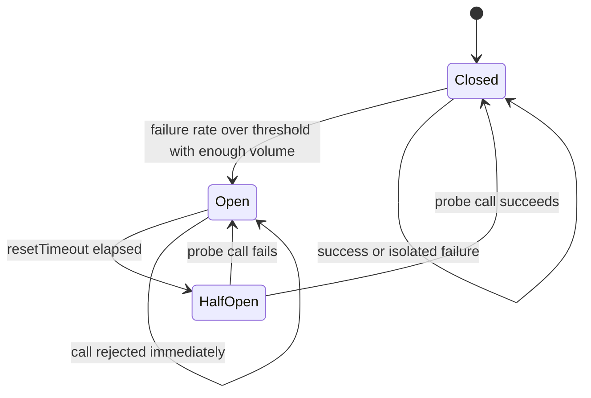
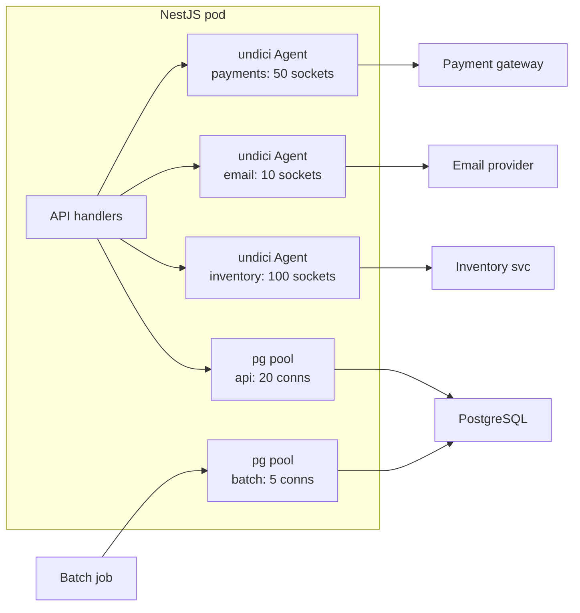

## 20.5 Circuit breakers

#### Concept

A circuit breaker is a stateful wrapper around calls to one dependency. It watches the recent failure rate. While the dependency is healthy the breaker is **closed** and calls pass through. When failures cross a threshold the breaker **opens**: for a cooling-off period every call fails *immediately* without touching the dependency. After the cooling-off period the breaker goes **half-open** and lets a small number of probe calls through; if they succeed it closes, if they fail it opens again.

The name comes from the electrical device: when current exceeds a limit the breaker trips, cutting the circuit so the wiring does not melt. A software breaker cuts the circuit so a failing dependency is not buried under load, and so your service stops burning its own resources waiting on something that is not going to answer.

#### Why does it exist?

Timeouts bound each call. Retries handle transient blips. Neither handles a dependency that is *down for minutes*. With only timeouts, every request to a dead payment gateway still waits the full 2 s before failing; at 500 RPS that is 1,000 in-flight requests holding memory, sockets and possibly DB connections, all to learn what the previous 10,000 calls already learned. And every one of those calls is load on a gateway that is trying to recover. A breaker learns the lesson once, fails fast for a while (microseconds instead of 2 s), and periodically checks whether the dependency has recovered. It converts "slow failure under load" into "fast failure with automatic recovery".

#### Mental model

Imagine a receptionist at a clinic. Normally when you ask for Dr. Patel she rings his office. If she rings ten times in a row and gets no answer, she stops ringing and tells everyone who asks "he is not available, try again in a few minutes" without picking up the phone. Every few minutes she tries once; if he answers, she goes back to normal. The receptionist is the breaker: she protects the waiting room from pointless queuing and protects the doctor from a phone that never stops ringing.

#### How it works



1. **Closed.** Calls pass through. The breaker records each outcome in a rolling window (for example 10 buckets of 1 s each). Timeouts count as failures. Errors you choose to filter out (a `400` is the caller's fault, not the dependency's) do not.
2. **Trip condition.** Two thresholds together: a **failure percentage** (say 50%) and a **volume threshold** (say at least 20 calls in the window). The volume threshold prevents a breaker from opening because 1 of 2 calls failed at 03:00 on a quiet night.
3. **Open.** Every call is rejected instantly with a specific error (`BreakerOpenError`) and the fallback runs if one is configured. No traffic reaches the dependency. This state lasts `resetTimeout` (say 10–30 s).
4. **Half-open.** One (or a few) real calls are allowed. Success closes the breaker and clears the stats; failure reopens it and restarts the `resetTimeout`.
5. **Metrics and events.** State transitions are logged and exported (`circuit_breaker_state{name}` as a gauge 0/1/2, `circuit_breaker_transitions_total{name, to}`), because an open breaker is often the first alert of a downstream outage.

Two design decisions matter as much as the thresholds:

- **One breaker per dependency** (and usually per *operation class* within a dependency: reads and writes to the same service can have different health). A single global breaker means a dead email provider blocks payments.
- **Fallback behaviour** is a product decision: fail the request, return cached data, return a degraded answer, or queue the work for later. Section 20.10 covers the choices; the breaker is where you plug them in.

#### Practical example

Checkout calls the payment gateway. Normal error rate is under 0.5%. The breaker is configured to open when the failure rate exceeds 50% over at least 20 calls in a 10 s window, stay open 15 s, then probe. When the gateway has an outage, within 10 s the breaker opens on every pod; checkout returns a `503` with a friendly message and a `Retry-After: 15` header in about 1 ms instead of 2 s; the gateway gets a few probe calls per pod every 15 s instead of 500 RPS; and the on-call sees `circuit_breaker_state{name="payment-gateway"} = 1` in the alert. Meanwhile the *catalog* and *cart* features are untouched, because their dependencies have their own breakers.

#### NestJS example

`opossum` is the standard breaker library for Node. Here it wraps a payment gateway client inside a NestJS provider, with Prometheus metrics via `prom-client` and an error filter that keeps client-side mistakes from tripping the breaker.

```ts
import { Injectable, Logger, OnModuleDestroy, ServiceUnavailableException } from '@nestjs/common';
import CircuitBreaker from 'opossum';
import { Counter, Gauge } from 'prom-client';
import { PaymentGatewayHttp, ChargeRequest, ChargeResult } from './payment-gateway.http';

const stateGauge = new Gauge({
  name: 'circuit_breaker_state', help: '0=closed 1=open 2=half-open', labelNames: ['name'],
});
const transitions = new Counter({
  name: 'circuit_breaker_transitions_total', help: 'state changes', labelNames: ['name', 'to'],
});

@Injectable()
export class PaymentBreaker implements OnModuleDestroy {
  private readonly log = new Logger(PaymentBreaker.name);
  private readonly breaker: CircuitBreaker<[ChargeRequest], ChargeResult>;

  constructor(private readonly http: PaymentGatewayHttp) {
    this.breaker = new CircuitBreaker((req: ChargeRequest) => this.http.charge(req), {
      name: 'payment-gateway',
      timeout: 2_500,                 // opossum's own timer; counts as a failure
      errorThresholdPercentage: 50,   // trip when >= 50% of calls fail...
      volumeThreshold: 20,            // ...and at least 20 calls were made in the window
      rollingCountTimeout: 10_000,    // window length
      rollingCountBuckets: 10,        // 1 s buckets
      resetTimeout: 15_000,           // open -> half-open after 15 s
      capacity: 200,                  // max concurrent in-flight calls (a bulkhead, see 20.6)
      // Return true to NOT count this error as a dependency failure.
      errorFilter: (err: { statusCode?: number }) =>
        err.statusCode !== undefined && err.statusCode >= 400 && err.statusCode < 500 && err.statusCode !== 429,
    });

    this.breaker.on('open', () => this.onState('open', 1));
    this.breaker.on('halfOpen', () => this.onState('half-open', 2));
    this.breaker.on('close', () => this.onState('closed', 0));
    this.breaker.on('reject', () => this.log.warn('payment call rejected: breaker open'));
    this.breaker.on('semaphoreLocked', () => this.log.warn('payment call rejected: capacity exhausted'));
    stateGauge.set({ name: 'payment-gateway' }, 0);
  }

  async charge(req: ChargeRequest): Promise<ChargeResult> {
    try {
      return await this.breaker.fire(req);
    } catch (err) {
      if ((err as Error).message === 'Breaker is open' || (err as { code?: string }).code === 'EOPENBREAKER') {
        throw new ServiceUnavailableException('payments temporarily unavailable');
      }
      throw err;
    }
  }

  private onState(to: string, value: number) {
    stateGauge.set({ name: 'payment-gateway' }, value);
    transitions.inc({ name: 'payment-gateway', to });
    this.log.warn({ msg: 'breaker state change', name: 'payment-gateway', to });
  }

  onModuleDestroy() { this.breaker.shutdown(); }
}
```

A few notes on the real behaviour of `opossum`:

- In half-open state it lets **one** call through; the outcome decides the next state. That is deliberately conservative: it avoids a herd of probes hitting a recovering service.
- `breaker.fallback(fn)` registers a function called whenever the action fails *or* is rejected; the fallback's return value becomes the result of `fire()`. Use it for cached or degraded answers; do not use it to hide errors you need to see.
- `breaker.stats` exposes the rolling counts (`fires`, `failures`, `timeouts`, `rejects`, `successes`), which you can export as metrics.
- An open breaker does **not** stop the `resetTimeout` timer from firing if the process is under heavy event-loop lag; the transition may be late by the lag amount, which is another reason to keep the event loop healthy (20.8).

#### PostgreSQL example

Breakers around your primary database are usually a mistake: if the primary is down you have nothing to fall back to, and failing fast is what `connectionTimeoutMillis` already does. Breakers around **read replicas** are useful: when a replica lags badly or goes away, you route reads to the primary (or another replica) for a while.

```ts
// Two DataSources: primary and replica. The breaker guards the replica.
const replicaBreaker = new CircuitBreaker(
  (sql: string, params: unknown[]) => replica.query(sql, params),
  { timeout: 800, errorThresholdPercentage: 40, volumeThreshold: 30, resetTimeout: 20_000, name: 'pg-replica' },
);
replicaBreaker.fallback((sql: string, params: unknown[]) => primary.query(sql, params));

// A lag check that counts as failure if the replica is more than 5 s behind.
await replicaBreaker.fire(
  `SELECT CASE WHEN now() - pg_last_xact_replay_timestamp() > interval '5 seconds'
          THEN pg_terminate_backend(pg_backend_pid()) END`, [],
);
```

The lag check above is intentionally blunt: it turns "too laggy" into an error the breaker can see. In practice you would measure `pg_last_xact_replay_timestamp()` in a health probe every second and feed the breaker's decision from that.

#### Production scenario

A marketplace API has breakers on: payment gateway, tax-calculation SaaS, address-validation SaaS, recommendations service, search cluster, and email provider. In one quarter the breakers opened 31 times. 27 of those were third-party outages lasting 2–40 minutes that customers never noticed because each dependency had a fallback (tax: last known rate table; address validation: accept as entered and flag for review; recommendations: bestsellers; search: database `ILIKE` on the first 100 products of the category; email: queue). The 4 remaining were the payment gateway, where there is no fallback; checkout showed a "please try again in a moment" screen and conversion dipped for the duration. Total engineering time spent on those 31 incidents: near zero. Before breakers, each third-party outage was a page.

#### Failure scenario

At 09:40 on a Monday the on-call was paged for elevated checkout latency. Dashboards showed the payment breaker **flapping**: open, half-open, closed, open, every 20 seconds. The gateway was healthy for 90% of calls but returned `500` for a specific card BIN range after a change on their side. Every time the breaker closed, the 10% failures accumulated, the breaker tripped, and all checkouts failed for 15 s, including the 90% that would have succeeded. The threshold of 50% was correct; the problem was that a partial, *deterministic* failure looked like a transient outage. The fix was twofold: treat the gateway's `500` with a specific `error.code = "unsupported_card"` as a *non-counting* error (it is a per-card business outcome, not a dependency failure), and raise `volumeThreshold` so the window needed 50 calls. Lesson: breakers reason about *dependency health*; feed them only errors that mean the dependency is unhealthy.

#### Edge cases & failure modes

- **Flapping.** A dependency that is partially failing pushes the breaker across the threshold repeatedly. Tune volume thresholds, lengthen `resetTimeout`, and filter deterministic errors out of the count.
- **Half-open herd.** If your breaker allows N probes and you run 50 pods, the recovering service gets 50N probes at once. Keep probes to 1 per pod and stagger `resetTimeout` with a little jitter per instance.
- **Breaker per process.** Each pod has its own breaker with its own view; during a partial outage some pods are open and some closed. This is normal and usually fine. A shared breaker in Redis is possible but adds a dependency to your reliability layer; do it only if the per-pod divergence hurts.
- **Timeouts counted twice.** If your HTTP client has a 2 s timeout and the breaker has a 2.5 s timeout, the client's timeout fires first and is counted as a failure; fine. If the breaker timeout is shorter, the breaker gives up while the HTTP call continues; set the breaker timeout above the client timeout, or leave the breaker timeout off and rely on the client.
- **Counting the wrong errors.** `400`, `404`, `422`, business declines, validation errors: none of these mean the dependency is down. Filter them.
- **Breaker with no fallback and no `Retry-After`.** Clients retry an open breaker in a loop; add `Retry-After` to the `503`.
- **Breaker hiding a real outage.** Fallbacks are so smooth nobody notices the dependency has been down for three days. Alert on `circuit_breaker_state == 1` for more than N minutes.
- **Breaker around a non-idempotent call with retries inside it.** The breaker sees one failure but the retries hit the dependency three times; keep retries *inside* the breaker action and count them as one fire, or put retries outside and count each attempt.

#### How a Senior Backend Engineer thinks about this

They add a breaker to every third-party call and to every cross-service call that has a sensible fallback. They *do not* add one where fast failure has no benefit (the primary database) or where the call is so rare the volume threshold is never met (a monthly report). They think carefully about the error filter, because a breaker fed with business errors becomes a random outage generator. They put the breaker state on the main dashboard and alert on "open for more than 2 minutes". And they treat an opened breaker as a *successful* outcome: the system did what it was designed to do.

To a product manager: "When a partner goes down, the breaker lets us instantly switch to Plan B for a few minutes and keep checking whether the partner is back, instead of making every customer wait and fail."

#### Common mistakes

- One breaker for all outbound HTTP.
- Trip thresholds with no volume floor (breaker opens on the first two errors of the day).
- Counting `4xx` as failures.
- No metrics on state; discovering the breaker was open for six hours from a customer complaint.
- Wrapping a call that has no timeout: the breaker never sees a failure because nothing ever returns.
- Using the fallback to return "success" for a write that did not happen.

#### Interview questions

1. *Describe the three states of a circuit breaker and what triggers each transition.* Expected: closed/open/half-open; failure rate plus volume threshold; reset timeout; probe result.
2. *Why do breakers need a volume threshold in addition to a failure percentage?* Expected: to avoid tripping on small samples at low traffic.
3. *Your breaker keeps flapping. What do you look at?* Expected: which errors are counted; partial deterministic failures; window and volume; reset timeout; jitter.
4. *Where would you NOT use a circuit breaker?* Expected: primary database with no alternative; extremely low-volume calls; calls where fast failure gives no benefit.
5. *How does a per-pod breaker behave differently from a shared one, and which do you prefer?* Expected: per-pod diverges but has no extra dependency; prefer per-pod unless divergence is harmful.

#### Practical exercise

Wrap a fake payment gateway (an Express or NestJS stub that can be toggled between healthy, 50% `500`, and 100% timeout) with `opossum` in a NestJS provider, export `circuit_breaker_state` to Prometheus, and drive 50 RPS at it with `autocannon`. Acceptance criteria: within 10 s of switching the stub to timeout mode the breaker opens and p99 latency drops below 5 ms; within 20 s of restoring the stub the breaker closes; `400` responses from the stub never open the breaker.

## 20.6 Bulkheads

#### Concept

A bulkhead is an isolation boundary that limits how many resources one workload or one dependency can consume, so that its failure cannot take resources from the others. In practice: separate connection pools, separate socket pools, separate worker processes, separate Kubernetes deployments, separate per-tenant quotas. The word comes from ship design: a hull divided into watertight compartments stays afloat when one compartment floods.

#### Why does it exist?

Shared resources fail together. If all outbound HTTP calls share one socket pool of 100 sockets and the email provider hangs, 100 sockets are soon held by email calls and the payment gateway, which is perfectly healthy, cannot get a socket. If the API and the nightly reporting job share one PostgreSQL pool of 20 connections, a report that runs 10 concurrent 5-minute queries leaves the API with 10 connections during its peak hour. If one tenant sends 10,000 requests a second, every other tenant's requests queue behind them. Bulkheads make sure a problem in one compartment stays in that compartment.

#### Mental model

Imagine a hospital with one waiting room for everything. A flu outbreak fills every chair, and the person with a broken arm cannot get in. A hospital with separate emergency, outpatient and paediatric departments keeps functioning during the flu outbreak because the flu patients only fill *their* department. Bulkheads are the separate departments.

#### How it works



The levels at which you can draw a bulkhead, from smallest to largest:

1. **Concurrency limit per dependency in-process.** `opossum`'s `capacity`, a `p-limit` or `bottleneck` limiter around the client. When exhausted, calls are rejected immediately instead of queuing.
2. **Socket pool per dependency.** One `undici.Agent` (or `https.Agent`) per downstream host with its own `connections` limit. A hung email provider holds at most its 10 sockets.
3. **Database pool per workload.** Two `DataSource`s: `api` (small, short `statement_timeout`) and `batch` (small too, long timeout). PostgreSQL-side `CONNECTION LIMIT` per role enforces the split even if the app misbehaves.
4. **Process/deployment per workload.** API pods, worker pods and cron pods are separate Kubernetes deployments with their own resource requests, replica counts and autoscaling. A memory leak in the PDF-generating worker cannot OOMKill the API.
5. **Per-tenant quotas.** A `Bottleneck.Group` keyed by tenant, or gateway-level rate limits per API key, so one tenant cannot consume the whole capacity.
6. **Per-priority queues.** Separate Kafka topics or BullMQ queues for `critical` and `bulk` work, with separate consumers, so a million bulk emails do not delay the password-reset email.

#### Practical example

A SaaS invoicing API serves 200 tenants. Three bulkheads: (1) per-dependency `undici` agents so the tax SaaS hanging cannot starve the PDF renderer's sockets; (2) `api` and `batch` PostgreSQL pools with role-level connection limits so month-end batch invoicing cannot starve interactive requests; (3) per-tenant concurrency of 20 via `Bottleneck.Group`, so one tenant's script that fires 5,000 invoice creations queues in *their* lane, and the other 199 tenants see normal latency.

#### NestJS example

Two `TypeORM` connections registered under different names, injected where needed:

```ts
// app.module.ts
@Module({
  imports: [
    TypeOrmModule.forRoot({
      name: 'default',                 // API pool: small, fast, short timeouts
      type: 'postgres', url: process.env.PG_URL_API,
      extra: { max: 20, connectionTimeoutMillis: 1_000, statement_timeout: 2_000 },
      entities: [Order, Invoice],
    }),
    TypeOrmModule.forRoot({
      name: 'batch',                   // batch pool: separate role, long timeouts
      type: 'postgres', url: process.env.PG_URL_BATCH,
      extra: { max: 5, connectionTimeoutMillis: 5_000, statement_timeout: 300_000 },
      entities: [Order, Invoice],
    }),
    TypeOrmModule.forFeature([Invoice], 'batch'),
  ],
})
export class AppModule {}

// month-end.service.ts
@Injectable()
export class MonthEndService {
  constructor(@InjectRepository(Invoice, 'batch') private readonly invoices: Repository<Invoice>) {}
}
```

Per-tenant concurrency with `bottleneck`:

```ts
import Bottleneck from 'bottleneck';

@Injectable()
export class TenantLimiter {
  // Each tenant gets its own limiter: at most 20 in flight, at most 200 queued.
  private readonly group = new Bottleneck.Group({
    maxConcurrent: 20,
    highWater: 200,
    strategy: Bottleneck.strategy.OVERFLOW,  // reject when the queue is full instead of growing
  });

  run<T>(tenantId: string, fn: () => Promise<T>): Promise<T> {
    return this.group.key(tenantId).schedule(fn);
  }
}
```

With `strategy: OVERFLOW`, a job added beyond `highWater` is dropped and `schedule()` rejects; that rejection becomes a `429` for that tenant only. Other strategies (`LEAK`, `BLOCK`) exist; `OVERFLOW` is the one that behaves like a bulkhead.

#### PostgreSQL example

Enforce the pool split on the server side, so that a misconfigured pod cannot exceed its share:

```sql
CREATE ROLE app_api   LOGIN PASSWORD '...' CONNECTION LIMIT 400;  -- 20 pods x 20
CREATE ROLE app_batch LOGIN PASSWORD '...' CONNECTION LIMIT 20;   -- 4 pods x 5
ALTER ROLE app_api   SET statement_timeout = '2s';
ALTER ROLE app_batch SET statement_timeout = '5min';

-- Watch the split in production:
SELECT usename, state, count(*)
  FROM pg_stat_activity
 WHERE datname = 'shop'
 GROUP BY usename, state
 ORDER BY usename, state;
```

If you run PgBouncer, define separate pools per user in `pgbouncer.ini` (`[databases]` with `pool_size` per entry, and `max_user_connections` per user) for the same effect one layer up.

#### Sequelize example

```ts
export const apiDb = new Sequelize(process.env.PG_URL_API!, {
  dialect: 'postgres',
  pool: { max: 20, acquire: 1_000 },
  dialectOptions: { statement_timeout: 2_000 },
});
export const batchDb = new Sequelize(process.env.PG_URL_BATCH!, {
  dialect: 'postgres',
  pool: { max: 5, acquire: 5_000 },
  dialectOptions: { statement_timeout: 300_000 },
});
// Register with @nestjs/sequelize using SequelizeModule.forRoot({ name: 'batch', ... })
// and inject the model with @InjectModel(Invoice, 'batch').
```

#### Production scenario

Kubernetes deployments as bulkheads for a food-delivery platform:

```yaml
# api: latency-sensitive, autoscaled on CPU and RPS
apiVersion: apps/v1
kind: Deployment
metadata: { name: orders-api }
spec:
  replicas: 12
  template:
    spec:
      containers:
        - name: app
          image: orders:1.42.0
          args: ["node", "dist/main.js"]           # boots only the HTTP app
          resources: { requests: { cpu: "500m", memory: "512Mi" }, limits: { memory: "768Mi" } }
---
# worker: throughput-oriented, scaled on queue depth
apiVersion: apps/v1
kind: Deployment
metadata: { name: orders-worker }
spec:
  replicas: 4
  template:
    spec:
      containers:
        - name: app
          image: orders:1.42.0
          args: ["node", "dist/worker.js"]         # boots only queue consumers
          resources: { requests: { cpu: "1", memory: "1Gi" }, limits: { memory: "1536Mi" } }
```

Same image, different entrypoints, different resource envelopes, different scaling rules. When a bad deploy of the PDF worker leaks memory and is OOMKilled every 10 minutes, the API deployment does not notice.

#### Failure scenario

At 00:05 on the first of the month, a reporting query started on the same pool as the API. It ran 8 concurrent `SELECT ... GROUP BY` statements over 400 million rows, each for about 6 minutes. The API pool had 20 connections; 8 were now busy for 6 minutes. At 00:06 a traffic spike (push notifications go out at midnight) needed 18 connections; 12 were available; `connectionTimeoutMillis` was 30 s; requests queued; p99 went to 30 s; the gateway timed out at 10 s; users retried; the pool never recovered until the reports finished. Post-mortem: batch work moved to a separate role with `CONNECTION LIMIT 6` and a separate pool, `connectionTimeoutMillis` on the API pool cut to 1 s so that pool exhaustion turns into a fast `503` instead of a 30 s hang, and an alert on `pg_pool_waiting_requests > 0` for more than 10 s.

#### Edge cases & failure modes

- **Too many small pools.** 15 dependencies x 50 sockets each x 40 pods = 30,000 sockets. Size each pool from its measured concurrency, not from a default.
- **Bulkhead that only queues.** A concurrency limit with an unbounded queue is not a bulkhead; it is a memory leak with a delay. Bound the queue and reject when full.
- **Batch role too generous.** `CONNECTION LIMIT` counts *all* sessions for the role including idle ones; a leaked connection reduces the effective limit.
- **Cross-pool transactions.** You cannot span a transaction across two `DataSource`s; pick the pool per unit of work, not per table.
- **Per-tenant limiter memory.** `Bottleneck.Group` keeps a limiter per key; set `timeout` on the group so idle tenant limiters are garbage-collected.
- **Deployment bulkheads without PodDisruptionBudgets.** A node drain can take out all worker pods at once even though the API is fine.

#### How a Senior Backend Engineer thinks about this

They ask: "if this dependency hangs completely, what is the maximum amount of *my* resources it can hold?" and make sure the answer is a number they chose (50 sockets, 5 connections, 200 queued jobs) rather than "all of them". They separate latency-sensitive work from throughput work at the deployment level early, because it is cheap when the codebase is small and painful later. They enforce limits on both sides where possible (pool `max` in the app *and* `CONNECTION LIMIT` in PostgreSQL). And they resist the urge to make every limit generous; a bulkhead that never fills is not protecting anything.

#### Common mistakes

- One shared `axios` instance with one `https.Agent` for every outbound host.
- Running cron jobs and batch processing inside the API process "because it's simpler".
- Pools sized "to be safe" (`max: 100`) on 40 pods against a PostgreSQL with `max_connections = 200`.
- Per-tenant fairness implemented in the database (`ORDER BY tenant_id`) instead of at admission.

#### Interview questions

1. *What is a bulkhead and give three concrete examples in a Node/PostgreSQL system.* Expected: per-dependency socket pools, per-workload DB pools/roles, separate deployments; per-tenant limiters.
2. *How would you stop a monthly batch job from starving the API's database connections?* Expected: separate role with `CONNECTION LIMIT`, separate pool, short `connectionTimeoutMillis` on the API pool, alerts on waiting requests.
3. *Why is an unbounded queue in front of a concurrency limiter dangerous?* Expected: memory growth, latency without rejection; bound it and shed.
4. *One tenant floods your API. Where do you isolate them and why there?* Expected: at admission (gateway or a per-tenant limiter), before the shared resources are touched.

#### Practical exercise

Split an existing NestJS app's PostgreSQL access into `api` and `batch` `DataSource`s with different roles and `CONNECTION LIMIT`s. Run a batch job that holds 5 connections for 2 minutes while `autocannon` drives the API at 200 RPS. Acceptance criteria: API p99 stays under 100 ms during the batch; `pg_stat_activity` shows the batch role never exceeding its limit; the API pool's `waitingCount` stays at 0.
