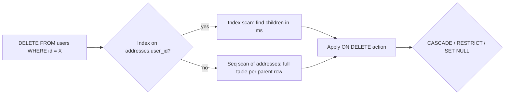

## 20.5 Keys: primary keys and foreign keys

### 20.5.1 Primary keys

#### Concept

A primary key (PK) is the column or set of columns that uniquely identifies each row and can never be `NULL`. Every table gets exactly one. PostgreSQL implements it as a unique B-tree index plus a `NOT NULL` constraint on each column. Other tables refer to a row by its primary key value.

Two philosophies exist. A natural key is a real-world identifier that already exists: an email, an ISBN, a SKU, a country code. A surrogate key is a meaningless system-generated identifier: a `bigint` sequence or a UUID. A composite key is a PK made of more than one column, common in join tables (`(order_id, product_id)`).

#### Why does it exist?

Without a primary key, a table is a bag of rows with no reliable way to address one of them. `UPDATE ... WHERE email = ...` works until two rows share the email. Replication systems (logical replication, Debezium, CDC pipelines) need a key to describe "which row changed". ORMs need a key to implement `save()` and identity maps. And most importantly, foreign keys need something stable to point at.

#### Mental model

Imagine a hospital. A patient's name is a natural key: real, meaningful, and a disaster the day two "Priya Sharma"s are admitted, or when one patient changes her name. The hospital assigns a patient number that never changes and means nothing. That is a surrogate key. The name is still stored, still unique-ish, still searched, but nothing points at it.

#### How it works

1. `PRIMARY KEY (col)` creates a unique index named `<table>_pkey` and marks `col NOT NULL`.
2. Every insert probes that index for a duplicate; a duplicate raises `23505 unique_violation`.
3. Foreign keys from other tables reference this index to validate that the parent row exists.
4. Logical replication uses the PK as the row identity (`REPLICA IDENTITY DEFAULT`). A table without a PK cannot have its `UPDATE`s and `DELETE`s replicated logically unless you set `REPLICA IDENTITY FULL`, which sends the whole old row.

Natural vs surrogate decision table:

| Property | Natural key (email, SKU) | Surrogate key (bigint, uuid) |
|---|---|---|
| Stability | Changes (email changes, SKU renumbered) | Never changes |
| Size in child tables | Text copied into every child row (email is ~25 bytes) | 8 or 16 bytes |
| Meaning in logs and debugging | Readable | Opaque |
| Uniqueness truly guaranteed? | Often no (two products, one SKU after a merger) | Yes, by construction |
| Cascading updates when the key changes | `ON UPDATE CASCADE` rewrites every child row | Not needed |
| Recommended for | Reference data that is itself the value (country_code, currency) | Every entity table |

The reference schema uses surrogate keys on every entity table and keeps natural identifiers (`email`, `sku`, `slug`) as `UNIQUE` columns. That gives you both: fast stable references and business uniqueness.

#### Practical example

`products.sku` is unique and meaningful, so why not make it the PK? Because a SKU gets reassigned when a supplier changes, because `order_items` would then carry a text SKU in millions of rows, and because the day merchandising decides SKUs are case-insensitive you would need to rewrite every child table. `products.id uuid` as PK and `sku text UNIQUE` costs 16 bytes per product and removes every one of those problems.

#### PostgreSQL example

```sql
-- Composite primary key in a join table with no other identity
CREATE TABLE product_tags_v2 (
  product_id uuid   NOT NULL REFERENCES products(id) ON DELETE CASCADE,
  tag_id     bigint NOT NULL REFERENCES tags(id)     ON DELETE CASCADE,
  added_at   timestamptz NOT NULL DEFAULT now(),
  PRIMARY KEY (product_id, tag_id)
);
-- The PK index covers lookups by product_id (leading column).
-- Lookups by tag_id need their own index:
CREATE INDEX product_tags_v2_tag_id_idx ON product_tags_v2 (tag_id);

-- Identity column semantics
CREATE TABLE demo_ident (id bigint GENERATED ALWAYS AS IDENTITY PRIMARY KEY, note text);
INSERT INTO demo_ident (id, note) VALUES (5, 'x');
-- ERROR: cannot insert a non-DEFAULT value into column "id"  (ALWAYS protects you)
INSERT INTO demo_ident (id, note) OVERRIDING SYSTEM VALUE VALUES (5, 'x');  -- explicit override
-- GENERATED BY DEFAULT AS IDENTITY allows explicit values silently; prefer ALWAYS.
```

In the reference schema, `order_items` has a surrogate `bigint id` plus `UNIQUE (order_id, product_id)`, rather than a composite PK. Both are valid; the surrogate makes ORMs and API URLs (`/order-items/123`) simpler, and the unique constraint still enforces the business rule.

#### TypeORM example

```ts
import { Entity, PrimaryColumn, ManyToOne, JoinColumn, CreateDateColumn } from 'typeorm';

@Entity({ name: 'product_tags_v2' })
export class ProductTag {
  @PrimaryColumn('uuid', { name: 'product_id' })
  productId!: string;

  @PrimaryColumn('bigint', { name: 'tag_id' })
  tagId!: string;

  @ManyToOne(() => Product, { onDelete: 'CASCADE' })
  @JoinColumn({ name: 'product_id' })
  product!: Product;

  @CreateDateColumn({ name: 'added_at', type: 'timestamptz' })
  addedAt!: Date;
}
// Two @PrimaryColumn decorators produce PRIMARY KEY (product_id, tag_id).
```

#### Sequelize example

```ts
ProductTag.init(
  {
    productId: { type: DataTypes.UUID, primaryKey: true, field: 'product_id' },
    tagId: { type: DataTypes.BIGINT, primaryKey: true, field: 'tag_id' },
  },
  { sequelize, tableName: 'product_tags_v2', underscored: true, timestamps: false },
);
// Sequelize supports composite PKs in init(); some helpers (findByPk) expect a single PK,
// so use findOne({ where: { productId, tagId } }) for composite keys.
```

#### Edge cases & failure modes

- A table with no PK: logical replication of updates fails, ORMs misbehave, duplicates are unremovable. Add one even to log tables.
- Natural key that turns out not to be unique (national ID reused, email shared by a family). Surrogate keys make this a data-quality issue instead of a schema rewrite.
- `GENERATED BY DEFAULT` lets an application insert an explicit id and later collide with the sequence. Use `ALWAYS`.
- Composite PK with a leading column that is never queried alone: the index cannot serve lookups on the second column.

#### How a Senior Backend Engineer thinks about this

"Every entity table gets a surrogate PK. Every natural identifier gets a `UNIQUE` constraint. Join tables get a composite PK unless they need their own identity." They also think about what the PK will be used for beyond the table: replication identity, sharding key later, cache key in Redis, path parameter in URLs. That is why they prefer UUIDs for anything that leaves the database.

#### Common mistakes

- Making `email` the PK on `users`, then handling an email change with `ON UPDATE CASCADE` across nine tables.
- Composite natural PK `(country_code, postal_code, line1)` on addresses. Addresses are not unique; two users live at the same address.
- Forgetting the second-column index on a composite PK join table.

#### Interview questions

1. Natural or surrogate key for `users`? Expected: surrogate; email changes, and it gets copied into every child row. Follow-up: where does the email uniqueness live? (`UNIQUE` index, case-insensitive, excluding soft-deleted rows.)
2. What does `GENERATED ALWAYS` prevent that `BY DEFAULT` does not?
3. What happens to logical replication of a table with no primary key?

### 20.5.2 Foreign keys

#### Concept

A foreign key (FK) is a column (or columns) in a child table whose values must exist as a primary or unique key in a parent table. `order_items.order_id` must match an `orders.id`. The database enforces this on every insert and update of the child, and on every delete and key-update of the parent. The `ON DELETE` clause says what happens to children when the parent goes away.

#### Why does it exist?

Without FKs, an order item can point at an order that was deleted, a payment can reference a non-existent order, and a report that joins them silently drops or duplicates rows. These orphans are the most common form of data corruption in systems that "enforce it in the application", because the application has many write paths (API, admin tool, migration script, support engineer in `psql`) and only some of them remember the rule. The FK is the one rule that every path must obey.

#### Mental model

Imagine a library where each borrowing slip must name a real book on the catalog. The FK is the librarian who refuses to file a slip for a book that does not exist, and who, when a book is removed from the catalog, either refuses (`RESTRICT`), shreds the slips too (`CASCADE`), or blanks the book field on the slips (`SET NULL`).

#### How it works

1. On `INSERT` or `UPDATE` of the child's FK column, PostgreSQL looks up the parent key in the parent's unique index. Missing parent raises `23503 foreign_key_violation`. It also takes a `FOR KEY SHARE` lock on the parent row so the parent cannot be deleted or have its key changed until the child transaction ends.
2. On `DELETE` (or key `UPDATE`) of a parent row, PostgreSQL must find all child rows referencing it. This is where the index matters: with an index on the child FK column it is an index scan; without one it is a sequential scan of the entire child table, per deleted parent row, while holding locks.
3. The referential action then runs: `RESTRICT` / `NO ACTION` (error if children exist; `NO ACTION` is the default and is checked at end of statement or, if deferred, at commit), `CASCADE` (delete or update children, recursively), `SET NULL`, `SET DEFAULT`.
4. Constraint timing: by default FKs are checked immediately at the end of each statement. `DEFERRABLE INITIALLY DEFERRED` moves the check to `COMMIT`, which lets you insert a child before its parent within one transaction, or swap two rows' keys.



#### Choosing the ON DELETE action

| Relationship | Action in reference schema | Reason |
|---|---|---|
| `addresses.user_id` | `CASCADE` | Address has no meaning without its user; deleting a user removes their address book |
| `orders.user_id` | `RESTRICT` | Orders are financial records. A user with orders cannot be hard-deleted; soft-delete or anonymize instead |
| `order_items.order_id` | `CASCADE` | Items are part of the order document |
| `order_items.product_id` | `RESTRICT` | A product that was ever sold cannot vanish; deactivate it instead |
| `orders.shipping_address_id` | `SET NULL` | If the address is deleted, the order still exists; the snapshot of the address should live elsewhere (a `shipping_address jsonb` snapshot is common) |
| `payments.order_id` | `RESTRICT` | Money records never cascade |
| `reviews.user_id` | `CASCADE` | Product decision: user deletion removes their reviews (GDPR-friendly) |
| `categories.parent_id` | `RESTRICT` | Deleting a parent with children is a mistake, not an intent |

The senior default is `RESTRICT`. `CASCADE` is opt-in, only for true composition (children that are part of the parent's document). `SET NULL` is rare and requires the column to be nullable.

#### PostgreSQL example

```sql
-- Missing FK index demonstration: this is the single most common schema mistake in production.
CREATE TABLE audit_events (
  id bigint GENERATED ALWAYS AS IDENTITY PRIMARY KEY,
  user_id uuid NOT NULL REFERENCES users(id) ON DELETE CASCADE,
  event text NOT NULL,
  at timestamptz NOT NULL DEFAULT now()
);
-- 50 million rows, no index on user_id.

EXPLAIN (ANALYZE, BUFFERS) DELETE FROM users WHERE id = 'a4c3...';
-- Delete on users  (actual time=0.05..0.06 rows=0 loops=1)
--   ->  Index Scan using users_pkey on users  (actual time=0.03..0.03 rows=1 loops=1)
-- Trigger for constraint audit_events_user_id_fkey: time=48211.331 calls=1
-- Execution Time: 48211.5 ms
-- The trigger time is the cascade scanning 50 million rows. During those 48 seconds the
-- session holds a ROW EXCLUSIVE lock on audit_events and a row lock on the user.

CREATE INDEX CONCURRENTLY audit_events_user_id_idx ON audit_events (user_id);
-- Same delete: Trigger ... time=1.2 calls=1

-- Find all FKs without a supporting index (run this in every code review of a migration)
SELECT c.conrelid::regclass AS child_table, a.attname AS fk_column
FROM pg_constraint c
JOIN pg_attribute a ON a.attrelid = c.conrelid AND a.attnum = ANY (c.conkey)
WHERE c.contype = 'f'
  AND NOT EXISTS (
    SELECT 1 FROM pg_index i
    WHERE i.indrelid = c.conrelid
      AND i.indkey[0] = a.attnum          -- FK column is the leading index column
  )
ORDER BY 1, 2;
```

Deferrable constraints:

```sql
-- Two-way reference: orders.current_shipment_id -> shipments, shipments.order_id -> orders
ALTER TABLE orders ADD COLUMN current_shipment_id uuid;
ALTER TABLE orders ADD CONSTRAINT orders_current_shipment_fkey
  FOREIGN KEY (current_shipment_id) REFERENCES shipments(id) DEFERRABLE INITIALLY DEFERRED;

BEGIN;
INSERT INTO orders (id, user_id, current_shipment_id) VALUES ('o1', 'u1', 's1');  -- s1 does not exist yet: allowed, check deferred
INSERT INTO shipments (id, order_id, carrier) VALUES ('s1', 'o1', 'delhivery');
COMMIT;  -- both FKs are validated here

-- Deferring an existing immediate constraint for one transaction:
BEGIN;
SET CONSTRAINTS ALL DEFERRED;   -- only works for constraints declared DEFERRABLE
...
COMMIT;
```

#### TypeORM example

```ts
import { Entity, PrimaryGeneratedColumn, Column, ManyToOne, JoinColumn, Index } from 'typeorm';

@Entity({ name: 'order_items' })
@Index('order_items_product_id_idx', ['productId'])   // FK index: TypeORM does NOT add it for you
export class OrderItem {
  @PrimaryGeneratedColumn({ type: 'bigint' })
  id!: string;

  @Column('uuid', { name: 'order_id' })
  orderId!: string;

  @ManyToOne(() => Order, (o) => o.items, { onDelete: 'CASCADE', nullable: false })
  @JoinColumn({ name: 'order_id' })
  order!: Order;

  @Column('uuid', { name: 'product_id' })
  productId!: string;

  @ManyToOne(() => Product, { onDelete: 'RESTRICT', nullable: false })
  @JoinColumn({ name: 'product_id' })
  product!: Product;
}
```

Declaring both the scalar `orderId` column and the `order` relation on the same column is a deliberate pattern: you can insert with just the id (no extra `SELECT` to load the parent) and still navigate the relation when needed.

#### Sequelize example

```ts
Order.hasMany(OrderItem, { foreignKey: 'orderId', as: 'items', onDelete: 'CASCADE' });
OrderItem.belongsTo(Order, { foreignKey: 'orderId', as: 'order' });
OrderItem.belongsTo(Product, { foreignKey: 'productId', as: 'product', onDelete: 'RESTRICT' });

// Sequelize's sync() will create the FK; it will NOT create the FK index. Add it in the model:
OrderItem.init({ /* ... */ }, {
  sequelize, tableName: 'order_items', underscored: true,
  indexes: [{ fields: ['product_id'] }],
});
```

#### Production scenario

A support engineer runs `DELETE FROM users WHERE id = ...` for a GDPR request. `users` is referenced by eight tables. Six have FK indexes; two (`audit_events`, 50 million rows, and `email_opens`, 200 million rows) do not. The delete takes 3 minutes. During those 3 minutes: the user row is locked (harmless), `audit_events` and `email_opens` are each under a `ROW EXCLUSIVE` lock (other writers proceed, but `CREATE INDEX` and `ALTER TABLE` block), and the sequential scans evict hot pages from `shared_buffers`, so unrelated queries get 5 to 10 times slower. Nobody notices the delete itself; they notice the p99 spike on `GET /products`.

#### Failure scenario

At 02:14 the on-call was paged for "checkout latency p99 > 5 s". `pg_stat_activity` showed 40 sessions waiting on `Lock: relation` behind one `ALTER TABLE order_items ADD COLUMN gift_note text` that was itself waiting behind a `DELETE FROM products WHERE is_active = false AND created_at < '2020-01-01'` started by a cleanup job. The delete had `RESTRICT` on `order_items.product_id` and had to scan `order_items` for every one of 12,000 candidate products, because the FK index had been dropped a month earlier during an "unused index cleanup" that mistook a rarely-read index for an unused one. FK indexes are used by the cascade machinery, which does not show up as normal index reads until a delete happens. The team restored the index with `CREATE INDEX CONCURRENTLY` and added the "FK without index" query to their CI.

#### Edge cases & failure modes

- No index on the FK column: parent deletes and key updates scan the child table; locks are held for the duration.
- `CASCADE` on the wrong relationship: deleting one category cascades to products, which cascades to inventory, reviews, and (if someone had set it) order items. A cascade chain is a data-loss chain. Audit every `CASCADE` for reachability.
- Adding an FK to an existing large table validates every row under a `SHARE ROW EXCLUSIVE` lock (blocks writes). Use `ADD CONSTRAINT ... NOT VALID` then `VALIDATE CONSTRAINT` (which takes only `SHARE UPDATE EXCLUSIVE`).
- FK to a non-unique column is not allowed; the parent column must have a unique index. This means FK to a partial unique index is not allowed either.
- The `FOR KEY SHARE` lock on the parent row means heavy child inserts under one parent (many order items for one order) briefly serialize with any `UPDATE` of the parent's key columns. Non-key updates of the parent (`orders.status`) use `FOR NO KEY UPDATE` and do not conflict. This is why PostgreSQL distinguishes the two lock modes.
- Cross-database FKs do not exist. Once you split into microservices, referential integrity across services is your problem, not PostgreSQL's.
- FKs across partitions: supported from PG12 for references to partitioned tables; check version.
- Bulk loads with FKs on: each row is validated; for very large loads, drop the FK, load, re-add with `NOT VALID` + `VALIDATE`.

#### How a Senior Backend Engineer thinks about this

They ask three questions for every FK: (1) What happens on parent delete, and is that the business intent? (2) Is there an index on the child column? (3) Will this ever need to be deferred? They default to `RESTRICT`, add the index in the same migration as the constraint, and put the "FK without index" catalog query in CI. When someone proposes "we'll drop FKs for performance", they ask for the benchmark; FK validation is one index probe per insert, typically 20 to 50 microseconds, and never the bottleneck it is blamed for.

#### Common mistakes

- Forgetting the index. PostgreSQL never creates it. MySQL does, which is why people assume.
- `ON DELETE CASCADE` everywhere "so deletes just work".
- Adding an FK with validation on a 100-million-row table at 2 PM.
- Relying on the ORM's `synchronize` to create constraints in production (see section 20.10).

#### Interview questions

1. Does PostgreSQL index foreign key columns automatically? Expected: no. Why it matters: parent deletes scan the child table. Follow-up: write the query that finds FKs without indexes.
2. What lock does inserting a child row take on the parent row, and why? Expected: `FOR KEY SHARE`; prevents the parent key from changing or the row being deleted while the child references it; does not block non-key updates.
3. How do you add an FK to a 200 GB table without blocking writes? Expected: `NOT VALID` then `VALIDATE CONSTRAINT`.
4. When is `DEFERRABLE INITIALLY DEFERRED` needed? Expected: circular references, swapping keys, inserting child before parent in one transaction.
5. Which relationships in an e-commerce schema should never cascade? Expected: orders, payments, anything financial.

#### Practical exercise

Add a `product_images` table referencing `products` without an FK index. Load 5 million rows. Time `DELETE FROM products WHERE id = <one id>` and observe `pg_locks` from another session. Add the index and repeat. Then write a CI check (a Jest test that runs the catalog query against the test database) that fails if any FK lacks an index. Acceptance criteria: before/after timings recorded, CI check passing on the reference schema and failing when you drop one FK index.
