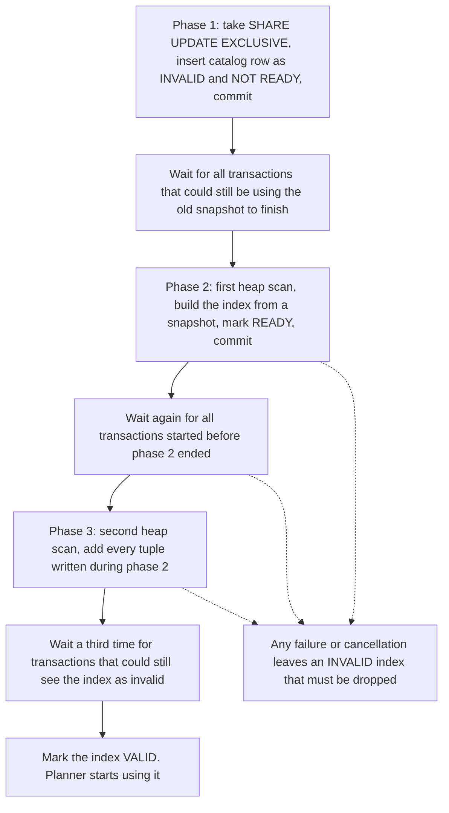

## 20.14 Creating indexes in production

### 20.14.1 CREATE INDEX CONCURRENTLY, and what it costs you

#### Concept

`CREATE INDEX` takes a **`SHARE` lock** on the table. `SHARE` is compatible with reads and with other `SHARE` holders, and it conflicts with `ROW EXCLUSIVE`, which is what every `INSERT`, `UPDATE` and `DELETE` takes. So a plain `CREATE INDEX` on `orders` blocks **every write to that table** for as long as the build takes. On 200 million rows that is 14 to 40 minutes.

`CREATE INDEX CONCURRENTLY` (often written CIC) takes only a `SHARE UPDATE EXCLUSIVE` lock, which does not conflict with writes. Writes continue throughout. In exchange it does more work, takes roughly two to three times longer, and can fail in a way that leaves a broken index behind.

#### Why does it exist?

Because the alternative is a maintenance window, and modern products do not get maintenance windows for adding an index. Every index you add to a live table after launch must be added concurrently. There is no debate about this; the only question is whether you have the operational discipline the mechanism requires.

#### Mental model

Imagine re-cataloguing a library that stays open. The plain way: lock the doors, catalogue everything, unlock. Fast, correct, and nobody can borrow a book for forty minutes. The concurrent way: walk the shelves and write cards while people are borrowing and returning, then walk the shelves a *second* time to catch everything that moved while you were on the first pass, then wait until every borrower who started before you finished has left, and only then declare the catalogue trustworthy. Slower, more work, and if you trip over halfway you leave a half-written catalogue on the floor that someone must throw away.

#### How it works



The three critical properties:

1. **Two full table scans.** That is why it is slower and why it generates roughly twice the I/O of a plain build.
2. **It waits for concurrent transactions, three times.** Any long-running transaction anywhere in the database, including an idle-in-transaction session or a long analytics query on an unrelated table, blocks the wait. A CIC on a busy database can sit at 99 percent for twenty minutes waiting for one forgotten `psql` session. Kill it first:

   ```sql
   SELECT pid, state, now() - xact_start AS age, left(query, 80)
   FROM pg_stat_activity
   WHERE state <> 'idle' AND xact_start < now() - interval '2 minutes'
   ORDER BY xact_start;
   ```

3. **It cannot run inside a transaction block.** `ERROR: CREATE INDEX CONCURRENTLY cannot run inside a transaction block`. This is the single most common way it fails, because almost every migration framework wraps migrations in a transaction by default.

**The INVALID index.** If CIC fails or is cancelled, PostgreSQL leaves the index in the catalogue marked `indisvalid = false`. That index:

- is **not used by the planner** for queries,
- **is still maintained on every insert and update**, so you pay the entire write cost for zero benefit,
- occupies disk,
- and for a unique index, **still enforces uniqueness**, which can reject writes for a constraint nobody knows exists.

Find and clean them up:

```sql
SELECT c.relname AS index_name, t.relname AS table_name,
       pg_size_pretty(pg_relation_size(c.oid)) AS size
FROM pg_index i
JOIN pg_class c ON c.oid = i.indexrelid
JOIN pg_class t ON t.oid = i.indrelid
WHERE NOT i.indisvalid;
```

```text
        index_name         | table_name |  size
---------------------------+------------+---------
 idx_orders_status_created | orders     | 4218 MB
```

The fix is always the same: `DROP INDEX CONCURRENTLY idx_orders_status_created;` then retry. Never try to "repair" it; a `REINDEX CONCURRENTLY` on an invalid index is not guaranteed to help and PostgreSQL documents dropping and rebuilding as the correct action.

#### Practical example — the safe production recipe

```sql
-- 1. Belts first. Never let DDL queue behind, or ahead of, application traffic.
SET lock_timeout = '5s';
SET statement_timeout = 0;             -- the build itself must not be killed by a timeout
SET maintenance_work_mem = '2GB';      -- big builds are 2 to 4 times faster with memory

-- 2. Check for long transactions that would stall the waits.
SELECT count(*) FROM pg_stat_activity
WHERE xact_start < now() - interval '1 minute' AND state <> 'idle';

-- 3. Build.
CREATE INDEX CONCURRENTLY idx_orders_user_created
  ON orders (user_id, created_at DESC);

-- 4. Verify. This is not optional.
SELECT indisvalid, indisready FROM pg_index WHERE indexrelid = 'idx_orders_user_created'::regclass;

-- 5. Give the planner fresh statistics for the new index's expression, if any.
ANALYZE orders;
```

`lock_timeout` deserves a word. CIC needs a brief `SHARE UPDATE EXCLUSIVE` at the start. If a long `ACCESS EXCLUSIVE` holder (another migration) is in front of it, CIC queues, and **everything behind it queues too**, including ordinary `SELECT`s, because the PostgreSQL lock queue is FIFO and does not let later-arriving compatible requests jump ahead. That is how a single index build takes an entire API down for four minutes without ever holding a conflicting lock itself. `lock_timeout = '5s'` makes the DDL give up instead of starting a pile-up. Part 24 — Database Migrations covers the general pattern; for indexes it is non-negotiable.

Timing on real hardware, `orders` at 200 million rows, `maintenance_work_mem = 2GB`, NVMe:

| Operation | Lock | Duration | Writes blocked |
|---|---|---|---|
| `CREATE INDEX` on `(user_id, created_at)` | `SHARE` | 11 min | Yes, 11 min |
| `CREATE INDEX CONCURRENTLY`, same | `SHARE UPDATE EXCLUSIVE` | 26 min | No |
| Same, with `maintenance_work_mem = 64MB` | `SHARE UPDATE EXCLUSIVE` | 71 min | No |
| `DROP INDEX` | `ACCESS EXCLUSIVE` | under 1 s | Yes, briefly, and blocks reads too |
| `DROP INDEX CONCURRENTLY` | `SHARE UPDATE EXCLUSIVE` | ~5 s | No |

Note the last two rows. `DROP INDEX` takes `ACCESS EXCLUSIVE`, which blocks **reads as well as writes**. It is fast, but if it queues behind a 30-second query, every request to that table stacks up behind it for 30 seconds. Use `DROP INDEX CONCURRENTLY` with `lock_timeout` for anything on a hot table.

#### TypeORM example

TypeORM wraps each migration in a transaction by default, so `CREATE INDEX CONCURRENTLY` inside one fails. The fix is the static `transaction = false` property on the migration class:

```ts
// 1712004500000-AddOrdersUserCreatedIndexConcurrently.ts
import { MigrationInterface, QueryRunner } from 'typeorm';

export class AddOrdersUserCreatedIndexConcurrently1712004500000 implements MigrationInterface {
  // Tells TypeORM not to wrap this migration in BEGIN/COMMIT.
  // Without it: "CREATE INDEX CONCURRENTLY cannot run inside a transaction block"
  public transaction = false as const;

  public async up(queryRunner: QueryRunner): Promise<void> {
    await queryRunner.query(`SET lock_timeout = '5s'`);
    await queryRunner.query(`SET statement_timeout = 0`);
    await queryRunner.query(`SET maintenance_work_mem = '2GB'`);
    await queryRunner.query(
      `CREATE INDEX CONCURRENTLY IF NOT EXISTS idx_orders_user_created
         ON orders (user_id, created_at DESC)`,
    );
    // Fail the migration loudly if the build ended up INVALID.
    const [{ ok }] = await queryRunner.query(
      `SELECT indisvalid AS ok FROM pg_index WHERE indexrelid = 'idx_orders_user_created'::regclass`,
    );
    if (!ok) throw new Error('idx_orders_user_created is INVALID; drop it and retry');
  }

  public async down(queryRunner: QueryRunner): Promise<void> {
    await queryRunner.query(`DROP INDEX CONCURRENTLY IF EXISTS idx_orders_user_created`);
  }
}
```

Three details that matter. `IF NOT EXISTS` makes a retry after a partial failure idempotent *only* if you dropped the invalid index first, so keep the validity check. `transaction = false` means **this migration is not atomic**: if it does three things and the second fails, the first is not rolled back. Therefore a `transaction = false` migration must do exactly one thing. And `statement_timeout = 0` is essential if your migration role inherits a timeout, because a 26-minute build will otherwise be cancelled at 30 seconds and leave you an invalid index every single time.

#### Sequelize example

Sequelize's `addIndex` supports `concurrently: true`. The transaction problem is the same, and Sequelize's umzug-based runners typically do not wrap migrations in a transaction unless you ask, but check yours:

```js
// migrations/20260909120000-add-orders-user-created-index.js
module.exports = {
  async up(queryInterface) {
    await queryInterface.sequelize.query(`SET lock_timeout = '5s'`);
    await queryInterface.sequelize.query(`SET maintenance_work_mem = '2GB'`);
    await queryInterface.addIndex('orders', {
      name: 'idx_orders_user_created',
      fields: ['user_id', { name: 'created_at', order: 'DESC' }],
      concurrently: true,          // emits CREATE INDEX CONCURRENTLY
    });
  },
  async down(queryInterface) {
    await queryInterface.removeIndex('orders', 'idx_orders_user_created', { concurrently: true });
  },
};
```

If your runner does wrap in a transaction, disable it for this migration (`{ transaction: undefined }` in your own runner config, or run the DDL through a separate connection). Verify by looking at the actual error, not by hoping.

#### NestJS example

A startup guard that refuses to boot when an invalid or missing critical index is detected turns a silent performance cliff into a deploy failure:

```ts
// db-health.service.ts
import { Injectable, Logger, OnApplicationBootstrap } from '@nestjs/common';
import { DataSource } from 'typeorm';

const REQUIRED_INDEXES = ['idx_orders_user_created', 'idx_notifications_pending'];

@Injectable()
export class DbHealthService implements OnApplicationBootstrap {
  private readonly log = new Logger(DbHealthService.name);
  constructor(private readonly ds: DataSource) {}

  async onApplicationBootstrap() {
    const rows: { indexname: string; valid: boolean }[] = await this.ds.query(
      `SELECT c.relname AS indexname, i.indisvalid AS valid
         FROM pg_index i JOIN pg_class c ON c.oid = i.indexrelid
        WHERE c.relname = ANY($1)`,
      [REQUIRED_INDEXES],
    );
    const found = new Map(rows.map((r) => [r.indexname, r.valid]));
    for (const name of REQUIRED_INDEXES) {
      if (!found.has(name)) throw new Error(`Missing required index ${name}`);
      if (!found.get(name)) throw new Error(`Index ${name} is INVALID; drop and rebuild`);
    }
    this.log.log(`Verified ${REQUIRED_INDEXES.length} required indexes`);
  }
}
```

#### Production scenario

A team ships index migrations in a dedicated pipeline stage that runs *before* the application deploy, on a role with `statement_timeout = 0`, `lock_timeout = 5s`, `maintenance_work_mem = 2GB`, and a pre-flight check that fails the pipeline if any transaction older than 60 seconds is running. Each migration adds exactly one index. Rollback is `DROP INDEX CONCURRENTLY`. Nothing about the application deploy depends on the index existing, so a failed build does not block a release; it just gets retried.

#### Failure scenario

At 03:12 a nightly deploy runs `CREATE INDEX CONCURRENTLY` on `order_items` (900 million rows). At 03:38 the pipeline's 30-minute job timeout fires and kills the connection. PostgreSQL leaves `idx_order_items_product_created` as INVALID, 18 GB on disk. Nobody notices, because no query got slower: the planner ignores invalid indexes. Two weeks later the team investigates why `order_items` insert throughput dropped 22 percent and why `pg_wal` grew. The invalid index has been maintained on every one of 4 million daily inserts, for zero benefit, for fourteen days. **`SELECT ... WHERE NOT indisvalid` belongs in your monitoring, not in your incident retrospective.**

#### Edge cases & failure modes

- CIC inside a transaction block: the framework default that bites everyone.
- Long-running transactions stalling the three waits indefinitely; also, on a **hot standby**, a long query on the replica with `hot_standby_feedback = on` holds the primary's horizon and stalls CIC.
- Invalid index left behind after failure, cancellation, deploy timeout, or a `pg_terminate_backend`.
- `CREATE UNIQUE INDEX CONCURRENTLY` failing at the very end because of a duplicate that appeared during the build: you get an invalid index and no useful error location. Deduplicate first and add a partial unique guard if writes continue.
- Disk: a CIC needs room for the full new index plus temp sort files. A 20 GB index build on a volume with 25 GB free will fill the disk and take down the primary.
- Replication lag: the index build streams a lot of WAL. On a synchronous replica this directly slows every commit on the primary.
- `REINDEX` and CIC on the same table conflict.
- Partitioned tables: `CREATE INDEX CONCURRENTLY` is **not supported on a partitioned parent**. Build on each partition concurrently, then `CREATE INDEX ... ON ONLY parent` and `ALTER INDEX parent_idx ATTACH PARTITION child_idx` for each.

#### How a Senior Backend Engineer thinks about this

They treat an index build as an operation with a blast radius, not as a schema edit. They know the exact lock each DDL takes and they set `lock_timeout` before every one. They run one index per migration. They check `indisvalid` afterwards and monitor for it continuously. And they build indexes on a replica-promoted staging copy first, so the duration is known before it happens in production.

#### Common mistakes

- Plain `CREATE INDEX` on a live table.
- Forgetting `transaction = false` and shipping a migration that cannot run.
- A pipeline timeout shorter than the build.
- Not checking `indisvalid`.
- `DROP INDEX` without `CONCURRENTLY` on a hot table during peak.
- Leaving `maintenance_work_mem` at 64 MB, making every build three times longer than necessary.

#### Interview questions

1. *What lock does `CREATE INDEX` take and what does it block?* Expected: `SHARE`; blocks all writes, allows reads.
2. *Walk me through what CONCURRENTLY does differently.* Expected: two scans, three waits for concurrent transactions, weaker lock, can leave an invalid index.
3. *Why can't it run inside a transaction, and what does that mean for your migration tool?* Expected: it commits between phases; TypeORM `transaction = false`, one statement per migration, no atomic rollback.
4. *You find an INVALID index. What is the impact and the fix?* Expected: maintained on writes, unused by the planner, still enforces uniqueness if unique; `DROP INDEX CONCURRENTLY` and retry.
5. *How can an index build with a non-blocking lock still take your API down?* Expected: FIFO lock queue behind an `ACCESS EXCLUSIVE` holder; `lock_timeout` prevents the pile-up.

#### Practical exercise

On a 20 million row table, run `CREATE INDEX` in one session while a script inserts rows in another; record how long the inserts block. Repeat with `CONCURRENTLY`. Then start a `BEGIN; SELECT 1;` in a third session, run CIC, and observe it stalling; record how long, and where in the process it waits. Finally kill a CIC halfway and produce the invalid-index detection query output. Acceptance criteria: three timings, one stall observation, and the invalid-index query result.

## 20.15 Index maintenance

### 20.15.1 Bloat, REINDEX CONCURRENTLY, fillfactor and measuring size

#### Concept

Indexes decay. Deleted and updated rows leave dead entries that VACUUM marks reusable but rarely returns to the operating system. Page splits leave leaves half full. Over months a B-tree that should be 4 GB becomes 9 GB, and every scan reads twice the pages it needs to.

**Bloat** is the gap between the size an index has and the size it would have if rebuilt.

#### Why does it exist?

Because PostgreSQL's MVCC design (Parts 8 and 181.7) never removes anything in place, and because returning space to the OS would require rewriting the whole file under an exclusive lock. VACUUM's job is to make space *reusable*, not to shrink files. For a table that keeps growing this is fine, because the free space gets refilled. For an index whose key distribution has changed (a queue table that was once huge, a table after a mass delete), the free space is in the wrong places and never gets reused.

#### Mental model

A filing cabinet where removed files leave empty hanging folders. The cabinet is still four drawers wide even though it holds one drawer of paper. New files can go in the empty folders, but only if they sort into those exact positions. If all your new files are for surnames starting with Z and all your empty folders are under A to F, the cabinet keeps growing.

#### How it works — measuring

Start with plain sizes:

```sql
SELECT
  t.relname AS table_name,
  pg_size_pretty(pg_relation_size(t.oid))          AS heap,
  pg_size_pretty(pg_indexes_size(t.oid))           AS indexes,
  pg_size_pretty(pg_total_relation_size(t.oid))    AS total,
  round(100.0 * pg_indexes_size(t.oid) / nullif(pg_relation_size(t.oid), 0), 1) AS index_pct
FROM pg_class t
WHERE t.relkind = 'r' AND t.relnamespace = 'public'::regnamespace
ORDER BY pg_total_relation_size(t.oid) DESC
LIMIT 10;
```

```text
 table_name    | heap   | indexes | total  | index_pct
---------------+--------+---------+--------+-----------
 notifications | 210 GB | 63 GB   | 273 GB |      30.0
 order_items   | 67 GB  | 41 GB   | 108 GB |      61.2
 orders        | 30 GB  | 19 GB   | 49 GB  |      63.3
 payments      | 26 GB  | 9 GB    | 35 GB  |      34.6
 reviews       | 9.8 GB | 4.1 GB  | 14 GB  |      41.8
```

`index_pct` above roughly 60 percent is a flag, not a verdict: on a lookup-heavy table it can be legitimate. Above 100 percent, you have more index than data and you should be reading 20.20.

Then per index, with the scan counts that tell you whether the size is earning anything:

```sql
SELECT
  s.indexrelname AS index_name,
  s.relname AS table_name,
  pg_size_pretty(pg_relation_size(s.indexrelid)) AS size,
  s.idx_scan, s.idx_tup_read, s.idx_tup_fetch
FROM pg_stat_user_indexes s
WHERE s.relname = 'orders'
ORDER BY pg_relation_size(s.indexrelid) DESC;
```

```text
        index_name         | table_name |  size   | idx_scan  | idx_tup_read | idx_tup_fetch
---------------------------+------------+---------+-----------+--------------+---------------
 idx_orders_user_created   | orders     | 6142 MB | 411882014 |   8214402118 |    4102214882
 orders_pkey               | orders     | 4290 MB | 188204112 |    188204112 |     188204112
 idx_orders_status_created | orders     | 5104 MB |  41882014 |   2114882014 |    1024882014
 idx_orders_created_at     | orders     | 4212 MB |    118204 |   8214402118 |     820221488
 idx_orders_tenant_id      | orders     |  921 MB |         0 |            0 |             0
```

For real bloat estimation, `pgstattuple` measures it directly (it reads the whole index, so run it off-hours or on a replica):

```sql
CREATE EXTENSION IF NOT EXISTS pgstattuple;
SELECT * FROM pgstatindex('idx_orders_status_created');
```

```text
 version | tree_level | index_size | root_block_no | internal_pages | leaf_pages | empty_pages |
 deleted_pages | avg_leaf_density | leaf_fragmentation
---------+------------+------------+---------------+----------------+------------+-------------+
       4 |          3 | 5352079360 |          412 |           2418 |     650800 |           0 |
         28114 |            42.11 |              31.44
```

`avg_leaf_density: 42.11` is the number. A freshly built index at the default `fillfactor = 90` has a density around 88 to 90. At 42 this index is holding less than half the entries it could, so **it is roughly 2.1 times bigger than necessary**: 5.1 GB where 2.4 GB would do. `leaf_fragmentation: 31.44` means leaf pages are out of physical order, so range scans do more random I/O than they should.

Rules of thumb: rebuild when `avg_leaf_density` is under 50 to 60, or when the index is more than about 1.5 times the size of a freshly built copy, **and** the index is actually used.

#### How it works — rebuilding

```sql
-- The safe one. PG 12+. Builds a new index alongside, swaps it, drops the old.
REINDEX INDEX CONCURRENTLY idx_orders_status_created;

-- All indexes on one table, concurrently
REINDEX TABLE CONCURRENTLY orders;

-- The unsafe one: ACCESS EXCLUSIVE for the whole rebuild. Never on a live hot table.
REINDEX INDEX idx_orders_status_created;
```

`REINDEX ... CONCURRENTLY` behaves like CIC: weak lock, two passes, cannot run in a transaction, waits for concurrent transactions, and **can leave an invalid index behind** with a `_ccnew` suffix if it fails:

```sql
SELECT c.relname FROM pg_index i JOIN pg_class c ON c.oid = i.indexrelid WHERE NOT i.indisvalid;
```

```text
      relname
---------------------------------
 idx_orders_status_created_ccnew
```

Drop those with `DROP INDEX CONCURRENTLY` and retry. Also note the disk requirement: `REINDEX CONCURRENTLY` needs space for **both** copies at once, so rebuilding a 20 GB index needs 20 GB free plus sort space.

Before and after on that index:

```text
before: 5104 MB, avg_leaf_density 42.11, range scan 88 ms, buffers read 11204
after:  2402 MB, avg_leaf_density 89.44, range scan 41 ms, buffers read 4881
```

Halving the pages roughly halves the buffers, which roughly halves the time on a cache-miss-bound scan. It also gives you 2.7 GB of `shared_buffers` competition back.

#### Fillfactor

`fillfactor` is how full a page is packed at build time.

| Setting | Default | Effect |
|---|---|---|
| B-tree index `fillfactor` | 90 | Leaves 10 percent free in leaves for in-place growth. Lower it (70 to 80) for indexes on columns with heavy random inserts, to reduce page splits. Raise it (100) for read-only or append-only indexes to make them smaller and denser. |
| Table `fillfactor` | 100 | Leaves no free space, so an update must go to a new page and cannot be HOT. Lower it (85 to 90) on tables with frequent updates to non-indexed columns, so HOT updates stay possible. |

```sql
-- Append-only archive index: pack it tight
CREATE INDEX idx_events_created ON events_archive (created_at) WITH (fillfactor = 100);

-- Hot update table: leave room so HOT updates stay in page
ALTER TABLE inventory SET (fillfactor = 85);
VACUUM FULL inventory;   -- small table; rewrites with the new fillfactor
```

The `inventory` change is a real, measurable win: 400,000 rows updated constantly by stock movements. At `fillfactor = 100`, 71 percent of updates were non-HOT; at 85, 96 percent are HOT, index maintenance on updates dropped accordingly, and the table's bloat growth rate fell by two thirds.

Fillfactor only applies to **new** pages, so changing it requires a rewrite (`VACUUM FULL`, `CLUSTER`, `REINDEX`, or `pg_repack`) to take effect on existing data.

#### Production scenario

A monthly maintenance job, run from a scheduled worker on a Sunday morning, that reindexes only what needs it:

```sql
-- Candidates: used, large, and low density. Run pgstatindex only on the top 20 by size.
WITH big AS (
  SELECT s.indexrelid, s.indexrelname, s.idx_scan, pg_relation_size(s.indexrelid) AS bytes
  FROM pg_stat_user_indexes s
  WHERE pg_relation_size(s.indexrelid) > 1024*1024*1024   -- over 1 GB
  ORDER BY bytes DESC LIMIT 20
)
SELECT b.indexrelname, pg_size_pretty(b.bytes) AS size, b.idx_scan,
       (pgstatindex(b.indexrelid::regclass)).avg_leaf_density
FROM big b
WHERE b.idx_scan > 0
ORDER BY 4 ASC;
```

Anything under 55 percent density gets a `REINDEX INDEX CONCURRENTLY`, one at a time, with `lock_timeout = '5s'` and a check for invalid `_ccnew` leftovers afterwards. `pg_repack` is the alternative when you also need to compact the heap and cannot take `VACUUM FULL`'s `ACCESS EXCLUSIVE` lock.

#### Failure scenario

A `notifications` cleanup job deleted 800 million processed rows over a weekend. The heap did not shrink (expected: the space is reusable) and neither did the 27 GB `created_at` B-tree. But the queue index and the `(user_id, created_at)` index were now 85 percent dead entries in the *old* key ranges, while all new inserts landed at the right edge. `avg_leaf_density` was 14. Queries that read the newest data were fine; the nightly analytics range scans were reading five times the pages they needed and had gone from 40 minutes to 3 hours 20. `REINDEX TABLE CONCURRENTLY notifications` over two nights returned 41 GB of disk and put the job back to 44 minutes.

#### Edge cases & failure modes

- `REINDEX CONCURRENTLY` on a primary key or a constraint-backing index works in PG 12+, but the constraint's index name changes internally; verify the constraint afterwards.
- Invalid `_ccnew` indexes after a failed reindex, doubling storage silently.
- `VACUUM FULL` takes `ACCESS EXCLUSIVE` and rewrites the whole table plus all indexes; on `orders` that is 49 GB of rewriting with the table completely unavailable. It is not a maintenance strategy, it is a last resort.
- Reindexing an unused index: wasted I/O. Check `idx_scan` first.
- Disk exhaustion mid-reindex, which on a primary means the database stops accepting writes.
- Bloat estimation queries based on catalogue statistics (the popular `pgsql-bloat-estimation` queries) are approximations and can be off by 30 percent; `pgstattuple` is exact but expensive.
- On a replica, `pg_stat_user_indexes.idx_scan` counts only the replica's own scans; primary and replica statistics are separate.

#### How a Senior Backend Engineer thinks about this

They trend index sizes over time in Grafana rather than measuring them once. They know that bloat is a symptom and the cause is usually an update pattern or a vacuum that cannot keep up (Parts 8 and 181.8), so they fix autovacuum settings before scheduling monthly reindexes. They never run `VACUUM FULL` on a production table without an agreed window. And they reindex the small number of indexes that are both bloated and used, not everything.

#### Common mistakes

- Scheduling `REINDEX` (non-concurrent) as a cron job.
- Believing `DELETE` shrinks anything.
- Using `VACUUM FULL` for routine maintenance.
- Reindexing an index with `idx_scan = 0` instead of dropping it.
- Not checking free disk before a reindex.
- Ignoring `fillfactor` on a heavily updated table and then fighting the bloat forever.

#### Interview questions

1. *What is index bloat and how do you measure it?* Expected: dead entries plus half-empty pages; `pgstatindex.avg_leaf_density`, size trending, `pgstattuple`.
2. *Difference between `REINDEX`, `REINDEX CONCURRENTLY` and `VACUUM FULL`?* Expected: lock strength, online versus offline, table plus indexes versus index only, disk requirements.
3. *When do you lower table `fillfactor` and why?* Expected: frequently updated tables, to preserve HOT updates and reduce index maintenance.
4. *A 6 GB index has `idx_scan = 0` for 60 days. What do you do?* Expected: verify across all replicas and after a stats reset, then `DROP INDEX CONCURRENTLY` with a rollback plan.
5. *Why did a mass delete not free any disk?* Expected: VACUUM makes space reusable, not returned; only a rewrite shrinks files.

#### Practical exercise

Create a 10 million row table with an index, delete 80 percent of the rows in a scattered pattern, run `VACUUM`, and record `pg_relation_size` and `pgstatindex` before and after. Then run `REINDEX INDEX CONCURRENTLY` and record them again, along with the timing of a range scan at each stage. Finally, set the table `fillfactor` to 85, rewrite it, run 500,000 updates on a non-indexed column, and compare `n_tup_hot_upd` against the same test at `fillfactor = 100`. Acceptance criteria: a six-row measurement table and a written recommendation for your own busiest table.
