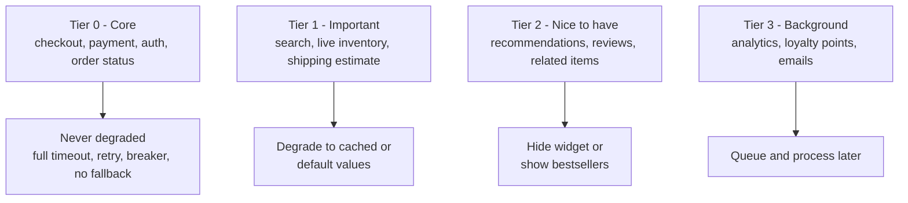

## 20.10 Graceful degradation

#### Concept

Graceful degradation is the practice of keeping the *core* of a product working when a *non-core* part fails, by substituting a cheaper, older or simpler answer for the one you cannot produce right now. The recommendations service is down: show bestsellers. The tax service is down: use yesterday's rate table and flag the order for review. The search cluster is down: fall back to a database `ILIKE`. The write path to the database is down: switch to read-only mode and let people browse. Each of those is a *fallback*, and the sum of them is a product that bends instead of breaking.

#### Why does it exist?

A checkout page calls eight things. If any one failure fails the page, the page's availability is the product of eight availabilities: eight dependencies at 99.9% each give you 99.2%, which is 7 hours of downtime a month. If only two of the eight are truly required and the other six degrade, the page's availability is the product of two: 99.8%, or 90 minutes a month, and those 90 minutes are the payment gateway's problem, not yours. Degradation is how you stop paying for other people's downtime.

#### Mental model

Imagine a restaurant that runs out of a side dish. A badly run one closes for the night. A well-run one tells you "no fries tonight, would you like a salad?" and keeps serving. The kitchen decided in advance which items are essential (the grill) and which have substitutes (the sides). Graceful degradation is the substitute menu, decided in advance.

#### How it works

1. **Classify each feature as core or non-core** with the product owner, per page or per flow. Core means "without this, the flow cannot complete correctly". Everything else is non-core and needs a fallback.
2. **Design the fallback per feature.** The options, roughly in order of preference:
   - **Stale data**: serve the last successful result from a cache with a longer TTL than normal (`stale-while-revalidate` / `stale-if-error` semantics).
   - **Default data**: bestsellers instead of recommendations; a default shipping estimate instead of a live one.
   - **Deferred work**: accept the request, queue the non-core step (email, analytics, loyalty points) for later.
   - **Reduced function**: read-only mode; search without facets; checkout without promo-code validation (or with an allow-list of known codes).
   - **Honest absence**: hide the widget; the page renders without the "people also bought" row.
3. **Trigger it automatically**, from a circuit breaker fallback, a timeout, or a feature flag an operator can flip.
4. **Make it visible**: a metric per fallback (`fallback_served_total{feature}`) and, where the customer is affected, a UI hint ("estimated delivery times are temporarily unavailable").
5. **Degrade non-core first, and in order.** Under overload, shed the cheapest-to-lose feature first (see 20.8): recommendations, then reviews, then live inventory badges, then search facets, and only in the last resort the checkout itself.



The **core vs non-core table** for an e-commerce checkout:

| Step | Core? | Dependency | Fallback |
|---|---|---|---|
| Authenticate user | Yes | Auth service / session store | None (fail request); but cache public keys for JWT verification so auth works while the auth service is down |
| Load cart | Yes | PostgreSQL | None |
| Validate promo code | No | Promo service | Accept known codes from cache; reject unknown codes with "try again later" |
| Calculate tax | Semi | Tax SaaS | Last known rate table (max 24 h old); flag order `tax_estimated = true` |
| Shipping estimate | No | Carrier API | Static estimate ("3–5 days") |
| Reserve inventory | Yes | Inventory service / PostgreSQL | None |
| Charge card | Yes | Payment gateway | None; but if the gateway supports it, "authorize now, capture later" |
| Create order | Yes | PostgreSQL | None; if primary is down, read-only mode for the whole site |
| Send confirmation email | No | Email provider | Queue via outbox; retry for hours |
| Award loyalty points | No | Loyalty service | Queue; eventual consistency |
| Recommendations on the thank-you page | No | Recommendations service | Bestsellers from cache; or hide |
| Analytics event | No | Kafka | Buffer locally and drop after a bound |

#### Practical example

Recommendations are computed by a separate service with a p99 of 400 ms and an availability of 99.5%. The product page calls it with a 500 ms timeout inside a breaker. On timeout, on error, or when the breaker is open, the page uses a `bestsellers:{category}` key in Redis (refreshed hourly by a job). If Redis is *also* down, the page renders without the row. None of those three states produces an error for the customer, and all three are counted.

#### NestJS example

A fallback chain using the breaker's `fallback` hook and a cache with a long "stale" TTL:

```ts
@Injectable()
export class RecommendationsService {
  private readonly log = new Logger(RecommendationsService.name);
  private readonly breaker: CircuitBreaker<[string, string], Product[]>;

  constructor(
    private readonly http: RecommendationsHttp,
    @Inject(REDIS) private readonly redis: Redis,
  ) {
    this.breaker = new CircuitBreaker(
      (userId: string, category: string) => this.http.forUser(userId, category, { timeoutMs: 500 }),
      { name: 'recommendations', timeout: 600, errorThresholdPercentage: 50, volumeThreshold: 20, resetTimeout: 20_000 },
    );
    // Called on failure, timeout, or when the breaker is open.
    this.breaker.fallback((_userId: string, category: string) => this.bestsellers(category));
    this.breaker.on('fallback', () => fallbackServed.inc({ feature: 'recommendations' }));
  }

  forUser(userId: string, category: string): Promise<Product[]> {
    return this.breaker.fire(userId, category);
  }

  private async bestsellers(category: string): Promise<Product[]> {
    try {
      const cached = await this.redis.get(`bestsellers:${category}`);   // refreshed hourly by a job
      return cached ? (JSON.parse(cached) as Product[]) : [];
    } catch (err) {
      this.log.warn({ msg: 'bestsellers cache unavailable', err: String(err) });
      return [];                                                          // honest absence
    }
  }
}
```

Read-only mode, the whole-site degradation for a primary database outage, as a guard driven by a flag that the failover watcher (20.11) or an operator can set:

```ts
@Injectable()
export class ReadOnlyModeGuard implements CanActivate {
  constructor(private readonly flags: FeatureFlagsService) {}

  canActivate(ctx: ExecutionContext): boolean {
    const req = ctx.switchToHttp().getRequest<Request>();
    const mutating = !['GET', 'HEAD', 'OPTIONS'].includes(req.method);
    if (mutating && this.flags.isOn('read_only_mode')) {
      throw new ServiceUnavailableException({ code: 'READ_ONLY', message: 'Ordering is paused for maintenance. Browsing still works.' });
    }
    return true;
  }
}
```

`FeatureFlagsService` should read from an in-memory copy refreshed every few seconds from Redis or a config service, so that flipping the flag does not itself depend on the thing that is down.

#### PostgreSQL example

Read-only mode has a database-level counterpart. When the primary is unavailable and a replica is promoted with a delay, or when you deliberately fail reads to a replica during maintenance:

```sql
-- On a replica, writes fail with SQLSTATE 25006 (read_only_sql_transaction).
-- The app maps 25006 to the READ_ONLY response instead of a 500.
INSERT INTO orders (id, user_id, total_cents) VALUES (gen_random_uuid(), 'u1', 4200);
-- ERROR:  cannot execute INSERT in a read-only transaction

-- Detect where you are:
SELECT pg_is_in_recovery();   -- true on a replica
```

And "stale but present" has a database form too: a materialized view refreshed periodically serves a dashboard when the live aggregation query is too expensive or its source is unavailable:

```sql
CREATE MATERIALIZED VIEW category_bestsellers AS
SELECT category_id, product_id, count(*) AS sales
  FROM order_items oi JOIN orders o ON o.id = oi.order_id
 WHERE o.created_at > now() - interval '7 days'
 GROUP BY category_id, product_id;
CREATE UNIQUE INDEX ON category_bestsellers (category_id, product_id);
-- Hourly: REFRESH MATERIALIZED VIEW CONCURRENTLY category_bestsellers;
```

#### Production scenario

A grocery-delivery app's home page composes 11 backend calls. After a degradation review, 3 are core (session, cart, store hours) and 8 have fallbacks. Over six months, the fallback metrics show: recommendations fallback served 2.1% of the time; delivery-slot estimate fallback 0.4%; promo banner fallback 6% (the marketing service is flaky); nothing else above 0.1%. Page availability as measured by synthetic checks: 99.97%, against a raw dependency-product availability of about 99.3%. The degradation work was two engineer-weeks.

#### Failure scenario

A fallback that was *too* graceful: the tax service fallback used "last known rates" with no age limit. The tax SaaS API key expired silently; the breaker opened; the fallback served rates from the day the key expired, for **five weeks**, during which a state changed its rate. Nobody noticed because nothing was failing; `fallback_served_total` had been rising, but no alert was attached. The company under-collected tax on 40,000 orders. Fixes: a maximum age on stale fallbacks (24 h for tax, then fail the step and route orders to manual review), and an alert whenever any fallback rate exceeds 1% for more than 15 minutes. Degradation must be *visible*, and stale data must have an expiry.

#### Edge cases & failure modes

- **Fallback with no age limit** serves data that is wrong, not just old.
- **Fallback that depends on the same failed dependency** (bestsellers from the recommendation service's own cache).
- **Silent degradation**: no metrics, no alert, no UI hint; the business runs degraded for weeks.
- **Fallback that changes semantics**: "accept unknown promo codes" is a revenue leak, "reject unknown codes" is a conversion hit; the product owner must choose.
- **Degrading core by accident** because the classification was never written down.
- **Read-only mode that is not enforced at the database**: a background job still writes to the primary while the site shows "maintenance".
- **Fallback that is slower than the real thing** (a database `ILIKE` on 5 million rows as a search fallback) and takes the database down too. Bound the fallback's cost.
- **Queued work from a degradation replayed all at once** on recovery: 200,000 emails in five minutes. Rate-limit the drain.

#### How a Senior Backend Engineer thinks about this

They run the core/non-core classification as a workshop with product, because it is a product decision with an engineering implementation. They design the fallback *before* the feature ships, since bolting it on later means touching every caller. They make stale data carry its age and enforce a maximum. They alert on fallback rates, not just on errors, because "everything is green and we are serving garbage" is the worst incident type. And they prefer honest absence over a fake answer: hiding a widget is fine; inventing a delivery date is not.

To a product manager: "If the recommendations engine breaks, customers see bestsellers instead of an error. If the payment provider breaks, there is no substitute, so we tell them clearly and ask them to try again in a minute. We decide together which features get a Plan B."

#### Common mistakes

- Treating every dependency as core, so any failure fails the page.
- Fallbacks with no observability.
- Caching stale data without recording *when* it was cached.
- A feature-flag system for degradation that lives in the database that is down.

#### Interview questions

1. *How do you decide which features to degrade and in what order?* Expected: core/non-core classification with product; degrade cheapest-to-lose first; never core.
2. *What are the main fallback strategies, in order of preference?* Expected: stale data, defaults, deferred work, reduced function, honest absence.
3. *What went wrong in the "five weeks of stale tax rates" story and how would you prevent it?* Expected: unbounded staleness and no alert on fallback rate; add max age and alerts.
4. *How would you implement site-wide read-only mode in NestJS, and where must it also be enforced?* Expected: a guard on mutating methods driven by an in-memory flag; also stop writers (jobs, consumers); map PostgreSQL `25006`.

#### Practical exercise

For a product page that calls recommendations, reviews and live inventory, implement fallbacks (bestsellers from Redis, hide reviews, "in stock" from a 10-minute cache with `cached_at`), each with a `fallback_served_total{feature}` metric and a max age. Use `toxiproxy` to take each dependency down in turn. Acceptance criteria: the page returns `200` in every case; the response includes a `degraded: ["recommendations"]` field listing active fallbacks; a fallback older than its max age causes the widget to be hidden rather than shown stale.

## 20.11 Failover

#### Concept

Failover is switching to a standby copy of a component when the primary copy fails. It happens on the **server side** (a database promotes a replica; a load balancer stops sending traffic to a dead node; a Multi-AZ deployment moves to the surviving zone) and on the **client side** (your application detects that its connection is dead and reconnects to whatever is now primary; it retries against a second endpoint; it sends reads to a replica when the primary is busy). Server-side failover is mostly infrastructure work. Client-side failover is *your* code, and it is where most failover incidents actually happen.

#### Why does it exist?

Hardware dies, zones lose power, kernels panic, and cloud providers reboot instances for maintenance. A single-copy component has the availability of the single machine, which is roughly 99.5–99.9%. A primary with a synchronous standby in another availability zone can reach 99.95–99.99%, *if* the switch happens automatically and *if* clients follow it correctly. The second "if" is the one this section is about.

#### Mental model

Imagine a shop with a main phone line and a backup line. When the main line goes dead, the phone company reroutes the number to the backup within a minute. But a customer who is mid-call gets cut off and has to redial; and a customer whose phone has cached the old routing keeps calling a dead line until the cache expires. Server-side failover is the phone company's rerouting. Client-side failover is the customer knowing to redial, and not having a stale cache.

#### How it works

**Server side (PostgreSQL on RDS Multi-AZ, or Patroni on Kubernetes):**

1. Health monitoring detects the primary is unresponsive (typically 10–30 s of failed checks).
2. A standby is promoted. With synchronous replication, no committed transaction is lost; with asynchronous, the last few hundred milliseconds of commits may be lost.
3. The DNS name (RDS endpoint) or virtual IP is repointed to the new primary. DNS TTL for RDS endpoints is 5 s; on Kubernetes, the Service endpoints update within a few seconds.
4. Total: typically 30–120 s from failure to writable-again.

**Client side (your NestJS pods):** during and after that window, this is what your process sees and must handle:

| Moment | What the app sees | What the app must do |
|---|---|---|
| Primary dies | In-flight queries error with `ECONNRESET` / `57P01` (admin shutdown) / socket hang up | Fail the in-flight request as *unknown outcome*; do not retry non-idempotent writes |
| Standby not yet promoted | New connections: `ECONNREFUSED` or connect timeout | Fail fast (1 s connect timeout); return `503` with `Retry-After`; enter read-only mode if replicas are reachable |
| DNS repointed | Existing pooled connections are dead; new ones go to the new primary | **Discard dead pooled connections**; do not cache DNS beyond TTL; reconnect with jittered backoff |
| New primary writable | Writes succeed again | Leave read-only mode; drain deferred work slowly |
| Old primary comes back as a replica | Nothing, if DNS is right; `25006 read-only` errors if a client cached the old IP | Treat `25006` on the "primary" as "I am on the wrong host": drop the connection and re-resolve |

The three client-side failures that matter most:

- **DNS caching.** Node does not cache DNS by itself, but `dns.lookup` uses the OS resolver, and some base images and some libraries (or a `cacheable-lookup` you added for performance) cache for longer than the TTL. Respect TTL; on `ECONNREFUSED` force a re-resolve.
- **Pool holding dead connections.** `pg.Pool` discovers a connection is dead only when a query fails on it. After failover, the next N queries (one per pooled connection) each fail once. Handle this by retrying *connection-level* errors once on a fresh connection for idempotent operations, and by letting the pool's `idleTimeoutMillis` and error handling evict the dead ones.
- **Writes during the window.** Anything that must not be lost goes to the outbox/queue (Part 19), not to a "retry later in memory" list that dies with the pod.

#### Practical example

An orders service on RDS Multi-AZ. The pool has `connectionTimeoutMillis: 1000`, `idleTimeoutMillis: 10000`, and an `error` handler that logs and discards. A `DatabaseHealthWatcher` runs `SELECT pg_is_in_recovery()` every 2 s; if the query fails for 3 consecutive checks the service flips `read_only_mode` on (browsing still works via the replica pool); when a check succeeds and returns `false`, it flips the flag off. During a 70 s RDS failover the site served browsing throughout, returned `503 READ_ONLY` for 61 s of checkout attempts, and lost zero orders.

#### NestJS example

A watcher that drives read-only mode from the primary's reachability, and a wrapper that retries idempotent reads once on a fresh connection after a connection-level error:

```ts
@Injectable()
export class DatabaseFailoverWatcher implements OnModuleInit, OnModuleDestroy {
  private readonly log = new Logger(DatabaseFailoverWatcher.name);
  private failures = 0;
  private timer?: NodeJS.Timeout;

  constructor(
    @InjectDataSource() private readonly primary: DataSource,
    private readonly flags: FeatureFlagsService,
  ) {}

  onModuleInit() { this.timer = setInterval(() => void this.probe(), 2_000); this.timer.unref(); }
  onModuleDestroy() { if (this.timer) clearInterval(this.timer); }

  private async probe() {
    try {
      const [{ pg_is_in_recovery }] = await this.primary.query('SELECT pg_is_in_recovery()');
      if (pg_is_in_recovery) throw new Error('connected to a replica as primary');  // stale DNS
      if (this.failures > 0) this.log.warn({ msg: 'primary reachable again', after: this.failures });
      this.failures = 0;
      this.flags.set('read_only_mode', false);
    } catch (err) {
      this.failures++;
      if (this.failures === 3) {
        this.log.error({ msg: 'primary unreachable, entering read-only mode', err: String(err) });
        this.flags.set('read_only_mode', true);
      }
    }
  }
}

const CONNECTION_ERRORS = new Set(['ECONNRESET', 'ECONNREFUSED', 'EPIPE', '57P01', '57P02', '57P03', '08006', '08001']);

/** Retry idempotent reads once when the pooled connection turned out to be dead. */
export async function readWithFailover<T>(fn: () => Promise<T>): Promise<T> {
  try { return await fn(); }
  catch (err) {
    const code = (err as { code?: string }).code ?? '';
    if (!CONNECTION_ERRORS.has(code)) throw err;
    return fn();   // pool hands out a fresh connection; the dead one was discarded on error
  }
}
```

The two `TypeOrmModule.forRoot` registrations for primary and replica pools were shown in 20.6; the replica pool is what keeps `GET` routes alive in read-only mode. TypeORM also supports `replication: { master, slaves }` in the DataSource options, routing `find`/`SELECT` to replicas automatically and writes to the master. It is convenient, but keep in mind that automatic routing sends *every* read to a replica, including reads inside a write flow that must see the latest data; use `queryRunner` with `'master'` explicitly for those.

#### PostgreSQL example

What the database shows during and after a failover, and the settings that make clients behave:

```sql
-- On the newly promoted primary:
SELECT pg_is_in_recovery();                 -- false
SELECT pg_last_wal_replay_lsn();            -- null on a primary

-- On a client that is still talking to the demoted old primary (now replica):
INSERT INTO orders ...;                     -- ERROR 25006: cannot execute INSERT in a read-only transaction

-- libpq/pg connection option that helps (supported by node-postgres via the connection string):
-- postgresql://host1:5432,host2:5432/shop?target_session_attrs=read-write
-- With two hosts and target_session_attrs=read-write, the client tries each host and
-- keeps only the one that accepts writes: client-side failover without DNS.
```

Also relevant: `synchronous_commit = on` with a synchronous standby (`synchronous_standby_names`) ensures zero data loss at the cost of write latency (typically +1–3 ms in-region), while `remote_apply` additionally guarantees the standby has applied the change before commit returns, which makes replica reads consistent immediately after failover.

#### Sequelize example

```ts
export const sequelize = new Sequelize('shop', null as unknown as string, null as unknown as string, {
  dialect: 'postgres',
  replication: {
    write: { host: process.env.PG_PRIMARY_HOST, username: 'app_api', password: process.env.PG_PASSWORD },
    read: [
      { host: process.env.PG_REPLICA_1, username: 'app_ro', password: process.env.PG_RO_PASSWORD },
      { host: process.env.PG_REPLICA_2, username: 'app_ro', password: process.env.PG_RO_PASSWORD },
    ],
  },
  pool: { max: 20, acquire: 1_000, idle: 10_000 },
});
// Sequelize routes SELECT to a read replica (round-robin) and everything else to write.
// Force a read to the primary inside a write flow with { useMaster: true } on the query options.
```

#### Production scenario

Redis Sentinel or Elasticache with automatic failover promotes a replica in 5–30 s. `ioredis` with Sentinel configuration (`sentinels: [...]`, `name: 'mymaster'`) re-resolves the master from the sentinels on reconnect; with a plain host it reconnects to the same DNS name, which Elasticache repoints. During the window, commands fail with `READONLY You can't write against a read only replica` if a client lands on the old master, and `ioredis` treats `READONLY` as a reason to reconnect. With `enableOfflineQueue: false` and `commandTimeout: 300` (20.4) the cache returns fast errors for the window and the app treats every read as a miss; database load rises about 2.5x for 20 s and returns to normal. That is the designed behaviour, and the capacity plan accounts for it.

#### Failure scenario

At 04:31 RDS performed an unplanned Multi-AZ failover. The service recovered in 90 s, except one pod that stayed broken for 40 minutes, returning `500` on every write. Its logs showed `25006 cannot execute INSERT in a read-only transaction`. That pod's base image ran `nscd` with a 30-minute positive DNS cache; it kept connecting to the *old* primary, now a replica, on every new connection. The other pods, on a newer image without `nscd`, followed the RDS endpoint's 5 s TTL. Fixes: remove `nscd`, treat `25006` on the primary pool as "wrong host" (drop the pool and re-resolve), and make the readiness probe fail if `pg_is_in_recovery()` is true on the primary connection so Kubernetes stops routing to a confused pod.

#### Edge cases & failure modes

- **Split brain**: the old primary still accepts writes because it did not notice it was demoted; a client with a cached address writes to it; those writes are lost. Fencing (Patroni, RDS) prevents this on the server side; `target_session_attrs=read-write` and `pg_is_in_recovery()` checks protect you on the client side.
- **Asynchronous replication loses the tail.** Orders committed in the last 200 ms before the crash may not exist on the new primary. The outbox and idempotent clients let them be safely re-submitted.
- **Replica lag after failover**: the new primary's replicas re-sync; reads may be stale for minutes. Route consistency-critical reads to the primary.
- **Connection storm on recovery**: 40 pods x 20 connections reconnect at once; jittered backoff (20.4) and `max` on each pool bound it.
- **In-flight transactions during failover** are lost; the app must treat the error as unknown outcome.
- **Client library "reconnect" that replays buffered commands** (Redis offline queue) executes stale writes after failover.
- **Health checks that depend on the primary** mark every pod unready during failover and remove all capacity (20.12); readiness should reflect "can I serve *something*", not "is every dependency perfect".

#### How a Senior Backend Engineer thinks about this

They assume the database *will* fail over, and they test it: a game day (20.15) where someone triggers an RDS reboot-with-failover in staging while load runs. They watch for the three client-side sins (stale DNS, dead pooled connections, non-idempotent retries) and fix them before production finds them. They use `target_session_attrs=read-write` or a proxy (RDS Proxy, PgBouncer) to make client-side failover boring. They keep a read-only mode ready because it turns a 90 s outage into a 90 s "browsing only" period. And they know the difference between synchronous and asynchronous replication in terms of *which orders they might lose*, and have written that down for the business.

#### Common mistakes

- Never testing failover, so the first real one is a surprise.
- Retrying writes after a connection error without idempotency keys.
- DNS caches (`nscd`, `cacheable-lookup`, custom `lookup` functions) that outlive the TTL.
- Reading your own writes from a replica immediately after failover.
- Assuming a pooled connection is alive because it was five seconds ago.

#### Interview questions

1. *Walk through what your NestJS pods see during an RDS Multi-AZ failover and what they must do at each step.* Expected: the table above; unknown-outcome handling; pool eviction; DNS TTL; read-only mode.
2. *What is `target_session_attrs=read-write` and why does it help?* Expected: libpq tries multiple hosts and keeps the writable one; client-side failover without DNS dependency.
3. *Synchronous vs asynchronous replication: what does each mean for data loss at failover?* Expected: sync loses nothing but adds write latency; async can lose the last few hundred milliseconds.
4. *A pod keeps getting `25006` after failover while others are fine. What happened?* Expected: stale DNS cache; connected to the demoted primary; fix DNS and detect the condition.

#### Practical exercise

Run PostgreSQL primary and replica in Docker with `repmgr` or Patroni (or simulate with two containers and manual promotion). Point a NestJS app at a DNS name (or a `pg` multi-host connection string with `target_session_attrs=read-write`). While `autocannon` drives 50 RPS of writes, kill the primary and promote the replica. Acceptance criteria: the app enters read-only mode within 6 s, `GET` routes keep returning `200` from the replica pool, no write returns `500` (only `503 READ_ONLY`), and the app resumes writes within 10 s of promotion without a restart.
