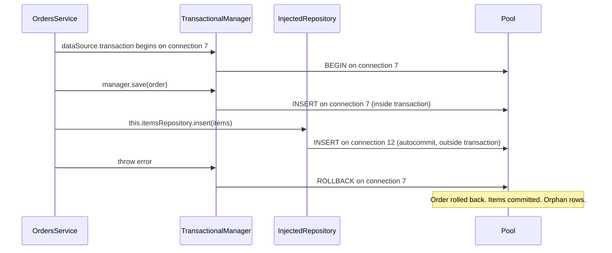

## 20.11 TypeORM transactions

Everything above was SQL. Now we map it onto TypeORM as used inside NestJS, where most of the transaction bugs we see in code review come from one source: not understanding that a TypeORM transaction is *a specific pooled connection*, and that any query not routed through that connection is not in the transaction.

### 20.11.1 `dataSource.transaction(async (manager) => ...)`

The callback API. TypeORM creates a `QueryRunner`, takes a connection from the pool, issues `START TRANSACTION`, runs your callback with an `EntityManager` bound to that connection, then `COMMIT` if the callback resolves or `ROLLBACK` if it throws, and releases the connection in all cases.

```ts
const order = await this.dataSource.transaction(async (manager) => {
  const order = await manager.save(Order, { userId, status: 'CREATED' });   // this connection
  await manager.insert(OrderItem, items.map((i) => ({ ...i, orderId: order.id }))); // same connection
  return order;                                                              // resolve => COMMIT
});
```

Rules: return or throw, never swallow; every query goes through `manager`; the callback's promise must settle before you consider the work done (do not fire-and-forget inside it).

### 20.11.2 The `QueryRunner` manual flow

Use it when the transaction must be controlled across method boundaries or when you need `SET LOCAL` before your first statement and want full visibility.

```ts
const queryRunner = this.dataSource.createQueryRunner();
await queryRunner.connect();                       // acquire pooled connection
await queryRunner.startTransaction('REPEATABLE READ');
try {
  await queryRunner.query(`SET LOCAL lock_timeout = '1s'`);
  await queryRunner.manager.update(Product, { id }, { stock: () => 'stock - 1' });
  await queryRunner.commitTransaction();
} catch (err) {
  await queryRunner.rollbackTransaction();         // safe to call even if commit threw
  throw err;
} finally {
  await queryRunner.release();                     // never skip; a leaked runner is a leaked connection
}
```

`release()` in `finally` is not optional. A `QueryRunner` that is never released holds its connection forever; after `pool.max` such leaks the application hangs on every query. Releasing twice throws `QueryRunnerAlreadyReleasedError`, so structure the code so `release()` runs exactly once.

### 20.11.3 Isolation level parameter

`dataSource.transaction('SERIALIZABLE', cb)`, `manager.transaction('REPEATABLE READ', cb)` and `queryRunner.startTransaction('SERIALIZABLE')` all emit `START TRANSACTION` followed by `SET TRANSACTION ISOLATION LEVEL ...`. Combine with the retry wrapper from section 20.2 for anything above `READ COMMITTED`.

### 20.11.4 Repository versus manager: the number one bug



The injected `Repository<T>` from `@InjectRepository()` is bound to `dataSource.manager`, which uses *any* free pooled connection in autocommit mode. Calling it inside a transaction callback runs the query on a different connection, outside the transaction. Worse, if the transaction holds a lock that the repository's query needs, the request deadlocks against itself: connection 7 holds the lock and waits for the callback to finish; connection 12 waits for the lock. The request hangs until `lock_timeout` or forever.

The fix is mechanical: inside a transaction, obtain everything from the transactional manager.

```ts
await this.dataSource.transaction(async (manager) => {
  const orders = manager.getRepository(Order);          // bound to the transaction
  const items = manager.withRepository(this.itemsRepository); // custom repository, rebound to the transaction
  const order = await orders.save({ userId, status: 'CREATED' });
  await items.insert(lines.map((l) => ({ ...l, orderId: order.id })));
});
```

`manager.withRepository(repo)` (TypeORM 0.3) returns a copy of a custom repository whose manager is the transactional one, so custom methods keep working.

### 20.11.5 Propagating a transaction across services

Once `OrdersService.place()` needs `InventoryService.reserve()` and `PaymentsService.record()` inside the same transaction, you need a way to hand the transactional manager around. Three options, from explicit to magical.

**Option A: pass the `EntityManager` as a parameter.** Simple, visible, testable. Every service method that can participate takes an optional `manager` and defaults to the injected one.

```ts
// src/inventory/inventory.service.ts
@Injectable()
export class InventoryService {
  constructor(@InjectRepository(Product) private readonly products: Repository<Product>) {}

  async reserve(productId: string, qty: number, manager?: EntityManager): Promise<void> {
    const repo = manager ? manager.getRepository(Product) : this.products;
    const r = await repo
      .createQueryBuilder()
      .update(Product)
      .set({ stock: () => 'stock - :qty' })
      .where('id = :id AND stock >= :qty', { id: productId, qty })
      .execute();
    if (r.affected !== 1) throw new ConflictException('Insufficient stock');
  }
}

// src/orders/orders.service.ts
await this.dataSource.transaction(async (manager) => {
  const order = await manager.save(Order, { userId, status: 'CREATED' });
  for (const line of lines) await this.inventory.reserve(line.productId, line.qty, manager);
  await this.payments.record(order.id, total, manager);
});
```

**Option B: `AsyncLocalStorage` (CLS) with a small context service.** The transactional manager is stored in async-local storage for the duration of the callback; repositories look it up.

```ts
// src/database/transaction-context.ts
import { Injectable } from '@nestjs/common';
import { AsyncLocalStorage } from 'node:async_hooks';
import { DataSource, EntityManager } from 'typeorm';
import { IsolationLevel } from 'typeorm/driver/types/IsolationLevel';

@Injectable()
export class TransactionContext {
  private readonly als = new AsyncLocalStorage<EntityManager>();
  constructor(private readonly dataSource: DataSource) {}

  /** The manager to use right now: transactional if inside run(), otherwise the default one. */
  get manager(): EntityManager {
    return this.als.getStore() ?? this.dataSource.manager;
  }

  /** Join an existing transaction or start a new one. */
  run<T>(work: () => Promise<T>, isolation: IsolationLevel = 'READ COMMITTED'): Promise<T> {
    if (this.als.getStore()) return work();
    return this.dataSource.transaction(isolation, (manager) => this.als.run(manager, work));
  }
}

// Any service: no manager parameter, no injected repository.
@Injectable()
export class InventoryService {
  constructor(private readonly tx: TransactionContext) {}
  async reserve(productId: string, qty: number): Promise<void> {
    const r = await this.tx.manager.getRepository(Product).decrement({ id: productId }, 'stock', qty);
    // decrement() has no conditional WHERE; use the query builder form above for stock checks
  }
}
```

**Option C: `typeorm-transactional`.** A maintained package that does option B for you with a `@Transactional()` decorator, propagation modes and post-commit hooks.

```ts
// main.ts, before NestFactory.create
import { initializeTransactionalContext, StorageDriver } from 'typeorm-transactional';
initializeTransactionalContext({ storageDriver: StorageDriver.AUTO });

// app.module.ts
TypeOrmModule.forRootAsync({
  useFactory: (config: ConfigService) => ({ type: 'postgres', url: config.get('DATABASE_URL'), autoLoadEntities: true }),
  inject: [ConfigService],
  async dataSourceFactory(options) {
    return addTransactionalDataSource(new DataSource(options));
  },
});

// orders.service.ts
import { Transactional, Propagation, IsolationLevel, runOnTransactionCommit } from 'typeorm-transactional';

@Injectable()
export class OrdersService {
  @Transactional({ isolationLevel: IsolationLevel.READ_COMMITTED })
  async place(dto: PlaceOrderDto): Promise<Order> {
    const order = await this.orders.save({ ... });          // injected repositories are patched to use the context
    await this.inventory.reserve(...);                        // joins the same transaction (Propagation.REQUIRED)
    runOnTransactionCommit(() => this.events.emit('order.placed', order.id)); // after COMMIT only
    return order;
  }
}
```

Tradeoffs: option A is boring and never surprises anyone; option B is 20 lines you own; option C is convenient but every injected repository now silently depends on the context being initialised, and a missed `initializeTransactionalContext()` in a worker entrypoint or a test means queries quietly run outside transactions. Whichever you choose, use one; mixing them is how the "number one bug" comes back.

### 20.11.6 Nested transactions and savepoints

In TypeORM 0.3, starting a transaction on a query runner that is already in one creates a savepoint (`SAVEPOINT typeorm_1`), and rolling back at that depth rolls back to it. `manager.transaction(cb)` on a *transactional* manager reuses its query runner, so it nests as a savepoint. `dataSource.transaction(cb)` always creates a *new* query runner and therefore a *separate* transaction on a separate connection, even when called from inside another transaction. That difference is a frequent source of self-deadlock.

### 20.11.7 Locks in `find` options

```ts
await manager.find(Product, { where: { id: In(ids) }, order: { id: 'ASC' }, lock: { mode: 'for_no_key_update' } });
await manager.findOne(Job, { where: { status: 'PENDING' }, lock: { mode: 'pessimistic_write', onLocked: 'skip_locked' } });
```

Pessimistic modes require an active transaction (`PessimisticLockTransactionRequiredError` otherwise). With `relations`, the lock applies to joined tables too unless you pass `lock.tables`. Section 20.6 lists the modes.

### 20.11.8 The `@Transaction()` decorator is gone

TypeORM 0.2 shipped `@Transaction()`, `@TransactionManager()` and `@TransactionRepository()` decorators. They were deprecated and removed in 0.3 because they tied transaction handling to method signatures and broke under dependency injection. If you see them in a codebase, it is on 0.2 and overdue for an upgrade; replace with `dataSource.transaction` or one of the propagation options above.

### 20.11.9 Testing transactions

Three layers of tests are worth writing.

1. **Rollback test.** Call the service with a failure injected after the first write (a spy that throws on the second `insert`), then assert the first write is absent. This catches the injected-repository bug directly.
2. **Concurrency test.** Run two calls in parallel with `Promise.allSettled` against a real PostgreSQL (Docker or Testcontainers; not SQLite, which has different locking) and assert the invariant: exactly one success, correct final stock.
3. **Leak test.** After the suite, assert `dataSource.driver` pool has no checked-out connections (`(dataSource.driver as PostgresDriver).master.totalCount` versus `idleCount` with the `pg` pool), or simply run the suite with `pool.max = 2` so a leak surfaces as a hang.

```ts
// test/checkout.concurrency.spec.ts (excerpt)
it('sells the last unit exactly once', async () => {
  await dataSource.query(`UPDATE products SET stock = 1 WHERE id = $1`, [productId]);
  const results = await Promise.allSettled([
    service.checkout(userA, [{ productId, qty: 1 }]),
    service.checkout(userB, [{ productId, qty: 1 }]),
  ]);
  expect(results.filter((r) => r.status === 'fulfilled')).toHaveLength(1);
  const [{ stock }] = await dataSource.query(`SELECT stock FROM products WHERE id = $1`, [productId]);
  expect(stock).toBe(0);
});
```

Avoid "wrap each test in a transaction and roll back" for code that opens its own transactions: `dataSource.transaction` takes a new connection, so it does not nest inside the test's transaction and the rollback does not cover it. Truncate tables between tests instead, or use one schema per Jest worker.

## 20.12 Sequelize transactions

### 20.12.1 Managed transactions

```ts
await this.sequelize.transaction(async (t) => {
  const order = await Order.create({ userId, status: 'CREATED' }, { transaction: t });
  await OrderItem.bulkCreate(lines.map((l) => ({ ...l, orderId: order.id })), { transaction: t });
});
// resolves => COMMIT; throws => ROLLBACK; the connection is returned in both cases
```

### 20.12.2 Unmanaged transactions

```ts
const t = await this.sequelize.transaction();
try {
  await Order.create({ userId, status: 'CREATED' }, { transaction: t });
  await t.commit();
} catch (err) {
  await t.rollback();   // rollback after a failed commit is safe; Sequelize tracks the state
  throw err;
}
```

Needed when the transaction spans callbacks you do not control, for example a stream consumer that commits per batch.

### 20.12.3 Passing `{ transaction: t }` to every query, and the bug when you forget

Sequelize has no ambient transaction unless you enable CLS. Every `create`, `update`, `findAll`, `increment`, `destroy`, `bulkCreate`, `count` and raw `sequelize.query` inside the callback must receive `{ transaction: t }`. One that does not runs on a different pooled connection in autocommit mode: it is not rolled back with the others, it does not see the transaction's uncommitted writes, and it can block on the transaction's own locks (a self-deadlock that ends only at `lock_timeout` or pool timeout). The same bug hides inside associations: `order.createItem(...)`, `product.getTags(...)` and instance `save()` also take `{ transaction: t }`.

### 20.12.4 CLS: `cls-hooked` and `AsyncLocalStorage`

Sequelize v6 can pick up the current transaction from a continuation-local-storage namespace, so you stop passing `t` everywhere:

```ts
// src/database/sequelize-cls.ts, imported before SequelizeModule.forRootAsync runs
import { createNamespace } from 'cls-hooked';
import { Sequelize } from 'sequelize';

export const sequelizeNamespace = createNamespace('sequelize-transactions');
Sequelize.useCLS(sequelizeNamespace);

// Later, anywhere:
await this.sequelize.transaction(async () => {
  await Order.create({ ... });             // automatically uses the transaction
  await this.inventory.reserve(productId); // any query inside this async chain joins it
});
```

`useCLS` is a static, process-wide setting; call it once before any `Sequelize` instance is created. Explicit `{ transaction: t }` still overrides CLS, and `{ transaction: null }` opts a query *out* (useful for writing an audit row that must survive rollback). Sequelize v7 (in alpha at the time of writing) uses Node's `AsyncLocalStorage` natively and enables this behaviour by default. With `@nestjs/sequelize`, call `Sequelize.useCLS()` in a module file that is imported before the root module.

### 20.12.5 Isolation levels

```ts
import { Transaction } from 'sequelize';
await this.sequelize.transaction({ isolationLevel: Transaction.ISOLATION_LEVELS.REPEATABLE_READ }, async (t) => { ... });
// Or a default for all transactions:
new Sequelize(url, { isolationLevel: Transaction.ISOLATION_LEVELS.READ_COMMITTED });
```

Serialization failures surface as `DatabaseError` with `original.code === '40001'`; wrap with the same retry loop as TypeORM.

### 20.12.6 Locks

```ts
await Product.findAll({ where: { id: ids }, order: [['id', 'ASC']], lock: t.LOCK.NO_KEY_UPDATE, transaction: t });
await Job.findOne({ where: { status: 'PENDING' }, lock: t.LOCK.UPDATE, skipLocked: true, transaction: t });
await Order.findByPk(id, { lock: { level: t.LOCK.UPDATE, of: Order }, include: [OrderItem], transaction: t }); // FOR UPDATE OF orders only
```

`lock: true` is shorthand for `t.LOCK.UPDATE`. `NOWAIT` is not exposed; use a raw query.

### 20.12.7 Hooks inside transactions and `afterCommit`

Model hooks receive the query options, including `transaction`. Any query a hook makes must forward it, or the hook's write escapes the transaction:

```ts
Order.addHook('afterCreate', async (order, options) => {
  await AuditLog.create({ entity: 'order', entityId: order.id, action: 'created' }, { transaction: options.transaction });
});
```

Side effects that must only happen if the transaction commits go through `afterCommit`, which is a method on the transaction object, not a model hook:

```ts
Order.addHook('afterCreate', (order, options) => {
  const publish = () => this.kafka.emit('order.created', { id: order.id });
  if (options.transaction) options.transaction.afterCommit(publish);
  else publish();
});
```

`afterCommit` callbacks run after `COMMIT` returns; if the process dies between commit and the callback, the event is lost, which is why the outbox (section 20.8) remains the reliable option for anything that matters. `afterCommit` is fine for cache invalidation and metrics.

## 20.13 Common ORM transaction mistakes

| Mistake | What you see | Why it happens | Fix |
|---|---|---|---|
| Not passing the manager/transaction | orphan rows after rollback; request hangs on its own lock | query runs on another pooled connection | `manager.getRepository`, `withRepository`, `{ transaction: t }`, or CLS; add a rollback test |
| Awaiting an HTTP call inside the transaction | pool exhaustion, `idle in transaction`, 503s on unrelated endpoints | lock and connection held for the call's latency | move the call before `BEGIN`; outbox for after |
| Transaction per request via request-scoped providers | connections held for the full request; high pool usage at low DB load | `BEGIN` at middleware, `COMMIT` at response, everything in between inside | transaction per use case, opened in the service, as short as possible |
| Catching errors and not rolling back | `25P02 current transaction is aborted`; partial commits | error swallowed inside callback | rethrow; or savepoint for expected failures |
| Releasing the query runner twice or never | `QueryRunnerAlreadyReleasedError`; or pool hangs after N requests | `release()` outside `finally`, or in both `catch` and `finally` | one `release()` in `finally` |
| Long transactions on hot rows | rising lock waits; throughput plateaus at 1/hold-time | logic or waits inside the locked section | lock late, commit early; atomic statements |
| `save()` for upsert | duplicate key errors under concurrency; or duplicate rows without a unique index | `save()` is SELECT then INSERT/UPDATE, two statements with a race window | `upsert()`, `insert().orUpdate()`, `ON CONFLICT` |
| Running migrations with `synchronize: true` | columns silently dropped or types changed in production | schema diffed and applied at boot | `synchronize: false`, migrations in CI/CD (Part 21) |
| Retrying non-idempotent work after `40001`/`40P01` | duplicate emails, double events, double charges | retry loop wraps side effects | retry only the DB transaction; side effects after commit via outbox |
| Using `dataSource.transaction` inside another transaction | self-deadlock, or inner commits while outer rolls back | new query runner, new connection | `manager.transaction` for savepoints; pass the manager |

**On request-scoped transactions.** A NestJS interceptor that starts a transaction before the handler and commits after looks elegant and appears in many tutorials. It means every request, including those that make three external calls, holds a connection in a transaction for its whole lifetime. With a 20-connection pool and a p99 request time of 800 ms, you cap at about 25 requests per second before queuing. Transactions belong in the service layer around the specific unit of work.

**On `save()` as upsert.** `repository.save()` issues a `SELECT` by primary key, then `INSERT` or `UPDATE`. Two concurrent saves of a new row with the same unique key both `SELECT` nothing and both `INSERT`; the second fails with `23505`. Without a unique index you get two rows. Neither is what "upsert" means. Use `repository.upsert()` (TypeORM), `Model.upsert()` (Sequelize), or SQL `ON CONFLICT`.

## 20.14 Edge cases and failure modes

- **Deadlock under a retry storm.** A batch job with bad lock ordering makes hundreds of API transactions deadlock; each retries immediately, restarting the 1-second detection timer and doubling load. Backoff with jitter, cap at 3, and fix the ordering; give batch jobs `lock_timeout` so they are the victims.
- **Lock wait pile-up.** One long holder, many waiters, each holding a pooled connection. `lock_timeout` on the waiters (`SET LOCAL` or role-level) turns a pool-wide outage into fast `55P03` failures on one endpoint.
- **Serialization failures at load.** `SERIALIZABLE` abort rates grow superlinearly with contention. Monitor the `40001` rate; above a few percent, move that path to atomic statements or explicit locks.
- **Transaction ID wraparound from long transactions.** Transaction ids are 32-bit; `VACUUM` must "freeze" old rows before ~2 billion ids pass. A long-open transaction (or a forgotten `idle in transaction` session, or a stuck replication slot) prevents freezing; when `age(datfrozenxid)` approaches the limit PostgreSQL first warns, then refuses writes. Alert on `age(datfrozenxid) > 1e9` and on transactions older than a few minutes.
- **Replica lag when reading your own writes.** The API commits on the primary, redirects the client to a `GET` served by a replica, and the row is not there yet (typical lag 10–200 ms, seconds under load). Options: read-your-writes routing (serve reads for a user from the primary for a few seconds after a write), `remote_apply` synchronous commit for that path, or return the created resource in the write response so no read is needed.
- **Partial commit illusions with autocommit.** Three statements without `BEGIN` are three transactions. If the second fails, the first is committed. Code reads as a unit; the database did not treat it as one. Any multi-statement write needs an explicit transaction.
- **Transactions spanning multiple databases.** A NestJS app writing to PostgreSQL and MongoDB, or to two PostgreSQL clusters, cannot make both commits atomic with local transactions. PostgreSQL supports two-phase commit (`PREPARE TRANSACTION`), but it needs a coordinator and careful recovery; in practice the answer is sagas with compensations and the outbox pattern. See Part 29 — Distributed Transactions and Sagas.
- **Client disconnect mid-transaction.** PostgreSQL rolls back when it notices; if the NestJS process keeps the connection open and idle, nothing rolls back until `idle_in_transaction_session_timeout`.
- **Commit acknowledged, response lost.** The client times out after the server committed, retries, and creates a duplicate. Only idempotency keys fix this; shorter transactions reduce the window but never close it.

## Senior Checklist — Part 20

- [ ] I understand the concept
- [ ] I can explain it simply
- [ ] I can implement it
- [ ] I understand its failure modes
- [ ] I understand its scaling limitations
- [ ] I understand its security implications
- [ ] I understand its operational implications
- [ ] I can choose between alternatives
- [ ] I can explain the tradeoffs
- [ ] I can answer senior-level interview questions
- [ ] I can draw dirty read, non-repeatable read, phantom, lost update and write skew as two-session timelines
- [ ] I know which anomalies PostgreSQL allows at each isolation level and where it differs from the SQL standard
- [ ] I can explain why `UPDATE ... WHERE stock >= qty` is safe at `READ COMMITTED`
- [ ] I choose between atomic statement, `FOR NO KEY UPDATE`, version column and `SERIALIZABLE` by contention and think time
- [ ] I know that TypeORM's `@VersionColumn` increments but does not check, and I write the conditional `UPDATE`
- [ ] I lock rows in a consistent order and can read a `deadlock detected` message to find both queries
- [ ] I never await a network call inside a transaction, and I use an outbox for events
- [ ] I set `statement_timeout`, `lock_timeout` and `idle_in_transaction_session_timeout` for API roles
- [ ] I can explain what `synchronous_commit` levels mean and what "committed" means during failover
- [ ] I use the transactional `EntityManager` (or `{ transaction: t }` / CLS) for every query inside a transaction and have a rollback test proving it
- [ ] I can build a job queue with `FOR UPDATE SKIP LOCKED` and a seat booking with a unique or exclusion constraint

## Part 20 — Key Takeaways

- A transaction is a specific connection in a specific state; any query not routed through it is not in it.
- `READ COMMITTED` takes a new snapshot per statement and re-checks `WHERE` after lock waits; that is why one conditional `UPDATE` beats read-then-write every time.
- `REPEATABLE READ` prevents lost updates and phantoms in PostgreSQL by aborting with `40001`; `SERIALIZABLE` also prevents write skew; both require a retry loop.
- Write skew has no shared row to lock; fix it with a constraint, a parent-row or advisory lock, or `SERIALIZABLE`.
- Plain `UPDATE` takes `FOR NO KEY UPDATE`; explicit `FOR UPDATE` (TypeORM `pessimistic_write`, Sequelize `LOCK.UPDATE`) also blocks child-row inserts. Prefer `for_no_key_update`.
- PostgreSQL does not escalate row locks, but a queued `ACCESS EXCLUSIVE` from DDL can block every reader; always run DDL with `lock_timeout`.
- Deadlocks are an application ordering bug; retry with backoff is the net, consistent ordering is the fix.
- Optimistic locking is for long think time and low contention; pessimistic for short critical sections and high contention; atomic statements whenever the logic fits in one.
- Prepare before `BEGIN`, write inside, publish after `COMMIT` through an outbox; never hold a lock across a network call.
- `COMMIT` means "WAL fsynced" at `synchronous_commit = on`; with asynchronous replication it does not mean "on the standby", and a failover can lose it.
- Transaction duration times request rate must stay far below pool size, or one slow path takes down every endpoint.
- Test transactions with injected failures and real concurrency on real PostgreSQL; decorators and configuration are not proof.
