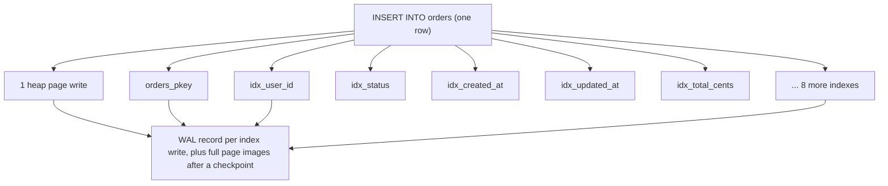
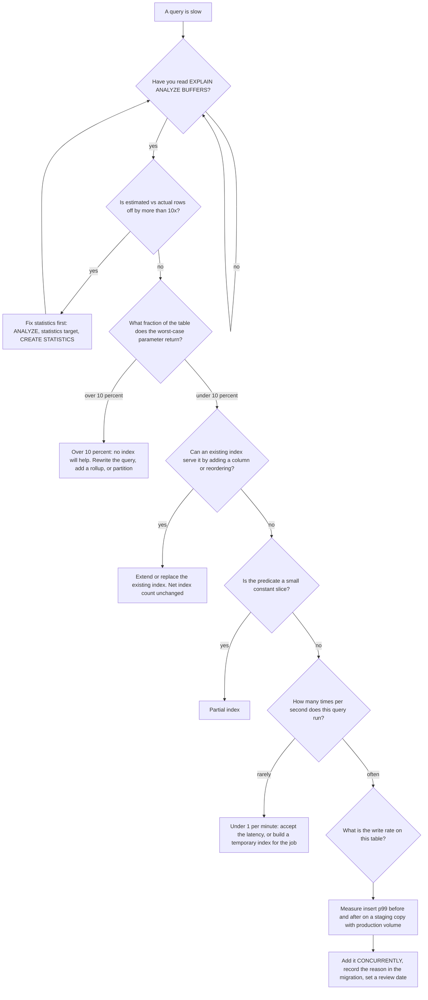

## 20.16 Cardinality, selectivity and statistics

### 20.16.1 Why an index on a three-value column is usually useless

#### Concept

Two words decide whether an index will ever be used:

- **Cardinality**: how many *distinct* values a column has. `orders.id` has 200,000,000 distinct values. `orders.status` has 6.
- **Selectivity**: what fraction of the table a specific predicate returns. `WHERE id = 42` selects 0.0000005 percent. `WHERE status = 'PAID'` selects 76 percent.

An index pays off when the predicate is **selective**. Not when the column has many distinct values, and not when the query "filters on something". Selectivity is about the specific value, which is why a single index can be perfect for one parameter and useless for another.

#### Why does it exist?

Because reading a row through an index costs more than reading a row in a sequential scan. Roughly: an index scan pays a tree descent plus one random heap page per row; a sequential scan pays one sequential page per ~51 rows and no descent. So there is a break-even fraction, and above it the sequential scan wins no matter how good your index is. The planner's job is to find that break-even, and your job is to know it exists.

#### Mental model

You want to find everyone in a 500-page phone book. Would you use the index at the back? Of course not, you would read the book. Now find one person: the index, obviously. Somewhere between "one person" and "everyone" the index stops being worth the page-flipping. For a real database on real storage that crossover is around **5 to 10 percent of rows**, and it moves with `random_page_cost`, with the column's physical `correlation`, and with how wide the rows are.

#### How it works

The planner computes selectivity from `pg_stats` (Parts 8 and 181.9):

| Statistic | What it is | How selectivity is derived |
|---|---|---|
| `n_distinct` | Distinct values; negative means a ratio of rows | `= value` on an unknown value: `1 / n_distinct` |
| `most_common_vals` / `most_common_freqs` | The top `default_statistics_target` values and their frequencies | `= value` on a listed value: its exact frequency |
| `histogram_bounds` | Equal-frequency buckets of the remaining values | Range predicates: interpolate across buckets |
| `null_frac` | Fraction of NULLs | `IS NULL` selectivity |
| `correlation` | -1 to 1, how well physical order matches value order | Scales the *cost* of an index scan's heap fetches toward sequential |

Look at them for the columns that matter:

```sql
SELECT attname, n_distinct, null_frac, correlation,
       most_common_vals::text[] AS mcv,
       most_common_freqs
FROM pg_stats
WHERE tablename = 'orders' AND attname IN ('status','user_id','created_at','shipping_country');
```

```text
    attname      | n_distinct | null_frac | correlation |                  mcv                    |        most_common_freqs
-----------------+------------+-----------+-------------+-----------------------------------------+----------------------------------
 status          |          6 |         0 |    0.612044 | {PAID,SHIPPED,PENDING,CANCELLED,REFUND_PENDING,CHARGEBACK} | {0.761,0.182,0.041,0.0116,0.0040,0.00004}
 user_id         |   -0.03991 |         0 |    0.001204 | {918273,41,102994}                      | {0.00021,0.00019,0.00018}
 created_at      |         -1 |         0 |    0.999841 |                                         |
 shipping_country|         14 |         0 |    0.041882 | {DE,AT,CH,NL,FR}                        | {0.612,0.144,0.101,0.061,0.040}
```

Read it carefully, because everything about indexing this table follows from these four rows.

- **`status`**: 6 distinct values, and `PAID` is 76.1 percent of the table. An index on `status` alone can never help a `status = 'PAID'` query, because 152 million rows is not a needle. It *can* help `status = 'CHARGEBACK'` (0.004 percent, 8,000 rows). One column, one index, two completely different answers. This is why "low cardinality means no index" is a rule of thumb and not a law: what matters is the frequency of the value you query.
- **`user_id`**: `n_distinct = -0.03991` means 3.991 percent of the row count, so about 7,982,000 distinct users. Average 25 orders each. `WHERE user_id = ?` selects 0.0000125 percent. Perfect index candidate.
- **`created_at`**: `n_distinct = -1` (every value distinct) and `correlation = 0.9998` (rows are physically in creation order). A range scan on it is nearly sequential, which is why the planner prices it cheaply and why BRIN works on it (20.13).
- **`shipping_country`**: `correlation = 0.04`, so a `DE` index scan means truly random heap access across the whole 30 GB.

**The rule of thumb.** With `random_page_cost = 1.1` on NVMe, an index scan tends to lose to a sequential scan somewhere around **8 to 12 percent** of rows for a well-correlated column and around **3 to 5 percent** for an uncorrelated one. With the default `random_page_cost = 4` those numbers drop to about 2 percent and 0.5 percent, which is why unusable-index complaints are so often really `random_page_cost` complaints. The planner will typically prefer a bitmap scan across most of the middle range, because it converts random reads into sorted ones.

**Correlated columns and `CREATE STATISTICS`.** The planner multiplies selectivities of `AND`ed predicates as if the columns were independent. When they are not, the estimate collapses:

`shipping_country = 'DE' AND currency = 'EUR'` -> estimated `0.612 x 0.68 = 0.416` ... except every German order is in EUR, so the truth is 0.612. A 47 percent underestimate here is mild. The classic disaster is `(city, postcode)`:

```sql
-- 8,400 cities, 41,000 postcodes; each postcode belongs to exactly one city
SELECT count(*) FROM addresses WHERE city = 'Hamburg' AND postcode = '20095';
```

Independence says `(1/8400) x (1/41000) = 2.9e-9`, so on 12 million addresses the planner estimates **1 row**. The truth is 340. A factor of 340, and if this is the outer side of a join, the plan is a nested loop that runs 340 times instead of once, or worse, it feeds a join that expected 1 row and gets 340.

```sql
CREATE STATISTICS addresses_city_postcode (dependencies, ndistinct, mcv)
  ON city, postcode FROM addresses;
ANALYZE addresses;
```

`dependencies` teaches it "postcode implies city", `ndistinct` gives the true count of distinct combinations (41,000, not 8400 x 41,000), and `mcv` stores common pairs. The estimate becomes 338. Same for `(shipping_country, currency)` on `orders`, `(product_id, category_id)` on `order_items`, and any pair where one column functionally determines the other.

Check the effect:

```sql
SELECT stxname, stxkeys, stxddependencies, stxdndistinct
FROM pg_statistic_ext JOIN pg_statistic_ext_data d ON d.stxoid = pg_statistic_ext.oid;
```

#### Practical example

The support tool lets an agent filter orders by status. Product wants it fast. A developer adds `CREATE INDEX ON orders (status)`. The index is 3.8 GB. Here is what it does for each status:

| Status | Rows | Selectivity | Plan chosen | Time | Index helped? |
|---|---|---|---|---|---|
| `PAID` | 152,200,000 | 76.1% | Parallel Seq Scan | 21.4 s | No, and it never will |
| `SHIPPED` | 36,400,000 | 18.2% | Parallel Seq Scan | 20.9 s | No |
| `PENDING` | 8,200,000 | 4.1% | Bitmap Heap Scan | 6.2 s | Marginally |
| `CANCELLED` | 2,320,000 | 1.16% | Bitmap Heap Scan | 1.9 s | Yes |
| `REFUND_PENDING` | 800,000 | 0.40% | Bitmap Heap Scan | 0.7 s | Yes |
| `CHARGEBACK` | 8,000 | 0.004% | Index Scan | 12 ms | Enormously |

Three of the six values get nothing from a 3.8 GB index that costs write latency on every insert. The correct answer is not an index on `status`; it is **partial indexes on the rare statuses** plus composite indexes for the common ones:

```sql
DROP INDEX CONCURRENTLY idx_orders_status;
CREATE INDEX CONCURRENTLY idx_orders_chargeback ON orders (created_at DESC) WHERE status = 'CHARGEBACK';
CREATE INDEX CONCURRENTLY idx_orders_refund_pending ON orders (created_at DESC) WHERE status = 'REFUND_PENDING';
CREATE INDEX CONCURRENTLY idx_orders_status_created ON orders (status, created_at DESC);
```

Total size: 3 MB + 280 MB + 5.1 GB, and every one of those bytes serves a query that could not be served otherwise. The `status`-only index is gone.

#### PostgreSQL example — proving the crossover

```sql
-- 0.004 percent: index scan
EXPLAIN (ANALYZE, BUFFERS) SELECT count(*) FROM orders WHERE status = 'CHARGEBACK';
```

```text
Aggregate  (cost=8214.02..8214.03 rows=1 width=8) (actual time=11.884..11.885 rows=1 loops=1)
  ->  Index Only Scan using idx_orders_status_created on orders
        (cost=0.57..8194.02 rows=8004 width=0) (actual time=0.061..11.204 rows=8021 loops=1)
        Index Cond: (status = 'CHARGEBACK'::text)
        Heap Fetches: 0
        Buffers: shared hit=41 read=8
Execution Time: 11.921 ms
```

```sql
-- 18.2 percent: the planner refuses the index, correctly
EXPLAIN (ANALYZE, BUFFERS) SELECT count(*) FROM orders WHERE status = 'SHIPPED';
```

```text
Finalize Aggregate  (cost=3184402.11..3184402.12 rows=1 width=8) (actual time=20918.114..20924.882 rows=1 loops=1)
  ->  Gather ... Workers Launched: 2
        ->  Partial Aggregate  (cost=3183402.11..3183402.12 rows=1 width=8) ...
              ->  Parallel Seq Scan on orders  (cost=0.00..3145402.11 rows=15200000 width=0)
                                               (actual time=0.041..19882.114 rows=12133333 loops=3)
                    Filter: (status = 'SHIPPED'::text)
                    Rows Removed by Filter: 54533334
                    Buffers: shared hit=91204 read=3829829
Execution Time: 20924.921 ms
```

Force the index to see whether the planner was right:

```sql
SET enable_seqscan = off;
EXPLAIN (ANALYZE, BUFFERS) SELECT count(*) FROM orders WHERE status = 'SHIPPED';
RESET enable_seqscan;
```

```text
Aggregate  (cost=8912440.22..8912440.23 rows=1 width=8) (actual time=61884.114..61884.115 rows=1 loops=1)
  ->  Index Only Scan using idx_orders_status_created on orders
        (cost=0.57..8821440.11 rows=36400000 width=0) (actual time=0.084..58221.884 rows=36400000 loops=1)
        Index Cond: (status = 'SHIPPED'::text)
        Heap Fetches: 0
        Buffers: shared hit=112044 read=1918204
Execution Time: 61884.184 ms
```

**61.9 seconds with the index, 20.9 seconds without.** The planner was right by a factor of three, and this is even an index-only scan; a plain index scan would have been minutes. When someone says "the planner is ignoring my index", check this before assuming a bug.

#### Edge cases & failure modes

- **Skewed columns where the average is meaningless.** `user_id` averages 25 orders; one B2B account has 4.1 million. The plan chosen for the average user is a disaster for that one. Watch for `pg_stat_statements` max/mean ratios above 50.
- **`default_statistics_target = 100`** keeps only 100 MCVs. On a column with 400 meaningfully frequent values, values 101 to 400 all get the "average of the rest" estimate. Raise it per column: `ALTER TABLE orders ALTER COLUMN shipping_country SET STATISTICS 500;` then `ANALYZE`.
- **Statistics stale after a bulk load.** A 40 million row import with no `ANALYZE` leaves the planner thinking the table is empty. Always `ANALYZE` after a bulk load; autovacuum will get there eventually, and "eventually" is after your batch job has already run 200 bad plans.
- **`n_distinct` badly estimated on large tables**, because it is sampled. If you know the truth, tell it: `ALTER TABLE orders ALTER COLUMN user_id SET (n_distinct = -0.04);`
- **Partitioned tables** need statistics on the parent for cross-partition plans; `ANALYZE parent` does that in PG 14+.
- **Correlation destroyed** by an update-heavy pattern, quietly making previously cheap range scans expensive.

#### How a Senior Backend Engineer thinks about this

Before proposing an index they run `SELECT count(*) FROM t WHERE <predicate>` for the *typical* and the *worst* parameter values and divide by the table size. If the worst case is above 10 percent, the index is not the answer; a different query, a rollup table, or a partial index is. They check `pg_stats` before believing any plan. And when a plan is bad they fix the estimate first, because a correct estimate often produces the right plan with no new index at all.

#### Common mistakes

- Indexing booleans and enums with two or three values (the fix is almost always a partial index).
- Assuming high cardinality means the index will be used, ignoring the specific value's frequency.
- Never running `ANALYZE` after a bulk load.
- Fighting the planner with hints instead of giving it extended statistics.

#### Interview questions

1. *Why is an index on a boolean column usually useless, and when is it not?* Expected: selectivity near 50 percent; useful when one value is rare, and then a partial index is better.
2. *What fraction of a table makes a sequential scan win, and what changes it?* Expected: roughly 5 to 10 percent; `random_page_cost`, correlation, row width, `effective_cache_size`.
3. *What is `CREATE STATISTICS` for?* Expected: correlated columns; `dependencies`, `ndistinct`, `mcv`; fixes the independence assumption.
4. *`pg_stats` says `n_distinct = -0.04`. What does that mean?* Expected: 4 percent of the row count are distinct.
5. *A query is fast for most users and 40 seconds for one. Where do you look?* Expected: data skew; MCV list; per-parameter plan differences; `pg_stat_statements` max versus mean.

## 20.17 When an index makes things SLOWER

### 20.17.1 Five cases, with numbers

#### Concept

Every index has a cost that is paid on writes and a benefit that is paid on reads. When the benefit is zero or negative, the index is a pure tax. Here are the five ways that actually happens in production, each with the measurement that proves it.

#### Case 1: a low-selectivity index the planner picks wrongly

Statistics were collected when `notifications.status = 'PENDING'` covered 0.01 percent of rows. A provider outage pushed 40 million notifications into `PENDING` overnight, but `ANALYZE` had not run because autovacuum's threshold (`autovacuum_analyze_scale_factor = 0.1`) needs 10 percent of 1.2 billion rows to change.

```sql
EXPLAIN (ANALYZE, BUFFERS)
SELECT id FROM notifications WHERE status = 'PENDING' ORDER BY created_at LIMIT 1000;
```

```text
Limit  (cost=0.57..3821.44 rows=1000 width=8) (actual time=0.084..184221.882 rows=1000 loops=1)
  Buffers: shared hit=8214402 read=4118204
  ->  Index Scan using idx_notifications_created_at on notifications
        (cost=0.57..458821440.11 rows=120000 width=8) (actual time=0.083..184221.204 rows=1000 loops=1)
        Filter: (status = 'PENDING'::text)
        Rows Removed by Filter: 118204882
Execution Time: 184221.944 ms
```

Three minutes. The planner believed 120,000 rows matched and that walking `created_at` order would find 1,000 of them quickly. In reality the oldest 118 million notifications are all `SENT`, so it walked 118 million index entries and heap rows before finding 1,000 pending ones. The estimate `rows=120000` versus the reality (40 million, but concentrated at the *end* of `created_at` order) is the bug.

`ANALYZE notifications;` alone fixes the plan. The durable fix is the partial index of 20.6, which cannot be fooled by this. **A stale statistic turned a good index into a three-minute query.**

#### Case 2: write amplification on a 14-index orders table



Measured on `orders`, single-row inserts through the connection pool at 400 inserts per second:

| Indexes | p50 insert | p99 insert | WAL per insert | Index bytes per row |
|---|---|---|---|---|
| 2 | 1.8 ms | 4.1 ms | 780 B | 68 B |
| 6 | 3.4 ms | 9.2 ms | 1,940 B | 214 B |
| 10 | 5.9 ms | 16.8 ms | 3,410 B | 402 B |
| 14 | 8.7 ms | 28.4 ms | 4,880 B | 611 B |

The p99 is the story: 4.1 ms to 28.4 ms. Each additional index is another tree descent that can miss the buffer cache, another page that can split, and another WAL record. At 400 inserts per second, 14 indexes produce 1.95 MB/s of WAL from the writes alone, against 312 KB/s at 2 indexes.

And the checkout endpoint that does one insert into `orders` plus three into `order_items` inside one transaction goes from 9 ms to 41 ms at p99, which shows up directly in your API SLO.

#### Case 3: index bloat after a mass delete

The GDPR job deletes 12 million users' order history: 310 million rows across `orders` and `order_items`, scattered across the whole key range.

```text
before delete: idx_orders_user_created  6142 MB, avg_leaf_density 88.4, list query 0.12 ms
after delete:  idx_orders_user_created  6142 MB, avg_leaf_density 21.7, list query 0.14 ms
after VACUUM:  idx_orders_user_created  6142 MB, avg_leaf_density 21.9, list query 0.14 ms
after REINDEX: idx_orders_user_created  1584 MB, avg_leaf_density 89.1, list query 0.11 ms
```

Point lookups barely changed, which is why nobody noticed. The damage was elsewhere: 4.5 GB of `shared_buffers` competition, 4.5 GB in every backup, 4.5 GB more for every replica to keep, and range scans over that index reading four times the pages. The lesson is that bloat is usually **not** visible in the query that uses the index; it is visible in everything else.

#### Case 4: hot-page contention on a monotonically increasing key

Every insert of a `bigserial` primary key writes to the **same rightmost leaf page**. At low rates this is a cache-friendly gift. At 8,000 inserts per second across 60 connections, all 60 backends want an exclusive buffer lock on one 8 KB page.

```sql
SELECT wait_event_type, wait_event, count(*)
FROM pg_stat_activity WHERE state = 'active' GROUP BY 1,2 ORDER BY 3 DESC;
```

```text
 wait_event_type |   wait_event    | count
-----------------+-----------------+-------
 LWLock          | BufferContent   |    38
 Lock            | transactionid   |     4
 IO              | WALWrite        |     3
```

38 backends waiting on `LWLock:BufferContent` is the signature. Measured throughput on `notifications` with a `bigserial` primary key:

| Insert rate attempted | Achieved | p99 | Dominant wait |
|---|---|---|---|
| 2,000/s | 2,000/s | 3 ms | WALWrite |
| 6,000/s | 5,950/s | 9 ms | WALWrite |
| 10,000/s | 8,100/s | 44 ms | LWLock BufferContent |
| 14,000/s | 8,400/s | 190 ms | LWLock BufferContent |

The ceiling is around 8,400 per second and adding connections makes it worse. Three fixes, in order of preference:

1. **Batch the inserts.** 100 rows in one `INSERT ... VALUES (...), (...)` writes one WAL record and takes the page lock once. This alone took the same workload to 34,000 rows per second.
2. **Partition by time** (Part 23 — Database Scaling). Each partition has its own index and its own right edge, and if you route by hash instead of time you spread the edge across N pages.
3. **Change the key distribution.** UUID v7 keeps rough time ordering with enough entropy to spread across several leaf pages. Random UUID v4 solves contention and creates a far worse problem (random I/O across the whole index).

Note that this is a *primary key* problem, so "drop the index" is not on the table. It is the clearest example of an index cost you cannot remove, only architect around.

#### Case 5: a GIN index on a jsonb column nobody queries

An engineer added `CREATE INDEX ON notifications USING gin (payload)` "because we might want to search notifications later". Nobody ever did.

```text
Index size:                       84 GB
idx_scan since creation (9 months): 0
Insert throughput before:         8,400/s
Insert throughput after:          1,180/s
WAL per insert before:            980 B
WAL per insert after:             4,210 B
Autovacuum pass on notifications: 41 min -> 3 h 20
Backup size increase:             +84 GB, +18 min
Monthly storage cost (gp3):       +$7 per replica per month, x4 environments
```

An 86 percent reduction in insert throughput for zero queries. This is the purest form of the problem: **an index's cost is unconditional and its benefit is conditional.** Dropping it restored everything within an hour.

#### Practical example — the audit

Run this against your own database right now. It takes ten seconds and it is usually uncomfortable:

```sql
SELECT
  s.relname AS table_name,
  s.indexrelname AS index_name,
  pg_size_pretty(pg_relation_size(s.indexrelid)) AS size,
  s.idx_scan,
  CASE WHEN s.idx_scan = 0 THEN 'NEVER USED'
       WHEN s.idx_scan < 50 THEN 'BARELY USED'
       ELSE 'ok' END AS verdict,
  (SELECT stats_reset FROM pg_stat_database WHERE datname = current_database()) AS stats_since
FROM pg_stat_user_indexes s
JOIN pg_index i ON i.indexrelid = s.indexrelid
WHERE NOT i.indisprimary AND NOT i.indisunique
ORDER BY s.idx_scan ASC, pg_relation_size(s.indexrelid) DESC;
```

#### Edge cases & failure modes

- An index that *is* used, on the wrong query: it serves an admin screen 4 times a day and costs 8 ms on 40 million inserts.
- An index used only by a nightly job, where a temporary index (create, run, drop) would be cheaper.
- Indexes that prevent HOT updates on a hot column, multiplying both heap and index bloat.
- A unique index that serialises writes on a hot key.
- An index that makes the planner's search space larger, adding planning time to every query on that table.

#### How a Senior Backend Engineer thinks about this

They ask "what does this cost when nobody queries it?" as the first question about any proposed index, not the last. They know that read benefit is easy to demonstrate and write cost is easy to ignore, so they demand both numbers. And they treat index count on hot write tables as a budget: `orders` gets five, and adding a sixth means removing one or making a case.

#### Interview questions

1. *Give three ways an index can make a system slower.* Expected: write amplification, planner misuse under stale statistics, buffer cache and vacuum competition, bloat, HOT prevention.
2. *You are at 8,000 inserts per second and see `LWLock:BufferContent`. Diagnose and fix.* Expected: right-edge contention on a monotonic key; batch, partition, or change key distribution.
3. *What does a GIN index cost on a write-heavy table?* Expected: 10 to 20x insert cost, big WAL, long vacuum, huge size.
4. *A mass delete left the index the same size. What is the impact and the fix?* Expected: bloat costs cache, backups, replicas and range scans; `REINDEX CONCURRENTLY`.

## 20.18 Why "add indexes everywhere" is bad advice

### 20.18.1 The full cost model

#### Concept

"Just add an index" is the most repeated and least examined advice in backend engineering. It is repeated because the read benefit is dramatic and easy to measure in isolation, and because the costs are diffuse, delayed and spread across systems nobody is looking at during the ticket.

Here is the complete bill for one index, on one hot table.

#### The worked table

One additional B-tree index on `orders (updated_at)`, 200 million rows, 400 inserts and 900 updates per second.

| Cost dimension | Measurement | Where it hurts |
|---|---|---|
| **Write latency** | +0.9 ms p50, +3.2 ms p99 per insert; +1.1 ms per non-HOT update | Checkout endpoint SLO; connection hold time; pool saturation |
| **HOT prevention** | `updated_at` changes on every update, so **every** update becomes non-HOT: HOT ratio 94% -> 0% | 7 index entries written per update instead of 0; heap bloat rate up 4x |
| **WAL volume** | +610 B per insert, +1,240 B per update; total +1.36 MB/s | Replication bandwidth, archive storage (+3.4 TB/year), replica apply lag |
| **Vacuum work** | One more index to scan per vacuum pass: +9 min per pass, 6 passes/day | Autovacuum worker occupancy; longer to reclaim; higher bloat |
| **shared_buffers competition** | 4.2 GB index, ~800 MB hot | 10% of an 8 GB cache taken from other tables; measured hit ratio 99.3% -> 98.6%, which doubles physical reads |
| **Storage** | 4.2 GB primary + 4.2 GB x 3 replicas + 4.2 GB in each of 2 staging copies | ~25 GB provisioned; on gp3 about $2/month, trivial; the IOPS it consumes is not |
| **Backup and restore** | +4.2 GB per base backup, +6 min restore time | RTO. A 40-minute restore becoming 52 minutes is a real availability number |
| **Planner search space** | One more access path to cost for every query on `orders`; planning time 0.14 ms -> 0.19 ms | At 3,000 queries/s that is 150 ms of CPU per second, 15% of a core, for nothing |
| **Schema change cost** | Every future `ALTER TABLE` that rewrites the table rebuilds this index too | Migration windows get longer forever |
| **Cognitive cost** | One more thing nobody dares drop | Compounding: the index that exists because nobody knows why |

If that index serves a query that runs 4 times a day on an admin page, you have made a bad trade. If it serves a query that runs 3,000 times a second, you have made an excellent one. **The bill is the same either way; only the benefit changes.**

#### The decision flow



#### The counter-argument, honestly

There is a real category where "add indexes freely" is correct: **read replicas and analytics copies that take no application writes**. An index there costs storage, replication of the index's own WAL from the primary (so it is not free), and vacuum, but no user-facing write latency. If your reporting workload lives on a dedicated replica, index it generously. The advice is bad as a universal rule, not as a rule for every situation.

Similarly, **small tables** (`categories` at 1,240 rows, `inventory` at 400,000) can carry more indexes without anyone noticing, because the write rates are low and everything fits in cache.

The rule that survives contact with production is:

> Index budgets are per table and proportional to the write rate. A table taking 5,000 writes per second gets 3 to 5 carefully chosen indexes. A table taking 5 writes per second can have 15.

#### Practical example — the index budget in review

A pull request adding an index must answer six questions, and a template in the repository makes it automatic:

```markdown
### Index proposal
- **Query**: `SELECT ... FROM orders WHERE tenant_id = $1 AND status = $2 ORDER BY created_at DESC LIMIT 20`
- **Rate**: 340 req/s (p99 SLO 150 ms)
- **Current plan**: Bitmap Heap Scan, 388k rows, 122k removed by filter, 1,301 ms
- **Proposed**: `(tenant_id, status, created_at DESC)`
- **Replaces**: `idx_orders_tenant_id`, `idx_orders_status` (both become redundant prefixes)
- **Estimated size**: 7.4 GB (measured on staging restore)
- **Write cost**: insert p99 8.1 ms -> 8.9 ms measured on staging at production insert rate
- **Net index count on orders**: 6 -> 5
```

The last line is the one that keeps a codebase healthy for five years.

#### Failure scenario

A "performance sprint" added 31 indexes across 9 tables in two weeks, each justified by a slow query. Read latencies improved by 40 percent. Six weeks later: checkout p99 up 3.4x, WAL up 4.1x, the replica 90 seconds behind at peak, autovacuum never finishing on `orders`, `pg_wal` filling twice, and the base backup window overrunning into business hours. The remediation took two months and dropped 22 of the 31 indexes, because by then nobody could tell which queries the other 9 served. **Adding indexes is fast; removing them requires evidence you did not collect at the time.** Record the reason at creation or accept that you can never remove it.

#### How a Senior Backend Engineer thinks about this

They think in budgets and in totals, not per ticket. They ask what the index does to the *slowest* thing in the system, not the thing in front of them. They insist that every index has a recorded query, a recorded rate, and a review date. They know the read win is provable in 5 minutes and the write cost takes a load test, and they do the load test anyway. And when a product manager asks why a "simple index" needs a staging measurement, they answer: "because the last one cost us four hours of checkout latency and we could not prove which one it was."

#### Common mistakes

- Treating each index decision in isolation.
- Measuring the read gain and not the write cost.
- Adding indexes during an incident and never revisiting them.
- Never dropping anything, so index storage exceeds table storage.
- Copying an index set from another service with a completely different read/write ratio.

#### Interview questions

1. *Name six costs of an index beyond disk space.* Expected: write latency, WAL and replication, vacuum time, buffer cache competition, planning time, backup and restore, HOT prevention, migration cost.
2. *When is "index everything" reasonable advice?* Expected: read-only replicas, analytics copies, small low-write tables.
3. *How do you decide whether to add an index?* Expected: the decision flow; statistics first, selectivity check, extend an existing index, partial index, rate justification, measured write cost.
4. *Your index storage exceeds your table storage. Is that wrong?* Expected: not automatically; it depends on the access pattern, but it demands an audit of `idx_scan` and duplicates.
5. *How would you explain the cost of an index to a product manager?* Expected: every order placed now writes 14 things instead of 2, so checkout gets slower for everyone to make one report faster for a few.

#### Practical exercise

Take your busiest write table. Produce a table with one row per index: size, `idx_scan`, the query you believe it serves, and whether it is a prefix of another index. Then, on a staging copy restored from production, measure insert p50 and p99 with all indexes, and again with the three least-used indexes dropped. Acceptance criteria: the per-index table, two latency measurements, and a written recommendation with a rollback plan.
