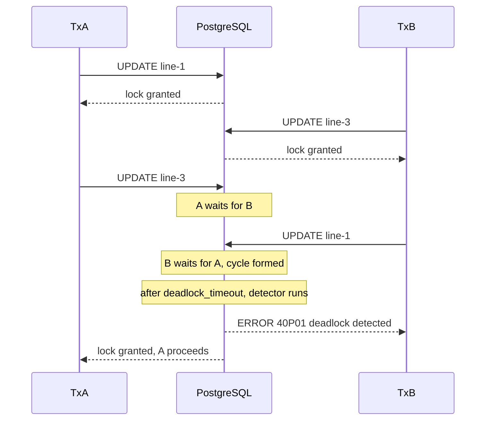
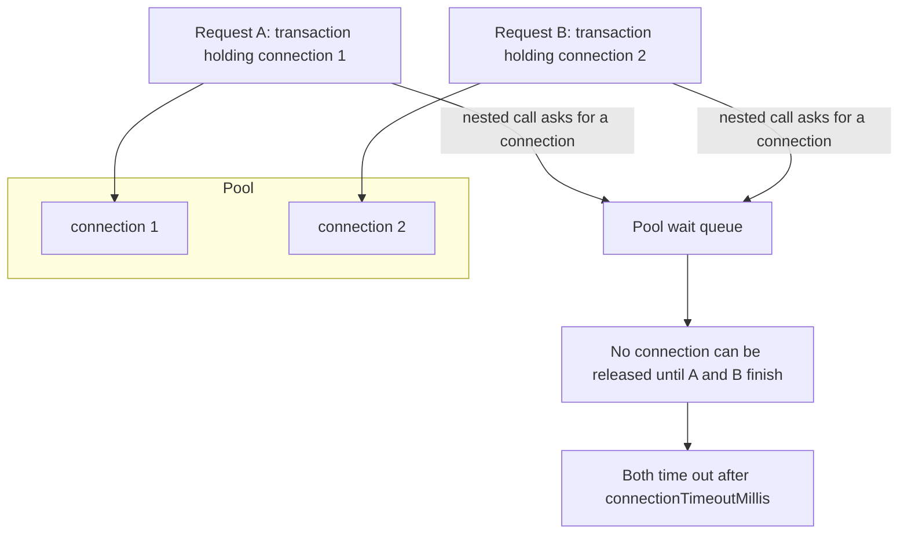
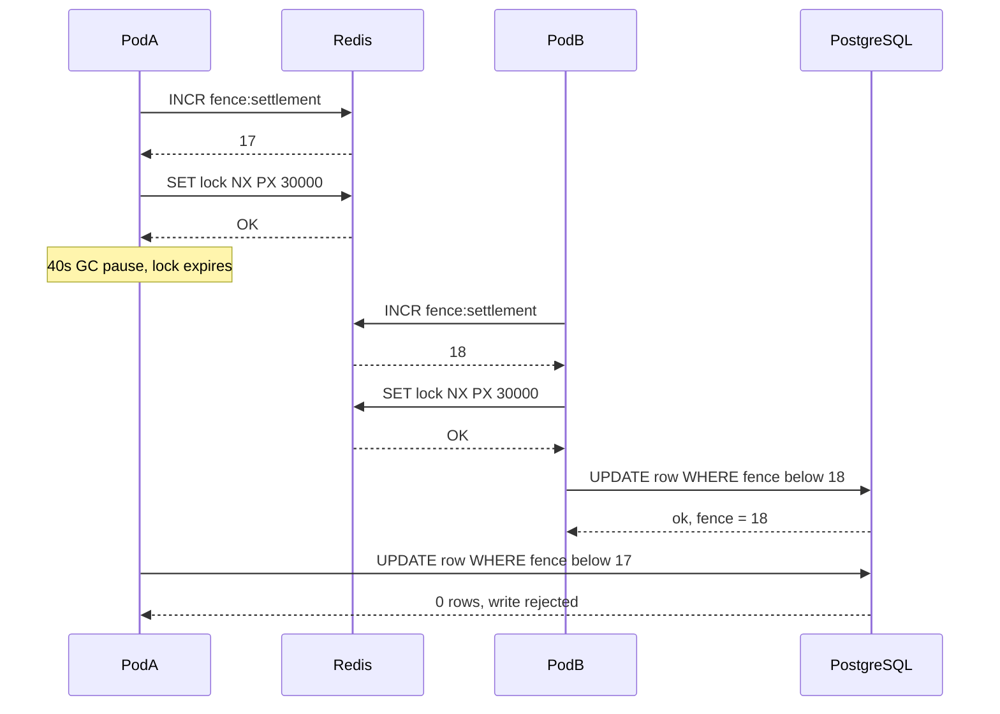

## 21.4 Deadlocks

#### Concept

A deadlock is a cycle of waiting. Transaction A holds a lock that transaction B wants, and B holds a lock that A wants. Neither can proceed, and neither will ever give up voluntarily. Unlike a slow query, a deadlock does not resolve itself with patience: it is a permanent state until something outside the cycle intervenes.

In a Node backend you meet deadlocks in three very different places, and they behave differently:

- **Database deadlocks.** Two PostgreSQL transactions lock the same rows in opposite orders. PostgreSQL *detects* this and kills one of them with an error. Annoying, recoverable, retryable.
- **Application-level deadlocks.** Two in-process locks (`async-mutex` mutexes, a semaphore, a lock keyed by entity id) acquired in inconsistent order. Nothing detects this. The requests hang until their timeout, or forever.
- **Resource deadlocks.** The most common one in real Node services: a transaction is holding one database connection while awaiting a second connection from an exhausted pool. Nobody is holding a row lock. Nothing is deadlocked in the database. The *pool* is deadlocked.

The first has a built-in escape hatch. The other two do not, which is exactly why they cause the worse incidents.

#### Why does it exist?

Deadlock is the price of locking. Any system that lets one actor exclusively hold a resource while requesting another can form a cycle. You could eliminate deadlocks by never holding two things at once, but real work needs to: debiting one account and crediting another, decrementing stock on three SKUs in a basket, updating an order and its lines.

The alternative to locking is not "no deadlocks", it is "wrong data". So the engineering question is never "how do I avoid all locks", it is "how do I take locks in a way that either cannot cycle, or cycles rarely enough that a retry is cheap".

#### Mental model

Imagine two people in a narrow corridor carrying furniture. A holds the left half of a sofa and needs the right half; B holds the right half and needs the left. Neither will put their half down, because putting it down means starting over. They stand there.

Now change the rule: *everyone always picks up the left half first*. A grabs the left half. B tries to grab the left half, cannot, and waits. A grabs the right half, walks out, and B proceeds. No cycle is possible, because there is a global order. That single rule — **always acquire locks in a consistent, globally agreed order** — prevents more deadlocks in production than every retry wrapper ever written.

#### How it works

PostgreSQL takes a row-level exclusive lock when a transaction updates a row, and holds it until commit or rollback. A second transaction updating the same row blocks on `tuple` / `transactionid` wait events.

When a transaction has waited longer than `deadlock_timeout` (default `1s`), PostgreSQL runs its deadlock detector:

1. It builds a **wait-for graph**: an edge from each waiting transaction to the transaction it is waiting on.
2. It looks for a cycle.
3. If it finds one, it picks a victim (in practice the transaction that ran the check, i.e. the one that just blocked and triggered detection) and aborts it.
4. The victim's client gets SQLSTATE **`40P01`**, message `deadlock detected`, with a helpful `DETAIL` naming both processes and both statements.
5. The other transaction is unblocked immediately and proceeds.

Note the timing: **PostgreSQL waits a full second before even looking**. That is deliberate; running the detector on every lock wait would be expensive, and the vast majority of lock waits clear in milliseconds. It also means a deadlock costs you at least one second of latency for the victim, and one second of a held connection.

Here is the classic two-session example. An order has three lines. Two workers update the lines of the same order, one iterating ascending by line id, the other descending — because one of them used `ORDER BY created_at DESC` in a query somewhere and nobody thought about it.

```sql
-- Session A: repricing job, iterates lines ascending
BEGIN;
UPDATE order_lines SET unit_price_cents = 1990
 WHERE id = 'line-1';        -- A now holds the row lock on line-1
                                    -- Session B: tax recalculation, iterates descending
                                    BEGIN;
                                    UPDATE order_lines SET tax_cents = 358
                                     WHERE id = 'line-3';   -- B holds line-3

UPDATE order_lines SET unit_price_cents = 2490
 WHERE id = 'line-3';        -- A blocks: waiting for B
                                    UPDATE order_lines SET tax_cents = 298
                                     WHERE id = 'line-1';   -- B blocks: waiting for A
                                    -- after deadlock_timeout (1s), PostgreSQL detects the cycle
                                    -- ERROR:  deadlock detected
                                    -- DETAIL: Process 4412 waits for ShareLock on transaction 88201;
                                    --         blocked by process 4398.
                                    --         Process 4398 waits for ShareLock on transaction 88214;
                                    --         blocked by process 4412.
                                    -- HINT:   See server log for query details.
COMMIT;                             ROLLBACK;   -- B was the victim; its whole transaction is gone
```



The important detail: **the victim loses its entire transaction**, not just the statement. Everything it did since `BEGIN` is rolled back. That is why the fix has two halves — prevent most of them with lock ordering, and survive the rest with a retry.

#### Practical example

An order-fulfilment service updates order lines in whatever order the client sent them in the request body. Two support agents edit the same order at the same moment, one from a list sorted by SKU, one from a list sorted by price. Deadlock. The fix is one line:

```ts
// Deterministic lock order: sort by primary key before touching anything.
const lines = [...dto.lines].sort((a, b) => a.id.localeCompare(b.id));
for (const line of lines) {
  await manager.update(OrderLine, { id: line.id }, { unitPriceCents: line.unitPriceCents });
}
```

Sorting by the primary key (or by any total order that every code path agrees on) means two concurrent transactions always request locks in the same sequence. The second one blocks at the *first* contended row and simply waits. A wait is not a deadlock; a wait finishes.

#### NestJS example

The retry wrapper. This belongs in a shared module, not copy-pasted into services.

```ts
import { Injectable, Logger } from '@nestjs/common';
import { DataSource, EntityManager } from 'typeorm';

// 40P01 deadlock_detected, 40001 serialization_failure (SERIALIZABLE / REPEATABLE READ).
const RETRYABLE_SQLSTATES = new Set(['40P01', '40001']);

export interface RetryOptions {
  attempts?: number;   // total tries, including the first
  baseMs?: number;     // first backoff delay
  maxMs?: number;      // cap on backoff
}

@Injectable()
export class TransactionRunner {
  private readonly log = new Logger(TransactionRunner.name);

  constructor(private readonly dataSource: DataSource) {}

  async runWithRetry<T>(
    work: (manager: EntityManager) => Promise<T>,
    opts: RetryOptions = {},
  ): Promise<T> {
    const attempts = opts.attempts ?? 5;
    const baseMs = opts.baseMs ?? 20;
    const maxMs = opts.maxMs ?? 500;

    for (let attempt = 1; ; attempt++) {
      try {
        return await this.dataSource.transaction(work);
      } catch (err) {
        const code = (err as { code?: string }).code;
        if (!code || !RETRYABLE_SQLSTATES.has(code) || attempt >= attempts) throw err;

        // Exponential backoff with full jitter: without jitter, both victims retry
        // at the same instant and deadlock again.
        const ceiling = Math.min(maxMs, baseMs * 2 ** (attempt - 1));
        const delay = Math.random() * ceiling;
        this.log.warn(`sqlstate=${code} attempt=${attempt} retrying in ${Math.round(delay)}ms`);
        await new Promise((resolve) => setTimeout(resolve, delay));
      }
    }
  }
}
```

Three things make this correct rather than decorative:

- **The whole transaction is retried**, because the whole transaction was rolled back. Retrying only the failed statement inside a dead transaction gets you `25P02 current transaction is aborted`.
- **Full jitter.** Two victims that retry after exactly 20 ms collide again. Randomising the delay across `[0, ceiling)` spreads them.
- **`work` must be a pure function of its inputs.** If it sends an email or charges a card, a retry sends two. Side effects go outside the retried block, or behind an idempotency key (Part 19 — Idempotency and Exactly-Once Semantics).

Usage:

```ts
await this.txRunner.runWithRetry(async (manager) => {
  const lines = [...dto.lines].sort((a, b) => a.id.localeCompare(b.id));
  for (const line of lines) {
    await manager.update(OrderLine, { id: line.id }, { taxCents: line.taxCents });
  }
  await manager.update(Order, { id: dto.orderId }, { recalculatedAt: new Date() });
});
```

#### PostgreSQL example

Deadlocks are counted, so you can alert on them:

```sql
-- Cumulative deadlocks for this database since the last stats reset.
SELECT datname, deadlocks, xact_commit, xact_rollback
  FROM pg_stat_database
 WHERE datname = current_database();
--  datname | deadlocks | xact_commit | xact_rollback
-- ---------+-----------+-------------+---------------
--  shop    |      1483 |   402881904 |         51022
```

A non-zero, *growing* `deadlocks` counter is a design smell, not a fact of life. Healthy OLTP services run months at zero. Rate-alert it: more than ~1 per minute means a code path is taking locks in inconsistent order.

To see who is blocking whom right now:

```sql
SELECT a.pid, a.wait_event_type, a.wait_event, a.state,
       cardinality(pg_blocking_pids(a.pid)) AS blockers,
       pg_blocking_pids(a.pid) AS blocked_by,
       left(a.query, 80) AS query,
       now() - a.xact_start AS tx_age
  FROM pg_stat_activity a
 WHERE a.datname = current_database()
   AND cardinality(pg_blocking_pids(a.pid)) > 0
 ORDER BY tx_age DESC;
```

Set `log_lock_waits = on` and keep `deadlock_timeout = 1s`; then every wait longer than a second is logged with the blocking query, which is the single most useful lock-debugging setting in PostgreSQL.

#### Application-level deadlocks

PostgreSQL has a detector. Your process does not. Two `async-mutex` locks acquired in different orders hang forever:

```ts
import { Mutex } from 'async-mutex';

const walletLock = new Mutex();
const ledgerLock = new Mutex();

// Path 1: transfer
await walletLock.runExclusive(async () => {
  await ledgerLock.runExclusive(async () => { /* ... */ });
});

// Path 2: reconciliation  <-- opposite order. This deadlocks.
await ledgerLock.runExclusive(async () => {
  await walletLock.runExclusive(async () => { /* ... */ });
});
```

Two requests, one on each path, interleaving at their first `await`: request 1 holds `walletLock` and waits for `ledgerLock`; request 2 holds `ledgerLock` and waits for `walletLock`. There is no timeout by default, no error, no log line. The two requests hang until the client gives up, and both mutexes stay held forever, so *every subsequent request* on either path also hangs. One deadlock takes down the whole pod.

Two defences, and you want both:

```ts
import { Mutex, withTimeout, E_TIMEOUT } from 'async-mutex';

// 1. Every application lock has a timeout. A hang becomes an error you can see.
const walletLock = withTimeout(new Mutex(), 2_000);

try {
  await walletLock.runExclusive(async () => { /* ... */ });
} catch (err) {
  if (err === E_TIMEOUT) throw new ServiceUnavailableException('wallet busy');
  throw err;
}
```

```ts
// 2. Never nest application locks. If you truly must, define one global order
//    and enforce it with a helper that sorts the keys for you.
async function withLocks<T>(keys: string[], fn: () => Promise<T>): Promise<T> {
  const ordered = [...new Set(keys)].sort();          // global order: lexicographic key
  const releases: Array<() => void> = [];
  try {
    for (const key of ordered) releases.push(await locks.get(key).acquire());
    return await fn();
  } finally {
    for (const release of releases.reverse()) release();
  }
}
```

#### The promise deadlock

A subtler version: a request awaits a promise that nothing will ever resolve.

```ts
// A worker with BullMQ concurrency 1 that waits for another job on the same queue.
@Processor('reports')
export class ReportProcessor extends WorkerHost {
  async process(job: Job) {
    // The child job is queued on the SAME queue this worker serves, with concurrency 1.
    // This worker is the only consumer, and it is busy waiting here.
    const child = await this.reportsQueue.add('render-page', { page: 1 });
    await child.waitUntilFinished(this.queueEvents);  // never resolves
  }
}
```

The parent job occupies the only worker slot; the child can never be picked up; the parent waits for the child forever. The same shape appears with an in-process `Map<string, Deferred>` where the resolving code path is guarded by an `if` that turned out to be false, and with request/response over a message broker when the reply topic has no consumer.

The defences are structural: **never wait on work that your own capacity is required to perform**, always put a deadline on any promise that depends on an external event, and use a separate queue (and separate worker) for child jobs.

```ts
export function withDeadline<T>(p: Promise<T>, ms: number, label: string): Promise<T> {
  return new Promise<T>((resolve, reject) => {
    const timer = setTimeout(() => reject(new Error(`timeout after ${ms}ms: ${label}`)), ms);
    p.then(resolve, reject).finally(() => clearTimeout(timer));
  });
}
```

#### The connection-pool deadlock

This is the one that will actually page you. It is not a database deadlock and `pg_stat_database.deadlocks` stays at zero.

`pg` (and TypeORM and Sequelize on top of it) hands each transaction a dedicated connection from a fixed-size pool. If code inside a transaction asks the pool for a *second* connection — because a nested service call does `this.repo.find()` on the default `DataSource` instead of the transaction's `EntityManager` — then that request now needs two connections and holds one while waiting for the other.

```ts
// THE BUG. Do not copy it.
await this.dataSource.transaction(async (manager) => {          // holds connection #1
  await manager.update(Order, { id }, { status: 'PAID' });
  await this.pricingService.recalculate(id);                     // <-- uses this.repo (a NEW connection)
});
```



**The arithmetic.** Let `P` be the pool size and `D` the maximum number of connections a single request may hold simultaneously (its *nesting depth*: 1 for a plain query, 2 for a transaction that makes a nested non-transactional query, 3 if that call transacts again). With `N` concurrent requests all at depth `D`:

- Total connections needed to guarantee progress for at least one request: each of the `N` requests may hold `D - 1` connections and still be stuck. If `P = N * (D - 1)`, every request is stuck holding its share with none left. So you need one more.
- **`P >= N * (D - 1) + 1`.**

That is the HikariCP deadlock-avoidance formula and it applies unchanged to `pg`. Concretely, with a pool of 10 and `D = 2`: as soon as 10 concurrent requests are inside a transaction and each wants a second connection, the pool is empty and nothing can finish. `P >= 10 * 1 + 1 = 11` would guarantee one request completes, then the next, then the next — slowly, serially, but without deadlock. With `D = 1` the formula collapses to `P >= 1`: a request that never nests can never pool-deadlock.

So there are two fixes, and they rank very differently:

1. **Make `D = 1`.** Pass the transaction's `EntityManager` (or the Sequelize `transaction` object) down through every call inside a transaction, so nested work reuses the same connection. This is the real fix. See 21.11 for propagating it automatically with `AsyncLocalStorage` instead of threading a parameter through eight layers.
2. **Raise the pool** so `P >= N * (D - 1) + 1`. This is a mitigation that buys you time and costs you database connections. It does not remove the bug; it moves the cliff.

```ts
// FIXED: the nested call receives the same EntityManager, so D stays at 1.
await this.dataSource.transaction(async (manager) => {
  await manager.update(Order, { id }, { status: 'PAID' });
  await this.pricingService.recalculate(id, manager);   // reuses connection #1
});
```

#### Sequelize example

Sequelize has exactly the same trap, and its CLS integration is the standard cure:

```ts
// BUG: the inner query opens a second connection from the pool.
await sequelize.transaction(async (t) => {
  await Order.update({ status: 'PAID' }, { where: { id }, transaction: t });
  await Payment.findAll({ where: { orderId: id } });     // no `transaction: t` -> new connection
});

// FIX A: pass the transaction explicitly.
await Payment.findAll({ where: { orderId: id }, transaction: t });

// FIX B: enable CLS so the transaction is picked up automatically by every query
// in the same async context. Do this once, before models are defined.
import { Sequelize } from 'sequelize';
import { AsyncLocalStorage } from 'node:async_hooks';
Sequelize.useCLS(new AsyncLocalStorage());
```

#### Production scenario

A payments API runs 6 pods, `max: 20` connections per pod (120 total against a `max_connections = 200` PostgreSQL). Normal load is 400 RPS with p99 of 55 ms and `waitingCount` at 0. During a promotion, traffic hits 1,200 RPS. A settlement endpoint that opens a transaction and then calls a nested service (depth 2) is 8% of traffic. At 1,200 RPS with 90 ms of latency there are ~108 in-flight requests, ~9 per pod on that endpoint. With a pool of 20 that is survivable. The next release adds a second level of nesting: depth 3. Required pool becomes `9 * 2 + 1 = 19`. Add the other endpoints competing for the same 20 connections and the pool tips over: `waitingCount` climbs to 40, `connectionTimeoutMillis` fires, and the API returns 500s at 30% while PostgreSQL sits at 4% CPU with 118 idle connections. The database was never the bottleneck. The nesting was.

#### Failure scenario

At 02:14 the on-call was paged: `checkout p99 > 30s`, error rate 22%. PostgreSQL CPU 6%, `deadlocks` counter unchanged, no slow queries in `pg_stat_statements`, no lock waits in `pg_locks`. Every symptom pointed *away* from the database. The clue was `pg_stat_activity`: 118 connections, 116 of them `idle in transaction` with `xact_start` up to 40 seconds old.

Root cause: a refactor three days earlier had moved a loyalty-points lookup into `OrdersService.finalize()`, which runs inside the checkout transaction. The lookup used the injected repository, not the transaction manager. Depth went from 1 to 2. Under normal load nothing happened; under the 3x Tuesday-night batch of retried webhooks, more than 20 concurrent checkouts were inside a transaction on the same pod, the pool emptied, and every one of them waited for a connection that only another waiter could release.

Mitigation at 02:31: pool raised from 20 to 45, which restored service by pure arithmetic. Real fix shipped next morning: the loyalty lookup took the `EntityManager`, and a lint rule was added forbidding injected repositories inside a `transaction()` callback. The permanent guard was a dashboard panel for `pool.waitingCount` with an alert at `> 5 for 1 minute` (21.12).

#### Edge cases & failure modes

- **`deadlock_timeout` is also the lock-wait logging threshold.** Lowering it to 200 ms detects faster but runs the detector more often; leave it at `1s` unless you have measured a reason.
- **Foreign keys cause surprising deadlocks.** Inserting a child row takes a `FOR KEY SHARE` lock on the parent. Two transactions inserting children of two parents, in opposite order, deadlock on rows nobody explicitly locked.
- **Unique indexes cause deadlocks on concurrent `INSERT ... ON CONFLICT`** of the same key from three or more sessions.
- **Retry storms.** Every victim retrying immediately re-forms the cycle. Jitter is not optional.
- **Retrying a transaction with side effects** sends the email twice, charges twice.
- **Long-running transactions widen every window.** A transaction that awaits an HTTP call holds its locks and its connection for the duration of that call. Never do I/O to a third party inside a transaction.
- **`SERIALIZABLE` turns some deadlocks into `40001` instead**, which is cheaper (no 1-second wait) but more frequent.
- **A pool deadlock looks like a database problem** in every dashboard except `waitingCount` and `idle in transaction`.
- **PgBouncer in transaction mode** adds a second pool with its own exhaustion behaviour; a client-side pool of 20 per pod against a PgBouncer `default_pool_size` of 25 will queue at PgBouncer instead.

#### How a Senior Backend Engineer thinks about this

They treat deadlocks as a *design* signal, not a runtime nuisance. The first question is "what order are we taking locks in, and is that order the same everywhere?" Sorting by primary key before a multi-row update costs nothing and removes the whole class. The retry wrapper is the seatbelt, not the brakes.

They insist that transactions be short and pure: open late, commit early, no HTTP calls, no queue publishes, no `await sleep`. They know the pool-deadlock formula and can recite what `D` is for their hottest endpoint. They watch `deadlocks`, `waitingCount` and `idle in transaction` count as three separate signals, because each one points at a different bug.

And they refuse a certain kind of fix. "Just increase the pool" is accepted only as an incident mitigation with a follow-up ticket, never as a design. Connections are a shared, finite resource across every pod; the pod that fixes its problem by taking 45 connections is stealing them from the other five.

To a product manager: "Two operations grabbed the same two records in opposite order and each is waiting for the other. The database noticed and cancelled one. We retry it automatically, so the user sees a slightly slower request instead of an error. But the fact that it happens at all means we're doing the work in an inconsistent order, and we should fix that."

#### Common mistakes

- Retrying only the failed statement instead of the whole transaction.
- Retrying without jitter, producing a synchronised second collision.
- Retrying a transaction that has already sent a notification or charged a card.
- Calling an injected repository inside a `transaction()` callback.
- Making an HTTP call inside a transaction ("it's only 200 ms").
- Nesting in-process mutexes without a global order or a timeout.
- Treating a rising pool `waitingCount` as "the database is slow".
- Fixing a pool deadlock by raising `max` and closing the ticket.

#### Interview questions

1. *Two transactions deadlock in PostgreSQL. What exactly happens, and what does the application see?* Expected: wait-for graph checked after `deadlock_timeout`; one transaction aborted with `40P01`; the entire transaction is rolled back; the other proceeds; the client must retry the whole unit of work.
2. *How do you prevent database deadlocks rather than survive them?* Expected: consistent lock ordering (sort by primary key), short transactions, fewer rows locked, atomic single-statement updates where possible. Follow-up: *why does sorting work?* Because a cycle requires two actors requesting in opposite orders.
3. *Explain the connection-pool deadlock and give the sizing formula.* Expected: a request holding a connection while waiting for a second; `P >= N * (D - 1) + 1`; the real fix is reducing `D` to 1 by propagating the transaction's manager.
4. *Your service hangs but PostgreSQL shows zero deadlocks and no lock waits. Where do you look?* Expected: pool `waitingCount`, `idle in transaction` sessions, in-process mutexes, promises that can never resolve.
5. *Why is a retry wrapper dangerous around code with side effects?* Expected: at-least-once execution; duplicate emails/charges; side effects must be idempotent or moved outside the retried block.
6. *When would you deliberately accept deadlocks instead of preventing them?* Expected: when the ordering constraint would serialise an otherwise parallel workload and deadlocks are rare (say < 0.01% of transactions), a jittered retry is cheaper than the lost concurrency.

#### Practical exercise

Build a reproducible deadlock. Create `order_lines` with 3 rows. Write two NestJS endpoints, `POST /reprice` (updates lines ascending by id) and `POST /retax` (updates lines descending by id), each inside a transaction with a 300 ms `await` between the two updates. Fire both concurrently in a loop.

Acceptance criteria: (a) you observe `40P01` and `pg_stat_database.deadlocks` incrementing; (b) after wrapping both handlers in `TransactionRunner.runWithRetry`, both endpoints return 200 and the deadlock counter still increments; (c) after sorting the ids in both handlers, the deadlock counter stops incrementing entirely over 200 iterations. Then reproduce the pool deadlock: set `max: 3`, add a nested non-transactional query inside the transaction, fire 5 concurrent requests, and confirm the failure is a pool acquisition timeout while `pg_stat_database.deadlocks` stays flat.

## 21.5 Locks

#### Concept

A lock is a way of saying "only one actor at a time may be inside this section". It converts concurrent access to a resource into serial access, which is exactly what you want when the operation is not naturally atomic.

The question is never "should I use a lock" in the abstract. It is **"what is the scope of the thing I am protecting?"** — because that determines which lock can possibly work:

| Scope of shared state | Lock that works | Lock that does not |
|---|---|---|
| A variable, cache entry or file handle in one process | in-process mutex (`async-mutex`) | anything, this is the cheapest correct answer |
| A row in PostgreSQL | `SELECT ... FOR UPDATE`, advisory lock | in-process mutex (other pods bypass it) |
| A logical operation with no row yet, e.g. "run the nightly settlement" | PostgreSQL advisory lock, or Redis lock | in-process mutex |
| A resource outside your database, e.g. an SFTP upload slot | Redis lock with fencing token | PostgreSQL row lock |

Get the scope wrong and the lock is decoration. An `async-mutex` protecting an inventory decrement on a 12-pod deployment prevents exactly one twelfth of the races and gives the team confidence it has solved the problem.

#### Why does it exist?

Because some critical sections cannot be expressed as a single atomic statement. If your invariant is "decrement stock if it is at least `qty`", 21.6 shows you never need a lock: one `UPDATE ... WHERE` does it. But if the critical section is "read three rows, call a pricing function, decide, then write two rows and enqueue a job", there is no single statement. You need to hold something for the duration.

#### Mental model

Imagine the single key to a meeting room, hanging on a hook. To enter, you take the key. Anyone else who wants the room stands at the hook and waits. When you leave, you hang the key back.

Now add the three failure modes that every lock design must answer:

- **You take the key and have a heart attack inside the room.** Nobody can ever enter again. That is why distributed locks have a TTL.
- **The TTL expires while you are still in the room.** Someone else takes the key and walks in on you. That is why you need a fencing token: the resource itself must refuse the older key-holder.
- **You leave, come back, and hang up a key that is now someone else's.** That is why the release must be a compare-and-delete, not a delete.

#### How it works

**In-process: `async-mutex`.** A mutex here is a promise queue. `acquire()` returns a promise that resolves when it is your turn; `release()` resolves the next waiter. There is no OS involvement and no blocking; the event loop keeps serving other requests while a handler waits.

```ts
import { Injectable } from '@nestjs/common';
import { Mutex, withTimeout, E_TIMEOUT } from 'async-mutex';

@Injectable()
export class PricingCache {
  // One mutex per key, created lazily. Without the per-key split, an expensive
  // rebuild of key A would block every request for key B.
  private readonly locks = new Map<string, ReturnType<typeof withTimeout>>();
  private readonly cache = new Map<string, { value: PriceTable; expiresAt: number }>();

  private lockFor(key: string) {
    let m = this.locks.get(key);
    if (!m) { m = withTimeout(new Mutex(), 5_000); this.locks.set(key, m); }
    return m;
  }

  async get(key: string): Promise<PriceTable> {
    const hit = this.cache.get(key);
    if (hit && hit.expiresAt > Date.now()) return hit.value;

    try {
      return await this.lockFor(key).runExclusive(async () => {
        // Re-check inside the lock: a previous waiter may have already rebuilt it.
        const again = this.cache.get(key);
        if (again && again.expiresAt > Date.now()) return again.value;

        const value = await this.pricingRepo.loadTable(key);   // ~300 ms
        this.cache.set(key, { value, expiresAt: Date.now() + 60_000 });
        return value;
      });
    } catch (err) {
      if (err === E_TIMEOUT) throw new ServiceUnavailableException('price table unavailable');
      throw err;
    }
  }
}
```

Note the **double-checked pattern**: check, lock, check again. Without the second check, 50 queued waiters each run the 300 ms rebuild in turn, serially, for a total of 15 seconds. With it, one rebuilds and 49 return the fresh value instantly.

**This is the entire legitimate domain of an in-process mutex**: protecting a process-local resource (a cache slot, a file handle, a rate-limited outbound client, an in-memory batch buffer). It is correct on one pod and on fifty pods, because the thing it protects exists once per pod. The moment the invariant is about shared data, it stops being correct.

**Cross-process, in PostgreSQL: row locks.** `SELECT ... FOR UPDATE` takes an exclusive lock on the selected rows until the transaction ends. Covered in depth in 21.8. Use it when the thing you want to protect *is a row*.

**Cross-process, in PostgreSQL: advisory locks.** These lock an arbitrary 64-bit number that means whatever you decide. Nothing is checked; it is a pure mutual-exclusion primitive that happens to live in your database, which means it inherits your database's availability, transactions and connection handling. Perfect for "only one pod may run the nightly settlement".

There are four variants and choosing wrong causes real bugs:

| Function | Scope | Blocks? | Released by |
|---|---|---|---|
| `pg_advisory_lock(k)` | session | yes, waits forever | `pg_advisory_unlock(k)` or session end |
| `pg_try_advisory_lock(k)` | session | no, returns `false` | `pg_advisory_unlock(k)` or session end |
| `pg_advisory_xact_lock(k)` | transaction | yes | automatically at `COMMIT` / `ROLLBACK` |
| `pg_try_advisory_xact_lock(k)` | transaction | no, returns `false` | automatically at `COMMIT` / `ROLLBACK` |

**Prefer the `xact` variants.** A session-level lock is released only when you explicitly unlock or the connection closes. With a connection pool, "the connection closes" may be *never*, and a handler that throws between lock and unlock leaks the lock permanently — the classic "the nightly job stopped running two weeks ago and nobody noticed". The transaction-scoped variant is released by the database no matter how your code exits.

**Prefer the `try` variants** for anything where waiting is pointless. If four pods want to run the same cron, three of them should discover that instantly and go back to sleep, not queue up to run it again afterwards.

```sql
-- Turn a business key into the bigint the lock functions want.
-- Two-argument form: (namespace int4, key int4). Keeps different lock families apart.
SELECT pg_try_advisory_xact_lock(4711, hashtext('settlement:2026-09-09'));
--  pg_try_advisory_xact_lock
-- ---------------------------
--  t          <- this session won; another session gets f until this tx ends

-- Who holds advisory locks right now:
SELECT pid, classid, objid, granted
  FROM pg_locks
 WHERE locktype = 'advisory';
```

```ts
// NestJS: run a block only if this pod wins the lock; skip silently otherwise.
async runExclusively<T>(key: string, work: () => Promise<T>): Promise<T | null> {
  return this.dataSource.transaction(async (manager) => {
    const [{ locked }] = await manager.query<[{ locked: boolean }]>(
      'SELECT pg_try_advisory_xact_lock($1, hashtext($2)) AS locked',
      [4711, key],
    );
    if (!locked) return null;             // someone else has it; do nothing
    return work();                        // lock is held until this transaction commits
  });
}
```

The catch: the lock lives for the length of the *transaction*, and the transaction holds a connection. A 20-minute settlement run holds a pool connection for 20 minutes. That is acceptable for one job on a dedicated connection; it is not acceptable as a general-purpose lock for request handling. Also note `hashtext` is a 32-bit hash: distinct keys can collide, which means an unrelated job might be blocked. With the namespace form and a handful of job names, the risk is negligible; with millions of per-entity keys, it is not — use row locks for per-entity work.

**Cross-process, in Redis.** The standard pattern is a single command:

```text
SET lock:settlement:2026-09-09 <random-token> NX PX 30000
```

`NX` means "only if it does not exist" — that is what makes acquisition atomic. `PX 30000` sets a 30-second expiry so a crashed holder cannot block forever. The **token** is a random value unique to this acquisition, and it is the whole point of the design.

Release must be a compare-and-delete, in Lua so it is atomic:

```ts
import { Injectable } from '@nestjs/common';
import { randomUUID } from 'node:crypto';
import Redis from 'ioredis';

const RELEASE = `
if redis.call("GET", KEYS[1]) == ARGV[1] then
  return redis.call("DEL", KEYS[1])
else
  return 0
end`;

const EXTEND = `
if redis.call("GET", KEYS[1]) == ARGV[1] then
  return redis.call("PEXPIRE", KEYS[1], ARGV[2])
else
  return 0
end`;

@Injectable()
export class RedisLock {
  constructor(private readonly redis: Redis) {}

  async acquire(key: string, ttlMs: number): Promise<string | null> {
    const token = randomUUID();
    const ok = await this.redis.set(`lock:${key}`, token, 'PX', ttlMs, 'NX');
    return ok === 'OK' ? token : null;
  }

  // Compare-and-delete: never delete a lock that is no longer yours.
  async release(key: string, token: string): Promise<boolean> {
    const deleted = await this.redis.eval(RELEASE, 1, `lock:${key}`, token);
    return deleted === 1;
  }

  // Heartbeat: extend only while we still hold it.
  async extend(key: string, token: string, ttlMs: number): Promise<boolean> {
    const ok = await this.redis.eval(EXTEND, 1, `lock:${key}`, token, String(ttlMs));
    return ok === 1;
  }
}
```

Why the plain `DEL` is a bug: suppose the TTL is 30 s, your work takes 35 s, and at t=30 the lock expires and pod B acquires it. At t=35 pod A finishes and calls `DEL`. It has just deleted **pod B's lock**, and now pod C acquires it while B is still working. One naive release turns a single overrun into an unbounded cascade. The Lua compare-and-delete makes A's release a no-op.

**TTL versus work duration** is the hardest number in the design:

- TTL too short: the lock expires mid-work and two workers run concurrently. Silent corruption.
- TTL too long: a crashed pod blocks the resource for that long. A 10-minute TTL means a 10-minute outage for that key after a pod is OOMKilled.

The rule of thumb: **TTL = p99 work duration x 3**, plus a heartbeat that extends the lock every `TTL / 3` while the work is still running, plus a hard local deadline that aborts the work when it exceeds the TTL. If the work cannot be bounded, a Redis lock is the wrong tool — use a claim row in PostgreSQL with a lease and a version (21.14).

**Fencing tokens.** Even with heartbeats, a lock can be lost without the holder noticing: a 40-second GC pause, a network partition, a pod frozen by the CPU scheduler. Distributed locks over an unreliable network cannot provide mutual exclusion by themselves. The only complete answer is to make the **protected resource** reject stale writers.



```sql
-- The resource enforces the ordering. A stale holder's write affects 0 rows.
UPDATE settlement_runs
   SET status = 'DONE', fence = $1
 WHERE run_date = $2
   AND fence < $1;
```

`fence` comes from a monotonic counter (`INCR fence:settlement` in Redis, or a PostgreSQL sequence). Every acquisition gets a strictly larger number; the resource only accepts writes from the highest number it has seen. Now the lock is an *optimisation* that stops most contention, and the fence is the *correctness* guarantee. That is the right division of labour, and it is why "we use Redlock" is not an answer to "is this correct".

#### Practical example

A payouts service must not run two settlement batches for the same day. The state is a row in `settlement_runs`. Three viable designs:

1. `INSERT INTO settlement_runs (run_date) VALUES ($1) ON CONFLICT DO NOTHING RETURNING id` — the unique constraint is the lock, it never expires, and it is a permanent record. Best when the operation should happen exactly once ever.
2. `pg_try_advisory_xact_lock` around the whole batch — best when the job is repeatable and you just want one runner at a time.
3. Redis lock with fence — best when the batch talks to an external system that you can fence, and you do not want a 20-minute PostgreSQL transaction.

Design 1 is the strongest and the least fashionable. Reach for it first.

#### Decision table: which lock for which problem

| Problem | Use | Why not the others |
|---|---|---|
| Rebuild one cache key once per pod | `async-mutex` per key | Distributed locks add latency for a per-pod resource |
| Decrement stock | No lock: atomic `UPDATE ... WHERE available >= qty` (21.6) | Any lock is slower and can be forgotten |
| Multi-step edit of one order | `SELECT ... FOR UPDATE` on the order row (21.8) | Advisory locks do not tie to the row's lifetime |
| Admin edits a product form open for 4 minutes | Version column, optimistic (21.7) | Holding a row lock for 4 minutes blocks everyone |
| Only one pod runs the nightly cron | `pg_try_advisory_xact_lock`, or a `replicas: 1` deployment | Redis lock works but adds a dependency for zero benefit |
| Claim one of 100,000 pending jobs | `FOR UPDATE SKIP LOCKED` (21.14) | A single global lock serialises all workers |
| Serialise access to a third-party API with a per-account limit | Redis lock + fencing token | PostgreSQL locks cannot fence an external system |
| Guarantee an action happens at most once, forever | Unique constraint / idempotency key | Every TTL-based lock eventually expires |

#### Lock scope, hold time, and the one rule

Two numbers decide whether a lock is a tool or a bug: **how much it covers** and **how long it is held**. Throughput through a lock is roughly `1 / hold_time` operations per second per lock key. A lock held for 5 ms gives 200 ops/s. A lock held for 500 ms gives 2 ops/s. If 40 requests per second need that key, you have built a queue that grows forever.

So:

- **Narrow the scope.** Lock per entity (`lock:order:${id}`), never a global lock, unless the operation truly is global.
- **Shorten the hold.** Do all the reading, computing, formatting and validating *outside* the lock. Inside it, only the read-decide-write that must be atomic.
- **Acquire late, release early.** Not "at the top of the handler, in a `finally` at the bottom".
- **Always set a timeout on acquisition.** Waiting forever converts a slow path into a hung pod.
- **Always release in `finally`** (and for Redis, with compare-and-delete).

And the rule that saves the most incidents:

> **Never call an external API while holding a lock.**

A payment gateway that normally responds in 300 ms will one day respond in 30 seconds, or not at all. If that call is inside your lock, the lock is held for 30 seconds, every other request for that key queues behind it, the pool fills with waiters, and one slow third party becomes your outage. The same applies to holding a database transaction across an HTTP call — the transaction is a lock on every row it has touched, plus a connection.

The correct shape is: lock, write a `PENDING` row, release, call the external API, then lock again (or use an atomic conditional update) to record the result. That is the outbox/state-machine pattern from Part 19, and concurrency is one of the main reasons it exists.

#### Production scenario

A wallet service on 8 pods handles 900 RPS of balance operations. Per-user Redis locks (`lock:wallet:${userId}`, TTL 5 s) around a read-compute-write. Median hold time 6 ms, p99 22 ms. Redis adds ~0.4 ms per acquire and ~0.4 ms per release, so the lock costs about 1 ms on a 14 ms endpoint. Contention is invisible because keys are per user and no user does more than a few operations per second.

Then a "bulk payout" feature ships that locks `lock:wallet:merchant-global` while it iterates 5,000 recipients, calling a banking API per recipient. Hold time becomes 6 minutes; TTL is 5 seconds; the lock expires 72 times during one run; and every regular wallet operation for that merchant fails to acquire. The fix was structural, not parameter-tuning: the bulk payout writes 5,000 `PENDING` rows in one transaction and a worker pool processes them with per-recipient locks and idempotency keys. Hold time returned to milliseconds.

#### Failure scenario

At 23:50 a nightly reconciliation used `pg_advisory_lock` (session-scoped, blocking) taken at the start of the job and unlocked at the end. One night the job threw a `TypeError` on a malformed row after acquiring the lock. The `unlock` was not in a `finally`. The connection went back to the pool **still holding the advisory lock**, and because the pool keeps connections alive, the lock was never released. Reconciliation silently did nothing for eleven days — every subsequent run blocked forever on `pg_advisory_lock` and was killed by the pod's shutdown, holding *another* connection each night until the pool was exhausted and the pod started failing readiness.

Discovered when finance noticed missing reports. Three fixes: `pg_try_advisory_xact_lock` instead (transaction-scoped, auto-released, non-blocking), a `job_runs` table with a heartbeat so "last successful run" is observable, and an alert on `last_success_at older than 26 hours`. The lesson written in the post-mortem: *a lock you cannot observe is a lock you cannot operate.*

#### Edge cases & failure modes

- **Session advisory lock leaked into the pool** — the incident above. Use the `xact` variants.
- **`hashtext` collisions** put two unrelated keys on the same lock. Use the two-argument namespaced form and few keys.
- **Redis lock TTL shorter than the work** — two holders, silently. Heartbeat plus fence.
- **Plain `DEL` release** deletes someone else's lock. Compare-and-delete in Lua.
- **Redis failover loses the lock**: a replica promoted before replicating the `SET` grants the lock twice. This is inherent; fence the resource.
- **Clock skew and GC pauses** make any TTL-based lock unsafe on its own.
- **Lock held across an `await` on an external API** — one slow dependency, one queue, one outage.
- **A global lock instead of a per-key lock** collapses throughput to `1 / hold_time`.
- **In-process mutex used for a business invariant** on a multi-pod deployment: correct-looking, useless.
- **Mutex without a timeout** turns a hang into a permanently broken pod.
- **Re-entrancy**: `async-mutex` is not re-entrant. A handler that acquires the same mutex twice deadlocks against itself.
- **`SELECT ... FOR UPDATE` on a row that does not exist** locks nothing; two inserts still race. You need a unique constraint or an advisory lock on the key.

#### How a Senior Backend Engineer thinks about this

Their first move is to try to *remove* the lock. Most locks in application code exist because someone wrote a read-modify-write that could have been a single conditional `UPDATE`, or a check-then-insert that could have been a unique constraint. A lock you do not take cannot expire, leak, or serialise your traffic.

When a lock is genuinely needed, they ask four questions before choosing one: What exactly is being protected, and where does it live? What is the p99 hold time, and what throughput does `1 / hold_time` imply? What happens if the holder dies? What happens if the lock is wrongly granted twice — is the operation idempotent, or does it need a fence?

They keep application locks and business invariants separate in their heads: `async-mutex` for process-local resources, the database for correctness. They put a metric on every distributed lock (acquire success rate, wait time, hold time, expiry-while-held count) because an unobservable lock will fail silently for weeks. And they will not merge a lock whose critical section contains a `fetch`.

To a product manager: "We put a turnstile in front of this operation so only one runs at a time. The cost is that if the operation is slow, everyone else queues. So we keep the turnstile as narrow as possible, and we never let a slow third-party call happen while someone is inside it."

#### Common mistakes

- Using an in-process mutex to prevent oversell on a multi-pod deployment.
- `pg_advisory_lock` without `try` and without transaction scope.
- Releasing a Redis lock with `DEL`.
- Choosing the TTL by guessing rather than from p99 work duration.
- Assuming a distributed lock gives mutual exclusion without fencing.
- One global lock where a per-entity lock would do.
- Doing all the work inside the lock instead of only the atomic part.
- No metrics, no alert on "job has not succeeded in 26 hours".

#### Interview questions

1. *When is an in-process mutex the correct answer, and when is it dangerous?* Expected: correct for process-local resources (cache rebuild, file handle, batch buffer); dangerous for business invariants on multi-pod deployments.
2. *Walk me through a correct Redis lock.* Expected: `SET key token NX PX ttl`; unique token; Lua compare-and-delete release; heartbeat extend; TTL from p99 work duration; fencing token because TTL locks are not safe alone. Follow-up: *why is `DEL` wrong?*
3. *`pg_advisory_lock` versus `pg_try_advisory_xact_lock` — which and why?* Expected: `try` to avoid queueing pointless runs; `xact` so the lock is released automatically on commit/rollback and cannot leak into a pooled connection.
4. *What is a fencing token and what problem does it solve that a TTL cannot?* Expected: monotonic number per acquisition; the resource rejects writes from an older token; protects against a holder that was paused (GC, partition) and does not know it lost the lock.
5. *Your lock has a 30 s TTL and the work sometimes takes 45 s. What are your options?* Expected: heartbeat extension, hard deadline that aborts the work, fencing, or move to a lease-with-takeover model in PostgreSQL.
6. *Why must you never call an external API while holding a lock?* Expected: hold time becomes unbounded; throughput is `1 / hold_time`; a slow dependency becomes a queue and then an outage. Follow-up: *what shape do you use instead?* Pending row + release + external call + record result.
7. *How do you monitor a distributed lock?* Expected: acquire attempts/successes, wait time, hold time histogram, count of expiries while work was still running, and a staleness alert on the protected job.

#### Practical exercise

Implement `RedisLock` with acquire, Lua compare-and-delete release, and heartbeat extend. Then write a harness that starts 10 workers competing for `lock:report`, each doing work with a duration drawn from a distribution where 5% of runs take longer than the TTL. Instrument a shared counter that each worker increments only while it believes it holds the lock, and assert that the counter never exceeds 1.

Acceptance criteria: (a) without heartbeats, you can observe the counter reaching 2 and can point at the log line where the TTL expired mid-work; (b) with heartbeats, overlaps become rare but still occur if you simulate a 40-second pause with a synchronous busy-loop; (c) after adding a fencing token and an `UPDATE ... WHERE fence < $1` on the protected row, the protected row is never written by a stale holder, even when overlap occurs. Write down which of the three mechanisms is the correctness guarantee and which two are optimisations.
