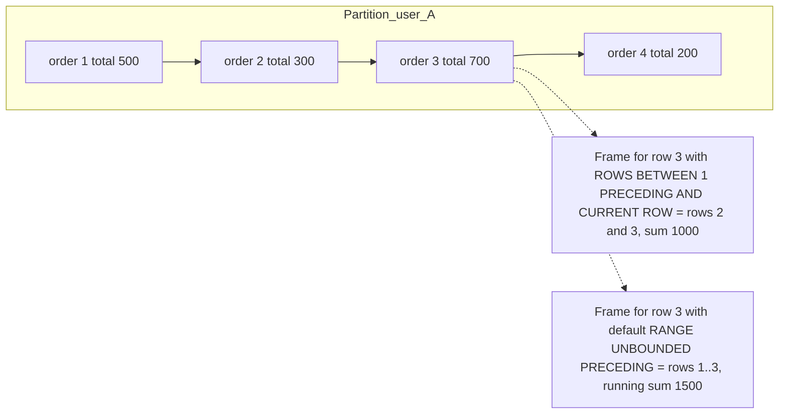

## 21.9 Window functions

### 21.9.1 What a window function is

#### Concept

A window function computes a value for each row using a set of related rows (the "window") without collapsing them into one row the way `GROUP BY` does. `sum(total) OVER (PARTITION BY user_id ORDER BY placed_at)` gives every order row its customer's running total up to that order. `row_number() OVER (PARTITION BY order_id ORDER BY created_at DESC)` numbers each order's payments from newest to oldest, so `= 1` picks the latest. The row stays; a new column appears.

The pieces of an `OVER` clause:

- `PARTITION BY` splits rows into groups (like `GROUP BY`, but rows are kept).
- `ORDER BY` orders rows within each partition and defines "before" and "after".
- The frame (`ROWS BETWEEN ... AND ...` or `RANGE ...`) says which rows around the current one feed the function. The default, when `ORDER BY` is present, is `RANGE BETWEEN UNBOUNDED PRECEDING AND CURRENT ROW`, which is why `sum() OVER (ORDER BY x)` is a running total.

#### Why does it exist?

Before window functions, "rank each product within its category by revenue", "the previous order's date for each order", or "running balance" required self-joins, correlated subqueries, or application code looping over sorted rows. Those are slow (O(n squared) for the correlated form) and unreadable. Window functions do it in one sorted pass per partition.

#### Mental model

Imagine a spreadsheet of orders sorted by customer and date. For each row, you look at a sliding highlighted region: "all rows above me for this customer" (running total), "the one row above me" (`LAG`), "all rows for this customer" (partition total for a percentage). You write the answer into a new column on the same row. The rows do not merge; the highlight moves.



#### How it works

1. The planner adds a `WindowAgg` node. Rows are sorted by `PARTITION BY` then `ORDER BY` (using an index if one matches, otherwise a `Sort`).
2. For each partition, rows are processed in order. The function sees the frame and computes the value.
3. Functions like `row_number`, `rank`, `lag`, `lead` are cheap (constant state). Aggregates over frames (`sum`, `avg`) are incremental for growing frames and can be more expensive for sliding frames.
4. Window functions are evaluated after `WHERE`, `GROUP BY` and `HAVING`, and before `ORDER BY` and `LIMIT`. You cannot filter on a window result in the same `SELECT`; wrap it in a subquery or CTE.
5. Multiple windows with the same `PARTITION BY`/`ORDER BY` share one sort. Different orderings need separate sorts; name windows with `WINDOW w AS (...)` to make sharing explicit.

Function reference:

| Function | Meaning | Typical use |
|---|---|---|
| `row_number()` | 1, 2, 3... within partition, no ties | top-N per group, dedup |
| `rank()` | 1, 1, 3 (gaps after ties) | leaderboards where ties share a rank |
| `dense_rank()` | 1, 1, 2 (no gaps) | "top 3 distinct scores" |
| `lag(col, n)` / `lead(col, n)` | value n rows before/after | time since previous order; next status |
| `first_value` / `last_value` / `nth_value` | value at frame edge | first purchase date per customer |
| `sum/avg/count/min/max ... OVER` | aggregate over the frame | running totals, moving averages, partition totals |
| `ntile(n)` | bucket rows into n groups | quartiles of customers by spend |
| `percent_rank`, `cume_dist` | relative position | percentile of a product's price in its category |

#### PostgreSQL example

```sql
-- Running total and partition total per customer, plus share of lifetime spend
SELECT user_id, id, placed_at, total,
       sum(total) OVER w                                        AS running_total,
       sum(total) OVER (PARTITION BY user_id)                   AS lifetime_total,
       round(100.0 * total / sum(total) OVER (PARTITION BY user_id), 1) AS pct_of_lifetime
FROM orders
WHERE status IN ('paid','shipped','delivered')
WINDOW w AS (PARTITION BY user_id ORDER BY placed_at, id)
ORDER BY user_id, placed_at;

-- Days since the customer's previous order (LAG), and whether this is a repeat purchase
SELECT id, user_id, placed_at,
       placed_at - lag(placed_at) OVER (PARTITION BY user_id ORDER BY placed_at, id) AS since_previous,
       row_number() OVER (PARTITION BY user_id ORDER BY placed_at, id) > 1        AS is_repeat
FROM orders;

-- Top 3 products per category by revenue (top-N per group)
WITH product_revenue AS (
  SELECT p.category_id, p.id AS product_id, p.name, sum(oi.quantity * oi.unit_price) AS revenue
  FROM order_items oi
  JOIN orders o   ON o.id = oi.order_id AND o.status IN ('paid','shipped','delivered')
  JOIN products p ON p.id = oi.product_id
  WHERE o.placed_at >= now() - interval '90 days'
  GROUP BY p.category_id, p.id, p.name
),
ranked AS (
  SELECT *, dense_rank() OVER (PARTITION BY category_id ORDER BY revenue DESC) AS rnk
  FROM product_revenue
)
SELECT category_id, product_id, name, revenue, rnk
FROM ranked WHERE rnk <= 3
ORDER BY category_id, rnk;

-- Dedup: keep the newest row per email among a messy import (users_import has duplicates)
DELETE FROM users_import
WHERE id IN (
  SELECT id FROM (
    SELECT id, row_number() OVER (PARTITION BY lower(email) ORDER BY created_at DESC, id DESC) AS rn
    FROM users_import
  ) t
  WHERE rn > 1
);

-- Moving 7-day average of daily revenue with an explicit frame
WITH daily AS (
  SELECT date_trunc('day', placed_at)::date AS day, sum(total) AS revenue
  FROM orders WHERE status IN ('paid','shipped','delivered') GROUP BY 1
)
SELECT day, revenue,
       avg(revenue) OVER (ORDER BY day ROWS BETWEEN 6 PRECEDING AND CURRENT ROW) AS avg_7d,
       revenue - lag(revenue) OVER (ORDER BY day)                                AS delta_vs_yesterday
FROM daily ORDER BY day;

-- Gaps and islands: contiguous runs of days on which a user placed at least one order
WITH days AS (
  SELECT DISTINCT user_id, date_trunc('day', placed_at)::date AS day FROM orders
),
numbered AS (
  SELECT user_id, day, day - (row_number() OVER (PARTITION BY user_id ORDER BY day))::int AS grp
  FROM days
)
SELECT user_id, min(day) AS streak_start, max(day) AS streak_end, count(*) AS streak_days
FROM numbered
GROUP BY user_id, grp
HAVING count(*) >= 3
ORDER BY streak_days DESC;
-- The trick: for consecutive days, "day minus row_number" is constant, so it identifies the island.

-- Frame semantics that bite: last_value with the default frame returns the CURRENT row, not the last in the partition
SELECT user_id, placed_at, total,
       last_value(total) OVER (PARTITION BY user_id ORDER BY placed_at)   AS wrong_last,   -- equals total (frame ends at current row)
       last_value(total) OVER (PARTITION BY user_id ORDER BY placed_at
                               ROWS BETWEEN UNBOUNDED PRECEDING AND UNBOUNDED FOLLOWING) AS real_last
FROM orders;
```

`RANGE` vs `ROWS`: `RANGE` groups peers (rows with equal `ORDER BY` values) into the frame together; `ROWS` counts physical rows. With a unique `ORDER BY` they agree; with ties, `sum() OVER (ORDER BY placed_at)` using the default `RANGE` includes all rows sharing the same timestamp in each of their running totals. Add a unique tiebreaker or use `ROWS` when you want strict one-row steps. `GROUPS` mode (PG11+) frames by peer groups.

#### TypeORM example

```ts
// Window functions are raw SQL territory. Keep them behind a typed repository method.
interface RankedProduct { category_id: string; product_id: string; name: string; revenue: string; rnk: number }

async topProductsPerCategory(days: number, n: number): Promise<RankedProduct[]> {
  return this.ds.query<RankedProduct[]>(
    `WITH product_revenue AS (
       SELECT p.category_id, p.id AS product_id, p.name, sum(oi.quantity * oi.unit_price) AS revenue
       FROM order_items oi
       JOIN orders o ON o.id = oi.order_id AND o.status IN ('paid','shipped','delivered')
       JOIN products p ON p.id = oi.product_id
       WHERE o.placed_at >= now() - ($1 || ' days')::interval
       GROUP BY p.category_id, p.id, p.name)
     SELECT * FROM (
       SELECT *, dense_rank() OVER (PARTITION BY category_id ORDER BY revenue DESC) AS rnk FROM product_revenue
     ) r WHERE rnk <= $2 ORDER BY category_id, rnk`,
    [days, n],
  );
}
```

QueryBuilder can express a window via `addSelect('row_number() OVER (PARTITION BY ... ORDER BY ...)', 'rn')` inside `getRawMany`, but the wrapping subquery for `WHERE rn = 1` is awkward; raw SQL reads better and is easier to review.

#### Sequelize example

```ts
const [rows] = await sequelize.query(
  `SELECT id, user_id, placed_at, total,
          sum(total) OVER (PARTITION BY user_id ORDER BY placed_at, id) AS running_total
   FROM orders WHERE user_id = :userId ORDER BY placed_at`,
  { replacements: { userId }, type: QueryTypes.SELECT },
);
```

#### Production scenario

A "your spending this year" widget for 2 million customers is computed nightly into a summary table by one query with `sum() OVER (PARTITION BY user_id ORDER BY placed_at)` over 12 million orders: one sort using the `(user_id, placed_at)` index (no `Sort` node), one `WindowAgg` pass, about 40 seconds on a replica. The alternative, a correlated subquery per order, would be 12 million index scans.

#### Failure scenario

A leaderboard used `rank()` for "top 100 sellers" and paginated with `WHERE rnk BETWEEN 101 AND 200`. Ties at rank 100 (three sellers with identical revenue) meant ranks 100, 100, 100, 103; page two started at 103 and the two tied sellers were never shown on any page. Switching to `row_number()` with a deterministic tiebreaker (`ORDER BY revenue DESC, seller_id`) made pagination complete, and `dense_rank()` was shown to the user as the displayed rank. Use `row_number()` to paginate and `rank()`/`dense_rank()` to display.

#### Edge cases & failure modes

- `last_value` and the default frame (see example): almost always needs `UNBOUNDED FOLLOWING`.
- Non-deterministic order: `row_number() OVER (ORDER BY placed_at)` with ties gives different numbering on different runs; add a unique tiebreaker.
- A window over a huge unindexed partition sorts on disk; check for `Sort Method: external merge` under `WindowAgg`.
- `PARTITION BY` on a low-cardinality column with millions of rows per partition is fine for `row_number`, but sliding-frame aggregates (`ROWS BETWEEN 1000 PRECEDING`) are recomputed per row and can be slow.
- Filtering on a window result requires a subquery; `WHERE row_number() OVER (...) = 1` is a syntax error.
- Window functions cannot be nested and cannot appear in `GROUP BY` or `HAVING`.

#### How a Senior Backend Engineer thinks about this

Top-N per group, dedup, running totals, deltas versus the previous row, and cohort math are window problems. They reach for `LATERAL` when the outer set is small (a page of 20 orders) and the window when the set is large (a nightly report over every order). They always add a unique tiebreaker to every window `ORDER BY`, and they know the `last_value` trap by heart.

#### Common mistakes

- `rank()` for pagination.
- Missing tiebreakers.
- `last_value` without a frame.
- Using a correlated subquery for "previous row" when `lag()` exists.

#### Interview questions

1. Difference between `row_number`, `rank`, and `dense_rank`? Expected: 1,2,3 vs 1,1,3 vs 1,1,2.
2. How do you select the latest payment per order with a window function, and when is `LATERAL` better? Expected: `row_number() OVER (PARTITION BY order_id ORDER BY created_at DESC) = 1` in a subquery; `LATERAL` when the outer set is small.
3. Why does `last_value` return the current row by default? Expected: default frame ends at `CURRENT ROW`.
4. Explain gaps and islands with `row_number`. Expected: `day - row_number()` is constant within a contiguous run.
5. What is the difference between `ROWS` and `RANGE` frames?

#### Practical exercise

Write four queries on the reference schema: running spend per customer, top 3 products per category, deduplicate a `users_import` table keeping newest, and 7-day moving average revenue. For each, capture the plan and confirm whether the `WindowAgg` is fed by an index scan or a `Sort`. Acceptance criteria: all four correct on a seeded dataset with deliberate ties, and at least one query rewritten to avoid a disk sort by adding an index.

## 21.10 CASE: conditional logic, conditional aggregation and pivoting

#### Concept

`CASE WHEN cond THEN a WHEN cond2 THEN b ELSE c END` is SQL's if/else. It appears in `SELECT` (derive a label), `ORDER BY` (custom sort order), `WHERE` (rarely; usually a smell), and, most importantly, inside aggregates to compute several conditional metrics in one pass (conditional aggregation), which is how you pivot rows into columns.

#### Why does it exist?

Reports want "count of orders by status as columns", not as rows. Sort orders want "pending first, then paid, then the rest". Labels want "small / medium / large basket". Doing these in application code means pulling all rows over the wire; `CASE` does it in the database in the same scan.

#### PostgreSQL example

```sql
-- Labeling and custom sort order
SELECT id, total,
       CASE WHEN total < 500 THEN 'small' WHEN total < 5000 THEN 'medium' ELSE 'large' END AS basket_size
FROM orders
ORDER BY CASE status WHEN 'pending' THEN 0 WHEN 'paid' THEN 1 ELSE 2 END, placed_at DESC;

-- Pivot: order counts per status as columns, per day (conditional aggregation)
SELECT date_trunc('day', placed_at)::date AS day,
       count(*) FILTER (WHERE status = 'pending')   AS pending,
       count(*) FILTER (WHERE status = 'paid')      AS paid,
       count(*) FILTER (WHERE status = 'shipped')   AS shipped,
       count(*) FILTER (WHERE status = 'delivered') AS delivered,
       count(*) FILTER (WHERE status = 'cancelled') AS cancelled,
       sum(CASE WHEN status = 'cancelled' THEN total ELSE 0 END) AS cancelled_value   -- older idiom, same result
FROM orders
WHERE placed_at >= now() - interval '30 days'
GROUP BY 1 ORDER BY 1;

-- Rating distribution per product as columns (the "stars histogram")
SELECT product_id,
       count(*) FILTER (WHERE rating = 5) AS five,
       count(*) FILTER (WHERE rating = 4) AS four,
       count(*) FILTER (WHERE rating = 3) AS three,
       count(*) FILTER (WHERE rating = 2) AS two,
       count(*) FILTER (WHERE rating = 1) AS one,
       round(avg(rating), 2)              AS avg_rating
FROM reviews GROUP BY product_id;

-- CASE in an UPDATE: bulk status transitions in one statement
UPDATE shipments
   SET status = CASE
                  WHEN delivered_at IS NOT NULL THEN 'delivered'
                  WHEN shipped_at   IS NOT NULL THEN 'in_transit'
                  ELSE status
                END
 WHERE status = 'created';

-- Dynamic pivots (unknown number of columns) need crosstab() from the tablefunc extension or application-side pivoting.
```

`FILTER` is preferred over `sum(CASE ...)` for readability; both plan identically. `CASE` is still needed when the conditional value is not a simple filter (different expressions per branch).

#### Edge cases & failure modes

- `CASE` returns the type of the first branch; mixing `text` and `integer` errors. Cast explicitly.
- No `ELSE` returns `NULL`; `sum()` ignores it, `count()` ignores it, but `array_agg` includes it.
- `CASE` in `WHERE` (`WHERE CASE WHEN $1 = 'x' THEN a = 1 ELSE b = 2 END`) prevents index use; write the branches as `OR` conditions or two queries.
- `CASE` on a column inside `ORDER BY` needs a `Sort` node; you cannot index a custom status order unless you use an expression index on the same `CASE`.

#### Interview questions

1. How do you get order counts per status as columns? Expected: conditional aggregation with `FILTER` or `sum(CASE ...)`.
2. When does `CASE` in `WHERE` hurt? Expected: it hides sargable predicates; the planner cannot use indexes.

## 21.11 Subqueries: scalar, correlated and derived tables

#### Concept

A subquery is a `SELECT` inside another statement. Three shapes:

- Scalar subquery: returns exactly one value; usable anywhere an expression is. `(SELECT count(*) FROM order_items WHERE order_id = o.id)` as a column.
- Correlated subquery: references a column from the outer query, so it is logically evaluated once per outer row. The scalar example above is correlated. This is where O(n squared) hides.
- Derived table: a subquery in `FROM`, used as a table. `FROM (SELECT ... GROUP BY ...) t`. Always planned as a normal join input; PG inlines or materializes as appropriate.

#### Why does it exist?

Subqueries let you compute an intermediate result inline without a CTE or a temp table. Derived tables are how you aggregate a child to the parent's grain before joining (the fix for row multiplication in section 21.3). Correlated subqueries express "for this row, look up something" naturally, and the planner turns many of them into joins.

#### How it works

1. A scalar uncorrelated subquery (`(SELECT max(placed_at) FROM orders)`) is an `InitPlan`: executed once, its value cached.
2. A correlated subquery in `SELECT` or `WHERE` becomes a `SubPlan`: executed per outer row, unless the planner can decorrelate it (it often can for `EXISTS`/`IN`, rarely for scalar aggregates in `SELECT`). With an index on the correlation column, each execution is an index probe: fine for 20 outer rows, painful for 2 million (`loops=2000000` in the plan).
3. A derived table in `FROM` is planned like a CTE that is inlined: predicates from the outer query are pushed into it when safe, and it participates in join ordering.
4. A subquery returning more than one row where a scalar is expected raises "more than one row returned by a subquery used as an expression". Add `LIMIT 1` with an `ORDER BY`, or use an aggregate.

#### PostgreSQL example

```sql
-- Scalar correlated subqueries in SELECT: fine for a single order page
SELECT o.id, o.total,
       (SELECT count(*) FROM order_items oi WHERE oi.order_id = o.id)                       AS item_count,
       (SELECT status FROM payments p WHERE p.order_id = o.id ORDER BY created_at DESC LIMIT 1) AS latest_payment
FROM orders o
WHERE o.id = $1;
-- Plan: Index Scan on orders; SubPlan 1 (loops=1); SubPlan 2 (loops=1). Total < 0.3 ms.

-- The same shape over a report: SubPlan loops = number of orders
EXPLAIN (ANALYZE)
SELECT o.id, (SELECT count(*) FROM order_items oi WHERE oi.order_id = o.id) AS item_count
FROM orders o WHERE o.placed_at >= '2026-01-01';
-- Index Scan using orders_placed_at_idx on orders o (rows=2104411)
--   SubPlan 1
--     ->  Aggregate (loops=2104411)
--           ->  Index Only Scan using order_items_order_id_product_id_key on order_items oi (loops=2104411)
-- Execution Time: 41210 ms   <- 2.1 million index scans

-- Rewrite as a derived table (aggregate once, join once): hash join, ~2 seconds
SELECT o.id, coalesce(ic.item_count, 0) AS item_count
FROM orders o
LEFT JOIN (SELECT order_id, count(*) AS item_count FROM order_items GROUP BY order_id) ic ON ic.order_id = o.id
WHERE o.placed_at >= '2026-01-01';

-- Uncorrelated scalar as InitPlan: computed once
SELECT id, total, total - (SELECT avg(total) FROM orders) AS vs_average FROM orders WHERE user_id = $1;

-- Derived table for "customers whose average order is above 2000"
SELECT u.email, s.avg_total
FROM (SELECT user_id, avg(total) AS avg_total FROM orders GROUP BY user_id HAVING avg(total) > 2000) s
JOIN users u ON u.id = s.user_id;

-- Row-returning subquery with ANY/ALL
SELECT id, price FROM products p
WHERE price > ALL (SELECT price FROM products WHERE category_id = p.category_id AND id <> p.id);  -- most expensive in its category
-- Clearer as a window: rank() OVER (PARTITION BY category_id ORDER BY price DESC) = 1
```

Decision table for "per-parent computed value":

| Outer row count | Child indexed on FK | Best tool |
|---|---|---|
| 1 to a few hundred | yes | Correlated scalar subquery or `LATERAL` |
| thousands to millions | yes or no | Derived table (`GROUP BY` then join) or window function |
| need top-1 child with several columns | yes | `LATERAL ... ORDER BY ... LIMIT 1` |
| need top-N children per parent over a large set | any | Window function with `row_number()` |

#### TypeORM example

```ts
// Derived-table join in QueryBuilder
const rows = await orderRepo.createQueryBuilder('o')
  .select(['o.id AS id', 'coalesce(ic.item_count, 0) AS item_count'])
  .leftJoin(
    (qb) => qb.select('oi.order_id', 'order_id').addSelect('count(*)', 'item_count').from(OrderItem, 'oi').groupBy('oi.order_id'),
    'ic', 'ic.order_id = o.id',
  )
  .where('o.placedAt >= :from', { from })
  .getRawMany();

// Scalar subquery as a selected column
const withCount = await orderRepo.createQueryBuilder('o')
  .addSelect((qb) => qb.select('count(*)').from(OrderItem, 'oi').where('oi.order_id = o.id'), 'item_count')
  .where('o.id = :id', { id })
  .getRawOne();
```

#### Sequelize example

```ts
const rows = await Order.findAll({
  attributes: {
    include: [[literal(`(SELECT count(*) FROM order_items oi WHERE oi.order_id = "Order"."id")`), 'itemCount']],
  },
  where: { id },
});
// For reports, use sequelize.query with the derived-table form instead of a literal per row.
```

#### Failure scenario

At 02:14 the on-call was paged: the "orders export" job was at 100 percent CPU for its fourth hour. The export selected every order of the year with three scalar subqueries per row (item count, latest payment status, shipment status). Each was an index probe, 40 microseconds; three per row over 2.1 million rows was 250 seconds of pure probing per subquery, and the `Aggregate` above each probe added more. Rewriting as three derived tables joined once brought the job to 90 seconds. The plan had said `loops=2104411` from the first run; nobody had looked.

#### Edge cases & failure modes

- Scalar subquery returning more than one row: runtime error, often only in production data.
- Scalar subquery returning zero rows: `NULL`, silently; `coalesce`.
- Correlated subquery on an unindexed column: sequential scan per outer row. Catastrophic.
- Derived table with `ORDER BY` and no `LIMIT`: the order is not guaranteed to survive the outer join.
- Predicate pushdown into a derived table is blocked by window functions, `DISTINCT ON`, or `LIMIT` inside it; the derived table is then computed in full first.

#### How a Senior Backend Engineer thinks about this

They look for `SubPlan` with a large `loops` count in any report plan and rewrite it as a derived table or window. They keep scalar subqueries for single-row lookups where they are the clearest expression. They never write a correlated subquery against a column without an index.

#### Interview questions

1. What is a correlated subquery and what is its cost model? Expected: references the outer row; evaluated per outer row; `loops=N` in the plan; needs an index or a rewrite.
2. Rewrite `SELECT o.id, (SELECT count(*) FROM order_items WHERE order_id = o.id) FROM orders o` for 2 million orders. Expected: derived table aggregated once, joined.
3. What is an `InitPlan` versus a `SubPlan`? Expected: uncorrelated, run once, vs correlated, run per row.
4. What happens when a scalar subquery returns two rows?

#### Practical exercise

Take the orders export query with three scalar subqueries, run it over 1 million orders, and capture the plan showing `loops`. Rewrite with derived tables, then with `LATERAL` for the top-1 payment, and compare the three plans and timings. Acceptance criteria: a table of timings and a one-paragraph rule for when each form is appropriate.
