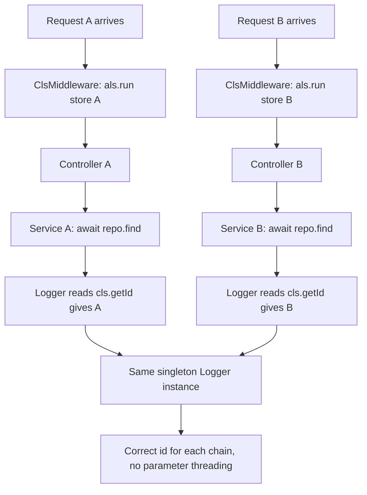

## 21.11 Shared state in NestJS

#### Concept

Every NestJS provider is a **singleton by default**. One instance is created when the application starts, and that same instance serves every request for the lifetime of the process. `OrdersService` is not created per request; there is exactly one, shared by all 40 requests currently in flight on that pod.

That is the right default — it is fast and it makes dependency injection cheap. But it means **any property you set on a provider is shared mutable state across concurrent requests**, and because every `await` is an interleaving point (21.2), the value you wrote before an `await` may belong to someone else after it.

#### Why does it exist?

Creating a fresh object graph per request is expensive: NestJS would have to resolve the whole dependency tree, run constructors, and garbage-collect it all, on every single request. Singletons make a NestJS app roughly as cheap as a plain Express app.

The cost is that NestJS gives you no protection at all against storing request state on a singleton. Nothing warns you. The code compiles, the tests pass (they run one request at a time), and the bug only appears under concurrency — which means it appears in production.

#### Mental model

Imagine a single clerk with one desk. There is exactly one desk. If the clerk puts *your* file on the desk, walks to the archive (that is the `await`), and while they are gone another customer's file is put on the same desk, then when the clerk returns and reads "the file on the desk" they read the wrong customer's data — and hand it to you.

The fix is not a bigger desk. It is to carry the file with you: pass the data as an argument, or hold it in something that is scoped to your visit.

#### How it works

Here is the exact code that leaks one user's data into another user's response. Variants of this ship regularly.

```ts
// THIS IS THE BUG. It will return the wrong user's orders under load.
@Injectable()
export class OrdersService {
  private currentUserId: string;          // shared by every concurrent request

  async getOrdersFor(userId: string): Promise<Order[]> {
    this.currentUserId = userId;                                  // (1) A writes 'user-A'
    const profile = await this.profiles.load(userId);             // (2) await: B runs and writes 'user-B'
    if (!profile.active) throw new ForbiddenException();
    return this.repo.find({ where: { userId: this.currentUserId } }); // (3) A reads 'user-B'
  }
}
```

Two requests, A for `user-A` and B for `user-B`, arriving 1 ms apart:

```text
t=0.0ms  A: this.currentUserId = 'user-A'
t=0.1ms  A: await profiles.load('user-A')      -> A parks, thread free
t=1.0ms  B: this.currentUserId = 'user-B'
t=1.1ms  B: await profiles.load('user-B')      -> B parks
t=4.0ms  A resumes: reads this.currentUserId   -> 'user-B'
t=4.1ms  A returns user-B's orders to user A   <- data leak
```

This is not a rare interleaving; at any meaningful RPS it happens constantly. The severity depends on what you stored: a `currentUserId` is a **data breach**, a cached tenant id is a cross-tenant leak, a `this.total` accumulator in a report service is silently wrong numbers.

The same shape appears with less obvious offenders:

```ts
private requestStartedAt: number;         // wrong durations in logs
private tenantSchema: string;             // queries against another tenant's schema
private lastError: Error;                 // wrong error surfaced to the wrong client
private items: OrderItem[] = [];          // accumulates across requests, grows forever
```

**The fix, in order of preference:**

**1. Do not store it. Pass it.** Almost always the right answer, and it costs nothing at runtime.

```ts
@Injectable()
export class OrdersService {
  async getOrdersFor(userId: string): Promise<Order[]> {
    const profile = await this.profiles.load(userId);
    if (!profile.active) throw new ForbiddenException();
    return this.repo.find({ where: { userId } });    // from the parameter, not from `this`
  }
}
```

**2. Use `AsyncLocalStorage`** when the value is genuinely ambient — a correlation id, the authenticated user, the current transaction — and threading it through eight layers would be worse than the alternative.

**3. Use a request-scoped provider** when the object itself must be per request (rare, and expensive; see below).

**Legitimate singleton state exists** and you should not become afraid of it. A provider may safely hold: an in-memory cache keyed by a business key, a connection or client instance, a metrics counter, a `Map` of in-flight promises for single-flight (21.3), configuration. The test is simple: **is this value about a particular request?** If yes, it must not live on the singleton.

#### NestJS example: request-scoped providers, and what they really cost

```ts
import { Injectable, Scope, Inject } from '@nestjs/common';
import { REQUEST } from '@nestjs/core';
import { Request } from 'express';

@Injectable({ scope: Scope.REQUEST })
export class RequestContext {
  readonly correlationId: string;
  readonly userId?: string;

  constructor(@Inject(REQUEST) private readonly req: Request) {
    this.correlationId = (req.headers['x-correlation-id'] as string) ?? randomUUID();
    this.userId = (req as { user?: { id: string } }).user?.id;
  }
}
```

This is correct — a new instance per request, no sharing. But there are two consequences people discover too late:

**Scope bubbles up.** Any provider that injects a request-scoped provider *becomes* request-scoped, and so does anything that injects *that*, all the way up to the controller. Inject `RequestContext` into a widely used `AuditService` and you have quietly made half your application request-scoped. NestJS then instantiates that whole subtree on every request.

**It is measurably slower.** On a service where a controller depends on 6 providers with a depth-3 graph, moving the leaf to `Scope.REQUEST` produced, on a 2-core pod:

| Configuration | Throughput | p50 | p99 | RSS |
|---|---:|---:|---:|---:|
| All singletons | 9,400 RPS | 3.1 ms | 12 ms | 180 MB |
| One request-scoped leaf (subtree bubbles) | 6,100 RPS | 5.0 ms | 24 ms | 265 MB |
| Same, with a 14-provider subtree | 3,800 RPS | 8.2 ms | 41 ms | 340 MB |

Roughly **35-60% of throughput**, plus GC pressure from allocating and discarding an object graph per request. Your numbers will differ; the shape will not. Measure before you adopt it broadly.

There is a middle path NestJS provides for the genuine multi-tenant case: **durable providers**. You implement a `ContextIdStrategy` that maps requests with the same tenant id to the same context, so the subtree is instantiated once per tenant rather than once per request.

```ts
import { ContextIdFactory, ContextIdStrategy, HostComponentInfo, ContextId } from '@nestjs/core';

const tenants = new Map<string, ContextId>();

export class TenantContextIdStrategy implements ContextIdStrategy {
  attach(contextId: ContextId, request: { headers: Record<string, string> }) {
    const tenantId = request.headers['x-tenant-id'];
    if (!tenantId) return () => contextId;                 // fall back to per-request

    let tenantSubTreeId = tenants.get(tenantId);
    if (!tenantSubTreeId) {
      tenantSubTreeId = ContextIdFactory.create();
      tenants.set(tenantId, tenantSubTreeId);
    }
    // Durable providers reuse the tenant subtree; non-durable ones stay per-request.
    return (info: HostComponentInfo) => (info.isTreeDurable ? tenantSubTreeId! : contextId);
  }
}

// main.ts
ContextIdFactory.apply(new TenantContextIdStrategy());
```

Providers opt in with `@Injectable({ scope: Scope.REQUEST, durable: true })`. Note the `Map` grows with tenant count, so bound it (an LRU) if tenants are numerous or transient.

#### `AsyncLocalStorage` and `nestjs-cls`

`AsyncLocalStorage` (from `node:async_hooks`) gives you a value that follows an asynchronous call chain. You call `als.run(store, callback)`, and anything called from `callback` — through any number of `await`s, promise chains and callbacks — can call `als.getStore()` and get *that* store, not another request's.



The mechanism: V8 tracks the "async resource" that scheduled each continuation, and `AsyncLocalStorage` associates the store with that chain. A `Promise`, a `setTimeout`, an `fs` callback and an `await` all propagate it. What does **not** propagate is anything that leaves the process or crosses a pre-existing async boundary — see the failure modes below.

`nestjs-cls` wraps this with NestJS lifecycle integration:

```ts
// app.module.ts
import { ClsModule } from 'nestjs-cls';
import { randomUUID } from 'node:crypto';

@Module({
  imports: [
    ClsModule.forRoot({
      global: true,
      middleware: {
        mount: true,                       // wraps every HTTP request in als.run()
        generateId: true,
        idGenerator: (req: Request) =>
          (req.headers['x-correlation-id'] as string) ?? randomUUID(),
        setup: (cls, req: Request) => {
          cls.set('ip', req.ip);
          cls.set('userAgent', req.headers['user-agent']);
        },
      },
    }),
  ],
})
export class AppModule {}
```

```ts
// The current user, set by a guard, read anywhere — with no parameter threading.
@Injectable()
export class AuthGuard implements CanActivate {
  constructor(private readonly cls: ClsService, private readonly jwt: JwtService) {}

  async canActivate(ctx: ExecutionContext): Promise<boolean> {
    const req = ctx.switchToHttp().getRequest<Request>();
    const token = req.headers.authorization?.replace('Bearer ', '');
    if (!token) throw new UnauthorizedException();
    const payload = await this.jwt.verifyAsync<{ sub: string; tenantId: string }>(token);
    this.cls.set('userId', payload.sub);
    this.cls.set('tenantId', payload.tenantId);
    return true;
  }
}
```

```ts
// A SINGLETON service that is nonetheless request-aware, with no per-request allocation.
@Injectable()
export class AuditService {
  constructor(private readonly cls: ClsService, private readonly repo: Repository<AuditLog>) {}

  async record(action: string, entityId: string): Promise<void> {
    await this.repo.insert({
      action,
      entityId,
      actorId: this.cls.get('userId'),          // correct per request
      tenantId: this.cls.get('tenantId'),
      correlationId: this.cls.getId(),
      at: new Date(),
    });
  }
}
```

```ts
// Correlation id into every log line and every outbound call.
@Injectable()
export class HttpClient {
  constructor(private readonly cls: ClsService) {}

  async post<T>(url: string, body: unknown): Promise<T> {
    const res = await fetch(url, {
      method: 'POST',
      headers: {
        'content-type': 'application/json',
        'x-correlation-id': this.cls.getId(),   // the trace continues downstream
      },
      body: JSON.stringify(body),
      signal: AbortSignal.timeout(2_000),
    });
    if (!res.ok) throw new Error(`${url} -> ${res.status}`);
    return res.json() as Promise<T>;
  }
}
```

**Transaction propagation** is the highest-value use, because it removes the connection-pool deadlock from 21.4 by construction. With `@nestjs-cls/transactional` the current `EntityManager` lives in the context, so nested services automatically reuse the transaction's connection instead of taking a second one.

```ts
import { ClsPluginTransactional } from '@nestjs-cls/transactional';
import { TransactionalAdapterTypeOrm } from '@nestjs-cls/transactional-adapter-typeorm';

ClsModule.forRoot({
  global: true,
  middleware: { mount: true },
  plugins: [
    new ClsPluginTransactional({
      imports: [TypeOrmModule],
      adapter: new TransactionalAdapterTypeOrm({ dataSourceToken: DataSource }),
    }),
  ],
});
```

```ts
@Injectable()
export class CheckoutService {
  constructor(
    private readonly txHost: TransactionHost<TransactionalAdapterTypeOrm>,
    private readonly pricing: PricingService,
  ) {}

  @Transactional()
  async checkout(orderId: string): Promise<void> {
    await this.txHost.tx.update(Order, { id: orderId }, { status: 'PAID' });
    await this.pricing.recalculate(orderId);   // uses txHost.tx internally: SAME connection
  }
}
```

```ts
@Injectable()
export class PricingService {
  constructor(private readonly txHost: TransactionHost<TransactionalAdapterTypeOrm>) {}

  async recalculate(orderId: string): Promise<void> {
    // Inside a @Transactional() call this is the transaction's manager.
    // Outside one, it is the plain manager. Nesting depth stays 1 either way.
    await this.txHost.tx.query('UPDATE order_lines SET total = qty * unit_price WHERE order_id = $1', [orderId]);
  }
}
```

If you prefer not to add the plugin, a hand-rolled version is about 30 lines and worth understanding:

```ts
import { AsyncLocalStorage } from 'node:async_hooks';

@Injectable()
export class TxContext {
  private readonly als = new AsyncLocalStorage<EntityManager>();

  constructor(private readonly dataSource: DataSource) {}

  /** The transaction's manager if we are inside one, otherwise the default. */
  get manager(): EntityManager {
    return this.als.getStore() ?? this.dataSource.manager;
  }

  async runInTransaction<T>(work: () => Promise<T>): Promise<T> {
    const existing = this.als.getStore();
    if (existing) return work();                      // already inside: join it, do not nest
    return this.dataSource.transaction((manager) => this.als.run(manager, work));
  }
}
```

The `if (existing) return work()` line is the whole point: it makes transactions *joinable*, so a service that opens a transaction can be called from inside another one without opening a second connection.

#### Production scenario

A B2B SaaS with 900 tenants ran every request through a request-scoped `TenantContext` injected into 11 providers. Throughput on 8 pods was 2,300 RPS with p99 at 78 ms, and GC accounted for 9% of CPU. Replacing it with `nestjs-cls` (singletons plus an ALS store) moved throughput to 5,900 RPS with p99 at 26 ms and GC to 2%, on the same hardware. They removed 3 of 8 pods.

The migration was mechanical: delete `scope: Scope.REQUEST`, replace `this.tenantContext.tenantId` with `this.cls.get('tenantId')`. The risky part was auditing for places where tenant id had leaked onto a singleton during earlier refactors — they found two, both in reporting code, both returning occasional cross-tenant rows that had been dismissed as "cache weirdness" for months.

#### Failure scenario

At 15:20 a customer support ticket said "I can see another company's invoices". Not a crash, not an error, not in any dashboard.

Root cause: a `PdfService` singleton with `private branding: TenantBranding`. `generateInvoice()` set `this.branding` from the tenant, then `await`ed a 200 ms logo fetch from S3, then rendered using `this.branding`. Under any concurrency, invoices rendered with whichever tenant's branding was set last — including the tenant's name, address and logo on another tenant's invoice.

The bug had been in production for 7 months. It was invisible because it required two tenants generating invoices within the same 200 ms window, which happened a few times a day out of 40,000 invoices, and nobody had reported it. The fix was one line — pass `branding` as a parameter — plus a lint rule (`no-restricted-syntax` banning assignment to `this.<field>` in `@Injectable()` classes outside the constructor, with an allowlist), plus a test that renders 50 invoices concurrently for 50 tenants and asserts every output matches its own tenant.

#### Edge cases & failure modes

- **Request data on a singleton property** — leaks across requests and across tenants.
- **Accumulator arrays on singletons** grow forever; a slow memory leak plus wrong results.
- **Request-scoped scope bubbling** silently converts a large subtree to per-request instantiation.
- **`Scope.REQUEST` providers in a scheduled task or queue consumer** have no request; NestJS creates a context anyway but `@Inject(REQUEST)` gives you `undefined`-ish values. Use ALS with an explicit `cls.run()` instead.
- **ALS context lost across a queue boundary** — the worker is a different process; you must serialise the correlation id into the job payload and re-enter the context in the processor.
- **ALS lost in event-emitter callbacks registered outside the request**: a listener registered at startup runs in the startup context, not the emitting request's.
- **ALS lost across `setTimeout` scheduled outside the context**, and across manually constructed promises resolved from elsewhere.
- **ALS store mutated after the request ends** (a fire-and-forget continuation) can write into a context whose owner is gone.
- **`AsyncLocalStorage` overhead** is small but not zero (single-digit percent on hot paths in modern Node); it is far cheaper than request scope.
- **Durable provider tenant maps** grow unbounded; bound them.

#### How a Senior Backend Engineer thinks about this

The question they ask of every provider field is "is this about a request?". If yes, it does not go on the provider. They treat a singleton field holding a user id, tenant id, correlation id or per-request accumulator as a security bug, not a style issue, and they say so in review.

They prefer parameters to ambient context, because parameters are visible in the type system, and they use `AsyncLocalStorage` only for genuinely cross-cutting values: correlation id, authenticated principal, tenant, current transaction. Those four, and not much else.

They are sceptical of `Scope.REQUEST` and ask for the measured cost before it lands, because they have seen scope bubbling take 40% off throughput for the convenience of not passing an argument. And they treat transaction propagation via ALS as a correctness feature, not ergonomics, because it makes the pool deadlock in 21.4 structurally impossible.

To a product manager: "Our service objects are shared by everyone using the site at that moment. If we write your user id onto one of them and then wait for the database, someone else's request can overwrite it before we finish. That is how one customer sees another customer's data, and it is why we never store your details on a shared object."

#### Common mistakes

- `private currentUser` / `private tenantId` on an `@Injectable()`.
- Assuming a NestJS provider is created per request.
- Making everything request-scoped to be safe.
- Injecting `REQUEST` into a provider also used by a cron job or queue consumer.
- Expecting the ALS context to survive into a BullMQ processor.
- Testing with one request and concluding it works.

#### Interview questions

1. *What is the default scope of a NestJS provider, and what does that mean for concurrent requests?* Expected: singleton; one instance shared; any field is shared mutable state across interleaved requests.
2. *Show me code that leaks one user's data into another user's response.* Expected: assign to `this.x`, `await`, read `this.x`.
3. *What is the real cost of `Scope.REQUEST`?* Expected: per-request instantiation of the whole subtree because scope bubbles up the injection chain; 35-60% throughput in measured cases; GC pressure. Follow-up: *what is `durable: true` for?*
4. *How does `AsyncLocalStorage` keep the correlation id correct across `await`s?* Expected: the store is bound to the async resource chain; continuations inherit it; each `run()` creates an independent chain.
5. *Where does ALS context get lost?* Expected: across processes and queues, in listeners registered outside the context, in timers scheduled outside it; re-enter explicitly with `cls.run()` and carry ids in the payload.
6. *How would you propagate a database transaction without passing an `EntityManager` through every method?* Expected: ALS-held manager, joinable transactions, `@nestjs-cls/transactional`; note it also prevents connection-pool deadlock.

#### Practical exercise

Write a NestJS service with `private currentUserId` set before an `await`, and a test that fires 100 concurrent requests for 100 different users. Assert that every response matches its own user. Watch it fail.

Acceptance criteria: (a) the buggy version fails with at least one mismatched response; (b) after switching to a parameter, 1,000 concurrent requests all match; (c) add `nestjs-cls`, set the user id in a guard, read it from a singleton audit service, and confirm every audit row has the correct actor across 1,000 concurrent requests; (d) benchmark the same endpoint with a request-scoped context provider versus ALS and record the throughput difference.

## 21.12 Concurrency and the database pool

#### Concept

Your application does not talk to PostgreSQL "as an application". It talks through a fixed number of TCP connections, each of which can run exactly one statement at a time. The pool is the queue in front of them. **Concurrency in your process and concurrency at the database are the same number only until the pool runs out** — after that, extra concurrency produces waiting, not work.

#### Why does it exist?

Opening a PostgreSQL connection is expensive: TCP, TLS, authentication, and a new server-side backend process with its own memory (a few MB of `work_mem` allowances plus catalog caches). At 500 RPS you cannot open one per request. The pool amortises that cost by keeping a small set of connections warm and lending them out.

#### Mental model

Imagine a call centre with 20 phone lines and a hold queue. Twenty conversations can happen at once. The 21st caller waits on hold. If conversations are short, the queue drains and nobody notices. If one conversation lasts six minutes because the agent is waiting on a third party (a transaction awaiting an HTTP call), one line is gone for six minutes and the hold queue grows.

#### How it works

1. A query asks the pool for a connection.
2. If one is idle it is handed over immediately (microseconds).
3. If all are busy, the request joins the wait queue. `waitingCount` increments.
4. If it waits longer than `connectionTimeoutMillis`, it fails with `timeout exceeded when trying to connect`.
5. When the query finishes, the connection returns to the pool — **unless it is inside a transaction**, in which case it is held from `BEGIN` to `COMMIT`.

That last point is the whole game. A simple query holds a connection for its duration (1-5 ms locally). A transaction holds one for the duration of *everything inside it*, including your JavaScript, including any `await` on an HTTP call. A transaction that awaits a 4-second payment API holds a connection for 4 seconds and shows up in `pg_stat_activity` as `idle in transaction`.

```text
Connection hold time
  plain SELECT                     1-5 ms
  transaction, 3 statements        5-15 ms
  transaction + external HTTP      as long as the third party takes   <- the bug
  transaction + await sleep        as long as you told it to sleep    <- also the bug
```

#### The sizing formula and a worked example

```text
per-pod pool max  >=  peak concurrent DB operations per pod
                      + nesting allowance (21.4)
                      + a little headroom

fleet total       =   pods x per-pod pool max
                      + workers x worker pool max
                      + cron/migration/admin connections
                  <=  max_connections - reserved
```

Worked, for 6 API pods at 1,200 RPS with a 45 ms p99 endpoint:

```text
In-flight requests fleet-wide  = RPS x latency = 1200 x 0.045     = 54
Per pod                                                    54 / 6 =  9
Fraction actually holding a connection at any instant (the rest are
  awaiting HTTP, doing CPU, or serialising JSON)             ~60%  =  5.4
Peak-to-average burst factor                                x 2.5  = 13.5
Nesting allowance: D = 1 everywhere (transaction manager propagated)  + 0
Headroom                                                            +  2
                                                                    -----
per-pod pool max                                                       16

Fleet:  6 API pods    x 16 = 96
        3 worker pods x 10 = 30
        1 cron pod    x  4 =  4
        migrations/admin   =  5
                             ---
                             135

max_connections = 200, reserved (superuser 3, replication 2, monitoring 5) = 190 usable.
135 fits, and leaves room to scale the API to 9 pods before hitting the ceiling.
```

Two things to notice. First, **more pool is not better**: 200 idle connections cost PostgreSQL memory and make every `pg_stat_activity` scan slower, and a pool larger than the database can usefully execute in parallel just moves the queue from your process to the database's CPU scheduler. A rough ceiling for the *whole fleet* on a machine with `C` cores and a good disk is `C x 2` to `C x 4` actively-working connections; beyond that, throughput flattens and latency rises.

Second, **the HPA is part of this calculation**. `maxReplicas: 30` with a pool of 16 means a potential 480 connections. Either cap `maxReplicas`, or introduce PgBouncer in transaction mode so hundreds of client connections multiplex onto a few dozen server connections.

#### NestJS example: the metric that tells you the truth

```ts
// typeorm config
TypeOrmModule.forRoot({
  type: 'postgres',
  url: process.env.DATABASE_URL,
  extra: {
    max: Number(process.env.DB_POOL_MAX ?? 16),
    connectionTimeoutMillis: 5_000,     // fail fast rather than pile up
    idleTimeoutMillis: 30_000,
    statement_timeout: 5_000,           // no query runs longer than this
    idle_in_transaction_session_timeout: 15_000,   // kill leaked transactions
    application_name: `shop-${process.env.APP_ROLE}`,   // shows in pg_stat_activity
  },
});
```

```ts
@Injectable()
export class PoolMetrics implements OnModuleInit {
  constructor(private readonly ds: DataSource, private readonly registry: Registry) {}

  onModuleInit() {
    const pool = (this.ds.driver as { master: Pool }).master;   // node-postgres Pool
    new Gauge({
      name: 'pg_pool_total', help: 'connections in the pool',
      registers: [this.registry], collect() { this.set(pool.totalCount); },
    });
    new Gauge({
      name: 'pg_pool_idle', help: 'idle connections',
      registers: [this.registry], collect() { this.set(pool.idleCount); },
    });
    new Gauge({
      // THE metric. Anything above 0 for a sustained period means the pool is the bottleneck.
      name: 'pg_pool_waiting', help: 'requests waiting for a connection',
      registers: [this.registry], collect() { this.set(pool.waitingCount); },
    });
  }
}
```

`waitingCount` is the truth-teller because it distinguishes the two things that look identical from the outside. Slow endpoint + `waitingCount = 0` means the database or the query is slow: go look at `pg_stat_statements`. Slow endpoint + `waitingCount = 40` means your own pool is the bottleneck: go look at hold times, nesting, and transactions doing I/O. Teams without this metric spend the first hour of every such incident tuning the wrong thing.

Pair it with the server side:

```sql
-- Sessions holding a connection while doing nothing: the classic leak.
SELECT application_name, count(*) AS sessions,
       max(now() - state_change) AS longest_idle_in_tx
  FROM pg_stat_activity
 WHERE state = 'idle in transaction'
 GROUP BY application_name
 ORDER BY longest_idle_in_tx DESC;
```

Alert on `pg_pool_waiting > 0 for 2 minutes` and on `idle in transaction` sessions older than 30 seconds. Both are actionable, both are early.

#### Edge cases & failure modes

- **Transaction awaiting an HTTP call** holds a connection for the third party's latency.
- **Nested connections** (`D > 1`) cause pool deadlock (21.4); the formula is `P >= N * (D - 1) + 1`.
- **`connectionTimeoutMillis` unset** means requests queue indefinitely and the client times out first, with the work still running.
- **`statement_timeout` unset** lets one runaway query hold a connection for hours.
- **Long-running read replicas queries** blocking replay (`max_standby_streaming_delay`) — a different resource, same shape.
- **HPA scaling multiplies connections** and can exhaust `max_connections`, making *new pods* fail to start.
- **Migrations at deploy time** open extra connections exactly when the fleet is at double size during a rolling update.
- **PgBouncer transaction mode** breaks session-level features: `SET` without `LOCAL`, session advisory locks, prepared statements (unless `max_prepared_statements` is configured), `LISTEN/NOTIFY`.
- **A pool per `DataSource`**: multiple `DataSource`s (read replica, tenant shards) each have their own pool; the fleet arithmetic must include all of them.

#### How a Senior Backend Engineer thinks about this

They treat pool size as a fleet-wide budget, not a per-service setting, and they can produce the arithmetic on demand. Before approving an HPA `maxReplicas` change they multiply it out.

They are ruthless about hold time: no external calls in transactions, `statement_timeout` always set, `idle_in_transaction_session_timeout` always set. They know that raising the pool is a mitigation with a cost paid by every other service on the same database.

And they instrument `waitingCount` before they need it, because the first time you need it is during an incident where every other metric is lying to you.

#### Practical exercise

Instrument `totalCount`, `idleCount` and `waitingCount` as Prometheus gauges. Set `max: 5`. Write an endpoint that opens a transaction, sleeps 2 seconds, then commits. Drive it at 10 RPS.

Acceptance criteria: `waitingCount` rises above zero within seconds; requests begin failing with connection timeouts at the rate you predict from `5 / 2s = 2.5 RPS` of capacity; `pg_stat_activity` shows 5 sessions `idle in transaction`. Then move the sleep outside the transaction and confirm `waitingCount` returns to 0 at the same request rate. Finally, compute the correct `max` for 1,000 RPS at 30 ms p99 across 4 pods and verify it empirically.

## 21.13 Scheduled tasks with multiple replicas

#### Concept

`@nestjs/schedule`'s `@Cron` decorator registers a timer **inside your process**. It is not a distributed scheduler. It has no idea that four other pods exist, and every one of them is running the same timer.

So `@Cron('0 0 * * *')` on a deployment with 5 replicas does not run your job at midnight. It runs it **five times** at midnight, concurrently, on five machines.

#### Why does it exist?

In-process scheduling is simple, dependency-free and correct for a single process — which is what most applications are during development, and what every tutorial assumes. NestJS documents the behaviour, but the decorator gives no hint at the call site, and nothing fails until the day you scale from 1 replica to 3.

#### Mental model

Imagine giving every employee an identical alarm clock and telling them "when this rings, lock up the shop". At closing time, five people all walk to the door and try to lock it. Sometimes that is harmless. Sometimes it means five people each count the till and each file a deposit.

#### How it works

```ts
// This runs on EVERY pod. With replicas: 5, that is five concurrent runs.
@Injectable()
export class SettlementScheduler {
  @Cron('0 0 * * *', { name: 'daily-settlement', timeZone: 'Asia/Kolkata' })
  async runSettlement(): Promise<void> {
    await this.settlement.settleAll();
  }
}
```

The incident this produces is worth telling in full, because the shape repeats.

At 00:00 the daily settlement ran on all 5 pods of the payments service. Each queried "merchants with unsettled transactions since yesterday", got the same 1,840 merchants, and began creating payout instructions. There was no unique constraint on `(merchant_id, settlement_date)` because in development there had only ever been one runner.

By 00:04, 9,200 payout instructions existed for 1,840 merchants. The bank file generator ran at 00:30 and submitted all of them. 5x the correct amount left the account: about 4.1 crore rupees over-disbursed. Recovery took nine days of merchant-by-merchant reconciliation and clawbacks, and two merchants had already withdrawn and spent the excess.

Root cause line in the post-mortem: *"`@Cron` is per-process. We scaled to 5 replicas in March and did not revisit the scheduler."* The scaling change had happened four months earlier; the settlement job had been running 5x every night since, but until March the amounts had been small enough that the daily reconciliation absorbed them.

```mermaid
sequenceDiagram
    participant P1 as Pod1
    participant P2 as Pod2
    participant P3 as Pod3
    participant PG as PostgreSQL
    Note over P1,P3: 00:00 local timers all fire
    P1->>PG: BEGIN; pg_try_advisory_xact_lock 4711, settlement
    PG-->>P1: true
    P2->>PG: BEGIN; pg_try_advisory_xact_lock 4711, settlement
    PG-->>P2: false
    P3->>PG: BEGIN; pg_try_advisory_xact_lock 4711, settlement
    PG-->>P3: false
    Note over P2,P3: return immediately, do nothing
    P1->>PG: settle 1840 merchants
    P1->>PG: COMMIT, lock released
```

#### The four solutions, compared

| Solution | Extra infrastructure | Survives pod death | Ordering / retries | Best for |
|---|---|---|---|---|
| PostgreSQL advisory lock | none | yes, lock auto-released | none built in | most services; the default answer |
| Redis lock | Redis | yes, TTL expiry | none built in | when the job is not database-centric |
| Dedicated `replicas: 1` deployment | a deployment | brief gap during restart | none built in | heavy jobs needing their own resources |
| BullMQ repeatable jobs | Redis + BullMQ | yes | retries, backoff, history | when you already run BullMQ |

**1. Advisory-lock leader election.** The lock is acquired for the duration of the job's transaction, so exactly one pod runs it, and the lock is released automatically however the job ends.

```ts
@Injectable()
export class LeaderElection {
  private readonly log = new Logger(LeaderElection.name);
  private static readonly NAMESPACE = 4711;    // keeps job locks away from other advisory locks

  constructor(private readonly ds: DataSource) {}

  /** Runs `work` only if this pod wins the lock. Returns false if another pod has it. */
  async runIfLeader(jobName: string, work: () => Promise<void>): Promise<boolean> {
    return this.ds.transaction(async (manager) => {
      const [{ locked }] = await manager.query<[{ locked: boolean }]>(
        'SELECT pg_try_advisory_xact_lock($1, hashtext($2)) AS locked',
        [LeaderElection.NAMESPACE, jobName],
      );
      if (!locked) {
        this.log.debug(`${jobName}: another pod is running it`);
        return false;
      }
      await work();                 // lock held until this transaction ends
      return true;
    });
  }
}
```

```ts
@Injectable()
export class SettlementScheduler {
  constructor(
    private readonly leader: LeaderElection,
    private readonly settlement: SettlementService,
    private readonly runs: JobRunsRepository,
  ) {}

  @Cron('0 0 * * *', { name: 'daily-settlement', timeZone: 'Asia/Kolkata' })
  async runSettlement(): Promise<void> {
    const ran = await this.leader.runIfLeader('daily-settlement', async () => {
      // Second layer: a unique constraint makes a duplicate run impossible
      // even if the lock somehow fails. Belt and braces (21.3).
      const claimed = await this.runs.claim('daily-settlement', today());
      if (!claimed) return;
      await this.settlement.settleAll();
      await this.runs.markSuccess('daily-settlement', today());
    });
    if (!ran) return;
  }
}
```

The trade-off to be explicit about: the job runs inside a transaction that holds a pool connection for its entire duration. For a 3-minute settlement on a pool of 16, that is acceptable. For a 40-minute job, use a dedicated `DataSource` with a small pool for the scheduler, or use the Redis lock instead.

**2. Redis lock.** Same idea, no long-lived database transaction, but now the TTL problem from 21.5 is yours: heartbeat while running, and make the job idempotent because the lock can expire.

```ts
@Cron('0 0 * * *')
async runSettlement(): Promise<void> {
  const token = await this.lock.acquire('cron:daily-settlement', 120_000);
  if (!token) return;
  const beat = setInterval(
    () => void this.lock.extend('cron:daily-settlement', token, 120_000).catch(() => undefined),
    40_000,
  );
  try {
    await this.settlement.settleAll();
  } finally {
    clearInterval(beat);
    await this.lock.release('cron:daily-settlement', token);
  }
}
```

**3. A dedicated singleton deployment.** Move schedulers into their own deployment with `replicas: 1` and no HTTP traffic. Honest about what it gives you: during a rolling restart or a node drain there is a window where zero pods or two pods exist, so this is *not* a strict guarantee on its own. Use `strategy: Recreate` to avoid overlap, and keep the idempotency layer.

```yaml
apiVersion: apps/v1
kind: Deployment
metadata: { name: shop-scheduler }
spec:
  replicas: 1
  strategy: { type: Recreate }    # never two scheduler pods at once during a deploy
  template:
    spec:
      containers:
        - name: app
          image: shop:1.42.0
          env: [{ name: APP_ROLE, value: scheduler }]
```

Its main virtue is not correctness, it is operational: the scheduler gets its own resources, its own memory limit, its own logs, and a 40-minute job cannot be evicted by API autoscaling.

**4. BullMQ repeatable jobs.** The scheduler lives in Redis, not in your process. Every pod can call `queue.upsertJobScheduler(...)` at boot; BullMQ deduplicates by key and produces exactly one job per interval, which is then delivered to exactly one worker.

```ts
@Injectable()
export class SettlementBootstrap implements OnModuleInit {
  constructor(@InjectQueue('settlement') private readonly queue: Queue) {}

  async onModuleInit() {
    // Idempotent: all 5 pods can call this; one schedule exists.
    await this.queue.upsertJobScheduler(
      'daily-settlement',
      { pattern: '0 0 * * *', tz: 'Asia/Kolkata' },
      { name: 'settle', data: {}, opts: { attempts: 3, backoff: { type: 'exponential', delay: 60_000 } } },
    );
  }
}

@Processor('settlement', { concurrency: 1 })
export class SettlementProcessor extends WorkerHost {
  async process(): Promise<void> {
    await this.settlement.settleAll();
  }
}
```

This is the strongest option when you already run BullMQ, because you inherit retries, backoff, job history, failure visibility and a dashboard — things you would otherwise build around a lock. The cost is a Redis dependency for scheduling, and the caveat that Redis persistence settings determine whether a schedule survives a Redis restart.

**Whichever you choose, add the observability layer.** A `job_runs` table with `(job_name, run_date) UNIQUE`, `started_at`, `finished_at`, `status` gives you idempotency *and* an alert:

```sql
CREATE TABLE job_runs (
  job_name    text        NOT NULL,
  run_date    date        NOT NULL,
  started_at  timestamptz NOT NULL DEFAULT now(),
  finished_at timestamptz,
  status      text        NOT NULL DEFAULT 'RUNNING',
  pod         text,
  PRIMARY KEY (job_name, run_date)
);
-- Alert: no successful run in the expected window.
SELECT job_name, max(finished_at) AS last_success
  FROM job_runs WHERE status = 'SUCCESS' GROUP BY job_name
HAVING max(finished_at) < now() - interval '26 hours';
```

The 21.5 incident — a job that silently did nothing for eleven days — is prevented by this table, not by the lock.

#### `setInterval` and overlapping runs

`@Interval(30_000)` and `setInterval(fn, 30_000)` schedule the *start* of each run 30 seconds apart, regardless of whether the previous run finished. If the work takes 45 seconds, you get overlap; if it takes 90 seconds, you get three concurrent runs and growing.

```ts
// THE BUG: overlapping runs when the work exceeds the interval.
@Interval(30_000)
async syncInventory() {
  await this.supplier.syncAll();       // sometimes 90 s
}
```

```ts
// FIX A: a re-entrancy guard.
private running = false;

@Interval(30_000)
async syncInventory() {
  if (this.running) {
    this.log.warn('previous inventory sync still running, skipping this tick');
    this.metrics.increment('cron.skipped', { job: 'inventory-sync' });
    return;
  }
  this.running = true;
  try { await this.supplier.syncAll(); }
  finally { this.running = false; }
}
```

```ts
// FIX B (better): self-scheduling, so the gap is measured from the END of the last run.
private timer?: NodeJS.Timeout;

onModuleInit() { this.schedule(); }
onModuleDestroy() { if (this.timer) clearTimeout(this.timer); }

private schedule() {
  this.timer = setTimeout(async () => {
    try { await this.supplier.syncAll(); }
    catch (err) { this.log.error({ err }, 'inventory sync failed'); }
    finally { this.schedule(); }        // always reschedule, even on failure
  }, 30_000);
}
```

Fix A is fine on one pod; note the `running` flag is per pod, so on 5 pods you still get 5 concurrent runs unless you also elect a leader. Fix B removes overlap by construction and is the pattern for any poll loop. Both must log or count the skipped tick — a job that silently skips half its runs looks healthy right up until the data is stale.

#### Edge cases & failure modes

- **`@Cron` on every replica** — the default and the most expensive mistake in this part.
- **`replicas: 1` with `RollingUpdate`** briefly runs two pods; use `Recreate` and keep idempotency.
- **Timezone and DST**: `@Cron('0 2 * * *')` runs twice on the day the clock goes back and zero times when it springs forward, unless you set `timeZone` and think about it. Prefer UTC schedules for machine jobs.
- **Clock skew across nodes** means "midnight" differs by seconds; a `try` lock handles it, a `SELECT ... then INSERT` does not.
- **A leader that dies mid-job** releases the lock but leaves the work half done; make the job resumable or idempotent.
- **Advisory lock held for a long job** occupies a pool connection for that long.
- **Redis lock TTL shorter than the job** allows a second runner.
- **`setInterval` pile-up** when work exceeds the interval.
- **Missed runs are silent** unless you record and alert on them.
- **A cron that runs at start-up too** (`@Timeout`) fires on every pod restart, including a CrashLoopBackOff, producing a burst.
- **BullMQ repeatable jobs stack up** if the worker is down and `pattern`-based schedules accumulate; check `removeOnComplete` and stalled-job settings.

#### How a Senior Backend Engineer thinks about this

The first question they ask about any `@Cron` is "how many replicas does this deployment have?" and the second is "what happens if it runs twice?". If the answer to the second is "nothing bad", a lock is optional. If it is "we send money", they want two layers: single execution *and* an idempotency constraint.

They prefer the advisory lock as the default because it adds no infrastructure and cannot leak, and they reach for BullMQ repeatable jobs when they already have Redis and want retries and history. They insist on a `job_runs` record with an alert on staleness, because the failure mode of every locking scheme is "it silently stopped running".

They treat `setInterval` for polling as a bug pattern and use self-scheduling loops. And they know that "we only have one replica" is a statement about today, not about the system.

To a product manager: "Our scheduled jobs currently run on every server. With five servers, the nightly payout runs five times. We're adding an election so only one server runs it, plus a database rule that makes a second run impossible even if the election fails."

#### Common mistakes

- `@Cron` with more than one replica and no lock.
- Relying on `replicas: 1` alone for correctness.
- Session-scoped advisory locks that leak (use `pg_try_advisory_xact_lock`).
- No record of runs, so a silently-stopped job goes unnoticed for weeks.
- `setInterval` for work whose duration can exceed the interval.
- Local timezone cron schedules for machine-to-machine jobs.
- Making the job "safe" by adding a check-then-act guard instead of a unique constraint.

#### Interview questions

1. *You have `@Cron('0 0 * * *')` and `replicas: 5`. What happens?* Expected: five concurrent runs; duplicate side effects; needs single-execution plus idempotency.
2. *Compare four ways to run a scheduled job once across a fleet.* Expected: the table above, with the trade-offs.
3. *Why `pg_try_advisory_xact_lock` rather than `pg_advisory_lock`?* Expected: non-blocking so losers exit immediately; transaction-scoped so it cannot leak into a pooled connection.
4. *What is the downside of the advisory-lock approach?* Expected: it holds a pool connection for the job's duration; use a dedicated small pool or a Redis lock for long jobs.
5. *Is `replicas: 1` enough?* Expected: no; rolling updates and node drains create overlap windows; use `Recreate` and keep idempotency.
6. *Your job takes 90 seconds and runs on `@Interval(30000)`. What happens and how do you fix it?* Expected: overlapping runs that pile up; re-entrancy guard, or self-scheduling from the end of the previous run; count skipped ticks.
7. *How do you know a scheduled job stopped running?* Expected: a `job_runs` table with last-success timestamps and a staleness alert; not logs.

#### Practical exercise

Deploy a NestJS app with 3 replicas and a `@Cron('* * * * *')` job that inserts a row into `cron_hits`. Run it for 5 minutes.

Acceptance criteria: (a) you observe 15 rows, proving per-pod execution; (b) after adding `runIfLeader` with `pg_try_advisory_xact_lock`, exactly 5 rows over 5 minutes across 20 repeated runs; (c) after adding a `UNIQUE (job_name, minute)` constraint, killing the leader mid-run and letting another pod take over produces no duplicate; (d) a `job_runs` staleness query correctly reports the job as stale when you scale the deployment to 0.

## 21.14 Concurrency across pods for job processing

#### Concept

A job queue in PostgreSQL is a table of work that several pods poll. The entire problem is: **how does each worker take a different row, and what happens when a worker dies holding one?** Four mechanisms answer that, and a robust system uses all four.

#### Why does it exist?

Because "SELECT the pending jobs and process them" is a race the moment there is more than one worker. Two workers read the same 20 rows and both process them. Add `UPDATE ... SET status='RUNNING'` and you have a check-then-act. Add a transaction and `FOR UPDATE` and all your workers queue behind the same row, processing serially. Each naive fix creates the next problem, and `SKIP LOCKED` is where it ends.

#### Mental model

Imagine a wall of pigeonholes with jobs in them and ten clerks. Without coordination, all ten reach for the top hole. `FOR UPDATE SKIP LOCKED` is the rule "if someone's hand is already in a hole, move to the next one" — so ten clerks fill ten different holes instantly. A lease is the rule "write your name and the time on the job; if it is still on your desk an hour later, anyone may take it back".

#### How it works

**Layer 1: a unique constraint on the job identity.** Before anything else, make duplicate *creation* impossible.

```sql
CREATE TABLE jobs (
  id          bigserial PRIMARY KEY,
  dedupe_key  text        NOT NULL,          -- e.g. 'invoice:order-9182'
  type        text        NOT NULL,
  payload     jsonb       NOT NULL,
  status      text        NOT NULL DEFAULT 'PENDING',
  priority    int         NOT NULL DEFAULT 0,
  run_after   timestamptz NOT NULL DEFAULT now(),
  attempts    int         NOT NULL DEFAULT 0,
  claimed_by  text,
  lease_until timestamptz,
  last_error  text,
  created_at  timestamptz NOT NULL DEFAULT now()
);

CREATE UNIQUE INDEX jobs_dedupe_uq ON jobs (dedupe_key)
  WHERE status IN ('PENDING', 'RUNNING');    -- partial: allows re-queuing after completion

-- Index the poll path, or the claim query scans the whole table as it grows.
CREATE INDEX jobs_claimable_idx ON jobs (priority DESC, run_after)
  WHERE status = 'PENDING';
```

Enqueue is then idempotent by construction:

```sql
INSERT INTO jobs (dedupe_key, type, payload)
VALUES ($1, $2, $3)
ON CONFLICT DO NOTHING
RETURNING id;      -- 0 rows means it was already queued
```

**Layer 2: claim with `FOR UPDATE SKIP LOCKED` and a lease.** One statement, atomic, and no two workers get the same row.

```sql
WITH claimable AS (
  SELECT id
    FROM jobs
   WHERE status = 'PENDING'
     AND run_after <= now()
   ORDER BY priority DESC, run_after
   FOR UPDATE SKIP LOCKED       -- the key: other workers skip rows we have locked
   LIMIT $2
)
UPDATE jobs j
   SET status      = 'RUNNING',
       claimed_by  = $1,                       -- pod name, for debugging
       lease_until = now() + interval '60 seconds',
       attempts    = j.attempts + 1
  FROM claimable c
 WHERE j.id = c.id
RETURNING j.*;
```

`SKIP LOCKED` is what makes this scale. Without it, ten workers all block on the highest-priority row and the queue drains serially; with it, ten workers claim ten disjoint batches in the same few milliseconds. The `LIMIT` is the batch size: small enough that a pod death loses little, large enough to amortise the round trip. 10-50 is typical.

**Layer 3: heartbeat and takeover.** A pod can be OOMKilled, evicted, or lose its network mid-job. The `RUNNING` row would be stuck forever. The lease makes it reclaimable.

```ts
@Injectable()
export class JobRunner {
  private readonly pod = process.env.POD_NAME ?? `pod-${process.pid}`;
  private readonly leaseMs = 60_000;

  async runOne(job: JobRow): Promise<void> {
    // Extend the lease while we work, so a long job is not stolen.
    const beat = setInterval(() => {
      void this.ds.query(
        `UPDATE jobs SET lease_until = now() + interval '60 seconds'
          WHERE id = $1 AND claimed_by = $2 AND status = 'RUNNING'`,
        [job.id, this.pod],
      ).catch((err) => this.log.warn({ err, jobId: job.id }, 'heartbeat failed'));
    }, this.leaseMs / 3);

    try {
      await this.handlers[job.type](job.payload);
      // Complete only if we still own it. If the lease expired and another pod
      // took over, affected = 0 and we must NOT mark it done.
      const res = await this.ds.query(
        `UPDATE jobs SET status = 'DONE', lease_until = NULL
          WHERE id = $1 AND claimed_by = $2 AND status = 'RUNNING'`,
        [job.id, this.pod],
      );
      if (res.rowCount === 0) {
        this.log.error({ jobId: job.id }, 'lost lease during processing, another pod may have run it');
        this.metrics.increment('jobs.lease_lost');
      }
    } catch (err) {
      await this.fail(job, err as Error);
    } finally {
      clearInterval(beat);
    }
  }
}
```

```sql
-- Takeover sweep, run every 30 s by ONE pod (leader-elected, 21.13).
UPDATE jobs
   SET status      = CASE WHEN attempts >= 5 THEN 'DEAD' ELSE 'PENDING' END,
       claimed_by  = NULL,
       lease_until = NULL,
       run_after   = now() + (interval '10 seconds' * least(attempts, 6)),  -- backoff
       last_error  = coalesce(last_error, 'lease expired')
 WHERE status = 'RUNNING'
   AND lease_until < now()
RETURNING id, type, attempts;
```

The `attempts >= 5 -> DEAD` branch is the dead-letter path. Without it, a job that reliably OOMs the pod that picks it up will kill every worker in the fleet, one after another, forever. This is the **poison-pill** failure and the attempt counter is the only thing that stops it.

**Layer 4: idempotent handlers.** Leases guarantee *at-least-once*, never exactly-once. A pod that is frozen by a 70-second GC pause loses its lease, another pod takes over, and then the first pod wakes up and finishes its work too. Both ran. The only defence is that running twice is harmless.

```ts
// Claim the side effect, not just the job.
async handleInvoiceEmail(payload: { orderId: string }): Promise<void> {
  const claimed = await this.ds.query(
    `INSERT INTO email_sends (order_id, kind) VALUES ($1, 'invoice')
     ON CONFLICT (order_id, kind) DO NOTHING RETURNING id`,
    [payload.orderId],
  );
  if (claimed.rowCount === 0) return;         // already sent by someone
  await this.mail.sendInvoice(payload.orderId);
}
```

And for external calls, pass an idempotency key derived from the job, so the *provider* deduplicates:

```ts
await this.stripe.charges.create(
  { amount, currency: 'inr', customer },
  { idempotencyKey: `job:${job.id}:charge` },     // same key on retry = same charge
);
```

#### Production scenario

An order-processing pipeline runs 8 worker pods with a batch size of 25 and a 60-second lease, handling 1.2 million jobs a day (peak ~90 jobs/second). The claim query runs every 200 ms per pod when the queue is non-empty and backs off to 2 s when it is empty, so idle polling costs about 4 queries/second fleet-wide.

Measured: claim query p99 of 3 ms with the partial index (it was 340 ms before the index, scanning 2.1 million `DONE` rows). Lease takeovers average 6 per day, all from pod evictions during node autoscaling. Duplicate side effects: zero, because every handler claims before acting.

The one tuning lesson: batch size 25 with a 60-second lease means a pod death can delay up to 25 jobs by up to 60 seconds. For a latency-sensitive queue they split it into two queues — a `fast` queue with batch 5 and a 15-second lease, and a `bulk` queue with batch 100 and a 10-minute lease.

#### Failure scenario

At 04:40 the queue depth alert fired: 180,000 pending jobs, growing. All 8 workers were "running". Nothing was completing.

The claim query was `SELECT ... WHERE status = 'PENDING' ORDER BY priority DESC LIMIT 25 FOR UPDATE` — **without `SKIP LOCKED`**. Under normal load nobody noticed, because jobs completed in 20 ms and the serialisation was invisible. That night a downstream API degraded to 8-second responses. Now each job held its row lock for 8 seconds, and the other 7 workers were all blocked on the *same* top-priority row, waiting. Fleet throughput collapsed from 90 jobs/second to 0.125 jobs/second — one worker's speed, not eight.

Two fixes: `SKIP LOCKED` on the claim (throughput returned to 8x immediately), and a timeout on the downstream call so a slow dependency degrades throughput proportionally instead of catastrophically. The deeper lesson written down: *without `SKIP LOCKED`, worker concurrency is a lie — you have N pods and one queue position.*

#### Edge cases & failure modes

- **No `SKIP LOCKED`**: all workers serialise on one row. The incident above.
- **No index on the claim predicate**: the poll query degrades as `DONE` rows accumulate. Use a partial index and archive completed jobs.
- **Lease shorter than the work**: two pods run the same job. Heartbeat, and never mark done without `AND claimed_by = $me`.
- **Lease much longer than the work**: a dead pod's jobs are stuck for the whole lease. Trade off against heartbeat frequency.
- **No attempt cap**: a poison-pill job kills every pod in rotation.
- **Ordering is not guaranteed** with `SKIP LOCKED`; if you need per-entity ordering, partition by a key (claim only jobs whose `entity_id` is not already `RUNNING`) or use a broker with per-key partitions.
- **Claiming a huge batch** loses a lot of work when a pod dies and holds locks longer.
- **`DONE` rows growing forever** slow every query; partition by month or delete after N days.
- **Clock skew** between pods makes `lease_until` comparisons wrong; always compute times with the database's `now()`, never with `new Date()` in Node.
- **The takeover sweep running on every pod** re-queues jobs concurrently; elect a leader for it (21.13).
- **Long transactions during processing** hold connections; claim in a short transaction, then process outside it.

#### How a Senior Backend Engineer thinks about this

They design the queue table before the handler, because the table is where all the concurrency lives. They insist on `SKIP LOCKED` and a partial index, and they can explain why each is load-bearing.

They accept at-least-once as a fact and put the effort into idempotent handlers rather than trying to achieve exactly-once, which is not available. Their rule: **claim the side effect, not just the job** — insert the `email_sends` row before sending, pass an idempotency key to the payment provider, use a conditional state transition for status changes.

They choose lease duration from the p99 job duration, not the median, and they alert on three things: queue depth, oldest pending job age, and lease-takeover rate. A rising takeover rate means pods are dying or jobs are exceeding their lease, and both are worth knowing before the queue backs up.

And they ask whether they need a queue table at all: if BullMQ or SQS is already in the stack, those solve claiming, leases, retries and dead-lettering for you. A hand-rolled table is right when you want the jobs in the same transaction as your data (the outbox pattern) and wrong when you just want a queue.

To a product manager: "Ten machines share one to-do list. Each one takes the next item nobody else has taken, and writes down that it is working on it with a deadline. If a machine dies, its item goes back on the list after the deadline. And every task is written so that doing it twice has the same effect as doing it once."

#### Common mistakes

- Omitting `SKIP LOCKED`.
- `SELECT` then `UPDATE ... SET status='RUNNING'` in separate statements.
- No lease, so a dead pod's jobs are stuck forever.
- No attempt cap, so a poison pill takes down the fleet.
- Marking a job `DONE` without checking you still own it.
- Handlers that are not idempotent, relying on the lease for correctness.
- Computing lease times in Node instead of with the database's `now()`.
- Never archiving completed jobs.

#### Interview questions

1. *Ten workers poll a jobs table. How do you ensure each gets different rows?* Expected: `FOR UPDATE SKIP LOCKED` inside a claiming `UPDATE ... RETURNING`, in one statement.
2. *What happens without `SKIP LOCKED`?* Expected: every worker blocks on the same row; fleet throughput collapses to one worker; invisible until jobs get slow.
3. *A pod is OOMKilled mid-job. Walk me through recovery.* Expected: the lease expires; a sweep re-queues it with backoff and an incremented attempt count; the handler is idempotent so partial work is safe; after N attempts it is dead-lettered.
4. *Why can you not achieve exactly-once here?* Expected: a paused pod can lose its lease and still complete its work; at-least-once plus idempotent handlers is the achievable design.
5. *How do you set the lease duration?* Expected: from p99 job duration, with a heartbeat at a third of it; too short causes double execution, too long delays recovery.
6. *How would you guarantee per-customer ordering across 10 workers?* Expected: partition by key — only claim a job whose entity has no other `RUNNING` job, or use a broker with per-key partitions and one consumer per partition.
7. *What indexes does the jobs table need and why?* Expected: partial index on the claim predicate `(priority DESC, run_after) WHERE status = 'PENDING'`, unique partial index on `dedupe_key` for pending/running; plus archiving so the table does not grow forever.

#### Practical exercise

Build the `jobs` table with the partial indexes above, a claim query with `SKIP LOCKED`, a heartbeat, and a leader-elected takeover sweep. Seed 10,000 jobs and run 6 worker processes.

Acceptance criteria: (a) all 10,000 jobs complete exactly once, verified by a unique constraint on a `job_results` table; (b) with `SKIP LOCKED` removed and a 500 ms artificial delay per job, measured throughput drops to roughly one worker's rate; (c) `kill -9` on a worker mid-batch results in its jobs being re-run after the lease expires, with no duplicate rows in `job_results`; (d) a job that always throws is dead-lettered after 5 attempts and does not block the queue; (e) claim query p99 stays under 5 ms after 500,000 `DONE` rows accumulate, or you can explain why and fix it with archiving.
