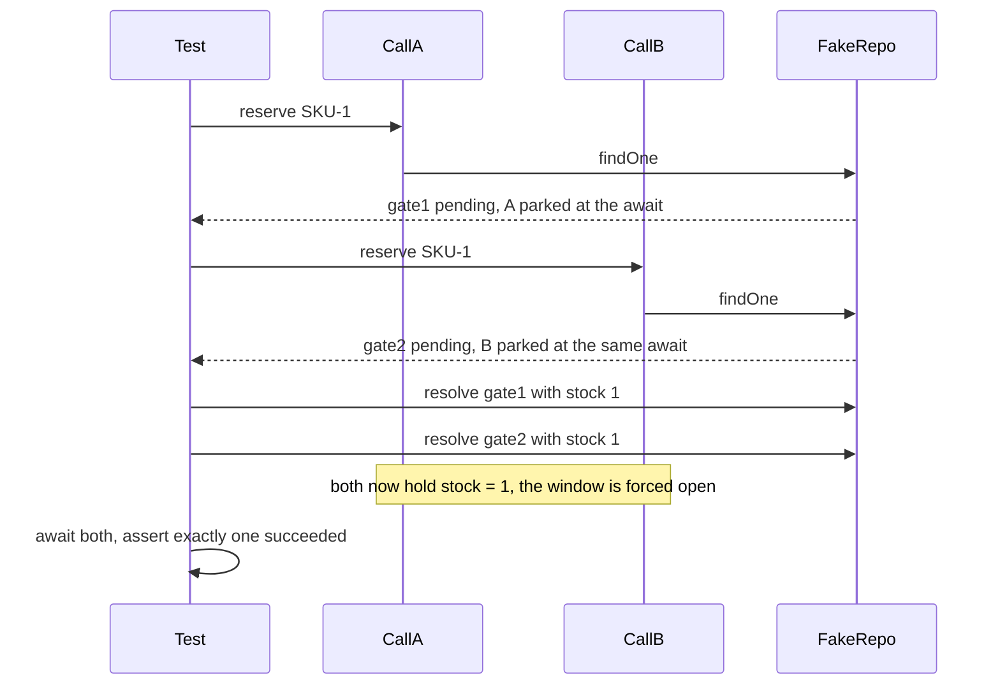

## 21.15 Testing concurrency

#### Concept

A concurrency bug is a bug about *timing between two actors*. A unit test has one actor. It runs the function, the function runs to completion, the assertion passes. There is no second request to interleave with, no second pod, no second connection. **A single-threaded unit test cannot fail on a race condition, no matter how buggy the code is.**

That is why oversells reach production. The code was tested. It was tested wrong.

Testing concurrency needs two different techniques, and you need both:

- **Stochastic tests**: fire N real concurrent operations at a real database and assert an invariant. These prove your fix works under realistic interleavings, and they catch bugs you did not think of. They are non-deterministic, so a passing run is weak evidence and a failing run is strong evidence.
- **Deterministic tests**: force a specific interleaving by controlling when promises resolve. These prove a *specific* window is closed, they never flake, and they document the bug in code. They only test the interleaving you thought of.

#### Why does it exist?

Because "we fixed it" is a hypothesis until something demonstrates the race is gone. The atomic `UPDATE` fix in 21.2 is three lines; the argument that it is correct depends on `READ COMMITTED` re-evaluation semantics, which most reviewers cannot verify by reading. A test that fires 50 concurrent requests at 10 units of stock and asserts exactly 10 succeed converts that argument into evidence.

It also exists because concurrency fixes regress silently. A future refactor replaces the conditional `UPDATE` with an ORM `save()` because it "reads better", and every existing test still passes. Only a concurrency test fails.

#### Mental model

Imagine testing a revolving door by walking through it alone. It works every time. The failure only appears when two people push at once from opposite sides. You cannot discover that by testing more carefully alone; you have to bring a second person.

#### How it works

**The stochastic test** needs three things to be trustworthy:

1. **A real PostgreSQL**, not a mock and not SQLite. The bug lives in the database's concurrency semantics; a mock has none. Testcontainers gives you a real one per test run.
2. **Genuinely parallel requests.** `Promise.all` over 50 `supertest` calls does this within one process — all 50 start before any completes.
3. **An invariant assertion, not a count of successes.** Assert "successes equal stock" *and* "final stock is zero" *and* "order rows equal successes". A single assertion can pass for the wrong reason.

```ts
// test/inventory.concurrency.e2e-spec.ts
import { Test } from '@nestjs/testing';
import { INestApplication } from '@nestjs/common';
import { PostgreSqlContainer, StartedPostgreSqlContainer } from '@testcontainers/postgresql';
import { DataSource } from 'typeorm';
import request from 'supertest';

jest.setTimeout(180_000);   // container pull + boot

describe('POST /orders under concurrency', () => {
  let container: StartedPostgreSqlContainer;
  let app: INestApplication;
  let ds: DataSource;

  beforeAll(async () => {
    container = await new PostgreSqlContainer('postgres:16-alpine').start();

    const moduleRef = await Test.createTestingModule({ imports: [AppModule] })
      .overrideProvider(DATABASE_URL)
      .useValue(container.getConnectionUri())
      .compile();

    app = moduleRef.createNestApplication();
    await app.init();
    ds = app.get(DataSource);
    await ds.runMigrations();
  });

  afterAll(async () => {
    await app?.close();
    await container?.stop();
  });

  beforeEach(async () => {
    await ds.query('TRUNCATE orders, order_lines, inventory RESTART IDENTITY CASCADE');
    await ds.query(
      `INSERT INTO inventory (sku, available, reserved) VALUES ('SKU-1', 10, 0)`,
    );
  });

  it('sells exactly 10 units to 50 concurrent buyers', async () => {
    const attempts = 50;

    // All 50 start before any completes: this is the interleaving that matters.
    const responses = await Promise.all(
      Array.from({ length: attempts }, (_, i) =>
        request(app.getHttpServer())
          .post('/orders')
          .set('Idempotency-Key', `test-${i}`)
          .send({ sku: 'SKU-1', qty: 1 }),
      ),
    );

    const created = responses.filter((r) => r.status === 201);
    const conflicts = responses.filter((r) => r.status === 409);

    // Three independent assertions. Any one alone can pass for the wrong reason.
    expect(created).toHaveLength(10);
    expect(conflicts).toHaveLength(40);

    const [inv] = await ds.query(`SELECT available, reserved FROM inventory WHERE sku = 'SKU-1'`);
    expect(Number(inv.available)).toBe(0);
    expect(Number(inv.reserved)).toBe(10);

    const [{ count }] = await ds.query(`SELECT count(*)::int AS count FROM orders`);
    expect(count).toBe(10);           // no phantom orders for failed reservations
  });

  // Run it repeatedly: one pass proves little, twenty passes prove something.
  it.each([1, 2, 3, 4, 5])('is stable across repeated runs (%i)', async () => {
    const responses = await Promise.all(
      Array.from({ length: 50 }, (_, i) =>
        request(app.getHttpServer()).post('/orders')
          .set('Idempotency-Key', `rep-${Date.now()}-${i}`)
          .send({ sku: 'SKU-1', qty: 1 }),
      ),
    );
    expect(responses.filter((r) => r.status === 201)).toHaveLength(10);
  });
});
```

Three practical notes. **Run the test against the buggy code first** — if it passes with `findOne` + `save`, your test is not concurrent and you are about to ship a false sense of safety. **Repeat it**: a race with a 5% window passes 95% of single runs. **Truncate, do not drop and recreate**, between tests; container startup is 3-8 seconds and you only want to pay it once.

If you want the multi-pod dimension too, boot two `INestApplication` instances against the same container. That catches in-process locks masquerading as fixes.

#### Deterministic interleaving

Stochastic tests find bugs; deterministic tests pin them down and stop them coming back. The technique is to replace the slow dependency with a promise **you** resolve, so you control exactly where the code parks.

```ts
// A deferred you can resolve from the test.
function deferred<T>() {
  let resolve!: (v: T) => void;
  let reject!: (e: unknown) => void;
  const promise = new Promise<T>((res, rej) => { resolve = res; reject = rej; });
  return { promise, resolve, reject };
}
```



```ts
describe('reserve: forced check-then-act window', () => {
  it('does not oversell when both callers read the same stock value', async () => {
    const gateA = deferred<Inventory>();
    const gateB = deferred<Inventory>();
    const findOne = jest.fn()
      .mockReturnValueOnce(gateA.promise)     // first caller parks here
      .mockReturnValueOnce(gateB.promise);    // second caller parks here too

    const updates: Array<{ qty: number }> = [];
    const repo = {
      findOneByOrFail: findOne,
      // Simulate PostgreSQL's conditional update: only the first one that finds
      // enough stock succeeds. This is the contract we are asserting on.
      conditionalDecrement: jest.fn(async ({ qty }: { qty: number }) => {
        if (stock < qty) return { affected: 0 };
        stock -= qty;
        updates.push({ qty });
        return { affected: 1 };
      }),
    };
    let stock = 1;

    const service = new InventoryService(repo as never);

    // Start both. Neither can proceed past findOne yet.
    const a = service.reserve('SKU-1', 1);
    const b = service.reserve('SKU-1', 1);
    await Promise.resolve();       // let both reach the await

    // Force the exact interleaving: both read stock = 1.
    gateA.resolve({ sku: 'SKU-1', available: 1 } as Inventory);
    gateB.resolve({ sku: 'SKU-1', available: 1 } as Inventory);

    const results = await Promise.allSettled([a, b]);
    const fulfilled = results.filter((r) => r.status === 'fulfilled');

    expect(fulfilled).toHaveLength(1);
    expect(updates).toHaveLength(1);
    expect(stock).toBe(0);
  });
});
```

This test is deterministic: it passes or fails the same way every run, in milliseconds, with no container. It documents the exact scenario in code, which is worth as much as the assertion. Use deterministic tests for the races you have already found and stochastic tests to find new ones.

The `await Promise.resolve()` line is doing real work: it yields one microtask turn so both `reserve` calls actually reach their `await` before you resolve the gates. Without it you may resolve `gateA` before the second call has started.

#### Testing deadlock retry

You do not need a real deadlock. You need to prove that a `40P01` error causes a full retry of the transaction and that the retry succeeds.

```ts
it('retries the whole transaction on 40P01 and succeeds', async () => {
  const deadlock = Object.assign(new Error('deadlock detected'), { code: '40P01' });
  const work = jest.fn()
    .mockRejectedValueOnce(deadlock)
    .mockRejectedValueOnce(deadlock)
    .mockResolvedValueOnce('ok');

  const ds = { transaction: (fn: (m: unknown) => Promise<unknown>) => fn({}) } as DataSource;
  const runner = new TransactionRunner(ds);

  const result = await runner.runWithRetry(work as never, { attempts: 5, baseMs: 1 });

  expect(result).toBe('ok');
  expect(work).toHaveBeenCalledTimes(3);       // the WHOLE unit of work re-ran
});

it('gives up after the attempt limit and rethrows', async () => {
  const deadlock = Object.assign(new Error('deadlock detected'), { code: '40P01' });
  const work = jest.fn().mockRejectedValue(deadlock);
  const runner = new TransactionRunner({ transaction: (fn: never) => (fn as never)({}) } as never);

  await expect(runner.runWithRetry(work as never, { attempts: 3, baseMs: 1 }))
    .rejects.toMatchObject({ code: '40P01' });
  expect(work).toHaveBeenCalledTimes(3);
});

it('does not retry a non-retryable error', async () => {
  const notNull = Object.assign(new Error('null value'), { code: '23502' });
  const work = jest.fn().mockRejectedValue(notNull);
  const runner = new TransactionRunner({ transaction: (fn: never) => (fn as never)({}) } as never);

  await expect(runner.runWithRetry(work as never, { attempts: 5, baseMs: 1 })).rejects.toThrow();
  expect(work).toHaveBeenCalledTimes(1);       // fail fast on real bugs
});
```

For a genuine end-to-end deadlock test, run two transactions that update two rows in opposite orders with an `await` between, against a real container, and assert that both eventually succeed and the deadlock counter incremented. Keep it in a separate, slower suite.

#### Testing the advisory-lock cron

The point is that only one of N callers runs the work, and that a failure still releases the lock.

```ts
it('runs the job on exactly one of five concurrent callers', async () => {
  const ran: string[] = [];

  // Five independent LeaderElection instances, each with its own connection
  // from a real pool, exactly like five pods.
  const results = await Promise.all(
    ['pod-1', 'pod-2', 'pod-3', 'pod-4', 'pod-5'].map((pod) =>
      new LeaderElection(ds).runIfLeader('daily-settlement', async () => {
        ran.push(pod);
        await new Promise((r) => setTimeout(r, 200));   // hold the lock
      }),
    ),
  );

  expect(ran).toHaveLength(1);
  expect(results.filter(Boolean)).toHaveLength(1);
});

it('releases the lock when the work throws, so the next run can proceed', async () => {
  await expect(
    new LeaderElection(ds).runIfLeader('job-x', async () => { throw new Error('boom'); }),
  ).rejects.toThrow('boom');

  // If the lock had leaked, this would return false.
  const ran = await new LeaderElection(ds).runIfLeader('job-x', async () => undefined);
  expect(ran).toBe(true);
});
```

The second test is the one that would have caught the eleven-day silent failure in 21.5. It is four lines.

Do not use fake timers for these. `jest.useFakeTimers()` and real database round trips do not mix — the timers your ORM and driver use will not fire. Trigger the scheduled method directly instead of waiting for the cron to fire; `@nestjs/schedule`'s `SchedulerRegistry` lets you fetch and invoke a job by name if you want the wiring covered too.

#### Production scenario

A payments team added a "concurrency suite" to CI: 14 tests, all against Testcontainers PostgreSQL, running on every PR. Total runtime 95 seconds (one container, `TRUNCATE` between tests). Over 18 months it caught 6 regressions before merge, including two where someone replaced an atomic update with an ORM `save()` during a refactor and every other test still passed.

Cost: 95 seconds per PR and one engineer-week to build. Value: the two `save()` regressions alone would each have been an oversell incident.

The one operational lesson: they had to pin the container image tag and set `maxWorkers: 2` for that suite, because 8 Jest workers each starting a PostgreSQL container exhausted the CI runner's memory.

#### Failure scenario

At 11:00 a "fix" for an oversell shipped with a passing test. The test fired 50 concurrent requests and asserted 10 succeeded. It passed in CI. It passed locally. Oversells continued in production.

The test used a mocked repository whose `decrement` was implemented as `stock -= qty` in JavaScript — with no guard, but also with no `await` inside it, so it was atomic *in the mock*. The test was proving that JavaScript's `-=` is not interruptible, which is true and irrelevant. The production repository issued a real conditional `UPDATE` whose guard someone had accidentally deleted in the same PR.

Fix: the concurrency suite was moved to Testcontainers with the real repository, and a rule was added that any test with "concurrency" or "race" in its name must not mock the database layer. The retro's one-liner: **a concurrency test that mocks the shared resource tests nothing.**

#### Edge cases & failure modes

- **Mocking the database** in a concurrency test removes the thing under test.
- **SQLite or an in-memory shim** has different locking and isolation semantics; the test lies.
- **Running the test once** and calling it proof; repeat 20 times.
- **Not running it against the buggy code first**, so you never verify the test can fail.
- **`Promise.all` over `supertest` with `agent.keepAlive` off** can serialise connections; check that requests really overlap.
- **Fake timers plus real I/O** deadlock the test.
- **Shared state between tests** (a container that is not truncated) makes failures look random.
- **Jest parallel workers each starting a container** exhausts CI memory; cap `maxWorkers` for that suite.
- **Testing only the happy interleaving** — also test that the loser gets a clean 409, not a 500.
- **Flaky assertions on timing** (`expect(duration).toBeLessThan(50)`) fail on loaded CI; assert on invariants, not on speed.

#### How a Senior Backend Engineer thinks about this

They will not accept a concurrency fix without a concurrency test, and they check that the test fails against the old code. That check is non-negotiable, because a test that cannot fail is documentation with a false badge.

They keep two suites: fast deterministic tests in the main run, slower container-backed tests in a separate CI job. They assert invariants — sums, counts, constraints — rather than sequences, because the sequence is legitimately non-deterministic and only the invariant is guaranteed.

They add a database `CHECK` constraint alongside the test, because the constraint tests every code path forever, including ones written after they leave. And they treat a flaky concurrency test as a bug in the system, not in the test, until proven otherwise — flakiness under concurrency is usually the system telling you something.

To a product manager: "We wrote a test that pretends fifty customers click buy at the same instant on ten items. It runs on every change. If someone ever breaks the protection, the build fails instead of the warehouse."

#### Common mistakes

- Unit-testing a race condition.
- Mocking the shared resource.
- One run, one assertion, done.
- Never verifying the test detects the original bug.
- Testing the winner's path and not the loser's error response.
- Timing-based assertions that flake in CI.
- No test at all because "it's hard to test concurrency".

#### Interview questions

1. *How do you test a race condition?* Expected: real database, N genuinely concurrent operations, invariant assertions, repeated runs; plus deterministic tests with controlled promise resolution.
2. *Why does a unit test never catch an oversell?* Expected: one actor, no interleaving, no second pod, and the shared resource is usually mocked away.
3. *How do you force a specific interleaving deterministically?* Expected: replace the awaited dependency with deferreds you resolve from the test; yield a microtask so both callers reach the await.
4. *How do you know your concurrency test is any good?* Expected: it fails against the pre-fix code; it passes 20 consecutive runs after the fix.
5. *How would you test deadlock retry?* Expected: inject an error with `code: '40P01'` and assert the whole unit of work re-ran, that non-retryable codes do not retry, and that the attempt limit is honoured.
6. *How do you test that a cron runs on only one of five pods?* Expected: five concurrent `runIfLeader` calls against one real database; assert exactly one ran; and a separate test that a throwing job still releases the lock.

#### Practical exercise

Add a concurrency suite to an existing NestJS service. Include: (1) a Testcontainers test firing 50 concurrent reservations against 10 units, (2) a deterministic test using deferreds that forces both callers to read the same stock value, (3) a deadlock-retry unit test, (4) a leader-election test with five concurrent callers plus a lock-release-on-throw test.

Acceptance criteria: every test fails against the pre-fix code and passes against the fixed code; the suite runs in under 2 minutes with one container; `maxWorkers` is configured so CI does not OOM; and a `CHECK (available >= 0)` constraint exists so the invariant is also enforced outside the tests.

## 21.16 Edge cases and failure modes

This is the reference section. Each entry is a real production failure: what you see, why it happens, what you do about it.

#### Oversell

- **Symptom.** More orders than stock. The site shows "sold out" while paid orders keep arriving. Discovered by the warehouse, not by monitoring.
- **Cause.** `findOne` -> check in JavaScript -> `save`. Two requests both read the old value across an `await`. Multi-pod makes any in-process guard useless.
- **Fix.** One atomic statement: `UPDATE inventory SET available = available - $1 WHERE sku = $2 AND available >= $1`, and treat `affected === 0` as a 409. Add `CHECK (available >= 0)` so no future code path can violate it. Add a 50-concurrent-request test.

#### Double payment

- **Symptom.** One customer charged twice for one order. Two `payments` rows, two provider charge ids.
- **Cause.** Double-clicked button, or a client retry after a timeout where the first request actually succeeded. Two requests both see `status = 'PENDING'` and both charge.
- **Fix.** Three layers. Idempotency key with a unique constraint, stored *before* calling the provider. A conditional state transition (`UPDATE orders SET status='PAID' WHERE id=$1 AND status='PENDING'`) so only one request proceeds. And the provider's own idempotency key so even a duplicate call is deduplicated on their side.

#### Duplicate cron execution

- **Symptom.** Five settlement runs, five digest emails per user, five reports. Always exactly N times, where N is your replica count.
- **Cause.** `@Cron` is a per-process timer. Every replica has one.
- **Fix.** Leader election with `pg_try_advisory_xact_lock`, or BullMQ repeatable jobs, or a `replicas: 1` scheduler deployment with `strategy: Recreate`. Plus a unique constraint on `(job_name, run_date)` as the second layer, and a staleness alert so a silently-stopped job is noticed.

#### A job lost when a pod restarts mid-processing

- **Symptom.** Queue depth looks fine; individual jobs never complete. A customer's export never arrives. No error anywhere.
- **Cause.** The job was marked `RUNNING`, the pod was OOMKilled or evicted, and nothing ever reclaims a `RUNNING` row.
- **Fix.** A lease (`lease_until`) with a heartbeat, and a leader-elected sweep that re-queues expired leases with backoff and an incremented attempt count. Cap attempts so a poison pill is dead-lettered instead of killing every pod in rotation. Make handlers idempotent, because takeover means at-least-once. Set `terminationGracePeriodSeconds` high enough for a job to finish, and stop claiming new work on `SIGTERM`.

#### Unhandled rejection crashing the process

- **Symptom.** Pods restart with no stack trace in the request logs. `CrashLoopBackOff`. Every in-flight request on that pod fails.
- **Cause.** A promise rejected with no `.catch()` — almost always fire-and-forget (`this.email.send(order)` with no `await`). Node 15+ terminates the process by default.
- **Fix.** Never fire-and-forget work that matters: use a transactional outbox or a queue. Where it truly does not matter, attach `.catch()` explicitly with `void`. Install a `process.on('unhandledRejection')` handler that logs fatally, closes the app gracefully and exits non-zero — so Kubernetes restarts you cleanly instead of mid-transaction. Enable `@typescript-eslint/no-floating-promises` so the linter catches it.

#### Event listener leaks on a long-lived emitter

- **Symptom.** `MaxListenersExceededWarning: Possible EventEmitter memory leak detected. 11 error listeners added`. Memory climbs slowly. Eventually one emitted event runs the handler thousands of times.
- **Cause.** A per-request or per-job `emitter.on('x', handler)` on a *singleton* emitter, with no `off`. Common with `@nestjs/event-emitter`, Redis clients, and stream error handlers registered inside a handler.
- **Fix.** Register listeners once at module init, not per request. If you must register per operation, use `once()` and always remove in `finally`, or use `AbortSignal` with `{ signal }` on `addEventListener`. Alert on the warning; do not raise `setMaxListeners` to silence it.

#### Memory growth from unbounded `Promise.all`

- **Symptom.** RSS climbs to the pod limit during a batch job. OOMKilled, restart, job restarts from the beginning, OOMKilled again.
- **Cause.** `Promise.all(rows.map(...))` where `rows` came from a query. Every task starts immediately and retains its payload and closure. 10,000 x 14 KB is 140 MB before the actual data.
- **Fix.** `p-map` or `p-limit` with concurrency chosen from the scarcest downstream (usually the connection pool). Stream the source with `pg-query-stream` instead of loading it. Checkpoint progress so a restart resumes. Bound the worker-pool queue (`maxQueue`) so a burst is rejected rather than buffered.

#### Nested-transaction deadlock (connection pool)

- **Symptom.** Requests hang and then fail with `timeout exceeded when trying to connect`. PostgreSQL CPU is low, `pg_stat_database.deadlocks` is flat, no lock waits. Every dashboard says the database is healthy.
- **Cause.** Code inside a transaction calls an injected repository, which takes a *second* connection. With N concurrent requests each holding one and wanting another, the pool is deadlocked.
- **Fix.** Propagate the transaction's `EntityManager` (or Sequelize `transaction`) so nesting depth stays 1 — best done with `AsyncLocalStorage` (`@nestjs-cls/transactional`, or Sequelize's `useCLS`) so it is automatic. As a mitigation only, size the pool to `P >= N * (D - 1) + 1`. Alert on `pool.waitingCount > 0` and on `idle in transaction` sessions.

#### `AsyncLocalStorage` context lost

- **Symptom.** Log lines with an empty or wrong correlation id. `cls.get('userId')` returns `undefined` in a background handler. Audit rows with a null actor. Traces that break at a queue boundary.
- **Cause.** Three distinct boundaries. **`setTimeout` scheduled outside the context** runs in whatever context existed when it was scheduled. **Event-emitter listeners registered at startup** run in the startup context, not the emitter's caller's. **Queue and process boundaries** (BullMQ, Kafka, HTTP to another service) do not carry in-process state at all.
- **Fix.** For timers and emitters, capture and re-enter: `const store = cls.get(); setTimeout(() => cls.run(store, work), 1000)` — or better, avoid detaching from the request in the first place. For queues, **serialise the ids into the job payload** and re-enter the context at the top of the processor:

```ts
@Processor('emails')
export class EmailProcessor extends WorkerHost {
  constructor(private readonly cls: ClsService) { super(); }

  async process(job: Job<{ correlationId: string; userId: string; to: string }>) {
    // Re-establish the context on the other side of the boundary.
    await this.cls.run(async () => {
      this.cls.set('correlationId', job.data.correlationId);
      this.cls.set('userId', job.data.userId);
      await this.mail.send(job.data);       // logs and audits now carry the right ids
    });
  }
}
```

For HTTP, propagate `x-correlation-id` (or W3C `traceparent`) as a header. The rule: **ALS is a within-process convenience; across any boundary you must carry the value explicitly.**

#### Request-scoped providers collapsing throughput

- **Symptom.** Throughput drops 30-60% after a refactor. p99 doubles. GC time rises. No individual endpoint looks slower in traces.
- **Cause.** Someone made one provider `Scope.REQUEST`, and scope bubbled up the injection chain, making the controller and its whole subtree per-request. NestJS now builds an object graph on every request.
- **Fix.** Move the request data to `AsyncLocalStorage` (`nestjs-cls`) and keep providers singleton. Where per-request instances are genuinely needed for multi-tenancy, use durable providers with a `ContextIdStrategy` keyed on tenant, and bound the tenant map. Measure before and after; do not accept scope changes without a benchmark.

#### A Redis lock expiring while the work is still running

- **Symptom.** Two workers processing the same job. Duplicate side effects despite "having a lock". Logs show both holding it, both convinced they are exclusive.
- **Cause.** TTL shorter than the work. Or a GC pause / network partition froze the holder past its TTL. A TTL-based lock cannot provide mutual exclusion by itself.
- **Fix.** Three things together. Set TTL from p99 work duration x 3 and heartbeat-extend at TTL/3 with a Lua compare-and-extend. Release with a Lua compare-and-delete so you never delete someone else's lock. And make the protected resource enforce ordering with a **fencing token**: `INCR` a counter per acquisition and write `UPDATE ... WHERE fence < $token`, so a stale holder's write affects zero rows. The fence is the correctness guarantee; the lock is the optimisation.

#### `setInterval` pile-up

- **Symptom.** Increasing concurrent runs of a poll loop. Connection pool exhaustion at a regular cadence. Memory climbing in a sawtooth that never fully returns.
- **Cause.** `setInterval(fn, 30_000)` schedules starts 30 s apart regardless of duration. Work that takes 45 s overlaps; work that takes 90 s triples up and grows without bound.
- **Fix.** Self-schedule from the *end* of each run with `setTimeout` and reschedule in `finally`, so a gap is guaranteed. Or add a re-entrancy guard that skips the tick and increments a `cron.skipped` counter — silence here is dangerous, so always count skips. Remember the guard is per pod: on multiple replicas you also need leader election. Clear the timer in `onModuleDestroy` or shutdown hangs.

#### Two workers claiming the same row without `SKIP LOCKED`

- **Symptom.** Queue depth grows while all workers show as busy. Fleet throughput equals one worker's throughput. Adding pods changes nothing.
- **Cause.** The claim query is `SELECT ... ORDER BY priority LIMIT 25 FOR UPDATE` with no `SKIP LOCKED`. Every worker blocks on the same top row. Invisible while jobs are fast; catastrophic the moment a downstream slows down.
- **Fix.** `FOR UPDATE SKIP LOCKED` inside a claiming `UPDATE ... RETURNING`, so each worker takes a disjoint batch. Add a partial index on the claim predicate. Put a timeout on every downstream call so slowness degrades throughput proportionally. Alert on "oldest pending job age", which catches this shape long before queue depth does.

#### Replication lag reading stale state

- **Symptom.** A user creates a resource, immediately reads it, and gets a 404. Or a balance check passes against a replica that has not seen the debit.
- **Cause.** Reads routed to a replica that is seconds behind. The race is between your write and the replica's replay.
- **Fix.** Route reads that follow a write in the same user flow to the primary (read-your-writes). Never make a *decision* on replica data — validation, authorisation and money checks go to the primary. Monitor `pg_last_xact_replay_timestamp()` lag and fail over reads to the primary when lag exceeds a threshold.

#### Cache stampede on a hot key

- **Symptom.** Database p99 spikes at a fixed cadence matching a TTL. Hundreds of identical expensive queries in `pg_stat_statements` within a few milliseconds.
- **Cause.** A popular key expires and every concurrent request misses and rebuilds.
- **Fix.** Single-flight per process (a `Map` of in-flight promises), a distributed rebuild lock so one pod rebuilds, and a longer-lived stale copy served while the rebuild happens. Add jitter to TTLs so keys do not expire together. Covered in full in 21.3.

## 21.17 A concurrency review checklist

Use this on any pull request that touches shared state — a database row, a cache key, a queue, an in-memory field, or a scheduled task.

| # | Question to ask | What a good answer looks like | Red flag |
|---|---|---|---|
| 1 | What happens if two of these run at the same instant? | A specific mechanism: atomic statement, row lock, version check, unique constraint | "It won't" |
| 2 | What happens on twelve pods? | Same answer as #1, because the guard lives in PostgreSQL or Redis | An in-process `Map`, `Set` or mutex |
| 3 | Is there an `await` between a read and a write that depends on it? | No, or the write is guarded by the value read | Yes, unguarded |
| 4 | Is the row count of every `UPDATE` checked? | `affected === 0` maps to a 409/404 | `await repo.update(...)` with the result discarded |
| 5 | Could this be a single atomic statement instead? | Yes, and it is | A lock or transaction wrapping one logical decision |
| 6 | Is the invariant also a database constraint? | `UNIQUE`, `CHECK` or `EXCLUDE` backs the code | Code-only enforcement |
| 7 | Are locks taken in a consistent order? | Sorted by primary key, with `ORDER BY` on the locking select | Client-supplied order |
| 8 | Is there any external call inside a transaction or lock? | No | `fetch`, queue publish, or S3 inside the critical section |
| 9 | What is the p99 hold time, and what throughput does `1/hold` allow? | A measured number that exceeds peak demand | Unknown |
| 10 | If this is retried, what happens twice? | Nothing harmful: idempotency key or claim-before-act | An email, a charge, a webhook |
| 11 | Does the retry re-read state and use jitter? | Yes, bounded attempts, full jitter | Fixed delay, or reuses stale data, or unbounded |
| 12 | Is any request data stored on a provider field? | No; parameters or `AsyncLocalStorage` | `this.currentUser`, `this.tenantId` |
| 13 | Is any new provider `Scope.REQUEST`? | No, or benchmarked and justified | Added "to be safe" |
| 14 | How many concurrent operations can this generate, and does the pool fit? | pods x concurrency computed against `max_connections` | `Promise.all` over a query result |
| 15 | Is every `Promise.all` bounded? | `p-limit`/`p-map` with a justified concurrency | Unbounded over a variable-length array |
| 16 | Does every remote call have a timeout and a decreasing budget? | Yes, shorter than the caller's | No `signal`, no `statement_timeout` |
| 17 | Is there a `@Cron` or `@Interval` here? How many replicas? | Leader-elected or scheduler-owned, plus a unique constraint | `@Cron` with `replicas > 1` |
| 18 | Can this scheduled work overlap with its previous run? | No: self-scheduling, or a guard that counts skips | `@Interval` shorter than p99 duration |
| 19 | If a pod dies mid-operation, what is left behind and who cleans it? | A lease with heartbeat and a takeover sweep | A `RUNNING` row nobody reclaims |
| 20 | Is the ALS context re-entered after a queue or timer boundary? | Ids carried in the payload and `cls.run()` at the top of the handler | Correlation ids that vanish |
| 21 | Is there a concurrency test, and does it fail against the old code? | Testcontainers, N concurrent calls, invariant assertions, repeated | A unit test with a mocked repository |
| 22 | What is the metric that would show this failing in production? | `pg_pool_waiting`, deadlock rate, lease-takeover rate, oldest pending job, `idle in transaction` | "We'd see the errors" |

If a PR cannot answer #1, #2 and #10, it is not ready, regardless of how clean the code reads.

## Senior Checklist — Part 21

- [ ] I understand the concept
- [ ] I can explain it simply
- [ ] I can implement it
- [ ] I understand its failure modes
- [ ] I understand its scaling limitations
- [ ] I understand its security implications
- [ ] I understand its operational implications
- [ ] I can choose between alternatives
- [ ] I can explain the tradeoffs
- [ ] I can answer senior-level interview questions
- [ ] I can explain why single-threaded Node still has race conditions, and point at the `await` that causes one
- [ ] I can name the five race-condition shapes and the standard fix for each
- [ ] I can write the atomic conditional `UPDATE` for a stock decrement and explain why the row count is the business answer
- [ ] I can choose between optimistic and pessimistic concurrency and defend the choice with a conflict rate
- [ ] I can write a correct Redis lock with a Lua compare-and-delete release, and explain why a fencing token is still required
- [ ] I can explain the connection-pool deadlock and compute `P >= N * (D - 1) + 1` for my own service
- [ ] I can size a database pool across pods, workers and cron against `max_connections`, including what the HPA does to it
- [ ] I can spot request data stored on a singleton NestJS provider and know two ways to fix it
- [ ] I can make a `@Cron` job run exactly once across a fleet, and know how I would find out if it silently stopped
- [ ] I can build a PostgreSQL job queue with `FOR UPDATE SKIP LOCKED`, leases, heartbeats and dead-lettering
- [ ] I can write a concurrency test that fails against the buggy code and passes against the fix
- [ ] I know which metrics tell me a concurrency problem is happening right now

## Part 21 — Key Takeaways

- Node is single-threaded but not race-free: **every `await` is a point where the world can change**, and every pod is another actor doing the same thing.
- In-process guards — a `Map`, a `Set`, an `async-mutex` — protect process-local resources only. Business invariants must live in PostgreSQL or Redis, where every pod can see them.
- Push the decision into the layer that serialises it for you. A conditional `UPDATE` whose row count is the answer beats every lock, and a constraint beats every code path, including the ones not written yet.
- Optimistic when conflicts are rare and the think-time is long; pessimistic when contention is high, transactions are short, and the work must not be redone. Above both: if the write is relative, use an atomic statement and choose neither.
- Deadlocks are prevented by consistent lock ordering and survived by a jittered retry of the **whole** transaction. Sorting by primary key removes the entire class.
- The connection-pool deadlock is the one that will page you: a transaction holding one connection while awaiting a second. Fix it by propagating the transaction's manager, not by raising the pool.
- Never hold a lock or a transaction across an external call. Throughput through a lock is `1 / hold_time`, and a third party's bad day becomes your outage.
- A NestJS provider is a singleton shared by every concurrent request. Request data on a provider field is a data-leak bug, not a style issue.
- Bound every fan-out. `Promise.all` over a query result is unbounded on memory, connections and downstream rate limits; `p-map` with a justified concurrency is the fix.
- `@Cron` runs on every replica. Elect a leader with `pg_try_advisory_xact_lock`, and add a unique constraint as the second layer, and alert on staleness so a silently-stopped job is noticed the next day.
- Distributed job processing is at-least-once. `SKIP LOCKED` for claiming, leases with heartbeats for recovery, attempt caps for poison pills, and idempotent handlers because none of the above is exactly-once.
- A concurrency fix without a concurrency test is a hypothesis. Run N real requests against a real database, assert the invariant, repeat twenty times, and verify the test fails against the old code.
- The metrics that tell the truth: event-loop lag, `pg_pool_waiting`, `pg_stat_database.deadlocks`, `idle in transaction` age, lease-takeover rate, and oldest pending job.
