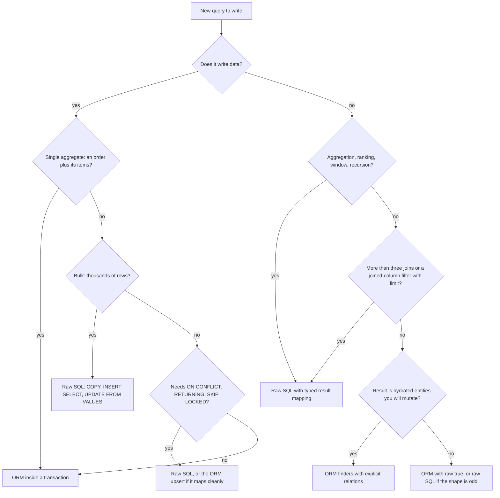

## 21.22 TypeORM vs Sequelize vs raw SQL

#### Concept

Three ways to talk to PostgreSQL from a NestJS service: a Data Mapper ORM (TypeORM), an Active Record ORM (Sequelize), and SQL text sent through the driver (`pg`, optionally with a typed query builder such as Kysely). They are not competitors on every axis. Most production systems use two of them, and the interesting question is not "which ORM" but "where is the line between them".

#### Why does it exist?

Because the shape of the work differs. Writing an order and its items inside a transaction is an object-graph problem, and an ORM is genuinely better at it. Computing "revenue by category per week, ranked, excluding refunds" is a set problem, and SQL is genuinely better at it. Choosing one tool for both means one of the two jobs is done badly.

#### The comparison

| Dimension | TypeORM | Sequelize | Raw SQL (`pg`, or Kysely for typing) |
|---|---|---|---|
| **Type safety** | Decorators give entity types; `find` options are typed and `select`/`relations` are checked, but query-builder results are `any` for raw selects and `getRawMany<T>()` is an unchecked cast. Column-name strings in `where` fragments are not verified. | Weakest of the three. `sequelize-typescript` types the model, but `where`/`include`/`attributes` are loosely typed, `$nested$` paths and `literal()` are strings, and `findAll` returns instances typed by the model regardless of the `attributes` you selected. | No types by default: `query<T>()` is a cast you must earn. With Kysely, the strongest of the three — column names, joins and result shapes are checked against a generated schema type. With `zod` parsing, runtime-verified as well. |
| **Migrations** | `migration:generate` diffs entities against the live schema and writes SQL for you. Powerful and the biggest footgun in the part: the diff is a draft that can drop columns, rewrite tables and create indexes non-concurrently. `migrations` table, `up`/`down`, transaction mode per run. | `sequelize-cli` generates only an empty skeleton; you write `queryInterface` calls or SQL yourself. Safer by omission, more typing, drift is your discipline. `SequelizeMeta` table, no wrapping transaction unless you add one. | Plain `.sql` files with a runner (`node-pg-migrate`, `dbmate`, `sqitch`, `graphile-migrate`, or Kysely's migrator). Full control, zero generation, and you own the versioning table. |
| **Query builder power** | Strong. `createQueryBuilder` covers joins, subqueries in `SELECT`/`FROM`/`WHERE`, `CASE`, locks, `INSERT ... ON CONFLICT`, `RETURNING`, CTEs via `.addCommonTableExpression()`. Fragments are still strings once you leave the simple path. | Weaker. There is no query builder, only the options object plus `fn`, `col` and `literal`. Anything non-trivial becomes a `literal()` string, and at that point you have raw SQL with none of the safety. | Total. It is SQL. Kysely adds composability and types without giving anything up. |
| **Relation loading** | `relations`, `leftJoinAndSelect`, `relationLoadStrategy: 'join' \| 'query'`, `eager`/lazy. The two-query strategy is a first-class option. | `include` with `required`, `separate: true`, nested includes, plus the `limit` + `subQuery` behaviour that surprises people. Comparable power, more sharp edges. | You write the joins and do the nesting yourself, or run two queries and group in code. More code, no surprises. |
| **Transactions** | `dataSource.transaction(cb)`, `QueryRunner` for manual control, savepoints via nesting, isolation levels, `pessimistic_read`/`pessimistic_write`. Propagation is manual unless you add a CLS package. | `sequelize.transaction(cb)`, savepoints via nesting, isolation levels, `LOCK.UPDATE`/`LOCK.SHARE`, and **CLS support built in** via `Sequelize.useCLS(namespace)`, which makes `transaction` propagate implicitly. | `BEGIN`/`COMMIT` on a checked-out client. Explicit, and you must never forget `release()`. |
| **Performance overhead** | Small per query (tens of microseconds); real cost is hydration of joined results and the statement count it chooses. | Similar. Instance construction is slightly heavier; `raw: true` removes most of it. | Lowest. `pg` returns plain objects; the only cost is your own mapping. For a 50,000-row report the gap is 3–10x in CPU and memory. |
| **Community and maintenance** | Very widely used and the default in the NestJS docs, but the project has a long history of slow maintenance: it went effectively unmaintained in 2021–2022, was revived by community maintainers, and is still on `0.3.x` with no 1.0, a large open-issue backlog and infrequent releases. It works; do not expect fast fixes. | Mature and stable on v6, maintained at a modest pace. v7 (`@sequelize/core`) has been in alpha for a long time with a rewritten TypeScript core and built-in decorators; treat the migration path as a real project, not a version bump. | `pg` is boring, stable and maintained. Kysely and the migration runners are small, active and easy to replace. |
| **Learning curve** | Steepest. Decorators, metadata, two loading models, cascade semantics, query builder, migration generation. | Gentle to start (Active Record reads naturally), then a long tail of behavioural surprises: `include` semantics, scopes, hooks that do not fire, `subQuery`. | Requires knowing SQL, which every backend engineer needs anyway. Nothing else to learn. |
| **NestJS integration** | `@nestjs/typeorm`: `forRoot`, `forFeature`, `@InjectRepository`, `TypeOrmHealthIndicator` in `@nestjs/terminus`. First-class. | `@nestjs/sequelize`: `forRoot`, `forFeature`, `@InjectModel`, `getModelToken` for tests. First-class. | A provider wrapping `pg.Pool`, plus a `Kysely` instance. Ten lines and no framework coupling. |
| **Testing ergonomics** | Entities are plain classes and easy to construct; repositories are easy to mock with `getRepositoryToken`. Integration tests need a real database and a `DataSource` per suite. | Models are the ORM: a model instance cannot exist without a `Sequelize` instance, so unit tests either mock heavily with `getModelToken` or use a real database. Active Record makes pure-domain unit testing harder. | Trivially mockable at the boundary (one `query` function), and the honest answer is to test against a real PostgreSQL container either way (Part 40, section 40.2). |
| **Bulk operations** | `insert()` with arrays, `save(rows, { chunk })`, `upsert()`, `orIgnore()`/`orUpdate()`, `InsertQueryBuilder`. Good. | `bulkCreate` with `updateOnDuplicate`/`ignoreDuplicates`, `Model.update` with a `where`. Good, with the hook caveats. | `COPY` via `pg-copy-streams` for hundreds of thousands of rows, `INSERT ... SELECT`, `UPDATE ... FROM (VALUES ...)`. An order of magnitude faster than any ORM path. |
| **JSONB support** | `@Column('jsonb')`, and `@>`/`->>` operators only through raw fragments in the query builder. Indexing and containment queries are hand-written. | `DataTypes.JSONB` with `Op.contains` (`@>`), `Op.has`, and dotted paths in `where`. Slightly better ergonomics than TypeORM. | Everything PostgreSQL has: `jsonb_path_query`, `jsonb_to_recordset`, GIN indexes with `jsonb_path_ops`, partial expression indexes. |
| **Window functions and CTEs** | Only via `.addCommonTableExpression()` or raw fragments in `addSelect('ROW_NUMBER() OVER (...)')`, and the result is `getRawMany`. | Only via `literal()`. Effectively raw SQL wearing a costume. | Native. This row alone decides most reporting code. |
| **Upserts** | `repository.upsert(values, ['sku'])` and `.orUpdate()` on the insert builder; `ON CONFLICT` target and `RETURNING` supported. | `Model.upsert` with `conflictFields`, `bulkCreate` with `updateOnDuplicate`. The `created` flag is unreliable. | `INSERT ... ON CONFLICT ... DO UPDATE ... RETURNING (xmax = 0) AS inserted`. Exact, and the only version that tells you truthfully what happened. |
| **Connection pooling control** | `poolSize` plus `extra` passed straight to `pg.Pool`, so every `pg` option is reachable, including `statement_timeout` and `idle_in_transaction_session_timeout`. `replication` for read replicas. | `pool: { max, min, acquire, idle, evict }` (sequelize-pool, not `pg.Pool`), plus `dialectOptions` for driver settings, and `replication: { read: [], write: {} }`. `acquire` is the timeout that matters. | You own `pg.Pool` directly: `max`, `idleTimeoutMillis`, `connectionTimeoutMillis`, `application_name`, and any per-connection `SET`. |
| **Raw escape hatch** | `manager.query(sql, params)`, `queryRunner.query`, `entityManager.query` inside a transaction. Results are untyped rows. | `sequelize.query(sql, { bind, type, transaction, model, mapToModel })` — and `model: Order` will even hydrate instances from raw rows. | It is the hatch. |

#### The rows that actually decide it

**Maintenance status is a real engineering input, not gossip.** TypeORM's history matters because you will hit a bug — the issue tracker has thousands of open ones, some years old — and the question is whether you can work around it in application code. Usually you can, because the escape hatch is `manager.query`. Sequelize's v6-to-v7 gap matters because a rewritten core with different decorators is a migration you will eventually have to schedule. Neither is a reason to avoid them; both are reasons to keep your data access behind repository classes you own, so that a future migration touches ten files instead of four hundred. That single decision — never call the ORM directly from a controller or a domain service — is worth more than the choice between the two ORMs.

**Type safety is where the gap is widest, and it is not close.** TypeORM checks that `select: { id: true }` refers to a real property. Sequelize does not check that `attributes: ['totalCents']` matches the model, and it certainly does not narrow the return type to those fields — so `order.status` compiles and is `undefined` at runtime. Kysely, by contrast, will not compile a join on a column that does not exist. If your team's pain is "we shipped a query that referenced a renamed column", that is the row to weigh.

**Window functions and CTEs is the row that forces the hybrid.** Neither ORM can express `ROW_NUMBER() OVER (PARTITION BY category_id ORDER BY revenue DESC)` without dropping to a string. Once you are writing a string, the ORM adds nothing except an awkward wrapper and an untyped result. Every team that tries hard enough to keep reports "in the ORM" ends up with a 40-line `literal()` that is harder to read than the SQL it contains.

**Performance overhead is the row people over-weight.** For a single-row lookup the ORM costs tens of microseconds against roughly 1 ms of database and network time — irrelevant. The cost that matters is structural: how many statements the ORM decided to issue, and how many rows it hydrated. An N+1 costs 100x more than the ORM's per-query overhead ever will. Choose on correctness, ergonomics and escape hatches; the microseconds are noise.

**Transactions is where Sequelize has a genuine advantage.** `Sequelize.useCLS(namespace)` makes the current transaction implicit, so a nested service method that calls `Order.create()` without passing `{ transaction: t }` still joins the transaction. In TypeORM the equivalent requires the transactional `EntityManager` to be threaded through every call, or a third-party CLS package. This is the most common transaction bug in TypeORM codebases (Part 20, section 20.13), and CLS removes a whole class of it. It also hides the transaction, which cuts both ways.

#### Decision table

| If your situation is... | Choose |
|---|---|
| Existing NestJS codebase already on one of them, working | Keep it. Migrating an ORM is a multi-month project with no user-visible benefit. |
| New service, team knows TypeORM, PostgreSQL, complex object graphs and transactions | TypeORM, with raw SQL for reports and a repository layer you own |
| New service, team knows Sequelize, lots of nested writes across service methods | Sequelize with CLS transactions, `separate: true` discipline, and raw SQL for reports |
| Read-heavy analytics or reporting service | Raw SQL with Kysely or `pg` plus `zod`; no ORM |
| Data pipeline, ETL, bulk loads | Raw SQL with `COPY`; an ORM here is pure overhead |
| Team is junior-heavy and the schema is simple CRUD | Prisma (see 21.24) for the guardrails, or TypeORM if you need Data Mapper semantics |
| Domain-driven design with aggregates, unit of work and an identity map | MikroORM |

## 21.23 When to use an ORM and when raw SQL is better

#### Concept

The line is not "simple versus complex". It is **"is this an object graph I will mutate, or a set I will read?"** Writes that change a few related rows inside a transaction are object-graph work: the ORM tracks what changed, generates the right `UPDATE`, and keeps you honest about the aggregate. Reads that aggregate, rank, window, recurse or bulk-modify are set work: SQL was designed for exactly that, and the ORM can only get in the way.

#### Mental model

Imagine a workshop. The ORM is the set of power tools on the bench: fast, safe, and perfect for the jobs they were built for. Raw SQL is the hand tools: slower to pick up, but the only thing that fits an odd joint. Nobody argues about which is "better"; a professional has both within reach and knows which one this cut needs.

#### The decision flow



#### The hybrid most senior teams land on

Roughly 85% of statements through the ORM, 15% raw, split like this:

**ORM for:**

- CRUD on a single aggregate: create an order with its items, update a product, soft-delete a customer.
- Writes inside a transaction where the object graph matters and the ORM's change tracking earns its keep.
- Simple list endpoints: filter, sort, paginate, one or two `belongsTo` includes.
- Anything a junior will maintain, because the ORM's guardrails (parameter binding, type conversion, relation nesting) prevent whole categories of mistakes.

**Raw SQL for:**

- **Reports and dashboards.** `GROUP BY`, `date_trunc`, `FILTER (WHERE ...)`, `GROUPING SETS`.
- **Window functions.** Ranking, running totals, "top 3 per category", `LAG`/`LEAD` for diffs.
- **Recursive CTEs.** Category trees, org charts, reply threads, graph reachability.
- **Queue claims.** `UPDATE ... WHERE id IN (SELECT id FROM jobs WHERE status = 'PENDING' ORDER BY run_at FOR UPDATE SKIP LOCKED LIMIT 10) RETURNING *` — no ORM expresses this well, and it is the single most valuable raw query in a backend.
- **Upserts with exact semantics.** `ON CONFLICT (sku) DO UPDATE SET stock = products.stock + EXCLUDED.stock RETURNING (xmax = 0) AS inserted`.
- **Bulk operations.** `COPY` for imports, `UPDATE ... FROM (VALUES ...)` for a thousand different updates in one statement, `DELETE ... WHERE id IN (SELECT ... LIMIT 10000)` batched deletes.
- **Anything where you already know the plan you want.** If you have run `EXPLAIN (ANALYZE, BUFFERS)` and tuned the query, keep the query.

Here is the queue claim, which no ORM does well, next to the report:

```sql
-- src/jobs/sql/claim-jobs.sql
UPDATE jobs
SET status = 'RUNNING', claimed_at = now(), claimed_by = $1
WHERE id IN (
  SELECT id FROM jobs
  WHERE status = 'PENDING' AND run_at <= now()
  ORDER BY run_at
  FOR UPDATE SKIP LOCKED
  LIMIT $2
)
RETURNING id, payload, attempts;
```

```sql
-- src/reports/sql/top-products-per-category.sql
WITH sales AS (
  SELECT p.category_id, p.id AS product_id, p.name,
         sum(oi.qty * oi.unit_price_cents) AS revenue_cents
  FROM order_items oi
  JOIN orders   o ON o.id = oi.order_id AND o.status IN ('PAID', 'SHIPPED')
  JOIN products p ON p.id = oi.product_id
  WHERE o.created_at >= $1
  GROUP BY p.category_id, p.id, p.name
), ranked AS (
  SELECT *, row_number() OVER (PARTITION BY category_id ORDER BY revenue_cents DESC) AS rn
  FROM sales
)
SELECT category_id, product_id, name, revenue_cents
FROM ranked WHERE rn <= 3
ORDER BY category_id, rn;
```

#### How to keep raw SQL safe

Raw SQL earns its place only if it is as safe as the ORM path. Four rules make it so.

**1. Parameters, always. No exceptions, no template literals.**

```ts
// NEVER. One malicious sort value and the table is gone.
await manager.query(`SELECT * FROM orders WHERE status = '${status}' ORDER BY ${sort}`);

// ALWAYS: values as parameters; identifiers from an allow-list.
const SORTS = { newest: 'created_at DESC', total: 'total_cents DESC' } as const;
const orderBy = SORTS[dto.sort ?? 'newest'];                       // never interpolate user text
await manager.query(`SELECT id, status FROM orders WHERE status = $1 ORDER BY ${orderBy} LIMIT $2`, [status, limit]);
```

Values go in `$1`. Identifiers (table, column, direction) can never be parameters in SQL, so they must come from a fixed map in your code. If a value list is dynamic, use `= ANY($1::uuid[])` rather than building `IN ($1,$2,...,$n)`.

**2. Typed result mapping with `zod`.** `manager.query<T>()` and `sequelize.query<T>()` are casts: the compiler believes you, and nothing checks the actual rows. One renamed column and every field is `undefined` at runtime, propagating `null`s into the API response. Parse instead of cast.

```ts
// src/reports/top-products.query.ts
import { z } from 'zod';

const RowSchema = z.object({
  category_id: z.string().uuid(),
  product_id: z.string().uuid(),
  name: z.string(),
  revenue_cents: z.coerce.number().int(),     // bigint arrives as a string; coerce deliberately
});
export type TopProductRow = z.infer<typeof RowSchema>;

@Injectable()
export class TopProductsQuery {
  constructor(private readonly ds: DataSource) {}

  async run(since: Date): Promise<TopProductRow[]> {
    const rows = await this.ds.query(loadSql('top-products-per-category.sql'), [since]);
    return z.array(RowSchema).parse(rows);     // throws loudly at the boundary, not silently downstream
  }
}
```

`z.coerce.number()` is where you decide, once and visibly, that this `bigint` becomes a JavaScript number — instead of discovering a string in a template three layers up. For money keep it a string or a `Decimal` and never coerce.

**3. Co-locate `.sql` files.** SQL inside a template literal loses syntax highlighting, cannot be pasted into `psql`, cannot be run through a linter, and produces horrible diffs. Put each statement in a `.sql` file next to the code that uses it and load it once at startup.

```ts
// src/database/load-sql.ts
import { readFileSync } from 'node:fs';
import { join } from 'node:path';

const cache = new Map<string, string>();
export function loadSql(name: string, dir = join(__dirname, '..', 'reports', 'sql')): string {
  const cached = cache.get(name);
  if (cached) return cached;
  const sql = readFileSync(join(dir, name), 'utf8');   // read once; the file is immutable at runtime
  cache.set(name, sql);
  return sql;
}
```

Remember to copy `**/*.sql` in your build step (`nest-cli.json` `compilerOptions.assets`, or the Dockerfile) or production will fail at the first report with `ENOENT`. Now `EXPLAIN (ANALYZE, BUFFERS)` on that exact file is a copy-paste, a reviewer reads SQL rather than string concatenation, and a query change shows up as a SQL diff in the pull request.

**4. Test raw SQL against a real database.** Mocks cannot catch a column rename, a type mismatch, an ambiguous reference or a plan regression. A Testcontainers-backed PostgreSQL, migrations applied, a seeded fixture, and one test per `.sql` file that asserts the shape and a couple of values is cheap insurance. Add a plan test for the important ones: run `EXPLAIN (ANALYZE, BUFFERS)` and assert the output does not contain `Seq Scan on orders`. That test fails the day someone drops the index.

```ts
it('claims at most N pending jobs and skips locked rows', async () => {
  await seedJobs(20);
  const [a, b] = await Promise.all([claimJobs('w1', 5), claimJobs('w2', 5)]);   // concurrent workers
  const ids = new Set([...a, ...b].map((j) => j.id));
  expect(ids.size).toBe(10);                       // no job claimed twice
});
```

#### Production scenario

An orders service at 800 requests per second: 92% of statements come from TypeORM (order creation, status updates, list endpoints), 8% from eleven `.sql` files (the queue claim, three reports, a bulk price import, two upserts, a recursive category query, a batched archive delete). The `.sql` files carry 60% of the database's total CPU time because reports are expensive, and every one of them has a plan test. When the ORM was used for the reports, the same work took 11 minutes and hydrated 2 million entities; the SQL version takes 9 seconds and streams.

#### Failure scenario

At 02:14 the on-call is paged: `orders-api` p99 has gone from 120 ms to 9 s and the pool is saturated. The cause is a "small" change from the day before: a product-name filter added to the order list endpoint. The developer hit `column "product.name" does not exist`, found `subQuery: false` on a forum, and shipped it. `LIMIT 20` now counts joined rows, so each request scans and joins far more than before, and pagination loops the client through overlapping pages, tripling traffic. The fix is four lines: paginate the parents with a `WHERE id IN (SELECT order_id FROM order_items JOIN products ...)` semi-join and load items separately. The lesson is in the review checklist (section 21.26): every `include`/`relations` change must show its generated SQL in the pull request.

#### How a Senior Backend Engineer thinks about this

They ask: "Will this query's shape ever change with user input, and does it aggregate?" Aggregation means SQL. They refuse to let raw SQL be un-parameterised, untyped or untested, and with those three rules in place they have no ideological problem with it. They keep both paths behind the same repository interface so the caller cannot tell which is which, and so swapping one for the other is a one-file change. And they push back on "let's rewrite everything in X" — the ORM is rarely the reason a system is slow.

#### Common mistakes

- Fighting the ORM for a week on a query that is nine lines of SQL.
- Raw SQL sprinkled through controllers and services, with no parsing and no tests.
- String-interpolated identifiers "because parameters do not work for column names".
- Believing raw SQL is unsafe by nature; it is unsafe when concatenated, exactly like any other code.
- Assuming the ORM is the performance problem before reading a query plan.

#### Interview questions

1. *Where do you draw the line between ORM and raw SQL, and why there?* Expected: object-graph writes versus set-based reads; aggregation, windows, recursion, bulk and queue claims go raw.
2. *How do you make raw SQL as safe as ORM queries?* Expected: bound parameters, allow-listed identifiers, runtime schema parsing, co-located files, real-database tests including plan assertions.
3. *Your report takes 11 minutes through the query builder. What do you do first?* Expected: get the generated SQL, run `EXPLAIN (ANALYZE, BUFFERS)`, check row counts and hydration, then rewrite as one statement.
4. *Why is `$1` safe when string interpolation is not?* Expected: parameters are sent out of band in the extended protocol and are never parsed as SQL; also enables plan reuse and `pg_stat_statements` grouping.
5. *What is the cost of introducing a second data-access style in one codebase?* Expected: two conventions, two testing approaches, drift; mitigate by hiding both behind repositories and a single SQL-file convention.

#### Practical exercise

Pick the slowest read endpoint in a service you know. Capture the ORM-generated SQL and its `EXPLAIN (ANALYZE, BUFFERS)`. Rewrite it as a co-located `.sql` file with bound parameters and a `zod` row schema, and add an integration test plus a plan assertion. Acceptance criteria: identical results proven by a test comparing both implementations on seeded data, at least a 3x latency improvement, and the raw version behind the same repository method signature as before.

## 21.24 The wider landscape

TypeORM and Sequelize are not the only options, and for a new NestJS + PostgreSQL service in 2026 they are not automatically the best ones. Four alternatives are worth knowing well enough to argue about.

**Prisma.** The most polished developer experience in the Node ecosystem. You write a `schema.prisma` file, run `prisma migrate dev`, and get a fully typed client where `prisma.order.findMany({ include: { items: true } })` returns a type that *knows* `items` is present and knows it is absent when you omit it. That result-type narrowing is something neither TypeORM nor Sequelize does, and it eliminates a real class of bug. Migrations are generated from schema diffs with a review step and a shadow database that catches drift. The historical objections — a separate Rust query engine binary that complicated Docker images and Lambda cold starts, and no `JOIN`-based relation loading (it issued one query per relation) — have both been addressed in recent versions: relation joins are available, and the client has moved toward a TypeScript-native implementation. What remains: the schema lives in Prisma's own DSL rather than TypeScript or SQL, complex SQL still means `$queryRaw` with `Prisma.sql` tagged templates, and there is no identity map or unit of work, so aggregate-heavy domain code needs more manual assembly. For a NestJS team that wants strong types, safe migrations and CRUD velocity, and is happy to drop to `$queryRaw` for reports, Prisma is a strong default. You would choose it over TypeORM when type safety and migration safety matter more than object-graph modelling.

**Drizzle.** A thin, TypeScript-first layer that reads like SQL. You define tables in TypeScript (`pgTable('orders', { id: uuid('id').primaryKey(), ... })`), and queries are composed with functions that mirror SQL clauses: `db.select().from(orders).where(eq(orders.status, 'PAID')).leftJoin(orderItems, eq(...))`. There is no runtime engine to speak of — it generates SQL and hands it to `pg` — so overhead is close to raw and it runs anywhere, including edge runtimes. `drizzle-kit` generates SQL migration files from schema diffs, and you commit the SQL. It also offers a relational query API (`db.query.orders.findMany({ with: { items: true } })`) for the CRUD cases. The trade-offs are honest: no identity map, no change tracking, no cascades, no lifecycle hooks — it is a query builder with a schema, not an ORM. The ecosystem is younger than the others, so you will occasionally be the first person to hit a problem. Choose it over TypeORM when your team is comfortable in SQL, wants end-to-end types with near-zero runtime cost, and does not need aggregate persistence.

**Kysely.** Not an ORM at all: a type-safe SQL query builder. You supply an interface describing your database (generated from the schema with `kysely-codegen`), and every query is checked against it — a typo in a column name, a join on the wrong type, or selecting a column you did not include in the result type is a compile error. It supports CTEs, window functions, `ON CONFLICT`, `RETURNING` and raw fragments through `sql` tagged templates that still parameterise correctly. It has a small migration runner. There is no relation loading, no hydration, no change tracking: you write the joins and shape the results. In a hybrid architecture Kysely is the ideal "raw SQL" half — everything section 21.23 asks of raw SQL (parameters, types, testability, composability) comes for free — while TypeORM or Prisma handles the CRUD half. Choose it as a companion rather than a replacement, unless your service is read-heavy enough that CRUD is a rounding error.

**MikroORM.** The most conceptually complete ORM in TypeScript: a true Data Mapper with an **identity map** (the same row loaded twice in one context is the same object) and a **unit of work** (you mutate objects, call `flush()` once, and it computes the minimal ordered set of statements, including insert ordering across foreign keys). If you have used Doctrine or Hibernate, it will feel immediately familiar. It has a first-class NestJS package with `AsyncLocalStorage`-based request context — so the entity manager is correctly scoped per request without you threading it — a strong migration system, schema diffing, entity generation from an existing database, and good TypeScript ergonomics. Its downsides are a smaller community than TypeORM or Prisma (fewer Stack Overflow answers at 2 a.m.), a genuinely steeper conceptual curve because you must understand identity maps and flush semantics to avoid surprises, and the fact that unit of work makes the exact SQL less predictable until you learn to read its debug output. Choose it over TypeORM when you are doing domain-driven design with real aggregates (Part 13), when you want transactional write-behind semantics, and when your team can invest in learning it properly.

**What would actually move a team off TypeORM.** Type safety of query results (Prisma or Kysely), migration safety and a diff you can trust (Prisma or Drizzle), correct request-scoped transaction propagation without threading a manager (MikroORM, or Sequelize's CLS), and a real unit of work for aggregate-heavy domains (MikroORM). What would not: performance benchmarks, GitHub stars, or a blog post. And whichever you pick, keep it behind repository classes you own — that is what makes the next decision cheap.
