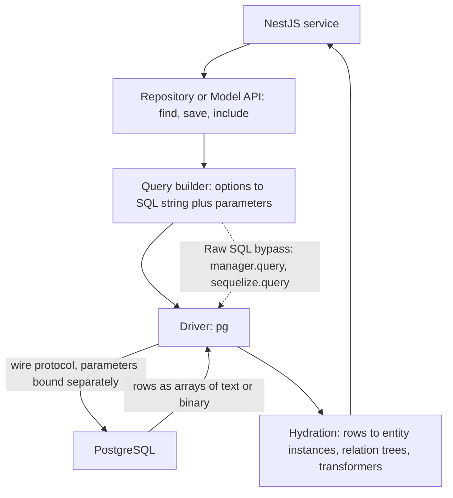
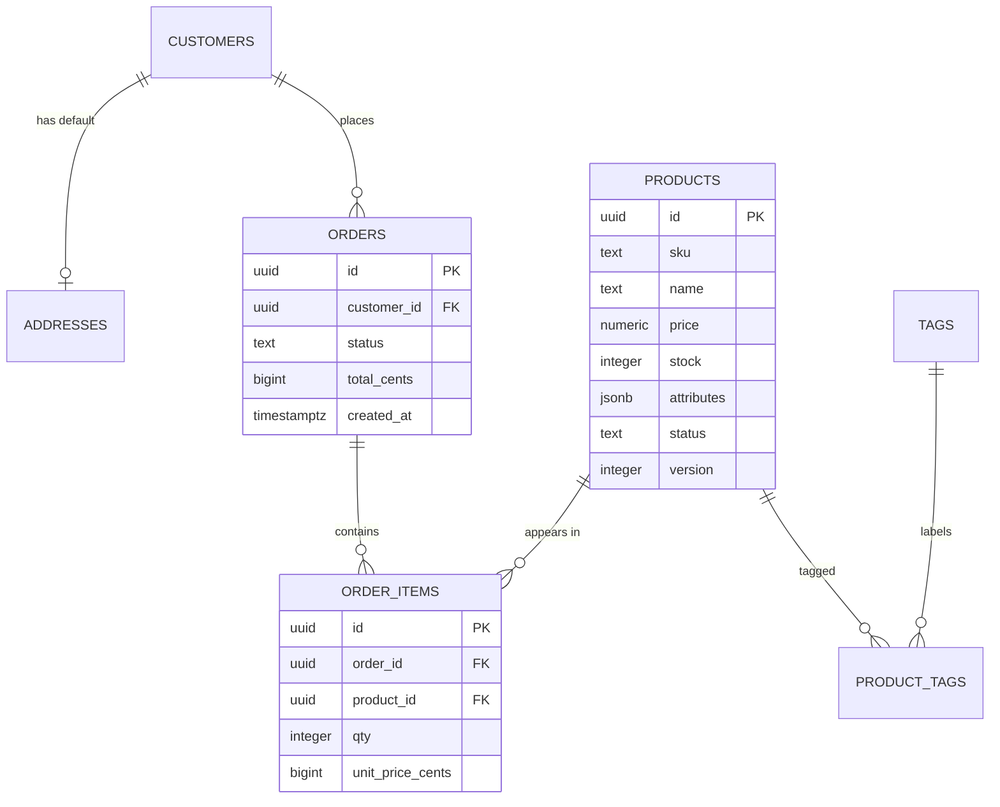

# Part 22 — ORM Engineering: TypeORM, Sequelize and Raw SQL

An ORM (object-relational mapper) is a translation layer between the objects your TypeScript code works with and the rows PostgreSQL stores. Most NestJS teams use TypeORM or Sequelize, most of them use about 20% of the feature set, and most production incidents involving the database trace back to the other 80%: what `save()` really does, how relations are loaded, which decorator emits which SQL, why a `LIMIT` returned fewer parents than expected, and where the connection went when the pool ran dry.

This part treats the ORM as an engineering component with a cost model, not as magic. For each feature we show the SQL it generates, the round trips it costs, and the failure it hides. We use one schema throughout (products, orders, order items, tags, addresses) so you can compare TypeORM and Sequelize on the same problem, and we finish with a comparison against raw SQL and a decision procedure for when to use which. Transactions were covered in depth in Part 21 — Database Transactions and Concurrency Control; here we only recap and point back.

One principle runs through every section: **the ORM is not the database**. It cannot enforce uniqueness, it cannot make `save()` atomic across two processes, and it cannot see the query plan. The schema, the constraints and the SQL log are the source of truth; the ORM is a convenience on top of them.

## 22.1 What an ORM actually does

#### Concept

An ORM keeps a description of your tables as classes (entities or models), generates SQL from method calls and options objects, sends that SQL through a driver, and turns the returned rows back into class instances (hydration). Around that core it adds conveniences: relation loading, migrations, transactions, soft delete, lifecycle hooks, and a query builder for when the option objects are not enough.

#### Why does it exist?

Without an ORM, every table needs hand-written `INSERT`, `SELECT`, `UPDATE` and `DELETE` statements, hand-written row-to-object mapping, and hand-written relation assembly. That is tedious and error-prone for the 80% of queries that are plain CRUD on a single aggregate. An ORM makes those 80% cheap to write, consistent across a team, and type-checked. It does not make the other 20% (reports, bulk operations, window functions, queues) better; it often makes them worse, and knowing where that line is what this part is about.

#### Mental model

Imagine a professional interpreter between you and a very literal, very fast clerk who only speaks SQL. For everyday requests ("file this order", "fetch that customer") the interpreter is perfect. For a complicated request ("give me the top three products per category by revenue in the last 30 days, excluding returns") the interpreter starts improvising, and you are better off writing the request in the clerk's language yourself and having the interpreter only carry the paper.

#### How it works



1. Your service calls `repository.find({ where: { userId }, relations: { items: true } })` or `Order.findAll({ where: { userId }, include: [Items] })`.
2. The ORM consults the entity metadata (built once at startup from decorators or `init()` calls): table names, column names and types, relations and their join columns.
3. It builds a SQL string with placeholders (`$1`, `$2`) and a separate parameter array. Values are never concatenated into the string; this is what makes ORM queries SQL-injection safe by default.
4. The driver (`pg`) sends the query using the extended protocol: parse, bind, execute. PostgreSQL plans and runs it and streams rows back. A simple primary-key lookup takes about 0.3–1 ms of database time on a local instance; the network and driver add roughly the same again.
5. Rows arrive as flat records. For a join, one row per *combination* of parent and child. The ORM de-duplicates parents by primary key and nests children under them. This hydration step is CPU work in your Node process: for 1,000 orders with 5 items each, TypeORM must process 5,000 rows and allocate 6,000 objects; expect 5–20 ms.
6. Column values are converted by type: `pg` returns `numeric` and `bigint` as strings (JavaScript numbers cannot represent them safely), `timestamptz` as `Date`, `jsonb` as parsed objects. The ORM applies any transformers you configured.
7. On writes, the ORM computes what changed, generates `INSERT`/`UPDATE`, runs lifecycle hooks, and may cascade to related entities, each as its own statement.

Overhead relative to raw SQL is small for single-row queries (tens of microseconds) and grows with result size and relation depth. It is rarely the bottleneck; the *queries the ORM chose to run* usually are.

#### Practical example

The schema used for the rest of this part. An e-commerce catalog with orders.



#### NestJS example

Both ORMs are registered at the root module and expose per-feature registration. Everything else in this part builds on these two registrations.

```ts
// src/app.module.ts (TypeORM variant)
import { Module } from '@nestjs/common';
import { ConfigModule, ConfigService } from '@nestjs/config';
import { TypeOrmModule } from '@nestjs/typeorm';

@Module({
  imports: [
    ConfigModule.forRoot({ isGlobal: true }),
    TypeOrmModule.forRootAsync({
      inject: [ConfigService],
      useFactory: (config: ConfigService) => ({
        type: 'postgres',
        url: config.getOrThrow<string>('DATABASE_URL'),
        autoLoadEntities: true,   // entities registered with forFeature() are picked up
        synchronize: false,       // never true outside a throwaway local database
        logging: ['error', 'warn'],
      }),
    }),
  ],
})
export class AppModule {}

// src/orders/orders.module.ts
@Module({
  imports: [TypeOrmModule.forFeature([Order, OrderItem, Product])],
  providers: [OrdersService],
  controllers: [OrdersController],
})
export class OrdersModule {}
```

```ts
// Sequelize variant of the root registration
import { SequelizeModule } from '@nestjs/sequelize';

SequelizeModule.forRootAsync({
  inject: [ConfigService],
  useFactory: (config: ConfigService) => ({
    dialect: 'postgres',
    uri: config.getOrThrow<string>('DATABASE_URL'),
    autoLoadModels: true,
    synchronize: false,
    define: { underscored: true, timestamps: true },
  }),
});
// and per feature: SequelizeModule.forFeature([Order, OrderItem, Product])
```

#### PostgreSQL example

The DDL the entities in the next sections map to. Write it (or generate it via migrations) before writing entities; the schema is the contract.

```sql
CREATE TABLE customers (
  id         uuid PRIMARY KEY DEFAULT gen_random_uuid(),
  email      text NOT NULL UNIQUE,
  created_at timestamptz NOT NULL DEFAULT now()
);

CREATE TABLE addresses (
  id          uuid PRIMARY KEY DEFAULT gen_random_uuid(),
  customer_id uuid NOT NULL UNIQUE REFERENCES customers(id) ON DELETE CASCADE,
  line1       text NOT NULL,
  city        text NOT NULL,
  country     char(2) NOT NULL
);

CREATE TABLE products (
  id         uuid PRIMARY KEY DEFAULT gen_random_uuid(),
  sku        text NOT NULL UNIQUE,
  name       text NOT NULL,
  price      numeric(12,2) NOT NULL CHECK (price >= 0),
  stock      integer NOT NULL DEFAULT 0 CHECK (stock >= 0),
  attributes jsonb NOT NULL DEFAULT '{}'::jsonb,
  status     text NOT NULL DEFAULT 'ACTIVE' CHECK (status IN ('ACTIVE', 'ARCHIVED')),
  version    integer NOT NULL DEFAULT 1,
  created_at timestamptz NOT NULL DEFAULT now(),
  updated_at timestamptz NOT NULL DEFAULT now(),
  deleted_at timestamptz
);

CREATE TABLE orders (
  id          uuid PRIMARY KEY DEFAULT gen_random_uuid(),
  customer_id uuid NOT NULL REFERENCES customers(id),
  status      text NOT NULL DEFAULT 'CREATED' CHECK (status IN ('CREATED','PAID','SHIPPED','CANCELLED')),
  total_cents bigint NOT NULL DEFAULT 0,
  created_at  timestamptz NOT NULL DEFAULT now(),
  updated_at  timestamptz NOT NULL DEFAULT now()
);
CREATE INDEX orders_customer_created ON orders (customer_id, created_at DESC);

CREATE TABLE order_items (
  id               uuid PRIMARY KEY DEFAULT gen_random_uuid(),
  order_id         uuid NOT NULL REFERENCES orders(id) ON DELETE CASCADE,
  product_id       uuid NOT NULL REFERENCES products(id) ON DELETE RESTRICT,
  qty              integer NOT NULL CHECK (qty > 0),
  unit_price_cents bigint NOT NULL,
  UNIQUE (order_id, product_id)
);
CREATE INDEX order_items_product ON order_items (product_id);

CREATE TABLE tags (
  id   uuid PRIMARY KEY DEFAULT gen_random_uuid(),
  name text NOT NULL UNIQUE
);
CREATE TABLE product_tags (
  product_id uuid NOT NULL REFERENCES products(id) ON DELETE CASCADE,
  tag_id     uuid NOT NULL REFERENCES tags(id) ON DELETE CASCADE,
  PRIMARY KEY (product_id, tag_id)
);
```

#### Production scenario

A catalog API serving 1,200 requests per second, 90% reads. With TypeORM, a `GET /products/:id` that loads the product plus its tags takes about 2 ms of database time and 0.4 ms of ORM overhead; that overhead is invisible next to the 15 ms of network to the client. The same service's nightly "revenue by category" report, written with the ORM's query builder, generated a 14-way join with hydration of 2 million rows and took 11 minutes; rewritten as one SQL statement with a CTE and `GROUP BY`, it took 9 seconds. Both facts are typical. Use the ORM where it is cheap and go around it where it is expensive.

#### Failure scenario

At 07:50 a deploy went out with a new `Product.description` column added to the entity and `synchronize: true` still on from local development. TypeORM diffed the entity against production, found that an old column `legacy_notes` (present in the database, absent from the entity) should not exist, and dropped it. Two years of merchandising notes were gone before the first coffee. Restore from the previous night's backup took four hours and lost the morning's edits. The fix is one line (`synchronize: false`) and one process (migrations reviewed in pull requests; section 22.7).

#### Edge cases & failure modes

- The ORM's picture of the schema and the real schema drift silently when migrations are hand-edited or applied out of order; a column the entity thinks is `NOT NULL` may be nullable in production and vice versa.
- Hydration of large joined results is CPU-bound in Node and blocks the event loop; a single 50,000-row `leftJoinAndSelect` can stall every other request on that pod for hundreds of milliseconds.
- Drivers return `numeric`/`bigint` as strings; code that does `price * qty` gets string concatenation or `NaN` (section 22.2 and 22.25).
- Entity metadata is built at startup; a circular import between entity files can leave a relation undefined and produce `Entity metadata for X#y was not found` only at runtime.
- Two ORMs on one database (a migration from Sequelize to TypeORM in progress) each maintain their own migration table and their own idea of the schema; only one should own DDL.

#### How a Senior Backend Engineer thinks about this

They read the SQL log before they trust an ORM method. They ask: how many statements does this produce, how many rows come back, how many objects get allocated, and does any of it run inside a transaction? They keep the schema as the source of truth, with constraints, and treat entity decorators as documentation of it. They pick one way to do each thing (loading relations, transactions, upserts) and make it the team convention, because ORM bugs come from mixing styles.

#### Common mistakes

- Learning the ORM instead of learning SQL, and then being unable to read the queries it generates.
- Using `synchronize: true` or `sync({ alter: true })` anywhere near production data.
- Treating hydration as free and returning entity trees with thousands of nodes.
- Choosing the ORM by popularity rather than by whether its model (Active Record versus Data Mapper, eager versus explicit loading) matches the team's habits.

#### Interview questions

1. *What does an ORM do between `repository.find()` and the rows coming back?* Expected: metadata lookup, SQL generation with bound parameters, driver round trip, hydration and de-duplication of joined rows, type conversion. Why it matters: separates users of the tool from engineers of it.
2. *Where does ORM overhead actually show up?* Expected: hydration of large joined results and the number of statements chosen, not per-query CPU.
3. *Why should the database schema, not the entity class, be the source of truth?* Expected: constraints are enforced for every code path; entities only describe.
4. *Name a query shape where you would bypass the ORM entirely.* Expected: reports with CTEs/window functions, bulk upserts, queue claims with `SKIP LOCKED`.

#### Practical exercise

Enable query logging and run one request that loads an order with items and products through your ORM. Count the statements, the rows returned by each, and the total time. Then write the same load as one raw SQL statement and compare. Acceptance criteria: a short write-up with both SQL texts, row counts, timings, and one sentence on which you would ship and why.

## 22.2 TypeORM entities

#### Concept

An entity is a class whose decorators describe a table: `@Entity()` names the table, `@Column()` describes each column's type, nullability and default, `@PrimaryGeneratedColumn()` the primary key, and the date/version/delete decorators cover the bookkeeping columns. TypeORM reads the decorators at startup into metadata used for every query and for schema generation.

#### Why does it exist?

Without entities you would repeat column names and types in every query and every mapping. The entity centralises them, gives the compiler something to check against, and lets `find()` know how to hydrate a row. The cost is that the decorators are a *second* description of the schema and can disagree with the first.

#### How it works

1. Decorators register metadata in a global store when the file is imported.
2. `DataSource.initialize()` builds `EntityMetadata` for every entity: columns, relations, indices, listeners.
3. Every repository method consults that metadata to build SQL; migrations compare it with the live schema.
4. The `type` option is passed to PostgreSQL almost verbatim (`'timestamptz'`, `'jsonb'`, `'numeric'`); if you omit it, TypeORM infers from the TypeScript type via `emitDecoratorMetadata` (`string` becomes `character varying`, `number` becomes `integer`, `Date` becomes `timestamp without time zone`, `boolean` becomes `boolean`), which is usually *not* what you want.

#### TypeORM example

The three core entities with every decorator that matters in production.

```ts
// src/products/product.entity.ts
import {
  Entity, PrimaryGeneratedColumn, Column, CreateDateColumn, UpdateDateColumn,
  DeleteDateColumn, VersionColumn, Index, OneToMany, ManyToMany, JoinTable,
} from 'typeorm';
import { OrderItem } from '../orders/order-item.entity';
import { Tag } from '../tags/tag.entity';

export enum ProductStatus { ACTIVE = 'ACTIVE', ARCHIVED = 'ARCHIVED' }

/** numeric(12,2) comes back from pg as a string; convert deliberately, never implicitly. */
const numericToString = { to: (v: string) => v, from: (v: string | null) => v };

@Entity({ name: 'products' })
export class Product {
  @PrimaryGeneratedColumn('uuid')
  id: string;

  @Index({ unique: true })
  @Column({ type: 'text' })
  sku: string;

  @Column({ type: 'text' })
  name: string;

  // Money. Keep it a string (or a Decimal from decimal.js); a JS number loses cents at scale.
  @Column({ type: 'numeric', precision: 12, scale: 2, transformer: numericToString })
  price: string;

  @Column({ type: 'integer', default: 0 })
  stock: number;

  @Column({ type: 'jsonb', default: () => `'{}'::jsonb` })
  attributes: Record<string, unknown>;

  // PostgreSQL enum type products_status_enum is created; see the enum discussion below.
  @Column({ type: 'enum', enum: ProductStatus, default: ProductStatus.ACTIVE })
  status: ProductStatus;

  @VersionColumn()
  version: number;

  // Without { type: 'timestamptz' } these become timestamp WITHOUT time zone.
  @CreateDateColumn({ type: 'timestamptz', name: 'created_at' })
  createdAt: Date;

  @UpdateDateColumn({ type: 'timestamptz', name: 'updated_at' })
  updatedAt: Date;

  // Soft delete: softRemove()/softDelete() set this; find*() exclude rows where it is not null.
  @DeleteDateColumn({ type: 'timestamptz', name: 'deleted_at' })
  deletedAt: Date | null;

  @OneToMany(() => OrderItem, (item) => item.product)
  orderItems: OrderItem[];

  @ManyToMany(() => Tag, (tag) => tag.products)
  @JoinTable({
    name: 'product_tags',
    joinColumn: { name: 'product_id', referencedColumnName: 'id' },
    inverseJoinColumn: { name: 'tag_id', referencedColumnName: 'id' },
  })
  tags: Tag[];
}
```

```ts
// src/orders/order.entity.ts
@Entity({ name: 'orders' })
export class Order {
  @PrimaryGeneratedColumn('uuid') id: string;

  // Keep the FK column as a plain column too: readable without loading the relation.
  @Column({ type: 'uuid', name: 'customer_id' }) customerId: string;

  @ManyToOne(() => Customer, (c) => c.orders, { nullable: false, onDelete: 'RESTRICT' })
  @JoinColumn({ name: 'customer_id' })
  customer: Customer;

  @Column({ type: 'text', default: 'CREATED' }) status: 'CREATED' | 'PAID' | 'SHIPPED' | 'CANCELLED';

  // bigint is also returned as a string by pg. Convert to number only if you know it fits.
  @Column({ type: 'bigint', name: 'total_cents', transformer: { to: (v: number) => v, from: (v: string) => Number(v) } })
  totalCents: number;

  @OneToMany(() => OrderItem, (item) => item.order, { cascade: ['insert'] })
  items: OrderItem[];

  @CreateDateColumn({ type: 'timestamptz', name: 'created_at' }) createdAt: Date;
  @UpdateDateColumn({ type: 'timestamptz', name: 'updated_at' }) updatedAt: Date;
}

// src/orders/order-item.entity.ts
@Entity({ name: 'order_items' })
@Unique(['orderId', 'productId'])
export class OrderItem {
  @PrimaryGeneratedColumn('uuid') id: string;
  @Column({ type: 'uuid', name: 'order_id' }) orderId: string;
  @Column({ type: 'uuid', name: 'product_id' }) productId: string;

  @ManyToOne(() => Order, (o) => o.items, { nullable: false, onDelete: 'CASCADE' })
  @JoinColumn({ name: 'order_id' })
  order: Order;

  @ManyToOne(() => Product, (p) => p.orderItems, { nullable: false, onDelete: 'RESTRICT' })
  @JoinColumn({ name: 'product_id' })
  product: Product;

  @Column({ type: 'integer' }) qty: number;
  @Column({ type: 'bigint', name: 'unit_price_cents', transformer: { to: (v: number) => v, from: (v: string) => Number(v) } })
  unitPriceCents: number;
}
```

**Type mapping you must know.**

| TypeScript | Decorator | PostgreSQL type | Returned as | Notes |
|---|---|---|---|---|
| `string` id | `@PrimaryGeneratedColumn('uuid')` | `uuid DEFAULT uuid_generate_v4()` | string | needs `uuid-ossp`; set `uuidExtension: 'pgcrypto'` in options to use `gen_random_uuid()` |
| `number` id | `@PrimaryGeneratedColumn()` | `serial`/`integer` with sequence | number | `'increment'` strategy; fine for internal tables |
| `string` | `@Column('text')` | `text` | string | prefer `text` over `varchar(n)`; a length limit is a `CHECK`, not a performance feature |
| `number` | `@Column('integer')` | `integer` | number | up to 2.1 billion |
| `number` | `@Column('bigint')` | `bigint` | **string** | pg refuses to lose precision; add a transformer |
| `string` | `@Column('numeric', { precision, scale })` | `numeric(p,s)` | **string** | money; never `float`/`double precision` |
| `boolean` | `@Column('boolean')` | `boolean` | boolean | |
| `Date` | `@Column('timestamptz')` | `timestamp with time zone` | `Date` | always `timestamptz`; plain `timestamp` is parsed in the Node process's local zone by `pg` |
| `Date` | `@Column('date')` | `date` | string `'YYYY-MM-DD'` by default | pg returns date as a string unless a type parser is registered |
| object | `@Column('jsonb')` | `jsonb` | parsed object | `json` preserves key order and whitespace but cannot be indexed usefully |
| enum | `@Column({ type: 'enum', enum })` | `CREATE TYPE ..._enum` | string | migrations for new values are awkward; `text` + `CHECK` is often simpler |
| `string[]` | `@Column('text', { array: true })` | `text[]` | array | index with GIN |
| `Buffer` | `@Column('bytea')` | `bytea` | Buffer | do not store files here |
| anything | `@Column('simple-json')` / `'simple-array'` | `text` | parsed | avoid; not queryable; use `jsonb` |

**Decimal as string.** `pg` returns `numeric` and `bigint` as strings because a JavaScript `number` has 53 bits of integer precision and binary floating point; `0.1 + 0.2` is not `0.3`, and `9007199254740993` cannot be represented. TypeORM does not convert. If you write `product.price * qty` you get either a string-coerced float or `NaN`. Options, best first: store money as integer cents in an `integer` column (safe up to 21 million currency units) or `bigint` with a `Number` transformer when you know the magnitude; keep `numeric` as a string and do arithmetic with `decimal.js`; or `pg.types.setTypeParser(1700, parseFloat)` globally, which is convenient and wrong for money.

**Timestamps.** `@CreateDateColumn()` without a type creates `timestamp without time zone`. `pg` parses those as *local time of the Node process*. A pod in `UTC` and a developer laptop in `Asia/Kolkata` disagree by 5.5 hours on the same row. Always `timestamptz`, and run Node with `TZ=UTC` anyway.

**Enums.** `type: 'enum'` creates a PostgreSQL enum type named `<table>_<column>_enum`. Adding a value later requires `ALTER TYPE ... ADD VALUE`, which cannot run inside a transaction block before PostgreSQL 12 and, in TypeORM-generated migrations, is usually expressed as rename-type, create-new-type, alter-column, drop-old-type, which locks the table. `text` with a `CHECK (status IN (...))` constraint changes with a plain `ALTER TABLE ... DROP CONSTRAINT / ADD CONSTRAINT`, and the TypeScript union type gives you the same compile-time safety.

**Soft delete.** `@DeleteDateColumn` makes `find*` and `count` add `WHERE deleted_at IS NULL` automatically, `repository.softDelete(criteria)` and `softRemove(entity)` set the timestamp, `restore()`/`recover()` clear it, and `withDeleted: true` (or `.withDeleted()` on the query builder) shows the rows. Two traps: unique indexes still see soft-deleted rows (re-creating a deleted SKU fails unless the unique index is partial, `WHERE deleted_at IS NULL`), and foreign keys still reference them (a soft-deleted product still appears on old orders, which is usually what you want).

#### PostgreSQL example

What `migration:generate` emits for the `Product` entity, so you can compare it with the hand-written DDL above and see what the decorators bought you and what they did not (no `CHECK` constraints, no `ON DELETE` unless specified, an enum type instead of `text`).

```sql
CREATE TYPE "public"."products_status_enum" AS ENUM('ACTIVE', 'ARCHIVED');
CREATE TABLE "products" (
  "id" uuid NOT NULL DEFAULT uuid_generate_v4(),
  "sku" text NOT NULL,
  "name" text NOT NULL,
  "price" numeric(12,2) NOT NULL,
  "stock" integer NOT NULL DEFAULT '0',
  "attributes" jsonb NOT NULL DEFAULT '{}'::jsonb,
  "status" "public"."products_status_enum" NOT NULL DEFAULT 'ACTIVE',
  "version" integer NOT NULL,
  "created_at" TIMESTAMP WITH TIME ZONE NOT NULL DEFAULT now(),
  "updated_at" TIMESTAMP WITH TIME ZONE NOT NULL DEFAULT now(),
  "deleted_at" TIMESTAMP WITH TIME ZONE,
  CONSTRAINT "PK_0806c755e0aca124e67c0cf6d7d" PRIMARY KEY ("id")
);
CREATE UNIQUE INDEX "IDX_c44ac33a05b144dd0d9ddcf932" ON "products" ("sku");
```

Note the generated index names. Name them yourself (`@Index('products_sku_unique', ['sku'], { unique: true })`) so that `EXPLAIN` output and lock messages are readable.

#### Edge cases & failure modes

- A property without an explicit `type` and with a TypeScript union type (`'A' | 'B'`) has no runtime type information; TypeORM throws at startup with a "data type is not defined" error.
- `default: () => 'now()'` is a SQL expression; `default: new Date()` is evaluated once at process start and baked into the DDL.
- `@Column({ select: false })` (for password hashes) hides the column from `find*` and from `save()`'s change detection; loading it requires `addSelect` in a query builder.
- Changing a column's `name` in the entity generates a `DROP COLUMN` and `ADD COLUMN`, not a rename; data is lost unless you edit the migration.
- `@VersionColumn` increments on `save()` but is not checked (Part 21, section 21.5).
- Entities with `bigint` primary keys return string ids; `where: { id: 42 }` still works, but `===` comparisons in application code fail.

#### How a Senior Backend Engineer thinks about this

They write the DDL first, with constraints, and then write the entity to match it, with explicit `type` on every column. They ban `float` for money and `timestamp` without zone, and they name every index and constraint. They know that decorators cannot express `CHECK` constraints or partial indexes and add those in migrations by hand. They treat `simple-json` and `eager: true` as smells in code review.

#### Common mistakes

- Omitting `type` and getting `character varying`, `integer` and `timestamp` by inference.
- Using `number` for a `bigint` or `numeric` property and being surprised by strings.
- Using PostgreSQL enums for anything that will gain values.
- Forgetting that soft-deleted rows still hit unique indexes.
- Two entities mapping the same table with different column sets, so `save()` from one nulls columns the other depends on.

#### Interview questions

1. *Why does `pg` return `bigint` and `numeric` as strings, and what do you do about it?* Expected: precision; integer cents, transformers, or a decimal library.
2. *What is wrong with `@CreateDateColumn()` without options in PostgreSQL?* Expected: `timestamp without time zone`, parsed as process-local time.
3. *PostgreSQL enum versus `text` plus `CHECK`: when do you pick which?* Expected: enums are compact and typed but painful to evolve; `text` plus `CHECK` for anything that changes.
4. *How does soft delete interact with unique constraints?* Expected: deleted rows still occupy the index; partial unique index on `deleted_at IS NULL`.

#### Practical exercise

Write the `Customer` and `Address` entities for the schema above with explicit types, named indexes and a partial unique index on `products.sku WHERE deleted_at IS NULL` added via a migration. Acceptance criteria: `migration:generate` after your migration produces an empty diff; a test soft-deletes a product and re-creates the same SKU successfully; `SELECT pg_typeof(created_at)` returns `timestamp with time zone`.

## 22.3 TypeORM relations

#### Concept

A relation is a foreign key described from the object's point of view: an `Order` *has many* `OrderItem`s, an `OrderItem` *belongs to* one `Product`. TypeORM has four relation decorators: `@ManyToOne`, `@OneToMany`, `@OneToOne` and `@ManyToMany`. Only some of them create columns; the rest are views over the other side.

#### Why does it exist?

So that `order.items[0].product.name` is a property access rather than three hand-written joins and a nesting loop. The price is that each relation is a *potential* query, and how and when it runs is the source of most ORM performance problems.

#### Mental model

Imagine a paper order form with a customer number written at the top. The customer number is the *owning side*: it lives on the form. The customer's folder that lists all their orders is the *inverse side*: it is derived by looking through every form. Only the form carries data; the folder is a view.

#### How it works

1. **`@ManyToOne` is always the owning side.** It creates the foreign key column (`order_id`) on this entity's table. `@JoinColumn({ name })` names that column; without it TypeORM uses `<property>Id` (`orderId`).
2. **`@OneToMany` is always the inverse side.** It creates no column. It exists so that loading can go from parent to children and so that cascades can flow from parent to children. It *requires* the `@ManyToOne` on the other entity.
3. **`@OneToOne`** creates a foreign key on whichever side has `@JoinColumn`, plus a unique index on it. The other side is inverse.
4. **`@ManyToMany`** needs a join table. The side with `@JoinTable` owns it. TypeORM manages the join table for you: `product.tags = [...]; save(product)` inserts and deletes join rows to match.
5. `nullable: false` makes the FK column `NOT NULL`. `onDelete` sets the database-level referential action (`'CASCADE' | 'SET NULL' | 'RESTRICT' | 'NO ACTION'`); `onUpdate` similarly. `orphanedRowAction` on the inverse side decides what happens to children removed from a parent's array on `save()` (`'nullify'` by default, `'delete'`, `'soft-delete'` or `'disable'`).
6. Loading is explicit: `find({ relations: { items: { product: true } } })` produces `LEFT JOIN`s (or separate queries with `relationLoadStrategy: 'query'`). Unloaded relations are simply `undefined` on the instance; there is no lazy proxy unless you declare the property as a `Promise` (section 22.8).

#### TypeORM example

**When to model the join table explicitly.** `@ManyToMany` is right for a pure association with no attributes (product to tag). The moment the association carries data (quantity, price at time of order, created-at, position), model it as its own entity with two `@ManyToOne`s, which is exactly what `OrderItem` is. You will also want an explicit entity when you need to query the join table directly, soft-delete associations, or paginate them. A common evolution is starting with `@ManyToMany` and, when the first extra column appears, migrating to an explicit entity; do it early, the migration is painful once the join table has millions of rows.

```ts
// One-to-one, owning side on Address (holds customer_id with a unique index)
@Entity({ name: 'addresses' })
export class Address {
  @PrimaryGeneratedColumn('uuid') id: string;
  @Column({ type: 'uuid', name: 'customer_id' }) customerId: string;
  @OneToOne(() => Customer, (c) => c.defaultAddress, { nullable: false, onDelete: 'CASCADE' })
  @JoinColumn({ name: 'customer_id' })
  customer: Customer;
  @Column('text') line1: string;
  @Column('text') city: string;
  @Column({ type: 'char', length: 2 }) country: string;
}

@Entity({ name: 'customers' })
export class Customer {
  @PrimaryGeneratedColumn('uuid') id: string;
  @Column('text') email: string;
  @OneToOne(() => Address, (a) => a.customer, { cascade: ['insert', 'update'] })
  defaultAddress?: Address;                       // inverse side: no column here
  @OneToMany(() => Order, (o) => o.customer) orders: Order[];
}

// Loading relations explicitly (object syntax, TypeORM 0.3)
const orders = await this.orders.find({
  where: { customerId },
  relations: { items: { product: true } },        // LEFT JOIN order_items, LEFT JOIN products
  order: { createdAt: 'DESC' },
  take: 20,
});

// Same, with separate queries instead of joins (avoids row multiplication for wide parents)
const ordersQ = await this.orders.find({
  where: { customerId },
  relations: { items: true },
  relationLoadStrategy: 'query',                   // SELECT orders; SELECT order_items WHERE order_id IN (...)
});

// Only the ids of related rows, no join of the related table's columns
const withTagIds = await this.products.find({ where: { status: ProductStatus.ACTIVE }, loadRelationIds: { relations: ['tags'] } });
```

Two habits worth adopting. First, declare the plain FK column (`orderId`) next to the relation (`order`) and map both to the same database column; you can then filter and insert by id without loading the relation, and `@RelationId` becomes unnecessary. Second, never set `eager: true` on a relation that can be large (section 22.8).

#### PostgreSQL example

What the relation options become. The differences matter at 02:00.

```sql
-- @ManyToOne(..., { nullable: false, onDelete: 'CASCADE' }) on OrderItem.order
ALTER TABLE "order_items" ADD CONSTRAINT "FK_order_items_order"
  FOREIGN KEY ("order_id") REFERENCES "orders"("id") ON DELETE CASCADE ON UPDATE NO ACTION;

-- @ManyToOne(..., { onDelete: 'RESTRICT' }) on OrderItem.product
ALTER TABLE "order_items" ADD CONSTRAINT "FK_order_items_product"
  FOREIGN KEY ("product_id") REFERENCES "products"("id") ON DELETE RESTRICT ON UPDATE NO ACTION;

-- The FK column is NOT indexed automatically. Add it, or every parent delete scans the child table.
CREATE INDEX "order_items_order_id_idx" ON "order_items" ("order_id");

-- @OneToOne with @JoinColumn creates a unique constraint on the FK
ALTER TABLE "addresses" ADD CONSTRAINT "UQ_addresses_customer" UNIQUE ("customer_id");
```

PostgreSQL does not create indexes on foreign-key columns. TypeORM does not either. Every `@ManyToOne` needs an `@Index()` on its FK column (or a composite index that starts with it), or deletes of the parent and joins from parent to child become sequential scans.

#### Edge cases & failure modes

- A `@OneToMany` without the matching `@ManyToOne` fails at startup with a metadata error; a `@ManyToOne` without the `@OneToMany` is fine (one-directional relation).
- `relations` with `take` on a `find` uses TypeORM's two-query pagination (distinct ids first); the same join in a query builder with `.limit()` instead of `.take()` returns fewer parents (section 22.5).
- `@ManyToMany` `save()` diffing loads the current join rows first; on a product with 10,000 tags every save reads 10,000 rows.
- `onDelete: 'CASCADE'` at the database and `cascade: ['remove']` in TypeORM are different mechanisms (section 22.10); using both is harmless, using only the ORM one is unreliable.
- Circular imports between entity files are resolved by the arrow-function `() => Product` form; a direct class reference in a decorator can be `undefined` at decoration time.
- Self-referencing relations (`Category.parent`) work with `@ManyToOne(() => Category, (c) => c.children)`; recursive loading needs a recursive CTE or `@Tree` entities.

#### How a Senior Backend Engineer thinks about this

They decide, per relation, whether it is ever loaded together with its parent in a hot path, and if so, how large it can get. They index every FK column on day one. They model anything with attributes as an explicit entity. They prefer `relationLoadStrategy: 'query'` or explicit joins over eager loading and check the SQL log for the number of statements after every change to `relations`.

#### Common mistakes

- Putting `@JoinColumn` on both sides of a one-to-one (two FK columns, two unique indexes, confusion).
- Forgetting the index on the FK column.
- Loading `relations: ['items', 'items.product', 'items.product.tags']` for a list endpoint that shows order numbers and totals.
- Using `@ManyToMany` for order lines and then trying to add a `qty` column.
- Setting `eager: true` on both sides of a relation (TypeORM refuses) or on any large collection.

#### Interview questions

1. *Which relation decorators create columns and which do not?* Expected: `@ManyToOne` and the `@JoinColumn` side of `@OneToOne` create FK columns; `@OneToMany` and inverse `@OneToOne` create none; `@ManyToMany` with `@JoinTable` creates a join table.
2. *When do you replace `@ManyToMany` with an explicit entity?* Expected: as soon as the association has attributes, needs direct querying, soft delete, or pagination.
3. *Does PostgreSQL index foreign-key columns? Does TypeORM?* Expected: neither; you must.
4. *What is the difference between `relations` in `find` and `leftJoinAndSelect` with `limit` in a query builder?* Expected: `find` with `take` paginates by distinct parent ids; `limit` cuts joined rows.

#### Practical exercise

Model `Category` with a self-referencing parent relation and `Product.category`. Write a `find` that loads products with their category and the category's parent, then the same with `relationLoadStrategy: 'query'`, and compare the SQL. Then add a `position` column to the product-tag association and migrate it from `@ManyToMany` to an explicit `ProductTag` entity without losing data. Acceptance criteria: both loading strategies return identical JSON; the migration is reversible; every FK column has an index (verify with `\di` in `psql`).
