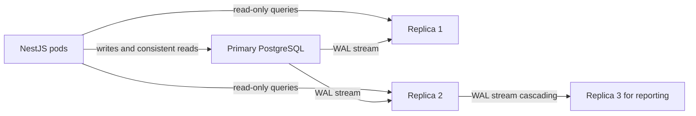
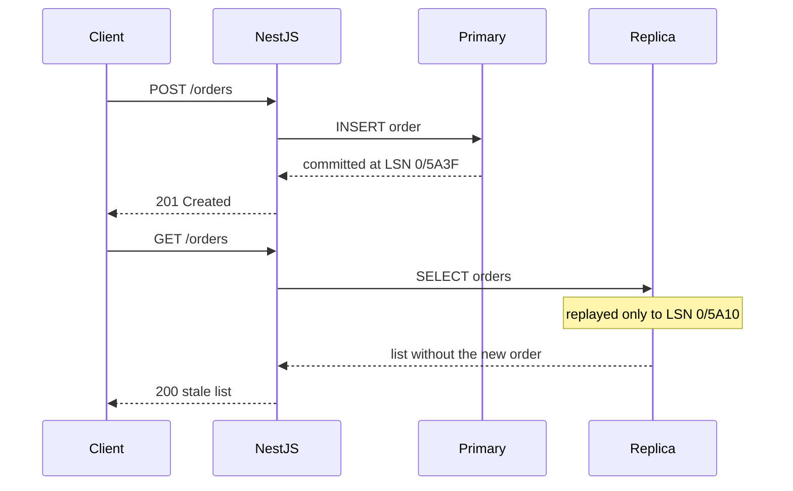

# Part 22 — Database Scaling

Most backend systems never outgrow one PostgreSQL instance. That sentence surprises people, so let me put numbers on it. A single well-tuned PostgreSQL server on a modern machine (say 32 vCPU, 128 GB RAM, NVMe storage) handles tens of thousands of simple indexed queries per second, several thousand write transactions per second, and multiple terabytes of data. A food-delivery app doing 2,000 orders per minute, a SaaS product with 50,000 tenants, a social feed for a million daily users: all of these fit on one primary with a couple of replicas, provided the schema, indexes and queries are sane.

So why is "database scaling" a whole part of this book? Because the systems that *do* outgrow one instance fail in ugly, expensive ways, and because most teams reach for the heavy tools (sharding, a new database engine, a rewrite) long before they have exhausted the cheap ones. This part gives you the ladder a senior engineer climbs, rung by rung, and the mechanics of each rung: replication, lag, failover, partitioning, sharding, rebalancing, connection scaling and multi-tenant layouts. Everything is PostgreSQL-specific and wired into NestJS with TypeORM and Sequelize where it matters.

Keep the senior mantra next to you the whole way: *Can it timeout? Can it fail? Can it become slow? Can it duplicate? Can it return a wrong response? Can it partially succeed?* Every rung of the ladder introduces a new way to answer "yes" to one of those.

## 22.1 The scaling ladder

#### Concept

The scaling ladder is the ordered list of interventions you try when a database is "slow" or "at capacity". The order matters: each rung is cheaper, safer and more reversible than the one after it, and each rung solves a specific class of problem. Skipping rungs is how teams end up sharding a database whose real problem was a missing index.

```text
 6. Sharding            (split rows across databases; last resort)
 5. Partitioning        (split a huge table inside one database)
 4. Read replicas       (copy the data; route reads away from the primary)
 3. Caching             (do not ask the database at all)
 2. Connection pooling  (stop wasting the database on connection churn)
 1. Queries and indexes (make each request cheap)
 0. Measure             (know which of the above you actually need)
```

#### Why does it exist?

Databases become the bottleneck for one of five reasons: individual queries are expensive, there are too many connections, the same data is read over and over, one table is so big that every operation on it hurts, or the write volume exceeds what one machine can absorb. Each reason has a different cure. The ladder exists so you diagnose before you treat.

Without the ladder, engineers guess. The guess is usually "we need to scale horizontally", which is the most expensive guess available.

#### Mental model

Imagine a restaurant whose kitchen cannot keep up. Before you build a second restaurant across town (sharding), you would check whether the chef is cooking each dish in the slowest possible way (bad queries), whether waiters are queuing at the pass instead of batching orders (connections), whether you could pre-cook the ten most popular dishes (caching), whether you could add a second line for cold dishes only (read replicas), and whether the walk-in fridge is so overstuffed that finding anything takes five minutes (a table that needs partitioning). Only when the single kitchen is genuinely at its physical limit do you open a second location, and you accept that the two kitchens will never share a fridge again.

#### How it works

1. **Measure.** Turn on `pg_stat_statements`. Look at `total_exec_time`, `calls`, `mean_exec_time` and `rows`. Look at `pg_stat_activity` for connection counts and wait events. Look at CPU, IOPS, cache hit ratio (`pg_stat_database.blks_hit / (blks_hit + blks_read)`). A senior engineer refuses to scale anything before this step.
2. **Queries and indexes.** The top ten statements by total time are almost always a handful of missing indexes, `SELECT *` on wide tables, N+1 loops from an ORM, or unbounded `OFFSET` pagination. Fixing them commonly buys 5x to 50x. See Part 19 — Indexes and Query Optimization.
3. **Connection pooling.** Every PostgreSQL connection is a process with roughly 5 to 10 MB of memory and real CPU cost on connect. 40 pods with a pool of 20 each is 800 connections, which is already past the comfortable zone. PgBouncer in transaction mode multiplexes thousands of client connections onto tens of server connections. See section 22.9.
4. **Caching.** Product pages, user profiles, configuration, permission sets: read a million times, changed once an hour. Redis answers in 0.2 to 1 ms and never touches the database. See Part 26 — Caching.
5. **Read replicas.** When reads still dominate after caching, stream a copy of the data to one or more replicas and route read-only traffic there. Reads scale almost linearly with replica count; writes do not scale at all.
6. **Partitioning.** When one table reaches hundreds of millions of rows, split it inside the same database by time, range or hash. Queries touch only the relevant partition; old data is dropped by dropping a partition.
7. **Sharding.** When *writes* exceed a single machine, or the dataset exceeds what one machine can store and back up, split rows across independent databases by a shard key. You now own a distributed system.

Rough capacity of one tuned PostgreSQL instance, so you know when you are actually near the edge:

| Dimension | Comfortable single instance | Where pain starts |
|---|---|---|
| Simple indexed reads | 20,000 to 60,000 QPS | CPU saturation, cache miss rate rising |
| Write transactions | 2,000 to 10,000 TPS | WAL write throughput, fsync latency, lock contention |
| Data size | 1 to 5 TB | Backups, vacuum, index bloat, restore time in hours |
| Single table | 100 to 500 M rows | Index size exceeds RAM, vacuum takes hours |
| Connections | 100 to 300 active | Memory, context switching, lock manager contention |
| Replication | 2 to 5 streaming replicas | Network bandwidth of WAL fan-out |

#### Practical example

An e-commerce order service. p95 latency on `GET /orders` rose from 40 ms to 900 ms over three months. The team's first proposal was "move orders to a sharded cluster". A senior engineer opened `pg_stat_statements` and found one query responsible for 71% of total execution time: the order list endpoint filtered by `user_id` and sorted by `created_at DESC`, with an index only on `user_id`. Adding a composite index `(user_id, created_at DESC)` brought p95 back to 35 ms. Total cost: one migration, twenty minutes.

#### Production scenario

The decision table below is the one to keep in your head. The symptom column is what you observe; the fix column is the rung to try first.

| Symptom you observe | Likely cause | First fix | Next rung if not enough |
|---|---|---|---|
| A few queries dominate `pg_stat_statements`; CPU high | Missing or wrong indexes, bad plans | Add or fix indexes, rewrite queries | Materialized views, caching |
| `FATAL: too many connections`, `remaining connection slots are reserved` | Pool size × pods exceeds `max_connections` | PgBouncer / RDS Proxy, smaller per-pod pools | Fewer pods per DB, replicas |
| Read-heavy, same rows read constantly, cache hit ratio fine but CPU high | No application caching | Redis cache with TTL and invalidation | Read replicas |
| Read-heavy, working set too large for cache, primary CPU saturated by SELECTs | Reads and writes share one machine | Read replicas with routed reads | More replicas, CQRS read models |
| One table with hundreds of millions of rows; vacuum runs for hours; queries always filter by date | Monolithic huge table | Time-range partitioning, drop old partitions | Archive to cold storage |
| Write TPS at the WAL/fsync limit; `LWLock:WALWrite` waits; primary IOPS maxed | Write volume exceeds one machine | Batching, async queues, move event/log tables elsewhere | Sharding |
| One tenant or one user dominates load | Hot key / hot shard | Rate limits, dedicated resources, salting | Dedicated shard |
| Replica lag climbing during backfills | Replica cannot replay as fast as primary writes | Throttle the writer by lag, bigger replica | Logical replication for subsets |

#### How a Senior Backend Engineer thinks about this

Before touching architecture, a senior engineer asks four questions: *What is the actual bottleneck (CPU, IOPS, memory, locks, connections)? Is it reads or writes? Is the load evenly spread or concentrated? What is the cheapest reversible change that addresses exactly that?* They refuse to shard on a hunch. They also refuse the opposite mistake: pretending one instance will last forever when the write curve says it will not. The ladder is climbed deliberately, one rung at a time, with a measurement after each.

To a product manager: "We have six levers, ordered from cheap to expensive. We will pull the cheap ones this sprint and measure. If we still need the expensive ones we will plan them properly, because the expensive ones change how every feature is built."

#### Common mistakes

- Sharding a database whose problem was three missing indexes.
- Adding replicas for a write-bound system (replicas do not help writes; they add write cost).
- Raising `max_connections` to 2,000 instead of adding a pooler.
- Caching before measuring, so the cache hides a query that later resurfaces during a cold start.

#### Interview questions

1. *A team says "our database is slow, we need to shard". What do you ask first?* Expected: which queries, which resource is saturated, reads or writes, what does `pg_stat_statements` show; sharding only helps write or storage limits.
2. *Roughly what can one PostgreSQL instance handle?* Expected: tens of thousands of simple QPS, thousands of write TPS, TBs of data, depending on hardware and working set.
3. *Why is connection pooling before caching on the ladder?* Expected: it is cheaper, has no invalidation problem, and connection storms cause outages independent of query cost.

## 22.2 Vertical scaling

#### Concept

Vertical scaling means running the same database on a bigger machine: more vCPUs, more RAM, faster or more storage. Nothing in the application changes. On AWS RDS it is a change of instance class (say from `db.r6g.xlarge` to `db.r6g.4xlarge`) and a change of storage type or provisioned IOPS.

#### Why does it exist?

Because it is the only scaling technique with zero application complexity. A larger machine raises every ceiling at once: CPU for query execution, RAM for `shared_buffers` and the OS page cache (which is what makes the working set fit in memory), and IOPS for writes and cache misses. For a large fraction of systems this is the right and final answer.

#### Mental model

Imagine the restaurant again. Vertical scaling is moving to a building with a bigger kitchen and more burners. Same staff, same menu, same fridge; nothing about how food is cooked changes. It works until you hit the largest building in town.

#### How it works

1. **RAM** determines how much of the data and indexes stay in memory. Rule of thumb: if the *working set* (rows and index pages touched in a typical hour) fits in RAM, reads are served from memory at microseconds per page; if it does not, every miss is a disk read at 0.1 to 1 ms on NVMe or several ms on network storage.
2. **CPU** determines how many concurrent queries execute. PostgreSQL uses one process per connection; a 16 vCPU box comfortably runs 16 to 32 active queries at once. More vCPUs also help parallel query for large scans.
3. **Storage IOPS and throughput** determine write rate (every commit is a WAL fsync) and cache-miss read rate. On RDS, `gp3` gives a baseline of 3,000 IOPS and 125 MB/s, extendable to 16,000 IOPS; `io2` goes to 256,000 IOPS at a much higher price.
4. **The change itself** on RDS: modify the instance class, choose "apply immediately" or the maintenance window. Single-AZ: a few minutes of downtime. Multi-AZ: the standby is resized first, then a failover of roughly 60 seconds, then the old primary is resized. Applications see connection drops during that minute.

Cost curve, on-demand pricing for a memory-optimised family in one common region, to make the tradeoff concrete:

| Instance class | vCPU | RAM | Approx. monthly cost (single-AZ) |
|---|---|---|---|
| db.r6g.large | 2 | 16 GB | ~$170 |
| db.r6g.xlarge | 4 | 32 GB | ~$340 |
| db.r6g.4xlarge | 16 | 128 GB | ~$1,350 |
| db.r6g.16xlarge | 64 | 512 GB | ~$5,400 |
| db.r6g.16xlarge Multi-AZ | 64 | 512 GB | ~$10,800 |

Cost doubles as capacity doubles up to the largest class, then there is no next rung. That flat wall is the limit of vertical scaling: after the biggest instance, the only direction is architectural.

#### Practical example

A ride-booking platform's PostgreSQL primary ran on `db.r6g.2xlarge` (64 GB). The dataset was 90 GB, the hot working set about 55 GB. Cache hit ratio had dropped to 91%, and `pg_stat_activity` showed many sessions in `IO:DataFileRead`. Moving to `db.r6g.4xlarge` (128 GB) put the whole working set in memory; hit ratio went to 99.6% and p95 latency fell from 120 ms to 18 ms. No code changed. Cost went from ~$680 to ~$1,350 per month, far cheaper than the engineering weeks any other option would need.

#### PostgreSQL example

After resizing, the memory settings must follow the machine, otherwise the extra RAM sits unused.

```sql
-- Check current settings (RDS manages these via parameter groups).
SHOW shared_buffers;          -- typically 25% of RAM
SHOW effective_cache_size;    -- typically 50-75% of RAM; a planner hint, not an allocation
SHOW work_mem;                -- per sort/hash per query node; raise carefully
SHOW maintenance_work_mem;    -- for VACUUM and CREATE INDEX

-- Is the working set in memory? Below 99% on an OLTP system is worth investigating.
SELECT datname,
       round(100.0 * blks_hit / NULLIF(blks_hit + blks_read, 0), 2) AS cache_hit_pct
FROM pg_stat_database
WHERE datname = current_database();
```

#### Production scenario

When vertical scaling is the right answer: the working set almost fits in RAM; IOPS is the ceiling and provisioned IOPS solves it; the team is small and cannot operate replicas or shards; the business runway is measured in years and the instance class ladder still has several rungs left.

When it is not: writes are already at the fsync limit on the largest class; the data set is 10 TB and restore-from-backup takes a day; a single machine is a single point of failure and the availability target demands more; the cost curve has crossed what a replica pair would cost.

#### Edge cases & failure modes

- Resize on Multi-AZ causes a failover; the application must reconnect and retry idempotent work (see section 22.6).
- Bigger RAM without adjusting `shared_buffers` and `effective_cache_size` leaves the planner making choices for a smaller machine.
- Burstable classes (`db.t3`, `db.t4g`) exhaust CPU credits under sustained load and become dramatically slower; never run production primaries on them.
- Storage cannot be shrunk on RDS; over-provisioning storage is a permanent cost.

#### How a Senior Backend Engineer thinks about this

"Buy the bigger box" is not a cop-out; it is usually the most cost-effective engineering decision available, because engineering time is the expensive resource. The senior engineer's job is to know where the wall is (the largest instance class, the write throughput of one machine) and to start the architectural work at least a year before hitting it, not the week after.

#### Interview questions

1. *When is vertical scaling the wrong answer?* Expected: write-bound at the top instance, dataset too large to restore in acceptable time, availability requirements, cost crossover.
2. *What changes after resizing an RDS instance?* Expected: memory parameters should be revisited; a Multi-AZ resize causes a failover.

## 22.3 Read replicas

#### Concept

A read replica is a second PostgreSQL server that continuously receives the primary's write-ahead log (WAL) and applies it, so it holds a copy of the data that is a little behind the primary. Clients can run `SELECT` queries on it. They cannot write to it. Adding replicas multiplies read capacity; it does nothing for write capacity.

#### Why does it exist?

On most OLTP systems, reads outnumber writes by 10:1 to 100:1. Once caching has taken the easy reads, what remains is still mostly reads: order histories, search listings, dashboards, reports. Running those on the primary steals CPU and memory from the writes that only the primary can do. Replicas also give you a warm copy for failover and a place to run heavy analytical queries without hurting production writes.

#### Mental model

Imagine a busy notary office. Only the head notary (the primary) may stamp new documents. But copies of every stamped document are couriered to three reading rooms (replicas) as soon as they are stamped. Anyone who wants to *read* a document goes to a reading room. The catch: a document stamped ten seconds ago may not have arrived in the reading room yet. That delay is replication lag, and it is the whole difficulty of using replicas correctly.

#### How it works

1. Every change on the primary is first written to the WAL (a sequential log of page changes) before the data files are touched. This is the same log that makes crash recovery possible.
2. A replica connects to the primary with a replication connection and *streams* WAL records as they are generated. This is **physical (streaming) replication**: it copies byte-level page changes, so the replica is an exact binary copy of the primary, same PostgreSQL major version, same everything.
3. The replica's startup process replays the WAL continuously. Because the replica is running in "recovery" mode while also accepting read-only connections, this is called **hot standby**.
4. **Logical replication** is different: it decodes WAL into row-level changes (insert/update/delete of specific rows in specific tables) and sends them to a subscriber, which applies them as ordinary SQL. It can replicate a subset of tables, cross major versions, and even into a database with a different schema. It is slower and has more caveats (no DDL, sequences are not replicated). Section 22.4 covers both in depth.
5. The application decides, per query, whether to send it to the primary or a replica. This routing is where the engineering lives.



Which reads are safe to send to a replica? The test is: *would the user notice if this data were a few seconds old?*

| Read | Safe on replica? | Why |
|---|---|---|
| Product catalog listing | Yes | Changes are rare and nobody expects instant consistency |
| Search results | Yes | Already eventually consistent |
| Public user profile | Yes | Seconds of staleness are invisible |
| Reports and dashboards | Yes | Ideal for a dedicated reporting replica |
| "My orders" list right after placing an order | No, or only with a read-your-own-writes guard | The user expects to see what they just did |
| Reading a row to decide a write (inventory check, balance check) | No | Must be on the primary, inside the transaction, with the right lock |
| Anything inside a transaction that writes | No | Transactions are pinned to one connection, and it must be the primary |
| Auth token lookup after login | Risky | A token created 200 ms ago may not have replicated |

#### Practical example

A food-delivery app: the restaurant menu page is 60% of all database reads. Menus change a few times a day. Sending menu reads to two replicas removed roughly half the load from the primary and cut primary CPU from 78% to 35%, leaving headroom for the order and payment writes that only the primary can serve.

#### NestJS example

Routing reads in TypeORM is built in. You declare `replication` in the DataSource options. TypeORM then sends `find*` methods and `SELECT` query builders to a random replica, and everything else (writes, raw `query()`, anything inside a transaction) to the master.

```ts
// src/database/database.module.ts
import { Module } from '@nestjs/common';
import { TypeOrmModule } from '@nestjs/typeorm';
import { ConfigModule, ConfigService } from '@nestjs/config';

@Module({
  imports: [
    TypeOrmModule.forRootAsync({
      imports: [ConfigModule],
      inject: [ConfigService],
      useFactory: (config: ConfigService) => ({
        type: 'postgres',
        autoLoadEntities: true,
        replication: {
          // All writes, raw queries and transactions go here.
          master: {
            host: config.getOrThrow('PG_PRIMARY_HOST'),
            port: 5432,
            username: config.getOrThrow('PG_USER'),
            password: config.getOrThrow('PG_PASSWORD'),
            database: config.getOrThrow('PG_DB'),
          },
          // Read-only SELECTs from find* and query builders go to a random slave.
          slaves: [
            { host: config.getOrThrow('PG_REPLICA_1_HOST'), port: 5432,
              username: config.getOrThrow('PG_USER'), password: config.getOrThrow('PG_PASSWORD'),
              database: config.getOrThrow('PG_DB') },
            { host: config.getOrThrow('PG_REPLICA_2_HOST'), port: 5432,
              username: config.getOrThrow('PG_USER'), password: config.getOrThrow('PG_PASSWORD'),
              database: config.getOrThrow('PG_DB') },
          ],
        },
        extra: { max: 10, connectionTimeoutMillis: 3000, statement_timeout: 5000 },
      }),
    }),
  ],
})
export class DatabaseModule {}
```

The important consequence: with `replication` configured, a plain `repository.findOne()` is a replica read. If a service reads a row and then writes based on it, that read must be explicitly forced to the primary.

```ts
// src/orders/orders.service.ts
import { Injectable } from '@nestjs/common';
import { DataSource } from 'typeorm';
import { Order } from './order.entity';

@Injectable()
export class OrdersService {
  constructor(private readonly dataSource: DataSource) {}

  // Listing is tolerant to a few seconds of staleness: let TypeORM pick a replica.
  async listForUser(userId: string): Promise<Order[]> {
    return this.dataSource.getRepository(Order).find({
      where: { userId },
      order: { createdAt: 'DESC' },
      take: 50,
    });
  }

  // Explicit replica read for a report query built with the query builder.
  async dailyRevenue(day: string): Promise<{ total: string }> {
    const runner = this.dataSource.createQueryRunner('slave'); // force replica
    try {
      return await this.dataSource
        .createQueryBuilder()
        .select('SUM(o.total_cents)', 'total')
        .from(Order, 'o')
        .where('o.created_at::date = :day', { day })
        .setQueryRunner(runner)
        .getRawOne();
    } finally {
      await runner.release(); // always return the connection to the pool
    }
  }

  // Must be fresh: the order was just created and the client is polling for it.
  async getFreshById(orderId: string): Promise<Order | null> {
    const runner = this.dataSource.createQueryRunner('master'); // force primary
    try {
      return await runner.manager.findOne(Order, { where: { id: orderId } });
    } finally {
      await runner.release();
    }
  }
}
```

Two rules to remember with TypeORM replication: `dataSource.query('SELECT ...')` always goes to the master, and any operation inside `dataSource.transaction(...)` or a query runner that has started a transaction is on the master.

#### Sequelize example

Sequelize has the same idea with `read` and `write` in `replication`. Reads use a round-robin over `read` hosts; `useMaster: true` on a query forces the primary.

```ts
// src/database/sequelize.provider.ts
import { Sequelize } from 'sequelize';

export const sequelize = new Sequelize(process.env.PG_DB!, undefined, undefined, {
  dialect: 'postgres',
  replication: {
    write: { host: process.env.PG_PRIMARY_HOST!, username: process.env.PG_USER!, password: process.env.PG_PASSWORD! },
    read: [
      { host: process.env.PG_REPLICA_1_HOST!, username: process.env.PG_USER!, password: process.env.PG_PASSWORD! },
      { host: process.env.PG_REPLICA_2_HOST!, username: process.env.PG_USER!, password: process.env.PG_PASSWORD! },
    ],
  },
  pool: { max: 10, min: 0, idle: 10_000, acquire: 5_000 },
  logging: false,
});

// Usage in a service:
// await Order.findAll({ where: { userId } });                 // replica (round-robin)
// await Order.findByPk(orderId, { useMaster: true });         // primary, fresh read
// await sequelize.transaction(async (t) => { ... });          // everything inside is on the primary
```

#### The read-your-own-writes problem

This is the single most common replica bug, so it gets its own walkthrough.

A user taps "Place order". The request writes the order on the primary and returns `201`. The mobile app immediately requests `GET /orders`. That read is routed to a replica which is 300 ms behind. The list does not contain the new order. The user taps "Place order" again. Now there are two orders. Nobody wrote a bug in the ordinary sense; the system simply never promised that a read after a write sees the write.



There are four workable solutions, from simplest to most precise.

**1. Sticky routing after a write.** After any write for a user, route that user's reads to the primary for a short window (say 5 seconds). Implement with a Redis key `rw:{userId}` with a 5 s TTL set on every write, and a request-scoped decision that checks it.

```ts
// src/database/read-routing.service.ts
import { Injectable } from '@nestjs/common';
import { DataSource, QueryRunner } from 'typeorm';
import Redis from 'ioredis';

@Injectable()
export class ReadRoutingService {
  private static readonly STICKY_SECONDS = 5;

  constructor(private readonly dataSource: DataSource, private readonly redis: Redis) {}

  // Call after every write on behalf of a user.
  async markWrote(userId: string): Promise<void> {
    await this.redis.set(`rw:${userId}`, '1', 'EX', ReadRoutingService.STICKY_SECONDS);
  }

  // Choose a query runner: primary if the user wrote recently, replica otherwise.
  async runnerFor(userId: string): Promise<QueryRunner> {
    const recentlyWrote = await this.redis.exists(`rw:${userId}`);
    return this.dataSource.createQueryRunner(recentlyWrote ? 'master' : 'slave');
  }
}
```

The 5-second window is a guess that is wrong when lag spikes to 30 seconds during a backfill. That is why the next options exist.

**2. Session-level consistency by LSN.** After a write, ask the primary for its current WAL position and hand that position to the client (in a cookie or response header). On the next read, the replica is asked whether it has replayed at least that far; if not, the read goes to the primary. This is exact, not a guess.

```sql
-- On the primary, right after the write commits (same connection or a separate quick call):
SELECT pg_current_wal_lsn();              -- e.g. 0/5A3F2C10

-- On a replica, before serving a read that must include that write:
SELECT pg_last_wal_replay_lsn();          -- e.g. 0/5A3F1000
-- Is the replica caught up to the client's LSN? Positive means still behind.
SELECT pg_wal_lsn_diff('0/5A3F2C10', pg_last_wal_replay_lsn()) AS bytes_behind;
```

**3. LSN wait on the replica.** Same as option 2, but instead of falling back to the primary, the read handler polls the replica a few times (10 ms apart, up to say 200 ms) until `bytes_behind <= 0`, then reads. This keeps load off the primary at the cost of a little latency. PostgreSQL 18 introduced a built-in `pg_wal_replay_wait()` procedure for this; on earlier versions you loop in the application.

**4. Route by endpoint intent.** Endpoints that are semantically "what did I just do" (`GET /orders/:id` immediately after creation, the checkout confirmation page) simply always read from the primary. Endpoints that are "browse" read from replicas. This is coarse but trivially correct and is a good default for small teams.

#### Production scenario

A payments dashboard at 4,000 read RPS and 150 write RPS. Two replicas each take 45% of reads; the primary keeps 10% (the sticky-routed and intent-routed fresh reads) plus all writes. Typical replication lag is 20 to 80 ms; during nightly reconciliation batches it rises to 3 to 8 seconds. The sticky window is 10 seconds and lag is alerted at 5 seconds so someone knows when the guess is about to be wrong. Replica reads p95 at 6 ms; primary writes p95 at 9 ms.

#### Failure scenario

At 09:12 the on-call is paged: "Duplicate orders spiking." A backfill job started at 09:00 is rewriting a 200-million-row table on the primary and replicas are 40 seconds behind. The mobile app's order-list read is going to a replica, users see no order, they retry. The immediate fix is an environment flag that routes all order reads to the primary; the primary's CPU rises to 70% but the duplicates stop. The long-term fixes are: throttle the backfill by replication lag (Part 23 — Database Migrations shows the script), apply the LSN-based consistency check, and add idempotency keys to `POST /orders` so a retry cannot create a second order regardless of what the client saw.

#### Edge cases & failure modes

- **Stale read after write**: covered above; assume it will happen and design for it.
- **Replica missing from DNS** during a rebuild; the pool keeps failing to connect. Use a replica endpoint (RDS reader endpoint, or a load balancer) rather than hardcoding hosts, and health-check the pool.
- **Query cancelled on replica**: `ERROR: canceling statement due to conflict with recovery`. A long report on the replica held a snapshot; the primary vacuumed rows the replica still needed. Either enable `hot_standby_feedback = on` (which makes the primary keep those rows, at the cost of bloat) or raise `max_standby_streaming_delay` on the reporting replica, or move long reports to a dedicated replica where delay is acceptable.
- **Transactions accidentally on a replica**: writes fail with `cannot execute INSERT in a read-only transaction`. Every ORM routes transactions to the master, but hand-built query runners can get this wrong.
- **Pool arithmetic**: each pod now has a pool for the primary *and* for each replica; 40 pods × (10 + 10 + 10) = 1,200 connections. See section 22.9.
- **Replica load imbalance**: TypeORM picks a random replica per query and Sequelize round-robins; neither is load-aware. A replica that is slow (running a big report) still gets its share. Put replicas behind a load balancer with health checks if this bites you.
- **Sequences and temporary tables** do not exist on a hot standby; code that does `SELECT nextval(...)` on a replica fails.

#### How a Senior Backend Engineer thinks about this

Replicas are cheap capacity with a tax: every read now needs a consistency decision. The senior engineer makes that decision explicit in code (a method name like `getFreshById`, a routing service, an endpoint annotation), never implicit in "whatever the ORM picks". They pair replicas with idempotency on writes, because stale reads cause client retries, and retries without idempotency cause duplicates. They alert on lag before users notice it.

#### Common mistakes

- Turning on `replication` in TypeORM and forgetting that every existing `findOne` silently became a replica read.
- Reading a balance from a replica and then writing a debit on the primary. That is a lost update waiting to happen.
- Assuming lag is always 50 ms because that is what it was during the demo.
- Running the same pool size against replicas as against the primary without recounting total connections.

#### Interview questions

1. *How would you route reads to replicas in a NestJS application, and what would you refuse to route?* Expected: TypeORM `replication` config or Sequelize `replication`; refuse reads that feed a write, reads inside transactions, and read-your-own-writes paths without a guard.
2. *Explain the read-your-own-writes problem and two solutions.* Expected: stale replica after a write; sticky routing after write with a TTL, LSN-based check with `pg_current_wal_lsn` / `pg_last_wal_replay_lsn`.
3. *What does `hot_standby_feedback` do and what does it cost?* Expected: replica tells the primary which rows it still needs so vacuum does not remove them; cost is bloat on the primary.
4. *Do replicas help write throughput?* Expected: no; they add a small cost to the primary (WAL sending) and help only reads and availability.

#### Practical exercise

Configure a local primary and one replica with Docker (bitnami/postgresql images support `POSTGRESQL_REPLICATION_MODE`). Wire a NestJS `OrdersModule` with TypeORM `replication`. Write a `POST /orders` followed immediately by `GET /orders` in a test and observe the stale read with a replica delayed via `recovery_min_apply_delay = '2s'`. Then implement sticky routing and the LSN check and show both tests pass. Acceptance criteria: the stale-read test reproduces reliably before the fix and passes after; total connection count is documented and below `max_connections`.
