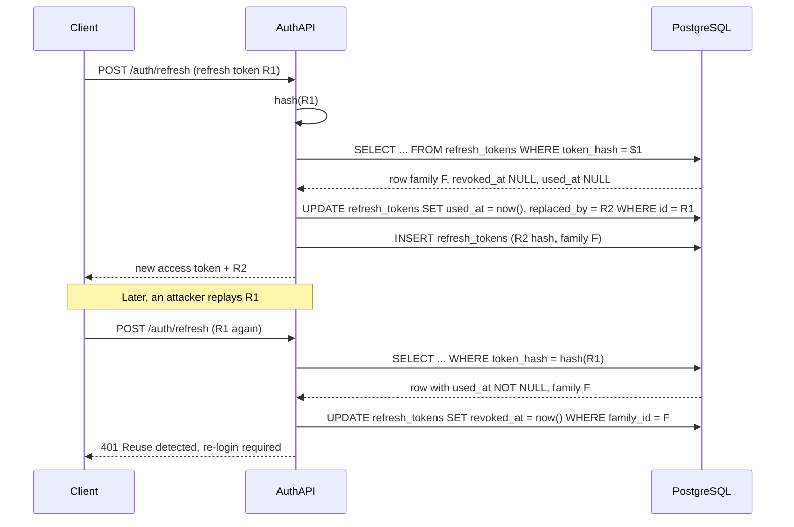

## 22.3 JSON Web Tokens (JWT)

#### Concept

A JWT is a small, self-contained credential: a JSON payload of *claims* ("this is user 42, with role customer, valid until 14:05") that is signed so that anyone with the right key can verify it was issued by your server and has not been changed. Because the token carries its own proof, the server that receives it does not need to look anything up. It reads the claims, checks the signature and the expiry, and trusts the content.

That last sentence is both the appeal and the danger. No lookup means fast, stateless, easy to scale. No lookup also means no way to change your mind about a token once it is out in the world, until it expires.

#### Why does it exist?

Sessions require every service that authenticates a request to reach the same store. When the system is one NestJS app and one Redis, that is fine. When there are eight services, an API gateway, a mobile app and three partner integrations, a shared session store becomes a bottleneck and a coupling point. JWTs let each service validate identity locally with a public key and nothing else.

They also fit machine-to-machine and third-party access (OAuth 2.0, 22.4) where there is no browser and no cookie jar.

#### Mental model

Imagine a concert wristband. The venue puts it on you at the gate after checking your ticket. Every bar and every door inside checks the wristband, not your ticket, and they do not phone the gate to ask. The wristband is hard to forge (special print, tamper-evident), it shows what you are entitled to (VIP area, free drinks), and it stops working when the festival ends. But if security decides to throw you out, they cannot remotely deactivate the wristband. They have to find you and cut it off. And if someone steals it from you, they are you until it expires.

That is the JWT tradeoff in one picture. Everything in this section is about making the wristband short-lived and making the "find you and cut it off" path possible.

#### How it works

A JWT is three base64url-encoded parts joined by dots: `header.payload.signature`.

```json
// header
{ "alg": "RS256", "typ": "JWT", "kid": "2026-08-key-1" }
// payload (claims)
{
  "sub": "8b1e2c1a-0f7f-4a5e-9f31-6c2f2a0e0d11",
  "iss": "https://api.example.com",
  "aud": "example-api",
  "iat": 1788900000,
  "exp": 1788900900,
  "jti": "c0a9c3d2-2f0a-4c22-8e02-5c7a8c0f1f2a",
  "roles": ["customer"],
  "tenant_id": "t_9f2"
}
```

The signature is computed over `base64url(header) + "." + base64url(payload)` using the algorithm named in the header. Note that the payload is **encoded, not encrypted**. Anyone who holds the token can read every claim. Never put secrets, passwords, card numbers or personal data you would not show the user into a JWT.

**Standard claims you should always set and always verify:**

| Claim | Meaning | Why it matters |
|---|---|---|
| `iss` | Issuer | Reject tokens minted by a different auth server that happens to share a key format |
| `sub` | Subject (user id) | The principal; use a stable id, not an email |
| `aud` | Audience | A token for the payments API must not be accepted by the admin API |
| `exp` | Expiry (seconds since epoch) | Bounds the damage of a stolen token |
| `iat` | Issued at | Lets you reject tokens issued before a "revoke all" timestamp |
| `nbf` | Not before | Rarely needed; verify it if present |
| `jti` | Token id | Needed for denylists and reuse detection |

**Signing algorithms:**

| Algorithm | Type | Key | Verify cost | Use when |
|---|---|---|---|---|
| `HS256` | HMAC with SHA-256 | One shared secret | About 5 microseconds | One service issues and verifies; nobody else needs to verify |
| `RS256` | RSA signature | Private key signs, public key verifies | About 100 to 300 microseconds (2048-bit) | Many services or third parties verify; publish the public key via JWKS |
| `ES256` | ECDSA on P-256 | Private/public pair | About 50 to 100 microseconds; much smaller signatures | Same as RS256, with smaller tokens and keys |

The rule: with `HS256`, every service that can verify can also forge, because it is the same secret. The moment a second service needs to verify tokens, move to `RS256` or `ES256` and hand out only the public key.

**The `alg=none` attack.** Early JWT libraries trusted the `alg` field in the header. An attacker took a valid token, changed the header to `{"alg":"none"}`, removed the signature, edited the payload to `"roles":["admin"]`, and the library said "no signature required, looks fine". A related trick: change `RS256` to `HS256` and sign the forged token with the server's *public* key as the HMAC secret; a library that picks the verification routine from the header would then verify it with the public key and accept it. The defense in every modern library, including `jsonwebtoken` used by `@nestjs/jwt` and `passport-jwt`, is to **pin the allowed algorithms on the verifying side**: `algorithms: ['RS256']`. Never let the token tell you how to verify it.

**Expiry and clock skew.** Access tokens should live minutes, not days: 5 to 15 minutes is typical. Verification compares `exp` to the server clock. If the issuing server's clock runs 30 seconds ahead of a verifying server, brand-new tokens fail with "token not yet valid" (`nbf`/`iat` checks) or expire 30 seconds early. Libraries expose a `clockTolerance` (typically 30 to 60 seconds); set it, and run NTP on every node.

**Why you cannot revoke a JWT, and the three answers.** The verifier does not call home, so nothing you do on the server changes the outcome until `exp`. The answers, from cheapest to most complete:

1. **Short-lived access tokens plus refresh tokens.** Access token: 10 minutes, stateless. Refresh token: days or weeks, stored server-side (hashed), exchanged for a new access token at `POST /auth/refresh`. Revocation happens at the refresh step; the maximum window of a stolen access token is 10 minutes.
2. **Refresh token rotation with reuse detection.** Every refresh returns a *new* refresh token and invalidates the old one. If an old (already used) refresh token is presented again, someone has a copy: either the legitimate client replayed a request, or an attacker stole the token. Either way, revoke the whole token family and force re-login.
3. **A denylist in Redis** keyed by `jti` with TTL equal to the token's remaining life, checked on every request. This reintroduces a lookup per request, but only a `GET` that returns nothing 99.99 percent of the time. Use it for the rare "log this user out now" case (password change, account compromise) rather than for normal logout.



**Where to store the token on the client.**

| Storage | XSS risk | CSRF risk | Notes |
|---|---|---|---|
| `localStorage` / `sessionStorage` | Any injected script can read and exfiltrate the token | None (not sent automatically) | Easiest; unacceptable for high-value apps |
| In memory (JS variable) | Script can read it while the page is open; lost on reload | None | Combine with a refresh token in an HttpOnly cookie |
| `HttpOnly` cookie | Script cannot read it | Sent automatically, so CSRF defenses are required (`SameSite`, CSRF token, 22.22) | Best for browser clients |
| Native secure storage (Keychain, Keystore) | Not applicable | Not applicable | Mobile apps |

The pattern most teams settle on for browsers: access token in memory, refresh token in an `HttpOnly; Secure; SameSite=Strict` cookie scoped to `Path=/auth/refresh`. XSS cannot read the refresh token; CSRF cannot use it because `SameSite=Strict` stops cross-site sending, and even if it could, the refresh endpoint returns the access token in the response body, which the attacker's page cannot read.

#### Practical example

A ride-booking platform: a rider app, a driver app, and internal services (pricing, dispatch, payments). The auth service issues `ES256` access tokens (10 minutes) with `aud: "rider-api"` or `aud: "driver-api"` and a `roles` claim. Every service verifies with the public key fetched from `https://auth.example.com/.well-known/jwks.json` and cached for an hour. The refresh token lives in the app's secure storage and is rotated on each use. When a driver is deactivated, the auth service revokes the driver's refresh family; the driver's access token dies within 10 minutes. For the "deactivate a driver during a live safety incident" case, the driver's `jti` is added to a Redis denylist and the driver API checks it, so the cut-off is immediate.

#### NestJS example

The building blocks: `@nestjs/jwt` to sign, `@nestjs/passport` plus `passport-jwt` to verify, and a strategy that turns a verified payload into the request principal.

```ts
// auth.module.ts
import { Module } from '@nestjs/common';
import { JwtModule } from '@nestjs/jwt';
import { PassportModule } from '@nestjs/passport';
import { ConfigModule, ConfigService } from '@nestjs/config';
import { JwtStrategy } from './jwt.strategy';
import { AuthService } from './auth.service';
import { AuthController } from './auth.controller';

@Module({
  imports: [
    PassportModule.register({ defaultStrategy: 'jwt' }),
    JwtModule.registerAsync({
      imports: [ConfigModule],
      inject: [ConfigService],
      useFactory: (cfg: ConfigService) => ({
        privateKey: cfg.getOrThrow<string>('JWT_PRIVATE_KEY'), // PEM, from a secrets manager
        publicKey: cfg.getOrThrow<string>('JWT_PUBLIC_KEY'),
        signOptions: {
          algorithm: 'ES256',
          expiresIn: '10m',
          issuer: 'https://api.example.com',
          audience: 'example-api',
          keyid: cfg.getOrThrow<string>('JWT_KEY_ID'), // "kid" header for rotation
        },
      }),
    }),
  ],
  providers: [AuthService, JwtStrategy],
  controllers: [AuthController],
  exports: [AuthService],
})
export class AuthModule {}
```

```ts
// jwt.strategy.ts
import { Injectable, UnauthorizedException } from '@nestjs/common';
import { PassportStrategy } from '@nestjs/passport';
import { ExtractJwt, Strategy } from 'passport-jwt';
import { ConfigService } from '@nestjs/config';
import { UsersService } from '../users/users.service';
import { TokenDenylist } from './token-denylist';

export interface AccessTokenPayload {
  sub: string; roles: string[]; tenant_id: string; jti: string; iat: number; exp: number;
}

@Injectable()
export class JwtStrategy extends PassportStrategy(Strategy, 'jwt') {
  constructor(cfg: ConfigService, private users: UsersService, private denylist: TokenDenylist) {
    super({
      jwtFromRequest: ExtractJwt.fromAuthHeaderAsBearerToken(),
      secretOrKey: cfg.getOrThrow<string>('JWT_PUBLIC_KEY'),
      algorithms: ['ES256'],          // pin the algorithm: defeats alg=none and key confusion
      issuer: 'https://api.example.com',
      audience: 'example-api',
      ignoreExpiration: false,
      jsonWebTokenOptions: { clockTolerance: 30 }, // seconds of skew we forgive
    });
  }

  // Runs only after signature, exp, iss and aud have been verified.
  async validate(payload: AccessTokenPayload) {
    if (await this.denylist.has(payload.jti)) throw new UnauthorizedException();
    // Optional, costs one cached lookup: reject tokens issued before "revoke all" or for disabled users.
    const status = await this.users.getAuthStatus(payload.sub); // cached in Redis for 60 s
    if (!status || status.disabled || payload.iat * 1000 < status.tokensInvalidBefore.getTime()) {
      throw new UnauthorizedException();
    }
    return { id: payload.sub, roles: payload.roles, tenantId: payload.tenant_id, jti: payload.jti };
  }
}
```

Whatever `validate` returns becomes `request.user`. The strategy is used by `AuthGuard('jwt')` from `@nestjs/passport`; a thin subclass lets you add a `@Public()` bypass (shown in full in 22.37).

The refresh flow stores only a **hash** of the refresh token. If the `refresh_tokens` table leaks (backup, SQL injection, a curious DBA), the attacker gets hashes they cannot use.

```ts
// auth.service.ts (refresh part)
import { Injectable, UnauthorizedException } from '@nestjs/common';
import { JwtService } from '@nestjs/jwt';
import { InjectRepository } from '@nestjs/typeorm';
import { Repository } from 'typeorm';
import { createHash, randomBytes, randomUUID } from 'node:crypto';
import { RefreshToken } from './refresh-token.entity';

@Injectable()
export class AuthService {
  constructor(private jwt: JwtService, @InjectRepository(RefreshToken) private tokens: Repository<RefreshToken>) {}

  private hash(raw: string) { return createHash('sha256').update(raw).digest('hex'); } // fast hash is fine: token is high-entropy

  async issuePair(user: { id: string; roles: string[]; tenantId: string }, familyId = randomUUID()) {
    const raw = randomBytes(48).toString('base64url');            // 384 bits of entropy
    await this.tokens.save(this.tokens.create({
      tokenHash: this.hash(raw), userId: user.id, familyId,
      expiresAt: new Date(Date.now() + 30 * 24 * 3600 * 1000),   // 30 days
    }));
    const accessToken = await this.jwt.signAsync(
      { roles: user.roles, tenant_id: user.tenantId },
      { subject: user.id, jwtid: randomUUID() },
    );
    return { accessToken, refreshToken: raw };
  }

  async refresh(raw: string) {
    const row = await this.tokens.findOne({ where: { tokenHash: this.hash(raw) }, relations: { user: true } });
    if (!row || row.expiresAt < new Date()) throw new UnauthorizedException();
    if (row.usedAt || row.revokedAt) {
      // Reuse detected: revoke the whole family, force re-login on every device sharing it.
      await this.tokens.update({ familyId: row.familyId }, { revokedAt: new Date() });
      throw new UnauthorizedException('Refresh token reuse detected');
    }
    await this.tokens.update({ id: row.id }, { usedAt: new Date() });
    return this.issuePair({ id: row.user.id, roles: row.user.roleNames(), tenantId: row.user.tenantId }, row.familyId);
  }
}
```

One subtle race remains: two legitimate refresh requests in flight at the same time (a mobile app with two tabs) will trigger reuse detection for the second one. Mitigate by making the `UPDATE ... SET used_at` conditional (`WHERE used_at IS NULL`) and checking the affected row count, and by allowing a short grace window (for example 10 seconds after `used_at`) during which the *same* replacement token is returned again. The complete module in 22.37 includes this.

#### PostgreSQL example

```sql
CREATE TABLE refresh_tokens (
  id          uuid PRIMARY KEY DEFAULT gen_random_uuid(),
  token_hash  text NOT NULL UNIQUE,          -- sha256 hex of the raw token
  user_id     uuid NOT NULL REFERENCES users(id) ON DELETE CASCADE,
  family_id   uuid NOT NULL,                 -- all rotations of one login share a family
  created_at  timestamptz NOT NULL DEFAULT now(),
  expires_at  timestamptz NOT NULL,
  used_at     timestamptz,                   -- set on rotation
  revoked_at  timestamptz,                   -- set on logout or reuse detection
  replaced_by uuid REFERENCES refresh_tokens(id),
  user_agent  text,
  ip          inet
);

-- Revoke a family on reuse; list a user's live tokens; purge expired.
CREATE INDEX refresh_tokens_family_idx ON refresh_tokens (family_id);
CREATE INDEX refresh_tokens_user_live_idx ON refresh_tokens (user_id)
  WHERE revoked_at IS NULL AND used_at IS NULL;
CREATE INDEX refresh_tokens_expires_idx ON refresh_tokens (expires_at);

-- The refresh lookup is a single unique-index probe:
EXPLAIN (ANALYZE, BUFFERS)
SELECT id, user_id, family_id, used_at, revoked_at, expires_at
FROM refresh_tokens WHERE token_hash = 'e3b0c442...';
```

```text
Index Scan using refresh_tokens_token_hash_key on refresh_tokens
  (cost=0.42..8.44 rows=1 width=88) (actual time=0.031..0.032 rows=1 loops=1)
  Index Cond: (token_hash = 'e3b0c442...'::text)
  Buffers: shared hit=4
Planning Time: 0.090 ms
Execution Time: 0.052 ms
```

The `users` table should carry a `tokens_invalid_before timestamptz` column. Setting it to `now()` on password change or "log out everywhere" invalidates every access token issued earlier, provided the strategy compares `iat` against it (as in the `validate` method above). It is a cheap, coarse revocation that costs one cached read.

#### Sequelize example

The same reuse detection with Sequelize, using a transaction and a row lock so that two concurrent refreshes with the same token cannot both succeed.

```ts
async refresh(raw: string) {
  const tokenHash = sha256(raw);
  return this.sequelize.transaction(async (t) => {
    const row = await RefreshToken.findOne({
      where: { tokenHash },
      lock: t.LOCK.UPDATE,        // SELECT ... FOR UPDATE: serialises concurrent refreshes
      transaction: t,
    });
    if (!row || row.expiresAt < new Date()) throw new UnauthorizedException();
    if (row.usedAt || row.revokedAt) {
      await RefreshToken.update({ revokedAt: new Date() }, { where: { familyId: row.familyId }, transaction: t });
      throw new UnauthorizedException('Refresh token reuse detected');
    }
    await row.update({ usedAt: new Date() }, { transaction: t });
    return this.issuePair(row.userId, row.familyId, t);
  });
}
```

#### Production scenario

A SaaS API at 4,000 requests per second. Each request verifies an `ES256` token: about 80 microseconds of CPU, so 0.3 CPU-seconds per second across the fleet, negligible. Refreshes arrive at roughly 4,000 / (10 minutes of token life / average session) which works out to about 7 per second, each costing two small PostgreSQL writes. The `refresh_tokens` table grows by about 600,000 rows a day; a nightly job deletes rows where `expires_at < now() - interval '7 days'`, keeping it under 25 million rows. The Redis denylist holds a few hundred entries at any time.

Key rotation: the auth service generates a new key pair monthly. The JWKS endpoint serves both the new and previous public keys, each with its `kid`. Tokens are signed with the new key; verifiers pick the key by `kid`. After the longest access-token lifetime plus a safety margin (one hour), the old key is removed from the JWKS. Verifiers cache JWKS for an hour but refresh immediately on an unknown `kid`, with a rate limit so an attacker cannot force JWKS fetches by sending random `kid` values.

#### Failure scenario

At 09:03 the payments service started rejecting 100 percent of requests with 401. The auth team had rotated the signing key at 09:00 and, to be tidy, removed the old key from JWKS at the same moment. Every access token in circulation (issued up to 10 minutes earlier) now referenced a `kid` that no longer existed. The payments service's JWKS cache refreshed, found no matching key, and rejected everything. Users saw "session expired" and their clients hit `/auth/refresh` all at once: a retry storm of 40,000 refreshes in one minute against a table designed for 7 per second. PostgreSQL held, but p99 latency on refresh went to 4 seconds and several mobile clients gave up and forced re-login.

Two lessons. Old keys stay in JWKS for at least one full token lifetime. And refresh endpoints need their own rate limiting and connection pool budget, because they are the thing everything falls back to.

#### Edge cases & failure modes

- **Token replay within its lifetime**: a captured access token works until `exp`. Keep lifetimes short and bind tokens to TLS where possible (mTLS or DPoP for high-value APIs).
- **Refresh token theft**: rotation with reuse detection bounds the damage to one refresh; whoever refreshes second triggers family revocation.
- **Legitimate double refresh**: two tabs, one token. Use a conditional update plus a short grace window.
- **Clock skew**: tokens rejected as "not yet valid" or expiring early. Set `clockTolerance`, run NTP, alert on skew.
- **JWKS rotation removing keys too early**: keep old keys for at least the token lifetime.
- **JWKS endpoint down**: verifiers must cache keys with a long stale-while-revalidate window; never fail open.
- **Huge tokens**: a `roles` claim with 400 permissions pushes the token past 8 KB and past header-size limits on some proxies. Put permission *versions* or a role id in the token, not the full list.
- **Deleted or disabled user with a valid token**: verify status on each request from a short-lived cache, or accept a 10-minute window and document it.
- **`aud` not checked**: a token for the public API accepted by the admin API.
- **`iss` not checked**: tokens from staging accepted in production because both share a key format (or, worse, a key).
- **Secrets in the payload**: claims are readable by anyone with the token.

#### How a Senior Backend Engineer thinks about this

The senior engineer asks: *what is the blast radius of a stolen token, and how long does it last?* Every design decision follows from that: short `exp`, rotation, denylist for emergencies, hashed storage of refresh tokens, `aud` per API. They pick `ES256` over `HS256` as soon as a second verifier exists, and they build key rotation before they need it, because rotating for the first time during an incident is how outages happen. They refuse to put anything in a token they would not print on a receipt.

To a product manager: "When you press 'deactivate this account', the app is locked out within ten minutes in the normal case and immediately in the emergency case. Making every case immediate would cost a database lookup on every request; here is what that costs and why we chose the hybrid."

#### Common mistakes

- Verifying with the algorithm named in the token header instead of pinning it.
- One long-lived access token (30 days) and no refresh flow.
- Storing raw refresh tokens in the database.
- Storing the access token in `localStorage` on a site that renders any user-generated content.
- Putting the whole user object, including email and address, into the token.
- Not setting or not verifying `aud` and `iss`.
- Rotating keys by replacing rather than by overlapping.
- Using the same key pair in staging and production.
- Treating logout as "delete the token on the client" only, with no server-side revocation of the refresh token.

#### Interview questions

1. *Why can't you revoke a JWT, and what are the practical answers?* Expected: no lookup during verification; short expiry plus refresh rotation, reuse detection, denylist for emergencies. Follow-up: what does the denylist cost per request?
2. *Explain the `alg=none` and key-confusion attacks and the single configuration that prevents both.* Expected: pin `algorithms` on the verifier.
3. *HS256 or RS256/ES256 for a system with three services?* Expected: asymmetric, because a shared HMAC secret lets any verifier forge. Follow-up: how do you rotate the key without downtime?
4. *Where do you store the token in a browser SPA and why?* Expected: access token in memory, refresh token in HttpOnly SameSite cookie; discuss XSS vs CSRF.
5. *Describe refresh token rotation with reuse detection. What is the race condition and how do you handle it?*
6. *A user's role changes. When does the API notice?* Expected: at next token issue; sooner with a status cache or version claim.
7. *What is `clockTolerance` and why would a 30-second skew take down authentication?*

#### Practical exercise

Build the refresh flow: `POST /auth/login` returns an access token (10 minutes, `ES256`) and a refresh token (raw, 48 random bytes); `POST /auth/refresh` rotates; the database stores only hashes. Write tests for: normal rotation; replay of a used refresh token revokes the whole family; a token with `alg` changed to `none` is rejected; a token signed with the wrong key is rejected; a token with `aud: "other-api"` is rejected; a token 20 seconds past expiry is accepted with `clockTolerance: 30` and rejected at 40 seconds. Acceptance criteria: all tests pass, and no raw refresh token ever appears in a log line or a database column.
