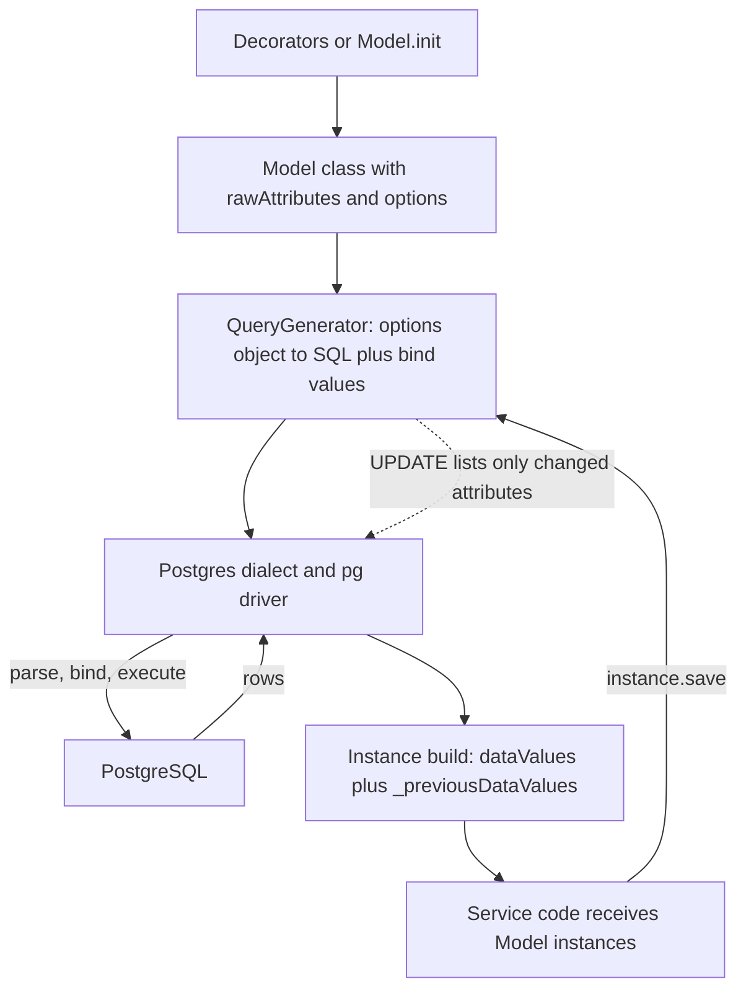
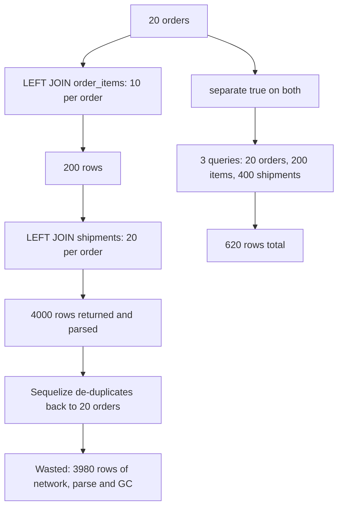

## 22.15 Sequelize models

#### Concept

A Sequelize **model** is a class that describes one table and doubles as the API for querying it. Where TypeORM separates the entity (data) from the repository (behaviour) — the Data Mapper pattern — Sequelize puts both on the same class: `Product.findAll()` is a static method, and `product.save()` is an instance method that writes the row it came from. That is the Active Record pattern, and every design difference between the two ORMs follows from it.

There are two ways to declare a model, and a NestJS codebase almost always uses the second:

- **`Model.init(attributes, options)`** — the native Sequelize API. Explicit, no decorators, no `reflect-metadata`, works in plain JavaScript.
- **`sequelize-typescript` decorators** (`@Table`, `@Column`, `@HasMany`) — a wrapper library that generates the same `init` call from decorator metadata. This is what `@nestjs/sequelize` is built on; `SequelizeModule.forFeature([Product])` expects decorated classes.

Both produce the identical runtime object. Learn `init` so you can read the SQL that comes out, then write decorators because that is what the team will use.

#### Why does it exist?

Because a table has two descriptions that must not drift: the columns PostgreSQL actually has, and the shape your TypeScript code expects. The model is the second one. It tells Sequelize how to build `INSERT` statements, which attributes map to which columns, how to convert a `numeric` string into whatever your code wants, and which of the returned values changed since the row was loaded so an `UPDATE` can list only those columns.

#### Mental model

Imagine a form template in an office. The template lists every field, its allowed format, its default value, and which fields the clerk stamps automatically (date received, date updated). `Model.init` is filling in that template once, at office opening. Every later request reuses it. If the template disagrees with the actual filing cabinet, nobody notices until a filing fails.

#### How it works



1. At boot, `sequelize.define()` / `Model.init()` / the `@Table` decorator registers the model on the `Sequelize` instance under a name.
2. Attribute definitions become `Model.rawAttributes`: type, `field` (the real column name), `allowNull`, `defaultValue`, `get`, `set`, `validate`.
3. A finder call builds an options tree, the dialect's query generator turns it into SQL text with `$1`-style bind parameters, and `pg` runs it.
4. Each returned row becomes an instance: values land in `instance.dataValues`, and a copy lands in `instance._previousDataValues`. `instance.changed()` is the difference between the two. This is how Sequelize knows that `product.stock = 4; await product.save()` should emit `UPDATE products SET stock = $1, updated_at = $2 WHERE id = $3` and not rewrite all twelve columns.
5. `instance.toJSON()` returns `dataValues` plus virtual getters — which is why a model instance serialises cleanly from a NestJS controller, and also why it leaks every column you selected.

#### Sequelize example

The `Model.init` form first, because it shows what the decorators generate.

```ts
// src/products/product.model.ts (native init style)
import { DataTypes, Model, InferAttributes, InferCreationAttributes, CreationOptional, Sequelize } from 'sequelize';

export class Product extends Model<InferAttributes<Product>, InferCreationAttributes<Product>> {
  declare id: CreationOptional<string>;
  declare sku: string;
  declare name: string;
  declare price: string;          // numeric(12,2) arrives as a string; keep it one
  declare stock: number;
  declare attributes: Record<string, unknown>;
  declare status: 'ACTIVE' | 'ARCHIVED';
  declare version: CreationOptional<number>;
  declare createdAt: CreationOptional<Date>;
  declare updatedAt: CreationOptional<Date>;
  declare deletedAt: CreationOptional<Date | null>;
  declare readonly inStock: boolean;   // VIRTUAL, no column
}

export function initProduct(sequelize: Sequelize): void {
  Product.init(
    {
      id:     { type: DataTypes.UUID, defaultValue: DataTypes.UUIDV4, primaryKey: true },
      sku:    { type: DataTypes.TEXT, allowNull: false, unique: true },
      name:   { type: DataTypes.TEXT, allowNull: false },
      price:  { type: DataTypes.DECIMAL(12, 2), allowNull: false },
      stock:  { type: DataTypes.INTEGER, allowNull: false, defaultValue: 0 },
      attributes: { type: DataTypes.JSONB, allowNull: false, defaultValue: {} },
      status: { type: DataTypes.ENUM('ACTIVE', 'ARCHIVED'), allowNull: false, defaultValue: 'ACTIVE' },
      version: { type: DataTypes.INTEGER, allowNull: false, defaultValue: 0 },
      createdAt: DataTypes.DATE,
      updatedAt: DataTypes.DATE,
      deletedAt: DataTypes.DATE,
      inStock: {
        type: DataTypes.VIRTUAL(DataTypes.BOOLEAN, ['stock']),   // declare the columns it reads
        get(this: Product) { return this.getDataValue('stock') > 0; },
      },
    },
    {
      sequelize,
      tableName: 'products',
      underscored: true,   // camelCase attributes map to snake_case columns
      timestamps: true,    // manage created_at / updated_at
      paranoid: true,      // soft delete via deleted_at
      version: true,       // optimistic locking on the version column
    },
  );
}
```

And the `sequelize-typescript` form that `@nestjs/sequelize` consumes. Same table, same SQL.

```ts
// src/products/product.model.ts (decorator style)
import {
  Table, Column, Model, DataType, Default, AllowNull, Unique, PrimaryKey,
  CreatedAt, UpdatedAt, DeletedAt, HasMany, BelongsToMany,
} from 'sequelize-typescript';

@Table({ tableName: 'products', underscored: true, timestamps: true, paranoid: true, version: true })
export class Product extends Model<Product> {
  @PrimaryKey @Default(DataType.UUIDV4) @Column(DataType.UUID) id: string;

  @Unique @AllowNull(false) @Column(DataType.TEXT) sku: string;
  @AllowNull(false) @Column(DataType.TEXT) name: string;

  /** DECIMAL comes back as a string from pg. Do not "fix" it with parseFloat. */
  @AllowNull(false) @Column(DataType.DECIMAL(12, 2)) price: string;

  @Default(0) @AllowNull(false) @Column(DataType.INTEGER) stock: number;
  @Default({}) @AllowNull(false) @Column(DataType.JSONB) attributes: Record<string, unknown>;
  @Default('ACTIVE') @Column(DataType.ENUM('ACTIVE', 'ARCHIVED')) status: 'ACTIVE' | 'ARCHIVED';

  @Column({ type: DataType.VIRTUAL(DataType.BOOLEAN, ['stock']), get(this: Product) { return this.getDataValue('stock') > 0; } })
  inStock: boolean;

  @CreatedAt createdAt: Date;
  @UpdatedAt updatedAt: Date;
  @DeletedAt deletedAt: Date | null;

  @HasMany(() => OrderItem, { foreignKey: 'productId', as: 'orderItems' }) orderItems: OrderItem[];
  @BelongsToMany(() => Tag, { through: 'product_tags', foreignKey: 'productId', otherKey: 'tagId', as: 'tags' }) tags: Tag[];
}
```

#### PostgreSQL example

The mapping from `DataTypes` to real PostgreSQL types is where most schema surprises begin. Sequelize will happily create a column type you did not intend.

| `DataTypes` | PostgreSQL column | What comes back to Node | Notes |
|---|---|---|---|
| `STRING` | `character varying(255)` | `string` | The default 255 is arbitrary; `STRING(1000)` or `TEXT` is usually what you want. In PostgreSQL `text` and `varchar` perform identically. |
| `TEXT` | `text` | `string` | Prefer this. |
| `CITEXT` | `citext` | `string` | Needs `CREATE EXTENSION citext`. Good for emails. |
| `INTEGER` | `integer` | `number` | |
| `BIGINT` | `bigint` | **`string`** | `pg` cannot represent 2^53+ safely. Money in cents hits this. |
| `DECIMAL(12,2)` | `numeric(12,2)` | **`string`** | The single most common money bug. See section 22.25. |
| `FLOAT` / `DOUBLE` | `double precision` | `number` | Never for money. |
| `BOOLEAN` | `boolean` | `boolean` | |
| `DATE` | `timestamp with time zone` | `Date` | Sequelize's `DATE` is a timestamp, not a calendar date. |
| `DATEONLY` | `date` | **`string`** `'2026-09-09'` | No timezone. Correct for birthdays and invoice dates. |
| `UUID` | `uuid` | `string` | Pair with `defaultValue: DataTypes.UUIDV4` or a database `gen_random_uuid()`. |
| `JSON` / `JSONB` | `json` / `jsonb` | parsed object | Always `JSONB` unless you need to preserve key order. |
| `ENUM('A','B')` | native `enum` type | `string` | Creates `enum_products_status`. Changing it later is painful; see 22.25. |
| `ARRAY(DataTypes.TEXT)` | `text[]` | `string[]` | PostgreSQL only. |
| `BLOB` | `bytea` | `Buffer` | Store files in object storage, not here. |
| `RANGE(DataTypes.DATE)` | `tstzrange` | `[Date, Date]` | Pairs with exclusion constraints for booking systems. |
| `VIRTUAL` | *no column* | computed | Cannot appear in `WHERE` or `ORDER BY`. |

`underscored: true` is the option that makes the model match the DDL written in section 22.1. It converts every attribute name to snake_case for the `field`, converts the timestamp columns to `created_at` / `updated_at` / `deleted_at`, and — importantly — converts *generated foreign keys* too, so `Order.belongsTo(Customer)` produces `customer_id` rather than `customerId`. Set it once in `define` at the root module so no model can forget it:

```ts
SequelizeModule.forRootAsync({
  inject: [ConfigService],
  useFactory: (config: ConfigService) => ({
    dialect: 'postgres',
    uri: config.getOrThrow<string>('DATABASE_URL'),
    autoLoadModels: true,
    synchronize: false,                                  // never true; see 14.20
    define: { underscored: true, timestamps: true },     // team-wide default
    pool: { max: 20, min: 2, acquire: 10_000, idle: 30_000 },
    logging: (sql, timingMs) => logger.debug({ sql, timingMs }),
    benchmark: true,
  }),
});
```

**Soft delete with `paranoid: true`.** `paranoid` requires `timestamps: true`. With it on, `instance.destroy()` runs `UPDATE products SET deleted_at = now() WHERE id = $1`, every finder adds `AND deleted_at IS NULL`, `instance.restore()` clears it, and `destroy({ force: true })` does a real `DELETE`. To read deleted rows pass `paranoid: false` in the query options. The trap: a **unique constraint does not know about soft deletes**. Soft-delete the product with `sku = 'ABC-1'` and the next `INSERT` with that SKU fails with `23505` even though no visible row holds it. The fix is a partial unique index that only covers live rows:

```sql
-- Replace the plain UNIQUE with a partial index so soft-deleted SKUs can be reused
ALTER TABLE products DROP CONSTRAINT products_sku_key;
CREATE UNIQUE INDEX products_sku_live_idx ON products (sku) WHERE deleted_at IS NULL;
```

**Optimistic locking with `version: true`.** This is the one place Sequelize does more than TypeORM. With `version: true`, an instance `save()` or `update()` emits the check *and* the increment in one statement:

```sql
UPDATE products SET stock = $1, version = $2, updated_at = $3
WHERE id = $4 AND version = $5;
```

If zero rows match, Sequelize throws `OptimisticLockError` instead of silently doing nothing. Compare with TypeORM's `@VersionColumn`, which increments but does not add the `WHERE` guard (Part 21, section 21.9) — there you must write the conditional `UPDATE` yourself. Two caveats: the check only applies to **instance** methods, so `Product.update({...}, { where: {...} })` bypasses it entirely, and the column must be `NOT NULL DEFAULT 0` in the database or the first update compares against `NULL` and matches nothing.

```ts
const product = await this.productModel.findByPk(id);            // version = 7 loaded
product.stock -= dto.qty;
try {
  await product.save();                                          // ... AND version = 7
} catch (err) {
  if (err instanceof OptimisticLockError) throw new ConflictException('Product changed, retry');
  throw err;
}
```

**Getters and setters.** A column definition may carry `get()` and `set()`. Inside them you must use `getDataValue` / `setDataValue`; calling `this.get('price')` from the getter for `price` recurses until the stack overflows.

```ts
@Column({
  type: DataType.BIGINT,                                  // returned as a string by pg
  get(this: Order) {
    const raw = this.getDataValue('totalCents');
    return raw === null ? null : Number(raw);             // safe below 2^53 cents (about 90 trillion)
  },
})
totalCents: number;

@Column({
  type: DataType.CITEXT,
  set(this: Customer, value: string) { this.setDataValue('email', value.trim().toLowerCase()); },
})
email: string;
```

Setters run on assignment and on `Model.create()`, but **not** on `Model.update()`, `bulkCreate` with `ignoreDuplicates`, or raw SQL. Same lesson as TypeORM's `@BeforeUpdate` (section 22.11): normalisation that must always happen belongs in a validation pipe or a database constraint, not in the model.

**`defaultScope` and why it bites.** A `defaultScope` is a set of query options merged into every finder on that model.

```ts
@DefaultScope(() => ({ where: { status: 'ACTIVE' }, attributes: { exclude: ['attributes'] } }))
@Table({ tableName: 'products', underscored: true })
export class Product extends Model<Product> { /* ... */ }
```

Now `Product.findByPk(id)` returns `null` for an archived product, and an admin screen that must show archived products silently shows nothing. Worse, `findOrCreate` and association mixins inherit it, and an included model brings its own default scope into the join (`include: [Product]` becomes `LEFT JOIN products ON ... AND products.status = 'ACTIVE'`), which quietly drops order items whose product was archived. `Product.unscoped().findByPk(id)` removes it, but only for that call and only for the top-level model — you must call `unscoped()` on each included model too.

Use `defaultScope` for things that are *never* wrong to filter (excluding a `password_hash` from `attributes`). Do not use it for business status, and never use it as a security boundary. The failure mode is silence: the query succeeds and returns the wrong rows.

#### Production scenario

A catalog service with 180,000 products serves `GET /products?q=...` at 400 requests per second. Two model-level decisions dominate its behaviour. First, `price` is `DECIMAL(12,2)` and the service does `price * 100` somewhere in a promotions helper; because `price` is a string, that expression produced `NaN` for one code path and the endpoint returned `"total": null` for 0.3% of requests for six weeks before a customer complained. Second, the model had `defaultScope: { where: { status: 'ACTIVE' } }`, and the reindex job — which reads through the same model — never indexed archived products, so archived products stayed searchable forever because nothing ever deleted them from the search index. Both bugs are model configuration, not query code.

#### Edge cases & failure modes

- `timestamps: true` with a table that has no `created_at` / `updated_at` produces `column "created_at" does not exist` on the first insert. Match the model to the DDL, not the other way round.
- `underscored: true` on some models and not others gives you a schema with both `customer_id` and `customerId` columns.
- `paranoid: true` plus a `UNIQUE` constraint blocks re-creation of soft-deleted rows; use a partial unique index.
- `paranoid` does not cascade: soft-deleting an order leaves its items visible, and `ON DELETE CASCADE` never fires because no row is deleted.
- `DataTypes.DATE` is a timestamp; `DataTypes.DATEONLY` is the calendar date. Choosing `DATE` for a birthday introduces timezone shifts at midnight.
- Virtual fields cannot be used in `where`, `order` or `group`; the SQL has no such column. Sorting by a virtual means sorting in JavaScript after loading everything.
- A `VIRTUAL` without its dependency array returns `undefined` whenever the query used `attributes` to select a subset.
- `version: true` on a column that is nullable makes every update a no-op that throws `OptimisticLockError`.

#### How a Senior Backend Engineer thinks about this

They write the DDL first and make the model describe it, because PostgreSQL enforces and the model only asks. They set `underscored` and `timestamps` globally in `define` so the team cannot drift. They treat `DECIMAL` and `BIGINT` as strings all the way to the JSON boundary and convert exactly once, deliberately. They allow `defaultScope` only for column exclusion, never for row filtering, and they can name the two lines of SQL each model option adds.

#### Common mistakes

- `parseFloat(product.price)` for money.
- `defaultScope` for tenant or status filtering, which fails open the moment someone calls `unscoped()` or joins the model.
- Relying on setters for normalisation and then using `Model.update()` everywhere.
- Leaving `DataTypes.STRING` (varchar(255)) on a field that will hold longer text.

#### Interview questions

1. *What is the difference between Active Record and Data Mapper, and which one is Sequelize?* Expected: Active Record puts persistence on the model class; Sequelize is Active Record, TypeORM is (mostly) Data Mapper. Why it matters: it explains why Sequelize models are hard to unit test without a database.
2. *Why does `product.price` come back as a string, and what should you do about it?* Expected: `numeric` exceeds JavaScript's safe double range; keep it a string or use a decimal library; convert at the boundary.
3. *What exactly does `paranoid: true` change, and what does it break?* Expected: `destroy` becomes an `UPDATE`, finders add `deleted_at IS NULL`; breaks unique constraints and database cascades.
4. *How does Sequelize's `version: true` differ from TypeORM's `@VersionColumn`?* Expected: Sequelize adds the `WHERE version = n` guard and throws `OptimisticLockError`; TypeORM only increments.
5. *Give a concrete way `defaultScope` can cause a production incident.* Expected: silent row filtering on includes and background jobs.

#### Practical exercise

Take the `products` DDL from section 22.1 and write both the `Model.init` and the decorator version of the model against it, with `underscored`, `paranoid` and `version: true`. Then write tests that prove: money round-trips without precision loss, soft delete hides the row from `findAll` but `paranoid: false` finds it, re-creating a soft-deleted SKU succeeds once you add the partial unique index, and a concurrent `save()` on a stale instance throws `OptimisticLockError`. Acceptance criteria: four passing tests against a real PostgreSQL container, and a query log showing the `AND version = $n` clause.

## 22.16 Sequelize associations

#### Concept

An association tells Sequelize how two models relate so that it can generate joins, generate foreign keys, and attach helper methods to instances. There are four: `hasOne`, `belongsTo`, `hasMany` and `belongsToMany`. The only structural question is **which table holds the foreign key**, and the answer decides which side gets which method.

- `belongsTo` — **this** model holds the foreign key. `Order.belongsTo(Customer)` puts `customer_id` on `orders`.
- `hasOne` / `hasMany` — the **other** model holds the foreign key. `Customer.hasMany(Order)` also means `customer_id` lives on `orders`.
- `belongsToMany` — a third table holds both keys. `Product.belongsToMany(Tag, { through: 'product_tags' })`.

A one-to-many is therefore declared twice, once from each side, and both declarations must agree on the foreign key.

#### Why does it exist?

Because the join condition, the column names, and the shape of the result are the same every time, and writing them by hand in every query is how mistakes get made. Once an association exists you can say `include: ['items']` instead of spelling out `LEFT JOIN order_items ON order_items.order_id = orders.id` and mapping the flat rows back into a tree.

#### Mental model

Imagine index cards in a filing box. `belongsTo` is a card that has another card's number written on it. `hasMany` is the reverse view: given a customer card, find every order card whose customer number matches. `belongsToMany` is a separate box of pairings, each slip naming one product and one tag. The physical arrangement never changes; the association is just which direction you are allowed to walk.

#### Sequelize example

The full association set for our schema, decorator style.

```ts
// src/orders/order.model.ts
@Table({ tableName: 'orders', underscored: true, timestamps: true })
export class Order extends Model<Order> {
  @PrimaryKey @Default(DataType.UUIDV4) @Column(DataType.UUID) id: string;

  @ForeignKey(() => Customer) @AllowNull(false) @Column(DataType.UUID) customerId: string;
  @BelongsTo(() => Customer, { foreignKey: 'customerId', as: 'customer' }) customer: Customer;

  @Default('CREATED') @Column(DataType.ENUM('CREATED', 'PAID', 'SHIPPED', 'CANCELLED')) status: string;
  @Default(0) @Column(DataType.BIGINT) totalCents: string;

  @HasMany(() => OrderItem, { foreignKey: 'orderId', as: 'items' }) items: OrderItem[];
}

// src/orders/order-item.model.ts
@Table({ tableName: 'order_items', underscored: true, timestamps: false })
export class OrderItem extends Model<OrderItem> {
  @PrimaryKey @Default(DataType.UUIDV4) @Column(DataType.UUID) id: string;
  @ForeignKey(() => Order) @Column(DataType.UUID) orderId: string;
  @BelongsTo(() => Order, { foreignKey: 'orderId', as: 'order' }) order: Order;
  @ForeignKey(() => Product) @Column(DataType.UUID) productId: string;
  @BelongsTo(() => Product, { foreignKey: 'productId', as: 'product' }) product: Product;
  @Column(DataType.INTEGER) qty: number;
  @Column(DataType.BIGINT) unitPriceCents: string;
}

// src/customers/customer.model.ts
@Table({ tableName: 'customers', underscored: true })
export class Customer extends Model<Customer> {
  @PrimaryKey @Default(DataType.UUIDV4) @Column(DataType.UUID) id: string;
  @Unique @Column(DataType.CITEXT) email: string;
  @HasOne(() => Address, { foreignKey: 'customerId', as: 'address' }) address: Address;
  @HasMany(() => Order, { foreignKey: 'customerId', as: 'orders' }) orders: Order[];
}
```

Many-to-many needs the `through` table, and if that table has no `created_at` you must say so:

```ts
@BelongsToMany(() => Tag, {
  through: { model: 'product_tags', timestamps: false },   // the join table has only the two keys
  foreignKey: 'productId',
  otherKey: 'tagId',
  as: 'tags',
})
tags: Tag[];
```

**Aliasing with `as`, and why it matters more than it looks.** The alias is not cosmetic. It becomes:

- the property name on the result (`order.items`, not `order.orderItems`),
- the name of every generated mixin (`order.getItems()`, `order.addItem()`, `order.setItems()`, `order.countItems()`, `order.createItem()`),
- the key you must use in `include`, and
- the table alias in the generated SQL (`LEFT JOIN "order_items" AS "items"`).

If the two sides declare different aliases, or an `include` names an alias that was not declared, Sequelize throws `OrderItem is not associated to Order!` at runtime — never at compile time. Two associations between the same pair of models (an order's `shippingAddress` and `billingAddress`, both pointing at `addresses`) are *only* distinguishable by alias, and forgetting `as` on one of them makes the second silently overwrite the first in the association registry.

```ts
@BelongsTo(() => Address, { foreignKey: 'shippingAddressId', as: 'shippingAddress' }) shippingAddress: Address;
@BelongsTo(() => Address, { foreignKey: 'billingAddressId',  as: 'billingAddress'  }) billingAddress: Address;
// include: [{ association: 'shippingAddress' }, { association: 'billingAddress' }]
```

#### How it works

`include` is Sequelize's relation loader. By default it generates a single query with `LEFT OUTER JOIN`s, selects the joined columns under prefixed aliases, and re-nests them in JavaScript.

```ts
const orders = await this.orderModel.findAll({
  where: { customerId },
  include: [{ association: 'items', include: [{ association: 'product', attributes: ['id', 'name'] }] }],
  order: [['createdAt', 'DESC']],
});
```

```sql
SELECT "Order"."id", "Order"."status", "Order"."total_cents" AS "totalCents",
       "items"."id" AS "items.id", "items"."qty" AS "items.qty",
       "items->product"."id" AS "items.product.id", "items->product"."name" AS "items.product.name"
FROM "orders" AS "Order"
LEFT OUTER JOIN "order_items" AS "items" ON "Order"."id" = "items"."order_id"
LEFT OUTER JOIN "products" AS "items->product" ON "items"."product_id" = "items->product"."id"
WHERE "Order"."customer_id" = $1
ORDER BY "Order"."created_at" DESC;
```

Note the `->` separator for nested includes and the dotted output aliases: that is Sequelize's protocol for reconstructing the tree. It de-duplicates parents by primary key, so 20 orders with 5 items each come back as 20 objects — but **100 rows crossed the wire and 100 rows were parsed**.

**`required: true` turns the LEFT JOIN into an INNER JOIN.**

```ts
include: [{ association: 'items', required: true }]   // INNER JOIN: orders with no items disappear
```

The subtle version of this rule: **putting a `where` inside an include sets `required: true` implicitly.** This one line changes the meaning of the endpoint:

```ts
// "orders with their cancelled items" -- but actually "only orders that HAVE a cancelled item"
include: [{ association: 'items', where: { status: 'CANCELLED' } }]

// what you probably meant
include: [{ association: 'items', where: { status: 'CANCELLED' }, required: false }]
```

An order-list endpoint that adds a product-name filter this way starts returning 40 orders instead of 200 and nobody can explain where the rest went. Always write `required` explicitly when an include carries a `where`.

#### The row explosion, and `separate: true`

A join multiplies rows. Two `hasMany` includes at the same level multiply against each other, which is the difference between a fast endpoint and an outage.



`separate: true` is Sequelize's answer, available on `hasMany` includes only. Instead of joining, it runs the include as its own query:

```ts
const orders = await this.orderModel.findAll({
  where: { customerId },
  include: [
    { association: 'items', separate: true },
    { association: 'shipments', separate: true },
  ],
  limit: 20,
});
```

```text
SELECT ... FROM "orders" AS "Order" WHERE "customer_id" = $1 LIMIT 20
SELECT ... FROM "order_items" AS "OrderItem" WHERE "OrderItem"."order_id" IN ($1,$2,...,$20)
SELECT ... FROM "shipments" AS "Shipment" WHERE "Shipment"."order_id" IN ($1,$2,...,$20)
```

Three round trips instead of one, but 620 rows instead of 4,000, and no cartesian blow-up as you add includes. It also unlocks `limit` and `order` *inside* the include, which a join cannot express:

```ts
{ association: 'items', separate: true, limit: 3, order: [['unitPriceCents', 'DESC']] }
```

**The cost you must know.** With `separate: true` and **no** `limit`, Sequelize issues **one** extra query for the whole parent set, batched with `IN`. With `separate: true` **and** a `limit` inside the include, it cannot express "top 3 per parent" in one statement, so it issues **one query per parent** — 20 parents means 20 queries. That is an N+1 you asked for. It is still often the right trade (20 fast indexed queries beat 4,000 rows), but you must see it in the log and decide, not discover it at 400 requests per second. The alternative for "top N per parent" is a raw SQL lateral join or a window function (Part 18, section 18.4).

#### The `limit` + `include` trap and `subQuery: false`

When you combine `limit` with a `hasMany` include, Sequelize does something clever: it wraps the parent table in a subquery so the limit counts *parents*, not joined rows.

```sql
SELECT "Order".*, "items"."id" AS "items.id", ...
FROM (
  SELECT "Order"."id", "Order"."status" FROM "orders" AS "Order"
  WHERE "Order"."customer_id" = $1 ORDER BY "Order"."created_at" DESC LIMIT 20
) AS "Order"
LEFT OUTER JOIN "order_items" AS "items" ON "Order"."id" = "items"."order_id"
ORDER BY "Order"."created_at" DESC;
```

That is correct: 20 orders with all their items. But the inner subquery only selects columns from `orders`, so the moment you filter or sort by a joined column you get `column "product.name" does not exist`. The internet's answer is `subQuery: false`, and it *does* remove the error — by removing the subquery:

```sql
SELECT ... FROM "orders" AS "Order"
LEFT OUTER JOIN "order_items" AS "items" ON ...
LEFT OUTER JOIN "products" AS "items->product" ON ...
WHERE "Order"."customer_id" = $1 AND "items->product"."name" ILIKE $2
ORDER BY "Order"."created_at" DESC
LIMIT 20;                                  -- 20 JOINED ROWS, not 20 orders
```

Now `LIMIT 20` counts joined rows. Twenty rows might be four orders. The API returns "page 1 of 12" with 4 items on it, the next page overlaps, and pagination is broken in a way that only shows up for orders with many items. This is exactly the TypeORM `take` + join bug from section 22.5.3, with a different spelling.

The safe patterns, in order of preference:

1. **Paginate the parents alone, then load children separately.** `findAll({ where, limit, offset })` for orders, then `separate: true` or a second batched query for items. Predictable counts, predictable SQL.
2. **Filter on a joined column with a `WHERE ... IN (subquery)`** so the join is not needed for the limit: `where: { id: { [Op.in]: literal('(SELECT order_id FROM order_items WHERE ...)') } }` — parameterise carefully.
3. **`subQuery: false` only with `belongsTo`/`hasOne` includes**, where the join cannot multiply rows and `LIMIT` on joined rows equals `LIMIT` on parents.
4. **Raw SQL** when the query genuinely needs "20 parents ordered by a child aggregate".

#### Edge cases & failure modes

- `include` with `attributes: []` on a `belongsToMany` still selects the through-table row; use `through: { attributes: [] }` to drop it.
- A `belongsToMany` `include` returns the join row under the through model's name (`product.product_tags` or your alias); serialising it leaks join metadata into the API response.
- `include` plus `group` produces SQL where the joined columns are not in the `GROUP BY`; PostgreSQL rejects it with `column must appear in the GROUP BY clause`.
- Association mixins (`order.getItems()`) are lazy and per instance: calling them in a loop is N+1 (section 22.21).
- `hasMany` with `onDelete: 'CASCADE'` in the association options only affects the FK that `sync()` would create; if the schema came from migrations, the association option is decorative. Check `information_schema.referential_constraints` for the truth.
- Self-referencing associations (`Category.hasMany(Category, { as: 'children', foreignKey: 'parentId' })`) work for one level; recursive trees need a recursive CTE.
- Two `separate: true` includes plus a nested `separate` inside one of them multiply query counts; log and count.

#### How a Senior Backend Engineer thinks about this

They decide loading strategy per endpoint from the shape of the data: one-to-one and small collections join, large or multiple collections go `separate: true`, and anything with `limit` plus a child filter gets written as explicit SQL. They always pass `required` explicitly. They read the generated SQL for every new `include` before merging, because `include` is the single line most likely to turn a 5 ms endpoint into a 5 second one.

#### Common mistakes

- Adding a `where` to an include and not realising it became an INNER JOIN.
- Reaching for `subQuery: false` to silence an error, and breaking pagination.
- Nesting three `hasMany` includes in one query and blaming PostgreSQL for the latency.
- Omitting `as` and then fighting `X is not associated to Y!`.
- Trusting association-level `onDelete` on a migration-managed schema.

#### Interview questions

1. *Which side of a one-to-many holds the foreign key, and how do `hasMany` and `belongsTo` reflect that?* Expected: the "many" side; `belongsTo` is declared on the FK holder.
2. *What SQL does `required: true` change, and when does Sequelize set it for you?* Expected: LEFT to INNER; implicitly whenever the include has a `where`.
3. *Explain `separate: true`: what it saves and what it costs.* Expected: avoids row multiplication; one extra batched query, or one query per parent when the include has a `limit`.
4. *Why does `limit` with a `hasMany` include produce a subquery, and what breaks when you disable it?* Expected: the limit must count parents; `subQuery: false` makes it count joined rows, breaking pagination.
5. *You must return the 20 newest orders, each with its 3 most expensive items. How?* Expected: paginate parents, then `separate: true` with `limit` and `order` (accepting N queries), or one raw SQL statement with `ROW_NUMBER()` or `LATERAL`.

#### Practical exercise

Seed 200 orders, each with 8 items and 3 shipments. Write the endpoint three ways: one query with two joined includes, one query with two `separate: true` includes, and parent pagination plus manual batched loads. Log rows returned, statements issued and wall time for each. Then add a filter on the product name and observe what `subQuery: false` does to the returned order count. Acceptance criteria: a table of the three measurements, and a written rule for when your team uses each.
