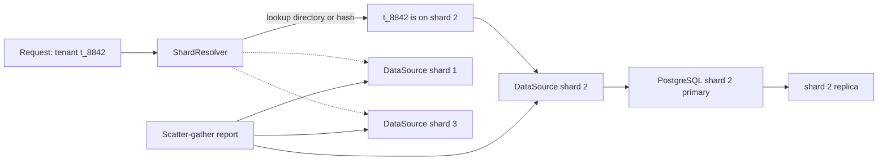

## 22.8 Sharding

#### Concept

Sharding is splitting the rows of a table (usually all the tables of a domain) across several independent databases, each holding a subset of the data. Each database is a *shard*. A rule, the *shard key*, decides which shard owns a given row. The application (or a middleware such as Citus) routes each query to the shard that holds the data. Unlike partitioning, the shards do not share a server, a transaction manager, or a query planner. Cross-shard joins, cross-shard transactions and cross-shard uniqueness are not free; they are things you build, badly, yourself.

Sharding is the last rung of the ladder because it is the only rung that changes how every feature is written from then on.

#### Why does it exist?

One machine has a ceiling on write throughput (WAL fsync, one set of CPUs, one set of disks) and on manageable data size (backup and restore time, vacuum duration). Read replicas cannot raise the write ceiling. Partitioning cannot either, because all partitions live on the same server. When the write curve says you will cross the ceiling within your planning horizon, or when the dataset has become too large to restore in an acceptable time, splitting the data across machines is the remaining option.

#### Mental model

Imagine a bank that has grown too large for one vault. It opens regional vaults and assigns every customer to exactly one region by the first letter of their surname. A customer's statement is now fast: one vault. But "total deposits across the bank" requires asking every vault and adding up. A transfer between two customers in different regions requires a protocol between two vaults, with all the ways that can half-fail. And when the "S" vault fills up because too many surnames start with S, splitting it means physically moving boxes to a new vault while customers keep depositing. Every one of those problems is what sharding costs.

#### How it works

1. **Choose the shard key.** The column whose value determines the shard. Almost always a tenant or user identifier, because almost all queries in a SaaS or consumer product are scoped to one tenant or user. Section 22.9 is entirely about this choice.
2. **Choose the mapping.** *Hash*: `shard = hash(key) % N` spreads evenly but makes adding a shard reshuffle almost everything (consistent hashing fixes that; section 22.11). *Range*: `key in [A, M)` goes to shard 1; easy to split, prone to hot ranges. *Directory*: a lookup table `tenant_id -> shard` stored in a small central database or in Redis; most flexible, adds a lookup per request (cache it), and lets you move a single tenant.
3. **Route every query.** The application resolves the shard from the request context (the authenticated tenant, the user id in the path), picks the DataSource for that shard, and runs the query there. Nothing in the request may accidentally use another shard's connection.
4. **Generate globally unique ids.** Auto-increment sequences are per shard, so `orders.id = 42` would exist on every shard. Use UUIDv7 (time-ordered, generated in the application, index-friendly) or Snowflake-style ids (timestamp + shard id + sequence). Never rely on a shard-local sequence for anything that crosses shards.
5. **Handle cross-shard reads.** Fan out to all shards and merge in the application (scatter-gather), or maintain a separate read model (a search index, a warehouse, a CQRS projection) that is fed by CDC from every shard. Reporting never runs against the shards directly.
6. **Avoid cross-shard writes.** A transaction that must update two shards is a distributed transaction. PostgreSQL supports two-phase commit (`PREPARE TRANSACTION`), but it is fragile and slow in practice. Design the domain so that a business transaction lives entirely within one shard, and use sagas with compensation (Part 30) for the rare cases that cannot.
7. **Keep reference data everywhere.** Small tables that every shard needs (countries, product categories, feature flags) are copied to every shard, or fetched from a shared service and cached.



**Citus** is the PostgreSQL-native way to shard. It is an extension that turns one PostgreSQL node into a coordinator and others into workers. You declare `create_distributed_table('orders', 'tenant_id')` and Citus places the table's shards across workers, routes queries that include `tenant_id` to a single worker, and parallelises queries that do not. Tables co-located on the same distribution column (`orders` and `order_items` both on `tenant_id`) can be joined on the worker. Reference tables are replicated to every worker. It removes most of the application-level routing but keeps the fundamental constraints: transactions and joins across distribution keys are limited, and you must design your schema around one distribution column. It is available managed on Azure (Cosmos DB for PostgreSQL) and self-hosted.

#### NestJS example

Application-level sharding with one TypeORM `DataSource` per shard, a `ShardResolver` that maps a tenant to a shard, and a request-scoped repository accessor. The directory mapping lives in a small control database and is cached in Redis.

```ts
// src/sharding/shard.config.ts
export interface ShardConfig { id: number; host: string; replicaHost?: string }

export const shardsFromEnv = (): ShardConfig[] =>
  JSON.parse(process.env.PG_SHARDS_JSON ?? '[]'); // e.g. [{"id":1,"host":"shard1.internal"}, ...]
```

```ts
// src/sharding/shard-datasources.provider.ts
import { Provider } from '@nestjs/common';
import { DataSource } from 'typeorm';
import { shardsFromEnv } from './shard.config';

export const SHARD_DATASOURCES = Symbol('SHARD_DATASOURCES');

// One DataSource per shard, all initialised at boot. Each has its own small pool.
export const shardDataSourcesProvider: Provider = {
  provide: SHARD_DATASOURCES,
  useFactory: async (): Promise<Map<number, DataSource>> => {
    const map = new Map<number, DataSource>();
    for (const shard of shardsFromEnv()) {
      const ds = new DataSource({
        type: 'postgres',
        host: shard.host,
        port: 5432,
        username: process.env.PG_USER,
        password: process.env.PG_PASSWORD,
        database: process.env.PG_DB,
        entities: [__dirname + '/../**/*.entity.js'],
        extra: { max: 5, connectionTimeoutMillis: 3000, statement_timeout: 5000 },
      });
      map.set(shard.id, await ds.initialize());
    }
    return map;
  },
};
```

```ts
// src/sharding/shard-resolver.service.ts
import { Inject, Injectable, NotFoundException } from '@nestjs/common';
import { DataSource } from 'typeorm';
import Redis from 'ioredis';
import { SHARD_DATASOURCES } from './shard-datasources.provider';

@Injectable()
export class ShardResolver {
  constructor(
    @Inject(SHARD_DATASOURCES) private readonly shards: Map<number, DataSource>,
    private readonly redis: Redis,
    private readonly control: DataSource, // small control DB holding tenant -> shard
  ) {}

  // Directory lookup with a cache. Moving a tenant means updating the directory and evicting the key.
  async shardIdFor(tenantId: string): Promise<number> {
    const cached = await this.redis.get(`shard:${tenantId}`);
    if (cached) return Number(cached);
    const [row] = await this.control.query('SELECT shard_id FROM tenant_shards WHERE tenant_id = $1', [tenantId]);
    if (!row) throw new NotFoundException(`tenant ${tenantId} has no shard`);
    await this.redis.set(`shard:${tenantId}`, String(row.shard_id), 'EX', 300);
    return row.shard_id;
  }

  async dataSourceFor(tenantId: string): Promise<DataSource> {
    const id = await this.shardIdFor(tenantId);
    const ds = this.shards.get(id);
    if (!ds) throw new Error(`shard ${id} is not configured on this pod`);
    return ds;
  }

  all(): DataSource[] { return [...this.shards.values()]; } // for scatter-gather and admin jobs only
}
```

```ts
// src/orders/orders.service.ts
import { Injectable } from '@nestjs/common';
import { ShardResolver } from '../sharding/shard-resolver.service';
import { Order } from './order.entity';
import { CreateOrderDto } from './dto/create-order.dto';
import { uuidv7 } from 'uuidv7';

@Injectable()
export class OrdersService {
  constructor(private readonly shards: ShardResolver) {}

  async create(tenantId: string, dto: CreateOrderDto): Promise<Order> {
    const ds = await this.shards.dataSourceFor(tenantId);
    // Whole business transaction on one shard: order + items + inventory for this tenant.
    return ds.transaction(async (em) => {
      const order = em.create(Order, { id: uuidv7(), tenantId, status: 'created', totalCents: dto.totalCents });
      await em.save(order);
      await em.query(
        'UPDATE inventory SET reserved = reserved + $1 WHERE tenant_id = $2 AND sku = $3 AND available - reserved >= $1',
        [dto.qty, tenantId, dto.sku],
      );
      return order;
    });
  }

  // Cross-shard report: fan out, merge. Only for admin/reporting paths, never in a user request.
  async countOrdersEverywhere(since: Date): Promise<number> {
    const counts = await Promise.all(
      this.shards.all().map((ds) =>
        ds.query('SELECT count(*)::int AS c FROM orders WHERE created_at >= $1', [since]).then((r) => r[0].c as number),
      ),
    );
    return counts.reduce((a, b) => a + b, 0);
  }
}
```

The guard rail: every entity carries `tenant_id`, every query includes it, and the resolver is the *only* way to obtain a DataSource in request code. A lint rule or a code review checklist enforces that nobody injects a shard DataSource directly.

#### PostgreSQL example

The control database and a Citus alternative for comparison.

```sql
-- Control database: the directory. Tiny, heavily cached, replicated for safety.
CREATE TABLE tenant_shards (
  tenant_id   text PRIMARY KEY,
  shard_id    int  NOT NULL,
  state       text NOT NULL DEFAULT 'active',   -- active | migrating | moved
  updated_at  timestamptz NOT NULL DEFAULT now()
);

-- On every shard: the same schema, and every business table carries tenant_id.
CREATE TABLE orders (
  id          uuid PRIMARY KEY,                  -- UUIDv7 generated by the app: globally unique
  tenant_id   text NOT NULL,
  status      text NOT NULL,
  total_cents bigint NOT NULL,
  created_at  timestamptz NOT NULL DEFAULT now()
);
CREATE INDEX orders_tenant_created_idx ON orders (tenant_id, created_at DESC);
```

```sql
-- Citus: the same domain without application-level routing.
CREATE EXTENSION citus;
SELECT create_distributed_table('orders', 'tenant_id');
SELECT create_distributed_table('order_items', 'tenant_id', colocate_with := 'orders');
SELECT create_reference_table('product_categories');   -- copied to every worker

-- Routed to exactly one worker because tenant_id is present:
SELECT * FROM orders o JOIN order_items i USING (tenant_id, id) WHERE o.tenant_id = 't_8842';
-- Runs in parallel across all workers, merged on the coordinator:
SELECT date_trunc('day', created_at), sum(total_cents) FROM orders GROUP BY 1;
```

#### Production scenario

A B2B SaaS with 30,000 tenants and 25,000 write TPS at peak, well past a single primary. Eight shards, each a primary plus one replica, tenant-to-shard directory in a control database with Redis cache. Each shard runs at about 3,000 write TPS, comfortably in range. The application is a NestJS fleet of 60 pods; each pod holds 8 shard pools of 5 connections plus 8 replica pools of 5, so 80 connections per pod and 4,800 total, which is why PgBouncer sits in front of every shard (section 22.12). Cross-shard reporting is done from a warehouse fed by Debezium from each shard. Global uniqueness for user emails (a user belongs to one tenant, but emails must be unique across the product) is enforced in the control database with a `user_emails(email PRIMARY KEY, tenant_id)` table written in the same request as the shard write, with a compensating delete if the shard write fails.

#### Failure scenario

"Why is there an order with id 5100234 on both shard 1 and shard 3?" A team sharded with `bigserial` ids. Each shard's sequence started at 1. Six months later a support tool that looked up orders by id alone returned the wrong tenant's order. Fixing it required a global backfill to UUIDv7 with dual-written id columns, one of the most expensive migrations the company ever ran. The rule: decide the id strategy *before* the first shard exists.

#### Edge cases & failure modes

- **Cross-shard uniqueness** (emails, usernames, coupon codes): needs a global table in a control database, or a deterministic mapping (shard by hash of the unique value itself).
- **Cross-shard transactions**: avoid; if unavoidable, saga with compensation and idempotent steps, never a home-made two-phase commit.
- **A tenant outgrows its shard**: needs a dedicated shard and a live move (section 22.11).
- **Directory unavailable**: with Redis down and the control database slow, no request can be routed. Cache the directory in process memory with a stale-while-revalidate policy; the mapping changes rarely.
- **Misrouted write**: a bug writes tenant A's row to shard B. The row is invisible to A and corrupts B's assumptions. Add a `CHECK` or a trigger on each shard that rejects rows whose `tenant_id` does not map to this shard (the shard can hold a copy of its own tenant list), and an audit job that scans for strays.
- **Schema drift between shards**: migrations must run on every shard in the same order (Part 23 covers this). A shard that missed a migration crashes the pods that reach it.
- **Re-sharding pain**: going from 8 to 12 shards with naive hashing moves 2/3 of all rows. Use consistent hashing or a directory from the start.
- **Global secondary indexes do not exist**: "find order by external payment reference" must either carry the tenant id or go through a global lookup table.

#### How a Senior Backend Engineer thinks about this

They delay sharding as long as the ladder allows, because sharding is a one-way door. When they do shard, they shard the whole domain by one key, keep transactions inside a shard, generate ids in the application, build the directory and the migration tooling before the second shard exists, and feed all reporting from CDC rather than from scatter-gather. They evaluate Citus seriously before writing a router by hand. They explain it to the product manager as: "After this, every feature must be designed around the tenant boundary. Cross-tenant features become projects, not tickets."

#### Common mistakes

- Sharding by a key that most queries do not include, so every query fans out.
- Using per-shard sequences for ids.
- Letting services hold a specific shard's DataSource instead of going through the resolver.
- Building reporting with scatter-gather in the request path.
- Sharding the database but not the caches and queues, so a hot tenant still saturates shared Redis.

#### Interview questions

1. *When would you shard and what would you try first?* Expected: only when write throughput or dataset size exceeds one machine after indexes, pooling, caching, replicas, partitioning and write offloading.
2. *How do you keep ids unique across shards?* Expected: UUIDv7 or Snowflake generated in the application; never shard-local sequences.
3. *How do you handle a query that needs data from all shards?* Expected: scatter-gather for admin paths; CDC-fed read models or a warehouse for reporting; never in the user request path.
4. *What does Citus give you and what does it not solve?* Expected: routing, co-located joins, reference tables, rebalancing; does not remove the need for a good distribution key or make cross-key transactions cheap.
5. *How do you enforce a globally unique email in a sharded system?* Expected: a global uniqueness table in a control database written in the same request, with compensation.

## 22.9 Shard keys

#### Concept

The shard key is the column (or combination) whose value decides which shard a row lives on. It is the most consequential decision in a sharded system, because every query that includes it is cheap and local, and every query that does not is expensive and global. It also decides how evenly data and load are spread, and whether business transactions can stay on one shard.

#### Why does it exist?

Without a key, there is no deterministic way to know where a row is, and every read becomes a broadcast. The key turns "somewhere in the cluster" into "exactly here".

#### Mental model

Imagine a library that has to split its collection across four buildings. Split by author's surname and "all books by Tolstoy" is one trip, but "all books about gardening" is four. Split by subject and the reverse is true. Whichever question your visitors ask most is the one your split should make cheap. If one subject is so popular that its building is always crowded while others sit empty, you chose a key with a bad distribution.

#### How it works

Criteria for choosing, in priority order:

1. **Access pattern alignment.** List the top twenty queries by frequency. The key should appear in as many of them as possible, especially in the write path. For a SaaS: `tenant_id`. For a consumer app: `user_id`. For a marketplace with buyer and seller: usually `buyer_id` for orders, and a CDC-fed seller read model, because buyers query far more often than sellers and a row can only live in one place.
2. **Transaction boundaries.** A business transaction (place order: order + items + inventory + payment record) must touch only one shard. Every table in that transaction must carry the key.
3. **Cardinality.** Many distinct values, so the data can spread across many shards. `country` (200 values, wildly skewed) is a terrible key; `user_id` (millions) is a good one.
4. **Distribution.** Load and size per key value should be roughly similar, or at least no single value should exceed what one shard can hold. A tenant that is 40% of all traffic breaks any key that lands it on a shared shard (section 22.10).
5. **Stability.** The key must not change for a row; moving rows between shards on key change is a migration, not an update. `user_id` never changes; `team_id` might, if users move teams.
6. **Availability in the request.** The key must be derivable from every request without a global lookup: from the JWT (tenant), from the path (user id), from the resource id itself (UUIDv7 with an embedded shard hint, or a Snowflake id carrying shard bits).

Comparison of common keys:

| Key | Cardinality | Alignment | Transaction locality | Typical trap |
|---|---|---|---|---|
| `tenant_id` (B2B SaaS) | Thousands to millions | Excellent, every request is tenant-scoped | Excellent | Whale tenants create hot shards |
| `user_id` (consumer) | Millions | Very good | Good, except social features that cross users | Celebrity users; cross-user feeds need a read model |
| `order_id` (hash) | Very high | Poor: "my orders" fans out | Poor: items and inventory elsewhere | Looks even, kills locality |
| `created_at` (range) | High | Good for time queries | Poor | All writes go to the newest shard: permanently hot |
| `region` / `country` | Tiny | Good for data residency | Good | Massive skew; only as a first-level split above another key |
| `product_id` | High | Good for catalog | Poor for orders | Hot products |

#### Practical example

A ride-booking platform considered `driver_id`, `rider_id` and `city_id`. Rides are written once per trip, then read by both rider and driver, and heavily by city-level dispatch. `city_id` had 300 values with three cities at 60% of traffic: rejected for skew. `driver_id` and `rider_id` each aligned with half the reads. The choice was `rider_id` for the `rides` shard key (riders read history far more than drivers do), a CDC-fed `driver_rides` read model for driver-side history, and a separate Redis-based geo index for dispatch that never touches the shards. Rides are a two-party transaction, which is exactly the kind of case that forces a read model.

#### PostgreSQL example

Encoding a shard hint into a Snowflake-style id so any service can route from the id alone, without a directory lookup.

```sql
-- 64-bit id: 41 bits ms timestamp | 10 bits shard id | 12 bits sequence.
-- Generated in the application, but the layout is documented in the database for tooling.
CREATE OR REPLACE FUNCTION shard_of(id bigint) RETURNS int
LANGUAGE sql IMMUTABLE AS $$ SELECT ((id >> 12) & 1023)::int $$;

-- Support tooling can now answer "which shard holds order 7156318204102918145?"
SELECT shard_of(7156318204102918145);   -- 3
```

#### Edge cases & failure modes

- **Key derived from mutable data** (email, team): rows must move when it changes; avoid.
- **Composite keys** (`tenant_id, region`): more complex routing and more fan-out for tenant-only queries; use only when residency laws require it.
- **Low-cardinality prefix**: hashing `country + user_id` still spreads well, but range-splitting on it creates hot ranges.
- **Key missing from a table**: `order_items` without `tenant_id` cannot be co-located with `orders`; every table in the shard must carry the key even if it feels redundant.
- **Key in the JWT but not verified**: a client that can choose its own tenant id in a header reads another tenant's shard. The key must come from an authenticated source.

#### How a Senior Backend Engineer thinks about this

They pick the key by reading query logs, not by intuition, and they verify the distribution with `SELECT key, count(*)` and per-key request rates before committing. They design the API so the key is always available (tenant in the token, user id in the path, shard bits in the id). They write down the queries that will *not* be local and decide, for each, whether it gets a read model or a fan-out.

#### Interview questions

1. *How do you choose a shard key?* Expected: access pattern alignment, transaction locality, cardinality, distribution, stability, availability in the request.
2. *Why is `created_at` a bad shard key even though it is a great partition key?* Expected: all writes go to the newest shard; hot shard forever; partitioning shares a server so hotness is harmless there.
3. *Orders involve a buyer and a seller. Which is the key?* Expected: the side with more reads and the write transaction; the other side gets a CDC-fed read model.

## 22.10 Hot partitions and hot shards

#### Concept

A hot partition or hot shard is one that receives a disproportionate share of traffic or data, so it saturates while its siblings are idle. The cluster's capacity is then limited by its hottest member, not by the sum. It happens whenever the key's distribution is uneven: one celebrity user, one tenant that is 40% of the business, or a time-based key where "now" is always the busiest value.

#### Why does it exist?

Real-world distributions are power laws, not uniform. Ten percent of users produce ninety percent of activity; one enterprise customer can be bigger than the next thousand combined; the latest day of a time series gets all the inserts. Any static split of such a distribution will have hot spots.

#### Mental model

Imagine a supermarket with ten checkouts. If nine are labelled by surname ranges and one is "customers named Smith", the Smith lane has a permanent queue while the others are empty. Adding an eleventh lane for "customers named Jones" does not help the Smiths. You must either split the Smiths across several lanes (salting), give them their own dedicated store (dedicated shard), or stop routing by surname entirely for that group.

#### How it works

Three flavours, three sets of mitigations.

**The celebrity problem** (one key value with enormous fan-in: a user with 50 million followers, a viral product). The row itself is hot: every write to it contends on the same page and lock, and every read hits the same shard. Mitigations: cache the hot entity aggressively at the edge and in Redis; move counters out of the row into Redis or a separate counter table with **salting** (N sub-rows, `follower_count_0..N`, incremented at random and summed on read); shed non-essential writes (do not update `last_seen` on every request); rate-limit per key.

**The whale tenant** (one tenant that is 40% of traffic on a shared shard). Mitigations: a **dedicated shard** for that tenant, made possible by directory-based routing; that tenant's data is moved live (section 22.11). With hash routing you cannot do this, which is the main argument for directory routing in B2B systems.

**The hot latest partition** (time-based key: all inserts go to today's partition or the newest range shard). For *partitions* this is usually fine, because partitions share the server and the latest partition is small and cached. For *shards* it is fatal: never range-shard by time. If you must split by time for retention, do it as partitions inside each hash shard.

Detecting hotness before users do:

```sql
-- Top tenants by write volume on this shard over the last 5 minutes, from an events table.
SELECT tenant_id, count(*) AS writes
FROM order_events
WHERE occurred_at > now() - interval '5 minutes'
GROUP BY tenant_id ORDER BY writes DESC LIMIT 10;

-- Per-shard load is better read from metrics: per-shard connection count, CPU, TPS.
-- Alert on max(shard_tps) / avg(shard_tps) > 3.
```

```ts
// src/sharding/salted-counter.service.ts
import { Injectable } from '@nestjs/common';
import Redis from 'ioredis';

// Spreads increments for a hot key across N sub-keys so no single Redis key (or DB row) is contended.
@Injectable()
export class SaltedCounterService {
  private static readonly SALTS = 16;
  constructor(private readonly redis: Redis) {}

  async increment(key: string): Promise<void> {
    const salt = Math.floor(Math.random() * SaltedCounterService.SALTS);
    await this.redis.incr(`${key}:${salt}`);
  }

  async read(key: string): Promise<number> {
    const keys = Array.from({ length: SaltedCounterService.SALTS }, (_, i) => `${key}:${i}`);
    const values = await this.redis.mget(...keys);
    return values.reduce((sum, v) => sum + Number(v ?? 0), 0);
  }
}
```

#### Production scenario

A social app with 12 user shards. One creator posts a video that goes viral; 4 million likes in an hour all increment `posts.like_count` on shard 7. The shard's CPU pins at 100% on lock waits (`Lock:tuple` and `LWLock:BufferContent`), and every other user on shard 7 sees 5-second latencies. Mitigation applied in the incident: likes routed to a salted Redis counter with a background job flushing the sum to PostgreSQL every 5 seconds. Long term: like counts never written synchronously to the row; the row stores a value refreshed by the flush job.

A B2B analytics product: tenant `acme` is 38% of all events. It was moved to a dedicated shard over a weekend using the live-migration procedure in section 22.11. Its p95 improved and, more importantly, the other 4,000 tenants stopped being collateral damage during acme's month-end batch.

#### Edge cases & failure modes

- **Hot key in Redis** too: sharding the database does not shard the cache; a single hot Redis key saturates one Redis node. Salt or replicate hot keys (see Part 26 — Caching).
- **Salting breaks exact reads**: summing 16 sub-keys is not atomic; a reader may see a total mid-update. Acceptable for counters, not for balances.
- **Dedicated shard becomes a single point of failure for the biggest customer**: give it the same HA setup as the shared shards.
- **Rate limiting the hot key hurts the most valuable customer**: prefer capacity (dedicated resources) over throttling for whales; prefer throttling for abusive keys.
- **Time-based hot partition and index bloat**: the newest partition's B-tree gets constant right-side inserts; it is fine, but monitor for lock contention on the rightmost leaf if you exceed ~10,000 inserts per second on one partition.

#### How a Senior Backend Engineer thinks about this

They assume the distribution is skewed and measure it before choosing routing. They pick directory routing in B2B precisely so whales can be isolated. They keep hot counters out of rows. They watch the ratio of the hottest shard to the average and treat a ratio over 3 as a capacity bug.

#### Interview questions

1. *A single tenant is 40% of traffic and slows everyone else. What do you do?* Expected: dedicated shard via directory routing, live move, same HA; short term, rate limits or resource isolation.
2. *A viral post's like counter is melting a shard. Fix it.* Expected: move the counter to Redis with salting, flush asynchronously, cache the post.
3. *Why is hash sharding bad for whale tenants?* Expected: you cannot choose where a tenant lands; a directory lets you.
