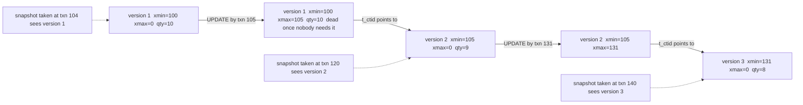

## 22.7 MVCC: multi-version concurrency control

### 22.7.1 Row versions, transaction ids, snapshots and visibility

#### Concept

PostgreSQL never modifies a row in place. When you `UPDATE` a row, it writes a **new version** of the row and marks the old version as expired. When you `DELETE`, it only marks the version as expired. Both versions stay in the table until VACUUM removes the expired one. Each version carries two transaction ids in its header: **xmin**, the transaction that created it, and **xmax**, the transaction that expired it (0 if it is still current).

Every query runs against a **snapshot**: a record of which transactions had committed when the query started. A row version is visible to the query if its creating transaction had committed at snapshot time and its expiring transaction had not. This is **MVCC**: readers see a consistent past, writers create the future, and neither waits for the other.

#### Why does it exist?

The alternative is locking: a reader takes a shared lock on rows, a writer takes an exclusive lock, and they block each other. With hundreds of concurrent connections, a reporting query would freeze checkout, and checkout would freeze reporting. MVCC lets `SELECT` never wait for `UPDATE` and `UPDATE` never wait for `SELECT`, at the cost of storing multiple versions and cleaning them up later. It also makes `ROLLBACK` almost free: PostgreSQL just marks the transaction as aborted, and every version it created becomes invisible.

#### Mental model

Imagine a shared document where nobody is allowed to erase. Every edit is written as a new line stamped with the editor's ticket number and the ticket number of whoever replaces it later. When you open the document, you are given a list of tickets that were "done" at that moment, and you read only the lines whose creator is on your list and whose replacer is not. Two people can edit and read at once without waiting; the paper simply gets longer until someone (VACUUM) tears out the lines nobody can see any more.

#### How it works



1. **Transaction ids (xids)** are 32-bit counters assigned when a transaction first writes. Read-only transactions get only a virtual id and cost nothing. `SELECT pg_current_xact_id()` forces assignment and shows the value.
2. **Insert** writes a tuple with `xmin = my xid`, `xmax = 0`.
3. **Delete** sets `xmax = my xid` on the current version. Nothing is removed.
4. **Update** does both: inserts a new version (`xmin = my xid`) and sets `xmax = my xid` on the old one, pointing the old tuple's `t_ctid` at the new version.
5. **Commit or abort** is recorded in the commit log (`pg_xact`, two bits per xid). The tuples are not touched at commit time; that is why commit is fast regardless of how many rows changed.
6. **Hint bits.** The first backend that reads a tuple after its transaction has finished looks up `pg_xact`, then caches the result in the tuple's `t_infomask` (`XMIN_COMMITTED`, `XMAX_ABORTED` and so on) so later readers skip the lookup. This dirties the page: a plain `SELECT` after a bulk load can generate writes (and WAL, if `wal_log_hints` or checksums are enabled). That is the "why is my read-only query writing to disk" surprise.
7. **Snapshot.** At statement start (`READ COMMITTED`) or transaction start (`REPEATABLE READ`, `SERIALIZABLE`), the backend records `xmin` (the oldest transaction still running), `xmax` (the next xid to be assigned), and the list of xids in progress between them. `SELECT pg_current_snapshot()` shows it as `xmin:xmax:xip_list`.
8. **Visibility rule** (simplified): a version is visible if its `xmin` is committed, is below the snapshot's `xmax`, and is not in the in-progress list; and its `xmax` is either 0, aborted, still in progress, or at or above the snapshot's `xmax`. Everything else is invisible to this snapshot.
9. **Row locks live in the header too.** `SELECT ... FOR UPDATE` sets `xmax` to the locker's xid with a flag bit saying "this is a lock, not a deletion". That is why row locks cost no lock-table memory and why a million-row `FOR UPDATE` is possible.

A version is **dead** when its `xmax` is committed and no snapshot in the system is old enough to still need it. The oldest snapshot in the system is called the **xmin horizon**. Anything a long-running transaction can still see cannot be cleaned. This is the link between "an idle transaction" and "table bloat", and it is the reason for the incidents in 22.8 and 22.10.

#### Practical example

Checkout reads `inventory.quantity` for product 7 (snapshot sees 10). At the same moment a warehouse job updates it to 9 and commits. The checkout's `SELECT` did not block, and returned 10, which was true when its statement began. If checkout then runs `UPDATE inventory SET quantity = quantity - 1 WHERE product_id = 7`, in `READ COMMITTED` the update re-reads the latest committed version (9) and produces 8. This re-check on write is how PostgreSQL avoids lost updates for simple arithmetic updates; for read-then-write logic in application code you need `FOR UPDATE` or optimistic versioning, which Part 24 — Database Transactions covers in depth.

#### NestJS example

Reading in a consistent snapshot across several statements (for example, a report of an order and its items and payments that must agree with each other) is a `REPEATABLE READ` transaction. TypeORM's `DataSource.transaction` takes the isolation level as its first argument.

```ts
// order-report.service.ts
import { Injectable } from '@nestjs/common';
import { DataSource } from 'typeorm';

@Injectable()
export class OrderReportService {
  constructor(private readonly dataSource: DataSource) {}

  // All three reads see the same snapshot even if the order is being updated
  async snapshotOf(orderId: number) {
    return this.dataSource.transaction('REPEATABLE READ', async (em) => {
      const [order] = await em.query('SELECT * FROM orders WHERE id = $1', [orderId]);
      const items = await em.query('SELECT * FROM order_items WHERE order_id = $1', [orderId]);
      const payments = await em.query('SELECT * FROM payments WHERE order_id = $1', [orderId]);
      return { order, items, payments };
    });
  }
}
```

Keep such transactions short. Every second they stay open, they hold the xmin horizon back for the whole database.

#### PostgreSQL example

Watch versions appear and die:

```sql
BEGIN;
SELECT pg_current_xact_id();                     -- e.g. 48819903
UPDATE inventory SET quantity = quantity - 1 WHERE product_id = 7;
SELECT xmin, xmax, ctid, quantity FROM inventory WHERE product_id = 7;
```

```text
   xmin   | xmax | ctid  | quantity
----------+------+-------+----------
 48819903 |    0 | (3,9) |        9      <-- the new version, inserted by our txn
```

From a second session while the first is still open:

```sql
SELECT xmin, xmax, ctid, quantity FROM inventory WHERE product_id = 7;
```

```text
   xmin   |   xmax   | ctid  | quantity
----------+----------+-------+----------
 48812201 | 48819903 | (3,2) |       10     <-- the old version, marked with our xmax, still visible here
```

Two sessions, two answers, no waiting. After `COMMIT` in session one, session two sees `(3,9)` with 9. The old version at `(3,2)` is now dead and awaits VACUUM. `SELECT pg_current_snapshot()` in session two during the overlap returns something like `48819903:48819904:48819903`, meaning "48819903 is in progress; do not show me its work".

#### TypeORM example

The per-transaction snapshot also matters for optimistic locking. `@VersionColumn` implements compare-and-set on top of MVCC: the `UPDATE ... WHERE id = $1 AND version = $2` finds zero rows if another version has been committed since your read.

```ts
@Entity('inventory')
export class Inventory {
  @PrimaryColumn({ name: 'product_id', type: 'bigint' })
  productId!: string;

  @Column({ type: 'integer' })
  quantity!: number;

  @VersionColumn()
  version!: number;   // TypeORM adds "AND version = :v" to UPDATEs and throws OptimisticLockVersionMismatchError
}
```

#### Sequelize example

Sequelize offers the same through `version: true` on the model definition; a stale save throws `OptimisticLockError`.

```ts
Inventory.init(
  {
    productId: { type: DataTypes.BIGINT, primaryKey: true, field: 'product_id' },
    quantity: { type: DataTypes.INTEGER, allowNull: false },
  },
  { sequelize, tableName: 'inventory', version: true, underscored: true },
);
```

#### Production scenario

A 200 million row `orders` table receives 300 inserts and 900 updates per second (status transitions, `updated_at` bumps). Every update creates a new version: 900 dead versions per second, 3.2 million per hour, 78 million per day. Readers never block, which is why the API can serve 5,000 reads per second alongside. But that is 78 million tuples per day that VACUUM must remove, and if each update also creates index entries (non-HOT), each of the table's 6 indexes grows by 78 million entries per day too. MVCC's cost is paid later, by VACUUM, in I/O.

#### Failure scenario

At 09:30 a data analyst opened a `REPEATABLE READ` transaction in a notebook to explore orders and went to a meeting. For three hours, every update on every table produced dead versions that VACUUM could not remove ("dead but not yet removable" in the vacuum logs), because that snapshot could theoretically still need them. `inventory` grew from 60 MB to 1.4 GB, index-only scans stopped working (pages were no longer all-visible), and p99 latency doubled. `idle_in_transaction_session_timeout` was set to 15 minutes for the analysts' role the same afternoon.

#### Edge cases & failure modes

- Long-lived snapshots (idle in transaction, long analytics, `pg_dump`, `hot_standby_feedback` from replicas) hold the xmin horizon and cause bloat everywhere, not just on the tables they read.
- Hint-bit writes after bulk loads: the first full scan after loading 100 million rows dirties every page; run `VACUUM` (or `VACUUM FREEZE`) right after the load to set hints and freeze in one pass.
- Aborted transactions leave dead tuples exactly like deletes; a job that inserts 1 million rows and rolls back leaves 1 million dead tuples.
- `READ COMMITTED` takes a new snapshot per statement; a two-statement read can see different states. Use `REPEATABLE READ` when consistency across statements matters.
- Row-lock information stored in `xmax` interacts with multixacts (`FOR KEY SHARE`, foreign keys); multixact ids have their own wraparound (`age(relminmxid)`).
- Cursors and `WITH HOLD` cursors keep snapshots alive beyond what you might expect.

#### How a Senior Backend Engineer thinks about this

They see every `UPDATE` as an insert plus a delete and price it accordingly. They know that "readers don't block writers" is paid for by VACUUM I/O, and they design write patterns so the debt stays payable: fewer updates of wide rows, no indexes on columns that churn, short transactions. They watch the xmin horizon like a resource: `SELECT max(age(backend_xmin)) FROM pg_stat_activity` is on their dashboard. To a product manager: "The database keeps old copies of rows so that reports never block checkouts; we have to clean those copies constantly, and anything that stops the cleaning slowly makes everything slower."

#### Common mistakes

- Believing `UPDATE` modifies in place and being surprised that a table with 10 million live rows occupies 40 GB.
- Leaving transactions open across HTTP calls or user interactions.
- Treating a `SELECT` as free of side effects (hint bits).
- Confusing MVCC snapshot isolation with serializability; Part 24 covers the anomalies.

#### Interview questions

1. *Explain xmin, xmax and how PostgreSQL decides whether a row version is visible.* Expected: creator and expirer xids; snapshot with xmin, xmax and in-progress list; committed-before-snapshot and not-expired-before-snapshot. Follow-up: where is commit status stored and what are hint bits?
2. *Why don't readers block writers in PostgreSQL, and what is the cost?* Expected: multiple versions; the cost is dead tuples, bloat and VACUUM.
3. *What does an UPDATE physically do?* Expected: new tuple version plus xmax on the old, plus index entries unless HOT.
4. *Why does a long idle transaction bloat tables it never touched?* Expected: xmin horizon is global.
5. *Why is ROLLBACK cheap in PostgreSQL but expensive in some other databases?* Expected: no undo log; abort is a bit in `pg_xact`.

#### Practical exercise

With two psql sessions, reproduce the visibility example above, including `pg_current_snapshot()`. Then leave session one idle in transaction, run 100,000 updates on `inventory` from session two, and query `pg_stat_user_tables.n_dead_tup` and `VACUUM (VERBOSE) inventory`. Acceptance criteria: you show the "dead but not yet removable" line, commit session one, vacuum again, and show the tuples being removed.

### 22.7.2 What UPDATE really costs: bloat and HOT updates

#### Concept

Every non-HOT update inserts one new heap tuple **and one new entry in every index on the table**, even indexes on columns that did not change, because index entries point at a specific tuple version (ctid). A **HOT update** (heap-only tuple) is the optimisation that avoids the index work: when the update changes no indexed column and the new version fits on the same page as the old one, PostgreSQL chains the new version to the old one inside the page and leaves every index untouched.

**Bloat** is the space occupied by dead versions (in the heap and in indexes) that VACUUM has not yet reclaimed, or that has been reclaimed but sits as scattered free space no longer used efficiently.

#### Why does it exist?

Index maintenance is the largest hidden cost of updates. On `orders` with 6 indexes, one non-HOT update is 7 writes and 7 sets of WAL records. HOT exists because most updates in real applications touch a few non-indexed columns (a status, a counter, a timestamp), and for those the index churn is pure waste.

#### Mental model

Imagine a library catalogue (index) that lists the shelf position of each book. If you rewrite a book and put the new edition on the same shelf next to the old one, and leave a note in the old slot saying "see next slot", the catalogue does not need to change. If the new edition must go to another shelf, or if the catalogue lists an attribute you changed (the title), every catalogue card must be updated.

#### How it works

1. The backend evaluates the `UPDATE`. It checks whether any column that appears in *any* index (including partial index predicates and expression indexes) changed value.
2. If none changed and the page has room (this is what `fillfactor` below 100 reserves), the new version is placed on the same page. The old tuple's `t_ctid` points to the new one, and the old one is flagged `HEAP_HOT_UPDATED`; the new one is `HEAP_ONLY_TUPLE`. Index entries still point at the *root* line pointer; an index scan follows the chain inside the page to the visible version.
3. **HOT pruning:** any backend that later reads the page and sees the chain can, without VACUUM, remove dead intermediate versions and turn the root line pointer into a redirect. This is opportunistic, cheap and happens constantly on hot pages, which is why a `fillfactor = 90` `inventory` table can sustain 500 updates per second without growing.
4. If an indexed column changed, or the page is full, the new version goes wherever there is space (often a different page), and every index gets a new entry. Old index entries become dead and are removed later by VACUUM (index vacuum) or, on PG 14+, by bottom-up index deletion when a B-tree page is about to split.
5. `pg_stat_user_tables` tells you the ratio: `n_tup_hot_upd / n_tup_upd`. Above 80 percent is healthy for a status-churn table; below 30 percent means something indexed is changing on every update (very often `updated_at`).

Cost comparison for one update on `orders` (6 indexes), measured on an NVMe instance:

| Update type | Heap writes | Index writes | WAL bytes (approx) | Latency |
|---|---|---|---|---|
| HOT (status only, `status` not indexed) | 1 page | 0 | 150 to 300 | 0.05 ms |
| Non-HOT (`updated_at` indexed) | 1 page | 6 entries | 1,200 to 2,500 | 0.3 ms |
| Non-HOT, page split in two indexes | 1 page | 6 entries plus 2 splits | 20,000 plus | 1 to 5 ms |

#### Practical example

`orders.updated_at` is bumped by every status change. A developer adds `CREATE INDEX ON orders (updated_at)` to support a "recently changed orders" admin screen. HOT ratio drops from 92 percent to 3 percent overnight: every status change now writes to all 7 indexes. WAL volume doubles, replicas lag, autovacuum on the indexes never catches up. The admin screen could have used `(status, updated_at)` on a partial set, or a separate small `order_events` table.

#### PostgreSQL example

```sql
-- Leave 30% free space on each page so new versions fit in place
ALTER TABLE inventory SET (fillfactor = 70);
VACUUM FULL inventory;   -- or pg_repack; fillfactor applies to new pages only

-- Watch the HOT ratio
SELECT relname, n_tup_upd, n_tup_hot_upd,
       round(100.0 * n_tup_hot_upd / greatest(n_tup_upd, 1), 1) AS hot_pct,
       n_dead_tup, n_live_tup
FROM pg_stat_user_tables
WHERE relname IN ('orders', 'inventory');
```

```text
 relname   | n_tup_upd  | n_tup_hot_upd | hot_pct | n_dead_tup | n_live_tup
-----------+------------+---------------+---------+------------+------------
 orders    | 3120041022 |      91021103 |     2.9 |   18922011 |  201233104   <-- indexed column churn
 inventory |  844120033 |     811203112 |    96.1 |      30122 |     420011
```

Find which index is responsible: list indexes whose columns are touched by your hottest `UPDATE` statement in `pg_stat_statements`, or check `pg_stat_user_indexes.idx_tup_read` growth against writes.

#### TypeORM example

Keep churning columns out of indexes and set `fillfactor` in a migration. TypeORM's `@Index` has no storage-parameter option, so raw SQL in a migration is the right tool.

```ts
import { MigrationInterface, QueryRunner } from 'typeorm';

export class InventoryFillfactor1725600000000 implements MigrationInterface {
  async up(qr: QueryRunner): Promise<void> {
    await qr.query(`ALTER TABLE inventory SET (fillfactor = 70)`);
    // Do NOT index updated_at on hot tables: it defeats HOT updates
    await qr.query(`DROP INDEX IF EXISTS idx_orders_updated_at`);
  }
  async down(qr: QueryRunner): Promise<void> {
    await qr.query(`ALTER TABLE inventory RESET (fillfactor)`);
  }
}
```

#### Sequelize example

```ts
export async function up({ context: queryInterface }: { context: QueryInterface }) {
  await queryInterface.sequelize.query(`ALTER TABLE inventory SET (fillfactor = 70)`);
  await queryInterface.removeIndex('orders', 'idx_orders_updated_at');
}
```

#### Production scenario

An `inventory` table of 400,000 rows updated 500 times per second stays at 60 MB for months with `fillfactor = 70`, HOT ratio 96 percent, and autovacuum running every 2 minutes for a few hundred milliseconds. The same table with an index on `updated_at` grew to 2.1 GB in a week and needed `pg_repack`. Monitoring: HOT ratio per table, `n_dead_tup`, table size trend, and WAL bytes per second.

#### Failure scenario

"The table is 40 GB but has 10 GB of data." A `products` table received nightly full rewrites (every row updated whether changed or not) for a year; autovacuum reclaimed space but the free space was scattered across pages, so new rows went into old gaps, sequential scans read four times more pages than needed, and index-only scans were rare because pages kept losing their all-visible bit. `pg_repack` shrank it to 10.5 GB in 40 minutes with no downtime.

#### Edge cases & failure modes

- Indexing `updated_at`, `version`, counters, or `last_seen_at` on hot tables destroys HOT.
- Expression and partial indexes count: an index `WHERE status = 'PENDING'` makes any change to `status` non-HOT.
- `fillfactor` applies only to new pages; existing pages need a rewrite.
- Very wide rows: fewer versions fit per page, HOT fails more often.
- Bulk updates that touch every row create a full copy of the table's live data as dead tuples.
- Bloat in indexes is separate from heap bloat and often worse; see Part 23 for `REINDEX CONCURRENTLY`.

#### How a Senior Backend Engineer thinks about this

They ask "which columns change most, and are any of them indexed?" before every index review. They budget `fillfactor` on hot tables. They prefer narrow, append-mostly event tables over wide rows that churn. They measure the HOT ratio after every schema change.

#### Common mistakes

- Adding indexes to hot tables without checking write patterns.
- Rewriting unchanged rows in sync jobs.
- Using `VACUUM FULL` on a production table to "fix bloat" and locking the API for an hour.

#### Interview questions

1. *What is a HOT update and what prevents it?* Expected: same-page new version with no index changes; prevented by changing an indexed column or a full page. Follow-up: how do you measure the HOT ratio?
2. *Why does an index on `updated_at` hurt more than an index on `user_id`?*
3. *What does `fillfactor` do and when do you lower it?*
4. *A table has 10 GB of live data and is 40 GB on disk. What happened and what are the options?*

#### Practical exercise

Create `inventory` with 1 million rows and `fillfactor = 100`. Run 500,000 random single-row updates on `quantity`; record size and HOT ratio. Repeat with `fillfactor = 70`. Repeat again with an index on `updated_at` while bumping `updated_at` in every update. Acceptance criteria: a table of size, HOT percent, WAL bytes and dead tuples for each run, with a one-paragraph recommendation.

### 22.7.3 Transaction id wraparound

#### Concept

Transaction ids are 32-bit numbers: about 4 billion values, used in a circle. PostgreSQL compares them **modulo 2 to the 32**: xid A is "older" than xid B if it is within 2 billion behind it. A tuple whose `xmin` is more than 2 billion transactions in the past would suddenly compare as being *in the future*, and become invisible to everyone. That is data loss without any disk failure. To prevent it, VACUUM **freezes** old tuples by setting a flag bit that means "created so long ago that it is visible to all transactions forever"; frozen tuples are never compared by xid again.

#### Why does it exist?

Using 32 bits was a storage decision (8 bytes of xids per tuple header instead of 16). The circular comparison and freezing are the price. Busy systems burn through 2 billion xids in weeks: at 2,000 write transactions per second, that is 11.5 days.

#### Mental model

Imagine an odometer that rolls over. If you record when each item entered the warehouse by odometer reading, and the odometer rolls over, everything old suddenly looks like it arrived in the future. Freezing means replacing the reading on very old items with a stamp that says "ancient, always valid".

#### How it works

1. Each table records the oldest unfrozen xid it may contain in `pg_class.relfrozenxid`; the database's minimum is `pg_database.datfrozenxid`. `age(relfrozenxid)` says how many transactions ago that was.
2. Regular VACUUM freezes tuples older than `vacuum_freeze_min_age` (50 million) on the pages it visits. When a table's age exceeds `vacuum_freeze_table_age` (150 million), VACUUM scans all pages not marked all-frozen in the visibility map (an "aggressive" vacuum) so that `relfrozenxid` can advance.
3. When a table's age exceeds `autovacuum_freeze_max_age` (200 million), autovacuum launches an **anti-wraparound vacuum** on it, even if autovacuum is disabled for that table, and even if it has no dead tuples. In `pg_stat_activity` it appears as `autovacuum: VACUUM public.orders (to prevent wraparound)`.
4. On PG 14+, when a table's age passes `vacuum_failsafe_age` (1.6 billion), VACUUM enters failsafe mode: it skips index cleanup and cost-based delays and freezes as fast as possible.
5. When the *database* age passes about 2 billion minus 40 million, every transaction logs a warning: `database "shop" must be vacuumed within N transactions`. At about 3 million remaining, the server **stops accepting commands** to protect data. On PG 14 and later you can still run `VACUUM` in normal mode at that point; older versions require single-user mode. Either way, your application is down until the vacuum finishes, which on a multi-terabyte database can be hours.

What makes freezing fall behind (the same list as VACUUM starvation, because it is VACUUM):

- Long-open transactions and idle-in-transaction sessions (the horizon).
- Orphaned prepared transactions (`SELECT * FROM pg_prepared_xacts`); these survive restarts.
- Replication slots with `hot_standby_feedback` and a lagging replica.
- Temporary tables in long-lived sessions: autovacuum cannot vacuum another session's temp tables, and their age counts.
- A table so large that a throttled vacuum takes longer than the time it takes the system to burn 200 million xids.
- Autovacuum workers all busy on other tables; anti-wraparound vacuums are prioritised, but three workers are three workers.

#### Practical example

An event-ingest database burns 3,000 xids per second (each event its own transaction) on a 4 TB `events` table with 12 indexes. Autovacuum, throttled to a few MB/s, needs about 30 hours to freeze the table; the system burns 200 million xids in 18.5 hours. The table's age keeps rising, anti-wraparound vacuum runs continuously, and one day the warnings begin. The permanent fix was batching events (100 per transaction cut xid consumption 100 times), partitioning `events` by month so old partitions freeze once and stay frozen, and raising `autovacuum_vacuum_cost_limit`.

#### PostgreSQL example

The queries every team should have in a dashboard:

```sql
-- Per database: how close to the wall?
SELECT datname, age(datfrozenxid) AS xid_age,
       round(100.0 * age(datfrozenxid) / 2147483647, 1) AS pct_to_wraparound
FROM pg_database ORDER BY 2 DESC;

-- Per table: who is oldest, and is autovacuum handling it?
SELECT c.relname, age(c.relfrozenxid) AS xid_age,
       pg_size_pretty(pg_total_relation_size(c.oid)) AS size,
       s.last_autovacuum, s.autovacuum_count
FROM pg_class c
JOIN pg_namespace n ON n.oid = c.relnamespace
LEFT JOIN pg_stat_user_tables s ON s.relid = c.oid
WHERE c.relkind IN ('r', 'm', 't') AND n.nspname NOT IN ('pg_catalog', 'information_schema')
ORDER BY 2 DESC LIMIT 10;

-- Anything holding the horizon back?
SELECT pid, state, age(backend_xmin) AS xmin_age, now() - xact_start AS open_for, left(query, 50)
FROM pg_stat_activity WHERE backend_xmin IS NOT NULL ORDER BY 3 DESC LIMIT 5;
SELECT * FROM pg_prepared_xacts;
SELECT slot_name, active, xmin, catalog_xmin FROM pg_replication_slots;
```

Alert at 50 percent of `autovacuum_freeze_max_age` (100 million) so you find the cause while there is still a week of runway, not at 1.9 billion.

Freezing on your own terms, during a quiet window:

```sql
VACUUM (FREEZE, VERBOSE) orders;   -- aggressive freeze; on PG 16+ use VACUUM (VERBOSE) after
                                   --   the table's age passes vacuum_freeze_table_age
```

#### NestJS example

Transactions per second is a wraparound input, so batching writes is also a wraparound defence. A queue consumer that commits one event per message burns one xid per message; grouping 200 messages per transaction cuts xid consumption 200 times and the `fsync` count with it.

```ts
// events-ingest.consumer.ts (BullMQ worker style, batch of jobs)
import { Injectable } from '@nestjs/common';
import { DataSource } from 'typeorm';

@Injectable()
export class EventsIngestConsumer {
  constructor(private readonly dataSource: DataSource) {}

  async ingestBatch(events: Array<{ orderId: number; type: string; payload: unknown }>) {
    // One transaction, one xid, one fsync for the whole batch
    await this.dataSource.transaction(async (em) => {
      await em
        .createQueryBuilder()
        .insert()
        .into('order_events')
        .values(events.map((e) => ({ orderId: e.orderId, type: e.type, payload: e.payload })))
        .execute();
    });
  }
}
```

#### Production scenario

A well-run 2 TB database at 1,500 write transactions per second: database age hovers between 60 and 180 million as anti-wraparound and regular vacuums advance `relfrozenxid`; `autovacuum_freeze_max_age` left at default; `vacuum_failsafe_age` at default as the last line of defence; alerts at 500 million (page) and 1 billion (wake the DBA). Large append-only tables are partitioned monthly so that closed partitions are frozen once (their visibility map is all-frozen) and never scanned again.

#### Failure scenario

Monday 08:15: `ERROR: database is not accepting commands to avoid wraparound data loss in database "shop"`. Root cause found in 20 minutes: a `pg_prepared_xacts` row from a two-phase-commit experiment nine months earlier had been holding the horizon since the experiment's coordinator was decommissioned. Every anti-wraparound vacuum since then had run, logged "oldest xmin" warnings, and freed nothing. `ROLLBACK PREPARED 'test-2pc-1'` and a database-wide `VACUUM` took four hours on the 3 TB database. Total downtime: four and a half hours. Two alerts would have prevented it: database age above 500 million, and any prepared transaction older than 10 minutes.

#### Edge cases & failure modes

- Multixact wraparound (`age(relminmxid)`) from heavy `FOR KEY SHARE` and foreign-key locking; same emergency, different counter.
- `autovacuum = off` on a table "temporarily" to stop I/O; anti-wraparound still runs, but regular freezing does not.
- Very large tables where a single vacuum takes longer than the xid burn interval; partition them.
- Replicas cannot vacuum; wraparound is a primary problem, but `hot_standby_feedback` from replicas extends the primary's horizon.
- Restoring from a logical dump resets ages; restoring from a physical backup does not.

#### How a Senior Backend Engineer thinks about this

They treat wraparound as a scheduled certainty, not a rare accident, and they have two dashboards: database age and horizon holders. They reduce xid consumption by batching. They partition huge append-only tables so freezing is a one-time cost per partition. They ban prepared transactions unless a specific coordinator owns their cleanup.

#### Common mistakes

- Not knowing the current database age.
- Disabling autovacuum during a busy period and forgetting to re-enable it.
- Letting an experiment leave prepared transactions or replication slots behind.
- Committing per row at thousands of rows per second.

#### Interview questions

1. *What is transaction id wraparound and how does PostgreSQL prevent it?* Expected: 32-bit circular xids; freezing by VACUUM; anti-wraparound autovacuum at 200 million; failsafe at 1.6 billion; shutdown near 2 billion. Why it matters: it is one of the few ways to lose data on healthy hardware.
2. *Name four things that stop freezing from advancing.*
3. *How does partitioning help with wraparound?* Expected: frozen partitions are all-frozen in the visibility map and are skipped.
4. *Your database is at age 1.9 billion. What do you do in the next 30 minutes?* Expected: find and kill horizon holders (idle transactions, prepared transactions, dead slots), then run VACUUM on the oldest tables with `vacuum_cost_delay = 0`.

#### Practical exercise

On a test instance, set `autovacuum_freeze_max_age = 200000` on a table (the minimum is 100,000) and generate 300,000 small write transactions. Observe the anti-wraparound autovacuum appear in `pg_stat_activity` and `age(relfrozenxid)` drop. Then open an idle transaction and repeat; observe age not dropping. Acceptance criteria: you can show both outcomes and name the horizon holder using `pg_stat_activity.backend_xmin`.
