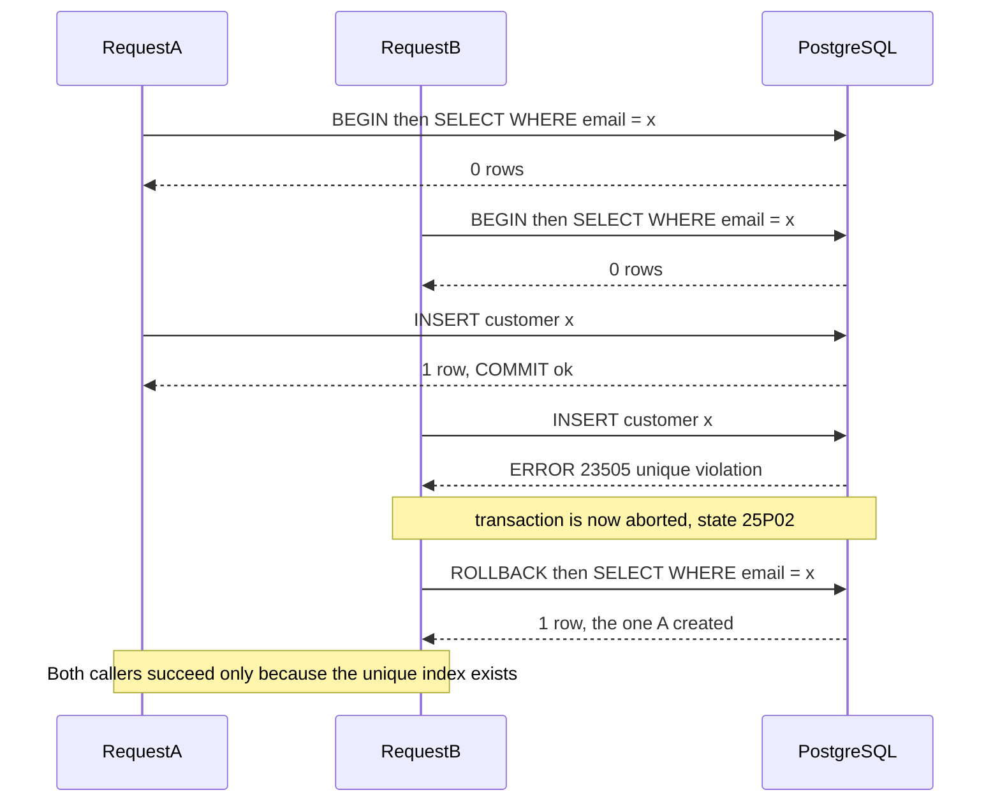
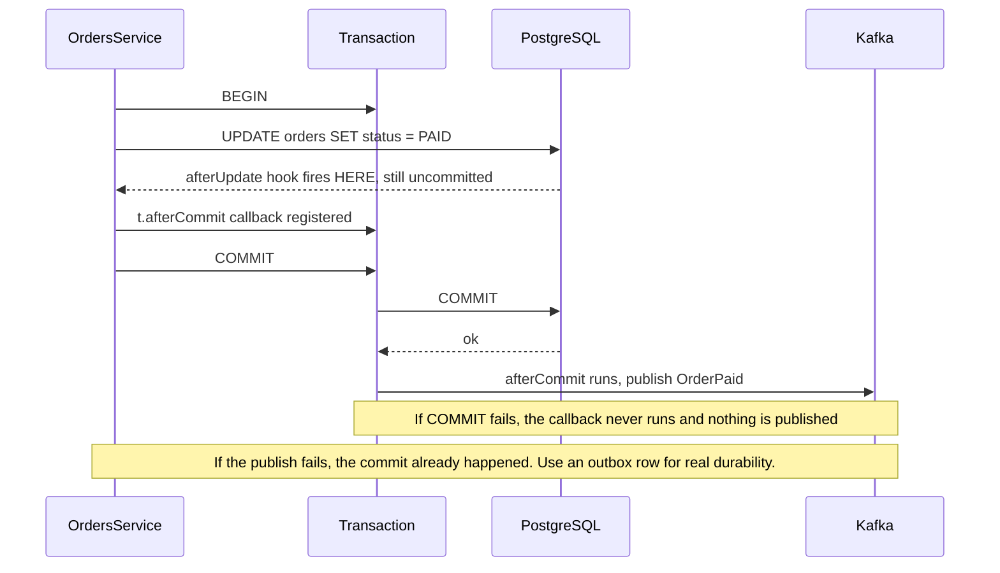

## 22.17 Sequelize query methods

#### Concept

Sequelize's query surface is a set of static methods on the model — `findAll`, `findOne`, `findByPk`, `findAndCountAll`, `findOrCreate`, `create`, `update`, `destroy`, `upsert`, `bulkCreate`, `increment`, `decrement`, `count`, `min`/`max`/`sum` — plus `sequelize.query()` for raw SQL. Every one of them takes the same options object shape (`where`, `attributes`, `include`, `order`, `group`, `having`, `limit`, `offset`, `transaction`, `raw`, `lock`), so learning the options once covers the whole API.

#### Why does it exist?

Because 80% of the statements a service issues are "select these columns from this table where these conditions hold". Expressing that as a JavaScript object instead of a string means it composes (you can add a condition in an `if`), it parameterises automatically (no injection), and it maps back to instances. The remaining 20% — reports, upserts, window functions — is what `sequelize.query()` and `literal()` are for.

#### How it works

Every option becomes a clause. `where: { status: 'PAID', totalCents: { [Op.gte]: 5000 } }` becomes `WHERE "status" = $1 AND "total_cents" >= $2`. Values always travel as bind parameters; only `literal()` puts text straight into the SQL, which is why `literal()` is the one function in this section you must treat as dangerous.

#### Sequelize example

The finders, with the SQL each produces.

```ts
// One row by primary key. SELECT ... FROM "orders" WHERE "id" = $1 LIMIT 1;
const order = await this.orderModel.findByPk(id, { include: [{ association: 'items' }] });

// One row by conditions. Adds LIMIT 1. Returns null (not an exception) when nothing matches.
const latest = await this.orderModel.findOne({ where: { customerId }, order: [['createdAt', 'DESC']] });

// Many rows, only the columns the response needs.
const rows = await this.orderModel.findAll({
  where: { customerId, status: { [Op.in]: ['PAID', 'SHIPPED'] }, createdAt: { [Op.gte]: since } },
  attributes: ['id', 'status', 'totalCents', 'createdAt'],
  order: [['createdAt', 'DESC']],
  limit: 50,
  offset: 0,
});

// Throws NotFoundError instead of returning null; useful in services that always need the row.
const must = await this.orderModel.findByPk(id, { rejectOnEmpty: new NotFoundException('Order not found') });
```

**`findAndCountAll` and the `distinct: true` count bug.** `findAndCountAll` runs two statements: your `SELECT` with `LIMIT`/`OFFSET`, and a `COUNT`. With a `hasMany` include, the count query joins too, so it counts **joined rows**:

```ts
// WRONG: count is 200 when there are 20 orders with 10 items each
const page = await this.orderModel.findAndCountAll({
  where: { customerId },
  include: [{ association: 'items' }],
  limit: 20,
});
// SELECT count("Order"."id") FROM "orders" LEFT JOIN "order_items" ...   -> 200

// RIGHT
const page2 = await this.orderModel.findAndCountAll({
  where: { customerId },
  include: [{ association: 'items' }],
  distinct: true,     // SELECT count(DISTINCT "Order"."id") ...          -> 20
  limit: 20,
});
```

The symptom in production is a paginator that says "10 pages" and shows an empty page 3. `distinct: true` is free to add and correct in every case where a `hasMany` include exists, so many teams make it a lint rule. Two related notes: with `group`, `findAndCountAll` returns `count` as an **array** of group counts, not a number; and `COUNT(DISTINCT id)` over a large join is expensive — for big tables, run the count as its own query without includes, or use an approximate count (Part 18, section 18.2).

**`findOrCreate` and what really happens under concurrency.** The method looks atomic. It is not.

```ts
const [customer, created] = await this.customerModel.findOrCreate({
  where: { email: dto.email },
  defaults: { email: dto.email, name: dto.name },
});
```

```text
-- Sequelize opens its own transaction when you do not pass one
BEGIN;
SELECT "id","email" FROM "customers" WHERE "email" = $1 LIMIT 1;   -- not found
INSERT INTO "customers" ("id","email","name") VALUES ($1,$2,$3) RETURNING *;
COMMIT;
```

Two requests for the same new email arriving 3 ms apart both run the `SELECT`, both find nothing, and both `INSERT`. One wins. The other gets `23505 duplicate key value violates unique constraint "customers_email_key"`. Sequelize catches that specific error and re-runs the `SELECT` to return the row the winner created, so the caller usually sees success — that recovery is the only reason `findOrCreate` works at all, and it **only works if a unique constraint exists**. Without one you get two rows and no error.



Now the part that causes incidents: **if you pass your own transaction**, the failed `INSERT` aborts *your* transaction. PostgreSQL marks the whole transaction as failed, and every subsequent statement returns `25P02 current transaction is aborted, commands ignored until end of transaction block` — including Sequelize's recovery `SELECT`. So `findOrCreate` inside a larger transaction turns a benign race into a hard 500 for the whole request. The workarounds are a savepoint around it, or — better — not using `findOrCreate` at all:

```ts
// Preferred: one atomic statement, no race, no aborted transaction
const [rows] = await this.sequelize.query(
  `INSERT INTO customers (id, email, name) VALUES (gen_random_uuid(), $1, $2)
   ON CONFLICT (email) DO UPDATE SET email = EXCLUDED.email
   RETURNING id, email, name, (xmax = 0) AS inserted`,
  { bind: [dto.email, dto.name], type: QueryTypes.SELECT, transaction: t },
);
// DO UPDATE (not DO NOTHING) so RETURNING always yields a row; xmax = 0 tells you if it was an insert
```

**`upsert`.** On PostgreSQL, `Model.upsert(values)` generates `INSERT ... ON CONFLICT (<primary key or unique index>) DO UPDATE SET ... RETURNING *`. Use `conflictFields` to target a specific unique index when the model has more than one:

```ts
await this.productModel.upsert(
  { sku: 'ABC-1', name: 'Widget', price: '19.99', stock: 40 },
  { conflictFields: ['sku'], returning: true },
);
```

It returns `[instance, created]`, but the `created` boolean is not reliable across dialects and versions — if the answer matters, use the raw `RETURNING (xmax = 0)` form above. `upsert` also updates **only the fields you pass**, and it does not run instance `beforeUpdate` hooks (it has its own `beforeUpsert`/`afterUpsert`).

**`bulkCreate` with `updateOnDuplicate`.** The bulk loader.

```ts
await this.productModel.bulkCreate(rows, {
  updateOnDuplicate: ['name', 'price', 'stock', 'updatedAt'],   // ON CONFLICT (id) DO UPDATE SET ...
  conflictAttributes: ['sku'],                                  // conflict target other than the PK
  returning: ['id'],
  validate: true,
});
```

One statement inserts all rows. Two constraints govern how many rows you may pass: PostgreSQL's wire protocol allows **65,535 bind parameters per statement**, so 12 columns caps you at about 5,400 rows; and one giant statement holds locks longer. Chunk at 500–1,000 and wrap the chunks in a transaction if the load must be all-or-nothing. Also note `ignoreDuplicates: true` produces `ON CONFLICT DO NOTHING` and cannot be combined with `updateOnDuplicate`, and that per-row hooks do not run unless you pass `individualHooks: true` (which defeats the purpose — see 22.18).

**`increment` and `decrement` are the atomic ones.** This is the pattern that makes stock decrements safe without a lock:

```ts
// UPDATE products SET stock = stock - $1, updated_at = $2 WHERE id = $3 AND stock >= $1
const [, affected] = await this.productModel.decrement(
  { stock: dto.qty },
  { where: { id: dto.productId, stock: { [Op.gte]: dto.qty } }, transaction: t },
);
if (affected === 0) throw new ConflictException('Insufficient stock');
```

The arithmetic happens in PostgreSQL under the row lock the `UPDATE` takes, so two concurrent decrements cannot both read `stock = 5` and both write `4`. Contrast with the read-modify-write shape (`product.stock -= qty; await product.save()`), which is a lost update unless `version: true` is on. Always pair `decrement` with the guard in the `WHERE` and check the affected count; the guard is what turns "went negative" into "returned 409".

**Operators.** `Op` is imported from `sequelize` and covers the SQL you need without strings.

```ts
import { Op, fn, col, literal, where as sqlWhere } from 'sequelize';

where: {
  status: { [Op.ne]: 'CANCELLED' },
  totalCents: { [Op.between]: [1_000, 50_000] },
  createdAt: { [Op.gte]: since },
  [Op.or]: [{ customerId }, { '$customer.email$': { [Op.iLike]: `%${term}%` } }],  // $nested$ reaches an include
  attributes: { [Op.contains]: { colour: 'red' } },                                 // jsonb @>
  tags: { [Op.overlap]: ['sale', 'new'] },                                          // array &&
}
```

`Op.like` is case-sensitive, `Op.iLike` is PostgreSQL's `ILIKE` (and cannot use a plain B-tree index unless you index `lower(col)` or use `pg_trgm` — Part 20). `$association.column$` is how you filter on an included table without writing SQL; it forces the include into the `WHERE`, which interacts with the `subQuery` behaviour from section 22.16.

**Aggregates, `group` and `having`, and the `fn`/`col`/`literal` trio.**

```ts
const revenue = await this.orderModel.findAll({
  attributes: [
    [fn('date_trunc', 'day', col('created_at')), 'day'],
    [fn('count', col('id')), 'orders'],
    [fn('sum', col('total_cents')), 'revenueCents'],
  ],
  where: { status: 'PAID', createdAt: { [Op.gte]: since } },
  group: [literal('1')],                       // group by the first select expression
  having: literal('count(id) > 10'),
  order: [[literal('1'), 'ASC']],
  raw: true,
});
```

- `col('created_at')` renders a **column reference**, quoted and unescaped as a value.
- `fn('sum', col('total_cents'))` renders `sum("total_cents")`.
- `literal('...')` renders the string **verbatim into the SQL**. It is the only injection hole in the Sequelize API. Never build a `literal` from request input; if you must (a dynamic sort column), validate it against an allow-list first.

```ts
const SORTABLE = new Set(['created_at', 'total_cents', 'status']);
const sort = SORTABLE.has(dto.sort) ? dto.sort : 'created_at';     // allow-list, then literal is safe
order: [[literal(`"${sort}" ${dto.dir === 'asc' ? 'ASC' : 'DESC'} NULLS LAST`)]];
```

**`raw: true` and what you give up.** With `raw: true` Sequelize skips instance construction and hands you plain objects. You lose: getters and setters, `VIRTUAL` fields, `toJSON()`, `save()`, association nesting (nested include columns arrive as flat `'items.id'` keys unless you add `nest: true`), and hooks. You gain roughly 30–50% less CPU and memory on large result sets, which matters for reports and exports. The rule: `raw: true` for anything you will serialise or aggregate and never mutate; instances for anything you will `save()`.

**`sequelize.query`: `replacements` versus `bind`.** Both are safe against injection. They are not the same mechanism.

```ts
// replacements: Sequelize escapes the values and splices them into the SQL TEXT before sending
const [a] = await this.sequelize.query(
  `SELECT id, name FROM products WHERE status = :status AND id IN (:ids)`,
  { replacements: { status: 'ACTIVE', ids: productIds }, type: QueryTypes.SELECT },
);

// bind: values travel as real PostgreSQL parameters ($1, $2); the server never sees them as text
const b = await this.sequelize.query(
  `SELECT id, name FROM products WHERE status = $1 AND id = ANY($2::uuid[])`,
  { bind: ['ACTIVE', productIds], type: QueryTypes.SELECT },
);
```

Prefer `bind`: parameters are sent out of band, the statement text is identical for every call (so PostgreSQL can reuse the plan and `pg_stat_statements` groups them into one entry), and there is no escaping code path to get wrong. Use `replacements` only for the thing `bind` cannot do — expanding an array into a comma-separated `IN` list — and note that `= ANY($1::uuid[])` covers that case anyway, without a parameter-count limit. Never mix the two in one query. And always set `type: QueryTypes.SELECT` (or `UPDATE`, `INSERT`), otherwise the return shape differs by dialect and you will destructure the wrong thing.

#### Edge cases & failure modes

- `findAndCountAll` without `distinct: true` over a `hasMany` include reports joined-row counts.
- `findOrCreate` inside a caller-supplied transaction can leave the transaction aborted (`25P02`).
- `Model.update()` returns `[affectedCount]` on PostgreSQL, and `[affectedCount, affectedRows]` only when you pass `returning: true`; code that reads `result[1]` without it gets `undefined`.
- `limit` with `offset` on a large table is O(offset); use keyset pagination past a few thousand rows (Part 15, section 15.2).
- `attributes` that omit the primary key break include nesting, because Sequelize de-duplicates parents by PK.
- `where` on a `DECIMAL` column with a JavaScript number can lose precision before it reaches the database; pass strings.
- Huge `Op.in` arrays become huge parameter lists and can exceed the 65,535 bind-parameter limit; use `= ANY($1::uuid[])` via raw SQL.
- `literal()` built from user input is SQL injection, full stop.

#### How a Senior Backend Engineer thinks about this

They know which method issues how many statements and can predict the SQL before running it. They use atomic statements (`increment`, `ON CONFLICT`) instead of read-then-write whenever the logic fits. They reach for `sequelize.query` with `bind` the moment the options object starts to need `literal`, because at that point they are writing SQL anyway and would rather write it legibly.

#### Common mistakes

- `findOrCreate` treated as atomic, with no unique constraint behind it.
- Pagination counts wrong because `distinct` was omitted.
- `product.stock -= n; save()` under concurrency.
- `literal()` with interpolated request parameters.
- `raw: true` on rows the code then tries to `save()`.

#### Interview questions

1. *What two statements does `findAndCountAll` run, and when is the count wrong?* Expected: the paged select plus a count; wrong with `hasMany` includes unless `distinct: true`.
2. *Walk through `findOrCreate` under two concurrent requests.* Expected: both select, both insert, one gets `23505`, Sequelize re-selects; only safe with a unique index; dangerous inside a caller transaction.
3. *`replacements` versus `bind` — which and why?* Expected: `bind` uses real server-side parameters, better plan reuse and grouping; `replacements` splices escaped text.
4. *Why is `decrement` safer than loading and saving?* Expected: arithmetic in the database under the row lock; no lost update.
5. *What do you lose with `raw: true`?* Expected: instances, virtuals, getters, nesting, hooks.

#### Practical exercise

Write a `GET /orders` endpoint with filtering, sorting and pagination that returns the correct total count with items included, and a `POST /orders/:id/items` that decrements stock atomically and returns 409 when insufficient. Prove both with tests: a pagination test asserting the count equals the number of distinct orders, and a concurrency test firing 50 parallel decrements at a product with stock 10 and asserting exactly 10 succeed. Acceptance criteria: both tests pass against real PostgreSQL, and stock is never negative.

## 22.18 Sequelize hooks

#### Concept

Hooks are functions Sequelize calls around a persistence operation. They come in three families: **instance hooks** (`beforeValidate`, `afterValidate`, `beforeCreate`, `afterCreate`, `beforeUpdate`, `afterUpdate`, `beforeSave`, `afterSave`, `beforeDestroy`, `afterDestroy`, `beforeUpsert`, `afterUpsert`), **bulk hooks** (`beforeBulkCreate`, `afterBulkCreate`, `beforeBulkUpdate`, `afterBulkUpdate`, `beforeBulkDestroy`, `afterBulkDestroy`), and **connection hooks** (`beforeConnect`, `afterConnect`). They can be declared per model or globally on the `Sequelize` instance.

#### Why does it exist?

To attach behaviour that must follow the data rather than the call site: normalise an email, compute a search vector, stamp `updatedBy`, write an audit row, publish an event. Same intent as TypeORM's subscribers (section 22.11), and the same warnings apply, plus one Sequelize-specific improvement: `afterCommit`.

#### How it works

```ts
// Model-scoped hooks, decorator style
@Table({ tableName: 'customers', underscored: true })
export class Customer extends Model<Customer> {
  @BeforeCreate
  @BeforeUpdate
  static normaliseEmail(instance: Customer): void {
    instance.email = instance.email.trim().toLowerCase();
  }

  @AfterCreate
  static async schedule(instance: Customer, options: CreateOptions): Promise<void> {
    // options.transaction is the transaction the insert ran in, if any
    await AuditLog.create(
      { entity: 'customer', entityId: instance.id, action: 'CREATE' },
      { transaction: options.transaction },     // MUST pass it, or the audit row commits separately
    );
  }
}
```

Two rules decide whether a hook fires at all:

1. **Instance hooks fire only for instance operations.** `Model.create()`, `instance.save()`, `instance.update()`, `instance.destroy()`. They do **not** fire for `Model.update()`, `Model.destroy()`, `Model.bulkCreate()` (except `beforeBulkCreate`), `increment`/`decrement`, or `sequelize.query()`.
2. **Bulk hooks fire for the bulk operations**, but they receive the *options object*, not the rows. `beforeBulkUpdate(options)` sees `options.attributes` (the values being set) and `options.where` — it has no idea which rows will match.

```ts
@BeforeBulkUpdate
static stampUpdater(options: UpdateOptions & { attributes?: Record<string, unknown> }): void {
  // Works because it mutates the SET clause, not the rows
  if (options.attributes) options.attributes.updatedBy = getCurrentUserId();
}
```

**`individualHooks: true`** bridges the gap: on a bulk `update` or `destroy`, Sequelize first `SELECT`s every matching row, builds instances, and runs the instance hooks per row. It is correct and it is expensive:

```ts
// One UPDATE becomes: 1 SELECT of all matching rows + N beforeUpdate + N afterUpdate
await this.orderModel.update({ status: 'CANCELLED' }, { where: { customerId }, individualHooks: true });
```

For 50,000 matching rows that is 50,000 hook invocations and 50,000 instances in memory in one request. Use it for tens of rows, never for a backfill.

**Model hooks versus global hooks.** Global hooks run for every model:

```ts
sequelize.addHook('beforeFind', (options) => { options.benchmark = true; });
// or in the root module: define: { hooks: { beforeCreate(instance) { /* ... */ } } }
```

Global hooks are useful for cross-cutting concerns (attaching a tenant filter, timing) and terrible for business logic, because nothing at the call site hints that they exist. Execution order is: global hooks defined on the `Sequelize` instance run **before** model hooks of the same name.

**`afterCommit`, and why it is the right place to publish events.** A hook running inside a transaction sees data that may never exist. Publishing "OrderPaid" from `afterUpdate` means the message goes out before `COMMIT` — and if the transaction rolls back, consumers act on an order that was never paid. `transaction.afterCommit()` runs only after the commit succeeds.



```ts
@AfterUpdate
static publishOnCommit(instance: Order, options: UpdateOptions): void {
  if (!instance.changed('status') || instance.status !== 'PAID') return;
  const publish = () => eventBus.emit('order.paid', { orderId: instance.id });
  // Register on the transaction if there is one; otherwise the write already committed
  options.transaction ? options.transaction.afterCommit(publish) : publish();
}
```

`afterCommit` fixes the ordering, not the durability. If the process dies between `COMMIT` and the publish, the event is lost forever and no retry exists. For anything a downstream system depends on, write an **outbox row inside the same transaction** and let a relay publish it (Part 28 — Messaging: Queues, Topics, Kafka, RabbitMQ and SQS, and Part 21, section 21.8). `afterCommit` is right for cache invalidation and best-effort notifications; the outbox is right for money.

#### Edge cases & failure modes

- A hook that forgets `{ transaction: options.transaction }` writes outside the transaction: the audit row survives a rollback, or deadlocks against the row its own transaction holds.
- A throwing `afterCreate` rolls back the insert but surfaces as a confusing error from `create()`.
- An `afterCommit` callback that throws cannot undo anything; wrap it in try/catch or you turn a successful commit into a 500.
- Hooks on `beforeFind` that mutate `options.where` silently change every query, including those in background jobs.
- `beforeBulkCreate` receives the array; mutating it is how you set defaults for bulk loads, but validation hooks do not run per row unless `individualHooks: true`.
- Hooks are not transactional with external systems: an HTTP call inside `afterUpdate` runs while the row lock is held.
- Two models whose hooks write to each other create recursion (`afterCreate` on `Order` creating an `AuditLog` whose `afterCreate` writes an `Order`).

#### How a Senior Backend Engineer thinks about this

They allow hooks for **pure, local, cheap** work: normalising a value, computing a derived column. Everything else goes in the service where it is visible. They never let a hook do I/O to another system except through `afterCommit` or an outbox. When an audit trail must be complete for every write path — including `sequelize.query` and a DBA in `psql` — they use a PostgreSQL trigger, not a hook.

#### Common mistakes

- Business logic in hooks, discovered six months later by someone debugging a bulk job that skipped it.
- Publishing events before commit.
- `individualHooks: true` on a migration-scale update.
- Forgetting to propagate the transaction.

#### Interview questions

1. *Which operations skip instance hooks?* Expected: `Model.update`/`destroy`, `bulkCreate`, `increment`, raw queries.
2. *What does `individualHooks: true` cost?* Expected: a select of all matching rows plus per-row hooks and instances.
3. *Why is `afterCommit` better than `afterUpdate` for publishing, and why is it still not enough?* Expected: ordering after commit; no durability, no retry — use an outbox.
4. *When would you use a database trigger instead of a hook?* Expected: completeness across all write paths, atomicity, independence from the ORM.

#### Practical exercise

Add an `order.paid` event to an existing flow, first from `afterUpdate` and then via `afterCommit` plus an outbox table. Write a test that rolls the transaction back and asserts no event was published in the second implementation but was in the first. Acceptance criteria: the outbox version publishes exactly once per commit and survives a process kill between commit and publish.

## 22.19 Sequelize scopes

#### Concept

A scope is a named, reusable chunk of query options. `defaultScope` is applied to every finder on the model (section 22.15); named scopes are opted into with `Model.scope('name')`; `Model.unscoped()` removes the default.

```ts
@DefaultScope(() => ({ attributes: { exclude: ['internalNotes'] } }))
@Scopes(() => ({
  paid:     { where: { status: 'PAID' } },
  withItems:{ include: [{ association: 'items' }] },
  forCustomer: (customerId: string) => ({ where: { customerId } }),   // parameterised scope
}))
@Table({ tableName: 'orders', underscored: true })
export class Order extends Model<Order> {}

// Usage
await Order.scope('paid', 'withItems').findAll();
await Order.scope({ method: ['forCustomer', customerId] }).findAll();
await Order.unscoped().findByPk(id);         // includes internalNotes
```

#### Why does it exist?

To stop the same `where` fragment being copied into forty call sites and drifting. "Active products", "non-cancelled orders", "this tenant's rows" are genuinely repeated conditions.

#### How it works and where it fails

Scopes merge. Multiple scopes' `where` clauses combine with `AND`, `include` arrays concatenate, and `attributes` from a later scope replace an earlier one. The merge rules are the first hazard: two scopes that both constrain `status` do not produce `status IN (...)`, one wins.

The second hazard is the important one. **Scopes for tenant isolation fail silently.**

```ts
@Scopes(() => ({ tenant: (tenantId: string) => ({ where: { tenantId } }) }))
// ...
await Order.scope({ method: ['tenant', req.tenantId] }).findAll({ where: { status: 'PAID' } });
```

This works — until someone writes `Order.findAll()` without the scope in a new endpoint, or a background job, or an admin tool, or inside an `include` on another model. There is no error, no warning, no failing test. The query returns every tenant's orders and the response looks perfectly normal to whoever wrote it. This is IDOR at the data layer (Part 40, section 40.5), and it is discovered by a customer, not by you.

Scopes are a **convenience**, not a security boundary. If cross-tenant leakage is a real risk, enforce it where it cannot be forgotten:

```sql
-- PostgreSQL row-level security: the database refuses to return other tenants' rows
ALTER TABLE orders ENABLE ROW LEVEL SECURITY;
CREATE POLICY orders_tenant_isolation ON orders
  USING (tenant_id = current_setting('app.tenant_id')::uuid);
```

```ts
// Set the setting once per request on the pooled connection, inside the transaction
await sequelize.query(`SELECT set_config('app.tenant_id', $1, true)`, { bind: [req.tenantId], transaction: t });
```

The `true` third argument makes the setting transaction-local, so a pooled connection cannot carry one tenant's id into another request. Now a forgotten scope returns zero rows instead of everyone's rows: the failure mode flips from silent leak to visible bug. If RLS is too much, the next best thing is a repository wrapper that is the only way to reach the model, with the tenant filter applied inside it and the raw model not exported.

#### Edge cases & failure modes

- `defaultScope` is applied to included models too, silently filtering join results.
- `unscoped()` only unscopes the model it is called on, not includes.
- Scope functions are evaluated at call time; a scope closing over a request value in a singleton service leaks state between requests.
- Whether the default scope's `where` reaches `Model.update`/`Model.destroy` has varied between versions — never rely on it to prevent a destructive write. Put the condition in the call.
- Scopes plus `raw: true` plus includes interact badly; check the SQL.

#### How a Senior Backend Engineer thinks about this

Scopes for readability, constraints and RLS for safety. They ask "what happens if someone forgets this?" — if the answer is "wrong data is returned and nobody notices", it does not belong in a scope.

#### Interview questions

1. *How do two scopes with conflicting `where` keys merge?* Expected: one replaces the other; not an `OR` or `IN`.
2. *Why are scopes a bad tenant isolation mechanism?* Expected: opt-in, silent when forgotten, bypassed by raw queries and includes; use RLS or an enforced repository.
3. *What does `unscoped()` not do?* Expected: it does not unscope included models.

## 22.20 Sequelize migrations

#### Concept

`sequelize-cli` manages an ordered list of migration files and a `SequelizeMeta` table recording which have run. Each file exports `up` and `down`, both receiving a `queryInterface` (the DDL API) and `Sequelize` (for `DataTypes` and `literal`).

```bash
npx sequelize-cli migration:generate --name add-sales-channel-to-orders
npx sequelize-cli db:migrate
npx sequelize-cli db:migrate:status
npx sequelize-cli db:migrate:undo
npx sequelize-cli seed:generate --name demo-products
```

A `.sequelizerc` keeps the paths sane in a NestJS project:

```js
// .sequelizerc
const path = require('path');
module.exports = {
  config:         path.resolve('src/database', 'sequelize-cli.config.js'),
  'models-path':  path.resolve('src', 'models'),
  'migrations-path': path.resolve('src/database', 'migrations'),
  'seeders-path': path.resolve('src/database', 'seeders'),
};
```

#### How it works

An important difference from TypeORM: **`sequelize-cli` has no `migration:generate` that diffs models against the database.** `migration:generate` creates an empty skeleton and you write the DDL yourself. That is more typing and considerably less dangerous — there is no tool that can decide on its own to drop a column it does not recognise (section 22.25). The trade is that model and schema drift is entirely your discipline.

The second difference: **sequelize-cli does not wrap each migration in a transaction by default.** If you want atomicity you write it:

```js
'use strict';
module.exports = {
  async up(queryInterface, Sequelize) {
    await queryInterface.sequelize.transaction(async (t) => {
      await queryInterface.addColumn(
        'orders', 'sales_channel',
        { type: Sequelize.TEXT, allowNull: true },      // nullable: safe on a live table
        { transaction: t },
      );
      await queryInterface.addConstraint('orders', {
        fields: ['sales_channel'],
        type: 'check',
        name: 'orders_sales_channel_check',
        where: { sales_channel: [null, 'WEB', 'APP', 'POS'] },
        transaction: t,
      });
    });
  },
  async down(queryInterface) {
    await queryInterface.removeColumn('orders', 'sales_channel');
  },
};
```

The `queryInterface` API you will actually use: `createTable`, `dropTable`, `addColumn`, `removeColumn`, `changeColumn`, `renameColumn`, `addIndex`, `removeIndex`, `addConstraint`, `removeConstraint`, `bulkInsert`, `bulkUpdate`, `bulkDelete`, and `sequelize.query` for anything it cannot express (partial indexes, `CREATE EXTENSION`, `ALTER TYPE ... ADD VALUE`, `ON CONFLICT` backfills).

**Indexes without downtime.** A plain `CREATE INDEX` takes an `ACCESS EXCLUSIVE`-blocking `SHARE` lock and stops writes to the table for the whole build — minutes on a 50 million row table. `concurrently: true` builds it without blocking writes, at the cost of two table scans and the requirement that it **must not run inside a transaction**:

```js
async up(queryInterface) {
  // No wrapping transaction here; CREATE INDEX CONCURRENTLY forbids it
  await queryInterface.addIndex('orders', {
    fields: ['status', 'created_at'],
    name: 'orders_status_created_idx',
    concurrently: true,
  });
}
```

A concurrent build that fails leaves an `INVALID` index behind; the next run must `DROP INDEX IF EXISTS` first. Check with `SELECT indexrelid::regclass FROM pg_index WHERE NOT indisvalid;`.

**`sync()` is not a migration strategy.** `sequelize.sync()` creates missing tables; `sync({ alter: true })` diffs models against the schema and issues `ALTER`s; `sync({ force: true })` **drops and recreates every table**. None of them are versioned, reviewed, ordered or reversible. `alter: true` in particular will drop a column your models no longer mention, change a type in a way that rewrites the table under an exclusive lock, and drop constraints and indexes it did not create. It is fine for a throwaway local database and a unit test schema. In every environment that holds data someone cares about, `synchronize: false` in `SequelizeModule.forRoot` and migrations run from the pipeline (the deployment table in section 22.7 applies unchanged).

## 22.21 N+1 and lazy getters in Sequelize

Sequelize's N+1 comes from association mixins. Every association generates `getX()` on the instance, and every call is a query:

```ts
// BUG: 1 + N queries
const orders = await this.orderModel.findAll({ where: { customerId } });   // 1
for (const order of orders) {
  const items = await order.getItems();                                    // 1 per order
  total += items.reduce((s, i) => s + Number(i.unitPriceCents) * i.qty, 0);
}
```

```text
Executing (default): SELECT "id","status" FROM "orders" WHERE "customer_id" = $1;
Executing (default): SELECT "id","qty" FROM "order_items" WHERE "order_id" = $1;   -- o1
Executing (default): SELECT "id","qty" FROM "order_items" WHERE "order_id" = $1;   -- o2
Executing (default): SELECT "id","qty" FROM "order_items" WHERE "order_id" = $1;   -- o3
... 97 more
```

The signature in the log is the same statement text repeated with different bind values. The same signature appears in `pg_stat_statements` as one row with `calls` in the millions and `mean_exec_time` under a millisecond — high call count with low mean time **is** N+1 until proven otherwise.

The three fixes mirror section 22.9:

```ts
// FIX 1: join (fine for few children per parent)
const a = await this.orderModel.findAll({ where: { customerId }, include: [{ association: 'items' }] });

// FIX 2: separate query (no row multiplication)
const b = await this.orderModel.findAll({ where: { customerId }, include: [{ association: 'items', separate: true }] });

// FIX 3: manual batch, when the children come from elsewhere
const orders = await this.orderModel.findAll({ where: { customerId }, raw: true });
const items = await this.itemModel.findAll({ where: { orderId: { [Op.in]: orders.map((o) => o.id) } }, raw: true });
const byOrder = new Map<string, OrderItem[]>();
for (const i of items) { const list = byOrder.get(i.orderId) ?? []; list.push(i); byOrder.set(i.orderId, list); }
```

**Detecting it automatically.** Sequelize's `logging` option is a function, so counting per request costs three lines plus `AsyncLocalStorage`:

```ts
// src/database/query-counter.ts
export const queryCtx = new AsyncLocalStorage<{ count: number }>();

// In SequelizeModule.forRootAsync options:
logging: (sql: string) => { const s = queryCtx.getStore(); if (s) s.count += 1; },

// In an interceptor: run the handler inside queryCtx.run({ count: 0 }, ...) and log/warn when count > 20
```

Ship that in staging with a threshold, and N+1 stops reaching production. The mixins are still useful — `order.getItems()` in a service that handles exactly one order is one clean query — but any mixin call inside a loop is a bug.
