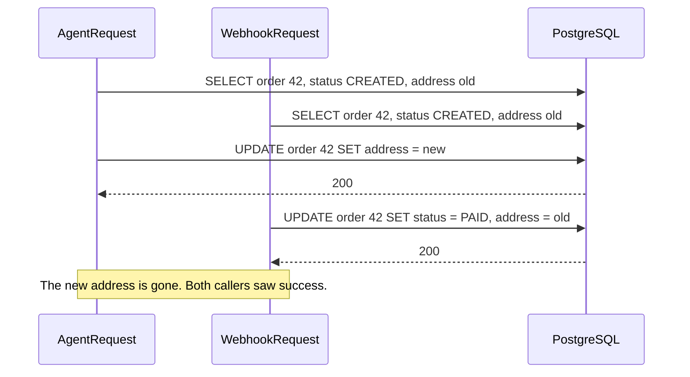
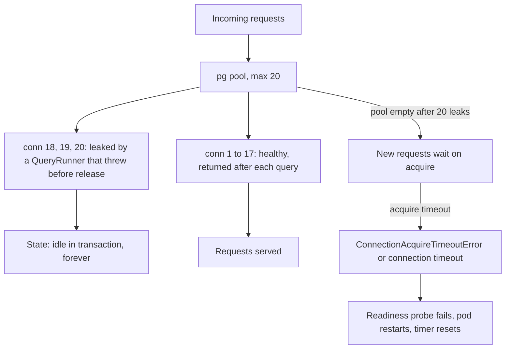

## 22.25 Edge cases and failure modes with ORMs

Every item below has cost a real team a real incident. Each one is presented the same way: the **symptom** you see, the **cause** underneath, the **fix**, and **how to catch it in code review** — because the cheapest place to stop all of these is a pull request.

### 22.25.1 `numeric` and `decimal` arrive as strings

**Symptom.** An invoice shows `total: "19.9919.99"`. Or `NaN`. Or a report where every row is `null`. Tests pass because the fixture used integers.

**Cause.** PostgreSQL's `numeric` has arbitrary precision; a JavaScript `number` is a 64-bit float that cannot represent `0.1 + 0.2` exactly, let alone a 30-digit decimal. `pg` therefore returns `numeric`, `decimal` and `bigint` as **strings**, deliberately, and both ORMs pass that through. So `product.price * item.qty` is `'19.99' * 2`, which JavaScript coerces to `39.98` and hides the problem, while `product.price + shipping` is `'19.99' + '4.50'` = `'19.994.50'`, and `Number(order.totalCents)` on a `bigint` past 9,007,199,254,740,991 silently loses the low digits.

**Fix.** Store money as `bigint` **cents** — integers, no rounding questions, exact addition — and keep the string until the JSON boundary. If you must have decimals, use a decimal library and convert deliberately at one place:

```ts
import Decimal from 'decimal.js';

// TypeORM: an explicit transformer beats a scattered parseFloat
const decimalTransformer = {
  to: (v: Decimal | null) => (v === null ? null : v.toFixed(2)),
  from: (v: string | null) => (v === null ? null : new Decimal(v)),
};

@Column({ type: 'numeric', precision: 12, scale: 2, transformer: decimalTransformer })
price: Decimal;

// Raw SQL: coerce once, at the parse boundary, and only where it is safe
const Row = z.object({ revenue_cents: z.coerce.number().int() });   // cents fit in a JS number below ~90 trillion
```

Do **not** register a global `pg` type parser that turns every `numeric` into a float. It "fixes" the symptom everywhere and corrupts money everywhere.

**Detect in review.** Any arithmetic on a field whose column is `numeric`, `decimal` or `bigint`. Any `parseFloat`. Any `Number(...)` on a money field. Any DTO where a money field is typed `number` but the entity says `string`.

### 22.25.2 `timestamptz` conversion surprises, and `Date` versus string

**Symptom.** An order created at 23:40 on 30 September appears in the October report. A birthday shifts by one day for users in Auckland. `createdAt` comes back as a string in one endpoint and a `Date` in another.

**Cause.** Three different type mappings collide.

- `timestamptz` (OID 1184) is an absolute instant. `pg` converts it to a JS `Date` correctly, and `Date` is always UTC internally. This one is fine.
- `timestamp` **without** time zone (OID 1114) has no zone. `pg` parses it as if it were in the **Node process's local time**. A container running `TZ=Europe/Berlin` and one running `TZ=UTC` produce `Date` objects two hours apart from the identical row. TypeORM's inferred default for a `Date` property is `timestamp without time zone`, so this happens by omission.
- `date` (OID 1082) is a calendar day. Raw `pg` gives you a `Date` at **local** midnight, which in a negative-offset timezone is the previous day. TypeORM returns `'2026-09-09'` as a string for `@Column('date')`, and Sequelize's `DATEONLY` also returns a string — so the same column is a string in the ORM and a `Date` in a raw query in the same codebase.

**Fix.** Always `timestamptz` for instants, always `date` for calendar days, and never `timestamp` without a zone.

```ts
@CreateDateColumn({ type: 'timestamptz', name: 'created_at' }) createdAt: Date;   // TypeORM: state it
@Column({ type: 'date', name: 'invoice_date' }) invoiceDate: string;              // string, not Date
```

```ts
// Sequelize: pin the connection timezone so nothing depends on the container's TZ
SequelizeModule.forRoot({ dialect: 'postgres', timezone: '+00:00', /* ... */ });
// And run every process with TZ=UTC in the Dockerfile / pod spec.
```

Do all date arithmetic in PostgreSQL where the zone is explicit (`date_trunc('day', created_at AT TIME ZONE 'Europe/Berlin')`) rather than in JavaScript. Report boundaries are a business decision about a timezone, not a technical default.

**Detect in review.** Any `@Column({ type: 'timestamp' })` or a `Date` column with no explicit type. Any migration whose generated SQL says `TIMESTAMP` instead of `TIMESTAMP WITH TIME ZONE`. Any `new Date()` used to build a report boundary without a named timezone.

### 22.25.3 `save()` racing under concurrency and silently overwriting

**Symptom.** A support agent updates an order's address; a webhook updates its status one second later; the address change is gone. No error was logged, both requests returned 200.

**Cause.** `save()` is read-modify-write across two round trips. Request A loads the full entity, request B loads the full entity, A writes, B writes — and because Sequelize writes the fields it thinks changed *from the state it loaded*, and TypeORM's `save()` writes the fields present on the object, B's write is based on a snapshot taken before A's. This is the classic lost update (Part 21, section 21.2), and the ORM will never tell you it happened.



**Fix.** Three options, in order of preference:

1. **Write only what changed, atomically.** `repository.update(id, { status: 'PAID' })` or `Order.update({ status }, { where: { id } })` emits `UPDATE ... SET status = $1 WHERE id = $2` and never touches the address column.
2. **Optimistic locking.** TypeORM `@VersionColumn` plus a conditional `UPDATE ... WHERE version = $n` (TypeORM increments but does not guard — you write the `WHERE`), or Sequelize's `version: true`, which does guard and throws `OptimisticLockError`. Return 409 and let the client retry with fresh data.
3. **Pessimistic lock** for short critical sections: `SELECT ... FOR UPDATE` (`lock: { mode: 'pessimistic_write' }`, `lock: Transaction.LOCK.UPDATE`) inside a transaction.

**Detect in review.** `findOne` followed by property assignment followed by `save()`, especially outside a transaction. Any handler that loads a whole entity to change one field.

### 22.25.4 The `findOrCreate` race

**Symptom.** Two customer rows with the same email, or a burst of `500`s during a marketing campaign with `duplicate key value violates unique constraint` in the logs, or — worst — `current transaction is aborted, commands ignored until end of transaction block`.

**Cause.** `findOrCreate` is `SELECT` then `INSERT`, not one atomic statement (section 22.17). Without a unique constraint you get duplicates. With one, the loser gets `23505`; Sequelize recovers by re-selecting, but if the call ran inside a transaction **you** supplied, PostgreSQL has already marked that transaction aborted and the recovery `SELECT` fails too.

**Fix.** A unique constraint is mandatory. Then replace the pattern with one statement:

```sql
INSERT INTO customers (id, email, name) VALUES (gen_random_uuid(), $1, $2)
ON CONFLICT (email) DO UPDATE SET email = EXCLUDED.email
RETURNING id, email, (xmax = 0) AS inserted;
```

`DO UPDATE` rather than `DO NOTHING` so `RETURNING` always yields a row. TypeORM's `repository.upsert(values, ['email'])` and Sequelize's `Model.upsert(values, { conflictFields: ['email'] })` generate the same shape. If you must keep `findOrCreate` inside a transaction, wrap it in a savepoint (`manager.transaction(cb)` nested, or `SAVEPOINT`/`ROLLBACK TO`) so the failed insert does not poison the outer transaction.

**Detect in review.** Every `findOrCreate`: does a unique index cover its `where`? Is it inside a caller-supplied transaction? Both answers must be checked.

### 22.25.5 Eager loading row explosion: 20 orders become 4,000 rows

**Symptom.** An endpoint that returns 20 orders takes 3.4 seconds and the pod's CPU spikes. The database says the query took 180 ms. The gap is Node.

**Cause.** Two collection joins in one query multiply. 20 orders x 10 items x 20 status-history rows = 4,000 rows on the wire, 4,000 rows parsed by `pg`, 4,000 objects allocated, then de-duplicated back to 20. The database did the join efficiently; your process did the hydration badly.

**Fix.** Never join two collections in one query.

```ts
// TypeORM: two queries, one per relation level, no multiplication
const orders = await this.orders.find({
  where: { customerId }, relations: { items: true, history: true },
  relationLoadStrategy: 'query', take: 20,
});

// Sequelize
const orders2 = await this.orderModel.findAll({
  where: { customerId }, limit: 20,
  include: [{ association: 'items', separate: true }, { association: 'history', separate: true }],
});
```

3 queries and 620 rows instead of 1 query and 4,000 rows. Also select fewer columns: a `jsonb` blob or a `text` description multiplied 200 times is megabytes of wasted transfer.

**Detect in review.** Count the `hasMany`/`OneToMany` relations in one query. More than one is a red flag. Ask for the row count, not just the query count.

### 22.25.6 The identity map and stale instances inside a transaction

**Symptom.** Inside a transaction you run `Product.update({ stock: 0 }, { where: { id } })`, then read `product.stock` from an instance you loaded earlier and it still says `5`. Or you load the same order twice in one request, mutate one copy, save both, and the second save undoes the first.

**Cause.** Neither TypeORM nor Sequelize keeps a full identity map, so **two loads produce two independent objects** with independent snapshots. And a bulk `update`/`increment`/raw statement changes the database without touching any in-memory instance. The object in your hand is a photograph, not a live view — and inside a long transaction the photograph gets old fast.

```ts
const product = await this.productModel.findByPk(id, { transaction: t });   // stock = 5
await this.productModel.decrement({ stock: 5 }, { where: { id }, transaction: t });
console.log(product.stock);      // still 5: the instance was not notified
await product.save({ transaction: t });   // may write stale values for other changed fields
```

ORMs that *do* have an identity map and unit of work (MikroORM, Hibernate-style) have the mirror-image surprise: the same row loaded twice is the *same object*, so a change in one place appears in another unexpectedly, and nothing is written until `flush()`, so a raw `SELECT` in the middle of the transaction does not see your pending changes.

**Fix.** After any bulk or atomic statement, either `await instance.reload({ transaction: t })` / `manager.findOne(...)` again, or (better) do not keep the instance at all — use `RETURNING` to get the new state in the same statement:

```ts
const [, [updated]] = await this.productModel.decrement(
  { stock: qty }, { where: { id, stock: { [Op.gte]: qty } }, returning: true, transaction: t },
);
```

**Detect in review.** Any instance used after a bulk update, `increment`, `upsert` or raw query in the same scope. Any function that loads the same entity that its caller already loaded.

### 22.25.7 `migration:generate` produces a destructive diff

**Symptom.** A migration reviewed in ten seconds ("it is generated, it must be right") drops a column, or rewrites a 40 million row table under an `ACCESS EXCLUSIVE` lock during peak traffic.

**Cause.** TypeORM's generator compares entity metadata to the live schema and emits SQL to make them match. It cannot know intent. A rename looks like "drop one column, add another". A hand-written `CHECK` constraint that no entity declares looks like "drop this constraint". A column that exists in the database and not in any entity — because another service owns it, or because it was added by a DBA — looks like "drop it". An enum change looks like "create a new type, rewrite the table, drop the old type".

```ts
// GENERATED for a rename. This deletes every value in the column.
await queryRunner.query(`ALTER TABLE "orders" DROP COLUMN "channel"`);
await queryRunner.query(`ALTER TABLE "orders" ADD "sales_channel" text`);

// CORRECT: a rename is metadata-only in PostgreSQL
await queryRunner.query(`ALTER TABLE "orders" RENAME COLUMN "channel" TO "sales_channel"`);
```

**Fix.** Treat generated migrations as **drafts**. Read every statement. Convert drop-plus-add into `RENAME`. Add `CONCURRENTLY` to index creation and move it out of the transaction. Add `lock_timeout` before DDL on large tables. Declare hand-written constraints in the entity (`@Check()`, `@Index()`) so they stop appearing in the diff. And run `migration:generate` against a database restored from production structure, not against your local one, so it sees the real schema. Sequelize sidesteps this whole class by not generating diffs at all (section 22.20).

**Detect in review.** Any migration containing `DROP COLUMN`, `DROP CONSTRAINT`, `ALTER COLUMN ... TYPE`, or `CREATE INDEX` without `CONCURRENTLY`. Require the author to state the table's row count and the expected lock duration in the pull request description.

### 22.25.8 `synchronize: true` deletes production columns

**Symptom.** The 07:50 deploy story from section 22.1: two years of merchandising notes gone, discovered at 09:15, four hours to restore, a morning of edits lost.

**Cause.** `synchronize: true` (TypeORM) and `sync({ alter: true })` (Sequelize) run the destructive diff of 22.25.7 **automatically, at boot, with no review**. The usual path is a `.env` left over from local development, or a config factory where the value comes from a variable that is `undefined` in production and defaults to `true`.

**Fix.** Hard-code `false`, and make the config refuse to start otherwise:

```ts
useFactory: (config: ConfigService) => {
  const synchronize = config.get('NODE_ENV') === 'test' && config.get('DB_SYNC') === 'true';
  if (synchronize && config.get('NODE_ENV') !== 'test') throw new Error('synchronize is forbidden outside tests');
  return { type: 'postgres', url: config.getOrThrow('DATABASE_URL'), synchronize, migrationsRun: false /* ... */ };
}
```

Belt and braces: give the application's database role no `DROP` privileges. Migrations run as a separate, more privileged role from the pipeline. Then even a mistake cannot delete a column.

**Detect in review.** Grep for `synchronize` and `sync(` in every config file and every test helper on every pull request. It belongs on the CI checklist, not on human memory.

### 22.25.9 `take`/`limit` with a collection join returns fewer parents

**Symptom.** `take: 20` returns 7 orders. The paginator says 10 pages; page 3 is empty; page 2 and page 3 share rows.

**Cause.** `LIMIT` applies to result rows. With a joined collection, one parent is many rows, so `LIMIT 20` cuts in the middle of a parent's children. TypeORM's `find({ take })` handles this by issuing a distinct-ids query first; `createQueryBuilder().limit()` does **not** (`.take()` does). Sequelize handles it by wrapping the parent in a subquery — until you write `subQuery: false` to make a joined-column filter work, at which point the limit counts joined rows again (section 22.16).

**Fix.** Separate the pagination from the child loading.

```ts
// TypeORM: skip/take (distinct parents) not offset/limit (raw rows)
const page = await this.orders.createQueryBuilder('o')
  .leftJoinAndSelect('o.items', 'i')
  .where('o.customerId = :customerId', { customerId })
  .orderBy('o.createdAt', 'DESC')
  .skip(0).take(20)      // TypeORM issues a distinct-id query, then fetches those parents with their items
  .getMany();

// Or: page the ids first, then load the graph. Always predictable, two queries.
const ids = await this.orders.find({ where: { customerId }, select: { id: true }, order: { createdAt: 'DESC' }, take: 20 });
const full = await this.orders.find({ where: { id: In(ids.map((o) => o.id)) }, relations: { items: true } });
```

**Detect in review.** `limit`/`offset` on a query builder that joins a collection. `subQuery: false` anywhere. Any pagination change without a test asserting the returned parent count.

### 22.25.10 Huge `IN (...)` lists blow past the parameter limit

**Symptom.** A nightly job that worked for a year fails with `bind message has 70000 parameter formats but 0 parameters`, or `there is no parameter $65536`, or simply gets slower and slower until it times out.

**Cause.** PostgreSQL's extended protocol allows at most **65,535 bind parameters per statement**. `In(ids)` with 100,000 ids generates `IN ($1, $2, ..., $100000)`. Even below the limit, a 30,000-element `IN` list produces a statement text of half a megabyte that must be parsed and planned on every call, and it is a unique statement text every time, so `pg_stat_statements` fills with one-off entries and no plan is reused.

**Fix.** Use an array parameter, which is a **single** parameter:

```ts
// TypeORM
await this.items.query(`SELECT * FROM order_items WHERE order_id = ANY($1::uuid[])`, [orderIds]);
// or, staying in the ORM, chunk
for (const chunk of chunked(orderIds, 1000)) await this.items.findBy({ orderId: In(chunk) });

// Sequelize
await this.sequelize.query(`SELECT * FROM order_items WHERE order_id = ANY($1::uuid[])`,
  { bind: [orderIds], type: QueryTypes.SELECT });
```

Also handle the empty case: `In([])` and `Op.in: []` produce SQL that is either invalid or accidentally matches nothing depending on version. Guard with `if (ids.length === 0) return [];` before the query.

**Detect in review.** Any `In(...)` or `Op.in` fed from an unbounded array. Ask "what is the maximum length of this list in production in two years?"

### 22.25.11 Connection leaks from an unreleased `QueryRunner`

**Symptom.** The service is fine after a deploy and dies four hours later. Requests hang, then fail. `SELECT count(*), state FROM pg_stat_activity GROUP BY state` shows 20 connections in `idle in transaction`. Restarting the pod fixes it — for four hours.

**Cause.** A `QueryRunner` (TypeORM) or an unmanaged transaction (Sequelize) checked a connection out of the pool and an early `return`, a thrown exception, or a forgotten branch skipped `release()`. The pool never gets it back. Each leak permanently removes one connection; after `max` leaks the pool is empty forever.



**Fix.** The `finally { release() }` rule, without exception:

```ts
const runner = this.dataSource.createQueryRunner();
await runner.connect();
await runner.startTransaction('READ COMMITTED');
try {
  await runner.manager.update(Order, id, { status: 'PAID' });
  await runner.manager.insert(Payment, payment);
  await runner.commitTransaction();
} catch (err) {
  await runner.rollbackTransaction();     // safe even if the transaction already failed
  throw err;
} finally {
  await runner.release();                 // ALWAYS. This is the line people forget.
}
```

Better: use the callback forms (`dataSource.transaction(cb)`, `sequelize.transaction(cb)`) which cannot leak, and reserve `QueryRunner` for the rare cases that genuinely need manual control. Add `idle_in_transaction_session_timeout = 5000` on the database role so PostgreSQL kills leaked sessions even when your code does not.

**Detect in review.** Every `createQueryRunner()` must have a `finally { release() }` in the same function. Every manual `sequelize.transaction()` (the unmanaged form that returns a transaction object) must have `commit`/`rollback` on all paths. Prefer rejecting the manual form entirely.

### 22.25.12 `TimeoutError: connection acquisition timeout` under load

**Symptom.** Under a traffic spike, requests fail with `ConnectionAcquireTimeoutError` (Sequelize; older versions say `TimeoutError: ResourceRequest timed out`) or `timeout exceeded when trying to connect` (`pg`, from `connectionTimeoutMillis`). The database itself looks idle: low CPU, few active queries.

**Cause.** This error means "**I could not get a connection from the pool within the timeout**". It almost never means the database is down. It means every pooled connection is busy, and it is a *symptom* whose real causes are, in order of frequency:

1. **A slow query** holding connections. 20 connections x one 800 ms query each = 25 requests per second maximum on that path.
2. **N+1**, which multiplies the number of connection-seconds each request needs.
3. **A leak** (22.25.11): connections gone permanently.
4. **Work inside a transaction that is not database work** — an HTTP call, an S3 upload, a `sleep` — holding a connection for the duration of a network round trip.
5. **A pool that is simply too small** for the concurrency, or too large so PostgreSQL is thrashing.

**Fix.** Do not raise `max` first; find which of the five it is. `pg_stat_activity` tells you immediately:

```sql
SELECT state, count(*), max(now() - state_change) AS longest
FROM pg_stat_activity WHERE datname = current_database() GROUP BY state;

SELECT pid, now() - query_start AS runtime, left(query, 80)
FROM pg_stat_activity WHERE state = 'active' ORDER BY runtime DESC LIMIT 10;
```

`idle in transaction` points at a leak or a network call inside a transaction. `active` with long runtimes points at slow queries. Many short `active` queries with the same text points at N+1. Then: add the missing index, remove the network call from the transaction, fix the loop, or fix the leak. Set `acquire`/`connectionTimeoutMillis` to a few seconds so the failure is fast and alertable instead of a silent hang, and export pool metrics (`pool.totalCount`, `idleCount`, `waitingCount`) to Prometheus so you see saturation before users do.

**Detect in review.** Any `await` inside a transaction that is not a database call. Any new query without an index behind its `WHERE`. Any change to pool size without a stated calculation.

### 22.25.13 N+1 hidden behind lazy relations and mixins

**Symptom.** p99 latency grows linearly with page size. Nothing appears in the slow query log because every individual query takes 0.4 ms.

**Cause.** `await order.items` on a `Promise`-typed TypeORM relation, or `await order.getItems()` in Sequelize, is a query that looks exactly like a property access. In a loop, a `map`, or a GraphQL resolver, that is one query per parent.

**Fix.** No `Promise`-typed relations in new code, no mixin calls inside loops; load explicitly (`relations`, `include`, `separate: true`) or with a request-scoped DataLoader (section 22.9), and ship a per-request query counter in staging.

**Detect in review.** Any `await` inside a `for`/`map` whose subject is a repository, model or entity property. Any `Promise<Something>` typed relation.

### 22.25.14 ORM cascade deletes more than intended

**Symptom.** Deleting a product deletes three tags that twelve other products used. Or deleting a customer takes 40 seconds, locks the table and produces 2 GB of WAL.

**Cause.** Two different mechanisms. `cascade: ['remove']` on a `@ManyToMany` removes the **related entities**, not the join rows — TypeORM does what you literally asked. And an `ON DELETE CASCADE` chain (`customers` to `orders` to `order_items` to `shipments`) fans one `DELETE` out to millions of rows in a single transaction.

**Fix.** For many-to-many, never cascade remove; to detach associations set `product.tags = []` and save, or delete from the join table. For hierarchies, use `ON DELETE RESTRICT` by default and cascade only where a child has no meaning without its parent. For large fan-outs, batch:

```sql
-- Delete children in chunks so locks and WAL stay bounded
DELETE FROM order_items WHERE order_id IN (
  SELECT id FROM orders WHERE customer_id = $1 LIMIT 10000
);
```

Or soft-delete the parent and let a background job reclaim children over time.

**Detect in review.** Every `cascade` option: does it include `remove`, and is the relation many-to-many? Every new FK: what is its `ON DELETE`, and what is the maximum fan-out? Ask for the row count.

### 22.25.15 Enum changes

**Symptom.** A migration adding `'REFUNDED'` to an order status enum locks `orders` for 90 seconds, or fails with `ALTER TYPE ... ADD VALUE cannot run inside a transaction block`, or a rollback is impossible because you cannot remove an enum value.

**Cause.** PostgreSQL native enums are a type, not a constraint. Adding a value is cheap but has transaction restrictions (and on older versions the new value cannot be used in the same transaction that added it). **Removing** a value requires creating a new type, rewriting every column that uses it, and dropping the old one — a full table rewrite under `ACCESS EXCLUSIVE`. TypeORM's generated migration for any enum change does exactly that rewrite, without telling you.

**Fix.** Prefer `text` with a `CHECK` constraint. Adding a value is then `ALTER TABLE ... DROP CONSTRAINT` plus `ADD CONSTRAINT ... NOT VALID` followed by `VALIDATE CONSTRAINT` — no rewrite, no exclusive lock beyond a moment, and fully reversible:

```sql
ALTER TABLE orders DROP CONSTRAINT orders_status_check;
ALTER TABLE orders ADD CONSTRAINT orders_status_check
  CHECK (status IN ('CREATED','PAID','SHIPPED','CANCELLED','REFUNDED')) NOT VALID;
ALTER TABLE orders VALIDATE CONSTRAINT orders_status_check;   -- scans without blocking writes
```

The TypeScript union type gives you the compile-time safety; the `CHECK` gives you the database-level safety. If you already have native enums, `ADD VALUE` is fine; just never plan to remove one.

**Detect in review.** Any migration touching a `USER-DEFINED` type. Any new `@Column({ type: 'enum' })` or `DataTypes.ENUM` — ask for `text` plus `CHECK` instead.

### 22.25.16 `@BeforeUpdate` and hooks that do not fire

**Symptom.** `updatedBy` is set for changes made through the admin UI and `NULL` for changes made by the bulk importer. Emails are lowercased sometimes. The audit table has gaps that correlate with background jobs.

**Cause.** Lifecycle callbacks fire for **entity** operations only. In TypeORM, `@BeforeUpdate` runs for `save()` and not for `update()`, `upsert()`, `insert()` of plain objects, or any query-builder write — those paths send values, never entity instances, so there is nothing to run the hook on. In Sequelize, instance hooks skip `Model.update`, `Model.destroy`, `bulkCreate`, `increment`/`decrement` and `sequelize.query` (section 22.18).

```ts
await this.orders.save(order);                                  // @BeforeUpdate runs
await this.orders.update(id, { status: 'PAID' });               // does NOT run
await this.orders.createQueryBuilder().update(Order).set({ status: 'PAID' }).where('id = :id', { id }).execute();  // does NOT run
```

**Fix.** Put anything that must always happen where it cannot be skipped:

- Normalisation: in a `class-transformer`/`class-validator` DTO or a NestJS pipe, at the edge.
- Audit trails and `updated_at`: a PostgreSQL trigger, which fires for every write path including `psql`.
- Derived columns: a generated column (`GENERATED ALWAYS AS ... STORED`) or a trigger.

```sql
CREATE OR REPLACE FUNCTION set_updated_at() RETURNS trigger AS $$
BEGIN NEW.updated_at = now(); RETURN NEW; END;
$$ LANGUAGE plpgsql;

CREATE TRIGGER orders_set_updated_at BEFORE UPDATE ON orders
FOR EACH ROW EXECUTE FUNCTION set_updated_at();
```

**Detect in review.** Any hook or listener that does something the business depends on. Ask: "which write paths skip this?" If the answer is "bulk imports", it is in the wrong place.

## 22.26 An ORM code review checklist

Use this as the ORM section of your pull-request template. Most of it is answerable by reading the diff plus the SQL log from a local run.

| # | Check | What a reviewer looks for | Why it matters |
|---|---|---|---|
| 1 | **SQL shown** | The pull request includes the generated SQL for any new or changed query | You cannot review what you cannot see; most ORM bugs are visible in one line of SQL |
| 2 | **Statement count** | Number of statements per request for the changed endpoint | Catches N+1 before it ships |
| 3 | **Row count** | Rows returned, not just statements | Catches join row explosion, which the statement count hides |
| 4 | **No loops over the ORM** | No `await repo.*` / `model.get*()` inside `for`, `map`, `forEach` | The canonical N+1 shape |
| 5 | **Collection joins** | At most one `OneToMany`/`hasMany` joined per query; otherwise two-query strategy | Cartesian multiplication |
| 6 | **Pagination correctness** | `skip`/`take` (not `offset`/`limit`) with joins; `distinct: true` on `findAndCountAll`; no `subQuery: false` | Wrong counts and overlapping pages |
| 7 | **Explicit `required`** | Every Sequelize `include` with a `where` states `required` explicitly | A `where` silently makes it an INNER JOIN |
| 8 | **Column selection** | `select`/`attributes` present on list endpoints; no `jsonb`/`text` blobs fetched to be discarded | Network and hydration cost |
| 9 | **Money and big numbers** | `numeric`/`bigint` handled as strings or cents; no `parseFloat`; no `Number()` on large ids | Silent financial corruption |
| 10 | **Timestamps** | `timestamptz` for instants, `date` for calendar days, no bare `timestamp`, `TZ=UTC` in the runtime | Off-by-one-day and off-by-hours bugs |
| 11 | **Concurrency on writes** | No load-mutate-`save()` on contended rows; atomic `update`/`increment`, version column, or explicit lock | Lost updates that return 200 |
| 12 | **Transaction scope** | Every query inside a transaction uses the transactional manager / `{ transaction: t }` / CLS; no HTTP, S3 or queue calls inside | Silent non-transactional writes; pool exhaustion |
| 13 | **`QueryRunner` release** | `finally { release() }` present, or the callback form used | Permanent connection leaks |
| 14 | **Upserts** | `ON CONFLICT` with a real unique index behind it; `findOrCreate` justified and not inside a caller transaction | Duplicate rows, aborted transactions |
| 15 | **`IN` list bounds** | Arrays fed to `In`/`Op.in` are chunked or converted to `= ANY($1::uuid[])`; empty array guarded | Parameter limit and plan churn |
| 16 | **Migration reviewed line by line** | No `DROP COLUMN` for a rename, `CREATE INDEX CONCURRENTLY`, `lock_timeout` set, row count stated | Data loss and peak-hour locks |
| 17 | **`synchronize` / `sync`** | `false` everywhere except test setup; enforced by config, not memory | Production column deletion |
| 18 | **Cascades** | ORM cascade for inserts, database `ON DELETE` for deletes, no cascade remove on many-to-many, fan-out estimated | Deleting more than intended |
| 19 | **Hooks and listeners** | Nothing business-critical in them; which write paths skip them is stated | Gaps in audit trails and normalisation |
| 20 | **Raw SQL hygiene** | Bound parameters, allow-listed identifiers, `zod`-parsed results, co-located `.sql`, an integration test | Injection and silent shape drift |
| 21 | **Indexes** | Every new `WHERE`/`ORDER BY`/`JOIN` column has an index, with `EXPLAIN (ANALYZE, BUFFERS)` attached | The ORM cannot save a sequential scan |
| 22 | **Scopes and tenancy** | Tenant isolation enforced by RLS or a mandatory repository, not by an opt-in scope | Cross-tenant data leaks fail silently |

## Senior Checklist — Part 22

- [ ] I understand the concept
- [ ] I can explain it simply
- [ ] I can implement it
- [ ] I understand its failure modes
- [ ] I understand its scaling limitations
- [ ] I understand its security implications
- [ ] I understand its operational implications
- [ ] I can choose between alternatives
- [ ] I can explain the tradeoffs
- [ ] I can answer senior-level interview questions
- [ ] I can predict the SQL an ORM call will generate before I run it, and I check the log
- [ ] I can explain what `save()` does differently from `insert()`, `update()` and `upsert()` in both ORMs
- [ ] I know which relation-loading strategy to use from the shape of the data, and why joining two collections is wrong
- [ ] I can detect N+1 from a query log, from `pg_stat_statements`, and with a per-request query counter
- [ ] I know which write paths skip lifecycle hooks and where that logic belongs instead
- [ ] I can explain the difference between ORM cascade and `ON DELETE CASCADE`, and which one I trust
- [ ] I review generated migrations line by line and can name three destructive diffs they produce
- [ ] I would never let `synchronize: true` or `sync({ alter: true })` near data anyone cares about
- [ ] I handle `numeric` and `bigint` as strings or cents, and `timestamptz` with an explicit timezone policy
- [ ] I can size a connection pool from concurrency and query duration, and diagnose an acquire timeout from `pg_stat_activity`
- [ ] I always release a `QueryRunner` in `finally`, or use the callback form
- [ ] I can write the queue claim, the upsert and the top-N-per-group query in raw SQL, safely parameterised and tested
- [ ] I can defend a choice between TypeORM, Sequelize, Prisma, Drizzle, Kysely and MikroORM for a specific team and workload

## Part 22 — Key Takeaways

- The ORM is not the database. Constraints, plans and the SQL log are the truth; entity decorators only describe them.
- Read the generated SQL. Almost every ORM incident is visible in one statement or one row count before it reaches production.
- Statement count and row count are the two numbers that matter. N+1 multiplies the first; joined collections multiply the second.
- Load relations explicitly. `eager: true` and lazy `Promise` relations trade a little typing for an unbounded query bill.
- Writes: prefer one atomic statement (`UPDATE ... WHERE`, `increment`, `ON CONFLICT`) over load-mutate-`save()`, which loses updates silently.
- `findOrCreate` is not atomic; it survives only because of a unique index, and inside a caller's transaction it can abort the whole thing.
- ORM cascade for creating aggregates, database `ON DELETE` for deleting them, `RESTRICT` by default, and estimate the fan-out first.
- Hooks, listeners and subscribers do not fire for bulk and query-builder writes; anything that must always happen belongs in a pipe, a constraint or a trigger.
- Generated migrations are drafts. `synchronize: true` and `sync({ alter: true })` are how production columns disappear.
- `numeric` and `bigint` are strings, `timestamp` without a zone is a bug waiting for a timezone change, and money belongs in `bigint` cents.
- A connection acquire timeout means "the pool is exhausted", not "the database is down"; find the slow query, the leak or the network call inside the transaction before raising `max`.
- The senior answer is hybrid: the ORM for CRUD and transactional writes, raw SQL for reports, windows, recursion, upserts, bulk work and queue claims — parameterised, `zod`-parsed, co-located in `.sql` files and tested against a real database.
- Keep every ORM call behind repositories you own; that one decision is what makes changing ORMs, or mixing in raw SQL, a small project instead of a rewrite.
