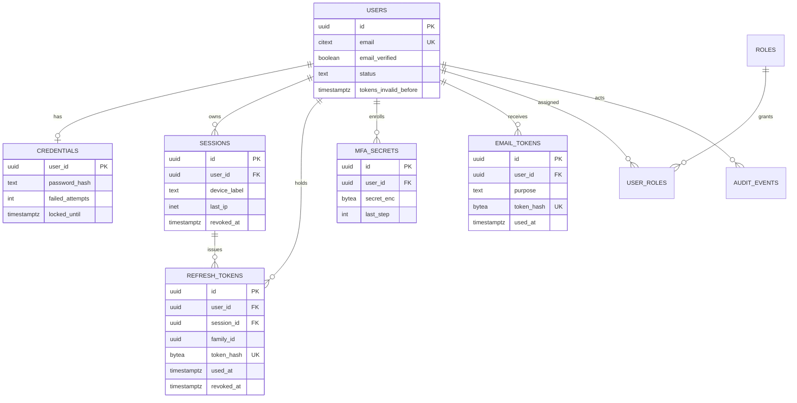
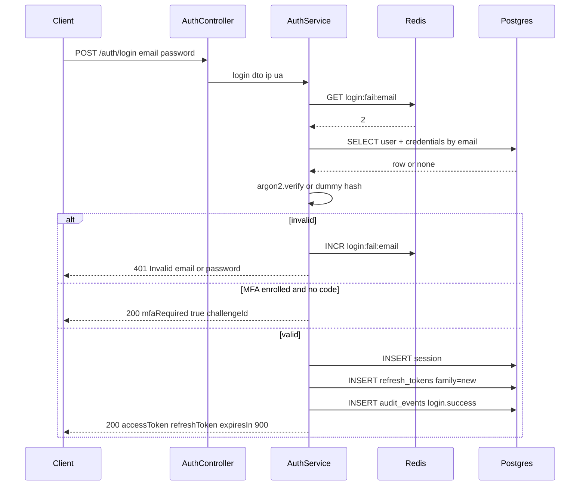
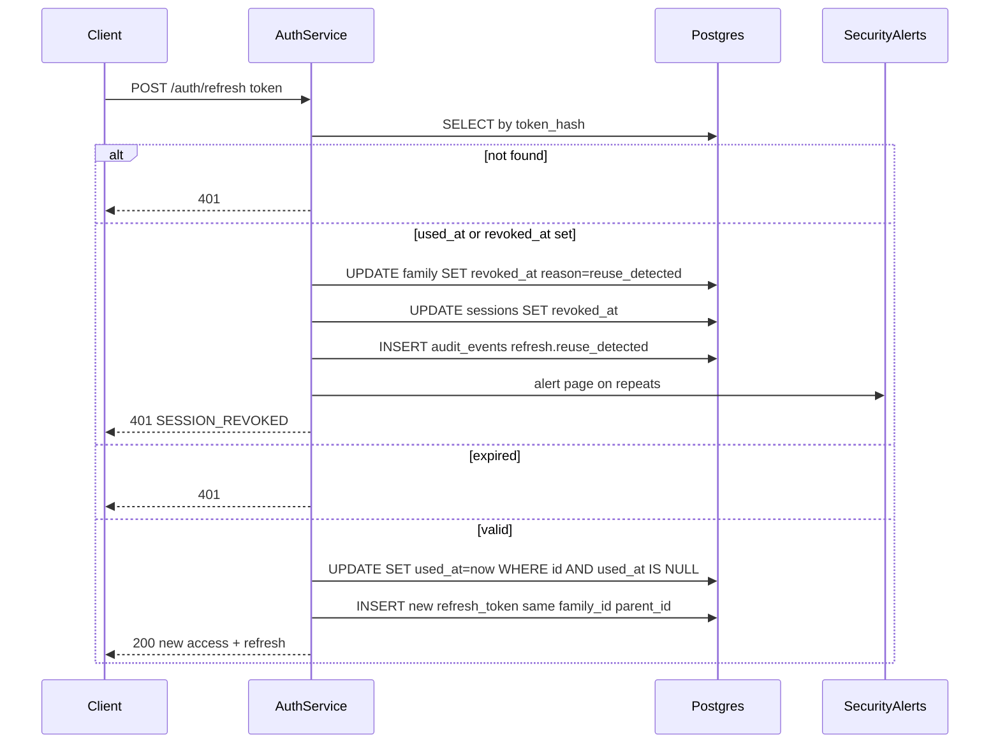

## 22.36 A complete NestJS authentication module

#### Concept

Everything in this part so far has been a piece: hashing, tokens, guards, rate limits, audit events. This section assembles them into one module you can copy into a project and adapt. It is deliberately opinionated, because an authentication module that offers five options for every decision is an authentication module that will be configured wrongly.

The design in one paragraph: **short-lived stateless access tokens, long-lived stateful refresh tokens with rotation and reuse detection, argon2id password hashing, TOTP as the second factor, single-use hashed tokens for email flows, and every security-relevant action recorded in the audit log.** Access tokens are JWTs signed with EdDSA, valid 15 minutes, verified without a database round trip. Refresh tokens are opaque random strings, stored hashed, valid 30 days, rotated on every use, grouped into a *family* so that reuse of an old one kills the whole chain.

#### Why does it exist?

Because "we'll just use Passport" is not a design. Passport gives you a strategy interface; it does not tell you what happens when a refresh token is stolen, how logout-everywhere works, whether a deleted user's token still works for 15 minutes, or where the lockout counter lives. Those decisions are the module.

#### Mental model

Imagine a building with a permanent membership record (the `users` row), a card printer at reception (the auth service), day passes that expire in 15 minutes and are checked at each door without calling reception (access tokens), and a long-term key fob you exchange for a fresh day pass (the refresh token). Each exchange destroys the old fob and issues a new one. If a fob that was already exchanged turns up again, reception knows there are two copies in circulation, cancels every fob in that chain, and calls security.

#### How it works

The decisions, and why:

| Decision | Choice | Why |
|---|---|---|
| Access token format | JWT, EdDSA (`Ed25519`), 15 min | Stateless verification; asymmetric so services verify without the signing key |
| Access token contents | `sub`, `sid`, `roles`, `tenant`, `jti`, `iat`, `exp` | Enough for guards; nothing sensitive; small enough for a header |
| Refresh token format | 32 random bytes, base64url, opaque | Nothing to forge, nothing to leak in a decode; revocable |
| Refresh storage | SHA-256 hash only | A database dump does not yield usable tokens; high entropy means no slow hash needed |
| Rotation | Every refresh issues a new token and consumes the old | Limits the value of a stolen token to one use |
| Reuse detection | Family-wide revocation plus alert | Turns theft into a detected event instead of a silent parallel session |
| Password hashing | argon2id, 64 MB, t=3, p=1 | Memory-hard; tuned to ~120 ms on the API instance |
| Second factor | TOTP with a replay window | No SMS cost, no SIM swap, works offline |
| Email flows | 32 random bytes, hashed, single use, 15–60 min | Same properties as refresh tokens |
| Session model | A `sessions` row per device, referenced by `sid` in the JWT | Logout-everywhere, device list, "sign out other devices" |
| Failure responses | Identical for unknown account and wrong password | No enumeration |

#### PostgreSQL example

The schema. Note what is *not* here: no password column on `users` (credentials are their own table so they can be rotated, so a passwordless user is representable, and so `SELECT * FROM users` never returns a hash), and no plaintext token anywhere.



```sql
CREATE EXTENSION IF NOT EXISTS citext;
CREATE EXTENSION IF NOT EXISTS pgcrypto;   -- gen_random_uuid()

CREATE TABLE users (
  id                    uuid PRIMARY KEY DEFAULT gen_random_uuid(),
  email                 citext NOT NULL UNIQUE,          -- citext: case-insensitive uniqueness
  email_verified        boolean NOT NULL DEFAULT false,
  display_name          text NOT NULL DEFAULT '',
  status                text NOT NULL DEFAULT 'active'
                          CHECK (status IN ('active','suspended','deleted')),
  tenant_id             uuid,
  tokens_invalid_before timestamptz NOT NULL DEFAULT now(),  -- global JWT kill switch per user
  created_at            timestamptz NOT NULL DEFAULT now(),
  updated_at            timestamptz NOT NULL DEFAULT now()
);

CREATE TABLE credentials (
  user_id        uuid PRIMARY KEY REFERENCES users(id) ON DELETE CASCADE,
  password_hash  text NOT NULL,                          -- argon2id encoded string, includes params + salt
  algo           text NOT NULL DEFAULT 'argon2id',
  failed_attempts int NOT NULL DEFAULT 0,
  locked_until   timestamptz,
  password_changed_at timestamptz NOT NULL DEFAULT now()
);

CREATE TABLE sessions (
  id            uuid PRIMARY KEY DEFAULT gen_random_uuid(),
  user_id       uuid NOT NULL REFERENCES users(id) ON DELETE CASCADE,
  device_label  text NOT NULL DEFAULT 'Unknown device',
  user_agent    text,
  ip            inet,
  created_at    timestamptz NOT NULL DEFAULT now(),
  last_seen_at  timestamptz NOT NULL DEFAULT now(),
  revoked_at    timestamptz,
  revoked_reason text
);
CREATE INDEX sessions_user_active_idx ON sessions (user_id, last_seen_at DESC) WHERE revoked_at IS NULL;
```

```sql
CREATE TABLE refresh_tokens (
  id           uuid PRIMARY KEY DEFAULT gen_random_uuid(),
  user_id      uuid NOT NULL REFERENCES users(id) ON DELETE CASCADE,
  session_id   uuid NOT NULL REFERENCES sessions(id) ON DELETE CASCADE,
  family_id    uuid NOT NULL,                    -- constant across a rotation chain
  token_hash   bytea NOT NULL UNIQUE,            -- sha256(token); the token itself is never stored
  parent_id    uuid REFERENCES refresh_tokens(id) ON DELETE SET NULL,
  issued_at    timestamptz NOT NULL DEFAULT now(),
  expires_at   timestamptz NOT NULL,
  used_at      timestamptz,                      -- set when exchanged; a second use is REUSE
  revoked_at   timestamptz,
  revoked_reason text CHECK (revoked_reason IN ('rotated','logout','logout_all','reuse_detected',
                                                'password_changed','admin','expired'))
);
-- The two hot lookups.
CREATE INDEX refresh_family_idx ON refresh_tokens (family_id) WHERE revoked_at IS NULL;
CREATE INDEX refresh_expiry_idx ON refresh_tokens (expires_at);
-- At most one live (unused, unrevoked) token per family: the invariant that makes reuse detectable.
CREATE UNIQUE INDEX refresh_one_live_per_family_idx ON refresh_tokens (family_id)
  WHERE used_at IS NULL AND revoked_at IS NULL;

CREATE TABLE mfa_secrets (
  id          uuid PRIMARY KEY DEFAULT gen_random_uuid(),
  user_id     uuid NOT NULL REFERENCES users(id) ON DELETE CASCADE,
  type        text NOT NULL DEFAULT 'totp' CHECK (type IN ('totp')),
  secret_enc  bytea NOT NULL,                    -- AES-256-GCM under a KMS-wrapped DEK
  confirmed_at timestamptz,                      -- NULL = enrolment started but not proven
  last_step   bigint,                            -- last accepted TOTP step: blocks replay in-window
  recovery_hashes text[] NOT NULL DEFAULT '{}',  -- argon2 hashes of one-time recovery codes
  created_at  timestamptz NOT NULL DEFAULT now()
);
CREATE UNIQUE INDEX mfa_one_confirmed_totp_idx ON mfa_secrets (user_id, type) WHERE confirmed_at IS NOT NULL;

CREATE TABLE email_tokens (
  id          uuid PRIMARY KEY DEFAULT gen_random_uuid(),
  user_id     uuid NOT NULL REFERENCES users(id) ON DELETE CASCADE,
  purpose     text NOT NULL CHECK (purpose IN ('verify_email','password_reset','email_change')),
  token_hash  bytea NOT NULL UNIQUE,
  payload     jsonb NOT NULL DEFAULT '{}'::jsonb,   -- e.g. the new email for 'email_change'
  created_at  timestamptz NOT NULL DEFAULT now(),
  expires_at  timestamptz NOT NULL,
  used_at     timestamptz,
  request_ip  inet
);
-- One live token per purpose per user: issuing a new reset link invalidates the previous one.
CREATE UNIQUE INDEX email_tokens_one_live_idx ON email_tokens (user_id, purpose) WHERE used_at IS NULL;

CREATE TABLE roles (
  id   uuid PRIMARY KEY DEFAULT gen_random_uuid(),
  name text NOT NULL UNIQUE CHECK (name ~ '^[a-z_]{2,32}$')   -- 'customer','support','admin'
);
CREATE TABLE user_roles (
  user_id    uuid NOT NULL REFERENCES users(id) ON DELETE CASCADE,
  role_id    uuid NOT NULL REFERENCES roles(id) ON DELETE RESTRICT,
  granted_by uuid REFERENCES users(id),
  granted_at timestamptz NOT NULL DEFAULT now(),
  PRIMARY KEY (user_id, role_id)
);
```

`audit_events` is the table from 22.34; the auth module writes to it and never updates it.

The partial unique index `refresh_one_live_per_family_idx` is the quiet hero of this schema. It makes "two live refresh tokens in one family" impossible at the database level, so a race between two concurrent refreshes cannot produce two valid chains — one of them fails with a unique violation, which the service maps to a retry or a reuse decision.

#### NestJS example

**The module tree:**

```text
src/auth/
  auth.module.ts
  auth.controller.ts
  auth.service.ts            register, login, refresh, logout, reset, verify
  token.service.ts           JWT signing, refresh token issue/rotate/revoke
  mfa.service.ts             TOTP enrolment and verification
  password.service.ts        argon2id hash/verify, dummy hash, rehash-on-login
  dto/
    register.dto.ts login.dto.ts refresh.dto.ts reset-request.dto.ts
    reset-confirm.dto.ts mfa-enroll.dto.ts mfa-verify.dto.ts
  guards/
    jwt-auth.guard.ts        global; honours @Public()
    roles.guard.ts           global; reads @Roles() via Reflector
  strategies/
    jwt.strategy.ts
  decorators/
    public.decorator.ts current-user.decorator.ts roles.decorator.ts
  filters/
    auth-exception.filter.ts never leaks whether an account exists
  entities/                  users, credentials, sessions, refresh-token, mfa-secret, email-token
```

**The module:**

```ts
@Module({
  imports: [
    TypeOrmModule.forFeature([User, Credential, Session, RefreshToken, MfaSecret, EmailToken, Role]),
    PassportModule.register({ defaultStrategy: 'jwt', session: false }),
    JwtModule.registerAsync({
      inject: [ConfigService],
      useFactory: (cfg: ConfigService) => ({
        privateKey: cfg.getOrThrow<string>('JWT_PRIVATE_KEY'),   // Ed25519 PKCS8 PEM
        publicKey: cfg.getOrThrow<string>('JWT_PUBLIC_KEY'),
        signOptions: {
          algorithm: 'EdDSA', expiresIn: '15m',
          issuer: 'https://api.example.com', audience: 'example-api',
          keyid: cfg.getOrThrow<string>('JWT_KID'),              // enables key rotation
        },
        verifyOptions: { algorithms: ['EdDSA'], issuer: 'https://api.example.com',
                         audience: 'example-api', clockTolerance: 30 },
      }),
    }),
    ThrottlerModule.forRootAsync({
      inject: [ConfigService],
      useFactory: (cfg: ConfigService) => ({
        throttlers: [{ name: 'default', ttl: 60_000, limit: 100 }],
        storage: new ThrottlerStorageRedisService(cfg.getOrThrow('REDIS_URL')),
      }),
    }),
  ],
  controllers: [AuthController],
  providers: [
    AuthService, TokenService, MfaService, PasswordService, JwtStrategy,
    { provide: APP_GUARD, useClass: ThrottlerGuard },   // order matters: throttle first,
    { provide: APP_GUARD, useClass: JwtAuthGuard },     // then authenticate,
    { provide: APP_GUARD, useClass: RolesGuard },       // then authorize.
  ],
  exports: [AuthService, TokenService],
})
export class AuthModule {}
```

**Decorators:**

```ts
// public.decorator.ts
export const IS_PUBLIC_KEY = 'isPublic';
export const Public = () => SetMetadata(IS_PUBLIC_KEY, true);

// roles.decorator.ts
export const ROLES_KEY = 'roles';
export const Roles = (...roles: string[]) => SetMetadata(ROLES_KEY, roles);

// current-user.decorator.ts
export interface JwtUser { sub: string; sid: string; roles: string[]; tenantId?: string; jti: string }
export const CurrentUser = createParamDecorator((data: keyof JwtUser | undefined, ctx: ExecutionContext) => {
  const user = ctx.switchToHttp().getRequest<{ user: JwtUser }>().user;
  return data ? user?.[data] : user;
});
```

**Strategy and guards:**

```ts
// jwt.strategy.ts
@Injectable()
export class JwtStrategy extends PassportStrategy(Strategy, 'jwt') {
  constructor(cfg: ConfigService, private readonly users: UserLookupService) {
    super({
      jwtFromRequest: ExtractJwt.fromAuthHeaderAsBearerToken(),
      ignoreExpiration: false,
      algorithms: ['EdDSA'],
      secretOrKey: cfg.getOrThrow<string>('JWT_PUBLIC_KEY'),
      issuer: 'https://api.example.com',
      audience: 'example-api',
      jsonWebTokenOptions: { clockTolerance: 30 },   // seconds; see 22.39 on clock skew
    });
  }

  // Runs only after the signature, exp, iss and aud have been verified.
  async validate(payload: JwtPayload): Promise<JwtUser> {
    // One cached lookup (Redis, 30 s TTL) enforces the things a stateless token cannot know.
    const state = await this.users.getAuthState(payload.sub);      // status, tokensInvalidBefore, session state
    if (!state || state.status !== 'active') throw new UnauthorizedException();
    if (payload.iat * 1000 < state.tokensInvalidBefore.getTime()) throw new UnauthorizedException();
    if (state.revokedSessionIds.has(payload.sid)) throw new UnauthorizedException();
    return { sub: payload.sub, sid: payload.sid, roles: payload.roles, tenantId: payload.tenant, jti: payload.jti };
  }
}
```

```ts
// jwt-auth.guard.ts: global, opt out with @Public()
@Injectable()
export class JwtAuthGuard extends AuthGuard('jwt') {
  constructor(private readonly reflector: Reflector) { super(); }

  canActivate(ctx: ExecutionContext) {
    const isPublic = this.reflector.getAllAndOverride<boolean>(IS_PUBLIC_KEY, [
      ctx.getHandler(), ctx.getClass(),     // handler beats controller
    ]);
    return isPublic ? true : super.canActivate(ctx);
  }
}

// roles.guard.ts
@Injectable()
export class RolesGuard implements CanActivate {
  constructor(private readonly reflector: Reflector) {}

  canActivate(ctx: ExecutionContext): boolean {
    const required = this.reflector.getAllAndOverride<string[]>(ROLES_KEY, [ctx.getHandler(), ctx.getClass()]);
    if (!required?.length) return true;                       // no @Roles() means authentication is enough
    const user = ctx.switchToHttp().getRequest<{ user?: JwtUser }>().user;
    if (!user) throw new UnauthorizedException();             // 401, not 403: we do not know who you are
    const ok = required.some((r) => user.roles.includes(r));
    if (!ok) throw new ForbiddenException('Insufficient role');
    return ok;
  }
}
```

**DTOs:**

```ts
export class RegisterDto {
  @IsEmail() @MaxLength(254) @Transform(({ value }) => String(value).trim().toLowerCase()) email: string;
  @IsString() @MinLength(12) @MaxLength(128) password: string;   // length beats character classes
  @IsOptional() @IsString() @Length(1, 80) displayName?: string;
}
export class LoginDto {
  @IsEmail() @MaxLength(254) @Transform(({ value }) => String(value).trim().toLowerCase()) email: string;
  @IsString() @MaxLength(128) password: string;
  @IsOptional() @Matches(/^\d{6}$/) totp?: string;               // present on the second leg of MFA login
  @IsOptional() @IsString() @Length(1, 64) deviceLabel?: string;
}
export class RefreshDto { @IsString() @Length(43, 64) refreshToken: string; }
export class ResetConfirmDto {
  @IsString() @Length(43, 64) token: string;
  @IsString() @MinLength(12) @MaxLength(128) password: string;
}
```

With the global pipe `new ValidationPipe({ whitelist: true, forbidNonWhitelisted: true, transform: true })`, a body containing `roles` or `emailVerified` is a 400, not a privilege escalation.

**PasswordService:**

```ts
@Injectable()
export class PasswordService {
  // Tuned so hashing takes 100-150 ms on the API instance. Measure on YOUR hardware.
  private readonly opts = { type: argon2.argon2id, memoryCost: 65536, timeCost: 3, parallelism: 1 } as const;
  // A real hash of a random value, computed once, used to burn the same CPU for unknown emails.
  private readonly dummyHash = argon2.hashSync?.(randomBytes(32).toString('hex'), this.opts);

  hash(plain: string) { return argon2.hash(plain, this.opts); }

  async verify(hash: string | null, plain: string): Promise<boolean> {
    if (!hash) { await argon2.verify(this.dummyHash, plain).catch(() => false); return false; }
    try { return await argon2.verify(hash, plain); } catch { return false; }
  }

  // Upgrade parameters silently when a user logs in with an older hash.
  needsRehash(hash: string) { return argon2.needsRehash(hash, this.opts); }
}
```

**Login, end to end:**



```ts
// auth.service.ts
async login(dto: LoginDto, meta: RequestMeta): Promise<LoginResult> {
  const failKey = `login:fail:${dto.email}`;
  if (Number((await this.redis.get(failKey)) ?? 0) >= 5) {
    throw new HttpException({ code: 'TOO_MANY_ATTEMPTS', retryAfter: 300 }, 429);
  }

  const row = await this.users.findWithCredentials(dto.email);          // LEFT JOIN credentials
  const ok = await this.passwords.verify(row?.passwordHash ?? null, dto.password); // constant work either way

  if (!row || !ok || row.status !== 'active') {
    await this.redis.multi().incr(failKey).expire(failKey, 900).exec();
    await this.audit.record({ action: 'login.failed', actorType: 'system', targetType: 'user',
                              targetId: dto.email, details: { reason: 'invalid_credentials' }, ...meta });
    throw new UnauthorizedException('Invalid email or password');       // one message for every failure
  }
  if (this.passwords.needsRehash(row.passwordHash)) {
    await this.credentials.update(row.id, { passwordHash: await this.passwords.hash(dto.password) });
  }

  const mfa = await this.mfa.getConfirmed(row.id);
  if (mfa && !dto.totp) {
    const challengeId = await this.mfa.startChallenge(row.id, meta);    // 5-minute Redis entry
    return { mfaRequired: true, challengeId };
  }
  if (mfa) await this.mfa.verifyOrThrow(row.id, dto.totp!);             // consumes the step, blocks replay

  await this.redis.del(failKey);
  const session = await this.sessions.create(row.id, dto.deviceLabel ?? deriveLabel(meta.userAgent), meta);
  const pair = await this.tokens.issuePair(row, session.id);            // new family
  await this.audit.record({ action: 'login.success', actorType: 'user', actorId: row.id,
                            targetType: 'session', targetId: session.id, ...meta });
  if (await this.sessions.isNewDevice(row.id, meta)) await this.mailer.newDeviceLogin(row.email, meta);
  return { ...pair, mfaRequired: false };
}
```

**Register:**

```ts
async register(dto: RegisterDto, meta: RequestMeta): Promise<{ status: string }> {
  if (await this.breached.isCompromised(dto.password)) {   // HIBP range API, k-anonymity
    throw new BadRequestException({ code: 'PASSWORD_BREACHED' });
  }
  const hash = await this.passwords.hash(dto.password);
  try {
    await this.ds.transaction(async (tx) => {
      const user = await tx.getRepository(User).save({ email: dto.email, displayName: dto.displayName ?? '' });
      await tx.getRepository(Credential).save({ userId: user.id, passwordHash: hash });
      await tx.query(`INSERT INTO user_roles (user_id, role_id) SELECT $1, id FROM roles WHERE name = 'customer'`,
                     [user.id]);
      await this.emailTokens.issue(tx, user.id, 'verify_email', 60);   // 60 minutes
    });
  } catch (err) {
    if (isUniqueViolation(err, 'users_email_key')) {
      // The email exists. Tell the OWNER, not the requester, and return the same response either way.
      await this.mailer.registrationAttemptOnExistingAccount(dto.email);
    } else { throw err; }
  }
  return { status: 'verification_email_sent' };            // identical response in both branches
}
```

**Refresh with rotation and reuse detection.** This is the core algorithm of the module.



```ts
// token.service.ts
async rotate(presented: string, meta: RequestMeta): Promise<TokenPair> {
  const hash = createHash('sha256').update(presented).digest();          // fast hash: 256 bits of entropy
  const row = await this.refresh.findOne({ where: { tokenHash: hash } });
  if (!row) throw new UnauthorizedException('Invalid refresh token');

  // REUSE: this token was already exchanged or already revoked. Two copies exist. Kill the family.
  if (row.usedAt || row.revokedAt) {
    await this.revokeFamily(row.familyId, 'reuse_detected');
    await this.sessions.revoke(row.sessionId, 'reuse_detected');
    await this.audit.record({ action: 'refresh.reuse_detected', actorType: 'system',
                              targetType: 'user', targetId: row.userId,
                              details: { familyId: row.familyId, tokenId: row.id }, ...meta });
    await this.alerts.securityEvent('refresh_reuse', { userId: row.userId, ip: meta.ip });
    throw new UnauthorizedException({ code: 'SESSION_REVOKED' });
  }
  if (row.expiresAt <= new Date()) throw new UnauthorizedException('Invalid refresh token');

  return this.ds.transaction(async (tx) => {
    // Atomic single-use consume: a concurrent request loses this race and gets 0 rows.
    const res = await tx.query(
      `UPDATE refresh_tokens SET used_at = now(), revoked_at = now(), revoked_reason = 'rotated'
       WHERE id = $1 AND used_at IS NULL AND revoked_at IS NULL RETURNING id`, [row.id]);
    if (res.length === 0) throw new UnauthorizedException({ code: 'SESSION_REVOKED' });

    const user = await tx.getRepository(User).findOneByOrFail({ id: row.userId });
    if (user.status !== 'active') throw new UnauthorizedException();
    await tx.query(`UPDATE sessions SET last_seen_at = now(), ip = $2 WHERE id = $1`, [row.sessionId, meta.ip]);
    return this.issueInto(tx, user, row.sessionId, row.familyId, row.id);   // same family, parent = old id
  });
}

private async revokeFamily(familyId: string, reason: string) {
  await this.refresh.query(
    `UPDATE refresh_tokens SET revoked_at = now(), revoked_reason = $2
     WHERE family_id = $1 AND revoked_at IS NULL`, [familyId, reason]);
}
```

Why this works: after rotation, the old token is `used`. If an attacker stole it before you used it, *they* get the new one and *you* present the old one on your next refresh — reuse detected, family killed, both of you logged out, and the user gets an alert. If they use it after you, same result. Either way the theft becomes a detected event instead of a silent second session. The cost is a real logout for a legitimate user in a race (see the grace window in edge cases).

**Logout and logout-everywhere:**

```ts
async logout(user: JwtUser) {
  await this.refresh.query(
    `UPDATE refresh_tokens SET revoked_at = now(), revoked_reason = 'logout'
     WHERE session_id = $1 AND revoked_at IS NULL`, [user.sid]);
  await this.sessions.revoke(user.sid, 'logout');
  await this.redis.del(`authstate:${user.sub}`);        // drop the cached state so the JWT stops working
  await this.audit.record({ action: 'logout', actorType: 'user', actorId: user.sub,
                            targetType: 'session', targetId: user.sid });
}

async logoutEverywhere(userId: string, reason: 'user_request' | 'password_changed') {
  await this.ds.transaction(async (tx) => {
    await tx.query(`UPDATE refresh_tokens SET revoked_at = now(), revoked_reason = 'logout_all'
                    WHERE user_id = $1 AND revoked_at IS NULL`, [userId]);
    await tx.query(`UPDATE sessions SET revoked_at = now(), revoked_reason = $2 WHERE user_id = $1
                    AND revoked_at IS NULL`, [userId, reason]);
    // Access tokens are stateless: this timestamp is what invalidates the ones already issued.
    await tx.query(`UPDATE users SET tokens_invalid_before = now() WHERE id = $1`, [userId]);
  });
  await this.redis.del(`authstate:${userId}`);
}
```

`tokens_invalid_before` is the switch that makes stateless tokens revocable. `JwtStrategy.validate` compares it against `iat`. The Redis cache of auth state has a 30-second TTL, so the worst case for a revocation to take effect is 30 seconds, and deleting the key makes it immediate.

**Password reset:**

```ts
async requestPasswordReset(email: string, meta: RequestMeta) {
  const user = await this.users.findByEmail(email);
  if (user) {
    const token = randomBytes(32).toString('base64url');
    await this.ds.transaction(async (tx) => {
      // The partial unique index means the previous live token must go first.
      await tx.query(`UPDATE email_tokens SET used_at = now()
                      WHERE user_id = $1 AND purpose = 'password_reset' AND used_at IS NULL`, [user.id]);
      await tx.query(`INSERT INTO email_tokens (user_id, purpose, token_hash, expires_at, request_ip)
                      VALUES ($1,'password_reset',$2, now() + interval '15 minutes', $3)`,
                     [user.id, sha256(token), meta.ip]);
    });
    await this.mailer.passwordReset(user.email, token);
  } else {
    await this.timing.burn(120);          // match the work done in the found branch
  }
  return { status: 'accepted' };          // identical response and timing either way
}

async confirmPasswordReset(dto: ResetConfirmDto, meta: RequestMeta) {
  const rows = await this.ds.query(
    `UPDATE email_tokens SET used_at = now()
     WHERE token_hash = $1 AND purpose = 'password_reset' AND used_at IS NULL AND expires_at > now()
     RETURNING user_id`, [sha256(dto.token)]);        // atomic consume: two concurrent uses, one winner
  if (rows.length === 0) throw new BadRequestException({ code: 'INVALID_OR_EXPIRED_TOKEN' });

  const userId = rows[0].user_id;
  await this.credentials.update(userId, {
    passwordHash: await this.passwords.hash(dto.password), passwordChangedAt: new Date(), failedAttempts: 0,
  });
  await this.logoutEverywhere(userId, 'password_changed');   // every device, everywhere
  await this.audit.record({ action: 'password.changed', actorType: 'user', actorId: userId,
                            targetType: 'user', targetId: userId, details: { via: 'reset' }, ...meta });
  await this.mailer.passwordChanged(userId);
}
```

**Email verification** uses the same `email_tokens` machinery with `purpose = 'verify_email'` and a 60-minute expiry; consuming it sets `users.email_verified = true` in the same transaction. Unverified accounts can log in but are blocked from checkout and from receiving marketing mail — decide that policy explicitly rather than leaving it to whichever guard someone remembers.

**TOTP enrolment and verification with a replay window:**

```ts
@Injectable()
export class MfaService {
  private readonly totp = new TOTP({ digits: 6, period: 30, window: [1, 1] });   // otplib; +/- 1 step

  async startEnrolment(userId: string, email: string) {
    const secret = authenticator.generateSecret(20);                 // 160 bits, base32
    const enc = await this.crypto.encryptForUser(userId, Buffer.from(secret, 'utf8'));  // envelope, 22.16
    await this.repo.upsertPending(userId, enc);                      // confirmed_at stays NULL
    const uri = authenticator.keyuri(email, 'Example Shop', secret); // otpauth:// for the QR code
    return { otpauthUri: uri, secret };                              // shown once, never logged
  }

  async confirmEnrolment(userId: string, code: string) {
    const pending = await this.repo.findPending(userId);
    if (!pending) throw new BadRequestException({ code: 'NO_PENDING_ENROLMENT' });
    const secret = (await this.crypto.decryptForUser(userId, pending.secretEnc)).toString('utf8');
    const step = this.currentStep();
    if (!authenticator.check(code, secret)) throw new BadRequestException({ code: 'INVALID_CODE' });

    const recovery = Array.from({ length: 10 }, () => randomBytes(10).toString('base64url'));
    await this.repo.confirm(userId, step, await Promise.all(recovery.map((c) => this.passwords.hash(c))));
    await this.audit.record({ action: 'mfa.enrolled', actorType: 'user', actorId: userId,
                              targetType: 'user', targetId: userId, details: { type: 'totp' } });
    return { recoveryCodes: recovery };                              // displayed once
  }

  async verifyOrThrow(userId: string, code: string) {
    const row = await this.repo.findConfirmed(userId);
    if (!row) throw new UnauthorizedException();
    const secret = (await this.crypto.decryptForUser(userId, row.secretEnc)).toString('utf8');
    if (!authenticator.check(code, secret)) {
      await this.redis.incr(`mfa:fail:${userId}`);                   // 5 failures -> temporary block
      throw new UnauthorizedException({ code: 'INVALID_CODE' });
    }
    const step = this.currentStep();
    // Replay defence: the same 30-second step can be used exactly once, even inside the +/- 1 window.
    const updated = await this.repo.bumpStep(userId, step);          // UPDATE ... WHERE last_step IS DISTINCT FROM $step AND (last_step IS NULL OR last_step < $step)
    if (!updated) throw new UnauthorizedException({ code: 'CODE_ALREADY_USED' });
  }

  private currentStep() { return Math.floor(Date.now() / 1000 / 30); }
}
```

**The exception filter that never leaks account existence:**

```ts
@Catch()
export class AuthExceptionFilter implements ExceptionFilter {
  private readonly logger = new Logger(AuthExceptionFilter.name);
  // Anything thrown from an auth route collapses into one of these.
  private static readonly SAFE: Record<number, { code: string; message: string }> = {
    400: { code: 'BAD_REQUEST', message: 'Invalid request' },
    401: { code: 'INVALID_CREDENTIALS', message: 'Invalid email or password' },
    403: { code: 'FORBIDDEN', message: 'Not allowed' },
    429: { code: 'TOO_MANY_REQUESTS', message: 'Too many requests' },
  };

  catch(exception: unknown, host: ArgumentsHost) {
    const res = host.switchToHttp().getResponse<Response>();
    const req = host.switchToHttp().getRequest<Request>();
    const correlationId = (req.headers['x-request-id'] as string) ?? randomUUID();
    const status = exception instanceof HttpException ? exception.getStatus() : 500;

    // Full detail to the log, including WHY, so on-call can debug without the client learning anything.
    this.logger.warn({ correlationId, path: req.path, status,
                       reason: exception instanceof HttpException ? exception.getResponse() : String(exception) },
                     'auth request failed');

    const safe = AuthExceptionFilter.SAFE[status] ?? { code: 'INTERNAL', message: 'Internal server error' };
    // Preserve machine-readable codes the client legitimately needs (MFA required, token expired).
    const passthrough = exception instanceof HttpException &&
      ['MFA_REQUIRED', 'SESSION_REVOKED', 'PASSWORD_BREACHED', 'INVALID_OR_EXPIRED_TOKEN', 'OTP_LOCKED']
        .includes((exception.getResponse() as any)?.code);
    const body = passthrough ? (exception as HttpException).getResponse() : safe;
    res.status(status === 500 ? 500 : status).json({ ...(body as object), correlationId });
  }
}
```

The rule the filter enforces: the *client* learns the category, the *log* learns the reason. `UserNotFoundException` and `WrongPasswordException` may exist internally and be useful in logs; neither may ever reach the wire.

#### Production scenario

A retail API with 900,000 monthly active users: 1.4 million logins a month, 26 million refreshes (a 15-minute access token means roughly one refresh per active user per 15 minutes), and about 40,000 password resets. `refresh_tokens` holds around 4 million rows; a nightly job deletes rows where `expires_at < now() - interval '7 days'` in batches of 10,000 to keep vacuum happy. Rotation adds one `UPDATE` and one `INSERT` per refresh, p99 under 6 ms. Reuse detection fires 30 to 60 times a day, and roughly 90 percent of those are the double-refresh race from mobile clients on flaky networks rather than theft, which is why the grace window below matters.

#### Failure scenario

A mobile release shipped without a mutex around token refresh. When the app resumed from background, four queued requests all got 401, all called `/auth/refresh` with the same token, and one won. The other three hit the reuse branch: family revoked, session killed, user logged out. Support tickets went from 12 to 900 a day.

The fix was two-part. Client: a single-flight refresh with the other callers awaiting the same promise. Server: a 10-second grace window — if a token was used within the last 10 seconds, from the same session, and the replacement token has not itself been used, return the *same* replacement pair instead of treating it as reuse. Genuine theft almost never lands inside a 10-second window from the same session id, and the false-positive rate went to nearly zero.

```sql
-- The grace-window query: return the child of a just-rotated token instead of killing the family.
SELECT c.* FROM refresh_tokens p
JOIN refresh_tokens c ON c.parent_id = p.id
WHERE p.token_hash = $1 AND p.used_at > now() - interval '10 seconds'
  AND c.used_at IS NULL AND c.revoked_at IS NULL AND c.session_id = p.session_id;
```

#### Edge cases & failure modes

- **Concurrent refresh** from multiple tabs or a resumed mobile app: use the grace window plus a single-flight client.
- **Deleted or suspended user** with a valid access token: the cached auth state has a 30-second TTL, so there is a window; delete the cache key on status change to close it.
- **Password change during an active session**: `logoutEverywhere` sets `tokens_invalid_before`, so the current device is logged out too. Decide whether to re-issue a pair for the initiating session (most products do).
- **Clock skew** between the signer and a verifier rejecting fresh tokens: `clockTolerance: 30` and NTP on every node.
- **Refresh token in `localStorage`** where XSS can read it: prefer an `HttpOnly; Secure; SameSite=Strict` cookie scoped to `/auth/refresh` for browsers, and the response body only for native apps.
- **Session table growth**: revoke and prune, or the device list becomes a hundred rows of "Chrome on Windows".
- **MFA lockout** when a user loses their phone: recovery codes, and a documented, identity-verified support path that writes an audit event.
- **Enumeration through the MFA step**: `challengeId` must be returned for a valid password on an MFA account only, and the timing of the invalid-password path must match.
- **Argon2 parameters too high** for the instance size: 64 MB per hash times 50 concurrent logins is 3.2 GB. Cap concurrency, or the login endpoint OOMs the pod under a stuffing attack.
- **Unique violation on `refresh_one_live_per_family_idx`** under a race: map it to the same 401 as reuse, or retry once after re-reading.

#### How a Senior Backend Engineer thinks about this

They pick one design and write it down, because the failure mode of auth is not usually a broken algorithm, it is five half-implemented ideas in one codebase. They make revocation possible from day one, since "we chose stateless tokens so we cannot log anyone out" is a sentence that ends careers during an incident. They keep the number of things a client can send small and the number of ways the server can answer smaller. And they treat the reuse-detection alert as a real signal with a real runbook: notify the user, list active sessions, and offer a password change.

They also know what this module does *not* solve: a compromised device, a phished TOTP code (only phishing-resistant WebAuthn stops that), or a malicious insider with database access. Those need different controls.

#### Common mistakes

- Storing refresh tokens in plaintext, or as JWTs that cannot be revoked.
- Rotation without reuse detection, which is just a shorter-lived token.
- Reuse detection without a grace window, which logs out real users daily.
- No `tokens_invalid_before`, so a password change leaves old access tokens working.
- Putting `roles` in the JWT and never bounding the staleness window.
- Returning different errors for unknown email, wrong password, and locked account.
- One `AuthService` method that does registration, login and MFA with six boolean flags.

#### Interview questions

1. *Walk me through refresh token rotation with reuse detection.* Expected: opaque token, hashed at rest, family id, atomic consume, reuse revokes the family, alert and audit.
2. *Why store refresh tokens hashed, and why is SHA-256 enough there when passwords need argon2?* Expected: 256 bits of entropy means no brute force; slow hashing protects low-entropy secrets only.
3. *How do you revoke a stateless access token?* Expected: short lifetime, `tokens_invalid_before`, session revocation list, cached with a bounded TTL.
4. *Two tabs refresh at the same moment. What happens, and how do you avoid logging the user out?* Expected: the race, the grace window, client single-flight.
5. *Where does the MFA replay window come from and how do you close it?* Expected: TOTP accepts +/- 1 step; store `last_step` and reject a repeat.
6. *Design the password reset flow so it is safe against enumeration and races.* Expected: uniform response and timing, hashed single-use token, atomic consume, session invalidation, notification.
7. *What is in your access token, and what is deliberately not?* Expected: `sub`, `sid`, `roles`, `tenant`, `jti`; no email, no PII, no permissions list that changes often.

#### Practical exercise

Implement this module against the schema above, then prove it with integration tests.

Acceptance criteria: registering an existing email returns the same body and status as a new one, and the existing owner receives an email; login with an unknown email and login with a wrong password have identical bodies and timings within 10 percent over 50 samples; refresh rotates the token and the old one fails; using an old token after rotation revokes the whole family, kills the session, and writes an audit event; two concurrent refreshes within 10 seconds both succeed and return the same pair; a password reset logs out all sessions and the previously issued access token stops working within 30 seconds; TOTP code reuse inside the same 30-second step is rejected; every route is protected by default and adding a controller without `@Public()` or a valid token returns 401 in the route-walker test.
