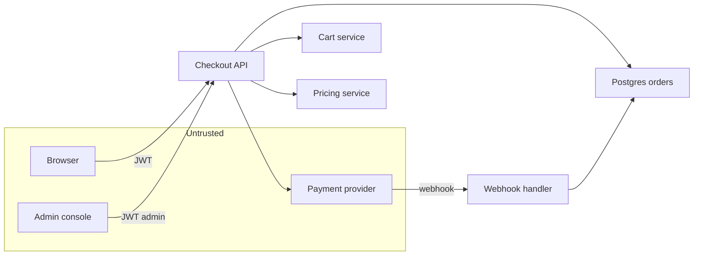

## 22.37 Threat modeling in one page

#### Concept

Threat modeling is a structured conversation that answers four questions about a feature: **what are we building, what can go wrong, what are we doing about it, and did we do a good job?** It is not a document produced by a consultant. It is a 45-minute whiteboard session with the people who are about to write the code, and its output is a short table of threats and controls that turns into tickets.

**STRIDE** is the checklist that stops the conversation from drifting into whatever the loudest person is worried about. Six categories, one per letter:

| Letter | Threat | The property it breaks |
|---|---|---|
| S | Spoofing | Authentication |
| T | Tampering | Integrity |
| R | Repudiation | Non-repudiation |
| I | Information disclosure | Confidentiality |
| D | Denial of service | Availability |
| E | Elevation of privilege | Authorization |

#### Why does it exist?

Because security bugs are cheapest to fix before the code exists. A missing tenant filter found on a whiteboard costs ten minutes; found in production it costs a breach notification. And because engineers are good at imagining failures (timeouts, retries, partial writes) and bad at imagining adversaries, unless something prompts them. STRIDE is the prompt.

#### Mental model

Imagine walking through a new shop with a security consultant before it opens. They do not read a policy document; they walk the customer's path, stopping at each point where something changes hands: the door, the shelves, the fitting room, the till, the stockroom door, the safe. At each point they ask one question: *what would a dishonest person try here?* Threat modeling is that walk, and STRIDE is the six questions they ask at each stop.

#### How it works

**Step 1: draw the flow with trust boundaries.** A trust boundary is any place where data crosses from a less-trusted zone to a more-trusted one. Every boundary is where validation and authorization must happen.



The boundaries here: browser to API, admin console to API, and payment provider to webhook handler. Note that the payment provider sits in the untrusted zone even though you trust the company: the *network path* is untrusted, so the webhook must be authenticated by signature (22.18), not by source IP or by hope.

**Step 2: run STRIDE at each boundary.** The output is one table. This is the deliverable; there is no document behind it.

| # | STRIDE | Threat against checkout | Likelihood | Impact | Control |
|---|---|---|---|---|---|
| 1 | S | Attacker replays a stolen JWT to check out as another customer | Medium | High | 15-minute access tokens, refresh rotation with reuse detection, device/session binding, new-device email |
| 2 | S | Forged payment webhook marks an unpaid order as paid | Medium | High | HMAC signature verification with timestamp and replay cache; reconcile against the provider API before fulfilment |
| 3 | T | Client posts `{ "priceCents": 1 }` with the cart | High | High | Server recomputes every price from `products`; the client sends only ids and quantities |
| 4 | T | Coupon applied twice by concurrent requests | Medium | Medium | `UPDATE coupons SET used = used + 1 WHERE id = $1 AND used < max_uses RETURNING`, unique `(coupon_id, order_id)` |
| 5 | T | Quantity `-5` produces a negative line total and a refund | Medium | High | `@IsInt() @Min(1) @Max(100)` on the DTO; `CHECK (quantity > 0)` in Postgres |
| 6 | R | Customer denies placing a 1,200 euro order | Low | Medium | `audit_events` with actor, ip, user agent, request id, hash chain; payment provider record |
| 7 | R | Support agent refunds to their own card and denies it | Low | High | Refund audit event with `on_behalf_of`, destination change alert, four-eyes approval above a threshold |
| 8 | I | `GET /orders/:id` returns another customer's address | High | High | Owner-scoped query `WHERE id = $1 AND customer_id = $2`; row-level security; 404 not 403 |
| 9 | I | Order confirmation email leaks the full PAN | Low | High | Only `last4` ever leaves the payment service; never-log list; redaction |
| 10 | I | Error response leaks SQL and table names | Medium | Low | Global exception filter with a correlation id |
| 11 | D | Payment endpoint flooded, blocking real checkouts | Medium | High | Cost-weighted rate limit per user, per IP; circuit breaker on the PSP call; separate connection pool for checkout |
| 12 | D | One customer creates 50,000 carts, filling the table | Medium | Medium | Per-user cart limit; TTL cleanup job; quota |
| 13 | E | `POST /admin/orders/:id/refund` without a role guard | Medium | High | Global `RolesGuard`, route-walker test that fails CI on an unguarded admin route |
| 14 | E | `role: "admin"` in the registration body | Medium | High | `ValidationPipe` whitelist plus `forbidNonWhitelisted`; per-audience DTOs |

**Step 3: decide.** Every row gets one of four outcomes: **mitigate** (build the control, make a ticket now), **accept** (write down why, with an owner and a review date), **transfer** (the PSP takes card data so PCI scope moves to them), or **eliminate** (drop the feature). Rows 3, 8, 13 and 14 are always "mitigate before merge". Row 12 might be "accept for now, revisit at 10,000 users".

**Step 4: verify.** Each mitigate row needs a test. "The server recomputes prices" is a claim until there is a test that posts a tampered price and asserts the order total is unchanged.

**How to run it in 45 minutes.** The agenda that works:

```text
0-5    One person draws the flow on the board. Data stores, services, boundaries. No detail.
5-10   Everyone silently lists threats on sticky notes, one per note. Silence matters:
       it stops the first idea from anchoring the room.
10-30  Walk STRIDE letter by letter at each boundary. Notes go on the board under a letter.
       Timebox each letter to 3-4 minutes. Duplicates are a signal, not a problem.
30-40  Score likelihood and impact as High/Medium/Low by show of hands. Do not compute a
       risk number to two decimal places; you are sorting, not measuring.
40-45  Assign an outcome to every row. Mitigations become tickets before people leave.
```

Rules that keep it to 45 minutes: the room is the engineers building the feature plus one person who has seen an incident, no slides, no template document, and no arguing about likelihood for more than 30 seconds (when in doubt, call it Medium and move on). Repeat only when the design changes materially, not on a calendar.

#### Production scenario

A payments team threat-models every design doc before implementation. The session is 45 minutes and produces 8 to 15 rows, of which typically 3 become tickets and the rest are already covered by platform controls. Over two years the sessions caught: a webhook handler that trusted a source IP, a "resend invoice" endpoint that took an email address from the request, and an admin export that had no tenant filter. Each of those was a 20-minute fix at design time.

#### Failure scenario

A team skipped threat modeling for a "simple" gift card feature because it was two endpoints. Nobody asked the D question. The balance check endpoint accepted a card code with no rate limit, and codes were 8 alphanumeric characters. An attacker enumerated 40 million combinations over a weekend from 200 IPs and drained 60,000 euros of balances. The threat is row 12's cousin, and it takes one letter of STRIDE and 30 seconds to find on a whiteboard.

#### Edge cases & failure modes

- Modeling the happy path only and missing the admin, support and internal-service paths.
- Forgetting that the mobile app is untrusted code running on a device the user controls.
- Treating "internal network" as a trust boundary; it is not, in a Kubernetes cluster with 200 pods.
- Producing a document nobody reads instead of tickets somebody builds.
- Threat modeling once at project start and never again after the design changed twice.

#### How a Senior Backend Engineer thinks about this

They run the session early, keep it short, and insist the output is tickets with tests. They know the highest-value letters for a typical CRUD backend are I and E (information disclosure and elevation of privilege), so they spend the most time there. They treat "accepted risk" as a real answer that must be written down with an owner, because an undocumented accepted risk is indistinguishable from an oversight during the postmortem.

#### Common mistakes

- Inviting only the security team, so the people who write the code never build the intuition.
- Scoring risk with a formula instead of sorting by gut and moving on.
- Skipping repudiation because it feels legalistic, then having no audit trail during a dispute.

#### Interview questions

1. *Apply STRIDE to a checkout flow. Give one concrete threat per letter.*
2. *What is a trust boundary and where are they in a typical NestJS deployment?* Expected: client to API, webhook sender to handler, service to service, human to admin console; not "inside the VPC".
3. *A threat model row says "accepted". What must be written next to it?* Expected: reason, owner, review date, and the signal that would change the decision.
4. *How do you keep threat modeling from becoming a document nobody reads?*

#### Practical exercise

Run a 45-minute STRIDE session on the checkout flow of a project you know. Produce the table above with your own rows.

Acceptance criteria: at least one threat per STRIDE letter; every High/High row has a ticket; every mitigate row names a test; every accepted row names an owner and a review date; the session ended on time.

## 22.38 The security review checklist for pull requests

#### Concept

Most security bugs enter the codebase through a normal pull request reviewed by a normal engineer on a normal Tuesday. A checklist turns "does this look fine" into "did we check these specific things", and it works because human reviewers are excellent at pattern matching once told which patterns to match.

Use it as a *filter*, not a ritual: most PRs touch none of these areas and get a normal review. The moment a PR touches a route, a query, a template, a dependency, a config file or a log line, the relevant group applies.

#### How it works

| Group | Check | What to look for |
|---|---|---|
| **Authentication** | Is every new route authenticated? | A new controller without `@Public()` should still be covered by the global guard; a new `@Public()` needs a reason in the PR description |
| | Token handling | No token logged, no token in a URL, no token in `localStorage` for a browser client, expiry set |
| | Credential changes | Password change or reset invalidates sessions; a notification email is sent |
| | MFA paths | The MFA step cannot be skipped by calling the second endpoint directly |
| **Authorization** | Ownership check on every read and write by id | `WHERE id = $1 AND customer_id = $2`, not `findOne(id)` then compare after loading |
| | Role or permission check for privileged actions | `@Roles()` present; admin routes not reachable with a customer token |
| | Tenant filter present in every query | Especially in raw SQL, query builders, bulk operations and reports |
| | 404 not 403 for resources the caller may not see | Otherwise the status code is an existence oracle |
| **Input** | DTO with `class-validator` on every body, query and param | No `any`, no `Record<string, unknown>` reaching a service |
| | Whitelist active | Global `ValidationPipe({ whitelist: true, forbidNonWhitelisted: true })`; nested objects use `@Type()` and `@ValidateNested()` |
| | Numeric and length bounds | `@Min`, `@Max`, `@MaxLength`; pagination has a hard cap |
| | No user input in an interpreter | No string-built SQL, no `exec`, no path from a parameter, no template compiled from data, no `ORDER BY` from a string |
| **Output** | No sensitive field in the response | `@Exclude()` on hashes and secrets, or an explicit response DTO; check the serializer is applied |
| | Error responses generic | No stack trace, SQL, file path, or "user not found" |
| | Correct content type and disposition for files | `nosniff`, `attachment`, forced type from sniffed bytes |
| **Data** | Migration is reversible and non-destructive | No column drops in the same deploy as the code that stops using them |
| | Indexes for new query patterns | And a `WHERE` clause the index can actually serve |
| | PII columns encrypted or justified | New personal data has a retention answer and an erasure answer |
| | Audit event for privileged or money-moving actions | Actor, target, before/after, ip |
| **Dependencies** | New package justified | Downloads, last publish, maintainer count, install scripts, transitive size |
| | Lockfile updated and `npm ci` still reproducible | No floating range added |
| | `npm audit` clean at the policy level | No new high or critical |
| **Configuration** | No secret in the diff | `gitleaks` passes; new config comes from the secrets manager |
| | Production-safe defaults | `synchronize: false`, debug off, Swagger off, CORS explicit |
| | New environment variable added to the config schema and to every environment | A missing variable must fail at boot, not at 3 am on the first request that needs it |
| **Observability** | No sensitive value logged | Structured fields, not interpolated strings; check `err.config.headers` |
| | New failure paths emit a metric or a log with enough context | Correlation id present |
| | Rate limit on any new expensive or public endpoint | With a cost weight if the bucket is shared |

Automate the mechanical half of this list so reviewers spend attention on the parts that need judgement: `gitleaks` for secrets, Semgrep rules for `exec`/`path.join(req`/raw SQL concatenation, an ESLint rule banning `any` in DTOs, a route-walker test asserting every route has a guard, and `npm audit` plus Trivy in CI. A checklist item that a machine can check should never be a human's job twice.

#### Practical exercise

Add the automatable half of the checklist to CI and the judgement half to your pull request template.

Acceptance criteria: a PR adding an unguarded route fails CI; a PR adding a hard-coded secret fails CI; a PR adding `child_process.exec` fails CI; the template's manual items fit on one screen so people actually read them.

## 22.39 Edge cases and failure modes

#### Concept

These are the ones that get through design reviews and appear at 03:00. Each is a real pattern with a symptom you can recognise and a fix you can implement.

**1. Token replay after logout.** *Symptom:* a user clicks "log out", the client deletes the token, and a request replayed from a proxy log or a browser extension still succeeds for the next 14 minutes. *Cause:* logout deleted the refresh token but access tokens are stateless. *Fix:* revoke the session and set `users.tokens_invalid_before = now()` (or maintain a revoked-`sid` set in Redis with a TTL equal to the access token lifetime); check it in `JwtStrategy.validate`; delete the cached auth state key so the check is immediate rather than eventually consistent. Accept that with a 30-second state cache your worst case is 30 seconds, and write that number down.

**2. A stolen refresh token used from another country.** *Symptom:* a refresh succeeds from an IP 4,000 km from the last one, 90 seconds later. *Cause:* the token leaked through a compromised device, a shared computer, or an XSS. *Fix:* bind the refresh token to a session and record the ip and user agent; compute an "impossible travel" signal on refresh (distance divided by elapsed time exceeding, say, 900 km/h) and on a hit require re-authentication, revoke the family, email the user with the device list, and write an audit event. Do not silently block: a VPN produces the same signal, so the response must be "prove it is you", not "you are locked out".

**3. Clock skew rejecting valid tokens.** *Symptom:* a small percentage of requests fail with `jwt not active` or `jwt expired` right after issuing, always on the same pod. *Cause:* the signer's clock is ahead of the verifier's by a few seconds, so `nbf`/`iat` is in the verifier's future. *Fix:* `clockTolerance: 30` (seconds) in `verifyOptions` and in `passport-jwt`'s `jsonWebTokenOptions`; run NTP (chrony) on every node and alert when offset exceeds 1 second; never set `nbf` unless you need it. Tolerance is a band-aid over a clock problem, so monitor the clock too.

**4. JWKS rotation breaking verification mid-deploy.** *Symptom:* during a rollout, some requests fail with `invalid signature` and it clears when the rollout finishes. *Cause:* new pods signed with key B while old pods and downstream verifiers still had only key A, or the JWKS cache TTL was longer than the rollout. *Fix:* the two-phase rotation: **publish first, sign later**. Deploy the new key into the JWKS with a distinct `kid` and let every verifier pick it up (cache TTL 5 minutes, plus a forced refetch on an unknown `kid`, rate limited to avoid a stampede). Only in a later deploy switch signing to the new `kid`. Keep the old key published for at least the maximum token lifetime plus skew before removing it.

**5. The session store being unavailable.** *Symptom:* Redis is down and every request either 500s or, worse, succeeds without a session check. *Cause:* an error handler that treats a lookup failure as "no revocation found". *Fix:* auth **fails closed**. A store error is a 503, not an implicit allow. Write the check so the safe branch is the default: `const state = await lookup(); if (!state) throw new UnauthorizedException();` never `if (state?.revoked) throw`. Separately, reduce the blast radius: cache auth state locally in-process for a few seconds so a brief Redis blip does not become a full outage, and make the *non-security* uses of Redis (rate limiting on read endpoints) fail open, which is the opposite decision for a reason you can articulate.

**6. An API key leaked into logs or a git commit.** *Symptom:* GitHub's secret scanner emails you, or the key turns up in a log search. *Cause:* the key was logged in an error, printed in a debug branch, or committed in a `.env`. *Fix:* run the runbook from 22.32 (rotate, revoke, audit, contain, rewrite, close the path). Structurally: give keys a visible prefix (`ak_live_`) so scanners can find them, store only the hash, keep `last_used_at` and `last_used_ip` so you can prove the old key is dead, scope each key to the minimum permissions and to an IP range where the client allows, and add the prefix to your own log-scanning rules so you find your leaks before a scanner does.

**7. A permission cache still allowing access after a role was revoked.** *Symptom:* an offboarded employee's admin access works for another ten minutes. *Cause:* roles are cached in Redis with a 15-minute TTL, or baked into a JWT with a 15-minute life, and revocation only wrote the database. *Fix:* make revocation an *event*, not just a write: the same transaction that deletes the `user_roles` row publishes an invalidation that deletes `authstate:{userId}` and bumps `tokens_invalid_before`. Keep the TTL short enough that a missed invalidation self-heals (30 to 60 seconds), and write a test that revokes a role and asserts a 403 within the documented window. Decide and document the window; "immediately" is not an implementable requirement for a distributed cache.

**8. A deleted user holding a valid JWT for 15 more minutes.** *Symptom:* a deactivated account keeps placing orders. *Cause:* the token is stateless and nothing checks user status. *Fix:* the same mechanism as 7 — status is part of the cached auth state that `validate()` checks, and deletion invalidates the cache key. If your access tokens are longer-lived than a minute or two, you need this check; if you insist on no per-request lookup, then your token lifetime *is* your revocation window, so make it 5 minutes and say so out loud.

**9. Tenant data leaking through one query that forgot the filter.** *Symptom:* a customer of tenant A sees a row from tenant B in a report or an export. *Cause:* one query out of 400 was written by hand without `tenant_id`. *Fix:* stop relying on discipline. Enable PostgreSQL row-level security on every tenant-scoped table, with a policy on a session variable set per request:

```sql
ALTER TABLE orders ENABLE ROW LEVEL SECURITY;
CREATE POLICY orders_tenant ON orders USING (tenant_id = current_setting('app.tenant_id', true)::uuid);
-- Per request, on the connection checked out of the pool:
SET LOCAL app.tenant_id = '2f1c...';
```

`SET LOCAL` scopes it to the transaction, so a pooled connection cannot leak the setting to the next request. Also add a CI test that runs every repository method as tenant A and asserts zero rows from tenant B, and make sure the app role is not `BYPASSRLS`.

**10. Timing attacks on token comparison.** *Symptom:* none, until a researcher demonstrates it. *Cause:* `a === b` on strings short-circuits at the first differing byte, and over enough samples the difference is measurable, especially on a local network. *Fix:* `crypto.timingSafeEqual` on equal-length buffers, and hash both sides first so the lengths always match and the comparison never reveals the length:

```ts
export function safeEqual(a: string, b: string): boolean {
  const ha = createHash('sha256').update(a).digest();
  const hb = createHash('sha256').update(b).digest();
  return timingSafeEqual(ha, hb);           // both are 32 bytes, always
}
```

Use it for API keys, webhook signatures, OTP codes and reset tokens. `timingSafeEqual` throws if the buffer lengths differ, which is why the hash step matters. Note that a database lookup by hash is already constant-ish time and is the better pattern where it applies.

**11. A race in password reset where two tokens are valid at once.** *Symptom:* a user requests two reset emails, uses the first, and the second still works an hour later; or two concurrent submissions of the same token both succeed and the second sets a password the attacker chose. *Cause:* issue-then-check logic instead of atomic consumption, and no invalidation of the previous token. *Fix:* the partial unique index (`WHERE used_at IS NULL`) so only one live token per user per purpose can exist, invalidation of the previous token inside the same transaction that issues the new one, and atomic consumption with `UPDATE ... WHERE used_at IS NULL AND expires_at > now() RETURNING user_id`. Zero rows returned means someone else won; return the same generic error either way.

**12. Mass assignment through a nested DTO.** *Symptom:* a user updates their profile and their `address.id` now points at someone else's address row, or their `subscription.plan` becomes `enterprise`. *Cause:* `whitelist: true` without `forbidNonWhitelisted`, or a nested object without `@Type()` so `class-transformer` never converts it and validation silently skips it. *Fix:* `forbidNonWhitelisted: true` and `forbidUnknownValues: true` globally; `@ValidateNested()` with `@Type(() => AddressDto)` on every nested object and array; no `id` field on nested input DTOs (the server resolves ownership); and never `Object.assign(entity, dto)`. Add a test that posts an unexpected property to every write route and asserts a 400 naming the property.

**13. CORS misconfiguration exposing authenticated responses.** *Symptom:* a bug bounty report shows an attacker page reading `GET /api/me` for any logged-in visitor. *Cause:* `origin: true` (reflection) with `credentials: true`, or a suffix match like `endsWith('example.com')` that also matches `evil-example.com`, or allowing `Origin: null`. *Fix:* an exact allow-list from configuration, `credentials: true` only with a specific origin, never `null`, and a boot-time assertion plus a unit test that a forged origin gets no `Access-Control-Allow-Origin` header. Remember that CORS protects browsers only; it is not an authorization control for server-to-server callers.

**14. SSRF through an HTTP redirect after the allow-list check.** *Symptom:* a "fetch product data from your URL" feature is used to read `http://169.254.169.254/latest/meta-data/iam/security-credentials/`. *Cause:* the code validated the *initial* URL against an allow-list, then let the HTTP client follow a `302` to an internal address. The DNS variant is worse: the hostname resolves to a public IP during validation and to `127.0.0.1` on the actual request (DNS rebinding). *Fix:*

```ts
const res = await axios.get(url, {
  maxRedirects: 0,                                   // follow redirects yourself, revalidating each hop
  timeout: 5_000,
  validateStatus: (s) => s < 400,
  // Resolve and pin the IP: validate the address you will actually connect to.
  httpAgent: new http.Agent({ lookup: allowListedLookup }),
});
```

`allowListedLookup` resolves the hostname, rejects any address in a private, loopback, link-local or unique-local range (including IPv6 and IPv4-mapped forms like `::ffff:127.0.0.1`), and hands the resolved IP to the connection so the name cannot be re-resolved to something else. Follow redirects manually, applying the same check to each `Location`, with a hop limit of 3. Then add the control that survives a code bug: an egress network policy or proxy that only permits the destinations this service legitimately needs.

#### How a Senior Backend Engineer thinks about this

Every item above is a place where a *correct-looking* implementation is wrong because of timing, caching, concurrency or a second request. So they ask the same six questions about every security control that they ask about every other piece of the system: *Can it time out? Can it fail? Can it become slow? Can it duplicate? Can it return a wrong response? Can it partially succeed?* — plus the security additions: *Can it be forged? Can it be replayed? Can it be guessed? Can it be bypassed? Can it leak? Can it be abused at scale?*

They also write down the windows. "Revocation takes effect within 30 seconds." "Access tokens live 15 minutes." "The reuse grace window is 10 seconds." A number you have chosen is a design; a number you have not chosen is a surprise during an incident.

## 22.40 Security as a practice

#### Concept

Everything so far is a control. This section is about the routine that keeps controls working after the people who built them have moved on: scanning, testing, external reporting, and the ability to respond when it goes wrong anyway.

#### How it works

**Dependency scanning in CI.** The baseline, running on every pull request and nightly on the default branch:

```yaml
# .github/workflows/security.yml (excerpt)
jobs:
  scan:
    runs-on: ubuntu-latest
    permissions: { contents: read, security-events: write, id-token: write }
    steps:
      - uses: actions/checkout@v4
      - uses: gitleaks/gitleaks-action@v2          # secrets in the diff and in history
      - run: npm ci --ignore-scripts
      - run: npm audit --omit=dev --audit-level=high
      - run: npx semgrep --config .semgrep.yml --error   # exec, path.join(req, raw SQL, eval
      - run: npx @cyclonedx/cyclonedx-npm --output-file sbom.json
      - uses: aquasecurity/trivy-action@0.28.0     # OS and image layers
        with: { image-ref: "ghcr.io/example/api:${{ github.sha }}", severity: "HIGH,CRITICAL", exit-code: "1" }
```

Nightly matters as much as per-PR: a dependency that was clean on Monday has a CVE on Thursday, and nobody opened a PR in between. Route the results into one place with an owner and an SLA (critical in 24 hours, high in 7 days, medium in 30), or the scanner becomes noise everyone mutes.

**Penetration testing cadence.** A useful rhythm for a mid-sized product: an external pentest annually, plus one after any major architectural change (new auth system, new tenant model, first mobile app). Two weeks of a good tester's time on a scoped target beats a month of automated scanning. Give them credentials for two accounts in two tenants and one admin account — an unauthenticated test on a product that is 95 percent behind login tests 5 percent of your attack surface. Insist that findings come with reproduction steps, and treat the retest as part of the engagement.

**Bug bounty.** Start with a **vulnerability disclosure policy** before a paid bounty: a `security.txt` file, a monitored `security@` address, a public promise not to pursue researchers acting in good faith, and a stated response time. That alone converts a percentage of "found a bug, posted it on Twitter" into "found a bug, emailed you". Move to a paid programme only when you can triage within a day and fix within a week; a bounty with a slow queue produces angry researchers and public disclosure. Start private and scoped, with a clear out-of-scope list (denial of service testing, social engineering, physical, third-party services).

**Incident response for a breach.** The shape of the first four hours, written down before you need it:

```text
1. Declare.       One incident commander. One channel. One document. Say the word "incident".
2. Contain.       Revoke credentials, disable the endpoint, block the IP, scale down the
                  compromised workload. Containment beats investigation in the first hour.
3. Preserve.      Snapshot pods and volumes before restarting anything. Export logs to a
                  place with a longer retention than the source. Note the times in UTC.
4. Assess.        What data, whose data, how much, over what period? Query the audit log.
                  "We do not know" is an answer that must be written down and worked on.
5. Eradicate.     Rotate every secret in the blast radius, not only the one you think leaked.
                  Patch the entry point. Rebuild rather than clean.
6. Recover.       Restore service, monitor closely, keep the incident open.
7. Notify.        Legal and privacy counsel decide the obligations. GDPR is 72 hours to the
                  supervisory authority from becoming aware. Start that clock in the document.
8. Learn.         Blameless postmortem within a week: timeline, contributing factors, actions
                  with owners and dates. Publish internally.
```

The two things teams get wrong under pressure: restarting the compromised pod (destroying the evidence) and rotating only the one credential they can prove was used. Snapshot first; rotate wide.

**The disclosure conversation.** When you have to tell customers, three principles beat any amount of wordsmithing. Say what happened in plain language and be specific about scope, including what was *not* affected. Say what you are doing and what they should do, with the useful actions first (change your password, check your sessions, watch for phishing that references this incident). And do not promise what you cannot verify — "no data was accessed" is only sayable if you have logs proving it, and "we take security seriously" costs you credibility because it is what everyone says.

Practise it: a tabletop exercise where the team is handed a scenario ("a researcher emails you a screenshot of another tenant's orders") and runs the playbook for an hour is the cheapest preparation available, and it always finds that nobody knows who can revoke production credentials at 2 am.

#### How a Senior Backend Engineer thinks about this

They know security is a rate, not a state: you will introduce vulnerabilities continuously, so what matters is how fast you find and remove them. They spend their budget on the controls that keep working when someone forgets — global guards, row-level security, database grants, egress rules, scanners in CI, short-lived credentials — rather than on documents that describe what everyone should remember. They keep the incident runbook short enough to be followed at 3 am. And they are honest with the business: perfect security is not on the menu; bounded, understood, monitored risk is.

## Senior Checklist — Part 22

- [ ] I understand the concept
- [ ] I can explain it simply
- [ ] I can implement it
- [ ] I understand its failure modes
- [ ] I understand its scaling limitations
- [ ] I understand its security implications
- [ ] I understand its operational implications
- [ ] I can choose between alternatives
- [ ] I can explain the tradeoffs
- [ ] I can answer senior-level interview questions
- [ ] I can explain the difference between authentication and authorization, and when each returns 401 versus 403
- [ ] I can implement refresh token rotation with reuse detection, including the concurrency race and the grace window
- [ ] I can choose and tune a password hash, and explain why argon2id beats bcrypt and why both beat SHA-256
- [ ] I can name the parameterised form for every interpreter my service talks to
- [ ] I can write an ownership-scoped query and back it up with row-level security
- [ ] I can design a file upload pipeline with quarantine, magic-byte checks, re-encoding and a separate serving domain
- [ ] I can configure pino redaction and explain why it is a backstop rather than the control
- [ ] I can answer a right-to-erasure request without breaking an append-only audit log
- [ ] I can rotate a database credential and a JWT signing key with zero downtime
- [ ] I can write a CSP for an API and for a server-rendered page, and explain why `origin: true` with credentials is a data leak
- [ ] I can build a tamper-evident audit log and verify the chain
- [ ] I can run a 45-minute STRIDE session and turn the output into tickets with tests
- [ ] I can run the first hour of a breach response without improvising

## Part 22 — Key Takeaways

- Authentication asks who you are; authorization asks what you may do. Deny by default, and make the deny the framework's job, not the developer's memory.
- Short-lived access tokens plus rotating, revocable refresh tokens with reuse detection is the design that survives a stolen token; rotation without detection is only a shorter fuse.
- Every injection is the same bug: data became syntax. Learn the parameterised form for SQL, shells, paths, Redis, Lua, logs, templates and dynamic SQL, and allow-list where no parameterised form exists.
- Hash passwords with argon2id tuned to about 100 ms on your hardware; hash high-entropy tokens with SHA-256 and compare with `timingSafeEqual`.
- Uploaded bytes are hostile until your own pipeline has re-encoded them; only a `clean` state is servable, and user content belongs on its own domain.
- The never-log list is short and absolute; structured logging plus redaction is a backstop, and crypto-shredding is how erasure coexists with append-only history.
- Secrets should be short-lived and narrowly scoped, because then a leak is survivable; every rotation needs an overlap window before the old value dies.
- PostgreSQL has an authorization system: per-service roles, column grants, statement timeouts and row-level security back up application code that will eventually be wrong.
- Security headers are the cheapest control you own, and CORS reflection with credentials is the most expensive mistake in that file.
- An audit log is a business record, not a debug log: append-only, hash-chained, retained for years, and queryable by the people who need it.
- Rate limit on the unit that matters — account for auth, key for partners, user for cost — in shared storage, before the expensive work, with `Retry-After` on the way out.
- Threat model for 45 minutes with the people writing the code; the output is tickets with tests, not a document.
- Security is a rate, not a state. Invest in controls that keep working when someone forgets, write down your windows, and rehearse the incident before you have one.
