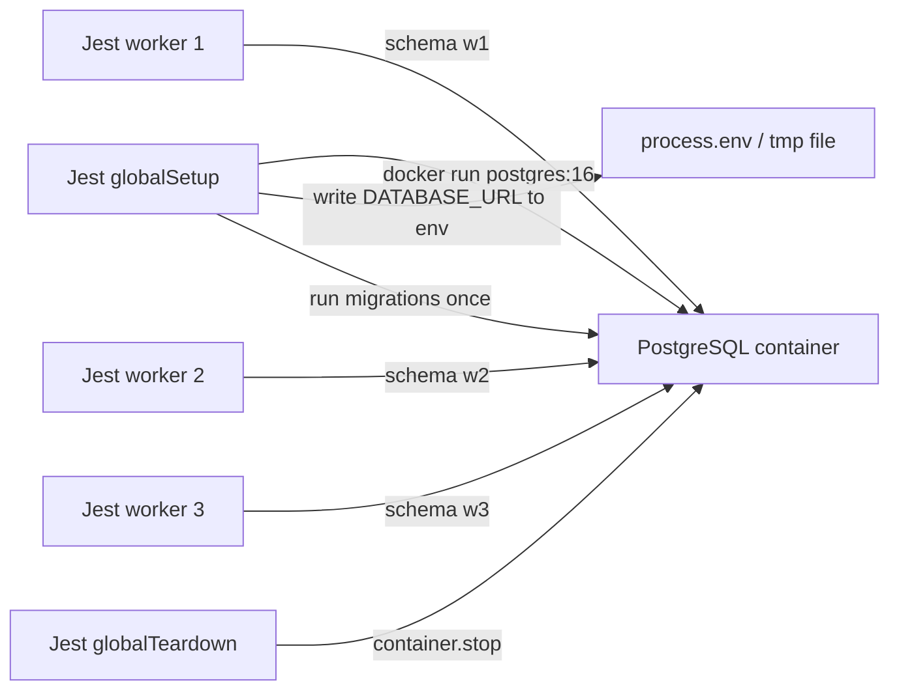

## 23.6 Fixtures, factories and builders

#### Concept

A **fixture** is data that exists before a test runs. A **factory** (or **builder**) is a function that creates a valid object or row with sensible defaults, letting the test override only what matters. The difference decides whether your suite is readable at 500 tests or a swamp of copy-pasted 30-field object literals.

#### Why does it exist?

Every test needs a valid `Order`, a valid `Customer`, a valid `Product`. If each test builds them inline, the first schema change (adding a required `currency` column) touches 300 files. If tests share one giant `fixtures.json`, every test depends on every row in it, nobody dares delete a row, and the file becomes a second, undocumented schema. This is **fixture drift**: the test data slowly stops looking like production data, and tests keep passing on shapes production never sees.

#### Mental model

Imagine a film set. The props department has a standard "office desk" kit: a lamp, a phone, three folders. A scene that needs a red folder asks for the standard kit with one red folder. Nobody rebuilds the desk from raw wood per scene, and nobody drags a single shared desk between every set (someone would eventually knock the lamp over in scene 12 and break scene 40).

#### How it works

1. One builder per aggregate or table, living under `test/builders/`.
2. Defaults are *valid* and *boring*: a normal customer, an in-stock product, a small order.
3. Randomised fields use `@faker-js/faker` with a **fixed seed** so failures reproduce.
4. Overrides are a partial object merged on top.
5. A separate `seed*` helper writes the built objects to the real database in integration tests, returning the persisted rows (with generated ids).

```ts
// test/builders/order-line.builder.ts
import { faker } from '@faker-js/faker';
import { OrderLine } from '../../src/orders/domain/order';

faker.seed(20260906); // deterministic across runs; change on purpose only

export function anOrderLine(overrides: Partial<OrderLine> = {}): OrderLine {
  return {
    sku: `SKU-${faker.string.alphanumeric({ length: 8, casing: 'upper' })}`,
    unitPriceCents: faker.number.int({ min: 100, max: 50_000 }),
    qty: faker.number.int({ min: 1, max: 5 }),
    ...overrides,
  };
}
```

```ts
// test/builders/product.builder.ts
import { faker } from '@faker-js/faker';
import { DataSource } from 'typeorm';
import { Product } from '../../src/products/product.entity';

export function aProduct(overrides: Partial<Product> = {}): Product {
  const p = new Product();
  p.sku = `SKU-${faker.string.alphanumeric({ length: 8, casing: 'upper' })}`;
  p.name = faker.commerce.productName();
  p.priceCents = faker.number.int({ min: 100, max: 50_000 });
  p.stock = 10;
  Object.assign(p, overrides);
  return p;
}

export async function seedProducts(ds: DataSource, products: Product[]): Promise<Product[]> {
  // save() returns entities with generated columns filled in
  return ds.getRepository(Product).save(products);
}
```

A test then reads as intent:

```ts
const [last] = await seedProducts(ds, [aProduct({ stock: 1, priceCents: 9_999 })]);
```

#### Edge cases & failure modes

- Unseeded faker produces a different email each run; a unique-constraint failure appears once a month and nobody can reproduce it.
- Builders that default `stock: 0` make half the tests fail for the wrong reason. Defaults must be the *happy path*.
- A builder that generates a random `createdAt` "in the past" occasionally lands on a daylight-saving boundary and breaks a date-diff assertion. Pin dates unless the test is about dates.
- Seeding via the ORM runs entity hooks and default values; seeding via raw SQL bypasses them. Choose deliberately; if your production writes go through the ORM, seed through the ORM.

#### Common mistakes

- One `fixtures.sql` with 4,000 rows loaded in `beforeAll`. Every test depends on all of it.
- Builders that hit the database implicitly on construction, making unit tests secretly integration tests.
- Overriding ids by hand (`id: 1`) and colliding with sequences later in the same test file.

#### Interview questions

1. *What is fixture drift and how do you prevent it?* Expected: test data diverging from production shapes over time; prevent with builders that default from the real entity and with integration tests that go through real migrations.
2. *Why seed faker?* Expected: reproducibility; a failing test must fail the same way tomorrow.

## 23.7 Integration testing with a real PostgreSQL (Testcontainers)

#### Concept

An **integration test** runs your real code (service, repository, ORM configuration, migrations) against a real dependency (PostgreSQL, Redis, Kafka) that is started just for the test run. **Testcontainers** is a library that starts Docker containers from test code, waits for them to be ready, hands you the connection details, and stops them afterwards.

#### Why does it exist?

The bugs unit tests cannot see are exactly the ones a real database exposes: a `NOT NULL` you forgot, a `UNIQUE` that fires on retry, a foreign key that blocks a delete, a `FOR UPDATE` that does not lock what you think, a migration that does not match the entity, a `timestamp` vs `timestamptz` mismatch, a query plan that seq-scans 30 million rows. Every one of those has caused a production incident that a mocked repository could not have prevented. Integration tests are the cheapest place to find them.

#### Mental model

Imagine a flight simulator. It is not a real flight, but the instruments, the physics and the failure modes are real. Pilots train on it because a checklist on paper (unit tests) does not prepare you for what the aircraft actually does when an engine fails.

#### How it works



1. **Global setup** starts one PostgreSQL container for the whole run (startup about 1.5–3 s for `postgres:16-alpine` on a warm Docker cache). Starting one per test file would multiply that by the number of files.
2. The connection URI is shared with workers through environment variables (set in global setup) or a temp file.
3. Migrations run once against the container. Never use `synchronize: true` in tests; it creates a schema from entities that can differ from what migrations create in production (section 23.20 lists the incident).
4. Each Jest worker gets an isolated slice of the database (a schema or a database per worker) so parallel files do not interfere.
5. Each test gets a clean state using one of the isolation strategies below.
6. Global teardown stops the container.

The **per-test isolation strategies**, with tradeoffs:

| Strategy | Speed | Isolation | Works with | Catches | Fails on |
|---|---|---|---|---|---|
| Transaction rollback (open `BEGIN` before test, `ROLLBACK` after) | Fastest (no I/O for cleanup) | Per test | Code that accepts an injected `EntityManager`/`QueryRunner` | Most SQL bugs | Code that opens its own transactions (nested `BEGIN` is a savepoint, `COMMIT` inside commits the savepoint, not the outer), concurrency tests, anything that needs another connection to see the data |
| Truncate all tables after each test (`TRUNCATE ... RESTART IDENTITY CASCADE`) | Fast (about 5–20 ms for 30 tables) | Per test | Any code | Everything including real transactions and concurrency | Tests running in parallel in the same schema |
| Schema per worker + truncate | Fast | Per worker and per test | Any code, parallel files | Everything | Slight setup cost (migrations per schema) |
| Database per worker (`CREATE DATABASE w1 TEMPLATE app_test`) | Medium (template copy about 100–300 ms) | Strongest | Any code | Everything | Slower start; connection limits with many workers |
| Fresh container per file | Slowest (2–3 s per file) | Strongest | Any code | Everything | CI budget; Docker resource limits |

The recommended default for a NestJS + TypeORM/Sequelize service is **schema per worker plus truncate after each test**. It works with real transactions and with concurrency tests, and it lets Jest run files in parallel.

#### Practical example — global setup with Testcontainers

```ts
// test/global-setup.ts
import { PostgreSqlContainer, StartedPostgreSqlContainer } from '@testcontainers/postgresql';
import { DataSource } from 'typeorm';
import { writeFileSync } from 'node:fs';
import { join } from 'node:os';

export default async function globalSetup(): Promise<void> {
  const container: StartedPostgreSqlContainer = await new PostgreSqlContainer('postgres:16-alpine')
    .withDatabase('app_test')
    .withUsername('app')
    .withPassword('app')
    // fsync off makes the test DB much faster; never do this in production
    .withCommand(['postgres', '-c', 'fsync=off', '-c', 'synchronous_commit=off', '-c', 'full_page_writes=off'])
    .start();

  const uri = container.getConnectionUri();
  process.env.TEST_DATABASE_URL = uri;

  // Workers are separate processes: persist what they need on disk
  writeFileSync(join(process.cwd(), '.test-db.json'), JSON.stringify({ uri }));

  // Keep a handle for teardown
  (globalThis as any).__PG_CONTAINER__ = container;

  // Create one schema per potential worker and migrate each once
  const admin = new DataSource({ type: 'postgres', url: uri });
  await admin.initialize();
  const workers = Number(process.env.JEST_MAX_WORKERS ?? 4);
  for (let w = 1; w <= workers; w++) {
    await admin.query(`CREATE SCHEMA IF NOT EXISTS w${w}`);
    const ds = new DataSource({
      type: 'postgres', url: uri, schema: `w${w}`,
      migrations: ['src/migrations/*.ts'], migrationsTableName: 'migrations',
    });
    await ds.initialize();
    await ds.runMigrations();
    await ds.destroy();
  }
  await admin.destroy();
}
```

```ts
// test/global-teardown.ts
export default async function globalTeardown(): Promise<void> {
  await (globalThis as any).__PG_CONTAINER__?.stop();
}
```

```ts
// test/db.ts  (used by every integration test file)
import { DataSource } from 'typeorm';
import { readFileSync } from 'node:fs';

export function workerSchema(): string {
  // JEST_WORKER_ID is "1", "2", ... per worker process
  return `w${process.env.JEST_WORKER_ID ?? '1'}`;
}

export async function createTestDataSource(entities: Function[]): Promise<DataSource> {
  const { uri } = JSON.parse(readFileSync('.test-db.json', 'utf8'));
  const ds = new DataSource({
    type: 'postgres', url: uri, schema: workerSchema(), entities,
    synchronize: false, logging: process.env.SQL_LOG === '1' ? 'all' : false,
    extra: { max: 5 },
  });
  return ds.initialize();
}

export async function truncateAll(ds: DataSource): Promise<void> {
  const schema = workerSchema();
  const tables = await ds.query(
    `SELECT tablename FROM pg_tables WHERE schemaname = $1 AND tablename <> 'migrations'`, [schema],
  );
  if (tables.length === 0) return;
  const list = tables.map((t: { tablename: string }) => `"${schema}"."${t.tablename}"`).join(', ');
  await ds.query(`TRUNCATE ${list} RESTART IDENTITY CASCADE`);
}
```

```ts
// jest.integration.config.ts
import type { Config } from 'jest';
const config: Config = {
  rootDir: '.',
  testMatch: ['<rootDir>/src/**/*.int-spec.ts'],
  globalSetup: '<rootDir>/test/global-setup.ts',
  globalTeardown: '<rootDir>/test/global-teardown.ts',
  testTimeout: 30_000,
  maxWorkers: 4,
  transform: { '^.+\\.ts$': 'ts-jest' },
};
export default config;
```

#### NestJS example — a repository test with real constraints

```ts
// src/orders/typeorm-order.repository.int-spec.ts
import { DataSource } from 'typeorm';
import { createTestDataSource, truncateAll } from '../../test/db';
import { OrderEntity } from './order.entity';
import { OrderItemEntity } from './order-item.entity';
import { TypeormOrderRepository } from './typeorm-order.repository';
import { Order } from './domain/order';
import { anOrderLine } from '../../test/builders/order-line.builder';

describe('TypeormOrderRepository (integration)', () => {
  let ds: DataSource;
  let repo: TypeormOrderRepository;

  beforeAll(async () => {
    ds = await createTestDataSource([OrderEntity, OrderItemEntity]);
    repo = new TypeormOrderRepository(ds);
  });
  afterEach(() => truncateAll(ds));
  afterAll(() => ds.destroy());

  it('persists an order with its items and reads it back by idempotency key', async () => {
    const order = Order.place('11111111-1111-1111-1111-111111111111', 'cust-1', [anOrderLine({ qty: 2 })]);
    await repo.save(order, 'idem-1');

    const found = await repo.findByIdempotencyKey('idem-1');
    expect(found?.id).toBe(order.id);
    expect(found?.totalCents).toBe(order.totalCents);
  });

  it('rejects a second order with the same idempotency key at the database', async () => {
    const a = Order.place('11111111-1111-1111-1111-111111111111', 'cust-1', [anOrderLine()]);
    const b = Order.place('22222222-2222-2222-2222-222222222222', 'cust-1', [anOrderLine()]);
    await repo.save(a, 'idem-1');

    await expect(repo.save(b, 'idem-1')).rejects.toMatchObject({ code: '23505' }); // unique_violation
    const rows = await ds.query(`SELECT count(*)::int AS n FROM orders`);
    expect(rows[0].n).toBe(1);
  });
});
```

The second test is impossible with a mocked repository and it is the one that protects you from double-charging on client retries. `23505` is the PostgreSQL SQLSTATE for `unique_violation`; asserting on it, not on the message text, is stable across PostgreSQL versions.

#### PostgreSQL example — proving a plan inside a test

Integration tests can assert on `EXPLAIN` output. This is the only automated way to catch "someone dropped the index in a migration" or "the query stopped using the index after a refactor":

```ts
it('uses the customer index for the order list query', async () => {
  const sql = `SELECT id FROM orders WHERE customer_id = $1 AND deleted_at IS NULL ORDER BY created_at DESC LIMIT 20`;
  const plan = await ds.query(`EXPLAIN (FORMAT JSON) ${sql}`, ['cust-1']);
  const root = plan[0]['QUERY PLAN'][0]['Plan'];
  // Walk to the scan node; with LIMIT it is usually Limit -> Index Scan
  const scan = root['Plans']?.[0] ?? root;
  expect(scan['Node Type']).toMatch(/Index Scan|Index Only Scan/);
  expect(scan['Index Name']).toBe('idx_orders_customer_created');
});
```

Be careful: on an empty table the planner may prefer a sequential scan because it is cheap, and the test will fail for the wrong reason. Seed a few thousand rows first, run `ANALYZE`, and then assert. Alternatively set `enable_seqscan = off` for the session and assert only that the *index exists and is usable*, which is a weaker but stabler claim.

#### Sequelize example — the same setup

```ts
// test/sequelize-db.ts
import { Sequelize } from 'sequelize-typescript';
import { readFileSync } from 'node:fs';
import { OrderModel } from '../src/orders/order.model';

export async function createTestSequelize(): Promise<Sequelize> {
  const { uri } = JSON.parse(readFileSync('.test-db.json', 'utf8'));
  const schema = `w${process.env.JEST_WORKER_ID ?? '1'}`;
  const sequelize = new Sequelize(uri, {
    dialect: 'postgres', logging: false, schema,
    models: [OrderModel],
    define: { schema },
    pool: { max: 5 },
  });
  await sequelize.authenticate();
  // Do NOT call sequelize.sync(); the schema was created by migrations in global setup
  return sequelize;
}
```

With Sequelize the temptation is `sequelize.sync({ force: true })`. It is the same trap as TypeORM's `synchronize`: a schema generated from models, not from migrations. Run migrations (with `umzug` or `sequelize-cli db:migrate`) in global setup instead.

#### Testing Redis and Kafka with containers

Redis starts in under a second and is worth running for real whenever TTLs, `SET NX`, Lua scripts or pub/sub are involved:

```ts
// test/redis-setup.ts
import { RedisContainer } from '@testcontainers/redis';

export async function startRedis() {
  const container = await new RedisContainer('redis:7-alpine').start();
  return { container, url: container.getConnectionUrl() }; // redis://host:port
}
```

A rate-limiter test with real Redis:

```ts
it('allows 10 requests per minute per key then rejects', async () => {
  for (let i = 0; i < 10; i++) expect(await limiter.tryAcquire('cust-1')).toBe(true);
  expect(await limiter.tryAcquire('cust-1')).toBe(false);
  const ttl = await redis.ttl('rl:cust-1');
  expect(ttl).toBeGreaterThan(0);
  expect(ttl).toBeLessThanOrEqual(60);
});
```

Kafka takes longer to start (about 8–20 s for a single-broker `confluentinc/cp-kafka` image, faster with the KRaft-mode images) and is worth it for consumer tests: at-least-once handling, idempotent processing, and the consumer surviving a poison message.

```ts
// test/kafka-setup.ts
import { KafkaContainer } from '@testcontainers/kafka';

export async function startKafka() {
  const container = await new KafkaContainer('confluentinc/cp-kafka:7.6.0').withExposedPorts(9093).start();
  const brokers = [`${container.getHost()}:${container.getMappedPort(9093)}`];
  return { container, brokers };
}
```

```ts
// src/inventory/stock-consumer.int-spec.ts (excerpt)
import { Kafka } from 'kafkajs';

it('processes a duplicate order.placed message exactly once', async () => {
  const producer = kafka.producer();
  await producer.connect();
  const message = { key: 'order-1', value: JSON.stringify({ orderId: 'order-1', sku: 'SKU-1', qty: 2 }) };
  await producer.send({ topic: 'order.placed', messages: [message, message] }); // duplicate on purpose
  await producer.disconnect();

  await waitFor(async () => (await stockOf(ds, 'SKU-1')) === 8, { timeoutMs: 10_000 });
  // still 8 after the duplicate: the consumer's processed_messages table did its job
  await expect(waitFor(async () => (await stockOf(ds, 'SKU-1')) < 8, { timeoutMs: 1_500 })).rejects.toThrow();
});
```

(`waitFor` is the polling helper from section 23.10.)

#### Production scenario — container lifecycle and CI

A typical orders service suite: 380 unit tests (6 s), 140 integration tests (55 s including 3 s container start), 35 e2e tests (70 s). In CI on GitHub Actions the runner already has Docker, so Testcontainers works with no extra configuration. Two ways to provide containers in CI:

- **Docker on the runner** (GitHub-hosted runners, GitLab with Docker-in-Docker or the Docker socket mounted): Testcontainers starts containers itself, the same as on a laptop. Simplest; startup cost paid per job.
- **Service containers** (`services:` in GitHub Actions, `services:` in GitLab CI): the CI starts PostgreSQL alongside the job; your global setup detects `TEST_DATABASE_URL` and skips Testcontainers. Faster start, but the test environment now differs between laptop and CI, which is a small but real source of "works on my machine".

```yaml
  # .github/workflows/test.yml (integration job, Testcontainers on the runner)
jobs:
  integration:
    runs-on: ubuntu-latest
    steps:
      - uses: actions/checkout@v4
      - uses: actions/setup-node@v4
        with: { node-version: 22, cache: npm }
      - run: npm ci
      - run: npm run test:integration
        env:
          TESTCONTAINERS_RYUK_DISABLED: 'false'   # Ryuk reaps containers if the job is killed
          JEST_MAX_WORKERS: '4'
```

Reuse across suites: set `TESTCONTAINERS_REUSE_ENABLE=true` and call `.withReuse()` on the container to keep it running between local runs; the second run then skips the 2–3 s startup. Do not enable reuse in CI, where each job should start clean.

#### Failure scenario

At 09:40 on a Monday the integration job started failing with `Error: Could not find a working container runtime strategy` on 30% of runs. The CI provider had moved to a new runner image where the Docker socket path changed. Locally everything passed. The team lost half a day before finding the `DOCKER_HOST` environment variable. The lesson: container-based tests add a dependency on the CI environment; pin runner images, set `DOCKER_HOST` explicitly, and keep a fallback path where `TEST_DATABASE_URL` from a service container is honoured so a broken Docker socket does not block every merge.

#### Edge cases & failure modes

- Container startup timeout in CI (default 60 s) when the image is not cached and the registry is slow; pre-pull images in a cached layer or use a smaller image (`-alpine`).
- Exhausting the PostgreSQL `max_connections` (default 100) with many workers each holding a pool of 10: set `extra.max` to a small number in tests.
- `TRUNCATE` waiting on a lock held by a leaked open transaction from a previous test; add `SET lock_timeout = '5s'` in the test connection so the leak surfaces as an error with a stack trace instead of a hang.
- Migrations that depend on extensions (`uuid-ossp`, `pgcrypto`, `pg_trgm`) fail on a plain image; run `CREATE EXTENSION` in global setup or use an image that includes them.
- Time zone: the container runs in UTC; a developer laptop may be in IST. A test that compares `DATE(created_at)` with a JS `Date` passes on one and fails on the other. Set `TZ=UTC` for the Node process in tests and in production.
- Windows and macOS Docker Desktop are slower at file I/O; a suite that takes 50 s on Linux CI may take 3 minutes locally. Use `tmpfs` for the data directory (`.withTmpFs({ '/var/lib/postgresql/data': 'rw' })`) to speed it up.

#### How a Senior Backend Engineer thinks about this

They budget the container cost once (global setup) and never per test. They choose the isolation strategy based on what the tests need to prove: transaction rollback is elegant but it cannot prove concurrency or real transaction behaviour, so they default to truncate and accept the few milliseconds. They treat the integration suite as the *primary* safety net for anything touching SQL and refuse to merge a repository or migration change without one.

#### Common mistakes

- `synchronize: true` in the test DataSource. The schema under test is not the schema in production.
- One shared database for parallel Jest workers, then "fixing" flakiness with `--runInBand`, then the suite takes 12 minutes.
- Asserting on ORM-returned objects with `toEqual` including `createdAt`, so every test is time-sensitive.
- Leaving the pool open (`ds.destroy()` missing in `afterAll`), so Jest prints "did not exit one second after the test run" and CI hangs.
- Starting Kafka per test file. Start it once in global setup.

#### Interview questions

1. *Compare transaction-rollback isolation with truncation.* Expected: rollback is fastest and gives per-test isolation but cannot test code that manages its own transactions or concurrency across connections; truncate is universal at a small cost.
2. *How do you run integration tests in parallel against one PostgreSQL container?* Expected: schema or database per Jest worker, keyed by `JEST_WORKER_ID`.
3. *Why not `synchronize: true` in tests?* Expected: it creates a schema from entities that can differ from what migrations create; tests then pass on a schema production does not have.
4. *How do you test that a query uses an index?* Expected: `EXPLAIN (FORMAT JSON)` in the test, after seeding enough rows and running `ANALYZE`.

#### Practical exercise

Set up Testcontainers global setup with schema-per-worker for a service with three tables. Write integration tests for: a unique constraint violation on retry (assert SQLSTATE `23505`), a foreign key preventing deletion of a product with orders (assert `23503`), and a `CHECK (stock >= 0)` constraint rejecting an oversell (assert `23514`). Acceptance: the suite runs with `maxWorkers: 4` without interference, total runtime under 30 s on a laptop, and each test fails if the corresponding constraint is removed from the migration.
