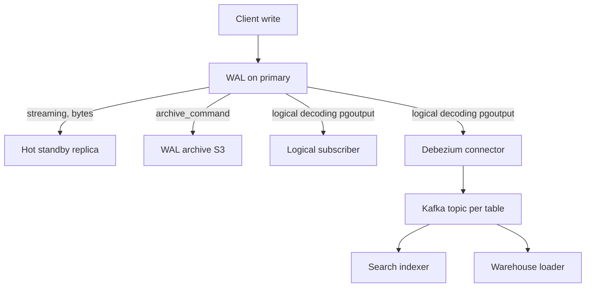
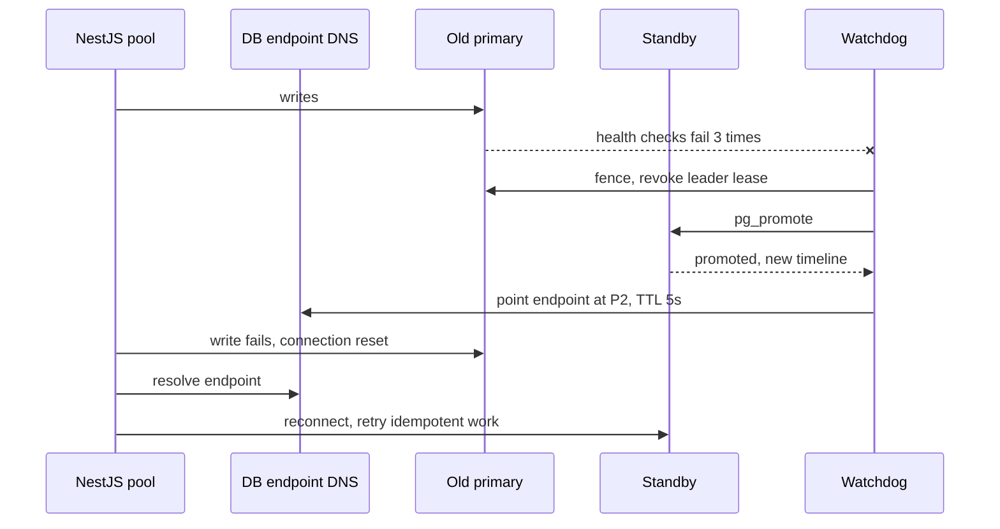

## 23.4 Replication mechanics

#### Concept

Replication is the process by which a change made on one PostgreSQL server appears on another. In PostgreSQL every change is described first in the write-ahead log (WAL); replication is, at its core, shipping that log somewhere else and replaying it. The variants differ in *what* is shipped (raw page changes or decoded row changes), *how* it is shipped (files or a live stream), and *when* the primary considers a commit done (before or after the replica has it).

#### Why does it exist?

Three reasons. Availability: if the primary dies you need a copy that is seconds behind, not a backup that is hours old. Read scaling: a copy can serve queries. Integration: other systems (search indexes, data warehouses, caches) want to know about every change without polling the tables. Each reason pulls toward a slightly different replication mode.

#### Mental model

Imagine a bookkeeper who writes every transaction in a journal before touching the ledger. Physical replication is photocopying the journal pages and mailing them to a second office that maintains an identical ledger. Streaming replication is a fax line that sends every line as soon as it is written. Logical replication is a clerk reading the journal aloud over the phone in plain words ("customer 42 paid 30 dollars"), so the far office can write it into a differently formatted ledger, or only note the entries it cares about. Synchronous replication is refusing to tell the customer "done" until the far office confirms it has written the line.

#### How it works

**WAL shipping (archive-based).** The primary finishes a 16 MB WAL segment file and `archive_command` copies it to shared storage (S3, NFS). The standby's `restore_command` fetches segments and replays them. Lag is at least one segment, typically minutes. Today it is mostly used as the *backup* mechanism (point-in-time recovery) and as a fallback when streaming falls behind.

**Streaming replication.** The standby opens a replication connection (`primary_conninfo`) to the primary's WAL sender process and receives WAL records as they are written, at the byte level. Lag is normally milliseconds. This is what RDS read replicas and Multi-AZ standbys use.

**Replication slots.** A slot is a named bookmark on the primary that says "replica X has consumed WAL up to here; do not delete anything after this point". Without a slot, a replica that disconnects for an hour comes back to find the WAL it needs already recycled, and must be rebuilt from a base backup. With a slot, the primary keeps the WAL. That safety has a sharp edge described in the failure modes below.

**Synchronous vs asynchronous.** Asynchronous (the default): the primary commits, acknowledges to the client, and streams the WAL whenever it can. A crash between commit and stream loses that transaction on failover. Synchronous: the primary waits for one or more standbys to confirm before acknowledging. The level of confirmation is `synchronous_commit`: `remote_write` (standby received and passed to the OS), `on` (standby fsynced it to disk), `remote_apply` (standby has replayed it, so a read there sees it). Every step up costs commit latency: on the same availability zone a synchronous commit adds roughly 1 to 3 ms; across regions, 30 to 100 ms.

**Quorum commit.** `synchronous_standby_names = 'ANY 2 (replica_a, replica_b, replica_c)'` means the commit waits for any two of the three. This keeps a durable copy without a single slow standby stalling every commit.

**Logical replication.** `wal_level = logical` makes the primary decode WAL into row changes. A `PUBLICATION` names the tables; a `SUBSCRIPTION` on another database connects and applies changes with ordinary inserts, updates and deletes. It works across major versions (the standard zero-downtime upgrade path), can replicate a subset of tables or even filtered rows and columns (PostgreSQL 15+), and the subscriber is a normal writable database. It does not replicate DDL, sequences or large objects, and the initial sync of a big table can take hours.

**CDC with Debezium.** Change Data Capture uses the same logical decoding (through the `pgoutput` plugin) but the consumer is Debezium, a Kafka Connect connector. Every row change becomes a Kafka message with `before` and `after` images. This is how you feed a search index, a cache invalidator or a data warehouse without dual writes from the application, and it is the mechanism behind the transactional outbox pattern (see Part 28 — Messaging: Queues, Topics, Kafka, RabbitMQ and SQS).



#### PostgreSQL example

Setting up a publication and inspecting the state of streaming replication.

```sql
-- On the primary: allow logical decoding (requires restart) and streaming.
-- postgresql.conf: wal_level = logical, max_wal_senders = 10, max_replication_slots = 10

-- Physical replication slot for a streaming replica (created before the replica connects).
SELECT pg_create_physical_replication_slot('replica_1_slot');

-- Logical replication of only the orders and order_items tables.
CREATE PUBLICATION orders_pub FOR TABLE orders, order_items;

-- On the subscriber database (another server):
CREATE SUBSCRIPTION orders_sub
  CONNECTION 'host=primary.internal dbname=shop user=repl password=...'
  PUBLICATION orders_pub;

-- Who is replicating from me, and how far behind is each?
SELECT client_addr, state, sync_state,
       pg_size_pretty(pg_wal_lsn_diff(pg_current_wal_lsn(), replay_lsn)) AS replay_behind,
       write_lag, flush_lag, replay_lag
FROM pg_stat_replication;

-- Slots and how much WAL each is holding on disk. Watch this.
SELECT slot_name, slot_type, active, wal_status,
       pg_size_pretty(pg_wal_lsn_diff(pg_current_wal_lsn(), restart_lsn)) AS retained_wal
FROM pg_replication_slots;
```

Configuring synchronous quorum commit:

```sql
-- postgresql.conf on the primary
-- synchronous_standby_names = 'ANY 1 (replica_a, replica_b)'
-- synchronous_commit = on

-- Per-transaction override: a non-critical write can skip the wait.
BEGIN;
SET LOCAL synchronous_commit = off;      -- audit log rows: losing one on crash is acceptable
INSERT INTO audit_events (actor_id, action) VALUES ('u_42', 'viewed_invoice');
COMMIT;
```

#### Production scenario

A typical production layout on AWS: one primary in AZ-a, a synchronous standby in AZ-b (RDS Multi-AZ does this for you, with the standby not readable), two asynchronous read replicas, and a Debezium connector feeding Kafka. The synchronous standby adds about 2 ms to every commit; write p95 goes from 7 ms to 9 ms and the business gets zero data loss on AZ failure. The read replicas lag 30 to 100 ms in steady state. Debezium lag is usually under a second, but a single 50-million-row `UPDATE` produces 50 million Kafka messages and the connector spends an hour catching up.

#### Failure scenario

The replication slot incident. A team created a Debezium connector, then decommissioned it a month later by deleting the Kafka Connect deployment. Nobody dropped the replication slot. The slot's `active` became false but the primary faithfully kept every WAL segment the dead consumer "might still need". Three weeks later at 03:40 the primary's disk hit 100%, PostgreSQL entered a state where it could not write WAL, and every write in the company failed with `PANIC: could not write to file "pg_wal/xlogtemp"`. Recovery was `SELECT pg_drop_replication_slot('debezium_slot')` followed by a checkpoint, once someone could get a connection. The fix afterwards: an alert on `pg_replication_slots` where `active = false` for more than 15 minutes, and `max_slot_wal_keep_size = '50GB'` (PostgreSQL 13+) so a runaway slot is invalidated instead of filling the disk.

#### Edge cases & failure modes

- **Inactive slot fills the disk**: described above. Set `max_slot_wal_keep_size`, alert on inactive slots and on `wal_status = 'unreserved'` or `'lost'`.
- **Async replica promoted after a crash**: transactions acknowledged to clients but not yet streamed are gone. The client received `201` for an order that no longer exists. Only synchronous replication prevents this; otherwise idempotent clients and reconciliation jobs are the mitigation.
- **Synchronous standby down**: with `synchronous_standby_names` naming one standby and no `ANY` quorum, every commit hangs forever waiting. Always have at least two candidates, or automation that removes the dead one from the list.
- **Logical replication conflicts**: a unique violation on the subscriber stops the subscription entirely until a human resolves it (PostgreSQL 15+ can skip a transaction with `ALTER SUBSCRIPTION ... SKIP`). Never write to subscriber tables that are also replicated into.
- **Logical replication and sequences**: after failing over to a logical subscriber, sequences are at their initial values; you must `setval` every sequence above the maximum existing id first.
- **Major version mismatch**: physical replication requires identical major versions; only logical replication crosses them.
- **Large transactions**: logical decoding only sends a transaction after commit (unless streaming of in-progress transactions is enabled, PostgreSQL 14+), so a 2-hour batch job appears as a huge burst at the end.

#### How a Senior Backend Engineer thinks about this

They pick the replication mode per requirement, not per fashion: a synchronous standby for durability, asynchronous replicas for read scaling, logical replication for upgrades and selective copies, CDC for integration. They know exactly which transactions can be lost on failover and have written that number down for the business. They treat replication slots as a liability that needs monitoring on day one.

#### Interview questions

1. *Difference between physical and logical replication?* Expected: byte-level page changes vs decoded row changes; physical is an exact copy same version; logical is selective, cross-version, writable subscriber, no DDL.
2. *What is a replication slot and what is the danger?* Expected: a bookmark preventing WAL deletion; an abandoned slot fills the disk; mitigate with `max_slot_wal_keep_size` and alerts.
3. *When would you use synchronous replication and what does it cost?* Expected: when losing acknowledged commits is unacceptable; adds a network round trip to every commit and a dependency on the standby's health; quorum commit reduces the risk.
4. *How does Debezium get changes out of PostgreSQL?* Expected: logical decoding via `pgoutput` from a replication slot, publishing before/after row images to Kafka.

## 23.5 Replication lag

#### Concept

Replication lag is the delay between a change committing on the primary and that change being visible on a replica. It has two units: bytes (how much WAL the replica has not yet replayed) and time (how old the replica's view is). Both matter. Byte lag tells you about throughput trouble; time lag tells you what users will experience.

#### Why does it exist?

Lag exists because replication is asynchronous by default and because the replica must do real work to apply changes: write WAL to its disk, replay it into data pages, and possibly wait for its own long-running queries to finish. Anything that makes the primary write faster than the replica can apply, or that pauses replay, creates lag.

#### Mental model

Imagine subtitles on a live broadcast. The speaker is the primary; the subtitler is the replica. Normally the subtitles trail by a second. When the speaker suddenly talks very fast (a bulk update) the subtitler falls behind. When the subtitler takes a phone call (a long query conflicting with replay) the subtitles freeze while the speaker continues. When nobody is speaking at all, the subtitles look "stuck" at the last line, which is not lag at all, just silence.

#### How it works

Causes of lag, in the order you should suspect them:

1. **Write bursts on the primary.** Bulk updates, backfills, index builds, `VACUUM FULL`, large deletes. WAL generation jumps from 5 MB/s to 200 MB/s; the replica's single replay process cannot keep up.
2. **Replay conflicts.** A long `SELECT` on the replica holds a snapshot; incoming WAL wants to remove rows that snapshot needs. The replica either cancels the query (after `max_standby_streaming_delay`, default 30 s) or delays replay. During that delay, lag grows.
3. **Slow replica hardware or storage.** A smaller instance class than the primary, or cheaper storage, applies WAL slower than the primary generates it.
4. **Network.** Cross-region replicas ride a WAN; bandwidth spikes or partitions cause both byte and time lag.
5. **Replica busy with its own load.** CPU starved by the reads you routed there.

Measuring lag:

```sql
-- On the primary: per-replica lag in bytes and time (PostgreSQL 10+).
SELECT application_name, state,
       pg_wal_lsn_diff(pg_current_wal_lsn(), sent_lsn)   AS send_lag_bytes,
       pg_wal_lsn_diff(pg_current_wal_lsn(), replay_lsn) AS replay_lag_bytes,
       write_lag, flush_lag, replay_lag                   -- intervals
FROM pg_stat_replication;

-- On the replica: how old is my view of the world?
SELECT now() - pg_last_xact_replay_timestamp() AS time_lag,
       pg_last_wal_receive_lsn() AS received,
       pg_last_wal_replay_lsn()  AS replayed,
       pg_is_in_recovery()       AS is_replica;
```

A subtlety: `now() - pg_last_xact_replay_timestamp()` grows during idle periods when the primary has committed nothing, because there is nothing new to replay. Compare receive and replay LSNs to distinguish "idle" from "behind": if `received = replayed`, the replica is caught up regardless of the timestamp.

#### NestJS example

Expose lag as a metric and use it as a routing signal. This provider polls each replica every two seconds and lets the routing layer avoid replicas that are too far behind.

```ts
// src/database/replica-lag.service.ts
import { Injectable, Logger, OnModuleInit } from '@nestjs/common';
import { Interval } from '@nestjs/schedule';
import { DataSource } from 'typeorm';

@Injectable()
export class ReplicaLagService implements OnModuleInit {
  private readonly logger = new Logger(ReplicaLagService.name);
  private lagSeconds = 0;

  constructor(private readonly dataSource: DataSource) {}

  onModuleInit(): void { void this.refresh(); }

  @Interval(2000)
  async refresh(): Promise<void> {
    const runner = this.dataSource.createQueryRunner('slave');
    try {
      const [row] = await runner.query(`
        SELECT CASE WHEN pg_last_wal_receive_lsn() = pg_last_wal_replay_lsn() THEN 0
                    ELSE EXTRACT(EPOCH FROM now() - pg_last_xact_replay_timestamp()) END AS lag`);
      this.lagSeconds = Number(row.lag ?? 0);
      if (this.lagSeconds > 5) this.logger.warn(`replica lag ${this.lagSeconds.toFixed(1)}s`);
    } catch (err) {
      this.logger.error('lag probe failed', err as Error);
      this.lagSeconds = Number.POSITIVE_INFINITY; // treat unknown as unusable
    } finally {
      await runner.release();
    }
  }

  // Routing layer asks this before choosing a replica for a "fresh enough" read.
  replicaAcceptable(maxLagSeconds: number): boolean {
    return this.lagSeconds <= maxLagSeconds;
  }
}
```

Export `lagSeconds` as a Prometheus gauge (`pg_replica_lag_seconds`) and alert at, say, 5 s warning and 30 s critical. If you use RDS, the `ReplicaLag` CloudWatch metric gives the same number without the probe.

#### Production scenario

The incident everyone eventually has: "User paid but the order list shows unpaid." The flow is: payment webhook arrives, the worker updates `orders.status = 'paid'` on the primary, then publishes a push notification "Your payment was received". The user opens the app; `GET /orders` hits a replica 6 seconds behind because a marketing export is running a huge `UPDATE` on `user_segments`. The order shows "awaiting payment". Support tickets follow. The user retries the payment; thanks to the payment provider's idempotency key the second charge is rejected, but the user has now seen a scary screen. The mitigations: route order-status reads for a user who received a status-change notification in the last 30 seconds to the primary; throttle exports by lag; and stop marketing exports from running on the same database as orders at all (a separate reporting replica with `max_standby_streaming_delay = -1`).

#### Edge cases & failure modes

- **Lag looks huge but the primary is idle**: timestamp-based lag on a quiet primary; compare LSNs.
- **Lag spikes to minutes during a migration**: throttle the migration (Part 24) and pre-warn the on-call.
- **Replica cancels queries**: `canceling statement due to conflict with recovery`. Options: `hot_standby_feedback`, longer `max_standby_streaming_delay`, dedicated reporting replica.
- **Lag on the synchronous standby stalls the primary**: if `synchronous_commit = remote_apply`, replay lag on the standby becomes commit latency on the primary.
- **Cascading replicas** add lag at each hop.
- **Cache invalidation racing lag**: the app invalidates a Redis key on write, the next reader repopulates it from a stale replica, and the stale value now lives in the cache for its full TTL. Repopulate caches from the primary, or delay invalidation by the expected lag.

#### How a Senior Backend Engineer thinks about this

Lag is not a bug to eliminate; it is a property to bound and to design around. They set a lag budget per read path ("this endpoint tolerates 5 seconds; that one tolerates none") and they make the writers that cause lag (batch jobs, backfills) responsible for staying inside the budget. The most important question they ask of any feature that reads from a replica is: *what does the user do when this is stale?* If the answer is "retry the write", idempotency is mandatory.

#### Interview questions

1. *How do you measure replication lag and what is the trap in the timestamp approach?* Expected: `pg_stat_replication` on the primary, `pg_last_xact_replay_timestamp` on the replica; idle primaries inflate timestamp lag; compare LSNs.
2. *A backfill causes 40 s lag and stale reads. What do you do now and later?* Expected: now, route affected reads to the primary and pause or throttle the job; later, lag-aware throttling, LSN-based consistency, idempotent writes.
3. *What causes replay conflicts and how do you handle them on a reporting replica?* Expected: vacuum on the primary removing rows a replica query needs; raise `max_standby_streaming_delay` or use `hot_standby_feedback`.

## 23.6 Failover

#### Concept

Failover is the process of turning a replica into the new primary when the old primary is dead, unreachable or being replaced. It has a database side (promotion, deciding who is primary) and an application side (finding the new primary, reconnecting, dealing with work that was in flight). Both sides must be designed; the database side is often provided by a platform (RDS Multi-AZ, Patroni), the application side is always your responsibility.

#### Why does it exist?

Machines die. Availability zones lose power. Instance resizes and major version upgrades require a restart. A business that promises 99.95% availability has about 4.4 hours of downtime per year to spend; one unplanned failover with a manual rebuild can spend all of it. Automated failover turns a multi-hour outage into a 30 to 90 second blip.

#### Mental model

Imagine an air traffic control tower with a duty controller and a shadow controller listening to every radio call. If the duty controller collapses, the shadow takes over; pilots are told to switch frequency. The danger: if the radio link between the two towers merely glitched, both might believe they are in charge and issue conflicting instructions. That is split brain, and it is why failover systems have a third party (a consensus store or a witness) to decide who is really in charge.

#### How it works

1. **Detection.** A health checker (Patroni's loop, RDS's monitoring, a Kubernetes operator) notices the primary is unresponsive for longer than a threshold, typically 10 to 30 seconds. Too short and network hiccups trigger needless failovers; too long and the outage lengthens.
2. **Fencing.** The old primary must be prevented from accepting writes even if it comes back. Patroni does this by requiring a leader lease in etcd/Consul/ZooKeeper; a primary that cannot renew its lease demotes itself. Without fencing, two primaries accept writes for the same rows: split brain.
3. **Promotion.** The chosen replica runs `pg_promote()` (or `pg_ctl promote`), stops replaying WAL, and starts a new timeline. Any transactions the old primary committed but had not streamed are lost (asynchronous) or guaranteed present (synchronous).
4. **Endpoint switch.** Clients need to find the new primary. Options: a DNS name updated to the new IP (RDS does this; TTL is 5 seconds), a virtual IP moved by Patroni's callback, an HAProxy or PgBouncer reconfigured, or a Kubernetes Service selector updated by the operator.
5. **Re-pointing other replicas.** Remaining replicas must follow the new primary. With `pg_rewind` the old primary can be turned into a replica without a full rebuild, provided its data directory is intact.



What the application must do, in order:

- **Detect broken connections quickly.** Pool connections to the dead primary are broken sockets. Set TCP keepalives and short `connectionTimeoutMillis` so a broken connection is discovered in seconds, not after the OS's default 2-hour keepalive.
- **Drain and rebuild the pool.** On `ECONNRESET`, `57P01 admin_shutdown`, `25006 read_only_sql_transaction` (you are talking to the demoted old primary), evict the connection and reconnect. `node-postgres` pools remove broken clients on error; make sure your health check exercises a query, not just a socket.
- **Resolve DNS again.** Node caches DNS per lookup, not globally, so a new connection will re-resolve. But a long-lived connection never re-resolves; only reconnection picks up the new address. Never pin the IP.
- **Retry idempotent work; do not retry the rest blindly.** A `SELECT` can be retried. An `INSERT` whose transaction was in flight when the failover hit is in an unknown state: it may have committed on the old primary and been lost, or committed and replicated, or never committed. Only an idempotency key (Part 30 — Distributed Transactions: Sagas, Outbox, Inbox and Idempotency) makes retry safe.
- **Stop background writers for a moment.** Workers pounding the endpoint during failover create a retry storm that slows the new primary's warm-up. Use exponential backoff with jitter.

#### NestJS example

A connection layer that survives failover: keepalive, short connect timeout, health check that detects a read-only (demoted) primary, and a retry wrapper for idempotent operations.

```ts
// src/database/typeorm.options.ts
import { TypeOrmModuleOptions } from '@nestjs/typeorm';

export const typeOrmOptions = (): TypeOrmModuleOptions => ({
  type: 'postgres',
  host: process.env.PG_WRITER_ENDPOINT, // DNS name, never an IP; RDS TTL is 5 s
  port: 5432,
  username: process.env.PG_USER,
  password: process.env.PG_PASSWORD,
  database: process.env.PG_DB,
  autoLoadEntities: true,
  extra: {
    max: 10,
    connectionTimeoutMillis: 3_000,   // fail fast while DNS is switching
    idleTimeoutMillis: 30_000,        // recycle idle connections so they re-resolve DNS
    keepAlive: true,
    keepAliveInitialDelayMillis: 10_000,
    statement_timeout: 5_000,
  },
});
```

```ts
// src/database/with-failover-retry.ts
import { Logger } from '@nestjs/common';

const RETRYABLE = new Set(['57P01', '57P02', '57P03', '08006', '08001', '25006', 'ECONNRESET', 'ECONNREFUSED']);
const logger = new Logger('FailoverRetry');

// Only wrap operations that are idempotent (reads, or writes guarded by an idempotency key).
export async function withFailoverRetry<T>(op: () => Promise<T>, attempts = 4): Promise<T> {
  let delay = 200;
  for (let i = 1; ; i++) {
    try {
      return await op();
    } catch (err) {
      const code = (err as { code?: string }).code ?? '';
      if (!RETRYABLE.has(code) || i === attempts) throw err;
      logger.warn(`retryable db error ${code}, attempt ${i}/${attempts}`);
      await new Promise((r) => setTimeout(r, delay + Math.random() * delay)); // jittered backoff
      delay = Math.min(delay * 2, 3_000);
    }
  }
}
```

A Terminus health indicator that reports "not ready" if the writer endpoint answers but is in recovery, which happens for a few seconds when DNS still points at the demoted node:

```ts
// src/health/writer-health.indicator.ts
import { Injectable } from '@nestjs/common';
import { HealthIndicatorService } from '@nestjs/terminus';
import { DataSource } from 'typeorm';

@Injectable()
export class WriterHealthIndicator {
  constructor(private readonly ds: DataSource, private readonly health: HealthIndicatorService) {}

  async isWritable(key = 'postgres_writer') {
    const indicator = this.health.check(key);
    const [row] = await this.ds.query('SELECT pg_is_in_recovery() AS ro');
    return row.ro ? indicator.down({ reason: 'endpoint is read-only' }) : indicator.up();
  }
}
```

#### Production scenario

RDS Multi-AZ failover, measured across many incidents: detection 10 to 20 s, promotion 15 to 30 s, DNS propagation 5 to 10 s. Total 60 to 90 s during which writes fail. A well-prepared NestJS fleet shows: HTTP 503 for writes for about 70 s (with the client SDKs retrying with backoff), reads continuing from replicas, background workers pausing on backoff, then everything recovering with no manual action. A poorly prepared fleet shows: pods holding dead connections for minutes, workers in a retry storm hammering the new primary, duplicate orders from non-idempotent retries, and one pod stuck in a `read-only transaction` loop because it cached the old IP.

Patroni on Kubernetes (or a managed operator such as CloudNativePG or Zalando's) gives finer control: leader election via etcd or the Kubernetes API, `pg_rewind` for the old primary, and a `maximum_lag_on_failover` setting so a replica far behind is never promoted.

#### Failure scenario

At 02:14 the on-call got paged because writes were failing. Multi-AZ failover had happened after a storage event. By 02:16 the new primary was up and DNS had switched. But the order-placement pods kept failing until 02:41. Root cause: the pods' pool used `idleTimeoutMillis: 0` (never recycle) and the OS keepalive default of 7,200 s, so the 10 connections per pod stayed pointed at the dead IP, and the application-level query timeout of 30 s meant each request waited half a minute before erroring. Nobody restarted the pods because the readiness probe only checked that the process was alive. Fixes: keepalive at 10 s, connection timeout 3 s, readiness probe that runs `SELECT 1` through the pool, and a runbook step to roll the deployment if failover does not self-heal in two minutes.

#### Edge cases & failure modes

- **Split brain**: two primaries accept writes. Only fencing prevents it. Never build a home-made failover script that promotes without fencing.
- **Failover during a transaction**: the transaction's outcome is unknown to the client. Design for it with idempotency keys and an outbox; reconcile with a nightly job.
- **Lost transactions on async promotion**: acknowledged writes vanish. Decide in advance which tables can tolerate that (audit logs) and which cannot (payments: synchronous).
- **Promoting a lagging replica**: minutes of data lost. Set `maximum_lag_on_failover` (Patroni) or verify lag before manual promotion.
- **DNS TTL ignored**: some resolvers and Java-style caches keep an old IP. Node re-resolves on each new connection, but verify it in your runtime.
- **Old primary returns and accepts writes**: without fencing or `pg_rewind`, it diverges. Patroni handles it; hand-rolled setups do not.
- **Connection storm on the new primary**: hundreds of pods reconnect at once; PgBouncer in front absorbs it.
- **Replicas orphaned**: they were following the old primary's timeline; with `recovery_target_timeline = 'latest'` they follow the new one, otherwise they stall.

#### How a Senior Backend Engineer thinks about this

They assume failover will happen at the worst time and rehearse it: a quarterly game day where the primary is rebooted in staging (and eventually production) and the team watches which pods misbehave. They treat "the application reconnected cleanly" as a feature with tests, not luck. They insist on a pooler or managed proxy so the reconnection storm is absorbed. They know the RPO (how much data can be lost, zero with synchronous) and RTO (how long writes are down, about a minute with automated failover) and have told the business those numbers.

#### Common mistakes

- Hardcoding the primary's IP or resolving it once at startup.
- Retrying every failed write during failover, creating duplicates.
- A readiness probe that returns `200` while the pool is full of dead sockets.
- Running the failover script by hand at 3 a.m. and promoting the wrong replica.

#### Interview questions

1. *Walk me through what happens in an RDS Multi-AZ failover and what your NestJS app must do.* Expected: detect, promote standby, DNS switch in about a minute; app must detect broken connections, reconnect via DNS, retry only idempotent work, avoid retry storms.
2. *What is split brain and how do Patroni and RDS prevent it?* Expected: two writable primaries; leader lease in a consensus store, fencing, only one endpoint.
3. *A transaction was in flight during failover. Did it commit?* Expected: unknown; with async replication it may be lost even if it committed; idempotency keys and reconciliation are the answer.
4. *Why should pooled connections have an idle timeout even when traffic is constant?* Expected: to re-resolve DNS and rotate away from dead or demoted hosts.

#### Practical exercise

Run a Patroni cluster locally (the Zalando Patroni repository has a Docker Compose setup with three nodes and etcd). Point a NestJS service at the HAProxy writer port. Under a load generator of 50 writes per second with idempotency keys, kill the primary container. Acceptance criteria: writes resume within 60 seconds without manual action; zero duplicate orders in the table; the metrics dashboard shows the failover window; the old primary rejoins as a replica via `pg_rewind`.
