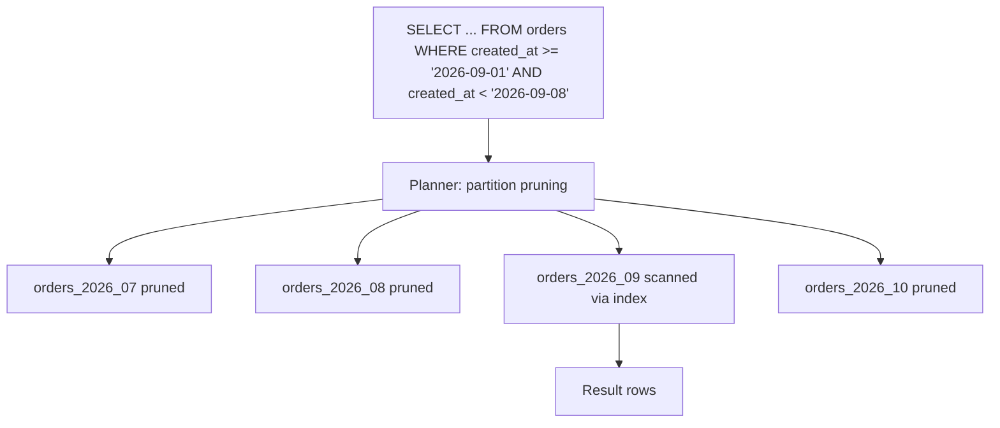

## 23.7 Partitioning

#### Concept

Partitioning splits one logical table into several physical tables (partitions) inside the same database, according to a rule on one or more columns (the partition key). To the application it is still one table called `orders`; to PostgreSQL it is a parent with children such as `orders_2026_08`, `orders_2026_09`. Queries whose `WHERE` clause constrains the partition key touch only the relevant children. Maintenance (vacuum, index rebuilds, dropping old data) happens per child.

PostgreSQL has supported *declarative* partitioning since version 10 (`PARTITION BY RANGE | LIST | HASH`). Before that, people faked it with inheritance and triggers; do not do that today.

#### Why does it exist?

A single table with 800 million rows hurts in ways that have nothing to do with query plans: autovacuum takes hours and falls behind, so bloat and transaction-id wraparound become real risks; indexes are tens of gigabytes and no longer fit in RAM; deleting last year's rows is a multi-hour `DELETE` that generates as much WAL as it removes; and a `CREATE INDEX` is a day-long project. Partitioning turns each of those into an operation on a manageable slice, and turns "delete a year of data" into `DROP TABLE orders_2025_01`, which takes milliseconds.

#### Mental model

Imagine a company's paper archive. Instead of one giant filing cabinet with every invoice ever issued, there is one cabinet per month. When the auditor asks for September invoices, you open one cabinet. When retention policy says to shred everything older than seven years, you wheel one cabinet to the shredder. But if the auditor asks for "every invoice to customer 4711 ever", you must open every cabinet: partitioning by month does nothing for that question, and may make it slower.

#### How it works

1. **Parent table** is declared with `PARTITION BY` and holds no rows itself.
2. **Partitions** are created with `PARTITION OF parent FOR VALUES ...`. Each is a real table with its own storage, statistics and indexes.
3. **Routing on insert**: PostgreSQL evaluates the partition key of each inserted row and puts it in the matching child. If none matches and there is no `DEFAULT` partition, the insert fails.
4. **Partition pruning** at plan time and execution time: when the query's `WHERE` clause constrains the partition key with constants or parameters, the planner removes non-matching partitions from the plan entirely. With `enable_partition_pruning = on` (default), this also works for parameter values known only at execution time (prepared statements, nested loop parameters).
5. **Indexes**: an index created on the parent is automatically created on every partition (and on future partitions). Each partition has its own physical index, so each is smaller and cache-friendlier.
6. **Constraints**: a primary key or unique constraint on a partitioned table *must include the partition key*. PostgreSQL cannot enforce uniqueness across partitions otherwise, because each partition's index is separate. This is the constraint that surprises everyone: `orders.id` alone cannot be the PK if you partition by `created_at`; the PK becomes `(id, created_at)`.
7. **Attach and detach**: an existing table with the right structure can be attached as a partition (`ATTACH PARTITION`), and a partition can be detached into a standalone table (`DETACH PARTITION`, with `CONCURRENTLY` in PostgreSQL 14+ to avoid blocking). This is how you archive: detach, dump to S3, drop.

**Range partitioning** splits by ordered intervals: dates, ids, amounts. The overwhelmingly common form is time. Partitions must not overlap; gaps are allowed but rows falling in a gap fail to insert.

**List partitioning** splits by explicit values: `region IN ('eu')`, `status IN ('archived')`, `tenant_id IN (...)` for a handful of giant tenants.

**Hash partitioning** splits by `hash(key) % modulus`. It spreads rows evenly across N partitions regardless of value distribution. It is for tables with no natural range and a need to shrink per-partition index size or spread vacuum work, and it is the shape that mirrors hash sharding later. It cannot drop "old" data because every partition holds a slice of every time period.

**Time partitioning** (range by a timestamp) is the sweet spot: orders by month, events by day, logs by hour. Inserts land in the newest partition; queries are usually "last N days"; retention is "drop partitions older than X".



#### PostgreSQL example

A time-partitioned `orders` table with a working primary key, per-partition indexes, a default partition as a safety net, and the queries that prove pruning is happening.

```sql
-- Parent. Note the PK includes the partition key: required by PostgreSQL.
CREATE TABLE orders (
  id           uuid        NOT NULL DEFAULT gen_random_uuid(),
  user_id      uuid        NOT NULL,
  status       text        NOT NULL,
  total_cents  bigint      NOT NULL,
  created_at   timestamptz NOT NULL DEFAULT now(),
  PRIMARY KEY (id, created_at)
) PARTITION BY RANGE (created_at);

-- Monthly partitions. Ranges are half-open: FROM inclusive, TO exclusive.
CREATE TABLE orders_2026_08 PARTITION OF orders
  FOR VALUES FROM ('2026-08-01') TO ('2026-09-01');
CREATE TABLE orders_2026_09 PARTITION OF orders
  FOR VALUES FROM ('2026-09-01') TO ('2026-10-01');
CREATE TABLE orders_2026_10 PARTITION OF orders
  FOR VALUES FROM ('2026-10-01') TO ('2026-11-01');

-- Safety net so an insert with an unexpected date does not fail.
-- Alert if this ever contains rows; it means partition creation fell behind.
CREATE TABLE orders_default PARTITION OF orders DEFAULT;

-- Index on the parent is propagated to every partition, present and future.
CREATE INDEX orders_user_created_idx ON orders (user_id, created_at DESC);
```

Verify pruning with `EXPLAIN`. A pruned partition simply does not appear in the plan.

```sql
EXPLAIN (ANALYZE, BUFFERS)
SELECT id, total_cents FROM orders
WHERE user_id = '5c0c1a8e-6c4a-4b0a-9a0e-1e1a2b3c4d5e'
  AND created_at >= now() - interval '7 days';
```

```text
Append  (cost=0.56..41.20 rows=12 width=24) (actual time=0.041..0.098 rows=9 loops=1)
  Subplans Removed: 3
  ->  Index Scan using orders_2026_09_user_id_created_at_idx on orders_2026_09
        (cost=0.56..40.80 rows=12 width=24) (actual time=0.039..0.092 rows=9 loops=1)
        Index Cond: ((user_id = '5c0c1a8e-...'::uuid) AND (created_at >= (now() - '7 days'::interval)))
        Buffers: shared hit=7
Planning Time: 0.412 ms
Execution Time: 0.131 ms
```

`Subplans Removed: 3` is execution-time pruning: `now()` is not a constant at plan time, so the planner kept all partitions and the executor dropped the three that could not match. Compare the same query without a `created_at` condition: every partition is scanned, and the plan shows one index scan per partition plus an `Append` node. That is the "random access by non-partition key" case where partitioning does not help and adds planning overhead.

Retention and the midnight problem:

```sql
-- Retention: drop a month in milliseconds instead of a multi-hour DELETE.
-- Detach first so a running query is not surprised; CONCURRENTLY needs PG 14+.
ALTER TABLE orders DETACH PARTITION orders_2025_08 CONCURRENTLY;
-- Optionally: pg_dump -t orders_2025_08 to S3 before dropping.
DROP TABLE orders_2025_08;

-- Attaching a pre-built partition (e.g. loaded from an archive).
-- A CHECK constraint matching the bounds lets PostgreSQL skip the validation scan.
ALTER TABLE orders_2025_08_restored
  ADD CONSTRAINT bounds CHECK (created_at >= '2025-08-01' AND created_at < '2025-09-01');
ALTER TABLE orders ATTACH PARTITION orders_2025_08_restored
  FOR VALUES FROM ('2025-08-01') TO ('2025-09-01');
```

Using `pg_partman` to automate creation and retention so nobody has to remember to make November's partition:

```sql
CREATE EXTENSION pg_partman;

-- Manage 'public.orders' by created_at, one partition per month,
-- always keep 3 future partitions ready.
SELECT partman.create_parent(
  p_parent_table := 'public.orders',
  p_control      := 'created_at',
  p_interval     := '1 month',
  p_premake      := 3
);

-- Retention: drop partitions older than 24 months (set keep_table=false to drop, true to detach only).
UPDATE partman.part_config
SET retention = '24 months', retention_keep_table = false
WHERE parent_table = 'public.orders';

-- Run maintenance hourly with pg_cron (or from a Kubernetes CronJob calling the same procedure).
SELECT cron.schedule('partman-maintenance', '0 * * * *', $$CALL partman.run_maintenance_proc()$$);
```

Hash partitioning for a table with no natural time dimension, such as a per-user counter table that is updated constantly:

```sql
CREATE TABLE user_stats (
  user_id      uuid   NOT NULL,
  orders_count int    NOT NULL DEFAULT 0,
  spent_cents  bigint NOT NULL DEFAULT 0,
  PRIMARY KEY (user_id)             -- partition key is user_id, so this is allowed
) PARTITION BY HASH (user_id);

-- 8 partitions; each holds roughly 1/8 of users. Vacuum runs on 8 smaller tables in parallel.
CREATE TABLE user_stats_p0 PARTITION OF user_stats FOR VALUES WITH (MODULUS 8, REMAINDER 0);
CREATE TABLE user_stats_p1 PARTITION OF user_stats FOR VALUES WITH (MODULUS 8, REMAINDER 1);
-- ... p2 through p7 in the same shape.
```

List partitioning where a few tenants are so large they deserve isolation:

```sql
CREATE TABLE events (
  tenant_id   text        NOT NULL,
  id          uuid        NOT NULL,
  occurred_at timestamptz NOT NULL,
  payload     jsonb       NOT NULL,
  PRIMARY KEY (tenant_id, id)
) PARTITION BY LIST (tenant_id);

CREATE TABLE events_acme  PARTITION OF events FOR VALUES IN ('acme');      -- the 40% tenant
CREATE TABLE events_globex PARTITION OF events FOR VALUES IN ('globex');   -- the 20% tenant
CREATE TABLE events_rest   PARTITION OF events DEFAULT;                    -- everyone else
```

#### TypeORM example

TypeORM does not know about partitions and does not need to: the entity maps to the parent table and PostgreSQL routes rows. Two things must be correct in the entity: the composite primary key, and every query that wants pruning must include the partition key.

```ts
// src/orders/order.entity.ts
import { Entity, Column, PrimaryColumn, Index, CreateDateColumn } from 'typeorm';

@Entity({ name: 'orders' })
@Index('orders_user_created_idx', ['userId', 'createdAt'])
export class Order {
  // Composite PK mirrors the partitioned table: (id, created_at).
  @PrimaryColumn('uuid', { default: () => 'gen_random_uuid()' })
  id!: string;

  @PrimaryColumn({ name: 'created_at', type: 'timestamptz', default: () => 'now()' })
  createdAt!: Date;

  @Column('uuid', { name: 'user_id' }) userId!: string;
  @Column('text') status!: string;
  @Column('bigint', { name: 'total_cents' }) totalCents!: string;
}
```

```ts
// src/orders/orders.repository.ts
import { Injectable } from '@nestjs/common';
import { InjectRepository } from '@nestjs/typeorm';
import { Repository, MoreThanOrEqual } from 'typeorm';
import { Order } from './order.entity';

@Injectable()
export class OrdersRepository {
  constructor(@InjectRepository(Order) private readonly repo: Repository<Order>) {}

  // Always bound by created_at so only the relevant partitions are scanned.
  findRecentForUser(userId: string, days = 30): Promise<Order[]> {
    const since = new Date(Date.now() - days * 86_400_000);
    return this.repo.find({
      where: { userId, createdAt: MoreThanOrEqual(since) },
      order: { createdAt: 'DESC' },
      take: 50,
    });
  }

  // Lookup by id alone scans every partition. If the API only has the id,
  // carry the creation date in the public identifier (e.g. UUIDv7) or accept the cost.
  findById(id: string, createdAt: Date): Promise<Order | null> {
    return this.repo.findOne({ where: { id, createdAt } });
  }
}
```

Migrations that create partitions belong in raw SQL inside a TypeORM migration; `synchronize` and `migration:generate` do not understand `PARTITION BY`, so never let them touch a partitioned table.

#### Sequelize example

Same story: model the parent, declare the composite key, and keep `synchronize`/`sync()` away from it.

```ts
// src/orders/order.model.ts
import { DataTypes, Model, Sequelize } from 'sequelize';

export class Order extends Model {
  declare id: string;
  declare createdAt: Date;
  declare userId: string;
  declare status: string;
  declare totalCents: string;
}

export function initOrder(sequelize: Sequelize): void {
  Order.init(
    {
      id: { type: DataTypes.UUID, primaryKey: true, defaultValue: DataTypes.UUIDV4 },
      createdAt: { type: DataTypes.DATE, primaryKey: true, field: 'created_at', defaultValue: DataTypes.NOW },
      userId: { type: DataTypes.UUID, field: 'user_id', allowNull: false },
      status: { type: DataTypes.STRING, allowNull: false },
      totalCents: { type: DataTypes.BIGINT, field: 'total_cents', allowNull: false },
    },
    { sequelize, tableName: 'orders', timestamps: false },
  );
}
```

#### Production scenario

An events table for a social product: 40 million rows per day, retention 90 days, so about 3.6 billion rows live at any time. Daily partitions; each is 40 M rows and about 12 GB with indexes. Autovacuum handles a day's partition in under 20 minutes instead of never finishing on the monolithic table. The nightly retention job is `DROP TABLE events_2026_06_07`, sub-second, versus the old `DELETE ... WHERE occurred_at < ...` that ran for six hours and generated 200 GB of WAL. Queries for a user's last 7 days of events touch 7 partitions with small indexes, p95 4 ms.

For `orders` on an e-commerce platform at 3 million orders per month, monthly partitions and a two-year retention in the hot database (older orders detached and moved to a cold "archive" database queried by a separate service) keep the live table at 72 million rows.

When partitioning does *not* help: a `products` table with 2 million rows accessed by id and by category; a `users` table accessed by id and email. Neither has a range dimension in its access pattern. Partitioning them adds planning overhead and per-query `Append` nodes for no benefit. The signal for partitioning is: the table is huge, *and* most queries filter on a column you could partition by, *and/or* retention is by that column.

#### Failure scenario

The midnight incident. A team partitioned `orders` by month and created partitions through September by hand. At 00:00:00 on October 1st, every `INSERT INTO orders` failed with `ERROR: no partition of relation "orders" found for row`. Checkout was down for 38 minutes until someone created `orders_2026_10`. There was no default partition and no automation. The fix set: `pg_partman` with `p_premake := 3`, an hourly maintenance job, a `DEFAULT` partition as a net, an alert on `SELECT count(*) FROM orders_default > 0`, and a synthetic check that inserts and deletes a row dated tomorrow in staging every day.

#### Edge cases & failure modes

- **Partition missing for tomorrow**: inserts fail at midnight. Automate creation, keep future partitions pre-made, and add a default partition.
- **Rows in the default partition**: they came from a gap or a future date. They also block creating a partition for that range until moved out.
- **Unique constraint not including partition key**: `ERROR: unique constraint on partitioned table must include all partitioning columns`. Design the key first.
- **Foreign keys to a partitioned table**: supported from PostgreSQL 12, but the referenced key must include the partition key, so `order_items.order_id` alone cannot reference `orders(id)`.
- **Updating the partition key** moves the row between partitions (supported since PostgreSQL 11) as a delete plus insert; concurrent updates on that row can fail with a serialization error.
- **Too many partitions**: thousands of partitions slow down planning (each query considers each partition's metadata) and bloat the catalog. Daily partitions with 2 years of retention is 730 partitions, acceptable; hourly for a year is 8,760 and painful.
- **Cross-partition queries**: no `created_at` predicate means every partition is scanned; a `LIMIT 10 ORDER BY created_at DESC` still needs a merge across partitions (PostgreSQL's `Merge Append` handles it, but it is slower than a single index).
- **`CREATE INDEX CONCURRENTLY` on a partitioned parent** is not supported directly; create the index `ON ONLY` the parent, then build it `CONCURRENTLY` on each partition, then `ALTER INDEX ... ATTACH PARTITION`. Part 24 shows the recipe.
- **Detach while queries run**: plain `DETACH` takes `ACCESS EXCLUSIVE` on the parent for a moment; use `CONCURRENTLY` (PostgreSQL 14+).
- **Hot latest partition**: all inserts and most reads hit one partition; its index pages are contended. That is inherent to time partitioning; it is usually fine because that partition is small and hot in cache. If it is not fine, sub-partition by hash within the day.

#### How a Senior Backend Engineer thinks about this

Partitioning is a storage-layout decision that leaks into the data model (composite keys) and into every query (the predicate must include the key). So the senior engineer decides on partitioning early for tables that will obviously become huge (events, logs, orders, messages) and designs the primary key and public identifiers accordingly, for example UUIDv7 ids whose timestamp prefix lets you derive the partition from the id. They refuse to partition small or randomly accessed tables. They put partition automation and monitoring in place *before* the first partition, not after the first midnight outage.

#### Common mistakes

- Partitioning `users` or `products` because "the table is big", without a range access pattern.
- Forgetting the partition key in the `WHERE` clause, so every query scans every partition and is slower than before.
- Creating partitions by hand and forgetting.
- Letting TypeORM `synchronize: true` run against a partitioned table; it will try to "fix" the schema.
- Using `DELETE` for retention on a partitioned table instead of `DROP` or `DETACH`.

#### Interview questions

1. *When does partitioning help and when does it hurt?* Expected: helps for huge tables with time/range access and retention-by-drop; hurts for random access by non-key columns and with too many partitions.
2. *Why must the primary key include the partition key?* Expected: each partition has its own index; uniqueness cannot be enforced across them without a global index, which PostgreSQL does not have.
3. *How does partition pruning work with `now()` in the query?* Expected: plan-time pruning needs constants; execution-time pruning handles runtime values; look for "Subplans Removed" in `EXPLAIN ANALYZE`.
4. *How do you implement 90-day retention on a 3-billion-row table?* Expected: daily range partitions, detach/drop partitions older than 90 days, automated with pg_partman or a cron job.
5. *What happens at midnight if the next partition does not exist?* Expected: inserts fail; mitigate with pre-created partitions and a default partition.

#### Practical exercise

Convert an `events` table with 20 million synthetic rows into daily range partitions using the copy-and-swap technique (create partitioned parent under a new name, copy in batches, rename in one transaction; details in Part 24). Set up `pg_partman` with 3 days premake and 30 days retention. Acceptance criteria: `EXPLAIN` on a 7-day query shows only 7 partitions; inserting a row dated 4 days ahead lands in the default partition and triggers your alert query; the retention job drops the oldest partition and its size is freed as shown by `pg_total_relation_size`.
