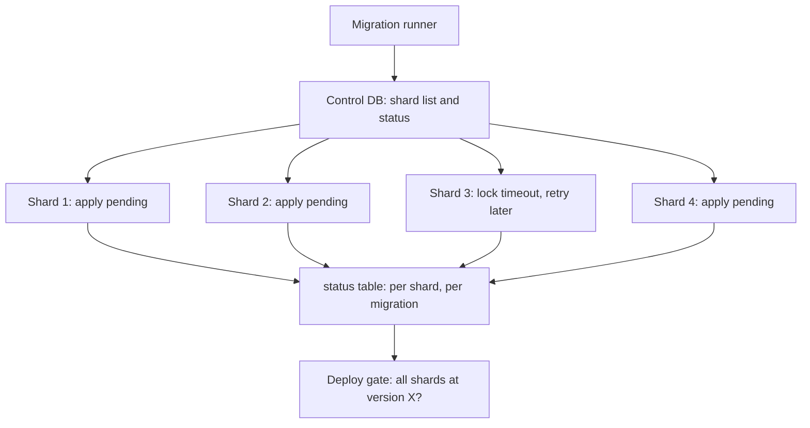

## 23.11 Migrations across services and shards

#### Concept

Two situations complicate the single-database story. **Shared database**: several services (or several deployables of one system) read and write the same tables, so a migration made by one team can break another team's pods. **Many databases with the same schema**: shards, or a database per tenant, so one logical migration must be applied to N physical databases and the application must survive the window in which some have it and some do not.

#### Why does it exist?

Because ownership and physical layout do not always match. A shared database is usually a leftover from a monolith that was split by team before it was split by data; it is a known anti-pattern (see Part 11 — Software Architecture) but a common reality. Shards and per-tenant databases are deliberate scaling choices from Part 22 that multiply the migration surface.

#### Mental model

Imagine several shops sharing one warehouse. If one shop rearranges the shelves overnight, the other shops' staff cannot find anything in the morning. Either one warehouse manager owns the layout and announces changes with notice, or each shop gets its own aisle that nobody else touches. Now imagine a chain with fifty warehouses that must all be rearranged the same way: you need a plan that tracks which warehouses are done, works even when half are done, and can retry the one where the forklift broke.

#### How it works

**Shared database rules.**

1. **One owner per table.** Write it down. Only the owning service's repository contains migrations for that table. Other services are consumers and may only rely on columns the owner has declared stable.
2. **Separate migration tables and roles per service.** Each service uses its own `migrationsTableName` (`migrations_orders`, `migrations_billing`) so runners do not collide, and its own database role with DDL rights only on the schemas it owns. Better still, one PostgreSQL schema per service (`orders.*`, `billing.*`) with `search_path` set per role; cross-service reads happen through views the owner publishes, or through APIs and events.
3. **N-1 compatibility across services**, not just across versions of one service. The owner's contract step (dropping a column) must wait until every consumer has stopped using it, which means the owner needs to know its consumers: `pg_stat_statements` by role, or a grep across repositories, or a deprecation announcement with a date.
4. **Views as contracts.** When a consumer needs a table shape the owner wants to change, the owner provides a view with the old shape during the transition, exactly like the rename trick in section 23.9.

**Migrations across shards.**

1. **Same migration files, applied to every shard**, in the same order, by a runner that iterates the shard list and records status per shard. Never a different migration per shard.
2. **Idempotent statements** (`IF NOT EXISTS`, `IF EXISTS`, `NOT VALID` guards) so that a rerun on a shard that half-applied is safe.
3. **Status table in the control database**: `shard_migrations(shard_id, migration_name, applied_at, status, error)`. The runner skips applied ones, retries failed ones, and reports "12 of 16 shards at version X".
4. **Application tolerates mixed versions**, because between the first and last shard the schema differs. Expand/contract already gives you this; the only new rule is that the *code* deploy waits until *all* shards are at the required version (the deploy gate checks the status table).
5. **Parallelism with a cap**: apply to 4 shards at a time; a lock timeout on one shard does not block the others.
6. **Backfills per shard**, each with its own cursor row (`backfill_progress` keyed by job and shard), throttled by that shard's own replica lag.



#### NestJS example

A shard-aware runner built on the per-shard `DataSource` map from Part 22.

```ts
// src/database/run-shard-migrations.ts
import { DataSource } from 'typeorm';
import { shardsFromEnv } from '../sharding/shard.config';
import { controlDataSource } from './control-data-source';

const PARALLEL = 4;

async function migrateShard(shardId: number, host: string): Promise<void> {
  const ds = new DataSource({
    type: 'postgres', host, port: 5432,
    username: process.env.PG_MIGRATION_USER, password: process.env.PG_MIGRATION_PASSWORD, database: process.env.PG_DB,
    migrations: ['dist/database/migrations/*.js'], migrationsTableName: 'migrations',
  });
  await ds.initialize();
  try {
    const applied = await ds.runMigrations({ transaction: 'each' });
    for (const m of applied) {
      await controlDataSource.query(
        `INSERT INTO shard_migrations (shard_id, migration_name, status, applied_at) VALUES ($1, $2, 'applied', now())
         ON CONFLICT (shard_id, migration_name) DO UPDATE SET status = 'applied', applied_at = now(), error = NULL`,
        [shardId, m.name]);
    }
    console.log(`shard ${shardId}: applied ${applied.length}`);
  } catch (err) {
    await controlDataSource.query(
      `INSERT INTO shard_migrations (shard_id, migration_name, status, error) VALUES ($1, 'pending', 'failed', $2)
       ON CONFLICT (shard_id, migration_name) DO UPDATE SET status = 'failed', error = EXCLUDED.error`,
      [shardId, (err as Error).message]);
    throw err;
  } finally {
    await ds.destroy();
  }
}

async function main(): Promise<void> {
  await controlDataSource.initialize();
  const shards = shardsFromEnv();
  const failures: number[] = [];
  for (let i = 0; i < shards.length; i += PARALLEL) {
    const results = await Promise.allSettled(shards.slice(i, i + PARALLEL).map((s) => migrateShard(s.id, s.host)));
    results.forEach((r, j) => { if (r.status === 'rejected') failures.push(shards[i + j].id); });
  }
  await controlDataSource.destroy();
  if (failures.length) { console.error(`failed shards: ${failures.join(', ')}; rerun to retry`); process.exit(1); }
}

main().catch((err) => { console.error(err); process.exit(1); });
```

The deploy pipeline's gate query: `SELECT count(DISTINCT shard_id) FROM shard_migrations WHERE migration_name = $1 AND status = 'applied'` must equal the shard count before the rollout proceeds.

#### Production scenario

Sixteen shards, one migration adding a nullable column: the runner finishes in about 20 seconds with 4-way parallelism. A migration with `VALIDATE CONSTRAINT` on a 100 M row table per shard: about 6 minutes per shard, 25 minutes total, during which the application runs fine on mixed schemas because the constraint was added `NOT VALID` first (instant everywhere) and validation changes nothing the code can see. A per-shard backfill: 16 cursors, 16 lag throttles, run as 16 Kubernetes Jobs from one template.

#### Edge cases & failure modes

- **Shard added mid-migration**: the new shard is created from a snapshot at version X while the runner is moving others to X+1; the runner's next pass picks it up because it reads the shard list each time.
- **Two services migrate the same table**: one drops a column the other just added a dependency on. Ownership, or separate schemas, is the only cure.
- **Consumer with `SELECT *` on an owner's table** silently gets new columns and loses dropped ones; consumers should select explicit columns or use owner-provided views.
- **Migration table shared by two services** with different file sets: each runner sees the other's rows as "unknown migrations" and TypeORM refuses or misorders. Separate table names.
- **Per-tenant databases in the thousands**: a migration becomes an hours-long batch; the app must tolerate the mixed state for that long, and the runner must be resumable and rate-limited against the shared host.

#### Interview questions

1. *Two services share a table. How do you make schema changes safely?* Expected: single owner, separate migration tables and roles or schemas, N-1 across services, views as transition contracts, consumer inventory before contract.
2. *How do you run one migration across 16 shards?* Expected: same files, idempotent statements, per-shard status in a control DB, bounded parallelism, retry, deploy gate on all-applied, app tolerant of mixed versions.

## 23.12 Testing migrations

#### Concept

A migration is tested the way any risky code is tested: for correctness on a fresh database, for reversibility where claimed, for behaviour against realistic data, and, uniquely, for *lock time* on a production-sized table. The last one is the test most teams skip and the one that would have prevented most migration incidents.

#### Why does it exist?

Because a migration that works on a 1,000-row development database can hold a lock for hours on 300 million rows, and because a backfill whose query is a sequential scan is fine on a laptop and a disaster in production. Timing does not scale linearly; only a production-like snapshot tells the truth.

#### Mental model

Imagine testing a bridge design with a toy model. It proves the geometry. It says nothing about whether the real bridge holds real trucks. For that you need a full-size test span, or at least a calculation from the real dimensions.

#### How it works

1. **Fresh-database test in CI** (section 23.2's exercise): apply all migrations from zero, run `down` for the last one and `up` again, then generate a migration and assert it is empty. Catches ordering bugs, syntax, and drift between entities and migrations.
2. **Snapshot test for big tables.** Restore last night's production snapshot (RDS snapshot to a temporary instance, or a `pg_basebackup` copy) into an isolated environment. Run the migration with timing. Record the lock hold time per statement, using `\timing` in psql or by logging `clock_timestamp()` before and after each statement. Anything over a second under `ACCESS EXCLUSIVE` goes back to the drawing board. Automate this weekly for the tables in a "big tables" list, and on demand for any migration touching them.
3. **Measure lock behaviour explicitly.** In the snapshot environment, start a long `SELECT` in one session, run the migration in another with `lock_timeout`, and confirm it fails fast rather than queueing. Confirm the retry loop works.
4. **`EXPLAIN` the backfill's batch query** against the snapshot. It must use the primary key index (or a purpose-built partial index like `CREATE INDEX CONCURRENTLY ON users (id) WHERE phone_e164 IS NULL`); a sequential scan per batch turns a one-hour backfill into a week.
5. **Dry runs.** `migration:generate --dryrun` prints SQL without writing; a wrapper that logs each statement the runner *would* execute against the target, with the target's PostgreSQL version, catches version-specific traps (fast defaults, `ADD VALUE` in transaction).
6. **Data assertions after the migration** on the snapshot: the verification queries from the walkthrough (pending count, mismatch count, constraint validity, invalid indexes).
7. **Application test against the migrated snapshot** with the *previous* code version, to prove N-1 compatibility; then with the new version.

#### PostgreSQL example

```sql
-- Measure lock hold time of a statement on the snapshot.
\timing on
BEGIN;
SET LOCAL lock_timeout = '3s';
SELECT clock_timestamp() AS started \gset
ALTER TABLE users ALTER COLUMN phone_e164 SET NOT NULL;
SELECT clock_timestamp() - :'started' AS held_for;
ROLLBACK;   -- it is a test

-- EXPLAIN the backfill batch. Must show an Index Scan on the PK (or a partial index), never Seq Scan.
EXPLAIN (ANALYZE, BUFFERS)
SELECT id, phone FROM users WHERE id > 1840000 AND phone_e164 IS NULL AND phone IS NOT NULL ORDER BY id LIMIT 2000;
```

```text
Limit  (cost=0.56..312.40 rows=2000 width=28) (actual time=0.031..3.912 rows=2000 loops=1)
  ->  Index Scan using users_pkey on users  (cost=0.56..1873201.11 rows=12011200 width=28)
        (actual time=0.029..3.611 rows=2000 loops=1)
        Index Cond: (id > 1840000)
        Filter: ((phone_e164 IS NULL) AND (phone IS NOT NULL))
        Rows Removed by Filter: 41
        Buffers: shared hit=2087
Planning Time: 0.212 ms
Execution Time: 4.101 ms
```

The `Rows Removed by Filter` stays small for a keyset backfill because filled rows sit behind the cursor. If it grows large (rows filled by dual writes ahead of the cursor), the partial index makes each batch cheap again.

#### NestJS example

A Jest test that applies migrations to a disposable database (Testcontainers) and checks both directions plus drift.

```ts
// test/migrations.e2e-spec.ts
import { PostgreSqlContainer, StartedPostgreSqlContainer } from '@testcontainers/postgresql';
import { DataSource } from 'typeorm';

describe('migrations', () => {
  let pg: StartedPostgreSqlContainer;
  let ds: DataSource;

  beforeAll(async () => {
    pg = await new PostgreSqlContainer('postgres:16').start();
    ds = new DataSource({
      type: 'postgres', url: pg.getConnectionUri(),
      entities: ['src/**/*.entity.ts'], migrations: ['src/database/migrations/*.ts'], synchronize: false,
    });
    await ds.initialize();
  }, 120_000);

  afterAll(async () => { await ds?.destroy(); await pg?.stop(); });

  it('applies all migrations, reverts the last, re-applies, and leaves no drift', async () => {
    await ds.runMigrations({ transaction: 'each' });
    await ds.undoLastMigration({ transaction: 'each' });
    await ds.runMigrations({ transaction: 'each' });
    // Drift check: the schema builder's log must contain no pending up queries.
    const sqlInMemory = await ds.driver.createSchemaBuilder().log();
    expect(sqlInMemory.upQueries.map((q) => q.query)).toEqual([]);
  });

  it('has no invalid indexes after migrations', async () => {
    const rows = await ds.query(`SELECT indexrelid::regclass AS name FROM pg_index WHERE NOT indisvalid`);
    expect(rows).toEqual([]);
  });
});
```

#### Edge cases & failure modes

- **Snapshot older than the code**: a column added yesterday is missing; refresh snapshots nightly and run pending migrations first.
- **Snapshot instance smaller than production**: timings are pessimistic, which is the safe direction; but a plan can differ (less RAM changes `work_mem` decisions). Match the instance class for the big-table tests.
- **Test data too uniform**: a generated 30 M rows with sequential ids and no deletes hides sparse-range and bloat behaviour. Prefer real snapshots with personal data masked.
- **CI database is PostgreSQL 16 while production is 13**: fast-path rules differ. Pin the CI image to the production major version.

#### Interview questions

1. *How do you know a migration will not lock a table for an hour?* Expected: run it against a production-sized snapshot and measure; classify statements by the lock table; `lock_timeout` as the safety net.
2. *What do you `EXPLAIN` before a backfill and what are you looking for?* Expected: the batch selection query; index scan on the key, small rows-removed-by-filter, low buffers.
3. *What does a good CI migration job check?* Expected: fresh apply, down and up, no drift, no invalid indexes, matching PostgreSQL major version.

## 23.13 Edge cases, failure modes and the migration safety checklist

The failure modes below are the ones that recur across companies. Each has a one-line cause and the control that prevents it.

- **Migration hangs waiting for a lock and queues every query on the table.** Cause: no `lock_timeout`, a long query or idle-in-transaction session ahead in the queue. Control: `lock_timeout` with retry; `idle_in_transaction_session_timeout`; migrations scheduled away from report windows.
- **`CREATE INDEX CONCURRENTLY` inside a transaction.** Cause: the runner wraps migrations in transactions by default. Control: own file, `--transaction none`, idempotent statements, invalid-index check afterwards.
- **Half-applied migration.** Cause: non-transactional migration failed at statement 3 of 5; the migrations table has no row. Control: every statement idempotent; rerun safe; or keep the migration transactional when no `CONCURRENTLY` is involved.
- **Migration run twice by two pods.** Cause: startup migrations with replicas. Control: pre-deploy Job with `backoffLimit: 0`; advisory lock as belt-and-braces.
- **Backfill bloats the table and starves autovacuum.** Cause: huge batches, no sleep, one giant transaction. Control: small autocommit batches, sleeps, lag throttle, per-table autovacuum tuning, vacuum after.
- **Enum value added and used in the same transaction.** Cause: PostgreSQL 12+ allows the `ADD VALUE` but forbids using it before commit; older versions forbid it in a transaction entirely. Control: own migration for the `ADD VALUE`; code tolerant to unknown values deployed first.
- **Type change rewrites a 500 GB table for hours.** Cause: in-place `ALTER COLUMN TYPE`. Control: the lock table review; copy-and-swap; snapshot timing test.
- **Old pods crash on a dropped column.** Cause: contract before the entity change was fully deployed. Control: remove from code, deploy, wait, then drop; consumer inventory for shared tables.
- **Migration table drift between environments.** Cause: edited or renamed applied migrations; hotfixes by hand. Control: never edit applied migrations; drift check in CI; hotfixes recorded as migrations.
- **NOT NULL added while an old writer still omits the column.** Cause: constraint before all live versions write the column. Control: the N-1 check before every constraint tightening.
- **Replication slot or WAL explosion during a backfill.** Cause: WAL burst faster than replicas or Debezium can consume. Control: lag throttle; watch `pg_replication_slots`.
- **Foreign keys silently pointing at the old table after a swap.** Cause: FKs reference OIDs, not names. Control: re-create FKs with `NOT VALID` + `VALIDATE` as part of the swap runbook.

#### Migration safety checklist

| # | Check | Why |
|---|---|---|
| 1 | Every statement classified: fast, scan, or rewrite (section 23.3) | Rewrites and scans under ACCESS EXCLUSIVE are outages |
| 2 | `lock_timeout` set (2 to 5 s) and a retry loop for DDL | Prevents the lock queue outage |
| 3 | `statement_timeout` set, larger than `lock_timeout` | Bounds an accidental rewrite |
| 4 | Indexes created and dropped with `CONCURRENTLY`, in their own non-transactional migration | Non-concurrent builds block writes; concurrent cannot be in a transaction |
| 5 | Invalid-index check after concurrent builds | Failed builds leave useless indexes |
| 6 | No data changes inside migrations; backfills run from a worker | Long transactions, bloat, lag |
| 7 | Backfill is keyset-batched, resumable, throttled by replica lag, logs progress | Survives crashes and protects replicas |
| 8 | Change is backward compatible with the currently running code (N-1) | Rolling deploys and code rollback |
| 9 | Contract steps (drop, rename, tighten) happen only after the code no longer references the old thing, verified with `pg_stat_statements` and a waiting period | Old pods and forgotten consumers |
| 10 | Backup (table copy or snapshot) taken before destructive steps, with a scheduled deletion | Roll-forward needs the data |
| 11 | `down` for destructive steps throws instead of destroying data | Prevents automated data loss |
| 12 | Generated migration reviewed line by line; noise removed | `migration:generate` is a draft |
| 13 | Migration run as a pre-deploy Job with `backoffLimit: 0`, direct to the primary, with a migration role | No races, visible failure, least privilege |
| 14 | Timing measured on a production-sized snapshot for any table over 10 M rows | Only real size tells the truth |
| 15 | `EXPLAIN` on the backfill batch query shows an index scan | Sequential scans per batch never finish |
| 16 | Enum additions in their own migration; code tolerant of unknown values deployed first | Transaction rules and consumer crashes |
| 17 | For shared tables: owner identified, consumers inventoried, views provided during transition | Cross-service breakage |
| 18 | For shards: same files, idempotent statements, per-shard status, deploy gate on all-applied | Mixed-version windows |
| 19 | Verification query written and run after each step | "Done" is a query result, not a feeling |
| 20 | Runbook: what to do if the job hangs, fails, or half-applies | 3 a.m. decisions made at 3 p.m. |

#### How a Senior Backend Engineer thinks about this

They treat the checklist as a review gate, not a suggestion. They know that most of the twenty items take a minute each and that skipping any one of them has, somewhere, cost a company a day. They keep a list of the big tables, the PostgreSQL major version in each environment, and the consumers of each shared table, because those three facts decide which recipes apply. When a product manager asks why a "simple rename" takes two weeks, they explain the bridge: the old one carries traffic until the new one is proven, and that is what zero downtime costs.

## Senior Checklist — Part 23

- [ ] I understand the concept
- [ ] I can explain it simply
- [ ] I can implement it
- [ ] I understand its failure modes
- [ ] I understand its scaling limitations
- [ ] I understand its security implications
- [ ] I understand its operational implications
- [ ] I can choose between alternatives
- [ ] I can explain the tradeoffs
- [ ] I can answer senior-level interview questions
- [ ] I can classify any `ALTER TABLE` as fast, scan or rewrite and name the safe recipe for the unsafe ones
- [ ] I never run DDL without `lock_timeout` and I can explain the lock queue outage from memory
- [ ] I can perform a rename or type change with expand/contract across five deploys and two weeks without downtime
- [ ] I can write a keyset, resumable, lag-throttled backfill and prove its batch query uses an index
- [ ] I can add NOT NULL, a foreign key, and a unique constraint to a 300 M row table without blocking writes
- [ ] I run migrations as a pre-deploy Job with a dedicated role, never at application startup with replicas
- [ ] I know why `down` is for development, and I back up before every destructive step
- [ ] I can convert a huge table to bigint ids or to partitions with copy-and-swap or partition attach
- [ ] I can run one migration across N shards with per-shard status and a deploy gate
- [ ] I test migrations on a production-sized snapshot and measure lock time before they reach production

## Part 23 — Key Takeaways

- Schema migrations are code with the highest blast radius in the repository; review generated migrations line by line.
- Fast, scan, or rewrite: classify every DDL statement; only fast operations may hold `ACCESS EXCLUSIVE` on a live table.
- `lock_timeout` plus retry is the seat belt: a 4 ms `ADD COLUMN` without it can freeze a table for the length of the longest running query.
- `CREATE INDEX CONCURRENTLY` in its own non-transactional migration; check for invalid indexes afterwards.
- NOT NULL, CHECK and foreign keys go on with `NOT VALID` then `VALIDATE`; unique constraints ride a concurrently built index.
- Expand, migrate, contract: add the new, dual-write and backfill, switch reads behind a flag, switch writes, remove the old across separate deploys.
- Backfills run from a worker in small autocommit keyset batches, throttled by replica lag, with a persisted cursor; never as one `UPDATE` in a migration.
- Dual writes are atomic in one transaction; across systems they are best-effort with idempotent upserts; a trigger covers write paths you forgot.
- Database rollback is mostly fiction: roll forward, keep old columns until the new path is proven, back up before destructive steps, make destructive `down` methods throw.
- Copy-and-swap and partition attach turn multi-hour rewrites into millisecond renames; `pg_repack` replaces `VACUUM FULL`.
- Migrations run once, before the rollout, as a Job with a migration role and an advisory lock, never at startup with replicas.
- Shared tables need an owner and a consumer inventory; shards need idempotent statements, per-shard status and a deploy gate.
- Measure lock time on a production-sized snapshot; `EXPLAIN` the backfill query; "done" is a verification query, not a feeling.
