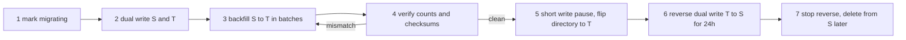

## 23.11 Rebalancing and live data movement

#### Concept

Rebalancing is moving data between shards while the system keeps serving traffic: adding a shard and giving it a fair share, draining a shard before retiring it, or moving one whale tenant to dedicated hardware. It has two halves: a routing scheme that keeps the amount of data to move small (consistent hashing, or a directory), and a procedure that moves the data without downtime or loss (dual-write, backfill, verify, cut over).

#### Why does it exist?

Any sharded system that lives long enough must change its shard count. With naive `hash(key) % N`, changing N from 8 to 9 remaps roughly 8/9 of all keys: almost everything moves, at once. A migration that moves 90% of a multi-terabyte dataset is a multi-week project with enormous risk. Rebalancing techniques exist to move only what must move, and to move it while the business continues.

#### Mental model

Imagine a ring of 360 mailboxes numbered like degrees on a compass. Each postal worker is assigned a few points on the ring and owns all mailboxes clockwise from their points up to the next worker's point. Hiring a new worker means giving them a few new points on the ring; they take over only the mailboxes between their points and the next existing points. Everybody else's mailboxes stay where they are. That is consistent hashing with virtual nodes. Moving the mail for those few mailboxes while letters keep arriving is the live-migration part.

#### How it works

**Consistent hashing with virtual nodes.** Hash each shard's identity to many points on a ring (say 128 virtual nodes per shard). Hash each key to a point; the owner is the first shard point clockwise. Adding a shard adds 128 points and takes over about 1/N of the ring, spread evenly. Removing a shard hands its arcs to the various neighbours. Virtual nodes are what make the split even; with one point per shard the arcs are wildly uneven.

**Directory routing** makes rebalancing an update to a table: `UPDATE tenant_shards SET shard_id = 9 WHERE tenant_id = 'acme'` after the data is in place. It is the simplest scheme to reason about and the one to prefer for tenant-keyed systems. Its cost is a lookup per request (cached) and a control database to keep highly available.

**Live migration of a key range or tenant**, step by step:

1. **Mark migrating.** Set the directory state for the tenant to `migrating`, recording source shard S and target shard T. The resolver keeps routing reads and writes to S.
2. **Enable dual writes.** The application (or a trigger plus logical replication) writes every change for the migrating tenant to both S and T. Writes to T are best-effort at this stage; the source of truth is still S. Every write must be idempotent on T (upserts keyed by primary key) because the backfill will overlap with them.
3. **Backfill.** Copy the tenant's existing rows from S to T in keyset batches, oldest first, using `INSERT ... ON CONFLICT DO UPDATE` so that a row updated by a dual write after the backfill read it does not get overwritten with the stale copy (compare an `updated_at` or version column in the `ON CONFLICT` clause). Throttle by replica lag and by T's load.
4. **Verify.** Row counts per table, checksums of ordered primary keys, spot checks of recently updated rows, and a continuous comparison of dual-write outcomes (a mismatch counter). Do not cut over until the mismatch rate is zero for a sustained period.
5. **Cut over.** Briefly block writes for the tenant (a few hundred milliseconds: the resolver returns `503 Retry-After: 1` for that tenant's writes), let in-flight writes to S complete and replicate, flip the directory to T, evict the cache, unblock. Reads and writes now go to T.
6. **Observe with fallback.** Keep dual-writing T to S in reverse for a day so an emergency flip back loses nothing. Then stop reverse writes, and after a retention window, delete the tenant's rows from S.



With Citus, most of this is `citus_rebalance_start()` (Citus 11+) which moves shards between workers using logical replication and a brief write lock per shard at the end. With RDS-hosted application sharding you build it yourself or use logical replication (`CREATE PUBLICATION ... FOR TABLE orders WHERE (tenant_id = 'acme')`, PostgreSQL 15+ row filters) to replace the dual-write and backfill steps with database-level replication, which is often the safer choice.

#### NestJS example

The resolver from section 23.8 extended with migration states, and a dual-write wrapper.

```ts
// src/sharding/tenant-routing.types.ts
export type TenantRoute =
  | { state: 'active'; shardId: number }
  | { state: 'migrating'; shardId: number; targetShardId: number }
  | { state: 'paused' }; // brief window during cutover
```

```ts
// src/sharding/dual-write.service.ts
import { Injectable, Logger, ServiceUnavailableException } from '@nestjs/common';
import { DataSource, EntityManager } from 'typeorm';
import { ShardResolver } from './shard-resolver.service';

@Injectable()
export class DualWriteService {
  private readonly logger = new Logger(DualWriteService.name);
  constructor(private readonly shards: ShardResolver) {}

  // Runs the write on the source of truth, then best-effort on the target while migrating.
  async write<T>(tenantId: string, op: (em: EntityManager) => Promise<T>): Promise<T> {
    const route = await this.shards.routeFor(tenantId);
    if (route.state === 'paused') {
      throw new ServiceUnavailableException({ message: 'tenant cutover in progress', retryAfterMs: 500 });
    }
    const source: DataSource = this.shards.byId(route.shardId);
    const result = await source.transaction(op);           // source commit is the truth

    if (route.state === 'migrating') {
      const target = this.shards.byId(route.targetShardId);
      try {
        await target.transaction(op);                      // op must be idempotent (upserts)
      } catch (err) {
        this.logger.error(`dual-write to shard ${route.targetShardId} failed for ${tenantId}`, err as Error);
        // Record the mismatch for the verifier; do not fail the user request.
        await this.shards.recordMismatch(tenantId, (err as Error).message);
      }
    }
    return result;
  }
}
```

The `op` passed in must be written as an upsert for dual writes to be safe: `INSERT ... ON CONFLICT (id) DO UPDATE SET ... WHERE excluded.updated_at > orders.updated_at`.

#### PostgreSQL example

Backfill batch and the verification checksum.

```sql
-- One backfill batch: keyset by primary key, idempotent upsert that never regresses newer data.
INSERT INTO orders (id, tenant_id, status, total_cents, created_at, updated_at)
SELECT id, tenant_id, status, total_cents, created_at, updated_at
FROM dblink('source_shard', $$
  SELECT id, tenant_id, status, total_cents, created_at, updated_at
  FROM orders WHERE tenant_id = 'acme' AND id > '018f3e1a-0000-7000-8000-000000000000'
  ORDER BY id LIMIT 5000 $$)
  AS s(id uuid, tenant_id text, status text, total_cents bigint, created_at timestamptz, updated_at timestamptz)
ON CONFLICT (id) DO UPDATE
  SET status = excluded.status, total_cents = excluded.total_cents, updated_at = excluded.updated_at
  WHERE orders.updated_at < excluded.updated_at;

-- Verification: same query on both shards must return identical values.
SELECT count(*), max(updated_at),
       md5(string_agg(id::text || ':' || updated_at::text, ',' ORDER BY id)) AS checksum
FROM orders WHERE tenant_id = 'acme';
```

#### Production scenario

Moving a 400 GB tenant from a shared shard to a dedicated one: dual writes enabled on Monday; backfill at 5,000 rows per batch with a 50 ms sleep and a pause whenever replica lag exceeds 2 s, completing in about 30 hours; verification clean for 6 hours on Wednesday; cutover Wednesday 23:00 with a 380 ms write pause; reverse dual writes until Thursday 23:00; source rows deleted the following week. Zero user-visible errors beyond a handful of `503` retries absorbed by client SDKs.

#### Edge cases & failure modes

- **Dual write succeeds on source, fails on target**: recorded as a mismatch; the backfill or a repair job reconciles. Never fail the user for the target.
- **Backfill overwrites a newer dual write**: prevented by the `WHERE orders.updated_at < excluded.updated_at` guard; requires a monotonic `updated_at` or version column on every table.
- **Deletes during migration**: a delete on the source must also delete on the target; backfill of a row already deleted on the source is harmless only if deletes are dual-written and the backfill reads a snapshot after the delete. Use soft deletes during migration windows if possible.
- **Cutover pause too long**: requests time out. Bound it (1 s) and abort the flip if in-flight writes have not drained.
- **Cache holds the old shard**: evict `shard:{tenant}` on flip and keep the cache TTL short during migrations.
- **Sequences and counters on the target**: none if you use application-generated ids; if any table still uses a sequence, `setval` it above the source's max before cutover.
- **Rebalancing under load**: backfill competes with production; throttle by target CPU and replica lag, and schedule the heavy part off-peak.

#### How a Senior Backend Engineer thinks about this

They design the routing scheme for rebalancing on day one: directory or consistent hashing, never `mod N`. They treat data movement as a product with tooling: a CLI to start, monitor, verify, cut over and roll back a tenant move, exercised on small tenants first. They prefer database-level logical replication with row filters over application dual writes when the PostgreSQL version allows, because it has fewer ways to lose a write.

#### Interview questions

1. *Explain consistent hashing and why virtual nodes matter.* Expected: points on a ring, clockwise ownership; adding a node moves only 1/N of keys; virtual nodes even out the arcs.
2. *Describe a zero-downtime move of one tenant to a new shard.* Expected: mark migrating, dual write, batched idempotent backfill, verify, short pause and directory flip, reverse dual write, cleanup.
3. *How do you stop the backfill from overwriting newer data?* Expected: version or `updated_at` guard in the upsert.

## 23.12 Connection scaling

#### Concept

Connection scaling is keeping the number of PostgreSQL connections within what the server handles well, no matter how many application pods, replicas and workers exist. PostgreSQL forks one backend process per connection; each costs memory (5 to 10 MB baseline, more with `work_mem` in use) and adds contention in shared structures. Beyond a few hundred *active* connections, throughput goes down, not up. A connection pooler multiplexes many client connections onto few server connections.

#### Why does it exist?

Because the arithmetic of modern deployments explodes. 40 API pods with a pool of 20, 10 worker pods with a pool of 10, two replicas each receiving read pools, and a few admin tools: 40×20 + 10×10 = 900 connections to the primary alone. Kubernetes autoscaling doubles the pod count during a traffic spike, so at the exact moment the database is busiest it also receives twice as many connections. `max_connections` is hit, new pods fail with `FATAL: remaining connection slots are reserved for non-replication superuser connections`, and the outage is self-inflicted.

#### Mental model

Imagine a call centre with 50 agents. Without a pooler, every customer keeps a dedicated phone line open all day even when silent, so 900 lines are needed for 900 customers and most agents sit idle waiting for their assigned customer to speak. With a pooler (a switchboard), customers dial in when they have something to say and are connected to any free agent for the duration of the sentence. 50 agents serve 900 customers because customers are silent 95% of the time.

#### How it works

**PgBouncer** is the standard pooler. It sits between the application and PostgreSQL. In *transaction* pooling mode, a client holds a server connection only for the duration of one transaction (for autocommit statements, one statement), then releases it. Typical ratio: 2,000 client connections onto 40 server connections. Costs: session-level features break across transactions (`SET` without `LOCAL`, prepared statements before PgBouncer 1.21, advisory locks held across transactions, `LISTEN/NOTIFY`, temporary tables). *Session* mode has none of those limitations but only helps by reusing connections across short-lived clients, not by multiplexing.

**RDS Proxy** is the managed equivalent on AWS. It multiplexes, handles failover more gracefully (it keeps client connections open while the backend switches, often reducing failover impact to a few seconds), and integrates with IAM and Secrets Manager. It "pins" a client to a server connection when session state is detected, which silently removes the multiplexing benefit; watch the `DatabaseConnectionsCurrentlySessionPinned` metric.

**Per-pod pools** still exist in front of the pooler: the Node.js `pg` pool inside each NestJS pod, sized small (5 to 10) because acquiring a connection from PgBouncer is cheap. The application pool's job becomes limiting concurrency per pod, not saving connection setup cost.

Topology: one PgBouncer (or a pair behind a load balancer) per PostgreSQL node, including replicas. PgBouncer is single-threaded; it handles tens of thousands of transactions per second, and multiple instances on the same port with `so_reuseport` scale it further.

```text
 60 NestJS pods x pool 8  = 480 client connections
          |
          v
   PgBouncer (transaction mode), default_pool_size = 40
          |
          v
   PostgreSQL primary, max_connections = 200 (40 used by pooler + room for admins and replication)
```

The budget formula the senior engineer keeps handy:

```text
server_connections_needed = sum over poolers (default_pool_size x databases x users) + reserved (superuser, replication, admin)
must be < max_connections, with max_connections itself sized so that
max_connections x work_mem x (average sort/hash nodes per query) fits in RAM after shared_buffers.
```

#### NestJS example

Pool settings that fit behind PgBouncer in transaction mode, and the guards that prevent session state leaking.

```ts
// src/database/typeorm.options.ts
import { TypeOrmModuleOptions } from '@nestjs/typeorm';

export const typeOrmOptions = (): TypeOrmModuleOptions => ({
  type: 'postgres',
  host: process.env.PGBOUNCER_HOST,      // pooler, not PostgreSQL directly
  port: 6432,
  username: process.env.PG_USER,
  password: process.env.PG_PASSWORD,
  database: process.env.PG_DB,
  autoLoadEntities: true,
  extra: {
    max: 8,                              // small: PgBouncer does the real pooling
    connectionTimeoutMillis: 2_000,
    idleTimeoutMillis: 10_000,
    statement_timeout: 5_000,            // sent as a startup parameter; PgBouncer passes it through
  },
});
```

Rules of the road in transaction pooling mode, enforced in code review:

- Use `SET LOCAL` inside a transaction, never bare `SET` (it would leak to the next client that gets the server connection).
- Take advisory locks and release them within one transaction (`pg_advisory_xact_lock`), never session-level `pg_advisory_lock` across statements.
- Do not rely on `LISTEN/NOTIFY` through the pooler; open a dedicated direct connection for it.
- Do not use temporary tables across statements.

#### PostgreSQL example

```sql
-- How many connections, by state and by application, right now?
SELECT application_name, state, count(*)
FROM pg_stat_activity
WHERE backend_type = 'client backend'
GROUP BY 1, 2 ORDER BY 3 DESC;

-- Idle-in-transaction connections hold locks and pool slots; kill them past a threshold.
-- Set idle_in_transaction_session_timeout = '30s' at the database level.
ALTER DATABASE shop SET idle_in_transaction_session_timeout = '30s';

-- Headroom check.
SELECT current_setting('max_connections')::int - count(*) AS free_slots FROM pg_stat_activity;
```

Minimal `pgbouncer.ini` for a primary:

```text
[databases]
shop = host=primary.internal port=5432 dbname=shop

[pgbouncer]
listen_port = 6432
pool_mode = transaction
default_pool_size = 40
max_client_conn = 4000
reserve_pool_size = 5
reserve_pool_timeout = 3
server_idle_timeout = 60
query_wait_timeout = 5       ; clients waiting for a server connection fail fast instead of piling up
```

#### Production scenario

Before: 48 pods × pool 20 = 960 connections; `max_connections = 1000`; autoscale to 70 pods during a campaign caused connection failures across the fleet. After: pool 8 per pod behind two PgBouncer instances with `default_pool_size = 50` each; primary sees at most 100 connections plus reserved; 140 pods during the next campaign, no connection errors, and p95 improved by 15% because fewer backends meant less lock manager contention.

#### Failure scenario

At 11:02 a deploy rolled out a new version. Kubernetes started 40 new pods before terminating the 40 old ones (surge), so for two minutes there were 80 pods × 20 = 1,600 connection attempts against `max_connections = 1000`. New pods failed readiness on their first query, Kubernetes kept them and retried, old pods were finally terminated, and the fleet recovered after four minutes of partial outage. The pooler would have absorbed this entirely; the interim fix was `maxSurge: 10%` and a smaller pool; the real fix was PgBouncer.

#### Edge cases & failure modes

- **Pool × replicas × pods** exceeding `max_connections`: recount after every topology change; alert on free slots below 20%.
- **Prepared statements in transaction mode**: `pg` uses unnamed statements by default, but TypeORM or `pg` with named prepared statements needs PgBouncer 1.21+ with `max_prepared_statements` set, or errors like `prepared statement "s1" does not exist`.
- **Session pinning in RDS Proxy**: session state silently disables multiplexing; watch the pinned-connection metric.
- **PgBouncer as a single point of failure**: run two, behind a load balancer or with DNS round-robin, and health-check them.
- **`query_wait_timeout` too high**: requests queue at the pooler instead of failing fast; latency explodes under overload. Keep it low and let the application's retry handle it.
- **Long transactions** monopolise server connections in transaction mode: a 30-second report holds one of the 40 for 30 seconds; run reports through a separate pool with its own limits.

#### How a Senior Backend Engineer thinks about this

They put a pooler in front of every production PostgreSQL from the start, size the application pool for concurrency rather than connection reuse, and forbid session-level state in application code. They know the connection budget as a number and re-derive it whenever pods, replicas or shards change.

#### Interview questions

1. *Why does a pooler improve throughput even though it adds a hop?* Expected: fewer backends means less memory and contention; multiplexing uses idle time; connection setup avoided.
2. *What breaks in PgBouncer transaction mode?* Expected: session `SET`, session advisory locks, `LISTEN/NOTIFY`, temp tables, named prepared statements on older versions.
3. *Size the pools: 60 pods, 2 replicas, primary `max_connections` 200.* Expected: small per-pod pools behind a pooler per node; pooler server pool sized from CPU cores and workload, well under 200 with headroom.

## 23.13 Write scaling before sharding

#### Concept

A set of techniques that raise effective write capacity of a single primary without splitting it: batching many small writes into few large ones, moving writes off the request path into queues, separating read models from the write model (CQRS), and moving high-volume low-value writes (events, logs, metrics, audit trails) to a store built for them. Each technique defers sharding, often by years.

#### Why does it exist?

Most "write-bound" databases are not bound by business writes. They are bound by chatty writes: a row update per page view, an audit row per request, a `last_seen` touch per API call, an event row per click. Business writes (orders, payments) are a small fraction. Removing or batching the chatter buys back the machine.

#### Mental model

Imagine a bank teller who must write every coin drop into the ledger by hand. Batching is counting a customer's coins and writing one line. Async queues are putting deposit slips in a tray for a clerk to enter later, in bulk, while the teller serves the next customer. Moving logs elsewhere is putting the visitor sign-in sheet at the door instead of in the ledger.

#### How it works

1. **Batching.** Collect writes for up to N ms or M rows and insert in one statement (`INSERT ... VALUES (...), (...), ...` or `COPY`). One transaction with 500 rows costs one fsync instead of 500. Throughput per second goes from thousands to hundreds of thousands of rows. Cost: a few milliseconds of latency and the need to handle a partial-batch failure (fall back to per-row inserts to find the bad row).
2. **Async write queues.** The request path publishes an event (BullMQ, RabbitMQ, Kafka); a worker consumes and writes in batches. Cost: the write is eventually consistent, and the queue must be durable and the consumer idempotent (Part 31).
3. **CQRS read models.** Keep the write model normalised and small; build denormalised read tables (or Elasticsearch, or Redis) from the change stream. Writes get cheaper because they no longer maintain the counters and denormalised columns that reads want. Cost: two models to keep consistent, and read-your-own-writes again.
4. **Move high-write data elsewhere.** Click events, request logs, metrics, notification delivery receipts: append-only, huge, queried by time. They belong in ClickHouse, S3 plus Athena, a time-series database, or at least a separate PostgreSQL instance with partitioning. Cost: another system to run, but one designed for that shape.
5. **Delete chatter.** `UPDATE users SET last_seen = now()` on every request is the classic. Write it to Redis and flush hourly, or only update when the previous value is more than 5 minutes old.

#### NestJS example

A batching writer for an audit trail: buffers rows, flushes every 200 ms or 500 rows, and falls back to single inserts if a batch fails.

```ts
// src/audit/audit-batch-writer.service.ts
import { Injectable, Logger, OnModuleDestroy } from '@nestjs/common';
import { DataSource } from 'typeorm';

interface AuditRow { actorId: string; action: string; targetId: string; at: Date }

@Injectable()
export class AuditBatchWriter implements OnModuleDestroy {
  private readonly logger = new Logger(AuditBatchWriter.name);
  private buffer: AuditRow[] = [];
  private timer?: NodeJS.Timeout;
  private static readonly MAX_ROWS = 500;
  private static readonly MAX_WAIT_MS = 200;

  constructor(private readonly ds: DataSource) {}

  enqueue(row: AuditRow): void {
    this.buffer.push(row);
    if (this.buffer.length >= AuditBatchWriter.MAX_ROWS) void this.flush();
    else if (!this.timer) this.timer = setTimeout(() => void this.flush(), AuditBatchWriter.MAX_WAIT_MS);
  }

  private async flush(): Promise<void> {
    if (this.timer) { clearTimeout(this.timer); this.timer = undefined; }
    const rows = this.buffer; this.buffer = [];
    if (rows.length === 0) return;
    try {
      // One multi-row INSERT: one round trip, one fsync, instead of rows.length of each.
      await this.ds.query(
        `INSERT INTO audit_events (actor_id, action, target_id, occurred_at)
         SELECT * FROM unnest($1::text[], $2::text[], $3::text[], $4::timestamptz[])`,
        [rows.map((r) => r.actorId), rows.map((r) => r.action), rows.map((r) => r.targetId), rows.map((r) => r.at)],
      );
    } catch (err) {
      this.logger.error(`batch of ${rows.length} failed; retrying individually`, err as Error);
      for (const r of rows) {
        try {
          await this.ds.query('INSERT INTO audit_events (actor_id, action, target_id, occurred_at) VALUES ($1,$2,$3,$4)',
            [r.actorId, r.action, r.targetId, r.at]);
        } catch (single) { this.logger.error('dropping audit row', single as Error); }
      }
    }
  }

  async onModuleDestroy(): Promise<void> { await this.flush(); } // drain on shutdown
}
```

Rows in the buffer are lost if the pod is killed abruptly; for an audit trail that must be complete, publish to a durable queue instead and batch in the consumer.

#### Production scenario

A marketplace primary at 9,000 write TPS: 6,500 of them were `last_seen` touches, session refreshes and click events. Moving click events to Kafka plus ClickHouse, `last_seen` to Redis with a 10-minute flush, and session refreshes to a sliding TTL in Redis left 1,800 business write TPS on the primary. Sharding was postponed indefinitely.

#### Edge cases & failure modes

- **Batch failure hides one bad row**: fall back to per-row to isolate it.
- **Async writes and read-your-own-writes**: the user does not see the write immediately; design the UI for it or write synchronously for user-facing state.
- **Queue backlog**: the worker falls behind; monitor lag and scale consumers.
- **Buffer lost on crash**: batching in memory is at-most-once; use a durable queue when loss is unacceptable.
- **CQRS projection lag**: read model minutes behind after a burst; expose freshness to the client.

#### Interview questions

1. *Primary at 9,000 write TPS. Do you shard?* Expected: first classify the writes; move chatter to Redis/queues/columnar stores; batch; usually sharding is unnecessary.
2. *What are the consistency implications of async writes?* Expected: eventual visibility, need for idempotent consumers, ordering per key.

## 23.14 Multi-tenant scaling strategies

#### Concept

A multi-tenant system serves many customers (tenants) from shared infrastructure. The data layout for tenants decides isolation, cost, operational load and how each of the scaling techniques in this part applies. Three layouts: shared schema with a `tenant_id` column (optionally enforced with row-level security), one schema per tenant, and one database per tenant.

#### Why does it exist?

Because the tradeoff between cost efficiency and isolation is real. Ten thousand tiny tenants cannot each have a database; three enterprise customers with compliance demands cannot share a table. Most products end up with a hybrid, and the senior engineer must know what each layout costs at migration time and at scale time.

#### Mental model

Imagine an office building. Shared schema is an open-plan floor where everyone's desk has a name tag and a rule says "only touch your own desk". Schema per tenant is one room per company on a shared floor with a shared corridor and services. Database per tenant is one building per company. The open plan is cheapest and easiest to rearrange; the buildings are the most private and the most expensive to renovate one by one.

#### How it works

| Layout | Isolation | Cost per tenant | Migrations | Noisy neighbour | Scaling path | Best for |
|---|---|---|---|---|---|---|
| Shared schema + `tenant_id` (+ RLS) | Logical only; one bug leaks data | Near zero | One migration for everyone; huge tables | Shared everything; needs rate limits | Partition by tenant list for whales; shard by `tenant_id` | Thousands of small tenants |
| Schema per tenant | Namespace separation, same connection | Low; catalog grows | N migrations, one per schema; drift risk; hours for 5,000 schemas | Shared CPU and pool | Move schemas between databases | Hundreds of mid-size tenants with custom needs |
| Database per tenant | Strong; separate backups and restore | High; pools and connections per DB | N migrations across N databases; orchestration required | None at the DB level | Move databases between servers | Tens of large or regulated tenants |

**Row-level security** (RLS) makes the shared-schema layout much safer: a policy on each table ensures every query is filtered by the tenant in the session, even if the developer forgets the `WHERE`.

```sql
CREATE TABLE invoices (
  id uuid PRIMARY KEY, tenant_id text NOT NULL, amount_cents bigint NOT NULL, created_at timestamptz DEFAULT now()
);
ALTER TABLE invoices ENABLE ROW LEVEL SECURITY;
ALTER TABLE invoices FORCE ROW LEVEL SECURITY;   -- applies to the table owner too

-- The application sets the tenant per transaction; the policy enforces it.
CREATE POLICY tenant_isolation ON invoices
  USING (tenant_id = current_setting('app.tenant_id', true))
  WITH CHECK (tenant_id = current_setting('app.tenant_id', true));

-- Per request, inside the transaction (SET LOCAL: safe with PgBouncer transaction mode):
BEGIN;
SET LOCAL app.tenant_id = 't_8842';
SELECT * FROM invoices WHERE created_at > now() - interval '30 days';   -- only t_8842's rows
COMMIT;
```

The `tenant_id` index must lead every composite index (`(tenant_id, created_at)`), otherwise the policy's filter is applied after a broad scan.

#### NestJS example

A request-scoped tenant context and a query runner wrapper that sets the RLS variable for every transaction.

```ts
// src/tenancy/tenant-transaction.service.ts
import { Injectable } from '@nestjs/common';
import { DataSource, EntityManager } from 'typeorm';

@Injectable()
export class TenantTransactionService {
  constructor(private readonly ds: DataSource) {}

  // Every tenant-scoped unit of work goes through here; RLS does the rest.
  async run<T>(tenantId: string, work: (em: EntityManager) => Promise<T>): Promise<T> {
    return this.ds.transaction(async (em) => {
      // Parameterised via format to avoid injection; set_config with is_local = true equals SET LOCAL.
      await em.query(`SELECT set_config('app.tenant_id', $1, true)`, [tenantId]);
      return work(em);
    });
  }
}
```

The tenant id comes from the verified JWT (a guard populates it), never from a client-supplied header.

#### Production scenario

A SaaS with 20,000 tenants: 19,900 on shared-schema with RLS across 4 hash shards keyed by `tenant_id`; 90 mid-size tenants on their own list partitions inside those shards; 10 enterprise tenants each on a dedicated database with their own backups. One migration pipeline applies each change to 4 shards and 10 dedicated databases in order, with a status table so a failed database can be retried alone. Schema-per-tenant was rejected because a migration across 20,000 schemas took 6 hours and drift between schemas had caused two incidents.

#### Edge cases & failure modes

- **RLS bypassed by a superuser or table owner** without `FORCE`; connect as a non-owner role.
- **Missing `set_config`** in some code path: with RLS the query returns zero rows rather than leaking, which is the safe failure, but it looks like a data-loss bug. Log the tenant setting on empty results in staging.
- **Migrations across N databases** half-applied: tenants on different schema versions; the app must be N-1 compatible (Part 25) and the pipeline resumable.
- **Per-tenant connection pools** explode with database-per-tenant: 500 databases × pool 5 = 2,500 connections; use PgBouncer with per-database pools, or a lazy pool that opens on demand.
- **Tenant deletion**: shared schema means a big `DELETE` (do it in batches); database per tenant means `DROP DATABASE`.
- **Cross-tenant analytics**: trivial with shared schema, painful with database per tenant; feed a warehouse by CDC.

#### How a Senior Backend Engineer thinks about this

They start with shared schema plus RLS plus `tenant_id`-leading indexes, because it is the cheapest to operate and the easiest to shard later by the same key. They add dedicated partitions or databases only for tenants that need isolation for compliance or for load, and they keep the number of distinct layouts to two. They refuse schema-per-tenant at scale unless custom schemas per tenant are the product.

#### Interview questions

1. *Compare the three multi-tenant layouts for a product expecting 10,000 tenants.* Expected: shared schema with RLS by default; dedicated databases for a handful; avoid schema-per-tenant because of migration cost and drift.
2. *How does RLS help and what can still go wrong?* Expected: enforces tenant filter at the database; bypassed without `FORCE`, needs the setting per transaction, needs leading `tenant_id` indexes.
3. *How would you migrate a shared-schema tenant to its own database?* Expected: the live-move procedure from section 23.11.

## Senior Checklist — Part 23

- [ ] I understand the concept
- [ ] I can explain it simply
- [ ] I can implement it
- [ ] I understand its failure modes
- [ ] I understand its scaling limitations
- [ ] I understand its security implications
- [ ] I understand its operational implications
- [ ] I can choose between alternatives
- [ ] I can explain the tradeoffs
- [ ] I can answer senior-level interview questions
- [ ] I climb the ladder in order (queries, pooling, cache, replicas, partitioning, sharding) and measure at each rung
- [ ] I can configure TypeORM `replication` and Sequelize `replication` and I know which reads I refuse to send to a replica
- [ ] I can solve read-your-own-writes with sticky routing and with an LSN check
- [ ] I can read `pg_stat_replication` and `pg_replication_slots` and I alert on lag and on inactive slots
- [ ] I know what my application does during a failover: reconnect via DNS, retry only idempotent work, no retry storm
- [ ] I can design a partitioned table with a correct primary key, automated partition creation and retention by drop
- [ ] I can choose a shard key from query logs and justify it by alignment, cardinality and distribution
- [ ] I can move a tenant between shards with dual writes, idempotent backfill, verification and a sub-second cutover
- [ ] I keep a connection budget and a pooler in front of every PostgreSQL node
- [ ] I remove chatty writes before I consider sharding

## Part 23 — Key Takeaways

- One tuned PostgreSQL instance serves tens of thousands of QPS and terabytes of data; most systems never need more than replicas and partitioning.
- Diagnose before scaling: `pg_stat_statements` and `pg_stat_activity` tell you which rung of the ladder applies.
- Replicas scale reads only; every replica read needs an explicit consistency decision, and every write needs idempotency because stale reads cause retries.
- Replication lag is a property to bound, not a bug to eliminate; measure it with LSNs and throttle the jobs that cause it.
- A replication slot with no consumer will fill your disk; alert on inactive slots and set `max_slot_wal_keep_size`.
- Failover is an application feature: DNS endpoints, keepalives, short connect timeouts, readiness that checks writability, retries only for idempotent work.
- Partition huge tables by the column your queries and retention use; the primary key must include the partition key; automate partition creation before the first midnight.
- Sharding is a one-way door: shard the whole domain by one key, keep transactions inside a shard, generate ids in the application, feed reporting from CDC.
- Directory routing lets you isolate whale tenants and move them live; `mod N` hashing cannot be rebalanced cheaply.
- Hot keys are a distribution problem: salt counters, cache hot entities, give whales dedicated shards.
- Pool size times replicas times pods must stay under `max_connections`; put PgBouncer or RDS Proxy in front of every node and keep application pools small.
- Before sharding for writes, delete the chatter: batch, queue, move logs and events to a store built for them.
- Shared schema with `tenant_id`, RLS and `tenant_id`-leading indexes is the default multi-tenant layout; dedicated databases are for the few tenants who need them.
