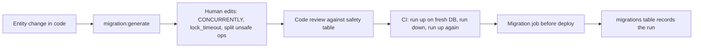
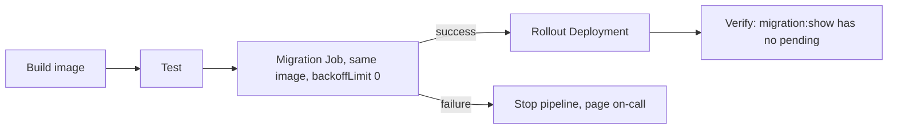

# Part 24 — Database Migrations and Zero-Downtime Schema Changes

A database schema is the one part of a system that cannot be redeployed. Code is stateless: ship a new version, kill the old pods, done. The database carries every row ever written, and every change to its shape must be made in place, while the application keeps reading and writing, while old and new versions of the code run at the same time, and while a single wrong lock can stop the entire business for as long as it takes someone to notice.

This part is about making schema changes boring. It covers migrations as code in TypeORM and Sequelize, where migrations should run, exactly which `ALTER TABLE` operations are fast and which rewrite terabytes, how to keep a migration from queueing behind a long query and freezing every request, the expand/contract pattern with a complete walkthrough on a `users` table, batched backfills that do not melt the replicas, why rollback is mostly fiction, and the recipes for renaming, retyping, splitting and shrinking tables without a maintenance window.

The senior mantra applies to every migration: *Can it timeout? Can it fail? Can it become slow? Can it duplicate? Can it return a wrong response? Can it partially succeed?* A migration can do all six, and a migration that partially succeeds is the worst of them.

## 24.1 Migrations as code

#### Concept

A migration is a versioned, ordered, executable description of one change to the database schema or data. Migrations live in the repository next to the code that needs them, are reviewed like code, and are applied by a tool that records which ones have already run in a table in the database itself. The database's shape at any moment is the result of applying every migration in order.

Three related but different things get called "migration":

- **Schema migration**: changes the structure. `ALTER TABLE users ADD COLUMN phone_e164 text`. Usually fast, sometimes catastrophically slow.
- **Data migration**: changes existing rows to fit a new structure or rule. `UPDATE users SET phone_e164 = normalize(phone)`. Never fast on a big table.
- **Backfill**: a data migration run in batches, over time, from a worker, with throttling and progress tracking, instead of as one statement. On any table with more than a few million rows, data migrations *are* backfills.

#### Why does it exist?

Without migrations as code, schema changes happen by hand in a database console, differ between environments, and nobody can say what the schema looked like last Tuesday. Deploys break because the code expects a column that exists in staging but not in production. A new engineer cannot build a local database that matches production. Migrations solve reproducibility: the same ordered list of changes, applied everywhere, tracked in the database.

#### Mental model

Imagine a building's renovation log. Every change to the building (a wall removed, a door added) is written as a numbered work order and signed off when done. Anyone can reconstruct the building's current layout by reading the orders in sequence. Nobody knocks out a wall without an order, because next week's electrician needs to know where the wall went. And crucially, once a wall is gone, "undo work order 42" is not a matter of paperwork; you would need to rebuild the wall.

#### How it works

1. A developer changes an entity (TypeORM) or model (Sequelize) and generates or writes a migration file with a timestamped name: `1725580800000-AddPhoneE164ToUsers.ts`.
2. The migration has an `up` function (apply) and a `down` function (attempt to undo).
3. The migration runner connects to the database, reads the `migrations` table (TypeORM's default name; Sequelize's CLI uses `SequelizeMeta`), finds the files not yet recorded, sorts by timestamp, and runs each `up`, inserting a row for it.
4. In PostgreSQL, most DDL is **transactional**: `ALTER TABLE`, `CREATE TABLE`, `CREATE INDEX` (the non-concurrent kind), `DROP`, all roll back if the transaction fails. This is a huge advantage over MySQL. TypeORM runs each migration inside a transaction by default (`migrationsTransactionMode: 'all'` wraps *all* pending migrations in one transaction; `'each'` wraps each separately; `'none'` disables it).
5. Two statements refuse to run inside a transaction block: `CREATE INDEX CONCURRENTLY` (and `DROP INDEX CONCURRENTLY`, `REINDEX CONCURRENTLY`), and before PostgreSQL 12, `ALTER TYPE ... ADD VALUE`. From PostgreSQL 12, `ADD VALUE` can run in a transaction but the new enum value cannot be *used* until that transaction commits. Migrations containing these must run with transactions disabled for that migration.

**Forward-only mindset.** Write every migration as if `down` will never be run in production, because on a real database it usually cannot be: a dropped column's data is gone, a backfilled value cannot be un-backfilled, and running `down` while new code is deployed breaks the new code. `down` is for local development and for CI checks. Production recovers by writing a *new* forward migration that repairs the situation. Keep `down` accurate anyway; it documents intent and it is what lets a developer iterate locally.

**`migration:generate` review discipline.** TypeORM can diff entities against the database and emit a migration. The output is a starting point, never a finished migration. It will happily generate `ALTER TABLE "users" DROP COLUMN "phone"` because you renamed a property, `ALTER COLUMN "total" TYPE bigint` which rewrites the table, or `CREATE INDEX` without `CONCURRENTLY`. Every generated migration is edited by hand and reviewed against the safe-operations table in section 24.3. Generated migrations also tend to include noise (re-creating constraints with different names, altering defaults) whenever entity metadata and the database disagree slightly; delete the noise.



#### Practical example

The `users` table has a free-text `phone` column with values like `+1 (555) 010-2233`, `555 010 2233` and `00 44 20 7946 0958`. Marketing wants SMS, which needs E.164 format (`+15550102233`). The change: add `phone_e164`, normalise every existing row into it, make the application write both, and eventually drop the free-text column. That is one schema migration (add column), one backfill (normalise 30 million rows), one code change per stage, and a final schema migration (drop column), spread over two weeks. Section 24.5 walks through every step of it.

#### NestJS example

DataSource configuration for migrations, separate from the application's runtime configuration, so the CLI and the migration job have their own entry point.

```ts
// src/database/data-source.ts
import 'reflect-metadata';
import { DataSource } from 'typeorm';

// Used by the TypeORM CLI and by the migration job. Never imported by the running app.
export const AppDataSource = new DataSource({
  type: 'postgres',
  host: process.env.PG_HOST,
  port: Number(process.env.PG_PORT ?? 5432),
  username: process.env.PG_MIGRATION_USER,      // a role that owns the tables
  password: process.env.PG_MIGRATION_PASSWORD,
  database: process.env.PG_DB,
  entities: ['dist/**/*.entity.js'],
  migrations: ['dist/database/migrations/*.js'],
  migrationsTableName: 'migrations',
  migrationsTransactionMode: 'each',           // one transaction per migration file
  synchronize: false,                          // never in any environment beyond a scratch DB
  logging: ['migration', 'error'],
});
```

```json
{
  "scripts": {
    "migration:generate": "typeorm migration:generate -d dist/database/data-source.js -p",
    "migration:run": "typeorm migration:run -d dist/database/data-source.js",
    "migration:run:notx": "typeorm migration:run -d dist/database/data-source.js -t none",
    "migration:show": "typeorm migration:show -d dist/database/data-source.js",
    "migration:revert": "typeorm migration:revert -d dist/database/data-source.js"
  }
}
```

The `-t none` (`--transaction none`) variant is for migrations with `CREATE INDEX CONCURRENTLY`. Keep such migrations in their own file, and in the migration body set `lock_timeout` yourself since there is no surrounding transaction to make it `LOCAL`.

#### TypeORM example

A hand-edited migration for adding the nullable column: transactional, with a lock timeout so it cannot block behind a long query.

```ts
// src/database/migrations/1725580800000-AddPhoneE164ToUsers.ts
import { MigrationInterface, QueryRunner } from 'typeorm';

export class AddPhoneE164ToUsers1725580800000 implements MigrationInterface {
  name = 'AddPhoneE164ToUsers1725580800000';

  public async up(queryRunner: QueryRunner): Promise<void> {
    // Fail fast instead of queueing behind a long transaction and blocking the app (section 31.4).
    await queryRunner.query(`SET LOCAL lock_timeout = '3s'`);
    // Nullable, no default: catalog-only change, takes ACCESS EXCLUSIVE for microseconds.
    await queryRunner.query(`ALTER TABLE "users" ADD COLUMN "phone_e164" text`);
  }

  public async down(queryRunner: QueryRunner): Promise<void> {
    await queryRunner.query(`SET LOCAL lock_timeout = '3s'`);
    await queryRunner.query(`ALTER TABLE "users" DROP COLUMN "phone_e164"`);
  }
}
```

And a non-transactional one for the index, which must run with `-t none`:

```ts
// src/database/migrations/1725581000000-IndexUsersPhoneE164.ts
import { MigrationInterface, QueryRunner } from 'typeorm';

export class IndexUsersPhoneE1641725581000000 implements MigrationInterface {
  name = 'IndexUsersPhoneE1641725581000000';

  public async up(queryRunner: QueryRunner): Promise<void> {
    // No transaction here (run with --transaction none), so plain SET, then reset.
    await queryRunner.query(`SET lock_timeout = '3s'`);
    await queryRunner.query(`CREATE INDEX CONCURRENTLY IF NOT EXISTS "users_phone_e164_idx" ON "users" ("phone_e164")`);
    await queryRunner.query(`RESET lock_timeout`);
  }

  public async down(queryRunner: QueryRunner): Promise<void> {
    await queryRunner.query(`DROP INDEX CONCURRENTLY IF EXISTS "users_phone_e164_idx"`);
  }
}
```

If a `CONCURRENTLY` build fails halfway (lock timeout, cancelled, deadlock), it leaves an **invalid** index behind that consumes space and slows writes but is never used. The `IF NOT EXISTS` would then skip re-creating it. Always check for invalid indexes after such a migration and drop them:

```sql
SELECT indexrelid::regclass AS index_name FROM pg_index WHERE NOT indisvalid;
```

#### Sequelize example

Sequelize migrations use `queryInterface`; they are plain JavaScript or TypeScript modules run by `sequelize-cli` or Umzug. They are *not* wrapped in a transaction automatically; you add one when you want atomicity.

```ts
// migrations/20260906120000-add-phone-e164-to-users.ts
import { QueryInterface, DataTypes } from 'sequelize';

export default {
  async up(queryInterface: QueryInterface): Promise<void> {
    await queryInterface.sequelize.transaction(async (transaction) => {
      await queryInterface.sequelize.query(`SET LOCAL lock_timeout = '3s'`, { transaction });
      await queryInterface.addColumn('users', 'phone_e164', { type: DataTypes.STRING(20), allowNull: true }, { transaction });
    });
  },

  async down(queryInterface: QueryInterface): Promise<void> {
    await queryInterface.sequelize.transaction(async (transaction) => {
      await queryInterface.sequelize.query(`SET LOCAL lock_timeout = '3s'`, { transaction });
      await queryInterface.removeColumn('users', 'phone_e164', { transaction });
    });
  },
};
```

For `CONCURRENTLY`, use `queryInterface.sequelize.query(...)` outside any transaction; `queryInterface.addIndex` has a `concurrently: true` option on PostgreSQL, but the raw statement is clearer to review.

#### Production scenario

A team of 12 engineers ships 20 to 40 migrations a month to a 1.5 TB database. Their rules: every migration is a separate PR section reviewed by someone who has read section 24.3; generated migrations are always edited; every migration sets `lock_timeout`; index creation is always `CONCURRENTLY` in its own file; data changes never run in migrations, only in backfill jobs; and a migration that touches a table over 10 million rows must be tested against last night's production snapshot in a staging environment with timing recorded. Their average migration takes under a second of lock time; their worst in two years took 4 seconds.

#### Failure scenario

`migration:generate` produced, among other lines, `ALTER TABLE "orders" ALTER COLUMN "total_cents" TYPE bigint` because someone changed a TypeScript type from `number` to `string` and the column decorator from `int` to `bigint`. Nobody noticed in review. In production the statement took an `ACCESS EXCLUSIVE` lock on `orders` (300 million rows) and started rewriting the table. Every read and write on `orders` blocked. Checkout was down for 41 minutes until an on-call engineer found the session with `pg_stat_activity`, terminated it with `pg_terminate_backend`, and the transaction rolled back (transactional DDL saved the day; the table was intact). The fix afterwards: the review checklist, snapshot testing for migrations touching big tables, and the type-change recipe in section 24.3.

#### Edge cases & failure modes

- **Migration file with `CONCURRENTLY` run inside a transaction**: `ERROR: CREATE INDEX CONCURRENTLY cannot run inside a transaction block`. The migration fails; with `'each'` mode the transaction rolls back cleanly; make it its own file and run with `-t none`.
- **Enum value added and used in the same transaction** (PostgreSQL 12+): `ERROR: unsafe use of new value "x" of enum type`. Split into two migrations.
- **Half-applied migration in `'none'` mode**: statements 1 and 2 ran, 3 failed; the `migrations` table has no row; rerunning repeats 1 and 2. Make every statement idempotent (`IF NOT EXISTS`, `IF EXISTS`) in non-transactional migrations.
- **Migration table drift between environments**: staging has a migration production does not, or the same name with different content. Never edit a migration that has run anywhere; write a new one. Compare `SELECT name FROM migrations` across environments in CI.
- **Two migrations with the same timestamp** from two branches: order becomes arbitrary. Rebase and regenerate the timestamp before merge.
- **Entity and schema disagree** after a manual hotfix in production: `migration:generate` produces a migration to "undo" the hotfix. Record hotfixes as migrations immediately.

#### How a Senior Backend Engineer thinks about this

They treat a migration as production code with the highest blast radius in the repository: it runs once, cannot be retried casually, and can lock the whole business. They read every generated line. They separate schema changes (fast, transactional) from data changes (slow, batched, from a worker). They think forward-only and design each migration so that the code deployed before and after it both work (Part 25 — Backward Compatibility).

#### Common mistakes

- Trusting `migration:generate` output.
- Putting an `UPDATE` of millions of rows inside a migration, holding a transaction for an hour.
- Using `synchronize: true` "only in staging" and then wondering why staging and production diverge.
- Editing an already-applied migration file.
- Not setting `lock_timeout`.

#### Interview questions

1. *Schema migration, data migration, backfill: what is the difference and where does each run?* Expected: structure vs rows vs batched rows; schema in the migration job, data as a batched backfill from a worker.
2. *What cannot run inside a PostgreSQL transaction and how do you handle it in TypeORM?* Expected: `CREATE INDEX CONCURRENTLY`, pre-12 `ALTER TYPE ADD VALUE`; separate file, `--transaction none`, idempotent statements.
3. *Why "forward-only"?* Expected: `down` cannot restore dropped data and breaks the new code; repair with a new forward migration; keep `down` for local iteration.
4. *What do you check in a generated migration before merging?* Expected: rewrites, missing `CONCURRENTLY`, dropped columns, implicit NOT NULL, lock timeout, ordering.

## 24.2 Where migrations run

#### Concept

A migration must run exactly once, before the code that depends on it, by a process with the right permissions, in a place where a failure is visible and does not take the application down with it. The choice is between running migrations as a distinct step in the deployment pipeline (a CI/CD job, a Kubernetes Job or init container) and running them when the application starts.

#### Why does it exist?

Because "the app runs migrations on boot" works beautifully with one instance and becomes a race with ten. Ten pods start simultaneously, each sees pending migrations, each tries to run them. TypeORM inserts the migration row after `up` succeeds, so two pods can both run the same `ALTER TABLE`; one fails with "column already exists", crashes, restarts, and now you have CrashLoopBackOff on half the fleet in the middle of a deploy, with the schema in a state nobody can describe.

#### Mental model

Imagine renovating a hotel. You do not let every arriving guest knock out a wall if they notice the renovation is not done. One contractor does the work before the guests arrive, signs the work order, and only then are the doors opened. If the contractor fails, the doors stay closed and someone is called; the guests never see a half-built room.

#### How it works

**Option A: CI/CD job before deploy (recommended).** The pipeline builds the image, then runs a one-off container from that same image with the command `npm run migration:run`, then, only if that succeeds, updates the Deployment. On Kubernetes this is a `Job` with `backoffLimit: 0` (do not auto-retry a failed migration; a human must look) and `activeDeadlineSeconds` so a hung migration is killed. Helm users put it in a pre-upgrade hook; Argo CD users use a `PreSync` hook.

**Option B: init container.** Each pod runs the migration command in an init container before the main container starts. Same race as startup migrations unless the init container takes a lock; the advantage is it needs no separate pipeline step. Acceptable only with an advisory lock, and it still means a migration failure prevents *every* new pod from starting, which during a failover or scale-up is a bad time to discover it.

**Option C: at application startup** (`migrationsRun: true` in TypeORM). Fine for a single-instance development setup. In production, dangerous for the race described above, and because a slow migration delays readiness for every pod, and because the application's database role then needs DDL permissions.

**Advisory lock.** If you must run migrations from something that may run concurrently, wrap the whole run in a session-level advisory lock so only one runner proceeds and the others wait or skip. This is what tools like Flyway do internally; TypeORM does not.



**Permissions.** The application role should own nothing and have only `SELECT, INSERT, UPDATE, DELETE` on the tables. A separate migration role owns the tables and runs DDL. This stops a compromised application from altering the schema and stops a well-meaning engineer from running `synchronize` with production credentials.

**Ordering.** Migrations run in timestamp order; timestamps come from when the file was created, not merged. Two feature branches can produce files whose order differs from merge order. Rules: regenerate the timestamp on rebase; never have a migration depend on a later one; CI applies all migrations to a fresh database in filename order, so any mis-ordering is caught before production.

**Drift detection.** Drift is the database's actual schema differing from what the migrations say. It arises from hotfixes in a console, from `synchronize` in some environment, from failed non-transactional migrations. Detect it in CI by running `migration:generate` (with `--dryrun`, or `--check` on recent TypeORM versions, which exits non-zero when a migration would be generated) against an environment's database after all migrations are applied: any output means drift. Also compare the list of applied migration names between environments.

#### NestJS example

A small standalone script, packaged in the same image, used by the Kubernetes Job. It uses an advisory lock so that even an accidental concurrent run is safe.

```ts
// src/database/run-migrations.ts
import { AppDataSource } from './data-source';

const MIGRATION_LOCK_KEY = 7_236_501; // arbitrary constant, unique per application

async function main(): Promise<void> {
  const ds = await AppDataSource.initialize();
  const runner = ds.createQueryRunner();
  await runner.connect();
  try {
    // Session-level advisory lock: held on this connection until released or disconnected.
    const [{ locked }] = await runner.query('SELECT pg_try_advisory_lock($1) AS locked', [MIGRATION_LOCK_KEY]);
    if (!locked) {
      console.log('another migration runner holds the lock; exiting without changes');
      return;
    }
    const applied = await ds.runMigrations({ transaction: 'each' });
    console.log(`applied ${applied.length} migration(s): ${applied.map((m) => m.name).join(', ') || 'none'}`);
    await runner.query('SELECT pg_advisory_unlock($1)', [MIGRATION_LOCK_KEY]);
  } finally {
    await runner.release();
    await ds.destroy();
  }
}

main().catch((err) => { console.error('migration failed', err); process.exit(1); });
```

Note the lock is taken on `runner`'s connection while `runMigrations` uses the DataSource's own connections; the lock still works because it is a global mutex in PostgreSQL, not tied to the migrating connection. Do not run this through PgBouncer in transaction mode: session-level advisory locks require a stable session. Point the migration job at PostgreSQL directly.

```yaml
# k8s/migration-job.yaml
apiVersion: batch/v1
kind: Job
metadata:
  name: shop-api-migrate
  annotations:
    argocd.argoproj.io/hook: PreSync
    argocd.argoproj.io/hook-delete-policy: BeforeHookCreation
spec:
  backoffLimit: 0                 # never auto-retry a failed migration
  activeDeadlineSeconds: 1800     # kill a hung migration after 30 minutes
  template:
    spec:
      restartPolicy: Never
      containers:
        - name: migrate
          image: registry.internal/shop-api:1.42.0
          command: ["node", "dist/database/run-migrations.js"]
          env:
            - name: PG_HOST
              value: primary.internal      # direct, not PgBouncer
            - name: PG_MIGRATION_USER
              valueFrom: { secretKeyRef: { name: pg-migrator, key: username } }
            - name: PG_MIGRATION_PASSWORD
              valueFrom: { secretKeyRef: { name: pg-migrator, key: password } }
```

#### PostgreSQL example

Roles and drift checks.

```sql
-- Two roles: one owns and migrates, one only uses.
CREATE ROLE shop_migrator LOGIN PASSWORD '...';
CREATE ROLE shop_app      LOGIN PASSWORD '...';

ALTER SCHEMA public OWNER TO shop_migrator;
-- Existing and future tables: app can read/write, cannot alter.
GRANT USAGE ON SCHEMA public TO shop_app;
GRANT SELECT, INSERT, UPDATE, DELETE ON ALL TABLES IN SCHEMA public TO shop_app;
GRANT USAGE, SELECT ON ALL SEQUENCES IN SCHEMA public TO shop_app;
ALTER DEFAULT PRIVILEGES FOR ROLE shop_migrator IN SCHEMA public
  GRANT SELECT, INSERT, UPDATE, DELETE ON TABLES TO shop_app;
ALTER DEFAULT PRIVILEGES FOR ROLE shop_migrator IN SCHEMA public
  GRANT USAGE, SELECT ON SEQUENCES TO shop_app;

-- Which migrations has this database seen? Compare across environments in CI.
SELECT id, timestamp, name FROM migrations ORDER BY timestamp;

-- Is a migration runner active right now?
SELECT pid, state, now() - xact_start AS running_for, left(query, 80)
FROM pg_stat_activity WHERE usename = 'shop_migrator';
```

#### Production scenario

Deploy pipeline for a 40-pod service: build (4 min), tests (6 min), migration job (typically 2 to 10 s; alerted if over 60 s), rollout with `maxSurge: 25%` and `maxUnavailable: 0` (3 min). The migration job runs with the *new* image against the *old* code still serving traffic, which is exactly why every migration must be backward compatible with the currently running version (Part 25). Rollback of the code is a normal rollout to the previous image; the schema stays at the new version, which the old code tolerates because of the expand/contract discipline.

#### Failure scenario

A team ran migrations at startup with 12 replicas. A deploy included `CREATE UNIQUE INDEX` on a busy table. All 12 pods started, all 12 attempted the index; one won the lock, eleven queued behind it, each holding a connection and blocking readiness. The index took 9 minutes. Kubernetes killed pods on the readiness deadline, restarted them, and each restart re-queued another index attempt. Meanwhile the old pods had been scaled down. Total outage: 34 minutes. Moving migrations to a pre-deploy Job with `backoffLimit: 0` and using `CONCURRENTLY` fixed both halves of the problem.

#### Edge cases & failure modes

- **Migration run twice by two pods**: races on DDL, crash loops. Use a Job, or an advisory lock.
- **Job succeeds, rollout fails**: schema is ahead of the code. Fine if the migration was backward compatible; disastrous if it dropped a column the old code reads.
- **Job hangs on a lock** (section 24.4): `activeDeadlineSeconds` kills it; the transaction rolls back; the pipeline stops.
- **Job runs through PgBouncer**: session advisory lock and `SET` behave unpredictably in transaction mode; connect directly.
- **Migration role lacks ownership** of a table created by hand: `must be owner of table`. Fix ownership with `ALTER TABLE ... OWNER TO shop_migrator`.
- **Different migration lists per environment**: someone applied a migration in staging that was later renamed; the renamed one is pending in staging and applied in production. Never rename applied migrations.
- **Multiple services sharing one database and one `migrations` table**: their runners collide on the table and on ordering. Give each service its own `migrationsTableName`, or better, its own schema (section 24.8).

#### How a Senior Backend Engineer thinks about this

They make the migration step a first-class, visible, separately monitored stage in the pipeline, with its own alert and its own runbook. They give the application role no DDL rights. They ask of every migration: "If this job succeeds and the rollout is then cancelled, is the running code still fine?" If not, the migration is split.

#### Interview questions

1. *Why not run migrations on application startup?* Expected: races between replicas, delayed readiness, DDL permissions in the app, failures hidden in crash loops.
2. *How would you run migrations on Kubernetes?* Expected: a Job from the same image, `backoffLimit: 0`, deadline, before rollout; PreSync hook in Argo CD or pre-upgrade in Helm; direct connection to the primary.
3. *How do you detect schema drift?* Expected: generate a migration against each environment in CI and fail on non-empty output; compare applied migration lists.
4. *Two branches created migrations with out-of-order timestamps. What happens and how do you prevent it?* Expected: application order differs by environment; regenerate timestamps on rebase; CI applies to a fresh DB.

#### Practical exercise

Set up a NestJS project with a `migrations` folder, the `run-migrations.ts` runner above, and a GitHub Actions workflow that: starts PostgreSQL as a service container, applies all migrations, runs `migration:generate --dryrun` and fails if any SQL is produced, reverts the last migration and re-applies it, and finally runs the test suite. Acceptance criteria: the workflow fails when you add an entity column without a migration; it fails when a migration's `down` does not restore the schema; it passes otherwise.
