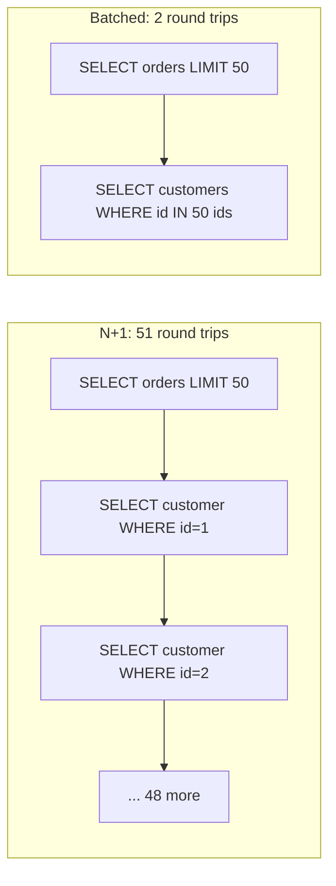

## 24.4 N+1 queries

#### Concept

An **N+1 query** is the pattern where code fetches a list of N parent rows with one query, then runs one more query *per row* to fetch a child or related row. For 50 orders that need their customer, that is 1 + 50 = 51 round trips where 1 or 2 would do. It is the single most common performance bug in ORM-based services, and it is invisible in development because N is 3 there and 500 in production.

#### Why does it exist?

ORMs make it easy to write `order.customer` as if it were a property. Behind that property is a query. Lazy loading, `for` loops with `await` inside, and "helper" methods that fetch by id are all N+1 generators. Each individual query is fast (1–2 ms), so nothing looks slow in isolation; the sum is what hurts.

#### Mental model

Imagine a waiter taking a table of 20 people's orders and walking to the kitchen after *each* person instead of once with the full list. Each walk is quick. The table waits twenty walks.

#### How it works



Cost model: each round trip to PostgreSQL in the same zone is about 0.5–1 ms of network plus 0.2–1 ms of planning and execution for a primary-key lookup. Fifty of them sequentially: 50–100 ms. One `IN` query returning 50 rows: 2–4 ms. Across a request doing 500 RPS, N+1 also multiplies the *query rate* on the database by 50, which is the part that takes the database down.

**Detection.**

- Query logging in development with counts per request: TypeORM `logging: ['query']` and a middleware that counts; any request over about 10 queries is suspect.
- `pg_stat_statements`: a query with very high `calls`, tiny `mean_exec_time` and the shape `WHERE id = $1` is almost always an N+1.
- APM traces (OpenTelemetry with the `pg` instrumentation): a request span with 50 identical child spans in a staircase is the signature.

```sql
-- N+1 suspects: many calls, cheap each, primary-key shape
SELECT calls, round(mean_exec_time::numeric, 2) AS mean_ms, round(total_exec_time::numeric) AS total_ms, left(query, 80) AS q
FROM pg_stat_statements
WHERE calls > 100000 AND mean_exec_time < 2
ORDER BY calls DESC
LIMIT 10;
```

#### TypeORM example — the bug and three fixes

```ts
// BUG: 1 + N queries
const orders = await this.orders.find({ where: { customerId }, take: 50 });
for (const o of orders) {
  o.items = await this.items.find({ where: { orderId: o.id } }); // one query per order
}
```

Fix 1, `relations` (TypeORM issues a join or a second `IN` query depending on strategy):

```ts
const orders = await this.orders.find({
  where: { customerId }, take: 50, order: { createdAt: 'DESC' },
  relations: { items: true },
  relationLoadStrategy: 'query', // 2 queries: orders, then items WHERE orderId IN (...); avoids row multiplication with take
});
```

Fix 2, explicit `IN` batching, which works for any shape including non-relations:

```ts
import { In } from 'typeorm';
const orders = await this.orders.find({ where: { customerId }, take: 50 });
const items = await this.items.find({ where: { orderId: In(orders.map((o) => o.id)) } });
const byOrder = new Map<string, OrderItem[]>();
for (const it of items) byOrder.set(it.orderId, [...(byOrder.get(it.orderId) ?? []), it]);
for (const o of orders) o.items = byOrder.get(o.id) ?? [];
```

Fix 3, DataLoader, for GraphQL or for any code path where callers request related rows independently and you want automatic batching within one tick:

```ts
// src/customers/customer.loader.ts
import { Injectable, Scope } from '@nestjs/common';
import DataLoader from 'dataloader';
import { In, Repository } from 'typeorm';
import { InjectRepository } from '@nestjs/typeorm';
import { Customer } from './customer.entity';

@Injectable({ scope: Scope.REQUEST }) // one loader per request so the cache never crosses users
export class CustomerLoader {
  readonly byId: DataLoader<string, Customer | null>;
  constructor(@InjectRepository(Customer) repo: Repository<Customer>) {
    this.byId = new DataLoader(async (ids: readonly string[]) => {
      const rows = await repo.find({ where: { id: In([...ids]) } });
      const map = new Map(rows.map((r) => [r.id, r]));
      return ids.map((id) => map.get(id) ?? null); // must preserve order and length
    }, { maxBatchSize: 500 });
  }
}
```

A request-scoped loader is one of the few justified uses of `Scope.REQUEST`; note it for section 24.10, where request scope on hot paths is warned against.

#### Sequelize example

```ts
// BUG
const orders = await Order.findAll({ where: { customerId }, limit: 50 });
for (const o of orders) o.items = await OrderItem.findAll({ where: { orderId: o.id } });

// FIX: include with separate: true does orders + one IN query, safe with limit
const orders = await Order.findAll({
  where: { customerId }, limit: 50, order: [['createdAt', 'DESC']],
  include: [{ model: OrderItem, as: 'items', separate: true }],
});
```

Without `separate: true`, Sequelize generates a `LEFT JOIN` and, combined with `limit`, wraps the parent query in a subquery; that works but returns one row per item and multiplies payload. `separate: true` is the `relationLoadStrategy: 'query'` equivalent.

#### PostgreSQL example — verify with EXPLAIN

```sql
EXPLAIN (ANALYZE, BUFFERS)
SELECT * FROM order_items WHERE order_id = ANY($1::uuid[]);
-- Bitmap Heap Scan on order_items  (actual time=0.31..1.92 rows=143 loops=1)
--   Recheck Cond: (order_id = ANY ('{...50 ids...}'::uuid[]))
--   Buffers: shared hit=61
--   ->  Bitmap Index Scan on idx_order_items_order_id  (actual time=0.22..0.22 rows=143 loops=1)
-- Execution Time: 2.05 ms
```

One query, 2 ms, 61 buffer hits. The N+1 equivalent was 50 queries at about 0.4 ms of execution each plus 50 round trips.

#### Edge cases & failure modes

- `IN` with 50,000 ids blows the protocol parameter limit (65,535 parameters) or builds a huge plan; chunk at 1,000 or use `= ANY($1::uuid[])` with a single array parameter.
- A join with `take`/`limit` on the parent multiplies rows and truncates the wrong thing; use the query strategy or `separate: true`.
- DataLoader caches per instance; a singleton loader leaks data across users and never invalidates.
- Fixing N+1 by loading *everything* eagerly on every path creates the opposite problem: 2 MB responses for a list that needed ids and names.

#### Interview questions

1. *How do you detect N+1 in production without reading code?* Expected: `pg_stat_statements` high `calls` with primary-key shape; traces with repeated identical child spans.
2. *When is DataLoader the right fix rather than a join?* Expected: when callers request related rows independently (GraphQL resolvers, nested services) and you want batching without restructuring; it must be request-scoped.

## 24.5 Connection pooling

#### Concept

A **connection pool** keeps a set of open PostgreSQL connections and lends them to requests. Opening a connection costs a TCP handshake, optional TLS, authentication and a backend process fork on the PostgreSQL side: 20–50 ms and several MB of memory. A pool amortises that. It also *bounds* concurrency at the database, which is a feature: 40 pods each opening unlimited connections will crash a database long before they run out of CPU.

#### How it works

1. On startup the pool opens `min` connections (often 0).
2. A request calls `acquire`. If an idle connection exists, it is returned in microseconds. If not and `total < max`, a new one is opened. Otherwise the request waits in a queue up to `connectionTimeoutMillis` (pg) / `acquire` (Sequelize).
3. After the query or transaction, `release` returns it to idle. Idle connections beyond `min` are closed after `idleTimeoutMillis`.
4. A separate pooler (**PgBouncer**) can sit between all pods and PostgreSQL, multiplexing hundreds of client connections onto tens of server connections. In *transaction* pooling mode a server connection is assigned only for the duration of a transaction, which is what makes the multiplexing possible.

Sizing follows Little's law (section 24.1): `busy = query_rate × avg_hold`. A widely used starting point for PostgreSQL itself is `connections ≈ 2 × cores + effective_spindles` for the *whole* database, because beyond that, backends contend for CPU and locks and throughput drops. With 8 cores that is under 20 active connections; the point of PgBouncer is to let 400 pod-level connections share those 20.

```ts
// TypeORM DataSource options (pg pool under extra)
export const dataSourceOptions: DataSourceOptions = {
  type: 'postgres',
  url: process.env.DATABASE_URL,
  extra: {
    max: Number(process.env.PG_POOL_MAX ?? 10),
    idleTimeoutMillis: 30_000,
    connectionTimeoutMillis: 2_000,      // fail fast instead of queueing forever
    statement_timeout: 5_000,            // server-side cap per statement
    application_name: 'orders-api',      // shows in pg_stat_activity
  },
};
```

```ts
// Sequelize
const sequelize = new Sequelize(process.env.DATABASE_URL!, {
  dialect: 'postgres', logging: false,
  pool: { max: 10, min: 0, acquire: 2_000, idle: 30_000 },
  dialectOptions: { statement_timeout: 5_000, application_name: 'orders-api' },
});
```

**Metrics that matter** (section 24.1 showed the exporter): `pool.totalCount`, `pool.idleCount`, `pool.waitingCount` from `pg`; for Sequelize, `sequelize.connectionManager.pool` exposes `size`, `available`, `using` and `waiting` from `sequelize-pool`. Alert on `waiting > 0` sustained for 30 s, and on `pool wait time p99` if you wrap `acquire` with a timer. On the database side:

```sql
SELECT application_name, state, count(*) FROM pg_stat_activity
WHERE datname = current_database() GROUP BY 1, 2 ORDER BY 3 DESC;
-- 'idle in transaction' rows held for seconds mean code holds a connection while awaiting something else (an HTTP call, a queue)
```

#### PgBouncer caveats

Transaction pooling breaks anything that assumes the same server connection across transactions: session-level `SET`, `LISTEN/NOTIFY`, session advisory locks (`pg_advisory_lock`; use `pg_advisory_xact_lock` instead), temporary tables, and named prepared statements (PgBouncer 1.21+ supports protocol-level prepared statements in transaction mode; older versions need `max_prepared_statements` off or the client's prepared statements disabled). Set `server_idle_timeout`, `default_pool_size` per database/user and `max_client_conn` high enough for all pods. Monitor `SHOW POOLS` for `cl_waiting` (clients waiting for a server connection), which is the PgBouncer version of `waitingCount`.

#### Failure scenario

At 19:40 a marketing push doubled traffic. The pods had `max: 10`, six pods, 60 client connections; PgBouncer `default_pool_size = 20`. `cl_waiting` climbed to 35. Every request waited around 400 ms for a server connection; p99 went from 180 ms to 2.4 s; error rate stayed at 0.1% because `connectionTimeoutMillis` was 30 s. The on-call saw "database is fine, CPU 35%" and looked at the app for twenty minutes. The fix that night was `default_pool_size = 40` (the database had 16 cores and room); the fix the next week was a 500 ms `connectionTimeoutMillis` so pool exhaustion becomes a visible 503 within half a second instead of a silent queue, and an alert on `cl_waiting`.

#### Edge cases & failure modes

- Holding a connection across an `await` of an external HTTP call (`idle in transaction`) multiplies hold time by 20× and empties the pool under a slow third party. Release before calling out, or keep the call outside the transaction.
- `max` too high: 40 pods × 20 = 800 connections; PostgreSQL forks 800 backends, each with its own `work_mem`; memory and lock contention collapse throughput.
- Pool per Jest worker in tests and pool per pod in production both count against `max_connections`; leave headroom for migrations, `psql` and replication.
- A replica pool and a primary pool double the connection count; size each.
- Long `connectionTimeoutMillis` hides exhaustion as latency; short values expose it as errors you can alert on.

#### Interview questions

1. *Why is a pool of 200 per pod a bad idea?* Expected: PostgreSQL throughput peaks around a small multiple of cores; more active backends contend and throughput drops; use a small pool per pod plus PgBouncer.
2. *What does `idle in transaction` tell you?* Expected: application code holds a transaction open while doing something else, usually an external call; it exhausts pools and blocks vacuum.
3. *What breaks under PgBouncer transaction mode?* Expected: session state (`SET`, `LISTEN`, session advisory locks, temp tables, older prepared-statement handling).

## 24.6 Query optimisation

#### Concept

A slow query is the most common cause of a slow API. Query optimisation is a loop: find the expensive queries, read their plans, change the query or the indexes, re-read the plan, measure again. Part 12 — Indexing and Part 13 — Database Transactions cover the mechanics in depth; this section is the performance engineer's recap and the traps that cost the most in practice.

#### How it works — the EXPLAIN workflow

1. Find candidates with `pg_stat_statements` sorted by **total** time (a 2 ms query called 10,000 times a minute beats a 2 s report query called hourly).
2. Take the actual parameter values from logs or `auto_explain`.
3. Run `EXPLAIN (ANALYZE, BUFFERS)`; compare estimated vs actual rows, look for `Seq Scan` on big tables, `Rows Removed by Filter` in the thousands, `Sort Method: external merge` (spilled to disk), `Nested Loop` with a high inner `loops` count, and `Buffers: shared read` dominating `hit`.
4. Fix: index, rewrite, limit columns, change pagination, or move work out of the request path.
5. Re-run and record before and after in the PR.

```sql
-- Top queries by total time (the ones that heat the database)
SELECT round(total_exec_time::numeric / 1000) AS total_s, calls,
       round(mean_exec_time::numeric, 2) AS mean_ms, rows,
       round(100 * shared_blks_hit / nullif(shared_blks_hit + shared_blks_read, 0), 1) AS hit_pct,
       left(query, 100) AS q
FROM pg_stat_statements
ORDER BY total_exec_time DESC
LIMIT 15;
```

#### The traps, with measurement and fix

**`SELECT *`.** Fetches every column, including wide `text`/`jsonb` columns that live in TOAST (out-of-line storage) and cost extra reads, and prevents *index-only scans* because the index does not cover the columns. Measurement: `EXPLAIN` shows `Index Scan` with `Heap Fetches`, or the query returns 40 KB per row when the API uses two fields. Fix: select the columns you use; with TypeORM `select: { id: true, status: true }` or `createQueryBuilder().select(['o.id', 'o.status'])`; cover the hot query with `INCLUDE`:

```sql
CREATE INDEX CONCURRENTLY idx_orders_customer_created_inc
  ON orders (customer_id, created_at DESC) INCLUDE (status, total_cents)
  WHERE deleted_at IS NULL;
-- Index Only Scan ... Heap Fetches: 0   (after VACUUM sets the visibility map)
```

**`COUNT(*)` on a big table.** An exact count must visit every visible row (MVCC has no per-table counter). On 80 million rows that is 5–20 s. Measurement: `pg_stat_statements` shows a `SELECT count(*)` in the top ten. Fix: for "about how many" use the planner's estimate, which is instant:

```sql
SELECT reltuples::bigint AS approx_rows FROM pg_class WHERE oid = 'orders'::regclass;
-- Or, for a filtered count, read the estimate from the plan:
EXPLAIN (FORMAT JSON) SELECT 1 FROM orders WHERE status = 'PENDING';  -- "Plan Rows": 41230
```

For exact counts that the product needs, maintain a counter table updated in the same transaction, or count within a bounded window (`WHERE created_at > now() - interval '7 days'`, which an index makes cheap). For pagination UI, replace "of 1,234,567 results" with "next page".

**`OFFSET` pagination.** `OFFSET 100000 LIMIT 20` reads and discards 100,000 rows. Measurement: the plan shows `rows=100020` on the scan under the `Limit`. Fix: keyset pagination (section 24.8).

**Functions on indexed columns.** `WHERE lower(email) = $1` cannot use an index on `email`; `WHERE created_at::date = '2026-09-06'` cannot use an index on `created_at`; `WHERE id::text LIKE '123%'` cannot either. Measurement: `Seq Scan` with a `Filter` containing the function. Fix: an expression index (`CREATE INDEX ON users (lower(email))`), a `citext` column, or a range predicate (`created_at >= '2026-09-06' AND created_at < '2026-09-07'`).

**Implicit type mismatch.** `WHERE customer_id = 42` on a `uuid`/`text` column, or a `bigint` compared to a `numeric` parameter from the driver, silently disables the index. Measurement: the plan shows a cast on the column side (`(customer_id)::text = ...`). Fix: bind the right type; in TypeORM raw queries, cast the parameter (`$1::uuid`), not the column.

**Sorting in the app.** Fetching 50,000 rows to sort and take 20 in JavaScript. Fix: `ORDER BY` with an index that matches the sort, plus `LIMIT`.

**Stale statistics and plan flips.** After a large import, `ANALYZE` has not run and the planner believes the table is small; or a table crosses a size threshold and the planner switches from index scan to seq scan. Measurement: estimated rows off by 100× in the plan. Fix: `ANALYZE orders`, tune `autovacuum_analyze_scale_factor` lower for big tables (0.02 instead of 0.1), and consider `default_statistics_target` for skewed columns. Section 24.14 lists the plan flip incident.

#### TypeORM example — the same query, before and after

```ts
// BEFORE: SELECT *, OFFSET, sort in app
const all = await this.orders.find({ where: { customerId } });
const page = all.sort((a, b) => b.createdAt.getTime() - a.createdAt.getTime()).slice(offset, offset + 20);

// AFTER: selected columns, keyset, index-only scan
const page = await this.orders.createQueryBuilder('o')
  .select(['o.id', 'o.status', 'o.totalCents', 'o.createdAt'])
  .where('o.customer_id = :customerId AND o.deleted_at IS NULL', { customerId })
  .andWhere(cursor ? '(o.created_at, o.id) < (:createdAt, :id)' : '1=1', cursor ?? {})
  .orderBy('o.created_at', 'DESC').addOrderBy('o.id', 'DESC')
  .limit(20)
  .getMany();
```

#### auto_explain for the ones you cannot reproduce

```sql
-- postgresql.conf (or ALTER SYSTEM); logs plans for statements slower than 200 ms, with actual timings and buffers
ALTER SYSTEM SET shared_preload_libraries = 'pg_stat_statements,auto_explain';
ALTER SYSTEM SET auto_explain.log_min_duration = '200ms';
ALTER SYSTEM SET auto_explain.log_analyze = on;
ALTER SYSTEM SET auto_explain.log_buffers = on;
ALTER SYSTEM SET auto_explain.log_timing = off;  -- timing adds overhead on some hardware; buffers alone are usually enough
```

`auto_explain` captures the plan *as it ran in production with real parameters*, which is often different from the plan you get in `psql` with hand-picked values.

#### Interview questions

1. *Why sort `pg_stat_statements` by total time and not mean time?* Expected: total time is what loads the database; a cheap frequent query often matters more than a slow rare one.
2. *How do you count rows in a 100-million-row table quickly?* Expected: `reltuples` estimate, planner estimate, counter table, or bounded window; explain the tradeoff in accuracy.
3. *Why does `WHERE lower(email) = $1` not use the index on `email`?* Expected: the index stores raw values; the planner cannot use it for a function of the column; use an expression index or `citext`.

## 24.7 Caching and batch processing

#### Caching: measure the hit ratio, then decide

Caching is covered in depth in Part 16 — Caching Strategies. The performance-engineering view is arithmetic. For a lookup that costs `T_origin` at the database and `T_cache` at Redis, with hit ratio `h`:

```text
avg_latency = h × T_cache + (1 - h) × (T_cache + T_origin)
```

With `T_cache = 0.5 ms`, `T_origin = 12 ms`: at h = 0.5 the average is 6.75 ms (barely worth the complexity); at h = 0.95 it is 1.1 ms; at h = 0.99 it is 0.62 ms. The hit ratio decides whether a cache is a win, and the hit ratio depends on the *access pattern*, not on your code. Measure it before building: log the keys requested for an hour and compute how many repeats you would have had with a given TTL. Product catalog, category trees, feature flags, exchange rates and permissions are usually 95%+; user-specific order lists are often under 30% and not worth caching.

Also count what a cache does to the tail: a miss now costs `T_cache + T_origin`, so p99 can get *worse* for low hit ratios, and a cache stampede on expiry (thousands of misses at once) is a self-inflicted incident. Part 16 covers stampede protection (single-flight locks, early refresh, jittered TTLs).

#### Batch processing

Batching turns N round trips into one. It applies to database writes, external API calls and message publishing.

**Bulk inserts with chunking.** A single `INSERT` with 1,000 rows costs one round trip and one WAL flush at commit; 1,000 single-row inserts cost 1,000 round trips. The PostgreSQL protocol caps parameters at 65,535 per statement, so with 10 columns chunk at about 5,000 rows.

```ts
// src/imports/product-import.service.ts
async importProducts(rows: ProductRow[]): Promise<void> {
  const CHUNK = 2_000;
  await this.ds.transaction(async (m) => {
    for (let i = 0; i < rows.length; i += CHUNK) {
      await m.createQueryBuilder().insert().into(Product)
        .values(rows.slice(i, i + CHUNK))
        .orUpdate(['name', 'price_cents', 'updated_at'], ['sku']) // ON CONFLICT (sku) DO UPDATE
        .execute();
    }
  });
}
```

Sequelize: `Product.bulkCreate(chunk, { updateOnDuplicate: ['name', 'priceCents', 'updatedAt'] })`.

**`COPY` for very large loads.** `COPY` streams rows in PostgreSQL's binary or text format and is 5–10× faster than multi-row `INSERT`: roughly 100k–500k rows per second on modest hardware. Use `pg-copy-streams`:

```ts
import { from as copyFrom } from 'pg-copy-streams';
import { pipeline } from 'node:stream/promises';
import { Readable } from 'node:stream';

async copyProducts(rows: AsyncIterable<ProductRow>): Promise<void> {
  const client = await this.pool.connect();
  try {
    const sink = client.query(copyFrom(`COPY products_staging (sku, name, price_cents) FROM STDIN WITH (FORMAT csv)`));
    const source = Readable.from((async function* () {
      for await (const r of rows) yield `${r.sku},"${r.name.replace(/"/g, '""')}",${r.priceCents}\n`;
    })());
    await pipeline(source, sink);
    await client.query(`INSERT INTO products (sku, name, price_cents) SELECT sku, name, price_cents FROM products_staging
                        ON CONFLICT (sku) DO UPDATE SET name = EXCLUDED.name, price_cents = EXCLUDED.price_cents`);
  } finally {
    client.release();
  }
}
```

Load into a staging table, then merge; that keeps the long `COPY` from holding locks on the live table.

**Multi-row `UPDATE` with `UNNEST`.** Updating 500 rows with 500 different values in one statement:

```sql
UPDATE products AS p
SET stock = v.stock, updated_at = now()
FROM unnest($1::text[], $2::int[]) AS v(sku, stock)
WHERE p.sku = v.sku;
```

```ts
await m.query(sql, [updates.map((u) => u.sku), updates.map((u) => u.stock)]);
```

One round trip, one plan, and the index on `sku` is used for the join.

**Batching external API calls.** Most providers offer batch endpoints (fetch 100 prices, send 1,000 push notifications). When they do not, run calls concurrently with a *bounded* concurrency (a `p-limit` of 8–16) so you do not open 5,000 sockets at once, and honour their rate limit with a token bucket. A sequential loop of 500 HTTP calls at 40 ms each is 20 s; with concurrency 16 it is about 1.3 s.

**Batching Kafka publishes.** `producer.send({ topic, messages: [...] })` with many messages in one call produces one batch per partition, dramatically cheaper than one `send` per message (each `send` awaits a broker acknowledgement). The outbox relay in Part 22 — Event-Driven Architecture reads up to 500 rows and publishes them in one `send`. librdkafka-based clients expose `linger.ms` and `batch.size` to batch automatically; kafkajs batches only what you pass in a single call, so batch in your code.

#### Edge cases & failure modes

- One bad row in a 5,000-row chunk fails the whole chunk; for imports, validate first, or insert per chunk in savepoints and retry failing chunks row by row.
- Huge single transactions (millions of rows) bloat WAL, block vacuum and hold locks; commit per chunk unless atomicity across the whole load is a requirement.
- `COPY` into a live table with indexes and triggers is much slower; use a staging table.
- Batched external calls amplify retries: a retry of a 1,000-item batch on a partial failure duplicates 999 successes unless the batch is idempotent per item.

## 24.8 Pagination and streaming

#### Keyset pagination and response size

`OFFSET` gets slower with every page; keyset pagination (`WHERE (created_at, id) < (:cursor_created_at, :cursor_id) ORDER BY created_at DESC, id DESC LIMIT 20`) is constant time at any depth because the index is entered at the cursor. Part 20 — API Design covers cursor encoding. Two performance rules beyond the query:

- Cap page size at the server (`LIMIT 100` maximum regardless of what the client asks); a `?limit=10000` request is a denial of service against your own database and serializer.
- Keep list responses thin: ids, names, a few fields. A list of 50 orders should be 10–20 KB, not 400 KB of nested items and customer objects. Measure with `content-length` in access logs and alert on p99 response size.

#### Streaming large exports

Building a 300 MB JSON array in memory to send a CSV export is how a pod gets OOMKilled at month end. Streaming reads rows from PostgreSQL with a cursor and writes them to the response as they arrive, keeping memory flat.

```ts
// src/reports/orders-export.controller.ts
import { Controller, Get, Query, Res, UseGuards } from '@nestjs/common';
import type { Response } from 'express';
import { DataSource } from 'typeorm';
import QueryStream from 'pg-query-stream';
import { Transform } from 'node:stream';
import { pipeline } from 'node:stream/promises';

@Controller('reports')
export class OrdersExportController {
  constructor(private readonly ds: DataSource) {}

  @Get('orders.csv')
  @UseGuards(AdminGuard)
  async exportOrders(@Query('from') from: string, @Query('to') to: string, @Res() res: Response): Promise<void> {
    res.setHeader('Content-Type', 'text/csv');
    res.setHeader('Content-Disposition', 'attachment; filename="orders.csv"');
    res.write('id,customer_id,status,total_cents,created_at\n');

    const queryRunner = this.ds.createQueryRunner();
    await queryRunner.connect();
    try {
      const client = (await queryRunner.connection.driver.obtainMasterConnection()) as import('pg').PoolClient;
      const stream = client.query(new QueryStream(
        `SELECT id, customer_id, status, total_cents, created_at FROM orders
         WHERE created_at >= $1 AND created_at < $2 ORDER BY created_at, id`,
        [from, to], { batchSize: 1_000 }, // rows fetched from the server cursor per round trip
      ));
      const toCsv = new Transform({
        objectMode: true,
        transform(row, _enc, cb) {
          cb(null, `${row.id},${row.customer_id},${row.status},${row.total_cents},${row.created_at.toISOString()}\n`);
        },
      });
      await pipeline(stream, toCsv, res); // backpressure: slow clients slow the cursor, not memory
    } finally {
      await queryRunner.release();
    }
  }
}
```

`pg-query-stream` opens a server-side cursor, so PostgreSQL does not materialise the result either. `pipeline` propagates backpressure: if the client reads slowly, the cursor stops fetching. Memory stays under a few MB for a 10-million-row export. Note `@Res()` disables Nest's response handling for this route, which is intended; alternatively return a `StreamableFile` wrapping the transformed stream.

For JSON, stream *JSON Lines* (`application/x-ndjson`, one object per line) rather than a JSON array; the client can parse as it goes and you never need the closing bracket in memory. If the client insists on an array, write `[`, then rows joined by `,`, then `]`, still streaming.

Streaming also applies to file uploads (pipe the request to S3 with multipart upload instead of buffering into memory) and to large HTTP responses from third parties (`response.body` as a stream in `undici`/`fetch`).

#### Edge cases & failure modes

- A streaming response cannot change its status code after the first byte; validate everything before `res.write`.
- Client disconnect must abort the cursor (`req.on('close')`) or the connection stays busy until the query finishes.
- Streaming inside a transaction holds the connection for the whole export; use a dedicated read-replica pool for exports.
- Compression middleware buffering the whole stream defeats the purpose; ensure it flushes per chunk or compress at the LB.

#### Interview questions

1. *Why is `OFFSET 500000` slow and what replaces it?* Expected: the scan reads and discards 500k rows; keyset pagination enters the index at the cursor.
2. *How do you export 20 million rows without OOM?* Expected: server-side cursor (`pg-query-stream`), transform stream, `pipeline` for backpressure, streaming response.
