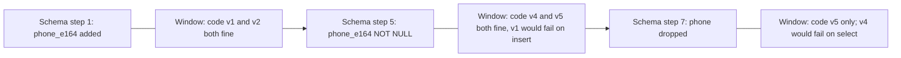
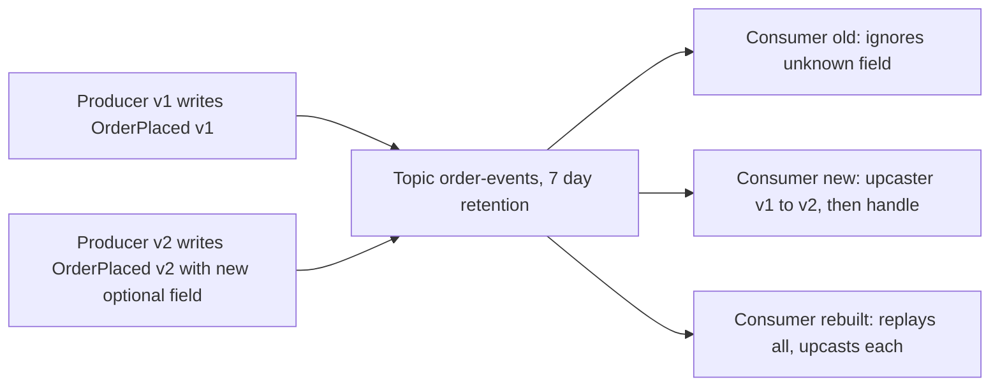

## 24.3 Schema compatibility: the N-1 rule

#### Concept

The N-1 rule: every database schema version must work with the application version currently deployed *and* with the one about to be deployed, and every application version must work with the schema version before and after its own. Since the migration runs before the rollout, the schema is always one step ahead of the oldest running pod, and if the rollout is reverted, one step ahead of the *only* running version. The rule is what makes rolling deploys and code rollbacks safe.

#### Why does it exist?

Because a schema change is applied once, instantly, to a database that many code versions share, while code versions replace each other gradually. There is no way to change schema and code atomically across 40 pods. The only alternative to N-1 compatibility is a maintenance window, and the only alternative to that is an outage.

#### Mental model

Imagine changing the locks on an office building while people are inside. You cannot swap every lock and hand out new keys at the same instant. So you install locks that accept both the old and the new key, hand out new keys over a week, and only when everyone has the new key do you remove the old key's profile. During the week, both keys work. The N-1 rule is "the lock must accept the previous key and the next key".

#### How it works

The link to Part 23 is direct: expand/contract *is* the N-1 rule applied step by step. This section covers the ways code breaks against a schema that is one step ahead or behind, so you can spot them in review.



**Entity mapping and removed columns.** TypeORM's `find*` methods generate `SELECT "user"."id", "user"."email", "user"."phone", ...` listing every column of the entity. Sequelize does the same with model attributes. If the column has been dropped, every such query fails with `column "phone" does not exist`. So the entity must lose the column *before* the column is dropped, which forces the two-deploy contract. A hand-written `SELECT *` does not fail; it returns a row without the property, and `row.phone` is `undefined`. That is worse when the value flows onward (a `null` written into another table, a notification sent with "undefined").

**Entities lagging behind the schema.** The reverse case: the schema has a new column the entity does not know. Reads are fine (the column is not selected). Inserts are fine only if the column is nullable or has a default. This is why step 1 of expand/contract adds the column nullable: v1 pods, which do not know it, keep inserting.

**Adding NOT NULL with old writers.** If the column is NOT NULL without a default and any live version inserts without it, that version's inserts fail. The safe order is: every live version writes the column; then tighten. In a shared-database situation, "every live version" includes other services.

**Type changes.** Widening (`varchar(50)` to `text`) is invisible to code. `int` to `bigint` changes what `pg` returns: JavaScript numbers are safe to 2^53, `pg` returns `bigint` columns as strings by default to avoid precision loss, so an entity declared `number` that becomes `bigint` starts receiving strings; code doing arithmetic gets `"42" + 1 = "421"`. Change the TypeScript type and the column decorator in the code version *before* the schema changes.

**Renames.** Old code uses the old name, new code the new one; no single schema satisfies both. Hence never rename; expand/contract.

**Default values as a compatibility tool.** A new column with `DEFAULT 'pending'` lets old inserts succeed and gives the new code a meaningful value to read. Defaults are the schema's version of "default values for new fields" in APIs.

**Constraints as breaking changes.** A new CHECK or unique constraint that old code can violate is a breaking change for that code, regardless of lock behaviour. Deploy code that complies first; then add the constraint (with `NOT VALID` + `VALIDATE`).

#### TypeORM example

The entity in the middle of the window (code v4 from Part 23): knows both columns, writes only the new one, reads the new one with a fallback. This single entity is compatible with schema steps 1 through 6.

```ts
// src/users/user.entity.ts  (v4: compatible with phone present or absent in code, present in DB)
import { Entity, PrimaryGeneratedColumn, Column } from 'typeorm';

@Entity({ name: 'users' })
export class User {
  @PrimaryGeneratedColumn('increment', { type: 'bigint' }) id!: string;   // string: bigint arrives as text from pg
  @Column('text', { unique: true }) email!: string;

  // Still declared so SELECTs succeed while the column exists; marked select: false would also work
  // if no code path needs it, and would make the entity tolerant of the column being dropped early.
  @Column('text', { nullable: true, select: false, insert: false, update: false }) phone?: string | null;

  @Column('text', { name: 'phone_e164', nullable: true }) phoneE164!: string | null;
}
```

`select: false` plus `insert: false` and `update: false` is a useful trick: the column stays mapped for explicit `addSelect` if ever needed, but ordinary finds no longer list it, so this entity survives the column being dropped. That collapses steps 6 and 7 into one safe deploy in many cases.

#### Sequelize example

Sequelize selects all model attributes by default; to make a model tolerant of a column that is about to disappear, remove the attribute from the model definition, or use a default scope that excludes it.

```ts
// src/users/user.model.ts (transition version)
User.init(
  {
    id: { type: DataTypes.BIGINT, primaryKey: true, autoIncrement: true },
    email: { type: DataTypes.TEXT, allowNull: false, unique: true },
    phone: { type: DataTypes.TEXT, allowNull: true },                   // still declared for explicit reads
    phoneE164: { type: DataTypes.TEXT, allowNull: true, field: 'phone_e164' },
  },
  {
    sequelize, tableName: 'users', timestamps: false,
    defaultScope: { attributes: { exclude: ['phone'] } },               // ordinary queries never select phone
  },
);
```

#### PostgreSQL example

Finding out whether any live code still touches a column before the contract step.

```sql
-- Any statement in the last stats window referencing the old column, excluding the new one.
SELECT calls, left(query, 120)
FROM pg_stat_statements
WHERE query ~* '\mphone\M' AND query !~* 'phone_e164'
ORDER BY calls DESC LIMIT 20;

-- Reset the counters right after the last old-code deploy so the next check reflects only current code.
SELECT pg_stat_statements_reset();
```

#### Production scenario

A team's deploy pipeline runs three checks on every PR that contains a migration: (1) the previous release's test suite against the migrated schema, (2) the current release's test suite against the *previous* schema (that is, without the new migration), and (3) the current suite against the migrated schema. All three must pass. Check (2) is the one people forget, and it is the one that catches "new code assumes the column exists" when a rollout is reverted after the migration ran.

#### Failure scenario

The "column dropped while old pods run" incident from Part 23 in another shape: a team removed `phone` from the entity and dropped the column in the same release. The migration job succeeded; the rollout started; for 4 minutes, v4 pods (entity with `phone`) ran against a schema without it; every user query on those pods failed. The blast radius was 40% of users for 4 minutes. The pipeline now refuses a PR that both removes an entity column and contains a `DROP COLUMN`.

#### Edge cases & failure modes

- **Rollback after migration**: code goes back to N, schema stays at N+1; safe only if N+1 was additive.
- **`SELECT *` in raw queries** silently changes shape; prefer explicit columns in raw SQL that feeds other writes.
- **Enum column with a new value** read by old code that maps the enum strictly; handled in section 24.5.
- **JSONB column shape changes** are invisible to the schema and entirely a code compatibility issue; version the JSON (`{"v": 2, ...}`) and read both.
- **Generated columns and triggers** added in N+1 may compute values old code did not expect to exist; harmless if old code ignores unknown columns.
- **Per-tenant or per-shard schema at different versions**: code must be N-1 compatible for as long as the slowest shard takes.

#### Interview questions

1. *State the N-1 rule and why it exists.* Expected: schema must work with current and next code; code with previous and next schema; because migrations are instant and rollouts are gradual, and rollbacks happen.
2. *Why does dropping a column break an ORM-based service even without `SELECT *`?* Expected: ORMs list entity columns explicitly; the query fails outright.
3. *How do you test N-1 compatibility in CI?* Expected: previous code against new schema, new code against previous schema, new against new.

## 24.4 Event compatibility and schema evolution

#### Concept

Events (Kafka messages, RabbitMQ messages, webhooks) are contracts with an extra dimension: time. A consumer reads a stream that contains messages from every producer version that ever wrote to it, in order, possibly weeks later. Schema evolution is the set of rules that keeps every message ever written readable by every consumer version that may ever read it.

#### Why does it exist?

Because topics are durable and consumers are independent. A retention of 7 days (or forever, with compaction) means old messages coexist with new ones. Consumers deploy on their own schedule; some are down for hours; some are rebuilt and replay from the beginning. A producer that changes a field's shape has changed the meaning of history.

#### Mental model

Imagine a company newsletter archive going back years. A new reader must be able to read the old issues; an old reader who has been away must be able to read the new issues. Adding a new column to the layout is fine. Renaming "Sales" to "Revenue" confuses the old reader; dropping the "Date" line breaks everyone who files issues by date. Whoever changes the layout must think about both readers.

#### How it works

1. **Envelope with a version.** Every event carries metadata separate from its payload: `type`, `version` (of the payload schema), `id`, `occurredAt`, `producer`. Consumers dispatch on `type` and `version`.
2. **Additive payload changes only.** Add optional fields with defaults. Never rename, never remove a field consumers use, never change a type or meaning. New meaning gets a new field name.
3. **Consumers ignore unknown fields.** The tolerant reader again. A consumer that validates with a strict schema and rejects extra fields will break the moment a producer adds one.
4. **Upcasters for real changes.** When a payload must change shape (v1 to v2), the consumer holds a small function per version step that transforms an old payload into the current shape before the business logic runs. Business logic then sees one shape. Upcasters are pure, chainable (v1 to v2 to v3), and unit-tested against recorded real events.
5. **Schema registry compatibility modes**, explained simply. A registry (Confluent Schema Registry with Avro, JSON Schema or Protobuf) stores every version of each topic's schema and refuses to register a new version that violates the configured mode:
   - **BACKWARD** (the default): a consumer using the *new* schema can read data written with the *old* schema. Allowed: delete fields, add fields with defaults. Deployment order: consumers first, then producers.
   - **FORWARD**: a consumer using the *old* schema can read data written with the *new* schema. Allowed: add fields, delete fields that had defaults. Deployment order: producers first, then consumers.
   - **FULL**: both. Allowed: add or delete *optional* fields with defaults only. Any deployment order.
   - **_TRANSITIVE** variants check against *all* previous versions, not just the latest. Use `FULL_TRANSITIVE` for topics with long retention or replay; it is the only mode that guarantees any consumer can read any message ever written.
6. **Protobuf and JSON Schema specifics.** Protobuf field numbers are the contract; never reuse a number; unknown fields are preserved by default; enums need an `UNKNOWN = 0`. JSON Schema compatibility depends on `additionalProperties`; a consumer schema with `additionalProperties: false` is intolerant.



#### NestJS example

A typed envelope, an upcaster chain, and a Kafka consumer that dispatches on type and version. The producer only ever publishes the latest version; the consumer accepts all.

```ts
// src/events/envelope.ts
export interface EventEnvelope<T = unknown> {
  id: string;            // UUIDv7; also the idempotency key for consumers
  type: string;          // 'order.placed'
  version: number;       // payload schema version
  occurredAt: string;    // ISO 8601
  producer: string;      // 'orders-service@1.42.0'
  payload: T;
}
```

```ts
// src/events/order-placed/order-placed.upcasters.ts
// v1: { orderId, userId, total }            total = net, major units (e.g. 42.5)
// v2: { orderId, userId, totalNetCents, currency }   currency added, cents, still net
// v3: { orderId, userId, totalNetCents, totalGrossCents, currency }

export interface OrderPlacedV3 { orderId: string; userId: string; totalNetCents: number; totalGrossCents: number; currency: string }

type Upcaster = (payload: Record<string, unknown>) => Record<string, unknown>;

// Each step converts exactly one version to the next. Pure, testable against recorded events.
const upcasters: Record<number, Upcaster> = {
  1: (p) => ({ orderId: p.orderId, userId: p.userId, totalNetCents: Math.round(Number(p.total) * 100), currency: 'USD' }),
  2: (p) => ({ ...p, totalGrossCents: p.totalNetCents }),   // gross unknown for old events: best available value, documented
};

export const CURRENT_ORDER_PLACED_VERSION = 3;

export function upcastOrderPlaced(version: number, payload: Record<string, unknown>): OrderPlacedV3 {
  let v = version; let p = payload;
  while (v < CURRENT_ORDER_PLACED_VERSION) {
    const step = upcasters[v];
    if (!step) throw new Error(`no upcaster from order.placed v${v}`);
    p = step(p); v += 1;
  }
  if (v > CURRENT_ORDER_PLACED_VERSION) {
    // A newer producer than this consumer: tolerate, since v3 fields are a subset by the additive rule.
  }
  return p as unknown as OrderPlacedV3;
}
```

```ts
// src/events/order-events.consumer.ts
import { Controller, Logger } from '@nestjs/common';
import { EventPattern, Payload } from '@nestjs/microservices';
import { EventEnvelope } from './envelope';
import { upcastOrderPlaced } from './order-placed/order-placed.upcasters';
import { LoyaltyService } from '../loyalty/loyalty.service';

@Controller()
export class OrderEventsConsumer {
  private readonly logger = new Logger(OrderEventsConsumer.name);
  constructor(private readonly loyalty: LoyaltyService) {}

  @EventPattern('order-events')
  async handle(@Payload() envelope: EventEnvelope<Record<string, unknown>>): Promise<void> {
    if (envelope.type !== 'order.placed') return;                      // unknown types are ignored, not errors
    const order = upcastOrderPlaced(envelope.version, envelope.payload);
    await this.loyalty.awardPoints(envelope.id, order.userId, order.totalNetCents);  // idempotent by event id
  }
}
```

The consumer treats an unknown `type` as "not for me", never as a failure; a new event type added by a producer must not crash consumers that predate it.

#### PostgreSQL example

The outbox table (Part 30) that produces these events carries the version so the relay never has to guess, and an archive of consumed events keyed by id gives idempotency.

```sql
CREATE TABLE outbox (
  id           uuid PRIMARY KEY,
  type         text NOT NULL,
  version      int  NOT NULL,
  occurred_at  timestamptz NOT NULL DEFAULT now(),
  payload      jsonb NOT NULL,
  published_at timestamptz
);

-- Consumer side: processed event ids for idempotency across redeliveries and replays.
CREATE TABLE consumed_events (
  event_id     uuid PRIMARY KEY,
  consumer     text NOT NULL,
  consumed_at  timestamptz NOT NULL DEFAULT now()
);
```

#### Production scenario

An `order-events` topic with 7-day retention and 6 consumers owned by 4 teams. Registry mode `FULL_TRANSITIVE`. Producer changes are additive only; when the totals moved to cents, the producer added `totalNetCents` alongside `total` for three months, consumers migrated one by one, and only then did the producer stop writing `total` (which under FULL required it to have had a default, which it did). A consumer rebuilt from scratch in month two replayed 7 days of mixed messages without error because of the upcaster chain.

#### Failure scenario

A producer renamed `userId` to `customerId` in `order.placed`. The registry was in `NONE` mode ("we will be careful"). The loyalty consumer read `payload.userId`, got `undefined`, and awarded points to user `undefined` for 40 minutes; 11,000 events were consumed and acknowledged. Recovery: an upcaster mapping `customerId` back, a replay from the offset before the deploy with idempotency keyed by event id (which correctly skipped nothing, because the earlier processing had written rows with a null user), and a manual repair of the 11,000 loyalty rows. The registry is now in `FULL_TRANSITIVE`, and the CI rejects producer schema changes the registry would reject.

#### Edge cases & failure modes

- **Consumer crashes on unknown enum value** in the payload: the same fix as for APIs; map unknowns to a sentinel and log.
- **Replay with old schema** after the upcaster for that version was deleted "because nobody uses v1 anymore": keep upcasters for as long as the topic retention plus the longest possible replay.
- **Compacted topics** keep the latest message per key forever; every version ever written may still be present. `FULL_TRANSITIVE` or bust.
- **Out-of-order delivery** across partitions means a v2 message may be read before a v1 message; upcasters must be independent of order.
- **Semantic drift**: `total` silently changing from net to gross with the same name is undetectable by any registry. Only naming discipline prevents it.
- **Webhooks to third parties** are events you cannot replay into their code; version them in the URL or payload and never remove fields.

#### How a Senior Backend Engineer thinks about this

They treat an event schema as an API published to the future. They configure the registry to the strictest mode the topic's retention demands and let it reject mistakes. They keep the producer additive and put all adaptation in consumers, because there are many consumers and one producer, and consumers can upcast at their own pace. They never delete an upcaster while any message of that version could still be read.

#### Common mistakes

- Registry in `NONE` mode "temporarily".
- No version in the envelope, so consumers guess from field presence.
- Consumer schemas with `additionalProperties: false`.
- Upcasters written as "if field missing then default" spread across business logic instead of one chain.

#### Interview questions

1. *Explain BACKWARD, FORWARD and FULL compatibility and the deployment order each implies.* Expected: new reads old (consumers first); old reads new (producers first); both (any order); transitive for replay.
2. *What is an upcaster and where does it live?* Expected: a pure function converting payload version N to N+1, chained in the consumer before business logic.
3. *A consumer was down for 8 hours and the producer changed schema meanwhile. What must be true for it to catch up?* Expected: additive change, tolerant reader, version in the envelope, upcaster if shape changed.

#### Practical exercise

Record 1,000 real `order.placed` v1 and v2 events to a fixture file. Implement the upcaster chain to v3 and a consumer that awards loyalty points idempotently. Acceptance criteria: replaying the fixture twice produces the same loyalty totals; a v4 event with an extra unknown field is processed without error; a registry check (or a JSON Schema compatibility test) rejects a producer change that removes `orderId`.
