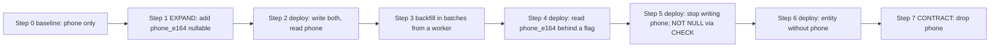
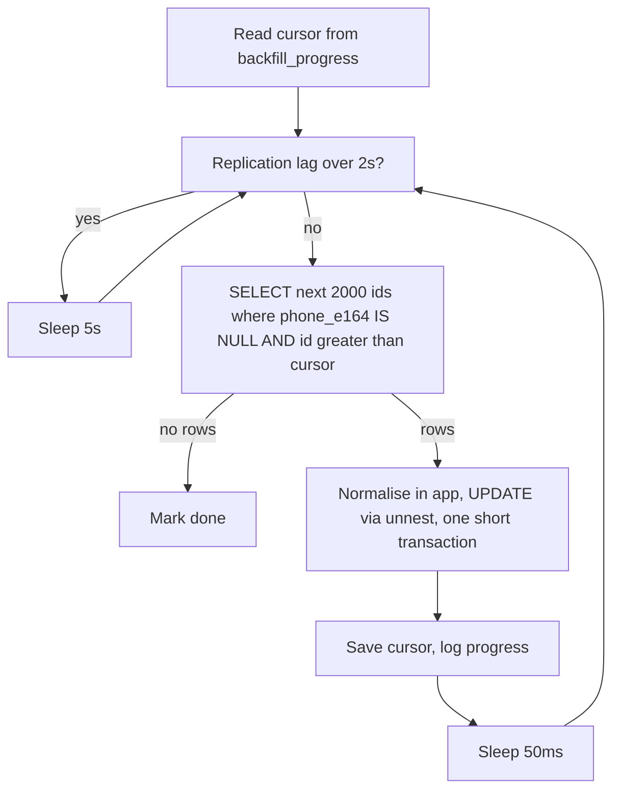
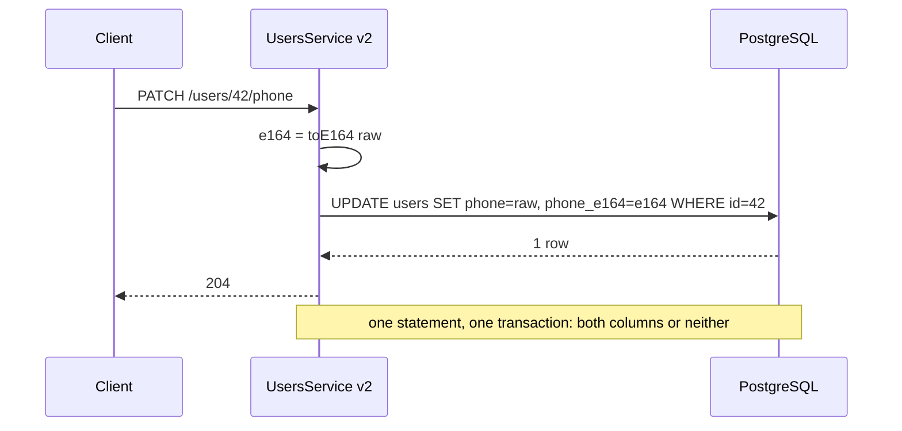

## 24.5 Zero-downtime migrations and the expand/contract pattern

#### Concept

Expand/contract is the discipline of making every schema change in three phases so that at no moment does any running version of the code find the database in a shape it cannot handle. **Expand**: add the new thing (column, table, index) alongside the old, without touching the old. **Migrate**: make the code write to both, backfill existing rows, then move reads and finally writes to the new thing. **Contract**: once nothing reads or writes the old thing, remove it. Every deploy in between is a normal rolling deploy; every step is reversible until the last.

#### Why does it exist?

Because a rolling deployment means old and new code run against one database at the same time, and because the schema is changed *before* the new code is fully out (the migration job runs first). A single migration that renames `phone` to `phone_e164` breaks every old pod the instant it commits and breaks every new pod if it is rolled back. Expand/contract replaces one dangerous step with six boring ones.

#### Mental model

Imagine replacing a bridge that carries traffic. You do not close it and build a new one in the same spot. You build the new bridge next to it (expand), open both and route some traffic across the new one while checking it holds (migrate), and only when the old bridge carries no traffic do you demolish it (contract). At every moment there is a bridge to drive on, and until demolition you can send everyone back to the old one.

#### How it works

The walk-through below uses the real change from section 24.1: `users.phone` (free text) becomes `users.phone_e164` (normalised, NOT NULL, indexed), and `phone` is dropped. Table size: 30 million rows. Every step shows the migration, the code change, and the query that proves the step is done before moving to the next.

```text
users -> add new column -> deploy code (write both, read old) -> backfill in batches
      -> switch reads -> switch writes -> add NOT NULL -> remove old column
```



Versions of the code are named v1 (baseline) through v5. At each deploy, the previous version and the new version coexist for minutes; the schema at that moment must satisfy both.

**Step 0: baseline (v1).**

```ts
// src/users/user.entity.ts  (v1)
import { Entity, PrimaryGeneratedColumn, Column } from 'typeorm';

@Entity({ name: 'users' })
export class User {
  @PrimaryGeneratedColumn('increment', { type: 'bigint' }) id!: string;
  @Column('text', { unique: true }) email!: string;
  @Column('text', { nullable: true }) phone!: string | null;   // free text, e.g. "+1 (555) 010-2233"
}
```

**Step 1: expand the schema.** Add the new column, nullable, no default. Fast. Old code (v1) ignores it because TypeORM selects only the columns in the entity and never writes columns it does not know.

```ts
// src/database/migrations/1725580800000-AddPhoneE164ToUsers.ts
import { MigrationInterface, QueryRunner } from 'typeorm';

export class AddPhoneE164ToUsers1725580800000 implements MigrationInterface {
  public async up(qr: QueryRunner): Promise<void> {
    await qr.query(`SET LOCAL lock_timeout = '3s'`);
    await qr.query(`ALTER TABLE "users" ADD COLUMN "phone_e164" text`);   // nullable: catalog-only
  }
  public async down(qr: QueryRunner): Promise<void> {
    await qr.query(`SET LOCAL lock_timeout = '3s'`);
    await qr.query(`ALTER TABLE "users" DROP COLUMN "phone_e164"`);
  }
}
```

Verification: the column exists, is nullable, and no rewrite happened.

```sql
SELECT column_name, is_nullable, data_type FROM information_schema.columns
WHERE table_name = 'users' AND column_name = 'phone_e164';
-- phone_e164 | YES | text
```

**Step 2: deploy v2, which writes both and reads the old column.** The entity gains the new column; every code path that sets `phone` also sets `phone_e164`. Reads still use `phone`. v1 and v2 coexist: v1 writes only `phone` (leaving `phone_e164` null, which the backfill will fix), v2 writes both. Neither breaks.

```ts
// src/users/user.entity.ts  (v2)
@Entity({ name: 'users' })
export class User {
  @PrimaryGeneratedColumn('increment', { type: 'bigint' }) id!: string;
  @Column('text', { unique: true }) email!: string;
  @Column('text', { nullable: true }) phone!: string | null;
  @Column('text', { name: 'phone_e164', nullable: true }) phoneE164!: string | null;  // new, dual-written
}
```

```ts
// src/users/phone-normalizer.ts
import { parsePhoneNumberFromString } from 'libphonenumber-js';

// Returns E.164 ("+15550102233") or null when the input cannot be parsed.
export function toE164(raw: string | null | undefined, defaultCountry: 'US' | 'GB' | 'IN' = 'US'): string | null {
  if (!raw) return null;
  const parsed = parsePhoneNumberFromString(raw, defaultCountry);
  return parsed?.isValid() ? parsed.number : null;
}
```

```ts
// src/users/users.service.ts  (v2: dual write, read old)
import { Injectable, NotFoundException } from '@nestjs/common';
import { InjectRepository } from '@nestjs/typeorm';
import { Repository } from 'typeorm';
import { User } from './user.entity';
import { toE164 } from './phone-normalizer';

@Injectable()
export class UsersService {
  constructor(@InjectRepository(User) private readonly users: Repository<User>) {}

  async updatePhone(userId: string, rawPhone: string, country: 'US' | 'GB' | 'IN'): Promise<void> {
    const user = await this.users.findOneBy({ id: userId });
    if (!user) throw new NotFoundException();
    user.phone = rawPhone;                       // old column: still the source of truth
    user.phoneE164 = toE164(rawPhone, country);  // new column: written alongside
    await this.users.save(user);
  }

  async getPhone(userId: string): Promise<string | null> {
    const user = await this.users.findOneBy({ id: userId });
    return user?.phone ?? null;                  // reads still come from the old column
  }
}
```

Verification: new writes populate both columns.

```sql
-- Rows written in the last 10 minutes should all have phone_e164 when phone is parseable.
SELECT count(*) FILTER (WHERE phone_e164 IS NULL AND phone IS NOT NULL) AS missing_new,
       count(*) AS recent
FROM users WHERE updated_at > now() - interval '10 minutes';
```

**Step 3: backfill.** Fill `phone_e164` for the 30 million existing rows. Not in a migration: from a worker, in batches, resumable, throttled by replication lag. The full script is in section 24.7; the loop is:



Verification: nothing left to backfill, and a sample comparison passes.

```sql
SELECT count(*) FILTER (WHERE phone IS NOT NULL AND phone_e164 IS NULL) AS pending,
       count(*) FILTER (WHERE phone_e164 IS NOT NULL) AS filled,
       count(*) AS total
FROM users;
-- pending must be 0 (or equal to the count of unparseable phones, which you handle separately)

-- Unparseable leftovers: decide (null them, fix by hand, or ask the user on next login).
SELECT id, phone FROM users WHERE phone IS NOT NULL AND phone_e164 IS NULL LIMIT 50;
```

**Step 4: deploy v3, which reads the new column behind a flag.** Reads switch to `phone_e164` when the flag is on; writes still go to both. The flag lets you switch back instantly without a deploy if anything looks wrong.

```ts
// src/users/users.service.ts  (v3: read new column when flagged)
async getPhone(userId: string): Promise<string | null> {
  const user = await this.users.findOneBy({ id: userId });
  if (!user) return null;
  if (this.flags.isEnabled('users.read_phone_e164')) {
    // Fall back to the old column for the few rows the backfill could not normalise.
    return user.phoneE164 ?? user.phone;
  }
  return user.phone;
}
```

Verification: with the flag at 10%, then 50%, then 100%, compare what both paths would return and count mismatches (log a metric `phone_read_mismatch_total`; it must be zero for a day before step 5).

**Step 5: deploy v4, which stops writing the old column, then enforce NOT NULL.** v4 writes only `phone_e164`. v3 and v4 coexist: v3 still writes both, v4 writes one; the old column starts to go stale, which is fine because after step 4 nothing reads it. After v4 is fully out, add the constraint with the CHECK recipe from section 24.3, and the index.

```ts
// src/users/users.service.ts  (v4: write only the new column)
async updatePhone(userId: string, rawPhone: string, country: 'US' | 'GB' | 'IN'): Promise<void> {
  const e164 = toE164(rawPhone, country);
  if (!e164) throw new BadRequestException('phone is not a valid number');   // new rule: must be valid
  await this.users.update({ id: userId }, { phoneE164: e164 });
}
```

```ts
// src/database/migrations/1726100000000-UsersPhoneE164NotNull.ts  (run with --transaction none)
import { MigrationInterface, QueryRunner } from 'typeorm';
import { runDdlWithRetry } from './util/ddl';

export class UsersPhoneE164NotNull1726100000000 implements MigrationInterface {
  public async up(qr: QueryRunner): Promise<void> {
    await runDdlWithRetry(qr, `ALTER TABLE "users" ADD CONSTRAINT "users_phone_e164_nn" CHECK ("phone_e164" IS NOT NULL) NOT VALID`);
    await qr.query(`ALTER TABLE "users" VALIDATE CONSTRAINT "users_phone_e164_nn"`);   // non-blocking scan
    await runDdlWithRetry(qr, `ALTER TABLE "users" ALTER COLUMN "phone_e164" SET NOT NULL`);
    await runDdlWithRetry(qr, `ALTER TABLE "users" DROP CONSTRAINT "users_phone_e164_nn"`);
    await qr.query(`CREATE INDEX CONCURRENTLY IF NOT EXISTS "users_phone_e164_idx" ON "users" ("phone_e164")`);
  }
  public async down(qr: QueryRunner): Promise<void> {
    await qr.query(`DROP INDEX CONCURRENTLY IF EXISTS "users_phone_e164_idx"`);
    await runDdlWithRetry(qr, `ALTER TABLE "users" ALTER COLUMN "phone_e164" DROP NOT NULL`);
  }
}
```

Careful: NOT NULL is only safe once *every* running version writes `phone_e164` on insert. v1 (which never wrote it) must be long gone; v2 onwards writes it. If any insert path in any live version can omit it, the constraint will break that path. This is the "adding NOT NULL and old writers" trap from Part 25.

Verification:

```sql
SELECT is_nullable FROM information_schema.columns WHERE table_name = 'users' AND column_name = 'phone_e164'; -- NO
SELECT indexrelid::regclass FROM pg_index WHERE NOT indisvalid;  -- must be empty
```

**Step 6: deploy v5, whose entity no longer knows `phone`.** The column still exists in the database; v4 (still knows the column but does not write it) and v5 (does not know it) coexist harmlessly. This deploy must be fully out before the column is dropped, otherwise a v4 pod doing `findOneBy` will select `phone` and fail with `column "phone" does not exist`.

```ts
// src/users/user.entity.ts  (v5)
@Entity({ name: 'users' })
export class User {
  @PrimaryGeneratedColumn('increment', { type: 'bigint' }) id!: string;
  @Column('text', { unique: true }) email!: string;
  @Column('text', { name: 'phone_e164' }) phoneE164!: string;   // phone is gone from the code
}
```

Verification: no query in the last 24 hours referenced the old column (search `pg_stat_statements` for `phone` outside `phone_e164`), and `migration:generate --dryrun` shows only the pending `DROP COLUMN`.

**Step 7: contract.** Drop the column. Fast. After this, rollback of the code to v4 or earlier is impossible without restoring the column, which is why v5 must have been stable for a while (a week is a common rule) before this runs.

```ts
// src/database/migrations/1726700000000-DropUsersPhone.ts
export class DropUsersPhone1726700000000 implements MigrationInterface {
  public async up(qr: QueryRunner): Promise<void> {
    await qr.query(`SET LOCAL lock_timeout = '3s'`);
    await qr.query(`ALTER TABLE "users" DROP COLUMN "phone"`);
  }
  public async down(qr: QueryRunner): Promise<void> {
    // Structure can be restored; the data cannot. This down exists for local development only.
    await qr.query(`ALTER TABLE "users" ADD COLUMN "phone" text`);
  }
}
```

Total elapsed time for a careful team: about two weeks, five deploys, two migrations that take milliseconds, one migration that scans without blocking, and one backfill that ran for a few hours from a worker. Zero downtime, zero moments where any pod could fail.

#### Sequelize example

The same step 2 in Sequelize, using a model hook so every write path populates both columns without each caller remembering.

```ts
// src/users/user.model.ts (v2)
import { DataTypes, Model, Sequelize } from 'sequelize';
import { toE164 } from './phone-normalizer';

export class User extends Model {
  declare id: string; declare email: string; declare phone: string | null; declare phoneE164: string | null;
}

export function initUser(sequelize: Sequelize): void {
  User.init(
    {
      id: { type: DataTypes.BIGINT, primaryKey: true, autoIncrement: true },
      email: { type: DataTypes.TEXT, allowNull: false, unique: true },
      phone: { type: DataTypes.TEXT, allowNull: true },
      phoneE164: { type: DataTypes.TEXT, allowNull: true, field: 'phone_e164' },
    },
    {
      sequelize, tableName: 'users', timestamps: false,
      hooks: {
        // Dual write: whenever phone changes, derive phone_e164. Runs for create and save.
        beforeSave: (user: User) => {
          if (user.changed('phone')) user.phoneE164 = toE164(user.phone);
        },
      },
    },
  );
}
```

Hooks do not run for `Model.update(...)` bulk calls unless `individualHooks: true`, and never for raw queries. That gap is the argument for a database trigger in section 24.6.

#### Production scenario

The same pattern applies to every rename, type change, table split and constraint tightening you will ever do. A team that internalises it stops having "migration deploys" at all: every deploy is a rolling deploy, and the schema is always one step ahead of or behind the code in a way both sides tolerate. Their release calendar has no maintenance windows.

#### Failure scenario

A team skipped step 6 and dropped `phone` while v4 pods were still serving. v4's entity listed `phone`; every `findOneBy` on users failed with `column "phone" does not exist`; login was down for the 4 minutes it took to finish the rollout of v5, which the on-call had to trigger manually because the deploy pipeline had paused on the migration job's success waiting for a manual approval. The lesson: the contract step is a two-deploy operation (remove from code, then drop), and the drop is its own release, not a tail on the code release.

#### How a Senior Backend Engineer thinks about this

They see a schema change as a sequence of states, and at each state they ask: "which code versions can be running now, and does the schema satisfy each?" They keep the old column until the new path has been in production long enough that they would not want to go back. They put reads behind a flag so switching back is a config change, not a deploy. They resist the urge to compress steps: two weeks of boring is cheaper than an hour of outage.

#### Interview questions

1. *Walk me through renaming a column with zero downtime.* Expected: add new column, deploy dual write, backfill, switch reads (flag), stop writing old, deploy entity without old, drop old; at each step both adjacent code versions work.
2. *When is it safe to add NOT NULL to the new column?* Expected: after every running version writes it on insert and the backfill is complete; via CHECK NOT VALID + VALIDATE.
3. *Why is dropping the old column two deploys, not one?* Expected: the entity must stop referencing it before the column disappears, or old pods fail on select.

## 24.6 Dual writes

#### Concept

Dual writing is writing the same fact to two places (two columns, two tables, two databases) during a migration window so that both the old and new representation stay current while existing data is backfilled. It is the "migrate" phase of expand/contract. It is also one of the easiest ways to create subtle inconsistency, so it needs rules.

#### Why does it exist?

A backfill copies existing rows, but rows keep changing while it runs. Without dual writes, a row updated after the backfill copied it has a stale new column. Dual writes make new changes land in both places; the backfill takes care of the rest; together they converge.

#### Mental model

Imagine moving your mail to a new address. Forwarding (the backfill) handles letters already in the system. Telling every sender the new address (dual writing) handles new letters. For a while some senders use the old address and some the new; both reach you. Only when everyone has the new address do you cancel the old one.

#### How it works



The rules:

1. **Same transaction when both targets are in the same database.** Two columns of one row, or two tables in one database: write them in one transaction. Then there is no consistency risk at all; the dual write is atomic.
2. **Order and idempotency when the targets are different systems.** Old database first (it is the source of truth until cutover), then the new one, best effort. Make the second write idempotent (upsert keyed by primary key with a version or `updated_at` guard) so retries and backfill overlap are harmless. Record failures of the second write in a mismatch table for a repair job, and never fail the user request because the *secondary* write failed.
3. **Every write path, not most.** Bulk updates, admin scripts, import jobs, ORM bulk methods that skip hooks, raw SQL in a report tool: any path that writes the old column without the new one creates rows the backfill must catch again. Grep for every write to the old column before enabling dual writes. Run the backfill's "pending" query periodically during the window; a non-zero count after the backfill finished means a missed path.
4. **Prefer a trigger when the derivation is pure.** If the new value is a deterministic function of the old row (normalise a phone, split a name, compute cents from a decimal), a `BEFORE INSERT OR UPDATE` trigger in PostgreSQL covers every write path, including ones you forgot, with no ordering or partial-failure problem. Its cost: logic in the database that must be removed at contract time, and the derivation must be expressible in SQL or PL/pgSQL.

#### PostgreSQL example

A trigger version of the dual write for the phone case. The SQL normalisation is deliberately simple (strip non-digits, keep a leading plus, assume a default country code for 10-digit numbers) because true E.164 parsing needs country context; the application's backfill uses the full library and the trigger only keeps *new* writes from being null until v4 is out.

```sql
CREATE OR REPLACE FUNCTION normalize_phone_e164(raw text) RETURNS text
LANGUAGE sql IMMUTABLE AS $$
  SELECT CASE
    WHEN raw IS NULL THEN NULL
    WHEN raw ~ '^\+' THEN '+' || regexp_replace(raw, '[^0-9]', '', 'g')
    WHEN length(regexp_replace(raw, '[^0-9]', '', 'g')) = 10 THEN '+1' || regexp_replace(raw, '[^0-9]', '', 'g')
    ELSE NULL
  END
$$;

CREATE OR REPLACE FUNCTION users_sync_phone_e164() RETURNS trigger
LANGUAGE plpgsql AS $$
BEGIN
  -- Only derive when the app did not already supply a value; the app's parser is better.
  IF NEW.phone_e164 IS NULL OR (TG_OP = 'UPDATE' AND NEW.phone IS DISTINCT FROM OLD.phone) THEN
    NEW.phone_e164 := COALESCE(NEW.phone_e164, normalize_phone_e164(NEW.phone));
  END IF;
  RETURN NEW;
END $$;

CREATE TRIGGER users_phone_e164_sync
BEFORE INSERT OR UPDATE OF phone ON users
FOR EACH ROW EXECUTE FUNCTION users_sync_phone_e164();

-- At contract time:
DROP TRIGGER users_phone_e164_sync ON users;
DROP FUNCTION users_sync_phone_e164();
```

#### Failure scenario

A team dual-wrote `orders.total` (numeric) to a new `orders.total_cents` (bigint) in the service layer. A month later, after cutover, finance found 0.3% of orders with mismatched totals. Cause: a nightly "currency rounding fix" script written years earlier updated `total` with raw SQL; it never knew about `total_cents`. The backfill had run before that script's next execution, so the rows it touched afterwards drifted. A trigger would have caught it. The repair was a second backfill comparing the two columns and a permanent consistency check that ran until the old column was dropped.

#### Edge cases & failure modes

- **Partial failure across two databases**: source committed, target failed. Record and repair; never roll back the source for a secondary failure.
- **Write ordering across services**: two requests update the same row in quick succession; the target receives them out of order. The `updated_at` guard in the upsert makes the older write a no-op.
- **Hooks bypassed**: `Model.update`, `bulkCreate`, `createQueryBuilder().update()`, raw SQL. Audit or use a trigger.
- **Trigger cost**: a PL/pgSQL trigger adds tens of microseconds per row; on a table with 10,000 writes per second it is measurable but rarely material.
- **Trigger left behind** after the migration silently keeps computing a column nobody uses; put its removal in the contract migration.
- **Dual write to a column with a stricter constraint** (NOT NULL, CHECK) fails the whole request when the derivation returns null; keep the new column nullable during the window.

#### Interview questions

1. *When are dual writes atomic and when are they not?* Expected: atomic in one transaction in one database; across systems they are best-effort with idempotent upserts and repair.
2. *Trigger or application code for dual writes?* Expected: trigger when the derivation is pure and expressible in SQL, because it covers every write path; application code when it needs external context.
3. *How do you detect a missed write path?* Expected: the "pending rows" query stays non-zero after the backfill; a periodic consistency check between old and new.

## 24.7 Backfill strategies

#### Concept

A backfill is a data change applied to existing rows in small batches, from a worker process, over time. It replaces the single giant `UPDATE` that would lock rows for hours, bloat the table, flood the WAL, push replicas minutes behind and hold a transaction open long enough to block vacuum on the whole database.

#### Why does it exist?

`UPDATE users SET phone_e164 = ... ` on 30 million rows is one transaction. In PostgreSQL an update writes a new row version and leaves the old one for vacuum: 30 million dead tuples, roughly doubling the table's size until vacuum runs, and vacuum cannot remove them until the transaction ends. Every one of those row versions goes into the WAL and to every replica. The statement holds row locks that block concurrent updates to those users for its whole duration. If it fails at row 29 million, everything rolls back and you start over. Batching solves each of those: short transactions, bounded dead tuples per batch that autovacuum handles as you go, throttled WAL, retry from the last cursor.

#### Mental model

Imagine repainting the lines in a car park that stays open. You do not close the whole car park for a day. You cone off ten spaces, paint them, remove the cones, wait a minute for traffic to settle, and move to the next ten. If it rains, you stop and resume tomorrow from the row you marked. Painting takes longer overall; nobody loses their parking.

#### How it works

1. **Keyset batches, not offsets.** Walk the primary key: `WHERE id > $cursor ORDER BY id LIMIT $n`. `OFFSET` gets slower with every batch; keyset is constant time.
2. **Select then update, or update with a subquery.** `UPDATE users SET ... WHERE id IN (SELECT id FROM users WHERE id > $1 AND phone_e164 IS NULL ORDER BY id LIMIT 2000) RETURNING id` works when the transformation is expressible in SQL. When the transformation needs application logic (a phone library), select the batch, compute in the worker, and update with `unnest` arrays in one statement.
3. **`WHERE id BETWEEN` for id ranges** when ids are dense integers: `UPDATE ... WHERE id BETWEEN 1000001 AND 1002000`. Simpler, but sparse ranges (after deletes) produce empty batches; keyset with `LIMIT` is more robust.
4. **One short transaction per batch.** Autocommit each `UPDATE`. Never wrap the loop in one transaction.
5. **Sleep between batches** (20 to 200 ms) to leave room for production traffic and let WAL replicate.
6. **Throttle by replication lag.** Before each batch, check the primary's `pg_stat_replication`; if the slowest replica's `replay_lag` exceeds a threshold (2 s), sleep and re-check. This is the single most important control; it is what keeps the "user paid but the order shows unpaid" incident from Part 23 from happening during migrations.
7. **Persist progress.** Store the cursor in a small table after each batch. A crash, a deploy or a manual stop resumes from the cursor.
8. **Log and expose metrics**: rows done, rows per second, estimated remaining, lag observed. A backfill without progress output is a backfill someone will kill at 3 a.m. thinking it is stuck.
9. **Run it from a worker**, as a BullMQ job or a Kubernetes Job with the application image, not from the migration runner. It must survive longer than a pipeline step and be stoppable without failing a deploy.
10. **Vacuum afterwards.** Autovacuum keeps up with batches, but a manual `VACUUM (VERBOSE, ANALYZE) users` at the end refreshes statistics and reclaims what remains. Check bloat with `pg_stat_user_tables.n_dead_tup`.

#### NestJS example

A resumable, throttled backfill runnable as a standalone script (`node dist/jobs/backfill-phone-e164.js`) or wrapped as a BullMQ processor.

```ts
// src/jobs/backfill-phone-e164.ts
import { NestFactory } from '@nestjs/core';
import { Logger } from '@nestjs/common';
import { DataSource } from 'typeorm';
import { AppModule } from '../app.module';
import { toE164 } from '../users/phone-normalizer';

const JOB = 'users.phone_e164';
const BATCH = 2000;
const SLEEP_MS = 50;
const MAX_LAG_SECONDS = 2;
const sleep = (ms: number) => new Promise((r) => setTimeout(r, ms));

async function replicaLagSeconds(ds: DataSource): Promise<number> {
  const rows: { lag: string | null }[] = await ds.query(
    `SELECT EXTRACT(EPOCH FROM max(replay_lag))::text AS lag FROM pg_stat_replication`);
  return Number(rows[0]?.lag ?? 0);
}

async function main(): Promise<void> {
  const app = await NestFactory.createApplicationContext(AppModule, { logger: ['log', 'warn', 'error'] });
  const ds = app.get(DataSource);
  const log = new Logger('BackfillPhoneE164');
  let stopping = false;
  process.on('SIGTERM', () => { stopping = true; });   // Kubernetes stop: finish the batch, save, exit

  await ds.query(`CREATE TABLE IF NOT EXISTS backfill_progress
    (job text PRIMARY KEY, cursor_id bigint NOT NULL DEFAULT 0, done_rows bigint NOT NULL DEFAULT 0,
     finished_at timestamptz, updated_at timestamptz NOT NULL DEFAULT now())`);
  await ds.query(`INSERT INTO backfill_progress (job) VALUES ($1) ON CONFLICT (job) DO NOTHING`, [JOB]);

  let [{ cursor_id: cursor, done_rows: done }] = await ds.query(
    `SELECT cursor_id, done_rows FROM backfill_progress WHERE job = $1`, [JOB]);
  cursor = BigInt(cursor); done = Number(done);
  const startedAt = Date.now();

  while (!stopping) {
    const lag = await replicaLagSeconds(ds);
    if (lag > MAX_LAG_SECONDS) { log.warn(`replica lag ${lag.toFixed(1)}s, pausing`); await sleep(5000); continue; }

    // Keyset batch: only rows still needing work, strictly after the cursor.
    const batch: { id: string; phone: string | null }[] = await ds.query(
      `SELECT id, phone FROM users WHERE id > $1 AND phone_e164 IS NULL AND phone IS NOT NULL
       ORDER BY id LIMIT $2`, [cursor.toString(), BATCH]);
    if (batch.length === 0) break;

    const ids: string[] = []; const values: string[] = [];
    for (const row of batch) {
      const e164 = toE164(row.phone);
      if (e164) { ids.push(row.id); values.push(e164); }   // unparseable rows are left for manual review
    }
    if (ids.length > 0) {
      // One short autocommit statement per batch; idempotent thanks to the IS NULL guard.
      await ds.query(
        `UPDATE users AS u SET phone_e164 = v.e164
         FROM unnest($1::bigint[], $2::text[]) AS v(id, e164)
         WHERE u.id = v.id AND u.phone_e164 IS NULL`, [ids, values]);
    }

    cursor = BigInt(batch[batch.length - 1].id);
    done += batch.length;
    await ds.query(`UPDATE backfill_progress SET cursor_id = $2, done_rows = $3, updated_at = now() WHERE job = $1`,
      [JOB, cursor.toString(), done]);

    if (done % (BATCH * 50) === 0) {
      const rate = done / ((Date.now() - startedAt) / 1000);
      log.log(`done=${done} cursor=${cursor} rate=${rate.toFixed(0)}/s lag=${lag.toFixed(1)}s`);
    }
    await sleep(SLEEP_MS);
  }

  if (!stopping) await ds.query(`UPDATE backfill_progress SET finished_at = now() WHERE job = $1`, [JOB]);
  log.log(stopping ? `stopped at cursor ${cursor}; rerun to resume` : `finished: ${done} rows`);
  await app.close();
}

main().catch((err) => { console.error(err); process.exit(1); });
```

At 2,000 rows per batch and roughly 60 ms per iteration (query, update, sleep), the script processes about 30,000 rows per second in theory and 8,000 to 15,000 in practice on a busy primary: 30 million rows in about an hour, with replicas never more than 2 seconds behind. A single `UPDATE` would have taken a comparable wall-clock time while blocking those rows and pushing replicas minutes behind.

#### PostgreSQL example

Pure-SQL variant when the transformation is expressible in SQL, plus the bloat check.

```sql
-- One batch. Run in a loop from a script with autocommit; keep the RETURNING max(id) as the next cursor.
WITH batch AS (
  SELECT id FROM users
  WHERE id > 1840000 AND phone_e164 IS NULL AND phone IS NOT NULL
  ORDER BY id LIMIT 2000
)
UPDATE users u SET phone_e164 = normalize_phone_e164(u.phone)
FROM batch WHERE u.id = batch.id
RETURNING u.id;

-- Bloat and vacuum health during and after the backfill.
SELECT relname, n_live_tup, n_dead_tup, last_autovacuum, last_vacuum
FROM pg_stat_user_tables WHERE relname = 'users';

-- After the backfill.
VACUUM (VERBOSE, ANALYZE) users;
```

Make sure the batch query is indexed: with `WHERE id > $1 AND phone_e164 IS NULL ORDER BY id LIMIT n`, the primary key index walks forward and skips already-filled rows cheaply as long as filled rows are contiguous behind the cursor, which they are for a keyset backfill. `EXPLAIN` it before the first run (section 24.12).

#### Edge cases & failure modes

- **Backfill bloats the table and starves autovacuum**: batches too large, sleeps too short, or `autovacuum_vacuum_cost_delay` too high for the table. Lower the batch size and raise the sleep; consider `ALTER TABLE users SET (autovacuum_vacuum_scale_factor = 0.01)` on huge tables so vacuum triggers earlier.
- **Long-running backfill holds back the xmin horizon** only if it holds a transaction open; autocommit batches do not. A forgotten `BEGIN` in the script turns it into the giant transaction you were avoiding.
- **Rows updated by users during the backfill**: the `phone_e164 IS NULL` guard means the backfill never overwrites a dual-written value.
- **Cursor saved before the update commits**: with autocommit the order is update then cursor; a crash between them re-does one batch, which is idempotent.
- **Replica lag never drops below the threshold** because of unrelated load: the backfill stalls forever; alert on "no progress in 15 minutes".
- **Backfill runs against a replica by mistake** (TypeORM `replication` routes `query()` to master, but a custom runner may not): the update fails with a read-only error; use `createQueryRunner('master')` explicitly if in doubt.
- **Unparseable rows**: decide the policy up front (null, fix by hand, ask the user); do not let them block NOT NULL indefinitely.
- **Hot rows**: a batch that includes a row a user is updating right now waits briefly for the row lock; keep `lock_timeout` small in the worker too, and retry the batch.

#### How a Senior Backend Engineer thinks about this

They budget a backfill in three currencies: WAL bytes (replica lag), dead tuples (vacuum), and row locks (user latency). They make it resumable and boring: it should be safe to kill at any moment and restart with one command. They would rather a backfill take a day at zero impact than an hour with a page.

#### Common mistakes

- `UPDATE` in a migration for a big table.
- `OFFSET` pagination for batches.
- One transaction around the whole loop "for atomicity".
- No progress table, so a crash means starting over, and no progress logs, so someone kills it.
- No lag throttle, so the read replicas fall minutes behind and users see stale data.

#### Interview questions

1. *Why not one `UPDATE` for 30 million rows?* Expected: long transaction, dead tuples and bloat, WAL burst and replica lag, row locks, all-or-nothing failure.
2. *Design a resumable, throttled backfill.* Expected: keyset batches, short autocommit transactions, sleep, replica lag check, cursor persisted, worker not migration, vacuum after.
3. *How does the backfill avoid overwriting newer dual-written values?* Expected: only update rows where the new column is still null, or an `updated_at` guard.

#### Practical exercise

Generate 5 million `users` with messy phone strings. Implement the backfill script above and run it against a primary with one streaming replica configured with `recovery_min_apply_delay = '3s'`. Acceptance criteria: the script pauses (visible in logs) while lag exceeds 2 s and resumes; killing the script with SIGTERM and restarting continues from the saved cursor without re-updating rows (verify with `n_tup_upd` deltas in `pg_stat_user_tables`); `n_dead_tup` never exceeds 5% of `n_live_tup` during the run; the pending count reaches zero.
