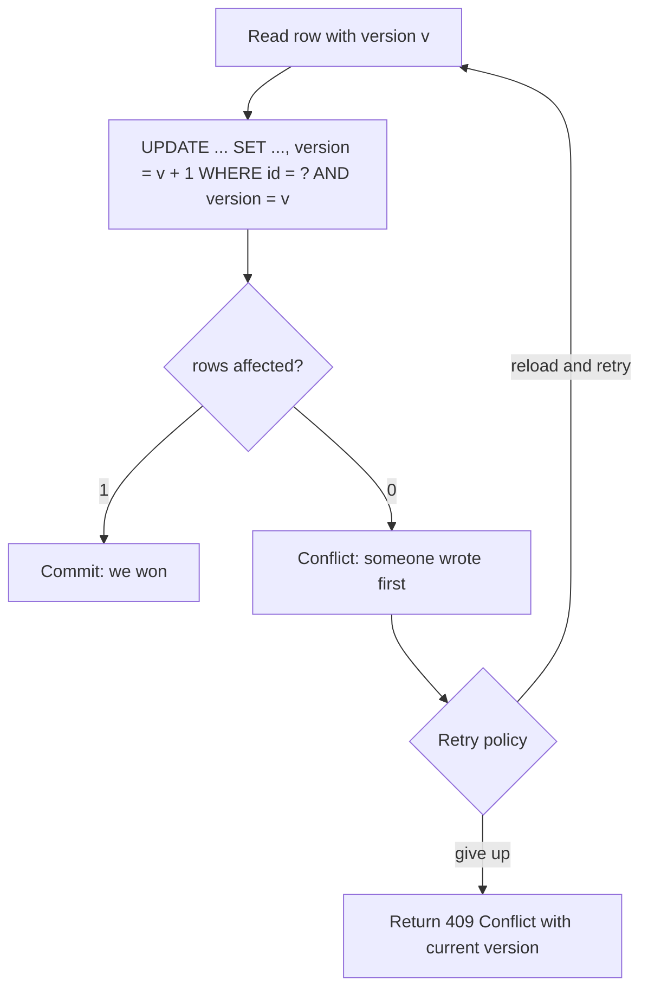
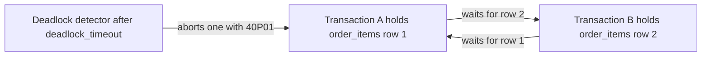

## 24.4 Locks in PostgreSQL

#### Concept

A lock is a promise the database keeps for you: "nobody else will do X to this thing until you are done". PostgreSQL has locks on rows, on tables, on transaction ids, on pages, and a general-purpose kind called advisory locks that mean whatever your application says they mean. Readers never block writers and writers never block readers for plain reads (that is MVCC's job); locks exist to order *writers against writers* and to protect schema changes.

#### Why does it exist?

Snapshots solve reading. They do not solve "two transactions want to change the same row" or "someone wants to drop a column while a query is reading it". For those, someone must wait. Locks decide who waits for whom, and for how long.

#### Mental model

Imagine a library with a rule: anyone may read a book at the table, but only one person may write in the margins at a time, and to do so they check the book out with a marker slip. `FOR UPDATE` is the slip. Someone who only wants to make sure the book is not removed from the shelf while they cite it uses a lighter slip (`FOR SHARE`, `FOR KEY SHARE`). Rebuilding the shelf (`ALTER TABLE`) needs the whole aisle empty. And an advisory lock is a note on the whiteboard, "Praveen is reorganising the poetry section", that everyone agrees to respect even though the library itself does not enforce it.

#### How it works

### 24.4.1 Row-level locks

There are four row lock modes, from strongest to weakest:

| Mode | Taken by | Conflicts with |
|---|---|---|
| `FOR UPDATE` | `DELETE`; `UPDATE` that changes a key column (PK or unique); `SELECT ... FOR UPDATE` | all four modes |
| `FOR NO KEY UPDATE` | `UPDATE` that does not change key columns (the common case); `SELECT ... FOR NO KEY UPDATE` | `FOR UPDATE`, `FOR NO KEY UPDATE`, `FOR SHARE` |
| `FOR SHARE` | `SELECT ... FOR SHARE` | `FOR UPDATE`, `FOR NO KEY UPDATE` |
| `FOR KEY SHARE` | foreign-key checks on the referenced row (an `INSERT` into `order_items` takes this on the `products` row); `SELECT ... FOR KEY SHARE` | `FOR UPDATE` only |

Two lines of that table drive real production behaviour:

- A normal `UPDATE products SET stock = stock - 1` takes `FOR NO KEY UPDATE`, which is compatible with `FOR KEY SHARE`. So inserting order lines that reference a product does **not** wait for a concurrent stock update. Good.
- `SELECT ... FOR UPDATE` takes the strongest mode, which conflicts with `FOR KEY SHARE`. So if your checkout locks the product with `FOR UPDATE`, every other transaction inserting an `order_items` row for that product *waits for your whole transaction*. TypeORM's `pessimistic_write` and Sequelize's `t.LOCK.UPDATE` both emit `FOR UPDATE`. If you do not intend to delete the row or change its key, prefer `FOR NO KEY UPDATE` (TypeORM lock mode `for_no_key_update`, Sequelize `t.LOCK.NO_KEY_UPDATE`).

Row locks live in the row header (`xmax` plus info bits), not in shared memory, so you can lock a million rows without running out of lock memory. Waiting is implemented by waiting on the *transaction id* of the holder, which is why deadlock messages talk about "ShareLock on transaction 12345".

Two modifiers change what happens when the row is already locked:

```sql
-- Wait forever (default). Bounded by lock_timeout if set.
SELECT * FROM jobs WHERE id = 42 FOR UPDATE;

-- Fail immediately with 55P03 lock_not_available.
SELECT * FROM jobs WHERE id = 42 FOR UPDATE NOWAIT;

-- Skip rows that are locked, return the rest. The queue pattern (24.10).
SELECT * FROM jobs WHERE status = 'PENDING' ORDER BY created_at LIMIT 10 FOR UPDATE SKIP LOCKED;
```

### 24.4.2 Table-level locks

Every statement takes a table-level lock on each table it touches, mostly to keep DDL out of the way:

| Mode | Taken by | Blocks |
|---|---|---|
| `ACCESS SHARE` | `SELECT` | only `ACCESS EXCLUSIVE` |
| `ROW SHARE` | `SELECT ... FOR UPDATE/SHARE` | `EXCLUSIVE`, `ACCESS EXCLUSIVE` |
| `ROW EXCLUSIVE` | `INSERT`, `UPDATE`, `DELETE` | `SHARE` and above |
| `SHARE UPDATE EXCLUSIVE` | `VACUUM`, `ANALYZE`, `CREATE INDEX CONCURRENTLY`, some `ALTER TABLE` forms | itself and above |
| `SHARE` | `CREATE INDEX` (non-concurrent) | writes |
| `ACCESS EXCLUSIVE` | `DROP TABLE`, `TRUNCATE`, `VACUUM FULL`, most `ALTER TABLE` | everything, including `SELECT` |

The dangerous mechanic is the *lock queue*. Table locks are granted in order. If a two-hour report holds `ACCESS SHARE` on `orders`, an `ALTER TABLE orders ADD COLUMN` queues behind it for `ACCESS EXCLUSIVE`, and every new `SELECT` on `orders` queues behind the `ALTER`. One idle migration can take the whole API down while blocking nothing itself. Always run DDL with `SET lock_timeout = '3s'` and retry; Part 27 — Database Migrations and Zero-Downtime Schema Changes covers this in depth.

### 24.4.3 The lock escalation myth

SQL Server and older MySQL versions *escalate* many row locks into a table lock when a transaction locks too many rows. PostgreSQL never does this. A transaction that updates 10 million rows holds 10 million row locks (in row headers) and one `ROW EXCLUSIVE` table lock, and other transactions can still update the rows it did not touch. What PostgreSQL *does* have is the shared lock table for table-level and advisory locks, bounded by `max_locks_per_transaction` (default 64) times `max_connections`; exhausting it fails with `out of shared memory` when a transaction touches thousands of tables or partitions, which is a different problem.

### 24.4.4 Foreign-key locks

When you insert or update a child row, PostgreSQL must make sure the parent row exists and stays existing until you commit. It does that with `SELECT 1 FROM products WHERE id = $1 FOR KEY SHARE` behind the scenes. Consequences:

- Deleting a parent, or updating its primary key, takes `FOR UPDATE` and waits for every open transaction that inserted a child referencing it.
- Before PostgreSQL 9.3, FK checks took `FOR SHARE`, which conflicted with every parent `UPDATE`; a busy `products` row would block all order-line inserts. Modern versions do not have this problem, but explicit `FOR UPDATE` on the parent recreates it.
- A hot parent row (a `tenants` row that thousands of child inserts reference per second) can still see contention if anyone updates its key or deletes it, or if code locks it with `FOR UPDATE` "to be safe".

### 24.4.5 Advisory locks

Advisory locks are locks on an integer key that PostgreSQL does not interpret. Your code decides what the key means.

```sql
-- Transaction-scoped: released automatically at COMMIT or ROLLBACK. Prefer this form.
SELECT pg_advisory_xact_lock(hashtext('rota:night-shift'));

-- Two-key form keeps namespaces apart: (namespace, id)
SELECT pg_advisory_xact_lock(1, 42);

-- Non-blocking: returns false instead of waiting
SELECT pg_try_advisory_xact_lock(hashtext('report:daily-2026-09-06'));

-- Session-scoped: survives COMMIT, must be released explicitly. Dangerous with connection pooling.
SELECT pg_advisory_lock(7);
SELECT pg_advisory_unlock(7);
```

Use them for: serialising a critical section that has no natural row to lock (write skew fixes), leader election for a cron job across pods, and "one importer at a time" guards. Do not use session-level advisory locks through PgBouncer in transaction pooling mode; the next transaction on that server connection belongs to someone else and inherits your lock.

#### Practical example

The "one active ride per driver" rule in section 24.3 was ultimately a partial unique index. Before that, the team's interim fix was `pg_advisory_xact_lock(hashtext('driver:' || driver_id))` at the top of the assignment transaction. It worked, it was five lines, and it bought them the week they needed to write the migration. That is the right way to use advisory locks: as a targeted, temporary or structural serialisation tool, not as a general mutex library.

#### NestJS example

A cron job that must run on exactly one of the eight API pods.

```ts
// src/reports/daily-report.job.ts
import { Injectable, Logger } from '@nestjs/common';
import { Cron } from '@nestjs/schedule';
import { DataSource } from 'typeorm';

@Injectable()
export class DailyReportJob {
  private readonly logger = new Logger(DailyReportJob.name);
  constructor(private readonly dataSource: DataSource) {}

  @Cron('0 2 * * *')
  async run(): Promise<void> {
    const queryRunner = this.dataSource.createQueryRunner();
    await queryRunner.connect();
    await queryRunner.startTransaction();
    try {
      // Non-blocking attempt; the other seven pods get false and exit.
      const [{ locked }] = await queryRunner.query(
        'SELECT pg_try_advisory_xact_lock(hashtext($1)) AS locked',
        ['job:daily-report'],
      );
      if (!locked) {
        this.logger.log('Another instance holds the lock, skipping');
        await queryRunner.rollbackTransaction();
        return;
      }
      await this.buildReport(queryRunner.manager);
      await queryRunner.commitTransaction(); // releases the advisory lock
    } catch (err) {
      await queryRunner.rollbackTransaction();
      throw err;
    } finally {
      await queryRunner.release();
    }
  }

  private async buildReport(manager: import('typeorm').EntityManager): Promise<void> {
    await manager.query('INSERT INTO daily_reports (day, total_cents) SELECT current_date - 1, coalesce(sum(total_cents), 0) FROM orders WHERE created_at::date = current_date - 1');
  }
}
```

#### PostgreSQL example

Finding out who is blocking whom, which you will do at 02:00 one day.

```sql
-- Sessions that are waiting on a lock, and the pid holding it
SELECT a.pid,
       a.state,
       a.wait_event_type,
       now() - a.xact_start        AS xact_age,
       pg_blocking_pids(a.pid)     AS blocked_by,
       left(a.query, 80)           AS query
FROM   pg_stat_activity a
WHERE  a.wait_event_type = 'Lock'
ORDER  BY xact_age DESC;

-- Every lock held by one pid, granted or not
SELECT locktype, relation::regclass, mode, granted, transactionid
FROM   pg_locks
WHERE  pid = 48213;

-- The usual culprit: a transaction that did work and then went idle
SELECT pid, now() - state_change AS idle_for, left(query, 80)
FROM   pg_stat_activity
WHERE  state = 'idle in transaction'
ORDER  BY idle_for DESC;

-- Kill it if you must
SELECT pg_terminate_backend(48213);
```

#### Production scenario

A B2B ordering system with 300 tenants ran `UPDATE tenants SET last_seen_at = now() WHERE id = $1` on every request, and locked the tenant row with `FOR UPDATE` in the order-creation transaction "to avoid concurrent quota issues". Order creation took 40 ms because it called the pricing service while holding the lock. Every other request from that tenant, including plain product listings that updated `last_seen_at`, queued behind order creation. The pricing service had a p99 of 900 ms. During its slow moments, tenants saw everything hang. Three changes fixed it: `last_seen_at` moved to a Redis key flushed every minute, the quota lock became `FOR NO KEY UPDATE`, and the pricing call moved *before* the transaction with its result passed in.

#### Failure scenario

At 09:31 on a Monday a developer ran `ALTER TABLE orders ADD COLUMN channel text` from a laptop. It needed `ACCESS EXCLUSIVE`. A BI tool had an `ACCESS SHARE` lock from a 25-minute query. The `ALTER` queued. Every `SELECT` on `orders` queued behind the `ALTER`. Within 40 seconds all 200 connections in the pool were waiting, the API returned 503, and the on-call restarted the API pods (which did nothing, because the queue was in PostgreSQL). Resolution: `pg_terminate_backend` on the `ALTER` session. Prevention: `lock_timeout` on every migration and a rule that DDL only runs through the deploy pipeline.

#### Edge cases & failure modes

- `FOR UPDATE` with `LIMIT` locks rows *as they are scanned*; with an `ORDER BY` that requires a sort, PostgreSQL may lock more rows than the limit returns. Use an index that provides the order.
- `SELECT ... FOR UPDATE` on a view or a join locks the rows of every underlying table unless you say `FOR UPDATE OF alias`.
- `SKIP LOCKED` skips rows locked in *any* conflicting mode, including rows an `UPDATE` in another transaction is touching, so a job can be "skipped" for reasons unrelated to job claiming.
- `lock_timeout` applies to table and row locks but not to waiting on a transaction id inside `SERIALIZABLE` conflict resolution; `statement_timeout` catches that.
- Sub-transactions (savepoints) multiply the transaction ids a row lock can point at; heavy savepoint use plus heavy locking can cause `MultiXact` contention. Rare, but it exists.
- Advisory lock keys from `hashtext()` can collide; two different strings serialising against each other is a performance bug, not a correctness bug.

#### How a Senior Backend Engineer thinks about this

They ask "what is the weakest lock that still protects the invariant?" and "how long will I hold it?" before writing `FOR UPDATE`. They know that TypeORM's `pessimistic_write` emits `FOR UPDATE` and that it blocks FK inserts, and they use `for_no_key_update` unless they are going to delete. They treat every table lock queue as a potential outage and put `lock_timeout` on DDL by policy. And they can read `pg_stat_activity` and `pg_locks` faster than they can open a dashboard.

#### Common mistakes

- Using `FOR UPDATE` where `FOR NO KEY UPDATE` was enough, silently serialising unrelated child inserts.
- Session-level advisory locks with a connection pool or PgBouncer.
- Assuming PostgreSQL escalates locks, and designing around a problem that does not exist while ignoring the lock queue problem that does.
- Running DDL without `lock_timeout`.
- Locking rows in a transaction that then makes a network call.

#### Interview questions

1. *What lock does a plain `UPDATE` take on the row, and why does it matter for foreign keys?* Expected: `FOR NO KEY UPDATE`, compatible with the `FOR KEY SHARE` taken by FK checks, so child inserts do not block on parent updates; but explicit `FOR UPDATE` does block them.
2. *Does PostgreSQL escalate row locks to table locks?* Expected: no; row locks live in tuple headers; the shared lock table is for table/advisory locks.
3. *Explain how one `ALTER TABLE` can block reads it does not touch.* Expected: lock queue; `ACCESS EXCLUSIVE` waits behind `ACCESS SHARE`, and new `ACCESS SHARE` requests wait behind it. Follow-up: how do you make DDL safe?
4. *When would you use an advisory lock rather than a row lock?* Expected: no natural row; cross-row invariants; leader election; must be transaction-scoped when pooled.
5. *What does `SKIP LOCKED` change about `SELECT ... FOR UPDATE`, and what is it for?* Expected: skips rows already locked; job queues.

#### Practical exercise

In two `psql` sessions: (1) lock a product row with `FOR UPDATE` in session A, then try to insert an `order_items` row for it in session B and observe the wait; (2) repeat with `FOR NO KEY UPDATE` and observe no wait; (3) with session A holding a long `SELECT` on `orders`, run `ALTER TABLE orders ADD COLUMN x int` in B with `lock_timeout = '2s'` and observe the failure; (4) use `pg_blocking_pids` to identify the blocker in case (1). Acceptance criteria: a written log of each observation with the lock modes seen in `pg_locks`.

## 24.5 Optimistic locking

#### Concept

Optimistic locking holds no database lock while the user or the application "thinks". Instead, every row carries a version number (or an updated-at timestamp). You read the row with its version, do your work, and write back with `WHERE version = <the one I read>`. If zero rows are affected, someone else wrote first; you reload and decide whether to retry, merge, or tell the user.

#### Why does it exist?

Pessimistic locks must be held for the whole read-think-write window. When that window contains a human editing a form for three minutes, or a call to a slow external API, holding a row lock (and a pooled connection) that long is unacceptable. Optimistic locking moves conflict detection to the write and makes it cost nothing until a conflict actually occurs.

#### Mental model

Imagine editing a shared document with a revision number in the corner. You take a copy at revision 41, make changes, and hand it back. The editor checks: is the master still at 41? If yes, your changes become revision 42. If someone already made 42, your copy is rejected and you are shown the new master to redo your edits.

#### How it works



1. Add an integer `version` column, default 0, `NOT NULL`.
2. Every read that will lead to a write carries the version to the caller (an API client, or just the service method).
3. The write is a single conditional `UPDATE` that increments the version and matches on the old one.
4. `affected === 0` means conflict. The row was not changed. There is nothing to roll back if this is your only write; if it is part of a transaction, throw so the transaction rolls back.
5. Retry policy depends on who is thinking. Machine think time: reload and retry a few times with backoff. Human think time: return `409 Conflict` with the current state and let the person decide.

#### Practical example

An admin panel where staff edit product descriptions and prices. Two staff members open the same product; one changes the price, the other fixes a typo and saves 30 seconds later. Without versioning, the typo fix silently reverts the price change (a lost update over a 30-second window). With `version`, the second save gets `409`, the UI shows "This product was changed by Asha at 14:02; reload to see her changes", and nothing is lost.

#### NestJS example

TypeORM has `@VersionColumn`, but read the caveat carefully: `repository.save()` *increments* the version but does **not** check it. It emits `UPDATE ... SET version = version + 1 WHERE id = $1`, unconditionally. The `OptimisticLockVersionMismatchError` is thrown only by `find` with `lock: { mode: 'optimistic', version }`, which compares the *loaded* row's version with the one you pass, and that still leaves a window between the check and the save. To get real optimistic locking with TypeORM, write the conditional `UPDATE` yourself.

```ts
// src/products/product.entity.ts
import { Entity, PrimaryGeneratedColumn, Column, VersionColumn } from 'typeorm';

@Entity('products')
export class Product {
  @PrimaryGeneratedColumn('uuid') id: string;
  @Column('text') name: string;
  @Column('bigint') priceCents: string; // bigint comes back as string from pg
  @VersionColumn() version: number;      // TypeORM increments this on save(); it does not check it
}

// src/products/products.service.ts
import { Injectable, ConflictException, NotFoundException } from '@nestjs/common';
import { InjectRepository } from '@nestjs/typeorm';
import { Repository } from 'typeorm';
import { Product } from './product.entity';
import { UpdateProductDto } from './dto/update-product.dto'; // contains expectedVersion: number

@Injectable()
export class ProductsService {
  constructor(@InjectRepository(Product) private readonly products: Repository<Product>) {}

  async update(id: string, dto: UpdateProductDto): Promise<Product> {
    const result = await this.products
      .createQueryBuilder()
      .update(Product)
      .set({ name: dto.name, priceCents: dto.priceCents, version: () => 'version + 1' })
      .where('id = :id AND version = :version', { id, version: dto.expectedVersion })
      .execute();

    if (result.affected === 0) {
      const current = await this.products.findOneBy({ id });
      if (!current) throw new NotFoundException();
      // 409 with the current state lets the client merge or overwrite deliberately.
      throw new ConflictException({ message: 'Stale version', current });
    }
    return this.products.findOneByOrFail({ id });
  }
}
```

The `find` variant, useful when you want TypeORM to do the compare on load (for example as a cheap pre-check before a longer operation):

```ts
// Throws OptimisticLockVersionMismatchError if the row's version differs from 7
const product = await this.products.findOne({ where: { id }, lock: { mode: 'optimistic', version: 7 } });
```

#### PostgreSQL example

```sql
ALTER TABLE products ADD COLUMN version integer NOT NULL DEFAULT 0;

-- Read
SELECT id, name, price_cents, version FROM products WHERE id = 'p1';   -- version 7

-- Write
UPDATE products
SET    name = 'Wireless Headphones', price_cents = 19900, version = version + 1
WHERE  id = 'p1' AND version = 7;
-- UPDATE 1: success. UPDATE 0: conflict (or row gone).
```

A `timestamptz updated_at` can serve as the version, but it has microsecond resolution and clock-based edge cases; an integer is simpler and never ambiguous.

#### TypeORM example

Covered above; the important API facts are: `@VersionColumn()` (increment only), `lock: { mode: 'optimistic', version }` in `find*` (compare on load, throws `OptimisticLockVersionMismatchError`), and `update().where('version = :v')` plus `result.affected` for the real check.

#### Sequelize example

Sequelize implements optimistic locking properly at the instance level. With `version: true`, `instance.save()` adds `WHERE version = <loaded version>` and throws `OptimisticLockError` when nothing matched.

```ts
import { Model, DataTypes, OptimisticLockError } from 'sequelize';

class Product extends Model {}
Product.init(
  {
    id: { type: DataTypes.UUID, defaultValue: DataTypes.UUIDV4, primaryKey: true },
    name: DataTypes.TEXT,
    priceCents: DataTypes.BIGINT,
  },
  { sequelize, tableName: 'products', version: true }, // adds an integer "version" column
);

async function updateProduct(id: string, dto: { name: string; expectedVersion: number }) {
  const product = await Product.findByPk(id, { rejectOnEmpty: true });
  if (product.get('version') !== dto.expectedVersion) throw new ConflictException('Stale version');
  product.set('name', dto.name);
  try {
    await product.save(); // UPDATE ... WHERE id = ? AND version = ?; version = version + 1
  } catch (err) {
    if (err instanceof OptimisticLockError) throw new ConflictException('Stale version');
    throw err;
  }
}
```

`Model.update()` (the static, bulk form) does not check the version; only instance `save()` does.

#### Production scenario

A CMS with 40 editors and 200,000 articles. Conflicts happen perhaps 20 times a day. Optimistic locking costs nothing on the 99.99% of saves without a conflict, holds no connection while editors type, and turns the conflicts into a clear UI message. Pessimistic locking here would mean holding a row lock and a pooled connection for the length of an editing session, which is impossible.

#### Failure scenario

A team added `@VersionColumn` to `Product`, saw the version go up on every save, and declared inventory "safe from race conditions". Six months later the flash-sale oversell happened anyway, because `save()` never checked the version. The post-mortem line was: "the column was decorative". The fix was the conditional `UPDATE` above, plus a test that runs two concurrent saves with the same expected version and asserts exactly one succeeds.

#### Edge cases & failure modes

- Retry storms: at high contention on one row, optimistic retries amplify load (each conflict is a wasted read and write). Above roughly 10–20% conflict rate, switch that path to pessimistic locking or an atomic statement.
- Clients that never send the version (or send a stale cached one) always conflict; make `expectedVersion` required in the DTO.
- Optimistic locking protects one row. Multi-row invariants still need locks, constraints or `SERIALIZABLE`.
- Version overflow is not a realistic concern for `integer` (2 billion updates per row), but use `bigint` if it costs you nothing.
- A `409` on a non-idempotent client that retries blindly can loop forever; the client must reload before retrying.

#### How a Senior Backend Engineer thinks about this

Optimistic when contention is low and think time is long (humans, external calls, multi-step wizards). Pessimistic when contention is high and think time is short (inventory decrement, wallet debit, job claim). Atomic single statements whenever the logic fits in one `UPDATE`, because they are both. They verify, with a concurrent test, that the ORM feature actually checks the version, rather than trusting the decorator's name.

#### Common mistakes

- Trusting TypeORM's `@VersionColumn` to reject stale writes.
- Checking the version with a `SELECT` and then writing without the `WHERE version =` clause (the check and the write are not atomic).
- Using `updated_at` as the version and comparing with second precision.
- Retrying optimistic conflicts on a human-facing endpoint instead of returning `409`.

#### Interview questions

1. *How does optimistic locking detect a conflict without holding a lock?* Expected: conditional `UPDATE` on version; zero rows affected means conflict.
2. *Does TypeORM's `@VersionColumn` implement optimistic locking?* Expected: it increments on save but does not check; real checking requires a conditional update or the `find` optimistic mode plus care. Why it matters: separates people who read decorators from people who read SQL logs.
3. *When is optimistic worse than pessimistic?* Expected: high contention, short think time, retries amplify load.
4. *A client sends `expectedVersion` and gets `409`. What should it do?* Expected: reload, show diff or merge, resubmit with the new version.

#### Practical exercise

Add real optimistic locking to a `PATCH /products/:id` endpoint. Write a test that loads version 3, fires two concurrent PATCH requests with `expectedVersion: 3`, and asserts one `200` and one `409` whose body includes the current version. Acceptance criteria: the test passes with TypeORM (conditional update) and, in a second implementation, with Sequelize `version: true`; the SQL log shows `WHERE ... version = $n` in both.

## 24.6 Pessimistic locking

#### Concept

Pessimistic locking takes the row lock *before* reading, with `SELECT ... FOR UPDATE` (or `FOR NO KEY UPDATE`), so that nobody else can change the row between your read and your write. Other transactions wanting the same row wait. It is the right tool when contention is high and the critical section is short.

#### Why does it exist?

Some logic between read and write cannot be squeezed into one `UPDATE`: apply bundle discounts across five products, check three tables of reservation rules, compute a fee from a lookup table. For those, you need the read to be stable until the write. A lock guarantees it without retries.

#### Mental model

Imagine a single-occupancy fitting room. You take the key, go in, try things on, come out, return the key. Everyone else waits outside. It is fair and simple; it is a disaster if you take the key and then go for lunch.

#### How it works

1. `BEGIN`.
2. `SELECT ... FOR [NO KEY] UPDATE` on every row you will modify, **in a consistent order** (by primary key, ascending) to prevent deadlocks.
3. Do the logic. No network calls. No waiting on anything that is not the database.
4. `UPDATE` the rows. `COMMIT`. Locks release.
5. Waiters wake in FIFO order for that lock, re-check their `WHERE`, and proceed with fresh data.

#### Practical example

A checkout with bundle pricing: if the cart contains a phone and a case, the case is 50% off, and stock for both must be decremented atomically. Lock both product rows (ordered by id), read stock and prices, compute, write both, commit. Total lock hold time about 3 ms.

#### NestJS example

```ts
// src/checkout/bundle-checkout.service.ts
import { Injectable, ConflictException } from '@nestjs/common';
import { DataSource, In } from 'typeorm';
import { Product } from '../products/product.entity';

@Injectable()
export class BundleCheckoutService {
  constructor(private readonly dataSource: DataSource) {}

  async reserve(lines: { productId: string; qty: number }[]): Promise<void> {
    // Sort first: consistent lock order across all concurrent transactions prevents deadlocks.
    const ids = [...new Set(lines.map((l) => l.productId))].sort();

    await this.dataSource.transaction(async (manager) => {
      // Lock in find options; requires an active transaction, otherwise TypeORM throws.
      const products = await manager.find(Product, {
        where: { id: In(ids) },
        order: { id: 'ASC' },
        lock: { mode: 'for_no_key_update' }, // does not block child inserts referencing these products
      });
      if (products.length !== ids.length) throw new ConflictException('Unknown product');

      for (const line of lines) {
        const p = products.find((x) => x.id === line.productId)!;
        if (p.stock < line.qty) throw new ConflictException(`Out of stock: ${p.name}`);
        p.stock -= line.qty; // safe: we hold the lock, nobody else can change stock
      }
      await manager.save(products);
    });
  }
}
```

The QueryBuilder form gives you `NOWAIT`/`SKIP LOCKED`:

```ts
const job = await manager
  .createQueryBuilder(Job, 'j')
  .setLock('pessimistic_write')
  .setOnLocked('skip_locked')   // or 'nowait'
  .where('j.status = :s', { s: 'PENDING' })
  .orderBy('j.created_at', 'ASC')
  .getOne();
```

Lock modes available to TypeORM `find` and `setLock`: `pessimistic_read` (`FOR SHARE`), `pessimistic_write` (`FOR UPDATE`), `for_no_key_update`, `for_key_share`, `pessimistic_partial_write` (`FOR UPDATE SKIP LOCKED`), `pessimistic_write_or_fail` (`FOR UPDATE NOWAIT`), `dirty_read` (no-op on PostgreSQL), `optimistic`.

#### PostgreSQL example

```sql
BEGIN;
SELECT id, stock, price_cents
FROM   products
WHERE  id IN ('p-case', 'p-phone')
ORDER  BY id
FOR NO KEY UPDATE;
-- logic
UPDATE products SET stock = stock - 1 WHERE id = 'p-case';
UPDATE products SET stock = stock - 1 WHERE id = 'p-phone';
COMMIT;
```

Note the `ORDER BY id`: with `FOR UPDATE`, PostgreSQL locks rows in the order it *scans* them, and the scan order follows the plan, not your `IN` list. An index scan on the primary key gives you ascending order; a sequential scan gives you physical order. Adding `ORDER BY id` makes the order explicit.

#### TypeORM example

Covered above. Two more facts: (1) `lock` in `find` throws `PessimisticLockTransactionRequiredError` if you are not inside a transaction, because a lock outside a transaction is released immediately and protects nothing; (2) `save()` on a locked entity still does its own `SELECT` first (see Part 25), which is harmless but costs a round trip; `update()` is cheaper.

#### Sequelize example

```ts
await this.sequelize.transaction(async (t) => {
  const products = await Product.findAll({
    where: { id: ids },
    order: [['id', 'ASC']],
    lock: t.LOCK.NO_KEY_UPDATE,   // t.LOCK.UPDATE emits FOR UPDATE; SHARE and KEY_SHARE also exist
    transaction: t,
  });
  // ...
  await Promise.all(products.map((p) => p.save({ transaction: t })));
});

// Queue claim with SKIP LOCKED
const job = await Job.findOne({
  where: { status: 'PENDING' },
  order: [['createdAt', 'ASC']],
  lock: t.LOCK.UPDATE,
  skipLocked: true,
  transaction: t,
});
```

Sequelize v6 has no `NOWAIT` option; use `sequelize.query('... FOR UPDATE NOWAIT', { transaction: t })` for that.

#### Production scenario

A wallet service at 800 debits per second across 2 million wallets. Contention per wallet is tiny, but a handful of "merchant" wallets receive 50 credits per second each. Pessimistic locking on the wallet row with a 2 ms critical section gives a per-wallet ceiling of ~500 transactions per second, which is well above 50. If a single wallet ever needed 5,000 per second, this design would cap out, and the answer would be a sharded balance (section 24.10), not a faster lock.

#### Failure scenario

An order-confirmation flow locked the order row with `FOR UPDATE`, then called the payment provider (p99 of 4 seconds, occasionally 30 seconds on their side), then updated the row. A degraded afternoon at the provider caused every lock to be held for 30 seconds. Connections piled up: 40 in the pool, each waiting on a locked row or on the provider. The API stopped serving *all* endpoints, because the pool was exhausted, including endpoints that never touched orders. The rule that came out of it is now a lint check in that codebase: no `await` of anything except the `EntityManager` inside a transaction callback.

#### Edge cases & failure modes

- Lock wait pile-up: waiters hold pool connections. Set `lock_timeout` (for example `SET LOCAL lock_timeout = '2s'`) inside hot transactions so a stuck holder fails waiters fast instead of exhausting the pool.
- `FOR UPDATE` in `REPEATABLE READ` can still raise `40001` if the row changed since the snapshot.
- Locking rows through a join or a subquery locks more than you think; use `FOR UPDATE OF alias`.
- `SKIP LOCKED` with `LIMIT 1` and no index on the ordering column scans and locks unpredictably under load.
- Locks are released only at transaction end. A savepoint rollback does not release row locks taken before the savepoint.
- Lock held across an `await` that never resolves (a forgotten promise) is a leaked connection *and* a leaked lock, until `idle_in_transaction_session_timeout` fires.

#### How a Senior Backend Engineer thinks about this

Three rules they do not negotiate: lock in a consistent order, keep the critical section to database calls only, and bound the wait with `lock_timeout`. They use `FOR NO KEY UPDATE` by default. And they measure: `pg_stat_activity` wait events and a histogram of transaction duration tell them whether the lock is the bottleneck long before users do.

#### Common mistakes

- Locking outside a transaction (TypeORM throws; raw SQL silently does nothing useful).
- Locking in the order the client sent the items.
- HTTP call, Kafka publish, Redis `BLPOP`, or `setTimeout` inside the locked section.
- Locking a parent row with `FOR UPDATE` and wondering why unrelated child inserts stall.
- Forgetting that `find` with `lock` and `relations` locks the joined tables too unless you scope it.

#### Interview questions

1. *Why must pessimistic locks be taken in a consistent order?* Expected: to prevent deadlocks; A locks 1 then 2, B locks 2 then 1 is a cycle.
2. *What happens if you `SELECT ... FOR UPDATE` outside a transaction?* Expected: lock released at statement end; protects nothing; TypeORM refuses.
3. *Why should you not call an external API while holding a row lock?* Expected: lock hold time becomes the API's latency; waiters exhaust the pool; unrelated endpoints fail.
4. *`FOR UPDATE` versus `FOR NO KEY UPDATE`: when does the difference show?* Expected: FK inserts of children block only on `FOR UPDATE`.

#### Practical exercise

Implement the bundle checkout above and load test it with 200 concurrent requests on the same two products. Acceptance criteria: no oversell, no deadlocks in the PostgreSQL log, p99 under 50 ms on a local database, and a deliberate variant with reversed lock order that *does* produce `deadlock detected` so you have seen it.

## 24.7 Deadlocks

#### Concept

A deadlock is two (or more) transactions each waiting for a lock the other holds. Neither can proceed. PostgreSQL detects the cycle and aborts one of the transactions with `ERROR: deadlock detected` (SQLSTATE `40P01`); the other continues. Deadlocks are not a database bug; they are a symptom of inconsistent lock ordering in application code.

#### Why does it exist?

Detection exists because prevention cannot be enforced by the database: it does not know in what order your application will touch rows. Rather than hang forever, PostgreSQL periodically checks the wait-for graph and breaks cycles.

#### Mental model

Imagine two people passing in a narrow corridor, each holding a door for the other and refusing to step back. A supervisor walks by every second; when she sees the standoff she sends one of them back to the start.

#### How it works

1. Transaction A locks row 1. Transaction B locks row 2.
2. A requests row 2 and waits on B's transaction id. B requests row 1 and waits on A's.
3. After a waiter has waited for `deadlock_timeout` (default 1 second), it runs the deadlock detector: a depth-first search over the wait-for graph in shared memory.
4. If a cycle is found, the *detecting* transaction (the one whose timer fired) is aborted with `40P01`. Its locks release; the other proceeds.
5. If no cycle is found, the waiter keeps waiting; the check is not repeated unless `log_lock_waits` is on (which logs the long wait) and does not cost anything further.



#### Practical example

An order-editing endpoint updates the quantity of each line in the order the client sent them. Two staff members edit the same two-line order at once; one's UI sent lines `[1, 2]`, the other's sent `[2, 1]`.

| Step | Session A | Session B | Result |
|---|---|---|---|
| 1 | `BEGIN;` | `BEGIN;` | |
| 2 | `UPDATE order_items SET qty = 3 WHERE order_id = 'o1' AND product_id = 'p1';` | | A holds row (o1,p1) |
| 3 | | `UPDATE order_items SET qty = 5 WHERE order_id = 'o1' AND product_id = 'p2';` | B holds row (o1,p2) |
| 4 | `UPDATE order_items SET qty = 4 WHERE order_id = 'o1' AND product_id = 'p2';` | | A waits for B |
| 5 | | `UPDATE order_items SET qty = 6 WHERE order_id = 'o1' AND product_id = 'p1';` | B waits for A: cycle |
| 6 | | (after ~1 s) | one session gets the error below; the other's `UPDATE` succeeds |

```text
ERROR:  deadlock detected
DETAIL:  Process 48213 waits for ShareLock on transaction 771204; blocked by process 48377.
         Process 48377 waits for ShareLock on transaction 771203; blocked by process 48213.
HINT:  See server log for query details.
CONTEXT:  while updating tuple (3,17) in relation "order_items"
```

Prevention: sort the lines by `(order_id, product_id)` before updating, or lock the parent `orders` row first with `FOR NO KEY UPDATE`, which serialises all edits of that order and makes the line order irrelevant.

#### NestJS example

Retry on `40P01`, but only around the whole transaction, and only for idempotent work.

```ts
// src/orders/order-lines.service.ts
import { Injectable } from '@nestjs/common';
import { DataSource } from 'typeorm';
import { OrderItem } from './order-item.entity';

@Injectable()
export class OrderLinesService {
  constructor(private readonly dataSource: DataSource) {}

  async setQuantities(orderId: string, lines: { productId: string; qty: number }[]): Promise<void> {
    // Consistent order removes the cycle; the retry is belt-and-braces for other paths.
    const sorted = [...lines].sort((a, b) => a.productId.localeCompare(b.productId));

    for (let attempt = 1; ; attempt++) {
      try {
        await this.dataSource.transaction(async (manager) => {
          for (const line of sorted) {
            await manager.update(OrderItem, { orderId, productId: line.productId }, { qty: line.qty });
          }
        });
        return;
      } catch (err: any) {
        const code = err?.driverError?.code ?? err?.code;
        if (code !== '40P01' || attempt >= 3) throw err;
        await new Promise((r) => setTimeout(r, 20 * attempt + Math.random() * 20));
      }
    }
  }
}
```

#### PostgreSQL example

```sql
-- Defaults and diagnostics
SHOW deadlock_timeout;              -- 1s
SET log_lock_waits = on;            -- log waits longer than deadlock_timeout (needs superuser or ALTER SYSTEM)

-- Lowering deadlock_timeout makes detection faster but runs the detector more often under contention.
-- 200ms to 500ms is reasonable for OLTP with short transactions; do not go below ~50ms.
ALTER SYSTEM SET deadlock_timeout = '500ms';
SELECT pg_reload_conf();

-- Prevent the order-lines deadlock structurally: serialise per order.
BEGIN;
SELECT id FROM orders WHERE id = 'o1' FOR NO KEY UPDATE;
UPDATE order_items SET qty = 3 WHERE order_id = 'o1' AND product_id = 'p1';
UPDATE order_items SET qty = 4 WHERE order_id = 'o1' AND product_id = 'p2';
COMMIT;
```

#### TypeORM example

Deadlocks surface as `QueryFailedError` with `driverError.code === '40P01'`. The retry pattern above applies. A subtle TypeORM source of deadlocks is `save()` on an array of entities: it may issue updates in an order you did not choose; sorting the array by primary key before `save()` restores determinism.

#### Sequelize example

Errors surface as `DatabaseError` with `original.code === '40P01'`. `Model.bulkCreate` with `updateOnDuplicate` issues one multi-row `INSERT ... ON CONFLICT`, which locks rows in the order given; sort the input by the conflict key.

#### Production scenario

A marketplace saw 30–50 deadlocks per hour, all between "update inventory for order" and "update inventory for cancellation", which iterated products in different orders. Each deadlock cost one transaction a 1-second wait plus a retry. Users rarely noticed; the database log was unreadable. Sorting by product id in both paths took the count to zero. Deadlocks are almost always this boring: two code paths, two orders.

#### Failure scenario

A retry-on-deadlock wrapper without backoff, around a transaction that was *not* the cause of the deadlock (it was the victim of a poorly ordered batch job). When the batch job ran, 200 API transactions per second each deadlocked, retried immediately, deadlocked again. Every retry restarted the 1-second detection timer. Throughput fell to almost zero for the batch job's 8-minute duration, and the retry storm doubled CPU on the primary. Fixes: backoff with jitter, a retry cap of 3, and the batch job locking its rows in primary-key order with `lock_timeout = '1s'` so *it* fails fast instead of the API.

#### Edge cases & failure modes

- Deadlocks across *different tables* (A: `products` then `orders`; B: `orders` then `products`) are the most common in ORM code, because each service locks "its" table first.
- Foreign keys create implicit locks; inserting children while another transaction deletes the parent can deadlock with no explicit lock in your code.
- Under `SERIALIZABLE`, the same cycle can surface as `40001` instead of `40P01`; retry both.
- A deadlock between a transaction and `VACUUM`/`CREATE INDEX` is a table-lock deadlock; the fix is `lock_timeout` on DDL.
- `deadlock_timeout` is also the threshold for `log_lock_waits`; lowering it makes your logs noisier.
- The victim is the transaction that detected the cycle, not the "cheapest" one; PostgreSQL does not pick by cost.

#### How a Senior Backend Engineer thinks about this

"Which two code paths lock the same rows, and in what order?" is their first question. They never accept "we retry deadlocks" as a fix; retry is a safety net, ordering is the fix. They read the `DETAIL` lines of the error (which processes, which tuples, which relation) and the server log (`log_lock_waits`) to find both queries, not just the victim.

#### Common mistakes

- Retrying without backoff.
- Retrying non-idempotent work (a retry that resends an email or re-publishes an event).
- Lowering `deadlock_timeout` to 10 ms "to fail faster", which makes the detector run constantly under normal lock waits.
- Locking child rows without a stable order and calling it "fine because it is only two rows".

#### Interview questions

1. *How does PostgreSQL detect a deadlock and which transaction does it abort?* Expected: wait-for graph checked after `deadlock_timeout`; the detecting waiter is aborted with `40P01`.
2. *Two services deadlock on `products` and `orders`. How do you fix it structurally?* Expected: agree on a global lock order (for example parent before child, then by primary key), or lock a single parent row first.
3. *What is wrong with immediate retry on deadlock?* Expected: retry storm; each retry restarts the timer; backoff with jitter and a cap.
4. *Can a deadlock happen with no explicit `FOR UPDATE` anywhere?* Expected: yes, from `UPDATE`/`DELETE` row locks and FK locks.

#### Practical exercise

Reproduce the order-lines deadlock with two `psql` sessions and capture the full error including `DETAIL`. Then fix it three ways (sort by key; parent-row lock; `SERIALIZABLE` with retry) and, for each, run 500 concurrent random-order edits and report the deadlock count from the PostgreSQL log. Acceptance criteria: zero deadlocks for the first two fixes; a measured retry rate for the third.
