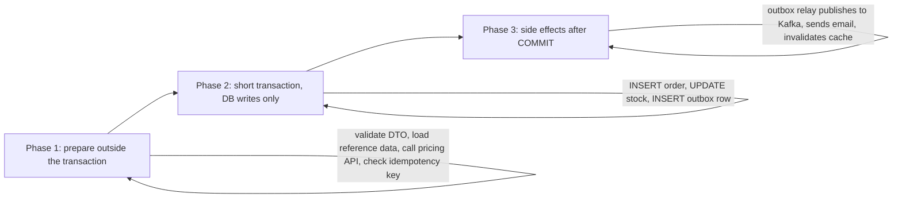

## 24.8 Transaction scope design

#### Concept

Transaction scope is the answer to two questions: *where does the transaction start and end*, and *what is allowed inside it*. A well-scoped transaction contains exactly the database writes that must succeed or fail together, and nothing else. Everything slow, remote, or non-rollbackable lives before it or after it.

#### Why does it exist?

A transaction holds resources for its whole lifetime: a pooled connection, row locks, a snapshot that blocks `VACUUM`, and, at `SERIALIZABLE`, predicate locks. Every millisecond you extend it, you extend all of those. And some side effects cannot be undone: an email is sent, a Kafka message is published, Stripe has charged the card. If those happen inside a transaction that later rolls back, you have lied to the outside world.

#### Mental model

Imagine a surgeon. Everything that must be done while the patient is open happens quickly, with everything prepared in advance and nobody leaving the room to make a phone call. Deciding on the procedure, ordering supplies, calling the family: before or after. Never during.

#### How it works

The three-phase shape every write endpoint should have:



1. **Prepare.** Validate input. Read reference data that does not need to be locked. Call external services whose result you need (pricing, fraud score, address validation). Check the idempotency key. None of this holds a connection in a transaction.
2. **Transact.** `BEGIN`. Lock what must be locked, in order. Write. Insert an *outbox* row describing the event to publish. `COMMIT`. Target: single-digit milliseconds.
3. **Side effects.** A relay process reads the outbox and publishes to Kafka or sends the email, marking each row done. If the process dies, the row is still there. This is the transactional outbox pattern; Part 33 — Distributed Transactions: Sagas, Outbox, Inbox and Idempotency covers the relay in depth, and Part 31 — Messaging covers consumer idempotency.

What must never be inside the transaction: HTTP calls, message publishes (except to the outbox table), email/SMS, Redis calls you wait on, file uploads, `setTimeout`, waiting for user input, or logging that blocks.

**Transaction length versus lock hold time.** They are not the same. A transaction that reads for 500 ms and then writes one row holds that row lock for only the tail of its life, but it holds its snapshot and connection for all of it. A transaction that locks first and then reads for 500 ms holds the lock for all of it. Lock as late as possible, commit as early as possible.

**Idle in transaction.** The worst state a connection can be in: `BEGIN` was issued, some work was done, and now the client is doing something else (awaiting an HTTP call, or just forgot to commit). It holds locks and blocks vacuum while doing nothing. `idle_in_transaction_session_timeout` kills such sessions after a threshold; set it to a few seconds for API workloads.

**Savepoints** give partial rollback inside a transaction:

```sql
BEGIN;
INSERT INTO orders ...;
SAVEPOINT before_coupon;
UPDATE coupons SET uses = uses + 1 WHERE code = 'SAVE10' AND uses < max_uses;
-- suppose that returned UPDATE 0: coupon exhausted, but we still want the order
ROLLBACK TO SAVEPOINT before_coupon;
-- transaction is still alive; the order insert is intact
COMMIT;
```

Savepoints are also how you survive an *error* mid-transaction: after any error, PostgreSQL puts the transaction in an aborted state and refuses further statements until `ROLLBACK` or `ROLLBACK TO SAVEPOINT`. Without a savepoint, a caught exception inside a transaction leaves it unusable.

**Timeouts inside transactions.** `SET LOCAL` scopes a setting to the current transaction:

```sql
BEGIN;
SET LOCAL statement_timeout = '2s';   -- any single statement longer than 2 s fails
SET LOCAL lock_timeout = '500ms';     -- any lock wait longer than 500 ms fails with 55P03
...
COMMIT;
```

**Read-only transactions on replicas.** `BEGIN READ ONLY` (or `default_transaction_read_only = on` on a standby) rejects writes with a clear error, catches accidental writes in "read" code paths, and lets you route the whole transaction to a replica. Remember replication lag: a read-only transaction on a replica may not see the write you just committed on the primary (section 24.14).

#### Practical example

A food-delivery order placement: validate the cart, call the restaurant availability service (80 ms), compute delivery fee from a geo service (30 ms), then in a 4 ms transaction insert the order, decrement any limited-stock items, insert an outbox row `order.placed`. After commit, the outbox relay publishes to Kafka within ~50 ms; the restaurant tablet, the courier dispatcher and the notification service consume it independently.

#### NestJS example

```ts
// src/orders/place-order.service.ts
import { Injectable, ConflictException } from '@nestjs/common';
import { DataSource } from 'typeorm';
import { Order } from './order.entity';
import { OutboxMessage } from '../outbox/outbox-message.entity';
import { RestaurantClient } from '../restaurants/restaurant.client';
import { PricingService } from '../pricing/pricing.service';
import { PlaceOrderDto } from './dto/place-order.dto';

@Injectable()
export class PlaceOrderService {
  constructor(
    private readonly dataSource: DataSource,
    private readonly restaurants: RestaurantClient,
    private readonly pricing: PricingService,
  ) {}

  async place(dto: PlaceOrderDto, idempotencyKey: string): Promise<Order> {
    // Phase 1: everything slow, before BEGIN.
    const available = await this.restaurants.isOpen(dto.restaurantId);   // HTTP, ~80 ms
    if (!available) throw new ConflictException('Restaurant closed');
    const quote = await this.pricing.quote(dto);                          // HTTP, ~30 ms

    // Phase 2: short transaction, DB only.
    const order = await this.dataSource.transaction(async (manager) => {
      await manager.query(`SET LOCAL statement_timeout = '2s'`);
      await manager.query(`SET LOCAL lock_timeout = '500ms'`);

      const inserted = await manager
        .createQueryBuilder()
        .insert()
        .into(Order)
        .values({ idempotencyKey, userId: dto.userId, totalCents: quote.totalCents, status: 'PLACED' })
        .orIgnore()                      // ON CONFLICT DO NOTHING on the unique idempotency_key
        .returning('*')
        .execute();
      if (inserted.raw.length === 0) {
        // Duplicate request: return the existing order, do not create side effects again.
        return manager.findOneByOrFail(Order, { idempotencyKey });
      }
      const order = inserted.raw[0] as Order;

      await manager.insert(OutboxMessage, {
        aggregateId: order.id,
        type: 'order.placed',
        payload: { orderId: order.id, userId: dto.userId, totalCents: quote.totalCents },
      });
      return order;
    });

    // Phase 3 happens in the outbox relay, not here.
    return order;
  }
}
```

#### PostgreSQL example

```sql
-- Server-side guard rails for an API role
ALTER ROLE api SET idle_in_transaction_session_timeout = '5s';
ALTER ROLE api SET statement_timeout = '10s';
ALTER ROLE api SET lock_timeout = '3s';

-- Outbox table the relay polls (index makes the poll cheap)
CREATE TABLE outbox_messages (
  id           bigserial PRIMARY KEY,
  aggregate_id uuid NOT NULL,
  type         text NOT NULL,
  payload      jsonb NOT NULL,
  created_at   timestamptz NOT NULL DEFAULT now(),
  published_at timestamptz
);
CREATE INDEX outbox_unpublished ON outbox_messages (id) WHERE published_at IS NULL;

-- Relay claim (see 24.10.4): several relay pods can run safely
WITH next AS (
  SELECT id FROM outbox_messages
  WHERE  published_at IS NULL
  ORDER  BY id
  LIMIT  100
  FOR UPDATE SKIP LOCKED
)
SELECT m.* FROM outbox_messages m JOIN next USING (id);
```

#### TypeORM example

Savepoints: in TypeORM 0.3, calling `startTransaction()` on a `QueryRunner` that is already in a transaction issues `SAVEPOINT typeorm_N`, and `rollbackTransaction()` at that depth issues `ROLLBACK TO SAVEPOINT`. Through the callback API this looks like nesting:

```ts
await this.dataSource.transaction(async (manager) => {
  await manager.insert(Order, order);
  try {
    // Nested call on the transactional manager becomes a savepoint, not a new transaction.
    await manager.transaction(async (inner) => {
      const r = await inner.update(Coupon, { code, uses: LessThan(maxUses) }, { uses: () => 'uses + 1' });
      if (r.affected === 0) throw new Error('coupon exhausted');
    });
  } catch {
    // Savepoint rolled back; outer transaction is still healthy and the order insert survives.
  }
});
```

#### Sequelize example

Nested transactions are savepoints when you pass the parent:

```ts
await this.sequelize.transaction(async (t) => {
  await Order.create(order, { transaction: t });
  try {
    await this.sequelize.transaction({ transaction: t }, async (sp) => {
      const [n] = await Coupon.update({ uses: literal('uses + 1') }, { where: { code, uses: { [Op.lt]: maxUses } }, transaction: sp });
      if (n === 0) throw new Error('coupon exhausted');
    });
  } catch {
    // savepoint rolled back, t still alive
  }
});
```

#### Production scenario

An API at 600 requests per second with a 30-connection pool. If the average transaction is 5 ms, the pool is ~10% utilised. If one code path holds a transaction for 400 ms (an HTTP call inside), 600 × 0.4 = 240 connection-seconds per second are demanded from a pool that can supply 30. Within a second, every request is waiting for a connection, and the "one slow endpoint" has taken down everything. The arithmetic is the argument: transaction duration multiplied by rate must stay well below pool size.

#### Failure scenario

At 16:40 a payment webhook handler began timing out. The handler opened a transaction, updated the payment row, then *inside the transaction* called the fraud-scoring vendor, whose p99 had climbed from 200 ms to 9 seconds. Every webhook held a connection and a lock on its payment row for 9 seconds. The pool (20 connections) was gone in two seconds. Checkout, which needed the same pool, returned 503. `idle_in_transaction_session_timeout` was not set. The fix took ten minutes (move the vendor call before `BEGIN`); the outage lasted 35.

#### Edge cases & failure modes

- `SET LOCAL` inside a transaction started by an ORM works only if you run it through the same manager/query runner.
- Savepoint rollback does not release row locks taken before the savepoint, and it does not undo sequence increments or advisory locks.
- A caught exception without a savepoint leaves the transaction aborted; the next query fails with `25P02 current transaction is aborted`.
- Outbox rows must be inserted in the *same* transaction as the business write; a separate transaction reintroduces the partial-failure window.
- `statement_timeout` cancels the statement, not the transaction; the client still has to `ROLLBACK`.
- Read-only transactions on a replica can still be cancelled by replication conflicts (`40001 canceling statement due to conflict with recovery`) unless `hot_standby_feedback` or `max_standby_streaming_delay` is tuned.

#### How a Senior Backend Engineer thinks about this

They draw the three phases before writing code and can say for every line whether it is before, inside or after the transaction. They assume every external call will one day take 30 seconds and ask what that does to the pool. They set the three timeouts (`statement_timeout`, `lock_timeout`, `idle_in_transaction_session_timeout`) at the role level so no code path can forget them. And they treat "publish after commit" as a correctness requirement with a table behind it, not a `finally` block.

#### Common mistakes

- `await axios.post(...)` inside `dataSource.transaction`.
- Publishing to Kafka inside the transaction, then rolling back; or after commit without an outbox, then crashing before publish.
- Request-scoped "transaction per request" middleware that opens `BEGIN` at request start and commits at response time, holding a connection for the whole request including all external calls.
- Catching errors inside the transaction and continuing without a savepoint.
- Relying on the client-side timeout to end a stuck transaction (it does not).

#### Interview questions

1. *What should never be inside a database transaction and why?* Expected: anything that cannot roll back or may be slow; lock and pool hold time; outbox for events.
2. *Explain the outbox pattern and what problem it solves.* Expected: atomic write of business data and event; relay publishes after commit; at-least-once with consumer idempotency.
3. *A transaction hit an error; you caught it and issued another query. What happens?* Expected: `25P02`; need savepoint or rollback.
4. *What is `idle in transaction` and how do you prevent it from hurting you?* Expected: open transaction doing nothing; holds locks and blocks vacuum; `idle_in_transaction_session_timeout`.
5. *Transaction duration is 400 ms at 600 rps with a 30-connection pool. What happens?* Expected: demand of 240 connection-seconds per second against 30; pool exhaustion within a second.

#### Practical exercise

Refactor an existing order-placement endpoint that calls an external pricing API inside its transaction into the three-phase shape with an outbox table and a relay worker using `FOR UPDATE SKIP LOCKED`. Acceptance criteria: the transaction duration histogram (log it) shows p99 under 10 ms; killing the relay mid-run and restarting it publishes every event exactly once to a test consumer that deduplicates on `outbox.id`; a `SET LOCAL lock_timeout` is visible in the query log.

## 24.9 Durability: WAL, fsync and what "committed" means

#### Concept

Durability is the promise that once PostgreSQL says `COMMIT`, the transaction survives a crash. The mechanism is the write-ahead log (WAL): a sequential file to which every change is written *before* the data pages are modified, and which is flushed to stable storage before the commit is acknowledged.

#### Why does it exist?

Writing data pages in place for every commit would be slow (random I/O) and unsafe (a crash mid-write leaves a torn page). Writing a sequential log is fast (one append, one fsync) and safe (recovery replays the log). Durability, in other words, is a *performance* design as much as a safety one.

#### Mental model

Imagine a ship's captain who writes every order in the logbook before it is carried out. If the crew falls asleep mid-manoeuvre, the next watch reads the logbook and finishes what was started. The captain does not tell the admiral "done" until the ink is dry.

#### How it works

1. A statement modifies a data page in shared memory (the buffer pool) and appends a WAL record describing the change to the WAL buffers.
2. At `COMMIT`, PostgreSQL writes a commit record to WAL and calls `fsync` on the WAL file (subject to `synchronous_commit`, below). Only then does the client see `COMMIT`.
3. Dirty data pages are written to the data files later, by the background writer and at checkpoints (`checkpoint_timeout`, default 5 minutes, or when `max_wal_size` is reached).
4. On crash recovery, PostgreSQL finds the last checkpoint and replays every WAL record after it. Transactions with a commit record are redone; those without are effectively rolled back.
5. With streaming replication, WAL records are also shipped to standbys, which replay them continuously.

`synchronous_commit` controls how far the commit must get before the client is told "done":

| Level | Client gets COMMIT after... | Survives primary crash? | Survives primary loss (failover)? | Visible on standby at ack? |
|---|---|---|---|---|
| `off` | WAL written to buffers, not flushed | no: up to ~3 × `wal_writer_delay` (about 600 ms) of commits can be lost | no | no |
| `local` | WAL fsynced on primary | yes | no | no |
| `remote_write` | plus standby has received and written WAL to its OS cache | yes | mostly: lost only if primary and standby OS both crash | no |
| `on` (default) | plus standby has fsynced WAL (only when `synchronous_standby_names` is set; otherwise same as `local`) | yes | yes | not necessarily |
| `remote_apply` | plus standby has applied the WAL | yes | yes | yes |

`off` never risks *corruption*; recovery is always consistent. It risks losing the last few hundred milliseconds of acknowledged commits. That is acceptable for some tables (analytics events, audit trails you can rebuild) and unacceptable for orders and payments. Because it can be set per transaction, you can choose per write.

**What "committed" means when the primary dies.** With asynchronous replication (the common cloud default, `synchronous_standby_names` empty), a commit acknowledged by the primary may not have reached the standby. If the primary is lost and the standby is promoted, those commits are gone, and the application already told the customer they succeeded. Synchronous replication (`synchronous_standby_names = 'ANY 1 (standby_a, standby_b)'`) closes that gap at the cost of one network round trip per commit (about 1–2 ms across availability zones, 80 ms or more across regions, which is why cross-region synchronous replication is rarely used).

#### Practical example

An orders database on AWS RDS Multi-AZ. Multi-AZ uses synchronous block-level replication to the standby, so an acknowledged commit is on two disks in two data centres; failover loses nothing but takes 60–120 seconds. Read replicas, by contrast, are asynchronous; promoting one after a primary loss can lose committed rows.

#### NestJS example

Turning durability down for a high-volume, low-value write path, per transaction.

```ts
// src/analytics/click-events.service.ts
import { Injectable } from '@nestjs/common';
import { DataSource } from 'typeorm';
import { ClickEvent } from './click-event.entity';

@Injectable()
export class ClickEventsService {
  constructor(private readonly dataSource: DataSource) {}

  async recordBatch(events: Partial<ClickEvent>[]): Promise<void> {
    await this.dataSource.transaction(async (manager) => {
      // Losing the last ~600 ms of click events on a crash is acceptable; skipping the fsync
      // lets this path sustain far higher commit rates on the same disk.
      await manager.query(`SET LOCAL synchronous_commit = off`);
      await manager.insert(ClickEvent, events);
    });
  }
}
```

#### PostgreSQL example

```sql
SHOW synchronous_commit;            -- on
SHOW synchronous_standby_names;     -- '' means replication is asynchronous, so "on" behaves like "local"
SHOW fsync;                         -- on; never turn this off on a production primary
SHOW wal_writer_delay;              -- 200ms; with synchronous_commit=off, max loss is roughly 3x this

-- Per-transaction opt-out
BEGIN;
SET LOCAL synchronous_commit = off;
INSERT INTO audit_log (actor, action) VALUES ('u1', 'viewed_report');
COMMIT;

-- How far behind is each standby?
SELECT application_name, state, sync_state,
       pg_wal_lsn_diff(pg_current_wal_lsn(), replay_lsn) AS replay_lag_bytes,
       replay_lag
FROM   pg_stat_replication;
```

#### Production scenario

On NVMe local disks an fsync costs 0.05–0.5 ms; on network block storage (EBS gp3) 1–3 ms. A single-row insert transaction is therefore bounded by fsync latency: roughly 300–1,000 commits per second per connection on EBS if each commits separately. PostgreSQL groups concurrent commits into one fsync (group commit; `commit_delay` can widen the window), so aggregate throughput across many connections is much higher: tens of thousands of commits per second is normal. The lesson for the application: batch small writes into one transaction where the semantics allow, and the fsync cost is paid once.

#### Failure scenario

The incident from section 24.1: `synchronous_commit = off` set globally for a bulk import and never reverted. Power loss took the last ~600 ms of acknowledged commits: 40 orders, all with confirmation emails already sent by the outbox relay. Recovery of the database was clean; recovery of customer trust was not. Two follow-ups: settings changed for imports are now `SET LOCAL` inside the import transaction, and an alert fires if `synchronous_commit` is not `on` at the cluster level.

#### Edge cases & failure modes

- `fsync = off` is not the same as `synchronous_commit = off`. `fsync = off` risks *corruption* on crash; it belongs only on throwaway test databases.
- Storage that lies about flushes (consumer SSDs with volatile write caches, some virtual disks) breaks durability underneath PostgreSQL. Cloud providers' persistent disks are honest; verify anything else.
- A synchronous standby that goes down stalls every commit on the primary until it returns or is removed from `synchronous_standby_names`. Use `ANY 1 (a, b)` with two standbys to survive one loss.
- `remote_apply` makes reads on the standby see the write, but each commit now waits for standby apply, which can lag under heavy replay.
- Checkpoints cause I/O spikes; `checkpoint_completion_target` (default 0.9) spreads them. A misconfigured `max_wal_size` causes frequent checkpoints and latency spikes on write-heavy systems.
- WAL archiving failures (`archive_command` failing) fill the disk with unarchived WAL; the primary stops accepting writes when the disk is full.

#### How a Senior Backend Engineer thinks about this

They know which tables are money and which are telemetry, and they let telemetry use `synchronous_commit = off` per transaction while money stays at `on` with a synchronous standby. They know that "committed" on an async-replicated primary is "committed unless we fail over in the next few hundred milliseconds" and design payment reconciliation to tolerate that. They check `pg_stat_replication` lag on the dashboard next to API latency.

#### Common mistakes

- Setting `synchronous_commit = off` globally for a one-off job.
- Assuming a read replica can be promoted with no data loss.
- Confusing `fsync` and `synchronous_commit`.
- Committing every row of a 100,000-row import in its own transaction and blaming PostgreSQL for the fsync cost.

#### Interview questions

1. *Describe what happens between `COMMIT` and the client receiving the acknowledgement.* Expected: commit record to WAL, fsync (per `synchronous_commit`), optional wait for standby, then ack; data pages written later.
2. *What does `synchronous_commit = off` risk, and what does it not risk?* Expected: loss of the last few hundred ms of acknowledged commits; never corruption.
3. *Your primary dies with async replication. What is the state of the last commits?* Expected: potentially lost on promotion; synchronous replication or reconciliation needed.
4. *Why is WAL faster than writing data pages directly?* Expected: sequential append, one fsync, group commit, torn-page safety via full-page writes.

#### Practical exercise

On a local PostgreSQL, benchmark 10,000 single-row inserts with `synchronous_commit = on` versus `off`, and then the same 10,000 rows in batches of 500 with `on`. Acceptance criteria: a table of commits per second for the three variants and a one-paragraph explanation of why batching closes most of the gap without sacrificing durability.

## 24.10 Concurrency patterns for common backend problems

This section is a catalog. Each pattern gives the invariant, the full SQL, and the reason it is safe. All of them work at the default `READ COMMITTED` level unless stated.

### 24.10.1 Inventory decrement

Invariant: stock never goes below zero; exactly `qty` units are reserved per successful call.

```sql
UPDATE products
SET    stock = stock - $2
WHERE  id = $1 AND stock >= $2
RETURNING stock;
-- 1 row: reserved, new stock returned. 0 rows: insufficient (or unknown id).
```

Safe because the `WHERE` is re-evaluated on the latest row version after any lock wait (section 24.2.2), and `CHECK (stock >= 0)` backs it up. Under a hot SKU, throughput is bounded by row-lock hold time; keep this the *only* statement in the transaction, or the first one.

### 24.10.2 Unique reservation

Invariant: a username, coupon code, seat label, or idempotency key is claimed by at most one owner.

```sql
CREATE UNIQUE INDEX usernames_unique ON users (lower(username));

INSERT INTO users (id, username, email)
VALUES ($1, $2, $3)
ON CONFLICT (lower(username)) DO NOTHING
RETURNING id;
-- 1 row: claimed. 0 rows: taken. No SELECT-then-INSERT race exists.
```

For "claim and return the existing owner in one statement":

```sql
INSERT INTO idempotency_keys (key, response_status, response_body)
VALUES ($1, NULL, NULL)
ON CONFLICT (key) DO UPDATE SET key = EXCLUDED.key   -- no-op update to lock and return the row
RETURNING key, response_status, response_body, (xmax = 0) AS inserted;
```

`xmax = 0` is true for a freshly inserted row and false for an updated existing one; it is a well-known PostgreSQL trick to distinguish the two branches of an upsert.

### 24.10.3 Wallet transfer with lock ordering

Invariant: money is neither created nor destroyed; no wallet goes negative; no deadlock when A pays B while B pays A.

```sql
BEGIN;
-- Lock both rows in a deterministic order regardless of direction.
SELECT id, balance_cents
FROM   wallets
WHERE  id IN ($1, $2)
ORDER  BY id
FOR NO KEY UPDATE;

-- Application verifies the source has enough; the UPDATE re-checks anyway.
UPDATE wallets SET balance_cents = balance_cents - $3 WHERE id = $1 AND balance_cents >= $3;
-- application: if 0 rows, ROLLBACK with "insufficient funds"
UPDATE wallets SET balance_cents = balance_cents + $3 WHERE id = $2;

INSERT INTO ledger_entries (from_wallet, to_wallet, amount_cents, idempotency_key)
VALUES ($1, $2, $3, $4);   -- unique on idempotency_key makes the transfer replay-safe
COMMIT;
```

A pure single-statement form with no explicit lock is also possible for two rows, using a CTE, but it is harder to read and to extend with ledger writes; the locked form is the one we recommend.

### 24.10.4 Job claim with `FOR UPDATE SKIP LOCKED`

Invariant: each pending job is processed by exactly one worker at a time; workers never wait for each other.

```sql
-- Claim up to 10 jobs in one statement; safe with any number of workers.
UPDATE jobs
SET    status = 'RUNNING', locked_by = $1, locked_at = now(), attempts = attempts + 1
WHERE  id IN (
  SELECT id FROM jobs
  WHERE  status = 'PENDING' AND run_at <= now()
  ORDER  BY priority DESC, run_at
  LIMIT  10
  FOR UPDATE SKIP LOCKED
)
RETURNING *;

-- Supporting index: the subquery is an index range scan, not a table scan.
CREATE INDEX jobs_pending ON jobs (priority DESC, run_at) WHERE status = 'PENDING';

-- Recover jobs whose worker died: a sweeper runs every minute.
UPDATE jobs SET status = 'PENDING', locked_by = NULL
WHERE  status = 'RUNNING' AND locked_at < now() - interval '5 minutes';
```

The claim transaction commits immediately; the *work* happens outside any transaction, and completion is a separate `UPDATE jobs SET status = 'DONE' WHERE id = $1 AND locked_by = $2`. Holding the claim transaction open for the duration of the work is the classic mistake: it works with two workers and collapses with fifty.

### 24.10.5 Counter updates under contention

Invariant: the count is exact. Problem: a single hot row (`posts.like_count` for a viral post at 3,000 likes per second) serialises every writer, and each `UPDATE` also creates a dead tuple, so the row's page churns and `VACUUM` struggles.

Options, in order of complexity:

```sql
-- 1. Atomic increment: correct, but bounded by lock hold time (~2-5k/s per row).
UPDATE posts SET like_count = like_count + 1 WHERE id = $1;

-- 2. Sharded counter: N rows per post, writers pick a random shard, readers sum.
CREATE TABLE post_like_shards (post_id uuid, shard smallint, count bigint NOT NULL DEFAULT 0,
                               PRIMARY KEY (post_id, shard));
INSERT INTO post_like_shards (post_id, shard, count)
VALUES ($1, floor(random() * 16), 1)
ON CONFLICT (post_id, shard) DO UPDATE SET count = post_like_shards.count + 1;
SELECT sum(count) FROM post_like_shards WHERE post_id = $1;   -- 16 rows, cheap

-- 3. Buffer in Redis (INCR is ~100k/s), flush to PostgreSQL every second per key.
```

Option 3 trades a second of staleness and a small loss window for near-unlimited write rate; for "likes" that is fine, for "money" it is not.

### 24.10.6 Booking a seat or a time slot

Invariant: one booking per seat per event; or no overlapping bookings per room.

```sql
-- Discrete seats: a unique index turns the race into a constraint violation.
CREATE TABLE seat_bookings (
  event_id uuid NOT NULL, seat_no text NOT NULL, user_id uuid NOT NULL,
  PRIMARY KEY (event_id, seat_no)
);
INSERT INTO seat_bookings VALUES ($1, $2, $3) ON CONFLICT DO NOTHING RETURNING seat_no;

-- Time ranges: an exclusion constraint forbids overlapping intervals per room.
CREATE EXTENSION IF NOT EXISTS btree_gist;
CREATE TABLE room_bookings (
  id      uuid PRIMARY KEY DEFAULT gen_random_uuid(),
  room_id uuid NOT NULL,
  during  tstzrange NOT NULL,
  EXCLUDE USING gist (room_id WITH =, during WITH &&)
);
INSERT INTO room_bookings (room_id, during) VALUES ($1, tstzrange($2, $3, '[)'));
-- Second overlapping insert fails with 23P01 exclusion_violation; catch it and return 409.
```

Exclusion constraints are checked with the same locking as unique indexes, so two concurrent overlapping inserts cannot both succeed, at any isolation level.

### 24.10.7 Choosing a pattern

| Problem shape | Pattern | Locks held | Retries | Works at READ COMMITTED |
|---|---|---|---|---|
| New value depends on old value of one row | atomic conditional `UPDATE` | row, for the statement | none | yes |
| Claim a unique thing | `INSERT ... ON CONFLICT` with unique index | index entry, for the statement | none | yes |
| Multi-row update with logic between | `SELECT ... FOR NO KEY UPDATE` in key order | rows, for the transaction | none | yes |
| Work queue | `FOR UPDATE SKIP LOCKED` | claimed rows, for the claim transaction | none | yes |
| Hot counter | sharded rows or Redis buffer | tiny | none | yes |
| Overlap or set-level rule | unique/partial/exclusion constraint | index, for the statement | none | yes |
| Rule across rows not expressible as constraint | parent-row lock, advisory lock, or `SERIALIZABLE` | parent row or predicate | only for `SERIALIZABLE` | yes, except `SERIALIZABLE` needs retry |
| Human think time between read and write | optimistic version column | none | reload on `409` | yes |

#### Interview questions

1. *Implement a job queue in PostgreSQL that scales to 50 workers.* Expected: `FOR UPDATE SKIP LOCKED` claim, partial index, short claim transaction, sweeper for dead workers.
2. *How would you prevent double-booking a meeting room?* Expected: exclusion constraint on `(room_id, tstzrange)`.
3. *A single row receives 5,000 increments per second. What breaks and what do you do?* Expected: lock serialisation and dead tuples; sharded counters or Redis buffering.
4. *Transfer between two wallets in both directions concurrently: how do you avoid deadlock?* Expected: lock in id order.

#### Practical exercise

Build the job queue from 24.10.4 as a NestJS worker using `@nestjs/schedule` polling every 500 ms, run 20 replicas against one table with 100,000 jobs, and verify that every job is processed exactly once (a unique `processed_jobs(job_id)` table will tell you). Then kill five workers mid-run and confirm the sweeper returns their jobs. Acceptance criteria: zero duplicates, zero lost jobs, and the claim query's `EXPLAIN (ANALYZE, BUFFERS)` shows an index scan on `jobs_pending`.
